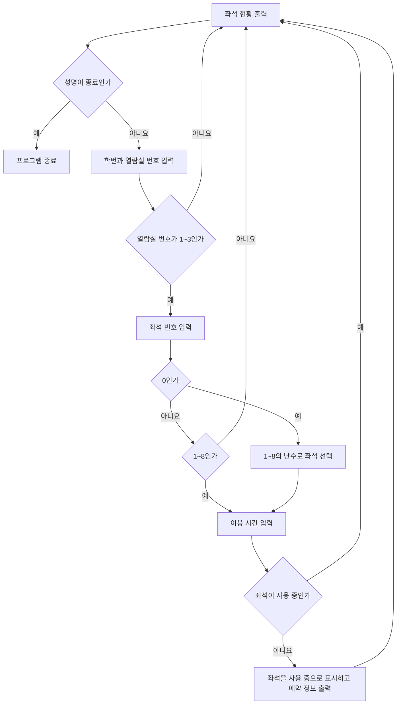

# 자율 발표 프로젝트 — 도서관 열람실 좌석 예약 시스템

[레포지토리 안내](../../README.ko.md) | [English](README.md) | [한국어](README.ko.md)

> **최종 수정일:** 2026-11-04

---

## 목차

- [개요](#개요)
- [기능](#기능)
- [파일 구성](#파일-구성)
- [실행 방법](#실행-방법)
- [동작 방식](#동작-방식)
- [실행 예시](#실행-예시)
- [한계와 개선 방향](#한계와-개선-방향)

## 개요

세종학술정보원(고려대학교 세종캠퍼스 도서관)의 열람실 좌석 예약을 본뜬 콘솔 프로그램으로, 7주차 자율 발표(2024-04-18)에서 소개했다. 대학 도서관 앱의 좌석 배정 기능과 입실 확인 안내를 바탕으로, 열람실 3곳에 좌석이 8개씩 있다고 가정하여 좌석 현황을 보여 주고 예약을 받는다.

프로그램은 3강의 리스트, 4강의 `if-elif-else`문, 5강의 `while`문과 `break`, `continue`, 그리고 `random` 모듈만으로 작성했다. 열람실마다 좌석 상태를 담은 리스트를 하나씩 두고, 무한 반복하는 `while True` 안에서 입력을 받아 리스트의 요소를 바꾸는 구조이다.

## 기능

- **좌석 현황 표시:** 매 반복의 처음에 세 열람실의 좌석 상태를 출력한다. 빈 좌석은 `○`, 사용 중인 좌석은 `●`이다.
- **예약자 정보 입력:** 성명과 학번을 입력받는다. 성명란에 `종료`를 입력하면 `break`로 반복을 끝내고 프로그램을 마친다.
- **열람실 선택:** 1\~3 중 하나를 입력받고, 범위를 벗어나면 안내 문구를 출력한 뒤 `continue`로 첫 화면으로 돌아간다.
- **좌석 선택과 무작위 배정:** 1\~8의 좌석 번호를 입력받으며, 0을 입력하면 `random.randint(1, 8)`로 좌석을 무작위로 고른다. 범위를 벗어난 번호는 거부한다.
- **중복 예약 방지:** 고른 좌석이 이미 `●`이면 안내 문구를 출력하고 첫 화면으로 돌아간다.
- **예약 확인:** 예약에 성공하면 좌석을 `●`로 바꾸고, 예약자 정보, 좌석 번호, 이용 시간, 10분 이내 입실 확인 안내를 출력한다.

## 파일 구성

| 파일 | 설명 |
|:-----|:-----|
| `library_seat_reservation.py` | 좌석 예약 프로그램 |
| `Presentation-Slides.pdf` | 발표 자료 (27쪽: 문제 풀이 과정, 전체 코드 설명, 실행 결과, 셀프 피드백) |
| `Presentation-Script.pdf` | 쪽마다 발표 내용을 적은 발표 스크립트 |

## 실행 방법

표준 라이브러리만 쓰므로 파이썬 3에서 바로 실행된다.

```bash
cd Coursework/Project_Library-Seat-Reservation-System
python3 library_seat_reservation.py
```

## 동작 방식

1. `seat1`, `seat2`, `seat3`을 빈 좌석 `○` 8개로 이루어진 리스트로 초기화한다. 리스트의 인덱스 0\~7이 좌석 번호 1\~8에 대응한다.
2. `while True`로 무한 반복하며, 반복마다 세 리스트를 출력하여 현황을 보여 준다.
3. 성명을 입력받아 `종료`이면 `break`로 반복을 빠져나온다. 그렇지 않으면 학번과 열람실 번호 `libnum`을 정수로 입력받는다.
4. `libnum`에 따라 `if-elif-else`로 세 갈래 중 하나로 간다. 1\~3이 아니면 `else` 블록이 안내 문구를 출력하고 `continue`로 2단계로 돌아간다.
5. 좌석 번호 `select`를 입력받는다. 0이면 1\~8의 난수로 바꾸고, 0보다 작거나 8보다 크면 안내 후 `continue`한다.
6. 이용 시간 `time`을 입력받은 뒤 `seat[select-1]`이 `●`인지 검사한다. 사용 중이면 안내 후 `continue`하고, 비어 있으면 `●`로 바꾸어 예약을 확정하고 확인 메시지를 출력한다.



*그림 1. 예약 한 건의 처리 흐름*

## 실행 예시

제1열람실 4번 좌석을 3시간 예약한 뒤, 제3열람실에 없는 9번 좌석과 없는 4번 열람실을 차례로 입력하고 종료한 실행이다. 성명과 학번은 예시 값이다. 두 번째 현황 이후의 같은 화면은 생략했다.

```text
=======================================================
            [ 세종학술정보원 열람실 예약 시스템 ]

   제1열람실  ['○', '○', '○', '○', '○', '○', '○', '○']
   제2열람실  ['○', '○', '○', '○', '○', '○', '○', '○']
   제3열람실  ['○', '○', '○', '○', '○', '○', '○', '○']
=======================================================
                 시스템을 종료하시려면 성명란에 '종료'를 입력하세요.

예약자 성명을 입력해주세요: 홍길동
예약자 학번을 입력해주세요: 20240001
예약하실 열람실을 선택해주세요(1~3): 1
제1열람실을 선택하였습니다.
예약하실 좌석 번호(1~8)를 입력해주세요.
0을 입력하면 무작위로 배정됩니다: 4
이용하실 시간을 입력해주세요: 3

[ 예약자 정보 ]
성명:  홍길동
학번:  20240001

4 번 좌석이 3 시간 예약되었습니다.
좌석예약 후 10분 이내에 입실확인하시기 바랍니다.
1. 앱 실행 및 블루투스 활성화 후 인증
2. 키오스크를 통한 학생증 인증

=======================================================
            [ 세종학술정보원 열람실 예약 시스템 ]

   제1열람실  ['○', '○', '○', '●', '○', '○', '○', '○']
   제2열람실  ['○', '○', '○', '○', '○', '○', '○', '○']
   제3열람실  ['○', '○', '○', '○', '○', '○', '○', '○']
=======================================================
                 시스템을 종료하시려면 성명란에 '종료'를 입력하세요.

예약자 성명을 입력해주세요: 홍길동
예약자 학번을 입력해주세요: 20240001
예약하실 열람실을 선택해주세요(1~3): 3
제3열람실을 선택하였습니다.
예약하실 좌석 번호(1~8)를 입력해주세요.
0을 입력하면 무작위로 배정됩니다: 9
유효하지 않은 좌석 번호입니다. 다시 한 번 확인해주세요.
(현황 화면 생략)
예약자 성명을 입력해주세요: 홍길동
예약자 학번을 입력해주세요: 20240001
예약하실 열람실을 선택해주세요(1~3): 4
유효하지 않은 열람실 번호입니다. 다시 한 번 확인해주세요.
(현황 화면 생략)
예약자 성명을 입력해주세요: 종료
```

## 한계와 개선 방향

발표의 셀프 피드백에서 정리한 개선 과제와, 코드에서 확인되는 한계는 다음과 같다.

1. **퇴실과 남은 시간:** 퇴실 기능이 없어 한 번 `●`가 된 좌석은 프로그램이 끝날 때까지 비지 않는다. 입력받은 이용 시간 `time`도 출력에만 쓰이고 저장되지 않으므로 좌석별 남은 시간을 보여 주려면 좌석마다 예약 정보를 따로 저장해야 한다.
2. **열람실의 무작위 배정:** 지금은 좌석만 무작위로 고를 수 있다. 열람실 번호에도 0을 허용하여 열람실까지 무작위로 고르는 기능을 더할 수 있다.
3. **반복되는 코드:** 세 열람실의 분기는 리스트 이름만 다르고 내용이 같다. 세 리스트를 하나의 2차원 리스트 `seats`에 담고 `room = seats[libnum - 1]`로 고르면 세 분기를 하나로 합칠 수 있다(7강의 2차원 리스트).
4. **무작위 배정의 충돌:** `random.randint(1, 8)`은 사용 중인 좌석도 고를 수 있으므로, 8석 중 $k$석이 사용 중이면 무작위 배정은 $k/8$의 확률로 실패하고 첫 화면으로 돌아간다. 빈 좌석의 번호만 모은 리스트에서 `random.choice()`로 고르면 빈 좌석이 남아 있는 한 실패하지 않는다.
5. **입력 오류:** 학번, 열람실 번호, 좌석 번호, 이용 시간에 수가 아닌 문자열을 입력하면 `int()`가 `ValueError`를 일으켜 프로그램이 멈춘다. 이용 시간이 0 이하인지도 검사하지 않는다.

다음은 3번과 4번을 반영하여 좌석 선택 부분을 다시 쓴 예이다.

```python
seats = [["○"] * 8 for _ in range(3)]       # 열람실 3곳 x 좌석 8개

room = seats[libnum - 1]                     # 고른 열람실의 좌석 리스트
if select == 0:
    empty = [i + 1 for i in range(8) if room[i] == "○"]
    if not empty:
        print("빈 좌석이 없습니다.")
        continue
    select = random.choice(empty)            # 빈 좌석 중에서만 고름
```

`["○"] * 8 for _ in range(3)`은 열람실마다 새 리스트를 만들므로, 한 열람실의 좌석을 바꾸어도 다른 열람실에 영향을 주지 않는다.
