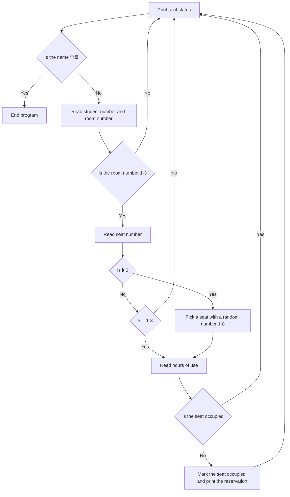

# Voluntary Presentation Project — Library Reading Room Seat Reservation System

[Repository Guide](../../README.md) | [English](README.md) | [한국어](README.ko.md)

> **Last Updated:** 2026-11-04

---

## Table of Contents

- [Overview](#overview)
- [Features](#features)
- [File Structure](#file-structure)
- [How to Run](#how-to-run)
- [How It Works](#how-it-works)
- [Example Run](#example-run)
- [Limitations and Improvements](#limitations-and-improvements)

## Overview

A console program modeled on the reading room seat reservation of the Sejong Academic Information Center (the library of Korea University Sejong Campus), introduced in the voluntary presentation of week 7 (2024-04-18). Based on the seat assignment feature and check-in guidance of the university library app, it assumes three reading rooms with eight seats each, shows the seat status, and takes reservations.

The program is written only with the lists of Lecture 3, the `if-elif-else` statement of Lecture 4, the `while` statement with `break` and `continue` of Lecture 5, and the `random` module. It keeps one list of seat states per reading room and, inside an endless `while True` loop, reads input and changes the elements of the lists.

## Features

- **Seat status display:** At the start of every iteration, the program prints the seat states of the three reading rooms. An empty seat is `○` and an occupied seat is `●`.
- **Reserver information:** The program reads a name and a student number. Entering `종료` (quit) in the name field ends the loop with `break` and finishes the program.
- **Reading room selection:** The program reads one of 1-3, and for an out-of-range number it prints a notice and returns to the first screen with `continue`.
- **Seat selection and random assignment:** The program reads a seat number from 1-8, and an input of 0 picks a seat at random with `random.randint(1, 8)`. Out-of-range numbers are rejected.
- **Preventing double booking:** If the chosen seat is already `●`, the program prints a notice and returns to the first screen.
- **Reservation confirmation:** On success, the program changes the seat to `●` and prints the reserver information, the seat number, the hours of use, and a reminder to confirm check-in within 10 minutes.

## File Structure

| File | Description |
|:-----|:-----|
| `library_seat_reservation.py` | The seat reservation program |
| `Presentation-Slides.pdf` | Presentation slides (27 pages: problem-solving process, full code walkthrough, run results, self-feedback) |
| `Presentation-Script.pdf` | Presentation script with the talk for each slide |

## How to Run

The program uses only the standard library, so it runs directly under Python 3.

```bash
cd Coursework/Project_Library-Seat-Reservation-System
python3 library_seat_reservation.py
```

## How It Works

1. `seat1`, `seat2`, and `seat3` are initialized as lists of eight empty seats `○`. List indices 0-7 correspond to seat numbers 1-8.
2. An endless `while True` loop prints the three lists on every iteration to show the status.
3. The program reads a name and leaves the loop with `break` if it is `종료`. Otherwise it reads the student number and the reading room number `libnum` as integers.
4. Depending on `libnum`, `if-elif-else` takes one of three branches. If it is not 1-3, the `else` block prints a notice and `continue` returns to step 2.
5. The program reads the seat number `select`. If it is 0, it is replaced by a random number from 1-8, and if it is less than 0 or greater than 8, the program prints a notice and continues.
6. After reading the hours of use `time`, the program checks whether `seat[select-1]` is `●`. If the seat is occupied, it prints a notice and continues, and if it is empty, it changes the seat to `●`, confirming the reservation, and prints the confirmation message.



*Figure 1. Processing flow of one reservation*

## Example Run

A run that reserves seat 4 of Reading Room 1 for three hours, then enters the nonexistent seat 9 in Reading Room 3 and the nonexistent Reading Room 4, and quits. The name and student number are example values. Identical status screens after the second one are omitted.

```text
=======================================================
            [ 세종학술정보원 열람실 예약 시스템 ]

   제1열람실  ['○', '○', '○', '○', '○', '○', '○', '○']
   제2열람실  ['○', '○', '○', '○', '○', '○', '○', '○']
   제3열람실  ['○', '○', '○', '○', '○', '○', '○', '○']
=======================================================
                 시스템을 종료하시려면 성명란에 '종료'를 입력하세요.

예약자 성명을 입력해주세요: 홍길동
예약자 학번을 입력해주세요: 20240001
예약하실 열람실을 선택해주세요(1~3): 1
제1열람실을 선택하였습니다.
예약하실 좌석 번호(1~8)를 입력해주세요.
0을 입력하면 무작위로 배정됩니다: 4
이용하실 시간을 입력해주세요: 3

[ 예약자 정보 ]
성명:  홍길동
학번:  20240001

4 번 좌석이 3 시간 예약되었습니다.
좌석예약 후 10분 이내에 입실확인하시기 바랍니다.
1. 앱 실행 및 블루투스 활성화 후 인증
2. 키오스크를 통한 학생증 인증

=======================================================
            [ 세종학술정보원 열람실 예약 시스템 ]

   제1열람실  ['○', '○', '○', '●', '○', '○', '○', '○']
   제2열람실  ['○', '○', '○', '○', '○', '○', '○', '○']
   제3열람실  ['○', '○', '○', '○', '○', '○', '○', '○']
=======================================================
                 시스템을 종료하시려면 성명란에 '종료'를 입력하세요.

예약자 성명을 입력해주세요: 홍길동
예약자 학번을 입력해주세요: 20240001
예약하실 열람실을 선택해주세요(1~3): 3
제3열람실을 선택하였습니다.
예약하실 좌석 번호(1~8)를 입력해주세요.
0을 입력하면 무작위로 배정됩니다: 9
유효하지 않은 좌석 번호입니다. 다시 한 번 확인해주세요.
(status screen omitted)
예약자 성명을 입력해주세요: 홍길동
예약자 학번을 입력해주세요: 20240001
예약하실 열람실을 선택해주세요(1~3): 4
유효하지 않은 열람실 번호입니다. 다시 한 번 확인해주세요.
(status screen omitted)
예약자 성명을 입력해주세요: 종료
```

## Limitations and Improvements

The improvement items listed in the self-feedback of the presentation and the limitations visible in the code are as follows.

1. **Checkout and remaining time:** There is no checkout feature, so a seat that has become `●` stays occupied until the program ends. The entered hours of use `time` are only printed and not stored, so showing the remaining time of each seat requires storing the reservation information of each seat separately.
2. **Random reading room assignment:** Currently only the seat can be chosen at random. Allowing 0 for the reading room number as well would add random assignment of the reading room.
3. **Repeated code:** The three reading room branches differ only in the list name and are otherwise identical. Putting the three lists into one 2D list `seats` and choosing with `room = seats[libnum - 1]` merges the three branches into one (2D lists of Lecture 7).
4. **Collisions in random assignment:** `random.randint(1, 8)` can also pick an occupied seat, so if $k$ of the 8 seats are occupied, random assignment fails with probability $k/8$ and returns to the first screen. Picking with `random.choice()` from a list of the numbers of empty seats only never fails as long as an empty seat remains.
5. **Input errors:** Entering a non-numeric string for the student number, room number, seat number, or hours of use makes `int()` raise a `ValueError` and stops the program. Whether the hours of use are 0 or less is not checked either.

The following example rewrites the seat selection part to reflect items 3 and 4.

```python
seats = [["○"] * 8 for _ in range(3)]       # 3 reading rooms x 8 seats

room = seats[libnum - 1]                     # seat list of the chosen room
if select == 0:
    empty = [i + 1 for i in range(8) if room[i] == "○"]
    if not empty:
        print("빈 좌석이 없습니다.")
        continue
    select = random.choice(empty)            # pick only among empty seats
```

`["○"] * 8 for _ in range(3)` creates a new list for each reading room, so changing a seat in one reading room does not affect the others.
