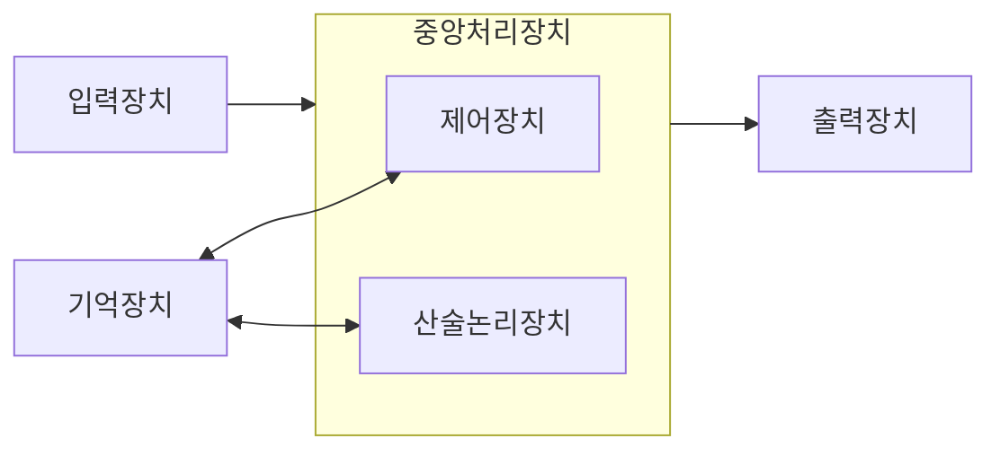
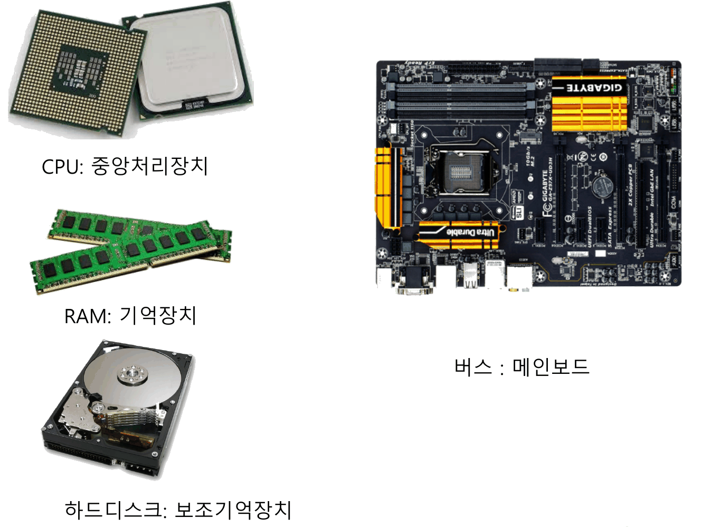
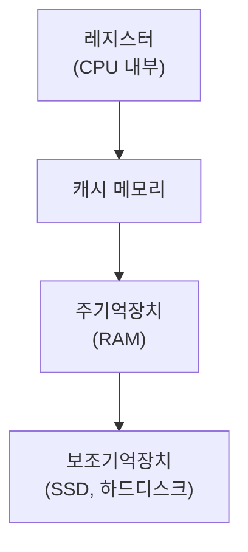
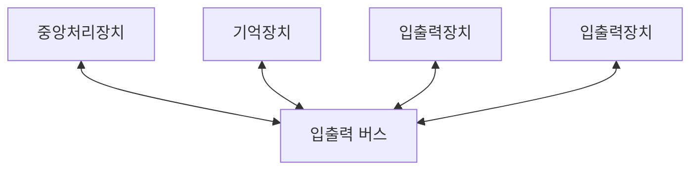
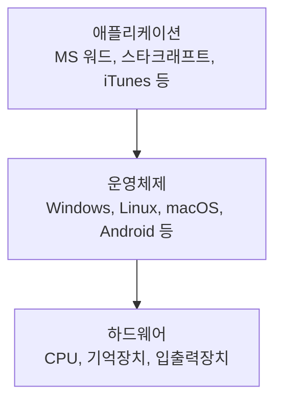
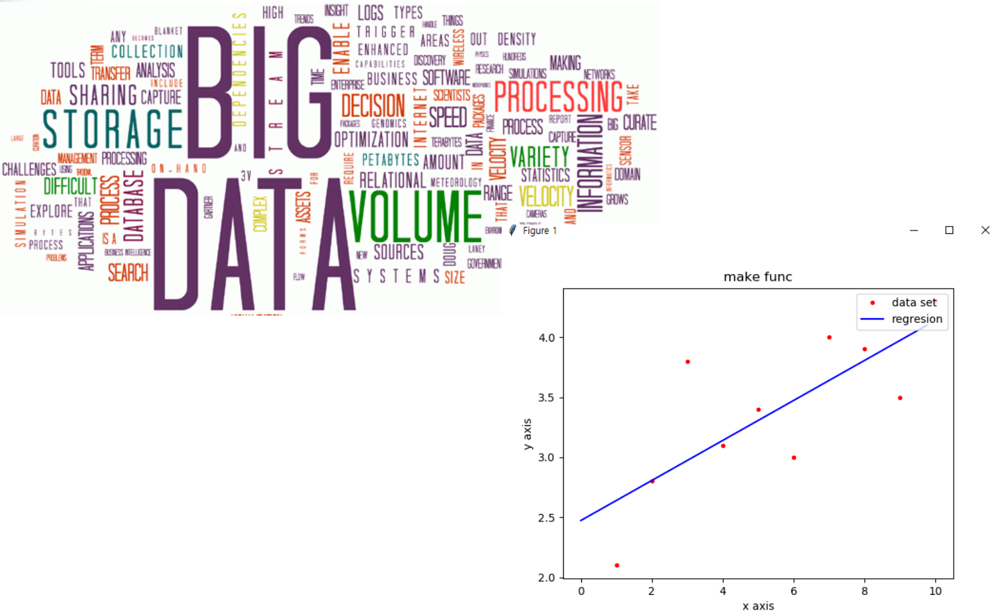
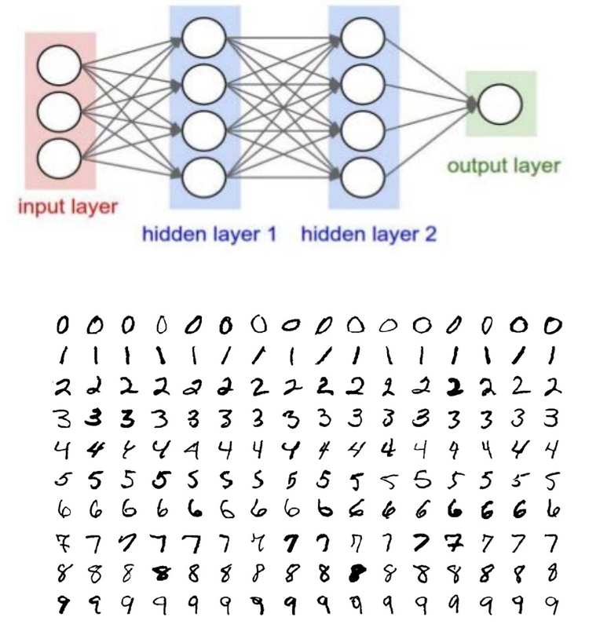

# 1강 — 컴퓨터 구조와 파이썬 소개

[레포지토리 안내](../../README.ko.md) | [English](Concepts_Lecture.md) | [한국어](Concepts_Lecture.ko.md)

> **최종 수정일:** 2026-11-04

> **학습 목표:**
> 1. 폰 노이만 구조의 구성 요소와 프로그램 내장 방식을 설명할 수 있다
> 2. 제어장치와 산술논리장치가 명령어를 인출, 해독, 실행, 저장하는 과정을 단계별로 설명할 수 있다
> 3. 캐시 메모리, 주기억장치, 보조기억장치를 속도, 가격, 용량, 휘발성으로 비교할 수 있다
> 4. 버스, 운영체제, 애플리케이션이 하드웨어와 맺는 관계를 설명할 수 있다
> 5. 컴파일 방식과 인터프리트 방식을 실행 속도와 이식성으로 비교하고 파이썬의 실행 방식을 설명할 수 있다
> 6. 계산, 회귀분석, 딥러닝을 예로 들어 파이썬의 활용 분야를 설명할 수 있다

---

## 목차

- [1. 파이썬 프로그래밍 학습의 개요](#1-파이썬-프로그래밍-학습의-개요)
- [2. 폰 노이만 구조](#2-폰-노이만-구조)
  - [2.1 구성 요소와 프로그램 내장 방식](#21-구성-요소와-프로그램-내장-방식)
  - [2.2 실제 컴퓨터의 부품](#22-실제-컴퓨터의-부품)
- [3. 중앙처리장치](#3-중앙처리장치)
  - [3.1 산술논리장치와 제어장치](#31-산술논리장치와-제어장치)
  - [3.2 명령어의 실행 과정](#32-명령어의-실행-과정)
- [4. 기억장치](#4-기억장치)
- [5. 입출력장치와 버스](#5-입출력장치와-버스)
- [6. 운영체제와 애플리케이션](#6-운영체제와-애플리케이션)
- [7. 프로그래밍 언어](#7-프로그래밍-언어)
  - [7.1 프로그래밍 언어와 기계어](#71-프로그래밍-언어와-기계어)
  - [7.2 컴파일 방식과 인터프리트 방식](#72-컴파일-방식과-인터프리트-방식)
- [8. 파이썬의 활용](#8-파이썬의-활용)
  - [8.1 계산기](#81-계산기)
  - [8.2 통계 기반의 회귀분석](#82-통계-기반의-회귀분석)
  - [8.3 딥러닝](#83-딥러닝)
- [개념 적용](#개념-적용)
- [요약](#요약)
- [점검 문제](#점검-문제)
- [참고 문헌](#참고-문헌)

---

<br>

## 1. 파이썬 프로그래밍 학습의 개요

**파이썬(Python)** 은 귀도 반 로섬(Guido van Rossum)이 1990년대 초에 만든 범용 고급 프로그래밍 언어이다 [1]. 문법이 간결하여 코드를 읽기 쉽고, 웹 개발, 데이터 분석, 과학 계산, 인공지능, 교육처럼 광범위한 분야에서 쓰이는 대표적인 프로그래밍 언어이다.

이 과목은 세 가지 능력을 기르는 것을 목표로 한다. 첫째는 파이썬 언어 자체에 대한 이해이고, 둘째는 프로그래밍의 기본 개념을 이해하여 다른 사람이 작성한 프로그램을 분석하는 능력이며, 셋째는 새로운 아이디어를 프로그램으로 구현하는 능력이다. 이를 위해 프로그래밍의 기초에서 시작하여 선택 구조(조건문), 반복 구조(반복문), 함수, 객체의 순서로 개념을 쌓아 가며, 각 개념은 그 개념을 연습하는 프로그램과 함께 다룬다. C 언어와 비교하면 파이썬의 특징이 분명해지는 곳에서는 두 언어의 차이도 함께 설명한다.

| 단원 | 주제 | 주요 내용 |
|:-----|:-----|:-----|
| 1강 | 컴퓨터 구조와 파이썬 소개 | 폰 노이만 구조, 중앙처리장치, 기억장치, 입출력장치, 운영체제, 프로그래밍 언어의 실행 방식, 파이썬의 활용 분야 |
| 2강 | 파이썬 시작하기 | 파이썬 설치와 IDLE, `print()`와 `input()`, 터틀 그래픽, 변수, 산술 연산자, 연산자 우선순위 |
| 3강 | 자료의 종류 | 자료형과 자료형 변환, 문자열의 접합, 반복, 형식화, 인덱싱과 슬라이싱, 이스케이프 시퀀스, 리스트의 기초 |
| 4강 | 조건문 | 기본 제어 구조, 관계 연산자와 논리 연산자, `if-else`문과 `if-elif-else`문, 중첩 `if`문, 난수 |
| 5강 | 반복문 | `for`문과 `range()`, 시퀀스의 순회, 누적 패턴, `while`문, 중첩 반복, `break`와 `continue` |
| 6강 | 함수 | 함수의 정의와 호출, 매개변수와 인수, 반환값, 변수의 유효 범위, 디폴트 인수와 키워드 인수, 무명 함수, 모듈 |
| 7강 | 리스트와 딕셔너리 | 리스트의 연산, 리스트 컴프리헨션, 2차원 리스트, 튜플과 시퀀스 자료형, 리스트의 복사, 세트, 딕셔너리 |
| 8강 | 클래스와 객체 | 객체 지향 프로그래밍, 클래스와 인스턴스, 생성자, 메서드, 정보 은닉, 접근자와 설정자 |

*표 1. 단원별 주제와 주요 내용*

파이썬으로 프로그램을 작성하기 전에, 이 단원은 프로그램이 실행되는 무대인 컴퓨터의 구조(2~5절), 하드웨어와 프로그램을 잇는 운영체제(6절), 프로그램을 기술하는 프로그래밍 언어(7절)를 살펴보고, 파이썬으로 만들 수 있는 프로그램의 예(8절)를 소개한다.

---

<br>

## 2. 폰 노이만 구조

### 2.1 구성 요소와 프로그램 내장 방식

오늘날의 컴퓨터는 모양과 크기, 성능이 서로 달라도 기본 구조는 거의 같다. 1945년에 존 폰 노이만(John von Neumann)이 EDVAC이라는 컴퓨터의 설계를 정리한 보고서에서 기술한 구조를 그대로 따르기 때문이다 [2]. 이 구조를 **폰 노이만 구조(von Neumann architecture)** 라고 한다. 책상 위의 데스크톱 컴퓨터 본체도, 스마트폰도 이 구조를 따른다.



*그림 1. 폰 노이만 구조의 구성 요소와 데이터의 흐름*

폰 노이만 구조는 다음 네 부분으로 이루어진다.

- **중앙처리장치(central processing unit, CPU):** 모든 계산을 수행하는 장치이며, 계산을 맡는 산술논리장치와 계산을 지휘하는 제어장치로 이루어진다(3절).
- **기억장치(memory):** 실행할 명령어와 처리할 데이터를 저장한다(4절).
- **입력장치(input device):** 키보드나 마우스처럼 바깥 세계의 정보를 컴퓨터 안으로 들여보낸다(5절).
- **출력장치(output device):** 모니터나 프린터처럼 처리 결과를 바깥 세계로 내보낸다(5절).

> **용어 정의:** **프로그램 내장 방식(stored-program concept)** 은 컴퓨터가 수행할 명령어의 목록(프로그램)을 데이터와 같은 방식으로 기억장치에 저장해 두고, 중앙처리장치가 기억장치에서 명령어를 하나씩 꺼내 실행하는 방식이다. 이 방식이 아닌 계산 기계는 다른 계산을 하려면 배선이나 스위치를 바꾸어야 하지만, 프로그램 내장 방식 컴퓨터는 기억장치에 들어 있는 프로그램만 바꾸면 전혀 다른 일을 할 수 있다.

> **핵심:** 하나의 컴퓨터로 문서 작성, 게임, 파이썬 프로그램 실행을 모두 할 수 있는 것은 프로그램 내장 방식 덕분이다. 프로그래밍이란 결국 기억장치에 넣을 명령어의 목록을 만드는 일이다.

### 2.2 실제 컴퓨터의 부품

데스크톱 컴퓨터의 본체를 열면 폰 노이만 구조의 구성 요소에 해당하는 부품을 볼 수 있다.



*그림 2. 데스크톱 컴퓨터의 CPU, RAM, 메인보드, 하드디스크*

- **CPU:** 손톱만 한 반도체 칩이며, 뒷면의 수많은 접점으로 메인보드와 연결된다. 그림 왼쪽 위의 두 칩은 CPU의 뒷면과 윗면을 보여 준다.
- **RAM:** 기억장치 칩 여러 개를 길쭉한 기판에 붙인 모듈이며, 주기억장치로 쓰인다.
- **메인보드(mainboard):** 다른 부품을 꽂는 커다란 회로 기판이다. CPU, RAM, 하드디스크 같은 여러 모듈을 서로 연결하는 배선, 즉 **버스(bus)** 가 이 기판 위에 있다(5절).
- **하드디스크(hard disk):** 자성을 띤 원판(플래터)에 데이터를 기록하는 보조기억장치이다.

| 폰 노이만 구조의 구성 요소 | 실제 부품의 예 |
|:-----|:-----|
| 중앙처리장치 | CPU 칩 |
| 기억장치 | RAM(주기억장치), 하드디스크나 SSD(보조기억장치) |
| 입력장치 | 키보드, 마우스, 터치스크린 |
| 출력장치 | 모니터, 프린터, 스피커 |
| 구성 요소를 잇는 통로 | 메인보드 위의 버스 |

*표 2. 폰 노이만 구조의 구성 요소와 실제 부품의 대응*

---

<br>

## 3. 중앙처리장치

### 3.1 산술논리장치와 제어장치

컴퓨터가 수행하는 계산은 모두 **중앙처리장치(CPU)** 를 통해 이루어진다. 최근에는 그래픽 카드의 처리장치인 **GPU(graphics processing unit)** 를 계산에 활용하기도 한다. GPU는 단순한 계산 수천 개를 동시에 수행하도록 설계되어 있어, 같은 계산을 많은 데이터에 반복하는 그래픽 처리와 딥러닝(8.3절)에서 CPU보다 빠르다. CPU는 다음 두 장치로 이루어진다.

- **산술논리장치(arithmetic logic unit, ALU):** 덧셈, 뺄셈, 곱셈, 나눗셈 같은 **산술 연산**과, 참과 거짓(또는 1과 0)을 다루는 **논리 연산**을 수행하는 회로를 가진다. 두 수의 크기를 비교하여 참이나 거짓을 내는 일도 산술논리장치가 한다.
- **제어장치(control unit, CU):** 명령어를 읽고 해석하여 산술논리장치와 기억장치를 통제함으로써 계산을 수행하게 한다. 산술논리장치가 계산을 하는 손이라면 제어장치는 무엇을 계산할지 지시하는 지휘자이다.

> **[컴퓨터구조]** CPU 안에는 **레지스터(register)** 라는 작고 빠른 저장 공간이 여러 개 있다. 산술논리장치는 보통 레지스터에 있는 값으로 계산하고 결과도 레지스터에 둔다. 특히 **프로그램 카운터(program counter, PC)** 는 다음에 실행할 명령어가 기억장치의 어디에 있는지(주소)를 담는 레지스터이며, 제어장치는 명령어를 하나 인출할 때마다 이 값을 다음 명령어의 주소로 바꾼다 [3]. 레지스터의 구성과 명령어의 형식은 컴퓨터구조에서 다룬다.

### 3.2 명령어의 실행 과정

제어장치와 산술논리장치는 명령어 하나를 다음 다섯 단계로 처리한다.

1. **인출(fetch):** 제어장치가 기억장치에서 명령어를 가져온다.
2. **해독(decode):** 제어장치가 가져온 명령어의 뜻을 해석한다.
3. **제어:** 제어장치가 해독한 명령어에 따라 산술논리장치로 데이터를 옮기고, 어떤 연산을 수행할지 지시한다.
4. **실행(execute):** 산술논리장치가 제어장치가 지시한 대로 계산을 수행한다.
5. **저장(store):** 수행한 결과를 기억장치에 다시 저장한다.


*그림 3. 명령어 하나를 처리하는 다섯 단계와 그 반복*

1~3단계는 제어장치가, 4단계는 산술논리장치가 수행하며, 5단계에서 결과가 기억장치로 돌아간다. 한 명령어의 처리가 끝나면 다음 명령어로 넘어가 같은 과정을 반복한다. 이 반복을 **명령어 사이클(instruction cycle)** 이라고 하며, 현대의 CPU는 이를 1초에 수십억 번 수행한다.

**예: `c = a + b`의 실행.** 기억장치의 100번지에 `a`의 값 3, 101번지에 `b`의 값 4가 들어 있고, 100번지와 101번지의 값을 더해 102번지에 저장하라는 뜻의 명령어가 기억장치에 들어 있다고 가정한다. 다섯 단계는 다음과 같이 진행된다.

| 단계 | 수행 장치 | 하는 일 | 이 예에서의 동작 |
|:-----|:-----|:-----|:-----|
| 1. 인출 | 제어장치 | 명령어를 가져온다 | 덧셈 명령어를 기억장치에서 읽어 온다 |
| 2. 해독 | 제어장치 | 명령어를 해석한다 | 100번지와 101번지의 값을 더해 102번지에 넣으라는 뜻임을 알아낸다 |
| 3. 제어 | 제어장치 | 데이터를 옮기고 연산을 지시한다 | 3과 4를 산술논리장치로 옮기고 덧셈을 지시한다 |
| 4. 실행 | 산술논리장치 | 계산한다 | 3 + 4 = 7을 계산한다 |
| 5. 저장 | 기억장치 | 결과를 저장한다 | 7을 102번지(`c`)에 기록한다 |

*표 3. `c = a + b`에 해당하는 명령어를 처리하는 다섯 단계*

> **참고:** 표 3은 이해를 돕기 위해 단순화한 모형이다. 실제 CPU에서는 이 계산이 보통 100번지의 값을 레지스터로 읽기, 101번지의 값을 다른 레지스터로 읽기, 두 레지스터의 값을 더하기, 결과를 102번지에 쓰기처럼 여러 개의 기계어 명령어로 나뉘며, 계산 결과는 기억장치에 저장하지 않고 레지스터에 남겨 두었다가 다음 계산에 바로 쓰기도 한다 [3]. 파이썬의 문장 한 줄도 실행될 때는 이런 기계어 명령어 여러 개로 처리된다.

---

<br>

## 4. 기억장치

**기억장치(memory)** 는 데이터와 함께 명령어를 저장하는 역할을 한다. 기억장치는 CPU와의 거리에 따라 다음과 같이 나뉜다.

- **캐시 메모리(cache memory):** CPU와 가장 가까이에 있는 기억장치이다. 최근의 CPU는 캐시를 칩 안에 둔다. 성능이 좋지만 가격이 비싸서 용량이 작다. CPU가 자주 쓰는 데이터를 주기억장치에서 미리 복사해 두어, 느린 주기억장치까지 가는 횟수를 줄인다.
- **주기억장치(main memory):** 캐시 메모리 아래에 위치한 기억장치이며, 대개 **램(RAM, random access memory)** 으로 구성한다. 실행 중인 프로그램과 그 프로그램이 다루는 데이터가 여기에 올라간다.
- **보조기억장치(secondary storage):** CPU로부터 가장 멀리 떨어져 있는 기억장치이다. 성능이 낮지만 가격도 낮아서 큰 용량을 갖출 수 있다. 하드디스크가 대세였지만 메모리 기술이 발전하면서 **플래시 메모리(flash memory)** 와 이를 이용한 **SSD(solid state drive)** 가 부상하였다.



*그림 4. CPU에서 가까운 순서로 나열한 기억장치의 계층*

그림 4의 아래로 내려갈수록 접근 속도는 느려지고, 같은 용량의 가격은 싸지며, 갖출 수 있는 용량은 커진다. 이처럼 빠르고 비싼 기억장치를 CPU 가까이에 조금, 느리고 싼 기억장치를 멀리에 많이 두는 구성을 **기억장치 계층(memory hierarchy)** 이라고 한다.

표 4는 기억장치마다 쓰이는 대표적인 기술과 2012년 기준의 접근 시간, 가격을 정리한 것이다 [3].

| 기억장치 | 대표적인 기술 | 접근 시간 | 1 GiB당 가격 (2012년) | 전원을 끄면 |
|:-----|:-----|:-----|:-----|:-----|
| 캐시 메모리 | SRAM | 0.5~2.5 ns | 500~1,000달러 | 내용이 사라진다 |
| 주기억장치 | DRAM | 50~70 ns | 10~20달러 | 내용이 사라진다 |
| 보조기억장치 (SSD) | 플래시 메모리 | 5,000~50,000 ns | 0.75~1.00달러 | 내용이 남는다 |
| 보조기억장치 (하드디스크) | 자기 디스크 | 5,000,000~20,000,000 ns | 0.05~0.10달러 | 내용이 남는다 |

*표 4. 기억장치별 대표적인 접근 시간, 가격, 휘발성*

표 4의 ns(나노초)는 10억분의 1초이다. 하드디스크의 접근 시간은 캐시의 수백만 배에 이르므로, 계층 구조 없이 모든 데이터를 하드디스크에서 읽는다면 CPU는 대부분의 시간을 기다리는 데 쓰게 된다.

> **용어 정의:** 전원이 꺼지면 저장된 내용이 사라지는 기억장치를 **휘발성(volatile)** 기억장치, 전원이 꺼져도 내용이 남는 기억장치를 **비휘발성(nonvolatile)** 기억장치라고 한다. 캐시와 RAM은 휘발성이고, SSD와 하드디스크는 비휘발성이다.

> **핵심:** RAM은 전원이 꺼지면 내용이 사라지므로, 프로그램이 처리한 결과 중 전원을 끈 뒤에도 남아야 하는 것은 보조기억장치에 파일로 저장해야 한다. 2강에서 파이썬 코드를 소스 파일로 저장하는 이유도 여기에 있다.

---

<br>

## 5. 입출력장치와 버스

입출력장치는 컴퓨터가 바깥 세계와 소통하는 수단이다.

| 종류 | 예 |
|:-----|:-----|
| 입력장치 | 마우스, 키보드, 터치스크린, 마이크, 게임패드, 동작 인식 장치 |
| 출력장치 | 모니터, 프린터, 3D 프린터, 스피커, 빔 프로젝터, E-Ink 전자 종이 |

*표 5. 입력장치와 출력장치의 예*

중앙처리장치, 기억장치, 입출력장치는 서로 데이터를 주고받아야 한다. 이때 쓰이는 컴퓨터의 정보 전송 회로를 **버스(bus)** 라고 하며, 입출력장치가 연결되는 버스를 **입출력 버스(I/O bus)** 라고 한다. 모든 장치가 하나의 공용 통로에 연결되어 있으므로, 새 장치를 추가할 때 다른 장치마다 따로 선을 이을 필요가 없다.



*그림 5. 중앙처리장치, 기억장치, 입출력장치를 연결하는 입출력 버스*

> **[컴퓨터구조]** 버스는 하는 일에 따라 기억장치나 장치의 위치(주소)를 전달하는 주소 버스, 실제 데이터를 전달하는 데이터 버스, 읽기와 쓰기 같은 제어 신호를 전달하는 제어 버스로 나누어 볼 수 있다. CPU가 기억장치의 값을 읽을 때는 주소 버스로 주소를 보내고, 제어 버스로 읽기 신호를 보낸 뒤, 데이터 버스로 값을 받는다. 버스와 입출력의 구조는 컴퓨터구조에서 다룬다.

---

<br>

## 6. 운영체제와 애플리케이션

**운영체제(operating system, OS)** 는 애플리케이션이 다양한 하드웨어(CPU, 기억장치, 입출력장치 등) 위에서 동작할 수 있도록 하는 시스템 소프트웨어이다. Windows, Linux, macOS, Android가 운영체제이고, 워드 프로세서, 게임, 음악 재생기처럼 사용자가 원하는 일을 하는 프로그램이 **애플리케이션(application)**, 곧 응용 프로그램이다.



*그림 6. 애플리케이션, 운영체제, 하드웨어의 계층*

운영체제는 애플리케이션에게 **API(application programming interface)** 를 제공하여, 운영체제가 제어하고 있는 하드웨어를 애플리케이션이 이용할 수 있게 한다. API는 파일 열기나 화면에 글자 쓰기처럼 운영체제가 정해 둔 기능의 목록과 그 사용 규칙이다. 애플리케이션은 하드웨어를 직접 다루지 않고 API를 호출하므로, 하드웨어의 제조사나 모델이 달라도 같은 애플리케이션이 동작한다. 파이썬의 `print()`가 화면에 글자를 출력할 때도 파이썬 인터프리터는 화면 장치를 직접 다루지 않고 운영체제가 제공하는 기능을 호출한다.

> **[운영체제]** 운영체제는 하드웨어를 애플리케이션이 쓰기 쉬운 형태로 감싸는 일 외에도, 여러 프로그램이 CPU를 나누어 쓰게 하는 프로세스 관리와 스케줄링, 각 프로그램에 기억장치를 나누어 주고 서로 침범하지 못하게 하는 메모리 관리, 보조기억장치의 데이터를 파일과 폴더로 정리하는 파일 시스템을 맡는다. 이러한 정책과 기법은 운영체제에서 다룬다.

---

<br>

## 7. 프로그래밍 언어

### 7.1 프로그래밍 언어와 기계어

소프트웨어는 프로그래밍 언어로 만든다. **프로그래밍 언어(programming language)** 는 프로그램을 작성하기 위해 만들어진 인공 언어 체계이다. 그런데 CPU가 직접 실행할 수 있는 것은 0과 1로 이루어진 명령어, 곧 **기계어(machine code)** 뿐이다. 사람이 읽고 쓰기 쉬운 파이썬이나 C 같은 고급 언어로 작성한 프로그램은 실행하기 전에 누군가 기계어로 번역해야 하며, 이 번역을 언제 어떻게 하는지에 따라 프로그래밍 언어를 두 방식으로 나눈다.

### 7.2 컴파일 방식과 인터프리트 방식

- **컴파일 방식(compiled):** **컴파일러(compiler)** 라는 프로그램이 실행 전에 소스 코드 전체를 CPU가 실행할 수 있는 기계어로 한꺼번에 번역해 둔다. 실행할 때는 번역된 기계어를 바로 실행한다.
- **인터프리트 방식(interpreted):** **인터프리터(interpreter)** 라는 프로그램이 애플리케이션을 실행할 때마다 소스 코드를 읽어 기계가 수행할 수 있는 형태로 번역하면서 실행한다.

| 방식 | 언어 | 실행 속도 | 이식성 |
|:-----|:-----|:-----|:-----|
| 컴파일 방식 | C, C++, 파스칼, 에이다 | CPU가 실행할 수 있는 기계어로 미리 컴파일되므로 빠르다. | 원래 애플리케이션이 개발된 CPU와 운영체제가 아닌 다른 CPU와 운영체제로 옮기는 경우, 대체로 코드를 그대로 사용할 수 없으므로 이식성이 낮다. C#, 자바처럼 가상 머신 기반의 언어는 이식성이 높다. |
| 인터프리트 방식 | 베이직, 파이썬, 루비, PHP, 펄 | 애플리케이션을 실행할 때마다 인터프리터가 소스 코드를 기계 코드로 번역하는 절차를 거치므로 느리다. | 인터프리터만 대상 CPU와 운영체제를 지원한다면 애플리케이션 코드는 변경할 필요 없이 어떤 환경에서나 실행할 수 있으므로 이식성이 높다. |

*표 6. 컴파일 방식과 인터프리트 방식의 실행 속도와 이식성*

> **용어 정의:** **이식성(portability)** 은 프로그램을 다른 CPU나 운영체제의 컴퓨터로 옮겨 실행하기 쉬운 정도이다. 컴파일 방식의 기계어는 특정 CPU와 운영체제를 위해 만들어지므로, 다른 환경에서 실행하려면 그 환경용으로 다시 컴파일해야 하고, 운영체제마다 다른 기능을 쓴 부분은 고쳐야 한다.

자바와 C#은 두 방식을 섞는다. 컴파일러가 소스 코드를 특정 CPU의 기계어가 아닌 중간 형태의 코드로 번역하고, 각 환경에 설치된 **가상 머신(virtual machine)** 이 이 중간 코드를 실행한다. 가상 머신만 있으면 같은 중간 코드가 어디에서나 실행되므로 이식성이 높다.

파이썬은 인터프리트 방식의 대표적인 언어이다. 파이썬 인터프리터는 Windows, macOS, Linux 등 주요 운영체제에 모두 있으므로, 한 번 작성한 파이썬 프로그램은 대부분 고치지 않고 다른 운영체제에서도 실행된다. 또 프로그래머가 CPU나 기억장치 같은 하드웨어의 세부 사항을 덜 신경 써도 되고, 문법이 사람의 언어에 가까워 처음 배우는 사람에게 친숙하다.

> **참고:** **파이썬의 바이트코드.** 표준 파이썬 인터프리터(CPython)는 소스 코드를 한 줄씩 곧바로 기계어로 바꾸지 않는다. 먼저 소스 코드 전체를 **바이트코드(bytecode)** 라는 중간 형태로 컴파일하고, 파이썬 가상 머신이 이 바이트코드를 한 명령씩 해석하여 실행한다. 다른 파일에서 불러 쓰는 모듈(6강)의 바이트코드는 `__pycache__` 폴더의 `.pyc` 파일로 저장해 두었다가 다음 실행에서 다시 쓴다 [4]. 따라서 파이썬을 인터프리트 방식으로 분류하는 것은 실행 전에 기계어 실행 파일을 미리 만들어 두지 않고, 실행할 때 인터프리터가 프로그램을 해석한다는 뜻이다.

---

<br>

## 8. 파이썬의 활용

### 8.1 계산기

파이썬으로는 간단한 계산기부터 데이터 분석과 인공지능 프로그램까지 만들 수 있다. 가장 간단한 예는 계산기이다. 계산기 프로그램이 구분선을 출력한 뒤 수식 `3+10*3`을 입력받아 `3+10*3= 39`를 출력하는 예를 생각할 수 있다. 이 계산기는 탁상용 계산기처럼 입력된 순서대로, 즉 앞에서부터 계산한다. 3 + 10 = 13을 먼저 구하고, 여기에 3을 곱하여 39를 얻는다.

그런데 파이썬에 같은 수식을 그대로 입력하면 결과가 다르다. 파이썬은 수학과 같이 곱셈을 덧셈보다 먼저 계산하기 때문이다(2강의 연산자 우선순위). `>>>`는 파이썬이 명령을 기다린다는 표시이며, 그 아래 줄이 파이썬이 출력한 결과이다.

```pycon
>>> 3 + 10 * 3
33
>>> (3 + 10) * 3
39
```

첫 번째 수식에서는 10 * 3 = 30을 먼저 계산하고 3 + 30 = 33을 얻는다. 앞에서부터 계산한 39를 얻으려면 두 번째 수식처럼 괄호로 3 + 10을 먼저 계산하게 해야 한다. 계산기 프로그램을 만들 때는 이처럼 어떤 순서로 계산할지를 프로그래머가 정해야 한다.

### 8.2 통계 기반의 회귀분석

파이썬은 많은 양의 데이터를 수집, 저장, 처리, 분석하는 데 널리 쓰인다. 저장 용량(volume), 처리 속도(velocity), 형태의 다양성(variety)이 기존 방법으로 다루기 어려울 만큼 큰 데이터를 **빅데이터(big data)** 라고 하며, 파이썬에는 이런 데이터를 다루는 라이브러리(NumPy, pandas, matplotlib 등)가 풍부하다. 통계 기반의 **회귀분석(regression analysis)** 은 그 대표적인 응용이다.



*그림 7. 빅데이터 관련 용어와 데이터에 맞춘 회귀 직선 그래프*

회귀분석은 한 변수(x)가 다른 변수(y)에 어떻게 관련되는지를 수식으로 나타내는 통계 기법이다. 그림 7의 오른쪽 그래프는 x가 1부터 9까지인 아홉 개의 데이터 점(빨간 점, data set)과, 이 점들에 가장 가깝게 그은 직선(파란 선, regression)을 matplotlib으로 그린 것이다. 이 직선을 회귀 직선이라고 하며, x가 커질수록 y도 대체로 커지는 경향을 보여 준다. 회귀 직선을 구하면 아직 관측하지 않은 x에 대한 y도 예측할 수 있다.

> **[기계학습]** 회귀 직선 $y = ax + b$는 보통 **최소제곱법(least squares method)** 으로 정한다. 각 데이터 점 $(x_i, y_i)$에서 직선까지의 세로 거리 $y_i - (ax_i + b)$를 오차로 보고, 오차의 제곱합 $\sum_i \left(y_i - (ax_i + b)\right)^2$을 가장 작게 만드는 $a$와 $b$를 고른다. 회귀 모델의 학습과 평가는 기계학습에서 다룬다.

### 8.3 딥러닝

**딥러닝(deep learning)** 은 여러 층으로 쌓은 인공 신경망으로 데이터의 특징을 스스로 학습하는 기계학습 방법이며, 파이썬은 딥러닝 연구와 개발에 널리 쓰이는 언어이다(PyTorch, TensorFlow 등의 라이브러리).



*그림 8. 은닉층이 두 개인 신경망과 손글씨 숫자 이미지*

그림 8 위쪽의 **신경망(neural network)** 은 원으로 나타낸 노드를 층으로 쌓은 구조이다. 데이터가 들어오는 **입력층(input layer)** 에 노드 3개, 중간 계산을 하는 **은닉층(hidden layer)** 두 개에 노드가 4개씩, 결과를 내는 **출력층(output layer)** 에 노드 1개가 있고, 화살표는 앞 층의 모든 노드에서 다음 층의 모든 노드로 이어진다. 각 화살표에는 가중치라는 수가 붙어 있으며, 학습은 데이터를 보고 이 가중치를 조정하는 과정이다. 은닉층을 여러 개 쌓아 층이 깊다는 데에서 딥러닝이라는 이름이 붙었다.

그림 8 아래쪽은 0부터 9까지의 손글씨 숫자 이미지이다. 이와 같은 손글씨 숫자를 모은 MNIST 데이터셋은 28 × 28 픽셀의 흑백 이미지로 이루어져 있으며, 학습용 60,000개와 시험용 10,000개가 있다 [5]. 신경망에 이미지의 픽셀 값을 입력하면 이미지가 어떤 숫자인지 분류하도록 학습시킬 수 있어, 딥러닝을 처음 배울 때 흔히 쓰는 예제이다.

> **[딥러닝]** 신경망의 가중치는 예측과 정답의 차이를 줄이는 방향으로 조금씩 고쳐 나가는 경사 하강법으로 학습하며, 각 가중치를 얼마나 고칠지는 출력층에서 입력층 쪽으로 오차를 거꾸로 전달하는 역전파(backpropagation)로 계산한다. 이미지 분류에 쓰는 CNN 같은 신경망 구조와 학습 기법은 딥러닝에서 다룬다.

---

<br>

## 개념 적용

**T/F 점검:**

| 문장 | 판단과 근거 |
|:-----|:------------|
| 폰 노이만 구조에서 프로그램은 데이터와 다른 별도의 장치에 저장된다. | **F.** 프로그램 내장 방식에서는 명령어와 데이터를 같은 기억장치에 저장한다. |
| 명령어를 해독하는 것은 산술논리장치이다. | **F.** 인출, 해독, 산술논리장치 제어는 제어장치가 하고, 산술논리장치는 지시받은 계산을 실행한다. |
| 캐시 메모리는 주기억장치보다 빠르지만 같은 용량의 가격이 비싸다. | **T.** 그래서 캐시는 CPU 가까이에 작은 용량만 두고, 자주 쓰는 데이터를 주기억장치에서 복사해 둔다. |
| 작성한 문서를 RAM에만 두면 전원을 꺼도 남아 있다. | **F.** RAM은 휘발성이므로 전원이 꺼지면 내용이 사라진다. 남겨야 할 데이터는 보조기억장치에 파일로 저장한다. |
| 애플리케이션은 운영체제가 제공하는 API로 하드웨어를 이용한다. | **T.** 애플리케이션이 하드웨어를 직접 다루지 않으므로 하드웨어가 달라도 같은 애플리케이션이 동작한다. |
| 컴파일 방식 언어는 인터프리트 방식 언어보다 대체로 이식성이 높다. | **F.** 컴파일된 기계어는 특정 CPU와 운영체제에 묶이므로 대체로 이식성이 낮다. 인터프리터만 있으면 실행되는 인터프리트 방식이 이식성이 높다. |
| 파이썬에서 `3 + 10 * 3`의 값은 39이다. | **F.** 곱셈을 먼저 계산하므로 33이다. 39를 얻으려면 `(3 + 10) * 3`으로 쓴다. |

---

<br>

## 요약

| 개념 | 핵심 요약 |
|:-----|:----------|
| 폰 노이만 구조 | 1945년 폰 노이만이 기술한 구조로, 중앙처리장치, 기억장치, 입력장치, 출력장치로 이루어지며 오늘날의 컴퓨터 대부분이 따른다. |
| 프로그램 내장 방식 | 명령어를 데이터와 함께 기억장치에 저장하고 하나씩 꺼내 실행하므로, 프로그램만 바꾸면 다른 일을 할 수 있다. |
| 중앙처리장치 | 모든 계산을 수행하며, 산술 연산과 논리 연산을 하는 산술논리장치와 이를 통제하는 제어장치로 이루어진다. |
| 명령어 사이클 | 인출, 해독, 제어, 실행, 저장의 다섯 단계로 명령어 하나를 처리하고, 다음 명령어로 넘어가 반복한다. |
| 기억장치 계층 | 캐시 메모리, 주기억장치(RAM), 보조기억장치(SSD, 하드디스크) 순으로 느려지고 싸지며 용량이 커진다. |
| 휘발성 | 캐시와 RAM은 전원이 꺼지면 내용이 사라지므로, 남겨야 할 데이터는 보조기억장치에 파일로 저장한다. |
| 입출력장치와 버스 | 입출력장치는 바깥 세계와 소통하는 수단이고, 버스는 중앙처리장치, 기억장치, 입출력장치를 잇는 정보 전송 회로이다. |
| 운영체제 | 애플리케이션이 하드웨어 위에서 동작하게 하는 시스템 소프트웨어이며, API로 하드웨어의 기능을 제공한다. |
| 컴파일 방식 | 실행 전에 기계어로 번역해 두므로 빠르지만, 다른 CPU와 운영체제로 옮기기 어려워 이식성이 낮다. |
| 인터프리트 방식 | 실행할 때마다 인터프리터가 번역하므로 느리지만, 인터프리터만 있으면 어디서나 실행되어 이식성이 높다. |
| 파이썬의 실행 | 표준 인터프리터는 소스 코드를 바이트코드로 컴파일한 뒤 가상 머신에서 실행한다. |
| 파이썬의 활용 | 계산기 같은 간단한 프로그램부터 회귀분석 같은 데이터 분석, 신경망을 이용한 딥러닝까지 폭넓게 쓰인다. |

---

<br>

## 점검 문제

1. **폰 노이만 구조:** 폰 노이만 구조의 네 구성 요소를 쓰고, 이 구조에서 프로그램을 바꾸기만 하면 같은 컴퓨터로 다른 일을 할 수 있는 이유를 설명하라.

   <details>
   <summary>정답</summary>

   네 구성 요소는 중앙처리장치(산술논리장치와 제어장치), 기억장치, 입력장치, 출력장치이다. 프로그램 내장 방식에 따라 명령어의 목록인 프로그램을 데이터와 함께 기억장치에 저장하고 중앙처리장치가 이를 하나씩 꺼내 실행하므로, 배선을 바꾸지 않고 기억장치의 프로그램만 바꾸면 수행하는 일이 바뀐다.

   </details>

2. **명령어 사이클:** 명령어 하나를 처리하는 다섯 단계를 순서대로 쓰고, 각 단계를 어느 장치가 수행하는지 밝혀라.

   <details>
   <summary>정답</summary>

   인출, 해독, 제어(산술논리장치에 데이터를 옮기고 연산을 지시), 실행, 저장의 순서이다. 인출, 해독, 제어는 제어장치가, 실행은 산술논리장치가 수행하고, 저장 단계에서 결과가 기억장치에 기록된다.

   </details>

3. **산술논리장치와 제어장치:** "두 수 중 어느 쪽이 큰지 비교한다"와 "다음에 실행할 명령어를 기억장치에서 가져온다"는 각각 어느 장치의 일인가?

   <details>
   <summary>정답</summary>

   비교는 결과로 참이나 거짓을 내는 연산이므로 산술논리장치가 수행한다. 명령어를 가져오는 인출은 제어장치의 일이다.

   </details>

4. **기억장치 계층:** 캐시 메모리, 주기억장치, 보조기억장치를 접근 속도가 빠른 순서로 나열하고, 기억장치를 한 종류로 통일하지 않고 계층으로 두는 이유를 설명하라.

   <details>
   <summary>정답</summary>

   캐시 메모리, 주기억장치, 보조기억장치의 순서이다. 빠른 기억장치는 같은 용량의 가격이 비싸고 느린 기억장치는 싸므로, 빠르고 비싼 기억장치를 CPU 가까이에 작게, 느리고 싼 기억장치를 멀리에 크게 두면 적은 비용으로 큰 용량과 빠른 접근을 함께 얻을 수 있다.

   </details>

5. **휘발성:** 문서 작성 프로그램에서 문서를 저장하지 않고 컴퓨터를 끄면 작성 중이던 내용이 사라지는 이유를 기억장치의 성질로 설명하라.

   <details>
   <summary>정답</summary>

   작성 중인 문서는 실행 중인 프로그램의 데이터로 주기억장치(RAM)에만 있다. RAM은 휘발성이어서 전원이 꺼지면 내용이 사라진다. 내용을 남기려면 파일로 저장하여 비휘발성인 보조기억장치에 기록해야 한다.

   </details>

6. **버스와 운영체제:** 버스와 운영체제가 각각 무엇과 무엇을 연결하는 역할을 하는지 비교하라.

   <details>
   <summary>정답</summary>

   버스는 중앙처리장치, 기억장치, 입출력장치 같은 하드웨어 장치끼리 데이터를 주고받게 하는 물리적인 정보 전송 회로이다. 운영체제는 애플리케이션과 하드웨어 사이에 놓인 시스템 소프트웨어로, API를 통해 애플리케이션이 하드웨어를 이용할 수 있게 한다.

   </details>

7. **컴파일과 인터프리트:** C로 작성한 프로그램의 실행 파일은 다른 운영체제에서 그대로 실행되지 않는 경우가 많지만, 파이썬 소스 파일은 대부분 그대로 실행된다. 그 이유를 설명하라.

   <details>
   <summary>정답</summary>

   C는 컴파일 방식이어서 실행 파일이 특정 CPU와 운영체제용 기계어로 이루어져 있으므로, 다른 환경에서는 다시 컴파일해야 한다. 파이썬은 인터프리트 방식이어서 각 환경에 설치된 인터프리터가 실행할 때마다 소스 코드를 해석하므로, 인터프리터가 그 환경을 지원하기만 하면 같은 소스 파일이 실행된다.

   </details>

8. **계산 순서:** 수식 `2 + 4 * 5`를 앞에서부터 계산하는 계산기와 파이썬은 각각 어떤 값을 내는가? 파이썬에서 앞의 계산기와 같은 값을 얻으려면 수식을 어떻게 고쳐야 하는가?

   <details>
   <summary>정답</summary>

   앞에서부터 계산하는 계산기는 2 + 4 = 6, 6 × 5 = 30을 낸다. 파이썬은 곱셈을 먼저 하여 4 * 5 = 20, 2 + 20 = 22를 낸다. 파이썬에서 30을 얻으려면 `(2 + 4) * 5`처럼 괄호를 쓴다.

   </details>

---

<br>

## 참고 문헌

1. Python Software Foundation, "History and License," *Python 3 Documentation*, accessed Nov. 4, 2026. https://docs.python.org/3/license.html
2. J. von Neumann, "First Draft of a Report on the EDVAC," Moore School of Electrical Engineering, University of Pennsylvania, Philadelphia, PA, USA, Jun. 1945.
3. D. A. Patterson and J. L. Hennessy, *Computer Organization and Design: The Hardware/Software Interface*, 5th ed. Waltham, MA, USA: Morgan Kaufmann, 2014.
4. Python Software Foundation, "Glossary," *Python 3 Documentation*, accessed Nov. 4, 2026. https://docs.python.org/3/glossary.html
5. Y. LeCun, L. Bottou, Y. Bengio, and P. Haffner, "Gradient-based learning applied to document recognition," *Proceedings of the IEEE*, vol. 86, no. 11, pp. 2278-2324, 1998.
