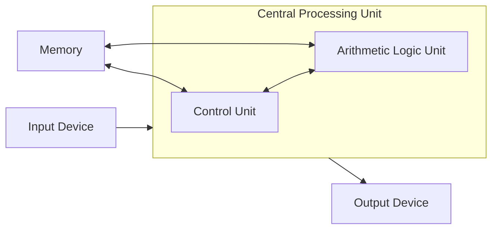
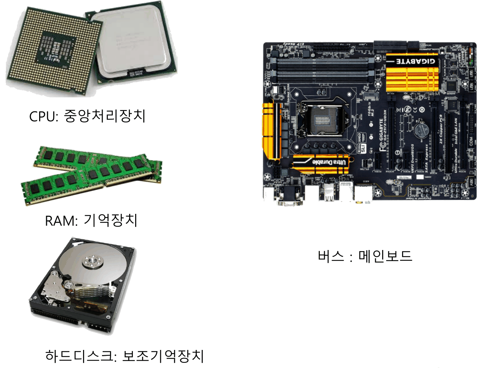
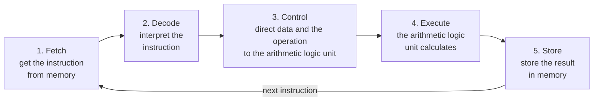
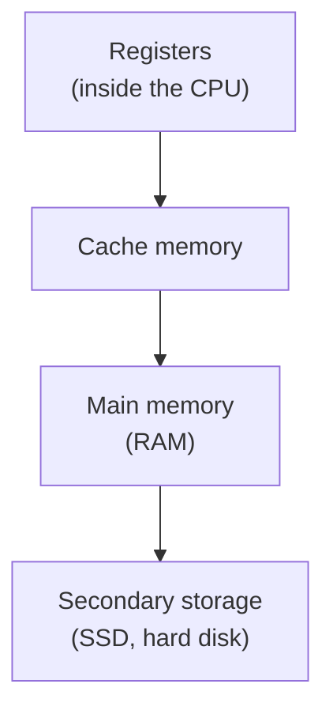
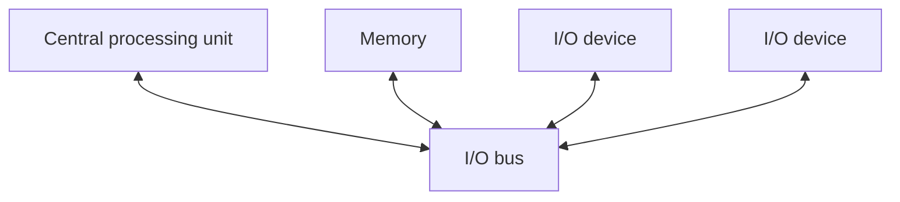
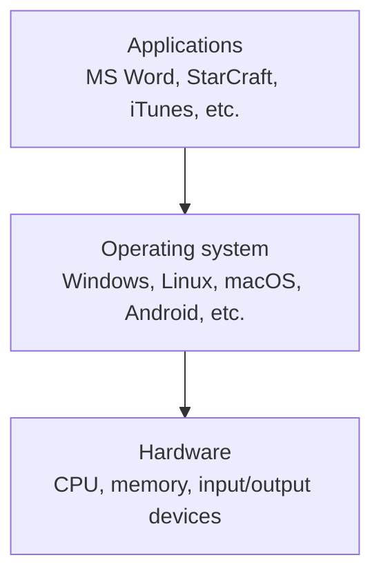
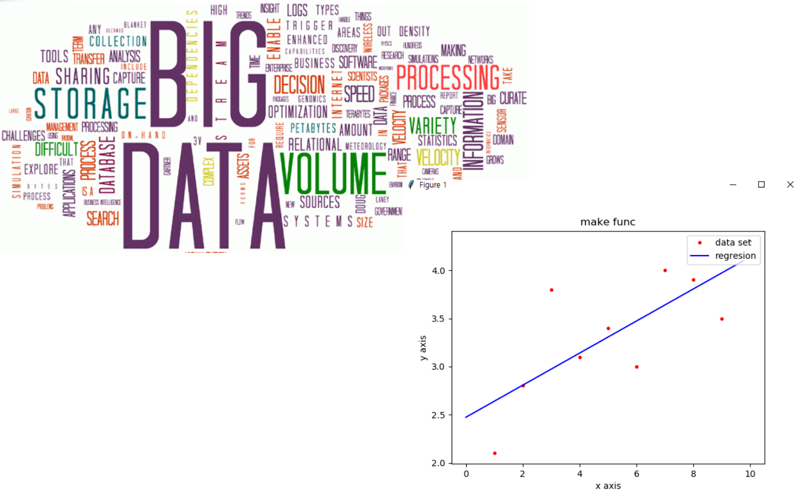
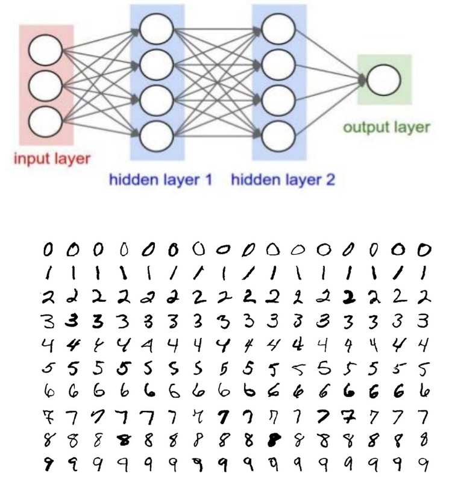

# Lecture 1 — Computer Architecture and Introduction to Python

[Repository Guide](../../README.md) | [English](Concepts_Lecture.md) | [한국어](Concepts_Lecture.ko.md)

> **Last Updated:** 2026-11-04

> **Learning Objectives:**
> 1. Explain the components of the von Neumann architecture and the stored-program concept
> 2. Describe step by step how the control unit and the arithmetic logic unit fetch, decode, execute, and store an instruction
> 3. Compare cache memory, main memory, and secondary storage in terms of speed, price, capacity, and volatility
> 4. Explain how the bus, the operating system, and applications relate to the hardware
> 5. Compare compiled and interpreted languages in terms of execution speed and portability, and explain how Python programs are executed
> 6. Describe the uses of Python with calculation, regression analysis, and deep learning as examples

---

## Table of Contents

- [1. Overview of Learning Python Programming](#1-overview-of-learning-python-programming)
- [2. The von Neumann Architecture](#2-the-von-neumann-architecture)
  - [2.1 Components and the Stored-Program Concept](#21-components-and-the-stored-program-concept)
  - [2.2 Parts of a Real Computer](#22-parts-of-a-real-computer)
- [3. The Central Processing Unit](#3-the-central-processing-unit)
  - [3.1 The Arithmetic Logic Unit and the Control Unit](#31-the-arithmetic-logic-unit-and-the-control-unit)
  - [3.2 How an Instruction Is Executed](#32-how-an-instruction-is-executed)
- [4. Memory](#4-memory)
- [5. Input/Output Devices and the Bus](#5-inputoutput-devices-and-the-bus)
- [6. Operating Systems and Applications](#6-operating-systems-and-applications)
- [7. Programming Languages](#7-programming-languages)
  - [7.1 Programming Languages and Machine Code](#71-programming-languages-and-machine-code)
  - [7.2 Compiled and Interpreted Languages](#72-compiled-and-interpreted-languages)
- [8. Uses of Python](#8-uses-of-python)
  - [8.1 A Calculator](#81-a-calculator)
  - [8.2 Statistical Regression Analysis](#82-statistical-regression-analysis)
  - [8.3 Deep Learning](#83-deep-learning)
- [Concept Applications](#concept-applications)
- [Summary](#summary)
- [Self-Check Questions](#self-check-questions)
- [References](#references)

---

<br>

## 1. Overview of Learning Python Programming

**Python** is a general-purpose, high-level programming language created by Guido van Rossum in the early 1990s [1]. Its concise syntax makes code easy to read, and it is a representative programming language used in a wide range of fields such as web development, data analysis, scientific computing, artificial intelligence, and education.

This course aims to develop three abilities. The first is an understanding of the Python language itself, the second is the ability to analyze programs written by others based on an understanding of the basic concepts of programming, and the third is the ability to implement new ideas as programs. To this end, the course starts from the basics of programming and builds up concepts in the order of selection structures (conditional statements), repetition structures (loops), functions, and objects, and each concept is covered together with programs that practice it. Where a comparison with the C language makes a feature of Python clearer, the difference between the two languages is also explained.

| Unit | Topic | Main Contents |
|:-----|:-----|:-----|
| Lecture 1 | Computer architecture and introduction to Python | von Neumann architecture, central processing unit, memory, input/output devices, operating systems, how programming languages are executed, uses of Python |
| Lecture 2 | Getting started with Python | Installing Python and IDLE, `print()` and `input()`, turtle graphics, variables, arithmetic operators, operator precedence |
| Lecture 3 | Kinds of data | Data types and type conversion, string concatenation, repetition, and formatting, indexing and slicing, escape sequences, list basics |
| Lecture 4 | Conditional statements | Basic control structures, relational and logical operators, `if-else` and `if-elif-else` statements, nested `if` statements, random numbers |
| Lecture 5 | Loops | The `for` statement and `range()`, traversing sequences, the accumulation pattern, the `while` statement, nested loops, `break` and `continue` |
| Lecture 6 | Functions | Defining and calling functions, parameters and arguments, return values, the scope of variables, default and keyword arguments, anonymous functions, modules |
| Lecture 7 | Lists and dictionaries | List operations, list comprehensions, two-dimensional lists, tuples and sequence types, copying lists, sets, dictionaries |
| Lecture 8 | Classes and objects | Object-oriented programming, classes and instances, constructors, methods, information hiding, getters and setters |

*Table 1. Topics and main contents of each unit*

Before writing programs in Python, this unit examines the structure of the computer, the stage on which programs run (Sections 2-5), the operating system that connects hardware and programs (Section 6), and the programming languages in which programs are written (Section 7), and then introduces examples of programs that can be built with Python (Section 8).

---

<br>

## 2. The von Neumann Architecture

### 2.1 Components and the Stored-Program Concept

Computers today differ in shape, size, and performance, but their basic structure is almost the same. This is because they follow the structure that John von Neumann described in 1945 in a report summarizing the design of a computer called EDVAC [2]. This structure is called the **von Neumann architecture**. Both the desktop computer on a desk and a smartphone follow it.



*Figure 1. Components of the von Neumann architecture and the flow of data*

The von Neumann architecture consists of the following four parts.

- **Central processing unit (CPU):** The device that performs all computation. It consists of the arithmetic logic unit, which does the calculations, and the control unit, which directs them (Section 3).
- **Memory:** Stores the instructions to execute and the data to process (Section 4).
- **Input device:** Like a keyboard or mouse, it brings information from the outside world into the computer (Section 5).
- **Output device:** Like a monitor or printer, it sends results out to the outside world (Section 5).

> **Definition:** The **stored-program concept** is the approach in which the list of instructions the computer is to perform (the program) is stored in memory in the same way as data, and the central processing unit takes the instructions out of memory one at a time and executes them. A calculating machine without this approach must have its wiring or switches changed to perform a different calculation, but a stored-program computer can do something entirely different simply by changing the program in its memory.

> **Key Point:** A single computer can be used for word processing, games, and running Python programs thanks to the stored-program concept. Programming is, in the end, the work of creating the list of instructions to put into memory.

### 2.2 Parts of a Real Computer

Opening the case of a desktop computer reveals parts that correspond to the components of the von Neumann architecture.



*Figure 2. The CPU, RAM, mainboard, and hard disk of a desktop computer*

- **CPU:** A part that holds a semiconductor chip in a square package smaller than a palm, connected to the mainboard through the many contacts on its underside. The two chips at the upper left of the figure show the underside and the top of a CPU.
- **RAM:** A module in which several memory chips are mounted on a long board. It is used as main memory.
- **Mainboard:** A large circuit board into which the other parts are plugged. The wiring that connects modules such as the CPU, RAM, and hard disk to one another, that is, the **bus**, is on this board (Section 5).
- **Hard disk:** A secondary storage device that records data on magnetized disks (platters).

| Component of the von Neumann Architecture | Example of a Real Part |
|:-----|:-----|
| Central processing unit | CPU chip |
| Memory | RAM (main memory), hard disk or SSD (secondary storage) |
| Input device | Keyboard, mouse, touchscreen |
| Output device | Monitor, printer, speaker |
| Pathway connecting the components | Bus on the mainboard |

*Table 2. Correspondence between the components of the von Neumann architecture and real parts*

---

<br>

## 3. The Central Processing Unit

### 3.1 The Arithmetic Logic Unit and the Control Unit

All computation that a computer performs is carried out by the **central processing unit (CPU)**. Recently, the processing unit of the graphics card, the **GPU (graphics processing unit)**, is also used for computation. A GPU is designed to perform thousands of simple calculations at the same time, so it is faster than a CPU for graphics processing and deep learning (Section 8.3), which repeat the same calculation over large amounts of data. A CPU consists of the following two units.

- **Arithmetic logic unit (ALU):** Has circuits that perform **arithmetic operations** such as addition, subtraction, multiplication, and division, and **logical operations** that deal with true and false (or 1 and 0). Comparing two numbers to produce true or false is also done by the arithmetic logic unit.
- **Control unit (CU):** Reads and interprets instructions and controls the arithmetic logic unit and memory so that the computation is performed. If the arithmetic logic unit is the hand that calculates, the control unit is the conductor that tells it what to calculate.

> **[Computer Architecture]** Inside the CPU are several small, fast storage locations called **registers**. The arithmetic logic unit usually computes with values in registers and also places its results in registers. In particular, the **program counter (PC)** is a register that holds where in memory (the address) the next instruction to execute is located, and each time the control unit fetches an instruction, it changes this value to the address of the next instruction [3]. The organization of registers and the format of instructions are covered in Computer Architecture.

### 3.2 How an Instruction Is Executed

The control unit and the arithmetic logic unit process one instruction in the following five steps.

1. **Fetch:** The control unit fetches an instruction from memory.
2. **Decode:** The control unit interprets the meaning of the fetched instruction.
3. **Control:** According to the decoded instruction, the control unit moves data to the arithmetic logic unit and tells it which operation to perform.
4. **Execute:** The arithmetic logic unit performs the calculation as instructed by the control unit.
5. **Store:** The result is stored back in memory.



*Figure 3. The five steps of processing one instruction and their repetition*

Steps 1-3 are performed by the control unit and step 4 by the arithmetic logic unit, and in step 5 the result goes back to memory. When the processing of one instruction is finished, the CPU moves on to the next instruction and repeats the same process. This repetition is called the **instruction cycle**, and a modern CPU performs it billions of times per second.

**Example: executing `c = a + b`.** Suppose that memory address 100 holds 3, the value of `a`, address 101 holds 4, the value of `b`, and memory contains an instruction meaning add the values at addresses 100 and 101 and store the sum at address 102. The five steps proceed as follows.

| Step | Unit | What It Does | Action in This Example |
|:-----|:-----|:-----|:-----|
| 1. Fetch | Control unit | Gets the instruction | Reads the addition instruction from memory |
| 2. Decode | Control unit | Interprets the instruction | Finds out that it means add the values at addresses 100 and 101 and put the sum at address 102 |
| 3. Control | Control unit | Moves data and directs the operation | Moves 3 and 4 to the arithmetic logic unit and orders an addition |
| 4. Execute | Arithmetic logic unit | Calculates | Computes 3 + 4 = 7 |
| 5. Store | Arithmetic logic unit → memory | Stores the result | Writes 7 to address 102 (`c`) |

*Table 3. The five steps of processing the instruction corresponding to `c = a + b`*

> **Note:** Table 3 is a simplified model to aid understanding. In a real CPU, this calculation is usually split into several machine instructions, such as reading the value at address 100 into a register, reading the value at address 101 into another register, adding the values of the two registers, and writing the result to address 102, and a result is sometimes kept in a register rather than stored in memory so that the next calculation can use it immediately [3]. A single line of Python is likewise processed as many such machine instructions when it runs.

---

<br>

## 4. Memory

**Memory** stores instructions together with data. Memory is divided as follows according to its distance from the CPU.

- **Cache memory:** The memory closest to the CPU. Recent CPUs place the cache inside the chip. It performs well but is expensive, so its capacity is small. It keeps copies of data that the CPU uses often from main memory, reducing the number of trips to the slower main memory.
- **Main memory:** The memory located below cache memory, usually made of **RAM (random access memory)**. Running programs and the data they handle are loaded here.
- **Secondary storage:** The memory farthest from the CPU. Its performance is low, but so is its price, so it can provide a large capacity. Hard disks were dominant, but as memory technology developed, **flash memory** and the **SSD (solid state drive)** built from it have risen.



*Figure 4. The levels of memory listed in order of closeness to the CPU*

Going down Figure 4, access becomes slower, the price for the same capacity becomes lower, and the capacity that can be provided becomes larger. This arrangement, with a small amount of fast, expensive memory close to the CPU and a large amount of slow, cheap memory farther away, is called the **memory hierarchy**.

Table 4 lists the representative technology used for each kind of memory along with its access time and price as of 2012 [3].

| Memory | Representative Technology | Access Time | Price per GiB (2012) | When Power Is Off |
|:-----|:-----|:-----|:-----|:-----|
| Cache memory | SRAM | 0.5-2.5 ns | 500-1,000 dollars | Contents are lost |
| Main memory | DRAM | 50-70 ns | 10-20 dollars | Contents are lost |
| Secondary storage (SSD) | Flash memory | 5,000-50,000 ns | 0.75-1.00 dollars | Contents remain |
| Secondary storage (hard disk) | Magnetic disk | 5,000,000-20,000,000 ns | 0.05-0.10 dollars | Contents remain |

*Table 4. Representative access time, price, and volatility of each kind of memory*

The ns (nanosecond) in Table 4 is one billionth of a second. The access time of a hard disk is millions to tens of millions of times that of a cache, so if all data were read from the hard disk without a hierarchy, the CPU would spend most of its time waiting.

> **Definition:** Memory whose contents are lost when the power is turned off is called **volatile** memory, and memory whose contents remain when the power is turned off is called **nonvolatile** memory. Cache and RAM are volatile, while SSDs and hard disks are nonvolatile.

> **Key Point:** RAM loses its contents when the power is turned off, so any result of a program that must remain after the power is turned off has to be saved as a file in secondary storage. This is also why Python code is saved as a source file in Lecture 2.

---

<br>

## 5. Input/Output Devices and the Bus

Input/output devices are the means by which a computer communicates with the outside world.

| Kind | Examples |
|:-----|:-----|
| Input device | Mouse, keyboard, touchscreen, microphone, gamepad, motion-recognition device |
| Output device | Monitor, printer, 3D printer, speaker, beam projector, E-Ink electronic paper |

*Table 5. Examples of input devices and output devices*

The central processing unit, memory, and input/output devices must exchange data with one another. The computer's information transfer circuit used for this is called a **bus**, and the bus to which input/output devices are connected is called the **I/O bus**. Because all devices are connected to one shared pathway, adding a new device does not require running a separate wire to each of the other devices.



*Figure 5. The I/O bus connecting the central processing unit, memory, and input/output devices*

> **[Computer Architecture]** By function, a bus can be divided into the address bus, which carries the location (address) of a memory cell or device, the data bus, which carries the actual data, and the control bus, which carries control signals such as read and write. When the CPU reads a value from memory, it sends the address over the address bus, sends a read signal over the control bus, and then receives the value over the data bus. The organization of buses and input/output is covered in Computer Architecture.

---

<br>

## 6. Operating Systems and Applications

An **operating system (OS)** is system software that allows applications to run on various hardware (the CPU, memory, input/output devices, and so on). Windows, Linux, macOS, and Android are operating systems, and programs that do what the user wants, such as word processors, games, and music players, are **applications**, that is, application programs.



*Figure 6. The layers of applications, the operating system, and hardware*

The operating system provides applications with an **API (application programming interface)** so that they can use the hardware that the operating system controls. An API is the list of functions defined by the operating system, such as opening a file or writing characters to the screen, together with the rules for using them. Because applications call the API instead of handling the hardware directly, the same application works even if the manufacturer or model of the hardware differs. When Python's `print()` displays characters on the screen, the Python interpreter likewise does not handle the display device directly but calls a function provided by the operating system.

> **[Operating Systems]** Besides wrapping the hardware in a form that applications can use easily, the operating system is responsible for process management and scheduling, which let several programs share the CPU, memory management, which gives each program its share of memory and keeps programs from intruding on one another, and the file system, which organizes the data in secondary storage into files and folders. These policies and techniques are covered in Operating Systems.

---

<br>

## 7. Programming Languages

### 7.1 Programming Languages and Machine Code

Software is made with programming languages. A **programming language** is an artificial language system created for writing programs. However, the only thing a CPU can execute directly is instructions made of 0s and 1s, that is, **machine code**. A program written in a high-level language that people can read and write easily, such as Python or C, must be translated into machine code before it runs, and programming languages are divided into two approaches according to when and how this translation is done.

### 7.2 Compiled and Interpreted Languages

- **Compiled:** A program called a **compiler** translates the entire source code into machine code that the CPU can execute, all at once, before execution. At run time, the translated machine code is executed directly.
- **Interpreted:** A program called an **interpreter** reads the source code and translates it into a form the machine can carry out, while running it, every time the application is executed.

| Approach | Languages | Execution Speed | Portability |
|:-----|:-----|:-----|:-----|
| Compiled | C, C++, Pascal, Ada | Fast, because the program is compiled in advance into machine code that the CPU can execute. | When an application is moved from the CPU and operating system it was developed for to a different CPU and operating system, the code usually cannot be used as is, so portability is low. Languages based on a virtual machine, such as C# and Java, have high portability. |
| Interpreted | BASIC, Python, Ruby, PHP, Perl | Slow, because every time the application runs, the interpreter goes through the process of translating the source code into machine code. | As long as the interpreter supports the target CPU and operating system, the application code runs in any environment without changes, so portability is high. |

*Table 6. Execution speed and portability of compiled and interpreted languages*

> **Definition:** **Portability** is the ease with which a program can be moved to and run on a computer with a different CPU or operating system. Compiled machine code is made for a specific CPU and operating system, so to run it in another environment it must be recompiled for that environment, and parts that use features that differ between operating systems must be modified.

Java and C# mix the two approaches. A compiler translates the source code not into the machine code of a specific CPU but into an intermediate form of code, and a **virtual machine** installed in each environment executes this intermediate code. As long as a virtual machine is present, the same intermediate code runs anywhere, so portability is high.

Python is a representative interpreted language. Python interpreters exist for all major operating systems, including Windows, macOS, and Linux, so a Python program written once usually runs on other operating systems without modification. Programmers also need to worry less about hardware details such as the CPU and memory, and the syntax is close to human language, which makes it familiar to beginners.

> **Note:** **Python bytecode.** The standard Python interpreter (CPython) does not convert source code directly into machine code line by line. It first compiles the entire source code into an intermediate form called **bytecode**, and the Python virtual machine interprets and executes this bytecode one instruction at a time [4]. The bytecode of a module imported from another file (Lecture 6) is saved as a `.pyc` file in the `__pycache__` folder and, as long as the source file has not changed, reused in later runs [5]. Classifying Python as an interpreted language therefore means that no machine-code executable is built in advance, and that the interpreter interprets the program at run time.

---

<br>

## 8. Uses of Python

### 8.1 A Calculator

With Python, one can build anything from a simple calculator to data analysis and artificial intelligence programs. The simplest example is a calculator. The following is the output of a calculator program written in Python. The program prints a separator line made of `=` and a `=` sign indicating that it is waiting for input, and when the user types `3+10*3=` as if pressing the keys of a desktop calculator, it prints the calculated result after the entered expression, `3+10*3= 39`.

```text
=============
=3+10*3=
3+10*3= 39
```

Like a desktop calculator, this program calculates in the order of input, that is, from the front. It first computes 3 + 10 = 13 and then multiplies by 3 to get 39.

However, entering the same expression into Python gives a different result, because Python, as in mathematics, computes multiplication before addition (operator precedence in Lecture 2). `>>>` indicates that Python is waiting for a command, and the line below it is the result printed by Python.

```pycon
>>> 3 + 10 * 3
33
>>> (3 + 10) * 3
39
```

In the first expression, 10 * 3 = 30 is computed first, giving 3 + 30 = 33. To get 39, as when calculating from the front, parentheses must make 3 + 10 be computed first, as in the second expression. When building a calculator program, the programmer must decide in what order the calculation is done in this way.

### 8.2 Statistical Regression Analysis

Python is widely used for collecting, storing, processing, and analyzing large amounts of data. Data whose storage size (volume), processing speed (velocity), and variety of forms (variety) are too large to handle with conventional methods is called **big data**, and Python has many libraries for handling such data (NumPy, pandas, matplotlib, and others). Statistical **regression analysis** is a representative application.



*Figure 7. Terms related to big data and a graph of a regression line fitted to data*

Regression analysis is a statistical technique that expresses as a formula how one variable (x) is related to another variable (y). The graph at the lower right of Figure 7, drawn with matplotlib, shows nine data points with x from 1 to 9 (red dots, data set) and the straight line drawn as close as possible to these points (blue line, regression). This line is called the regression line, and it shows the tendency of y to increase generally as x increases. Once the regression line is found, y can also be predicted for an x that has not yet been observed.

> **[Machine Learning]** The regression line $y = ax + b$ is usually determined by the **least squares method**. The vertical distance $y_i - (ax_i + b)$ from each data point $(x_i, y_i)$ to the line is treated as an error, and the $a$ and $b$ that minimize the sum of squared errors $\sum_i \left(y_i - (ax_i + b)\right)^2$ are chosen. Training and evaluating regression models are covered in Machine Learning.

### 8.3 Deep Learning

**Deep learning** is a machine learning method that learns the features of data by itself using artificial neural networks stacked in many layers, and Python is a language widely used for deep learning research and development (with libraries such as PyTorch and TensorFlow).



*Figure 8. A neural network with two hidden layers and images of handwritten digits*

The **neural network** at the top of Figure 8 is a structure in which nodes, drawn as circles, are stacked in layers. The **input layer**, where data comes in, has 3 nodes, each of the two **hidden layers**, which perform intermediate calculations, has 4 nodes, and the **output layer**, which produces the result, has 1 node, and arrows connect every node of one layer to every node of the next layer. Each arrow carries a number called a weight, and learning is the process of adjusting these weights by looking at data. The name deep learning comes from the network being deep, with several hidden layers stacked.

The bottom of Figure 8 shows images of handwritten digits from 0 to 9. The MNIST dataset, a collection of such handwritten digits, consists of 28 × 28 pixel grayscale images, with 60,000 for training and 10,000 for testing [6]. A neural network can be trained to classify which digit an image shows by feeding it the pixel values of the image, so this is a common first example in deep learning.

> **[Deep Learning]** The weights of a neural network are learned by gradient descent, which adjusts them little by little in the direction that reduces the difference between the prediction and the correct answer, and how much to adjust each weight is computed by backpropagation, which passes the error backward from the output layer toward the input layer. Neural network architectures such as CNNs used for image classification and training techniques are covered in Deep Learning.

---

<br>

## Concept Applications

**True/False Check:**

| Statement | Judgment and Reason |
|:-----|:------------|
| In the von Neumann architecture, programs are stored in a separate device from data. | **F.** In the stored-program concept, instructions and data are stored in the same memory. |
| Decoding an instruction is done by the arithmetic logic unit. | **F.** Fetching, decoding, and controlling the arithmetic logic unit are done by the control unit, and the arithmetic logic unit executes the calculation it is told to do. |
| Cache memory is faster than main memory but more expensive for the same capacity. | **T.** That is why only a small cache is placed close to the CPU, holding copies of frequently used data from main memory. |
| A document kept only in RAM remains even after the power is turned off. | **F.** RAM is volatile, so its contents are lost when the power is turned off. Data that must remain is saved as a file in secondary storage. |
| Applications use the hardware through the API provided by the operating system. | **T.** Because applications do not handle the hardware directly, the same application works even on different hardware. |
| Compiled languages are generally more portable than interpreted languages. | **F.** Compiled machine code is tied to a specific CPU and operating system, so portability is generally low. Interpreted languages, which run wherever an interpreter exists, are more portable. |
| In Python, the value of `3 + 10 * 3` is 39. | **F.** Multiplication is computed first, so the value is 33. To get 39, write `(3 + 10) * 3`. |

---

<br>

## Summary

| Concept | Key Summary |
|:-----|:----------|
| von Neumann architecture | The structure described by von Neumann in 1945, consisting of the central processing unit, memory, input devices, and output devices, which most computers today follow. |
| Stored-program concept | Instructions are stored in memory together with data and executed one at a time, so changing only the program makes the computer do something else. |
| Central processing unit | Performs all computation and consists of the arithmetic logic unit, which performs arithmetic and logical operations, and the control unit, which controls it. |
| Instruction cycle | One instruction is processed in five steps, fetch, decode, control, execute, and store, and the process repeats with the next instruction. |
| Memory hierarchy | Cache memory, main memory (RAM), and secondary storage (SSD, hard disk) become slower, cheaper, and larger in that order. |
| Volatility | Cache and RAM lose their contents when the power is turned off, so data that must remain is saved as a file in secondary storage. |
| Input/output devices and the bus | Input/output devices are the means of communicating with the outside world, and the bus is the information transfer circuit connecting the central processing unit, memory, and input/output devices. |
| Operating system | System software that lets applications run on hardware and provides hardware functions through an API. |
| Compiled approach | Translating to machine code before execution makes programs fast, but moving them to another CPU and operating system is hard, so portability is low. |
| Interpreted approach | The interpreter translates on every run, which is slow, but programs run anywhere an interpreter exists, so portability is high. |
| Execution of Python | The standard interpreter compiles source code into bytecode and then runs it on a virtual machine. |
| Uses of Python | Python is used widely, from simple programs such as calculators to data analysis such as regression and deep learning with neural networks. |

---

<br>

## Self-Check Questions

1. **von Neumann architecture:** Name the four components of the von Neumann architecture, and explain why the same computer can do something else in this architecture simply by changing the program.

   <details>
   <summary>Answer</summary>

   The four components are the central processing unit (the arithmetic logic unit and the control unit), memory, input devices, and output devices. Under the stored-program concept, the program, a list of instructions, is stored in memory together with data, and the central processing unit takes the instructions out one at a time and executes them, so changing only the program in memory, without rewiring, changes what the computer does.

   </details>

2. **Instruction cycle:** List in order the five steps of processing one instruction, and state which unit performs each step.

   <details>
   <summary>Answer</summary>

   The order is fetch, decode, control (moving data to the arithmetic logic unit and directing the operation), execute, and store. Fetch, decode, and control are performed by the control unit, execute by the arithmetic logic unit, and in the store step the result is written to memory.

   </details>

3. **Arithmetic logic unit and control unit:** Which unit does each of the following: comparing which of two numbers is larger, and fetching the next instruction to execute from memory?

   <details>
   <summary>Answer</summary>

   Comparison is an operation that produces true or false as its result, so it is performed by the arithmetic logic unit. Fetching an instruction is the job of the control unit.

   </details>

4. **Memory hierarchy:** List cache memory, main memory, and secondary storage in order of access speed from fastest, and explain why memory is arranged in a hierarchy instead of using a single kind.

   <details>
   <summary>Answer</summary>

   The order is cache memory, main memory, and secondary storage. Fast memory is expensive for the same capacity and slow memory is cheap, so placing a small amount of fast, expensive memory close to the CPU and a large amount of slow, cheap memory farther away provides both a large capacity and fast access at low cost.

   </details>

5. **Volatility:** Using a property of memory, explain why the content being written in a word processor disappears if the computer is turned off without saving the document.

   <details>
   <summary>Answer</summary>

   The document being written exists only in main memory (RAM) as data of a running program. RAM is volatile, so its contents are lost when the power is turned off. To keep the content, it must be saved as a file, which records it in nonvolatile secondary storage.

   </details>

6. **Bus and operating system:** Compare what the bus and the operating system each connect.

   <details>
   <summary>Answer</summary>

   The bus is a physical information transfer circuit that lets hardware devices such as the central processing unit, memory, and input/output devices exchange data. The operating system is system software placed between applications and hardware, and through its API it lets applications use the hardware.

   </details>

7. **Compiling and interpreting:** An executable file of a program written in C often does not run as is on another operating system, while a Python source file usually does. Explain why.

   <details>
   <summary>Answer</summary>

   C is a compiled language, so its executable file consists of machine code for a specific CPU and operating system and must be recompiled for another environment. Python is an interpreted language, so the interpreter installed in each environment interprets the source code every time it runs, and the same source file runs as long as the interpreter supports that environment.

   </details>

8. **Order of calculation:** What values do a calculator that computes from the front and Python each produce for the expression `2 + 4 * 5`? How must the expression be changed in Python to get the same value as the calculator?

   <details>
   <summary>Answer</summary>

   The calculator that computes from the front produces 2 + 4 = 6 and 6 × 5 = 30. Python performs the multiplication first, 4 * 5 = 20, and then 2 + 20 = 22. To get 30 in Python, use parentheses, as in `(2 + 4) * 5`.

   </details>

---

<br>

## References

1. Python Software Foundation, "History and License," *Python 3 Documentation*, accessed Nov. 4, 2026. https://docs.python.org/3/license.html
2. J. von Neumann, "First Draft of a Report on the EDVAC," Moore School of Electrical Engineering, University of Pennsylvania, Philadelphia, PA, USA, Jun. 1945.
3. D. A. Patterson and J. L. Hennessy, *Computer Organization and Design: The Hardware/Software Interface*, 5th ed. Waltham, MA, USA: Morgan Kaufmann, 2014.
4. Python Software Foundation, "Glossary," *Python 3 Documentation*, accessed Nov. 4, 2026. https://docs.python.org/3/glossary.html
5. Python Software Foundation, "Modules," *The Python Tutorial*, accessed Nov. 4, 2026. https://docs.python.org/3/tutorial/modules.html
6. Y. LeCun, L. Bottou, Y. Bengio, and P. Haffner, "Gradient-based learning applied to document recognition," *Proceedings of the IEEE*, vol. 86, no. 11, pp. 2278-2324, 1998.
