# 2강 — 파이썬 시작하기

[레포지토리 안내](../../README.ko.md) | [English](Concepts_Lecture.md) | [한국어](Concepts_Lecture.ko.md)

> **최종 수정일:** 2026-11-04

> **학습 목표:**
> 1. 프로그램, 프로그래밍 언어, 번역 프로그램의 관계를 설명할 수 있다
> 2. 파이썬을 설치하고 IDLE의 대화형 모드와 스크립트 모드로 프로그램을 작성하고 실행할 수 있다
> 3. `print()`, `input()`, `int()`로 값을 출력하고 입력받는 프로그램을 작성할 수 있다
> 4. 터틀 그래픽에서 거북이의 위치와 방향을 추적하여 도형을 그릴 수 있다
> 5. 이름 규칙에 맞는 변수를 만들어 정수, 실수, 문자열을 저장할 수 있다
> 6. 산술 연산자, 복합 대입 연산자, 연산자 우선순위를 이용하여 수식의 값을 단계별로 계산할 수 있다

---

## 목차

- [1. 프로그램과 프로그래밍 언어](#1-프로그램과-프로그래밍-언어)
  - [1.1 프로그램](#11-프로그램)
  - [1.2 프로그래밍 언어와 번역](#12-프로그래밍-언어와-번역)
- [2. 파이썬의 특징](#2-파이썬의-특징)
- [3. 파이썬 설치와 IDLE](#3-파이썬-설치와-idle)
  - [3.1 파이썬 설치](#31-파이썬-설치)
  - [3.2 IDLE과 대화형 모드](#32-idle과-대화형-모드)
- [4. 첫 번째 프로그램](#4-첫-번째-프로그램)
  - [4.1 문장과 순차 실행](#41-문장과-순차-실행)
  - [4.2 `print()` 함수](#42-print-함수)
- [5. 대화형 모드와 스크립트 모드](#5-대화형-모드와-스크립트-모드)
  - [5.1 대화형 모드에서의 계산: 온도 변환](#51-대화형-모드에서의-계산-온도-변환)
  - [5.2 스크립트 모드와 소스 파일](#52-스크립트-모드와-소스-파일)
  - [5.3 IDLE에서 소스 파일 작성, 저장, 실행](#53-idle에서-소스-파일-작성-저장-실행)
- [6. 터틀 그래픽](#6-터틀-그래픽)
- [7. 변수](#7-변수)
  - [7.1 변수와 대입](#71-변수와-대입)
  - [7.2 변수에 저장하는 자료의 종류](#72-변수에-저장하는-자료의-종류)
  - [7.3 변수 이름의 규칙](#73-변수-이름의-규칙)
- [8. 수식과 산술 연산자](#8-수식과-산술-연산자)
  - [8.1 수식, 연산자, 피연산자](#81-수식-연산자-피연산자)
  - [8.2 산술 연산자](#82-산술-연산자)
- [9. 사용자 입력](#9-사용자-입력)
  - [9.1 정수 입력: `input()`과 `int()`](#91-정수-입력-input과-int)
  - [9.2 문자열 입력](#92-문자열-입력)
- [10. 나머지 연산자의 활용](#10-나머지-연산자의-활용)
- [11. 거듭제곱 연산자와 복합 대입 연산자](#11-거듭제곱-연산자와-복합-대입-연산자)
  - [11.1 거듭제곱 연산자](#111-거듭제곱-연산자)
  - [11.2 복합 대입 연산자](#112-복합-대입-연산자)
- [12. 주석](#12-주석)
- [13. 연산자 우선순위](#13-연산자-우선순위)
  - [13.1 우선순위와 괄호](#131-우선순위와-괄호)
  - [13.2 우선순위표와 결합 방향](#132-우선순위표와-결합-방향)
  - [13.3 비트 연산자](#133-비트-연산자)
- [개념 적용](#개념-적용)
- [요약](#요약)
- [점검 문제](#점검-문제)
- [참고 문헌](#참고-문헌)

---

<br>

## 1. 프로그램과 프로그래밍 언어

### 1.1 프로그램

컴퓨터가 일을 하려면 무엇을 어떤 순서로 할지 알려 주는 **명령어(instruction)** 들의 목록이 필요하다. 컴퓨터가 수행할 명령어를 적어 놓은 문서를 **프로그램(program)** 이라고 한다.

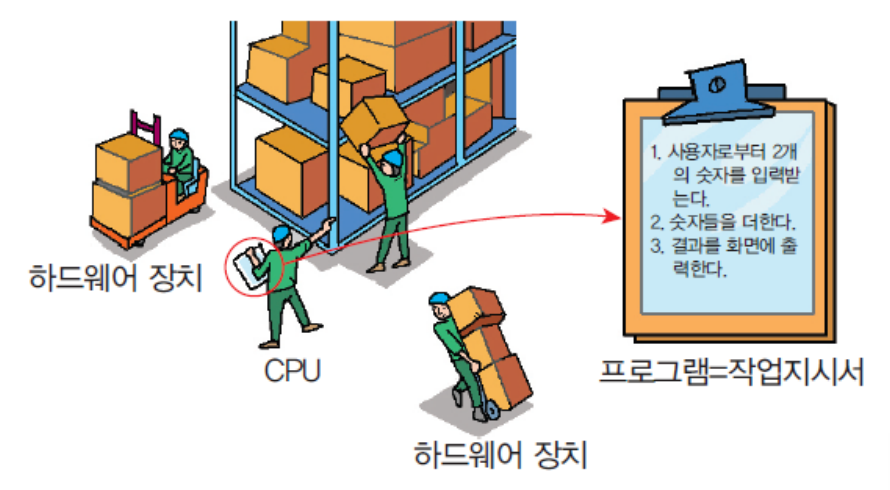

*그림 1. 작업 지시서인 프로그램을 따라 일하는 CPU와 하드웨어 장치*

그림 1은 프로그램을 작업 지시서에 비유한 것이다. 작업 지시서에는 "1. 사용자로부터 2개의 숫자를 입력받는다. 2. 숫자들을 더한다. 3. 결과를 화면에 출력한다."라는 세 단계가 적혀 있고, CPU라는 작업자는 지시서를 읽으면서 다른 하드웨어 장치들과 함께 상자(데이터)를 옮기고 처리한다. 작업자가 지시서에 없는 일을 스스로 하지 않듯이, 컴퓨터도 프로그램에 적힌 명령어만 순서대로 수행한다. 이 세 단계를 파이썬으로 옮긴 프로그램은 9.1절에서 작성한다.

### 1.2 프로그래밍 언어와 번역

1강에서 살펴보았듯이 CPU가 직접 이해하는 것은 0과 1로 된 기계어뿐이다. 사람이 기계어로 프로그램을 쓰기는 매우 어려우므로, 인간의 언어에 근접한 **프로그래밍 언어(programming language)** 가 필요하다. 인간이 프로그래밍 언어를 배워서 프로그램을 작성하면, 번역을 담당하는 소프트웨어가 그 프로그램을 기계어로 옮긴다. 실행 전에 프로그램 전체를 번역하는 소프트웨어를 **컴파일러(compiler)** 라고 한다.

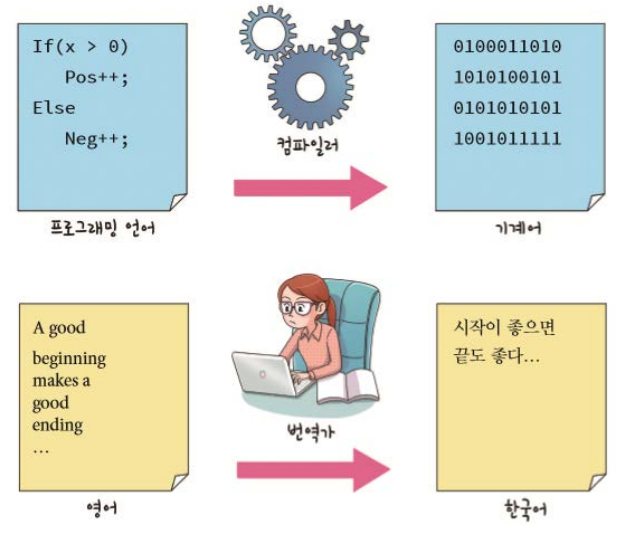

*그림 2. 프로그래밍 언어를 기계어로 바꾸는 컴파일러와 영어를 한국어로 바꾸는 번역가의 비유*

그림 2의 위쪽은 `x`가 0보다 크면 `Pos`를, 그렇지 않으면 `Neg`를 1 늘리는 프로그래밍 언어의 코드가 컴파일러를 거쳐 0과 1로 된 기계어가 되는 과정이다. 아래쪽은 번역가가 영어 문장 "A good beginning makes a good ending"을 한국어 문장 "시작이 좋으면 끝도 좋다"로 옮기는 과정이며, 컴파일러가 하는 일이 이와 같다. 파이썬은 컴파일러 대신 **인터프리터(interpreter)** 가 실행할 때 프로그램을 해석하는 인터프리트 방식의 언어이다(1강 7.2절). 어느 방식이든 프로그래머는 사람이 읽을 수 있는 언어로 프로그램을 쓰고, 기계어로 옮기는 일은 번역 프로그램이 맡는다.

> **용어 정의:** 프로그래밍 언어로 작성한 프로그램의 글을 **소스 코드(source code)** 라고 한다. 컴파일러와 인터프리터는 모두 소스 코드를 컴퓨터가 실행할 수 있는 형태로 바꾸는 번역 프로그램이다.

---

<br>

## 2. 파이썬의 특징

파이썬은 다음과 같은 특징 때문에 처음 배우는 프로그래밍 언어로 널리 쓰인다.

- **문법이 쉽다:** 코드를 보면 직관적으로 알 수 있는 부분이 많다.
- **다양한 플랫폼에서 사용한다:** Windows, macOS, Linux에서 같은 프로그램이 실행된다.
- **라이브러리가 풍부하다:** 파일 처리, 수학, 인터넷 같은 기능을 담은 표준 라이브러리가 파이썬과 함께 설치되고, 데이터 분석이나 인공지능을 위한 외부 라이브러리도 많다.
- **애니메이션이나 그래픽을 쉽게 사용한다:** 그림을 그리는 터틀 그래픽(6절)이 표준 라이브러리에 들어 있다.

다음 코드는 문법이 쉽다는 특징을 보여 준다. 처음 보는 사람도 사과가 과일 목록 안에 있으면 사과가 있다고 출력하는 코드임을 짐작할 수 있다.

```python
if "사과" in ["딸기", "바나나", "포도", "사과"]:
    print("사과가 있습니다")
```

```text
사과가 있습니다
```

- **1행:** 대괄호 `[...]`는 여러 값을 쉼표로 나열한 **리스트(list)** 이고(3강, 7강), `in`은 왼쪽 값이 오른쪽 리스트 안에 있는지 검사한다. `if 조건:`은 조건이 참일 때만 아래 문장을 실행하라는 조건문이다(4강).
- **2행:** 앞에 공백 네 칸을 두어 들여 쓴 문장은 `if`에 속한 문장이다. 리스트에 `"사과"`가 있으므로 조건이 참이 되어 `print()`가 실행된다.

---

<br>

## 3. 파이썬 설치와 IDLE

### 3.1 파이썬 설치

파이썬은 공식 웹 사이트 http://www.python.org/ 에서 무료로 내려받는다. 사이트에 접속하여 Downloads 메뉴에서 사용하는 운영체제용 최신 버전을 선택한다.

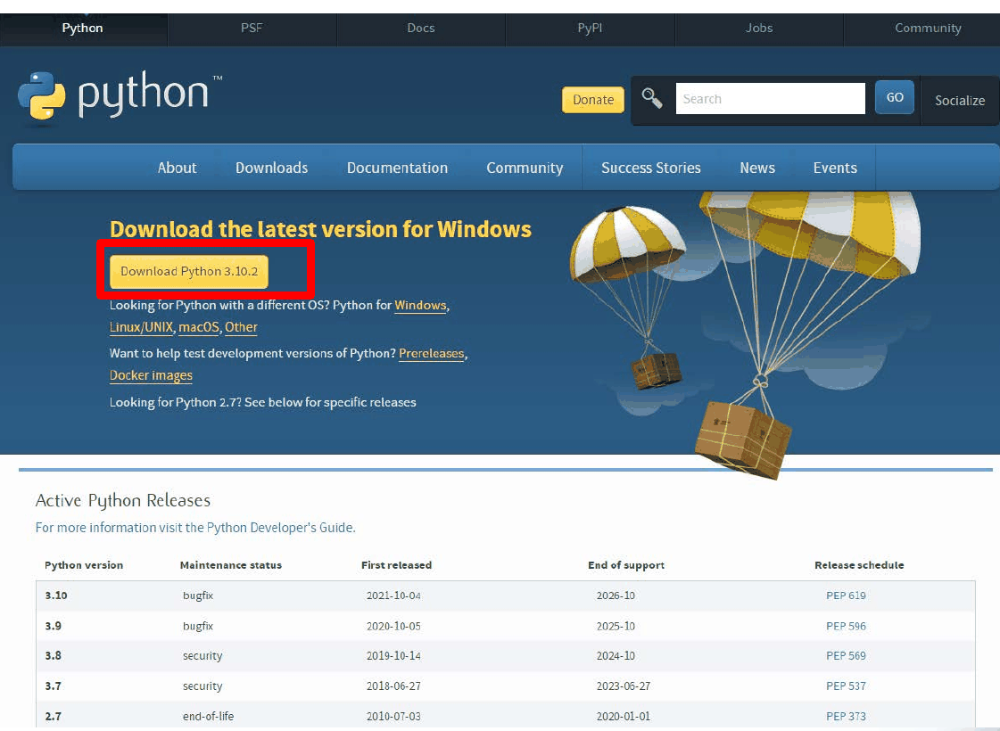

*그림 3. python.org의 내려받기 화면과 버전별 지원 현황*

그림 3의 "Download Python 3.10.2" 버튼은 화면을 캡처할 당시의 최신 버전이다. 새 릴리스 버전이 계속 나오므로 설치하는 시점의 최신 안정 버전을 받으면 된다. 아래쪽 표(Active Python Releases)는 버전마다 지원이 끝나는 시점을 보여 준다. 예전의 파이썬 2(2.7)는 2020-01-01에 지원이 끝났고(end-of-life) 파이썬 3과 문법이 일부 다르므로, 새로 배울 때는 파이썬 3을 설치한다.

Windows용 설치 프로그램을 실행하면 다음 창이 나타난다. 그림 4는 3.5.0 버전의 예이지만 최신 버전도 구성이 같다.

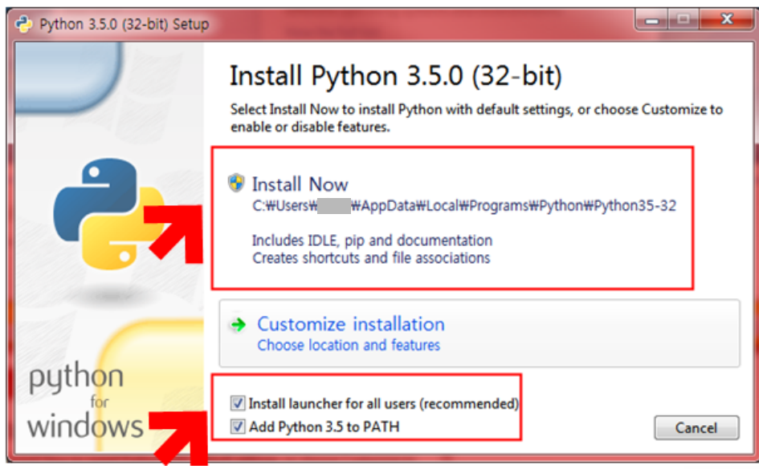

*그림 4. Windows용 파이썬 설치 프로그램의 첫 화면*

1. 아래쪽의 **Add Python to PATH**(버전에 따라 Add Python 3.x to PATH, Add python.exe to PATH)를 체크한다. 그러면 명령 프롬프트 같은 터미널에서 어느 폴더에 있든 `python` 명령으로 파이썬을 실행할 수 있다.
2. **Install launcher for all users (recommended)** 가 체크되어 있는지 확인한다(최근 버전에서는 Use admin privileges when installing py.exe). 런처는 `py` 명령으로 설치된 파이썬을 찾아 실행해 주는 프로그램이다.
3. **Install Now**를 누른다. 이 항목은 파이썬과 함께 IDLE, pip(외부 라이브러리 설치 도구), 문서를 설치하고, 바로 가기와 `.py` 파일 연결을 만든다.

> **용어 정의:** **PATH**는 운영체제가 명령어 이름에 해당하는 실행 파일을 찾아볼 폴더의 목록을 담은 환경 변수이다. 파이썬이 설치된 폴더가 PATH에 없으면, 터미널에서 `python`을 입력해도 운영체제가 파이썬을 찾지 못한다.

> **참고:** 그림 4와 같은 전통적인 Windows용 설치 프로그램은 파이썬 3.14부터 지원 중단 예정(deprecated)으로 지정되었고, 파이썬 3.16부터는 만들어지지 않는다. 그 대신 파이썬 공식 문서는 python.org/downloads나 Microsoft Store에서 받을 수 있는 **Python install manager**를 쓰도록 권한다. 이 도구를 설치한 뒤 `py install` 명령으로 원하는 버전의 파이썬을 설치하고, `py`나 `python` 명령으로 실행한다 [1].

macOS에서는 python.org의 macOS용 설치 프로그램을 실행하면 응용 프로그램 폴더 안의 Python 3.x 폴더에 IDLE이 설치된다. Linux에는 대개 `python3`이 이미 설치되어 있으며, IDLE이 없으면 배포판의 패키지 관리자로 설치한다(예: Ubuntu에서 `sudo apt install idle3`). 설치가 끝나면 터미널에서 다음 명령으로 버전을 확인할 수 있다. Windows에서는 `python --version`이나 `py --version`을 입력한다.

```bash
python3 --version
```

```text
Python 3.13.7
```

출력되는 버전 번호는 설치한 버전에 따라 다르다.

### 3.2 IDLE과 대화형 모드

**IDLE**은 파이썬과 함께 설치되는 통합 개발 학습 환경(Integrated Development and Learning Environment)이다 [2]. 코드를 입력하고 실행하는 셸 창과, 코드를 파일로 작성하는 편집기 창을 제공한다. Windows에서는 시작 메뉴에서 IDLE을 검색하거나 Python 3.x 폴더에서 IDLE을 찾아 실행한다.

IDLE을 실행하면 **파이썬 셸(Python shell)** 창이 열린다. 첫 줄에는 파이썬 버전 정보가 나오고, 그 아래의 `>>>`가 명령을 기다린다는 표시인 **프롬프트(prompt)** 이다. 프롬프트 뒤에 `print("hello world!")`를 입력하고 Enter 키를 누르면 바로 다음 줄에 결과가 출력된다.

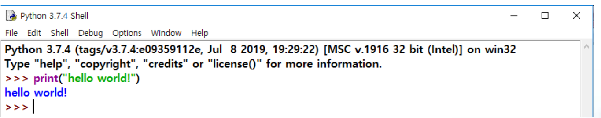

*그림 5. IDLE 셸에서 hello world!를 출력한 화면*

> **용어 정의:** 문장을 한 줄 입력할 때마다 파이썬이 곧바로 실행하고 결과를 보여 주는 방식을 **대화형 모드(interactive mode)** 또는 인터프리트 모드라고 하며, 이렇게 사용자와 주고받는 창을 **셸(shell)** 이라고 한다. 셸에 입력한 코드는 셸을 닫으면 사라지므로, 남겨 둘 프로그램은 5.2절의 스크립트 모드로 작성한다.

---

<br>

## 4. 첫 번째 프로그램

### 4.1 문장과 순차 실행

파이썬 프로그램은 여러 줄의 명령어로 이루어진다. 한 줄의 명령어를 **문장(statement)** 이라고 부르며, 문장들은 파이썬 인터프리터에 의하여 위에서 아래로 **순차적으로** 실행된다. 앞 문장의 실행이 끝나야 다음 문장이 실행되므로, 문장의 순서를 바꾸면 프로그램이 하는 일도 바뀐다. `if`문처럼 여러 줄로 이루어진 문장도 있지만(4강), 단순한 문장은 보통 한 줄에 하나씩 쓴다.

### 4.2 `print()` 함수

가장 간단한 파이썬 프로그램은 화면에 글자를 출력하는 한 줄짜리 프로그램이다.

```python
print("Hello World!")
```

```text
Hello World!
```

- **`print`:** 괄호 안의 값을 화면에 출력하는 **함수(function)** 이다. 함수는 이름 뒤에 괄호를 붙여 호출하며, 괄호 안에 넣어 함수에 전달하는 값을 **인수(argument)** 라고 한다. 함수를 직접 만드는 방법은 6강에서 배운다.
- **`"Hello World!"`:** 큰따옴표로 둘러싸인 문자들의 모임인 **문자열(string)** 이다. 문자열은 텍스트 데이터를 나타내며, 따옴표는 문자열의 시작과 끝을 표시할 뿐 출력되지 않는다. 작은따옴표로 `'Hello World!'`라고 써도 같은 문자열이다.

`print()`는 여러 개의 값을 쉼표로 구분하여 받으면 화면에 차례대로 출력한다. 다음은 대화형 모드에서 실행한 예이다.

```pycon
>>> print("결과값은", 2*7, "입니다.")
결과값은 14 입니다.
```

인수 `2*7`은 출력되기 전에 먼저 계산되어 14가 된다. `print()`는 여러 값 사이에 공백을 한 칸씩 넣고, 마지막 값 뒤에서 줄을 바꾼다. 그래서 출력은 `결과값은 14 입니다.`가 된다.

> **참고:** 값 사이에 넣는 문자와 끝에 붙는 문자는 `print()`의 `sep`과 `end` 인수로 바꿀 수 있다. 기본값은 각각 공백 한 칸과 줄바꿈 문자이다 [3]. 예를 들어 `print("2024", "03", "11", sep="-")`는 값 사이에 하이픈을 넣어 `2024-03-11`을 출력한다.

---

<br>

## 5. 대화형 모드와 스크립트 모드

### 5.1 대화형 모드에서의 계산: 온도 변환

화씨온도 $F$를 섭씨온도 $C$로 바꾸는 공식은 다음과 같다.

$$C = (F - 32) \times \frac{5}{9}$$

IDLE을 실행한 뒤 셸에서 화씨 90도를 섭씨로 바꾸는 계산을 한 줄씩 입력하면 다음과 같다.

```pycon
>>> ftemp = 90.0
>>> ctemp = (ftemp - 32.0) * 5.0 / 9.0
>>> print(ctemp)
32.22222222222222
```

- **1행:** 화씨온도 90.0을 `ftemp`라는 이름의 변수에 저장한다(변수는 7절).
- **2행:** 오른쪽 수식을 계산하여 `ctemp`에 저장한다. 괄호 안을 먼저 계산하여 90.0 - 32.0 = 58.0이 되고, 앞에서부터 58.0 * 5.0 = 290.0, 290.0 / 9.0 = 32.222...가 된다.
- **3행:** `ctemp`의 값을 출력한다. 290/9는 끝없이 이어지는 소수이므로 파이썬은 실수가 담을 수 있는 자릿수까지만 저장한 근삿값 `32.22222222222222`를 출력한다(11.1절의 참고).

대화형 모드에서는 `print()`를 쓰지 않고 변수 이름이나 수식만 입력해도 그 값이 표시된다. 예를 들어 `>>> ctemp`를 입력하면 `32.22222222222222`가 나타난다.

> **참고:** **C와 다른 나눗셈.** C에서는 정수끼리 나누면 몫만 남는 정수 나눗셈이 된다. 그래서 공식의 상수에서 `.0`을 빼고 정수만으로 계산하면 `5 / 9`는 0이 되고, 화씨온도가 정수 90일 때 `(90 - 32) * 5 / 9`는 32.222...가 아닌 32가 되어 소수점 아래의 결과가 나오지 않는다. 파이썬 3의 `/`는 피연산자가 정수여도 항상 실수 결과를 내므로 `5 / 9`는 `0.5555555555555556`, `(90 - 32) * 5 / 9`는 `32.22222222222222`이다 [4]. 몫만 구하는 나눗셈은 별도의 연산자 `//`를 쓴다(8.2절).

### 5.2 스크립트 모드와 소스 파일

대화형 모드는 한두 줄을 시험하기에는 편하지만, 코드가 복잡해지면 번거롭다. 수십 줄짜리 프로그램을 셸에 한 줄씩 입력하다가 한 글자라도 틀리면 다시 입력해야 하고, 셸을 닫으면 입력한 코드가 모두 사라진다.

그래서 텍스트 편집기를 이용하여 명령어들을 파일에 저장한 후에, 파일을 읽어서 명령어들을 하나씩 실행하는 방법을 쓴다. 명령어들이 저장된 파일을 **소스 파일(source file)** 이라고 하며, 파이썬 소스 파일의 확장자는 `.py`이다. 이렇게 소스 파일 전체를 한 번에 실행하는 방식을 **스크립트 모드(script mode)** 라고 한다. 소스 파일은 보조기억장치에 저장되므로 컴퓨터를 꺼도 남아 있고, 언제든 다시 열어 고치거나 실행할 수 있다(1강 4절). 파일 탐색기에서 보면 소스 파일은 파이썬 로고가 그려진 아이콘에 파일 형식이 Python File로 표시된다.

### 5.3 IDLE에서 소스 파일 작성, 저장, 실행

IDLE에서 소스 파일을 다루는 과정은 네 단계이다.

| 단계 | 메뉴 | 단축키 | 하는 일 |
|:-----|:-----|:-----|:-----|
| 작성 | 셸 창의 [File] → [New File] | Ctrl+N | 빈 편집기 창을 연다 |
| 저장 | 편집기 창의 [File] → [Save] | Ctrl+S | 코드를 `.py` 파일로 저장한다 |
| 실행 | 편집기 창의 [Run] → [Run Module] | F5 | 저장한 파일을 실행하고 결과를 셸 창에 출력한다 |
| 다시 열기 | [File] → [Open] | Ctrl+O | 저장했던 폴더로 가서 파일을 선택하면 편집기 창에 소스가 다시 나타난다 |

*표 1. IDLE에서 소스 파일을 작성, 저장, 실행, 다시 여는 메뉴*

macOS에서는 Ctrl 대신 Command 키를 쓴다. 그림 6은 [File] → [New File]로 연 편집기 창에 다음 세 줄짜리 프로그램을 입력한 모습이다.

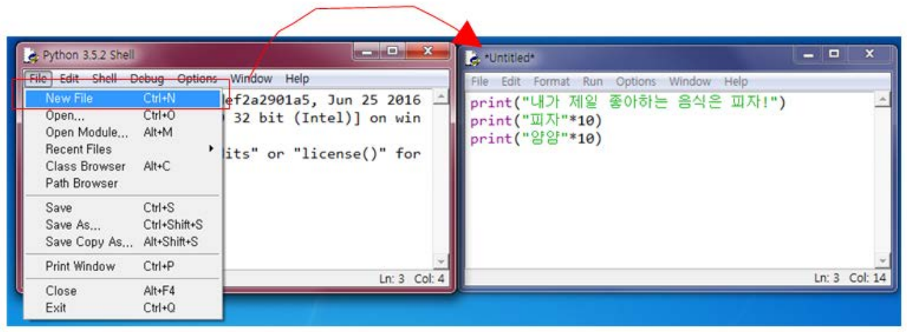

*그림 6. IDLE 셸의 File 메뉴에서 New File을 선택하여 연 편집기 창*

```python
print("내가 제일 좋아하는 음식은 피자!")
print("피자"*10)
print("양양"*10)
```

이 코드를 `test.py`로 저장하고 [Run] → [Run Module]을 선택하면, 셸 창에 `RESTART` 줄이 표시된 뒤 실행 결과가 출력된다.

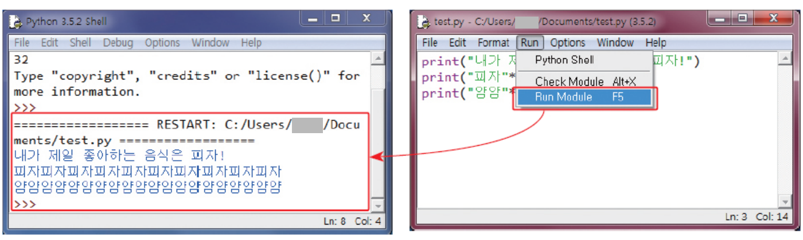

*그림 7. 편집기 창의 Run 메뉴에서 Run Module을 선택하여 셸 창에 결과를 출력한 화면*

```text
내가 제일 좋아하는 음식은 피자!
피자피자피자피자피자피자피자피자피자피자
양양양양양양양양양양양양양양양양양양양양
```

세 문장이 위에서부터 순서대로 실행된다. `"피자"*10`처럼 문자열에 정수를 곱하면 문자열을 그 횟수만큼 반복해 이어 붙인 새 문자열이 된다. 문자열 연산은 3강에서 자세히 다룬다.

> **주의:** Run Module은 편집기 창의 내용을 저장한 파일을 실행한다. 저장하지 않은 새 파일에서 F5를 누르면 IDLE이 먼저 저장하라고 묻는다. 또 셸 창에 입력한 코드는 셸을 닫으면 사라지므로, 프로그램은 처음부터 [File] → [New File]로 연 편집기 창에 작성한다.

---

<br>

## 6. 터틀 그래픽

**터틀 그래픽(turtle graphics)** 은 카테시안 좌표 평면에서 거북이 모양의 커서(터틀)를 움직여 그림을 그리는 기능이다. 거북이가 펜을 꼬리에 달고 화면 위를 지나가면 그 자취가 선으로 남는다고 생각하면 된다.

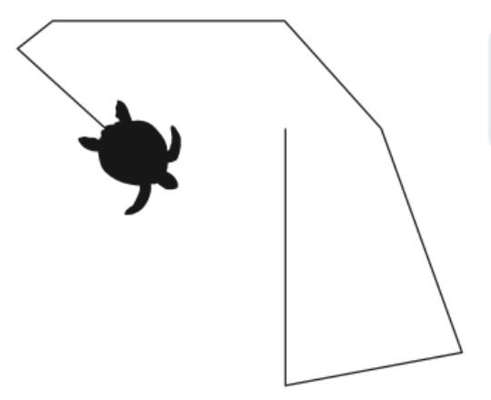

*그림 8. 화면 위를 지나간 거북이의 자취가 선으로 남은 모습*

> **용어 정의:** **카테시안 좌표 평면(Cartesian plane)** 은 가로축 x와 세로축 y로 점의 위치를 $(x, y)$로 나타내는 평면이다. 터틀 그래픽 창에서는 창의 한가운데가 원점 $(0, 0)$이고, 오른쪽이 x가 커지는 방향, 위쪽이 y가 커지는 방향이다.

셸에서 `import turtle`을 입력하여 터틀 그래픽 기능을 불러온 뒤 `t = turtle.Pen()`이나 `t = turtle.Turtle()`을 입력하면 Python Turtle Graphics라는 새 창이 열리고, 창 한가운데에 거북이(처음에는 화살표 모양)가 나타난다. 이후의 그림은 이 창에 그려진다. `turtle.Pen`은 `turtle.Turtle`의 다른 이름이므로 두 문장은 같은 일을 한다. 다음 코드는 한 변이 100인 빨간 정사각형을 그린다.

```python
import turtle
t = turtle.Turtle()
t.pencolor("red")
t.forward(100)
t.right(90)
t.forward(100)
t.right(90)
t.forward(100)
t.right(90)
t.forward(100)
```

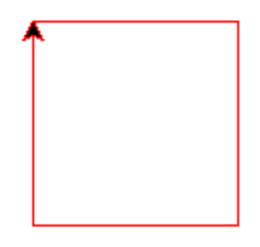

*그림 9. 앞의 코드로 그린 빨간 정사각형과 마지막 위치의 거북이*

- **`import turtle`:** 표준 라이브러리의 `turtle` **모듈**을 불러와 그 안의 기능을 `turtle.이름`으로 쓸 수 있게 한다. 모듈은 6강에서 다룬다.
- **`t = turtle.Turtle()`:** 거북이 하나를 만들어 변수 `t`에 저장한다. 거북이는 원점 $(0, 0)$에서 오른쪽(동쪽)을 바라본 채로 시작한다. 이렇게 만든 것을 객체라고 하며, 객체를 만드는 방법은 8강에서 다룬다.
- **`t.pencolor("red")`:** 거북이의 펜 색을 빨간색으로 바꾼다. `t.`은 거북이 `t`가 가진 기능을 쓴다는 뜻이다.
- **`t.forward(100)`:** 바라보는 방향으로 100만큼 앞으로 가면서 선을 그린다.
- **`t.right(90)`:** 제자리에서 오른쪽(시계 방향)으로 90도 돈다. 왼쪽으로 돌려면 `t.left(각도)`를 쓴다.

거북이의 상태는 위치와 방향으로 정해진다. 기본 모드(standard 모드)에서 방향은 동쪽을 0도로 하여 시계 반대 방향으로 잰 각도이며, 북쪽이 90도, 서쪽이 180도, 남쪽이 270도이다 [5]. 각 명령 뒤의 상태를 추적하면 다음과 같다.

| 순서 | 명령 | 위치 $(x, y)$ | 방향 |
|:-----|:-----|:-----|:-----|
| 0 | `t = turtle.Turtle()` | (0, 0) | 0도 (동쪽) |
| 1 | `t.forward(100)` | (100, 0) | 0도 (동쪽) |
| 2 | `t.right(90)` | (100, 0) | 270도 (남쪽) |
| 3 | `t.forward(100)` | (100, -100) | 270도 (남쪽) |
| 4 | `t.right(90)` | (100, -100) | 180도 (서쪽) |
| 5 | `t.forward(100)` | (0, -100) | 180도 (서쪽) |
| 6 | `t.right(90)` | (0, -100) | 90도 (북쪽) |
| 7 | `t.forward(100)` | (0, 0) | 90도 (북쪽) |

*표 2. 정사각형을 그리는 동안 거북이의 위치와 방향*

거북이는 원점에서 오른쪽, 아래쪽, 왼쪽, 위쪽 순으로 움직이므로 정사각형은 원점의 오른쪽 아래에 그려지고, 거북이는 원점으로 돌아와 위쪽을 바라본다. 그림 9에서 정사각형의 왼쪽 위 꼭짓점에 있는 화살표가 이 마지막 상태이다. `right(90)`을 모두 `left(90)`으로 바꾸면 원점의 오른쪽 위에 정사각형이 그려진다.

> **주의:** IDLE에서는 프로그램이 끝나도 터틀 그래픽 창이 남아 있지만, 터미널에서 `python 파일이름.py`로 실행하면 프로그램이 끝나는 순간 창이 닫힌다. 이때는 프로그램의 마지막 줄에 `turtle.done()`을 넣어 사용자가 창을 닫을 때까지 기다리게 한다 [5].

---

<br>

## 7. 변수

### 7.1 변수와 대입

**변수(variable)** 는 값을 저장하는 공간이며, 저장한 값을 이름으로 다시 꺼내 쓸 수 있게 한다. 파이썬에서 변수는 `변수이름 = 값` 형태의 문장으로 만들며, 값이 처음 할당되는 순간에 생성된다. 변수를 미리 선언하는 문장은 따로 없다.

```pycon
>>> score = 20
>>> score
20
>>> print(score)
20
```

- **1행:** 값 20을 `score`라는 변수에 저장한다. 이 문장은 화면에 아무것도 출력하지 않는다.
- **2행:** 대화형 모드에서 변수 이름만 입력하면 저장된 값이 표시된다.
- **3행:** `print()`로 변수의 값을 출력한다. 소스 파일로 실행하는 스크립트 모드에서는 2행처럼 이름만 써서는 아무것도 출력되지 않으므로 `print()`를 써야 한다.

> **용어 정의:** `=`는 같다는 뜻이 아니라 오른쪽의 값을 왼쪽의 변수에 저장하라는 **대입 연산자(assignment operator)** 이다. 파이썬은 오른쪽을 먼저 계산한 뒤 그 결과를 왼쪽 변수에 저장하므로, `x = x + 1`은 수학에서는 성립하지 않는 식이지만 파이썬에서는 `x`의 값을 1 늘리는 올바른 문장이다.

값을 할당한 적이 없는 변수를 사용하면 오류가 난다. 다음은 파이썬 3.13의 대화형 모드를 터미널에서 실행한 결과이다.

```pycon
>>> print(height)
Traceback (most recent call last):
  File "<python-input-0>", line 1, in <module>
    print(height)
          ^^^^^^
NameError: name 'height' is not defined
```

마지막 줄의 `NameError`는 `height`라는 이름이 정의되지 않았다는 뜻이다. 파이썬은 오류가 나면 이처럼 오류가 난 위치(`line 1`), 그 줄의 코드와 문제가 된 부분을 가리키는 `^` 표시, 오류의 종류와 설명을 출력하고 그 문장의 실행을 멈춘다. 표시되는 형식은 파이썬 버전과 실행 환경(IDLE, 터미널)에 따라 조금씩 다르다.

### 7.2 변수에 저장하는 자료의 종류

변수에는 어떤 데이터든지 저장할 수 있다. 같은 변수에 정수를 저장했다가 실수나 문자열을 다시 저장해도 된다. `type()` 함수에 변수를 넣으면 지금 저장된 값의 자료형을 알려 준다.

```pycon
>>> value = 3
>>> type(value)
<class 'int'>
>>> value = 3.14
>>> type(value)
<class 'float'>
>>> value = "hello"
>>> type(value)
<class 'str'>
```

| 자료형 | 파이썬 이름 | 예 |
|:-----|:-----|:-----|
| 정수 | `int` | ..., -2, -1, 0, 1, 2, ... |
| 실수 | `float` | 3.2, 3.14, 0.12 |
| 문자열 | `str` | `'Hello World!'`, `"123"` |

*표 3. 변수에 저장하는 기본 자료형과 그 예*

같은 숫자라도 따옴표로 감싸면 문자열이 되어 수처럼 계산되지 않는다. 정수끼리의 `+`는 덧셈이지만, 문자열끼리의 `+`는 두 문자열을 이어 붙이는 접합이다(3강).

```pycon
>>> 1 + 2
3
>>> "1" + "2"
'12'
```

> **참고:** 이 절에서는 변수를 값을 담는 상자에 비유했지만, 정확히 말하면 파이썬의 변수는 메모리에 있는 값(객체)을 가리키는 **이름**이다. `value = 3`은 값 3을 만들고 `value`라는 이름이 그 값을 가리키게 하며, `value = "hello"`는 같은 이름이 다른 값을 가리키도록 바꾼다. 값마다 자료형이 정해져 있고 변수는 어떤 자료형의 값이든 가리킬 수 있으므로, 같은 변수에 다른 자료형의 값을 대입할 수 있다. 이 차이는 리스트를 복사할 때 드러나며 7강에서 다룬다.

### 7.3 변수 이름의 규칙

변수 이름을 만들 때는 다음 규칙을 지켜야 한다.

- 영문 문자와 숫자를 사용한다. 파이썬 3은 한글 같은 유니코드 문자도 이름에 허용하지만, PEP 8은 표준 라이브러리의 이름에 ASCII 문자만 쓰고 되도록 영어 낱말을 쓰게 하며, 전 세계 사용자를 대상으로 하는 오픈 소스 프로젝트에도 같은 방식을 권한다 [6].
- 대문자와 소문자를 구분한다. `Score`와 `score`는 서로 다른 변수이다.
- 문자부터 시작해야 하며 숫자부터 시작하면 안 된다.
- `_`(밑줄 문자)로 시작할 수 있고, 중간에 넣을 수도 있다.
- 특수 문자(`+`, `-`, `*`, `/`, `$`, `@`, `&`, `%` 등)는 사용할 수 없다.
- 파이썬의 **키워드(keyword)** (`if`, `for`, `while`, `and`, `or` 등)는 사용할 수 없다.

| 이름 | 사용 가능 | 이유 |
|:-----|:-----|:-----|
| `sum` | 가능 | 영문 알파벳 문자로 시작한다 |
| `_count` | 가능 | 밑줄 문자로 시작할 수 있다 |
| `number_of_pictures` | 가능 | 중간에 밑줄 문자를 넣을 수 있다 |
| `King3` | 가능 | 맨 처음이 아니라면 숫자도 넣을 수 있다 |
| `2nd_base` | 불가능 | 숫자로 시작할 수 없다 |
| `money#` | 불가능 | `#`과 같은 기호는 사용할 수 없다 |

*표 4. 변수 이름의 예와 사용 가능 여부*

규칙을 어긴 이름을 쓰면 오류가 난다. 숫자로 시작하는 이름은 파이썬이 잘못된 숫자로 읽어 `SyntaxError: invalid decimal literal`을, 키워드를 쓴 `for = 3`은 `SyntaxError: invalid syntax`를 낸다(파이썬 3.13의 메시지). `money# = 100`은 `#`부터 줄 끝까지가 주석(12절)으로 처리되어 `money`만 남으므로, 정의되지 않은 이름 `money`를 쓴 `NameError`가 난다. 파이썬의 키워드 목록은 `keyword` 모듈로 확인할 수 있다.

```pycon
>>> import keyword
>>> keyword.kwlist
['False', 'None', 'True', 'and', 'as', 'assert', 'async', 'await', 'break', 'class', 'continue', 'def', 'del', 'elif', 'else', 'except', 'finally', 'for', 'from', 'global', 'if', 'import', 'in', 'is', 'lambda', 'nonlocal', 'not', 'or', 'pass', 'raise', 'return', 'try', 'while', 'with', 'yield']
>>> len(keyword.kwlist)
35
```

여러 단어로 된 이름을 쓰는 관례는 두 가지가 있다. **낙타 표기법(camel case)** 은 변수의 첫 글자는 소문자로, 나머지 단어의 첫 글자는 대문자로 적는 방법이다. 예를 들어 `myNewCar`처럼 첫 `m`은 소문자로, 나머지 단어들의 첫 글자는 대문자로 표기한다. 대문자가 낙타의 혹처럼 솟아 보여 붙은 이름이다. 한편 파이썬의 공식 스타일 가이드인 PEP 8은 변수와 함수 이름에 소문자 단어를 밑줄로 잇는 **스네이크 표기법(snake case)** 을 권한다(`my_new_car`) [6]. 어느 쪽이든 한 프로그램 안에서는 한 가지로 통일하고, `a`, `b`보다 `score`, `total_price`처럼 값의 뜻이 드러나는 이름을 쓰는 것이 좋다.

---

<br>

## 8. 수식과 산술 연산자

### 8.1 수식, 연산자, 피연산자

- **수식(expression):** 피연산자들과 연산자의 조합이다. 수식은 계산되어 하나의 값이 된다.
- **연산자(operator):** 연산을 나타내는 기호이다(`+`, `*` 등).
- **피연산자(operand):** 연산의 대상이 되는 값이다.

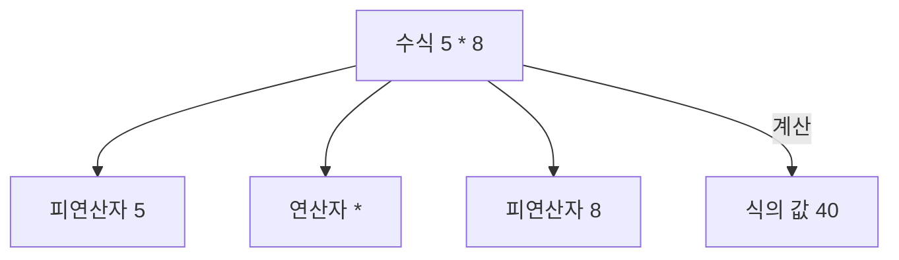

*그림 10. 수식 5 * 8을 이루는 피연산자, 연산자와 식의 값*

### 8.2 산술 연산자

파이썬은 덧셈, 뺄셈, 곱셈, 나눗셈, 나머지 연산을 다음 기호로 나타낸다.

| 연산자 | 기호 | 사용례 | 결괏값 |
|:-----|:-----|:-----|:-----|
| 덧셈 | `+` | `7 + 4` | 11 |
| 뺄셈 | `-` | `7 - 4` | 3 |
| 곱셈 | `*` | `7 * 4` | 28 |
| 나눗셈 (몫) | `//` | `7 // 4` | 1 |
| 나눗셈 | `/` | `7 / 4` | 1.75 |
| 나머지 | `%` | `7 % 4` | 3 |

*표 5. 파이썬의 산술 연산자와 계산 예*

곱셈 기호는 ×가 아니라 `*`이다. 나눗셈에는 두 연산자가 있다. `/`는 소수점 아래까지 계산하는 나눗셈이며, 나누어떨어지는 `8 / 4`도 결과가 실수 `2.0`이다. `//`는 몫만 구하는 **정수 나눗셈(floor division)** 이고, `%`는 나누고 남은 **나머지(remainder)** 를 구한다. 7을 4로 나누면 몫이 1, 나머지가 3이므로 `7 // 4`는 1, `7 % 4`는 3이다. C 언어는 피연산자가 정수인지 실수인지에 따라 같은 `/`가 몫이나 실수 결과를 내지만, 파이썬은 변수에 자료형을 따로 선언하지 않아 코드만 보고는 피연산자의 자료형을 알 수 없으므로 두 나눗셈을 서로 다른 연산자로 구분한다 [4].

> **주의:** 음수가 섞이면 `//`는 소수점 아래를 버리는 것이 아니라 수직선에서 왼쪽, 즉 더 작은 정수 쪽으로 내린다. 그래서 `-7 // 2`는 -3이 아니라 -4이고, `-7 % 2`는 1이다. 정수 `a`, `b`(`b`는 0이 아님)에 대해 파이썬에서는 언제나 `a == (a // b) * b + a % b`가 성립하고, `%`의 결과는 0이거나 나누는 수 `b`와 부호가 같다 [7]. 예를 들어 (-4) × 2 + 1 = -7이다.

---

<br>

## 9. 사용자 입력

### 9.1 정수 입력: `input()`과 `int()`

1.1절의 작업 지시서처럼 사용자로부터 두 정수를 입력받아 더한 결과를 출력하는 프로그램은 다음과 같다.

```python
x = int(input("첫 번째 정수를 입력하시오: "))
y = int(input("두 번째 정수를 입력하시오: "))
sum = x + y
print(x, "과", y, "의 합은", sum, "입니다.")
```

```text
첫 번째 정수를 입력하시오: 300
두 번째 정수를 입력하시오: 400
300 과 400 의 합은 700 입니다.
```

실행 결과에서 300과 400은 사용자가 키보드로 입력하고 Enter 키를 누른 값이다. 1행의 `x = int(input("첫 번째 정수를 입력하시오: "))`는 안쪽부터 바깥쪽으로 다음 순서로 실행된다.

1. `input("첫 번째 정수를 입력하시오: ")`가 괄호 안의 안내 메시지를 출력하고, 사용자가 입력한 값을 **문자열** 형태로 받는다. 사용자가 300을 입력하면 결과는 문자열 `"300"`이다.
2. `int(...)`가 사용자가 입력한 문자열을 숫자(정수) 300으로 변환한다.
3. `x = ...`가 정수 300을 변수 `x`에 저장한다.

2행도 같은 방식으로 `y`에 400을 저장하고, 3행이 300 + 400 = 700을 계산하여 `sum`에 저장한다. 4행의 `print()`는 다섯 값을 공백으로 구분하여 출력하므로 `300 과 400 의 합은 700 입니다.`가 된다.

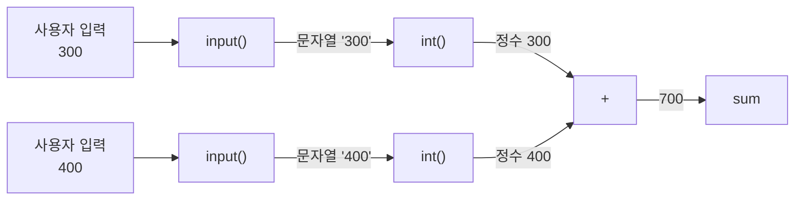

*그림 11. 두 입력이 input(), int(), 덧셈을 거쳐 700이 되는 과정*

`int()`를 빼고 `x = input(...)`, `y = input(...)`으로 쓰면 `x`와 `y`는 문자열 `"300"`과 `"400"`이 되고, `+`는 두 문자열을 이어 붙인다(7.2절). 그래서 출력은 `300 과 400 의 합은 300400 입니다.`가 된다. `int()` 대신 `float()`을 쓰면 입력이 실수로 변환되어 `300.0 과 400.0 의 합은 700.0 입니다.`가 출력된다.

> **주의:** `int()`는 정수 모양의 문자열만 변환한다. 정수를 입력받는 자리에 `3.5`나 `abc`를 입력하면 `ValueError: invalid literal for int() with base 10: '3.5'` 같은 오류가 나고 프로그램이 멈춘다. 또 이 프로그램은 합을 `sum`이라는 변수에 저장하는데, `sum`은 여러 값의 합을 구하는 파이썬 내장 함수의 이름이기도 하다. 변수에 같은 이름을 쓰면 그 프로그램에서는 내장 함수 `sum()`을 쓸 수 없게 되므로, `total`처럼 겹치지 않는 이름을 쓰는 편이 안전하다.

### 9.2 문자열 입력

이름처럼 글자로 된 값은 `input()`이 돌려주는 문자열을 그대로 변수에 저장한다.

```python
name = input("이름을 입력하시오: ")
print(name, "씨, 안녕하세요?")
print("파이썬에 오신 것을 환영합니다.")
```

```text
이름을 입력하시오: 홍길동
홍길동 씨, 안녕하세요?
파이썬에 오신 것을 환영합니다.
```

사용자가 입력한 문자열 `"홍길동"`이 `name`이라는 이름의 상자에 들어가고, 2행의 `print()`가 이를 꺼내 다른 문자열과 함께 출력한다. 입력한 글자는 숫자로 바꿀 필요가 없으므로 `int()`를 쓰지 않는다. 이 절의 입력과 출력을 함께 쓰는 문제는 [연습 문제 2](Exercises.ko.md#연습-문제-2-로봇-기자)와 [연습 문제 6](Exercises.ko.md#연습-문제-6-인사와-두-정수의-합)에 있다.

---

<br>

## 10. 나머지 연산자의 활용

몫 연산자 `//`와 나머지 연산자 `%`를 함께 쓰면 나눗셈의 몫과 나머지를 모두 구할 수 있다.

```python
p = int(input("분자를 입력하시오: "))
q = int(input("분모를 입력하시오: "))
print("나눗셈의 몫=", p // q)
print("나눗셈의 나머지=", p % q)
```

```text
분자를 입력하시오: 7
분모를 입력하시오: 4
나눗셈의 몫= 1
나눗셈의 나머지= 3
```

7 = 4 × 1 + 3이므로 몫은 1, 나머지는 3이다. 나머지 연산자는 다음과 같은 곳에 쓰인다.

**짝수와 홀수의 구분.** 어떤 정수를 2로 나눈 나머지는 짝수이면 0, 홀수이면 1이다.

```python
number = int(input("정수를 입력하시오: "))
print(number % 2)
```

```text
정수를 입력하시오: 28
0
```

28 = 2 × 14 + 0이므로 0이 출력되어 짝수임을 알 수 있다. 7을 입력하면 7 = 2 × 3 + 1이므로 1이 출력된다. 나머지가 0인지에 따라 "짝수입니다"나 "홀수입니다"를 골라 출력하려면 조건문(4강)이 필요하다.

**초 단위 시간을 분과 초로 바꾸기.** 1분은 60초이므로, 초 단위의 시간을 60으로 나눈 몫이 분, 나머지가 남은 초이다.

```python
sec = 1000
min = 1000 // 60
remainder = 1000 % 60
print(min, remainder)
```

```text
16 40
```

1000 = 60 × 16 + 40이므로 1000초는 16분 40초이다.

> **주의:** 이 코드는 1행에서 `sec`에 1000을 저장하고도 2행과 3행에서 1000을 직접 쓰므로, 다른 시간을 계산하려면 세 곳을 모두 고쳐야 한다. `min = sec // 60`, `remainder = sec % 60`처럼 변수를 쓰면 1행만 고치면 된다. 또 `min`은 가장 작은 값을 구하는 내장 함수의 이름이므로, 9.1절의 `sum`처럼 `minutes`와 같은 다른 이름을 쓰는 편이 안전하다.

---

<br>

## 11. 거듭제곱 연산자와 복합 대입 연산자

### 11.1 거듭제곱 연산자

거듭제곱(지수, power)을 계산하려면 `**` 연산자를 사용한다. `a ** b`는 $a^b$이다.

```pycon
>>> 2 ** 7
128
```

$2^7 = 2 \times 2 \times 2 \times 2 \times 2 \times 2 \times 2 = 128$이다. 거듭제곱 연산자로 원리금을 계산할 수 있다. 원금 $a$를 연이율 $r$의 복리로 $n$년 동안 맡기면, 1년 뒤에는 $a(1 + r)$, 2년 뒤에는 $a(1 + r)(1 + r) = a(1 + r)^2$이 되고, 같은 방식으로 $n$년 뒤의 원리금은 다음과 같다.

$$a(1 + r)^n$$

원금 1000, 연이율 5%(0.05), 기간 10년을 대입하면 다음과 같다.

```pycon
>>> a = 1000
>>> r = 0.05
>>> n = 10
>>> a * (1 + r) ** n
1628.894626777442
```

`**`가 `*`보다 먼저 계산되므로(13절), 먼저 $(1 + 0.05)^{10} = 1.05^{10} \approx 1.628894626777442$를 구하고 여기에 1000을 곱한다. 10년 뒤의 원리금은 약 1628.89이다.

> **참고:** 실수는 컴퓨터 안에서 2진수로 저장되므로 0.05처럼 2진수로 정확히 나타낼 수 없는 값은 가장 가까운 근삿값으로 저장된다. 그래서 실수 계산의 마지막 자리에는 작은 오차가 생길 수 있다. 예를 들어 `0.1 + 0.2`는 `0.30000000000000004`이다 [8]. 돈처럼 정확해야 하는 값은 결과를 반올림하여 출력한다.

### 11.2 복합 대입 연산자

**복합 대입 연산자(compound assignment operator)** 란 `+=`처럼 대입 연산자와 다른 연산자를 합쳐 놓은 연산자이다. 줄여서 복합 연산자라고도 한다.

| 복합 대입 연산자 | 의미 |
|:-----|:-----|
| `x += y` | `x = x + y` |
| `x -= y` | `x = x - y` |
| `x *= y` | `x = x * y` |
| `x /= y` | `x = x / y` |
| `x %= y` | `x = x % y` |

*표 6. 복합 대입 연산자와 그 의미*

`//=`, `**=`처럼 다른 산술 연산자에도 같은 형태의 복합 대입 연산자가 있다. 다음 프로그램은 `x`의 값을 2 늘렸다가 다시 2 줄인다.

```python
x = 1000
print("초기값 x=", x)
x += 2
print("x += 2 후의 x=", x)
x -= 2
print("x -= 2 후의 x=", x)
```

```text
초기값 x= 1000
x += 2 후의 x= 1002
x -= 2 후의 x= 1000
```

`x += 2`는 `x = x + 2`와 같으므로, 오른쪽의 1000 + 2 = 1002를 계산하여 다시 `x`에 저장한다. 이어서 `x -= 2`가 1002 - 2 = 1000을 저장한다.

> **참고:** C의 `x++`, `x--` 같은 증가, 감소 연산자는 파이썬에 없다. `x++`는 `SyntaxError: invalid syntax`이고, `++x`는 오류는 아니지만 부호 `+`를 두 번 붙인 식일 뿐이어서 `x`의 값이 바뀌지 않는다. 파이썬에서는 `x += 1`로 쓴다.

---

<br>

## 12. 주석

**주석(comment)** 은 소스 코드에 붙이는 설명글과 같은 것이다. 주석은 프로그램이 하는 일을 설명하며, 프로그램의 실행 결과에 영향을 끼치지 않는다. 파이썬에서는 `#`부터 그 줄의 끝까지가 주석이다. 주석은 줄 전체에 쓸 수도 있고 문장 뒤에 붙일 수도 있다.

```python
# 사용자로부터 화씨온도를 입력받는다.
ftemp = int(input("화씨온도: "))
ctemp = (ftemp - 32.0) * 5.0 / 9.0   # 화씨온도->섭씨온도
print("섭씨온도:", ctemp)            # 섭씨온도를 화면에 출력한다
```

```text
화씨온도: 90
섭씨온도: 32.22222222222222
```

인터프리터는 `#` 뒤의 글자를 읽지 않고 넘어가므로, 주석을 모두 지워도 실행 결과는 같다. 212를 입력하면 물이 끓는 온도인 `100.0`이 출력된다. 주석에는 코드만 보아서는 알기 어려운 내용, 예를 들어 이 계산이 무엇을 위한 것인지나 왜 이렇게 했는지를 적는 것이 좋다.

---

<br>

## 13. 연산자 우선순위

### 13.1 우선순위와 괄호

한 수식에 연산자가 여러 개 있으면 **연산자 우선순위(operator precedence)** 가 높은 연산자부터 계산한다. 수학과 마찬가지로 곱셈, 나눗셈, 나머지 연산자가 덧셈, 뺄셈 연산자보다 우선순위가 높다. 먼저 계산하게 하고 싶은 부분은 괄호로 묶는다.

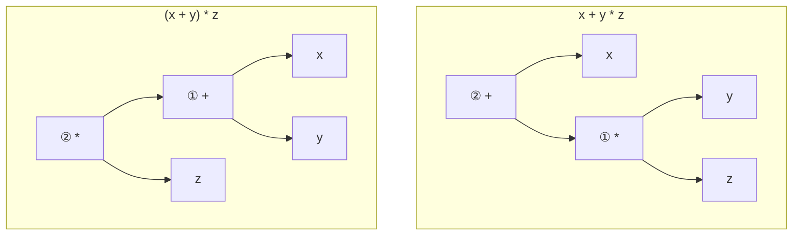

*그림 12. x + y * z와 (x + y) * z의 계산 순서를 나타낸 수식 트리*

그림 12에서 아래에 있는 연산자가 먼저 계산된다(①). `x + y * z`에서는 `y * z`를 먼저 계산하고 그 결과에 `x`를 더하며, `(x + y) * z`에서는 괄호 안의 `x + y`를 먼저 계산하고 그 결과에 `z`를 곱한다.

```pycon
>>> 10 + 20 / 2
20.0
>>> (10 + 20) / 2
15.0
```

첫 수식은 20 / 2 = 10.0을 먼저 계산하여 10 + 10.0 = 20.0이 된다. 두 번째 수식은 괄호 안의 10 + 20 = 30을 먼저 계산하여 30 / 2 = 15.0이 된다. 우선순위가 헷갈릴 때는 괄호를 넣으면 의도가 분명해진다.

### 13.2 우선순위표와 결합 방향

| 순위 | 연산자 | 설명 |
|:-----|:-----|:-----|
| 1 | `**` | 지수 연산자 |
| 2 | `~` `+` `-` | 단항 연산자 |
| 3 | `*` `/` `%` `//` | 곱셈, 나눗셈, 나머지 연산자 |
| 4 | `+` `-` | 덧셈, 뺄셈 |
| 5 | `>>` `<<` | 비트 이동 연산자 |
| 6 | `&` | 비트 AND 연산자 |
| 7 | `^` `\|` | 비트 XOR 연산자, 비트 OR 연산자 |

*표 7. 산술 연산자와 비트 연산자의 우선순위 (1이 가장 높다)*

2순위의 **단항 연산자(unary operator)** 는 피연산자 하나에 붙는 연산자로, `-5`의 부호 `-`, `+5`의 부호 `+`, 비트를 뒤집는 `~`(13.3절)가 있다. 4순위의 `+`, `-`는 피연산자 두 개 사이에 놓이는 이항 연산자로서의 덧셈과 뺄셈이다.

우선순위가 같은 연산자가 이어지면 **결합 방향(associativity)** 에 따라 계산한다. 대부분의 연산자는 왼쪽에서 오른쪽으로 계산하므로 `7 - 4 - 1`은 (7 - 4) - 1 = 2이고, `8 / 4 / 2`는 (8 / 4) / 2 = 1.0이다. 거듭제곱 `**`만은 오른쪽에서 왼쪽으로 계산하므로 `2 ** 3 ** 2`는 $2^{(3^2)} = 2^9 = 512$이며, `(2 ** 3) ** 2` = 64와 다르다 [7].

```pycon
>>> 7 - 4 - 1
2
>>> 2 ** 3 ** 2
512
>>> -2 ** 2
-4
>>> (-2) ** 2
4
```

> **주의:** `**`는 왼쪽에 붙은 단항 연산자보다 먼저 계산되므로 `-2 ** 2`는 $-(2^2) = -4$이다. 음수의 제곱을 구하려면 `(-2) ** 2`처럼 괄호를 쓴다. 반면 오른쪽의 단항 연산자는 먼저 적용되어 `2 ** -1`은 $2^{-1} = 0.5$이다. 또 표 7은 간단히 줄인 것이며, 파이썬에서는 `&`, `^`, `|`가 이 순서대로 각각 다른 순위를 가진다. 관계 연산자(`<`, `==` 등)와 논리 연산자(`not`, `and`, `or`)는 표의 모든 연산자보다 순위가 낮으며 4강에서 다룬다 [7].

### 13.3 비트 연산자

표 7의 5~7순위는 정수를 2진수로 나타냈을 때 각 자리의 비트(0 또는 1)끼리 계산하는 **비트 연산자(bitwise operator)** 이다. 6은 2진수로 `110`, 3은 `011`이므로 자리마다 다음 규칙을 적용한다.

| A | B | A AND B (`&`) | A OR B (`\|`) | A XOR B (`^`) |
|:-----|:-----|:-----|:-----|:-----|
| 0 | 0 | 0 | 0 | 0 |
| 0 | 1 | 0 | 1 | 1 |
| 1 | 0 | 0 | 1 | 1 |
| 1 | 1 | 1 | 1 | 0 |

*표 8. 비트 하나에 대한 AND, OR, XOR의 결과*

AND는 두 비트가 모두 1일 때만 1, OR는 하나라도 1이면 1, XOR는 두 비트가 서로 다를 때만 1이다.

```text
      110  (6)        110  (6)        110  (6)
    & 011  (3)      | 011  (3)      ^ 011  (3)
    -----           -----           -----
      010  (2)        111  (7)        101  (5)
```

비트 이동 연산자 `<<`, `>>`는 모든 비트를 왼쪽이나 오른쪽으로 옮긴다. `6 << 1`은 `110`을 왼쪽으로 한 칸 옮긴 `1100`, 즉 12이고, `6 >> 1`은 오른쪽으로 한 칸 옮겨 맨 끝 비트가 빠진 `11`, 즉 3이다. 왼쪽으로 한 칸 옮기면 2를 곱한 값이, 오른쪽으로 한 칸 옮기면 2로 나눈 몫(`// 2`의 결과)이 된다.

```pycon
>>> 6 & 3
2
>>> 6 | 3
7
>>> 6 ^ 3
5
>>> 6 << 1
12
>>> 6 >> 1
3
>>> ~6
-7
```

> **[논리설계]** `&`, `|`, `^`는 논리 게이트 AND, OR, XOR를 정수의 각 비트에 적용한 것이다. `~`는 모든 비트를 뒤집는 NOT이며, 음수를 2의 보수로 나타내는 정수에서는 모든 비트를 뒤집은 값이 $-x - 1$이므로 `~6`은 -7이다. 부울 대수, 논리 게이트, 2의 보수 표현은 논리설계에서 다룬다.

---

<br>

## 개념 적용

**연습 문제와 개념:** 2강의 [연습 문제](Exercises.ko.md)는 다음 개념을 사용한다.

| 연습 문제 | 사용하는 개념 |
|:-----|:-----|
| 1. `print()` 함수 실습 | 문자열 출력, 여러 값의 출력과 수식 인수 (4.2절) |
| 2. 로봇 기자 | 문자열 입력, 변수, 여러 값의 출력 (7절, 9.2절) |
| 3. 커피 가게 매출 | 정수 입력, 곱셈과 덧셈, 변수의 재대입 (8절, 9.1절) |
| 4. 자동 판매기 | 몫 연산자와 나머지 연산자로 동전 개수 구하기 (10절) |
| 5. 평균 구하기 | 연산자 우선순위와 괄호 (13.1절) |
| 6. 인사와 두 정수의 합 | 문자열 입력과 정수 입력을 함께 쓰기 (9절) |
| 7. 두 정수의 사칙연산 | 산술 연산자와 `/`의 실수 결과 (8.2절) |
| 8. 자릿수의 합 | `//`와 `%`로 자릿수를 하나씩 꺼내기 (10절) |

*표 9. 연습 문제와 각 문제가 사용하는 개념*

**T/F 점검:**

| 문장 | 판단과 근거 |
|:-----|:------------|
| IDLE 셸에 입력한 코드는 IDLE을 닫았다가 다시 열어도 남아 있다. | **F.** 셸에 입력한 코드는 셸을 닫으면 사라진다. 남길 코드는 [File] → [New File]로 편집기를 열어 `.py` 파일로 저장한다. |
| `print("합:", 3 + 4)`는 `합: 7`을 출력한다. | **T.** 인수 `3 + 4`가 먼저 7로 계산되고, 두 값 사이에 공백 한 칸이 들어간다. |
| 거북이가 `t.right(90)`을 실행하면 오른쪽으로 90만큼 이동한다. | **F.** `right(90)`은 제자리에서 시계 방향으로 90도 도는 명령이며, 이동은 `forward()`가 한다. |
| `_count`와 `count2`는 올바른 변수 이름이지만 `2count`는 아니다. | **T.** 이름은 문자나 밑줄로 시작해야 하며 숫자로 시작할 수 없다. |
| `input()`으로 받은 `"5"`에 3을 더하려면 `int()`로 바꾸어야 한다. | **T.** `input()`은 항상 문자열을 돌려주므로 `int("5") + 3`처럼 정수로 바꾼 뒤 더한다. `"5" + 3`은 오류이다. |
| `7 / 7`의 결과는 정수 1이다. | **F.** `/`는 항상 실수 결과를 내므로 `1.0`이다. 정수 몫은 `7 // 7`로 구한다. |
| `10 - 2 * 3`과 `(10 - 2) * 3`의 값은 같다. | **F.** 앞의 식은 곱셈을 먼저 하여 4, 뒤의 식은 괄호를 먼저 하여 24이다. |
| `x += 3`은 `x = x + 3`과 같다. | **T.** 복합 대입 연산자는 연산 결과를 같은 변수에 다시 저장한다. |

---

<br>

## 요약

| 개념 | 핵심 요약 |
|:-----|:----------|
| 프로그램 | 컴퓨터가 수행할 명령어를 적어 놓은 문서이며, 컴퓨터는 적힌 명령어만 순서대로 수행한다. |
| 프로그래밍 언어와 번역 | 사람이 고급 언어로 소스 코드를 쓰면 컴파일러나 인터프리터가 기계가 실행할 수 있는 형태로 바꾼다. |
| 파이썬의 특징 | 문법이 쉽고, 여러 플랫폼에서 실행되며, 라이브러리가 풍부하고, 그래픽을 쉽게 쓸 수 있다. |
| 설치와 IDLE | python.org에서 파이썬 3을 내려받아 Add Python to PATH를 체크하고 설치하며, IDLE의 셸과 편집기로 코드를 작성한다. |
| 대화형 모드 | 셸의 `>>>` 뒤에 입력한 문장을 곧바로 실행하며, 셸을 닫으면 입력한 코드가 사라진다. |
| 스크립트 모드 | 코드를 `.py` 소스 파일로 저장한 뒤 Run Module(F5)로 파일 전체를 실행한다. |
| `print()` | 쉼표로 구분한 여러 값을 공백 한 칸씩 띄워 출력하고 줄을 바꾼다. |
| 터틀 그래픽 | 거북이의 위치와 방향을 `forward()`, `right()`, `left()`로 바꾸며 자취를 선으로 그린다. |
| 변수와 대입 | 변수는 값을 저장하는 이름이며, `=`는 오른쪽을 계산하여 왼쪽 변수에 저장하는 대입 연산자이다. |
| 자료형 | 정수(`int`), 실수(`float`), 문자열(`str`)이 있고, `type()`으로 확인한다. |
| 변수 이름 | 영문자, 숫자, 밑줄로 만들고 숫자로 시작할 수 없으며, 대소문자를 구분하고 키워드는 쓸 수 없다. |
| 산술 연산자 | `+`, `-`, `*`, `/`(실수 나눗셈), `//`(몫), `%`(나머지), `**`(거듭제곱)가 있다. |
| `input()`과 `int()` | `input()`은 입력을 항상 문자열로 돌려주므로, 수로 계산하려면 `int()`나 `float()`으로 변환한다. |
| 나머지 연산자 | 짝수와 홀수 구분, 초를 분과 초로 바꾸기, 거스름돈 계산처럼 몫과 나머지가 필요한 곳에 쓴다. |
| 복합 대입 연산자 | `x += y`는 `x = x + y`와 같으며, 파이썬에는 `++`, `--`가 없다. |
| 주석 | `#`부터 줄 끝까지이며 실행에 영향을 주지 않고 코드를 설명한다. |
| 연산자 우선순위 | `**`, 단항 연산자, `*` `/` `//` `%`, `+` `-` 순으로 계산하고, 같은 순위는 왼쪽부터(`**`만 오른쪽부터) 계산한다. |
| 비트 연산자 | `&`, `\|`, `^`, `~`, `<<`, `>>`는 정수의 비트끼리 계산한다. |

---

<br>

## 점검 문제

1. **대화형 모드와 스크립트 모드:** 두 모드의 차이를 코드의 실행 방식과 저장 여부로 설명하라.

   <details>
   <summary>정답</summary>

   대화형 모드는 셸의 프롬프트 `>>>` 뒤에 문장을 한 줄 입력할 때마다 곧바로 실행하고 결과를 보여 주며, 입력한 코드는 셸을 닫으면 사라진다. 스크립트 모드는 코드를 `.py` 소스 파일로 보조기억장치에 저장한 뒤 파일 전체를 한 번에 실행하므로, 컴퓨터를 꺼도 코드가 남고 다시 열어 고칠 수 있다.

   </details>

2. **`print()`의 출력:** `print("가격은", 3 * 500, "원")`의 출력을 쓰라.

   <details>
   <summary>정답</summary>

   `가격은 1500 원`이다. 인수 `3 * 500`이 먼저 1500으로 계산되고, `print()`가 세 값 사이에 공백을 한 칸씩 넣는다.

   </details>

3. **터틀 그래픽:** 거북이가 원점에서 동쪽을 바라보고 있을 때 `t.left(90)`, `t.forward(50)`, `t.right(90)`, `t.forward(30)`을 차례로 실행한 뒤의 위치와 방향을 구하라.

   <details>
   <summary>정답</summary>

   `left(90)`으로 북쪽(90도)을 보고, `forward(50)`으로 (0, 50)에 간다. `right(90)`으로 다시 동쪽(0도)을 보고, `forward(30)`으로 (30, 50)에 간다. 마지막 상태는 위치 (30, 50), 방향 0도(동쪽)이다.

   </details>

4. **변수 이름:** `total_price`, `3rd_place`, `myScore`, `while`, `price$` 중 변수 이름으로 쓸 수 없는 것을 고르고 이유를 쓰라.

   <details>
   <summary>정답</summary>

   `3rd_place`는 숫자로 시작하고, `while`은 파이썬의 키워드이며, `price$`는 특수 문자 `$`를 포함하므로 쓸 수 없다. `total_price`(스네이크 표기법)와 `myScore`(낙타 표기법)는 쓸 수 있다.

   </details>

5. **나눗셈 연산자:** `17 / 5`, `17 // 5`, `17 % 5`의 값을 각각 구하라.

   <details>
   <summary>정답</summary>

   17 = 5 × 3 + 2이므로 `17 // 5`는 3, `17 % 5`는 2이다. `17 / 5`는 소수점 아래까지 계산하여 3.4이다.

   </details>

6. **입력과 형 변환:** 다음 코드에 5와 7을 입력하면 무엇이 출력되는가? 12를 출력하게 하려면 어떻게 고쳐야 하는가?

   ```python
   a = input("a: ")
   b = input("b: ")
   print(a + b)
   ```

   <details>
   <summary>정답</summary>

   `input()`은 문자열을 돌려주므로 `a`는 `"5"`, `b`는 `"7"`이고, `+`가 두 문자열을 이어 붙여 `57`이 출력된다. `a = int(input("a: "))`, `b = int(input("b: "))`처럼 `int()`로 정수로 바꾸면 5 + 7 = 12가 출력된다.

   </details>

7. **나머지 연산자의 활용:** 3725초는 몇 시간 몇 분 몇 초인가? `//`와 `%`를 이용한 계산 과정을 보여라.

   <details>
   <summary>정답</summary>

   1시간은 3600초이므로 `3725 // 3600` = 1시간, 남은 초는 `3725 % 3600` = 125초이다. 125초를 60으로 나누면 `125 // 60` = 2분, `125 % 60` = 5초이다. 따라서 1시간 2분 5초이다.

   </details>

8. **복합 대입 연산자:** `x = 10`에서 시작하여 `x += 5`, `x *= 2`, `x //= 4`, `x %= 4`를 차례로 실행한 뒤 `x`의 값을 구하라.

   <details>
   <summary>정답</summary>

   10 + 5 = 15, 15 × 2 = 30, 30 // 4 = 7, 7 % 4 = 3이므로 `x`는 3이다.

   </details>

9. **연산자 우선순위:** `2 + 3 * 4 ** 2 // 5`의 값을 계산 순서와 함께 구하라.

   <details>
   <summary>정답</summary>

   `**`가 가장 먼저 계산되어 4 ** 2 = 16이다. 다음으로 우선순위가 같은 `*`와 `//`를 왼쪽부터 계산하여 3 * 16 = 48, 48 // 5 = 9이다. 마지막으로 2 + 9 = 11이다.

   </details>

10. **비트 연산자:** `5 & 6`, `5 | 6`, `5 ^ 6`의 값을 2진수 계산으로 구하라.

    <details>
    <summary>정답</summary>

    5는 `101`, 6은 `110`이다. AND는 둘 다 1인 자리만 1이므로 `100` = 4, OR는 하나라도 1인 자리가 1이므로 `111` = 7, XOR는 서로 다른 자리만 1이므로 `011` = 3이다.

    </details>

---

<br>

## 참고 문헌

1. Python Software Foundation, "Using Python on Windows," *Python Setup and Usage*, accessed Nov. 4, 2026. https://docs.python.org/3/using/windows.html
2. Python Software Foundation, "IDLE: Python editor and shell," *The Python Standard Library*, accessed Nov. 4, 2026. https://docs.python.org/3/library/idle.html
3. Python Software Foundation, "Built-in Functions," *The Python Standard Library*, accessed Nov. 4, 2026. https://docs.python.org/3/library/functions.html
4. M. Zadka and G. van Rossum, "PEP 238: Changing the Division Operator," *Python Enhancement Proposals*, 2001. https://peps.python.org/pep-0238/
5. Python Software Foundation, "turtle: Turtle graphics," *The Python Standard Library*, accessed Nov. 4, 2026. https://docs.python.org/3/library/turtle.html
6. G. van Rossum, B. Warsaw, and A. Coghlan, "PEP 8: Style Guide for Python Code," *Python Enhancement Proposals*, 2001. https://peps.python.org/pep-0008/
7. Python Software Foundation, "Expressions," *The Python Language Reference*, accessed Nov. 4, 2026. https://docs.python.org/3/reference/expressions.html
8. Python Software Foundation, "Floating-Point Arithmetic: Issues and Limitations," *The Python Tutorial*, accessed Nov. 4, 2026. https://docs.python.org/3/tutorial/floatingpoint.html
