# Lecture 2 — Getting Started with Python

[Repository Guide](../../README.md) | [English](Concepts_Lecture.md) | [한국어](Concepts_Lecture.ko.md)

> **Last Updated:** 2026-11-04

> **Learning Objectives:**
> 1. Explain the relationship among programs, programming languages, and translator programs
> 2. Install Python and write and run programs in the interactive mode and the script mode of IDLE
> 3. Write programs that print values and read input with `print()`, `input()`, and `int()`
> 4. Draw shapes with turtle graphics by tracking the position and heading of the turtle
> 5. Create variables that follow the naming rules and store integers, floating-point numbers, and strings in them
> 6. Evaluate expressions step by step using arithmetic operators, compound assignment operators, and operator precedence

---

## Table of Contents

- [1. Programs and Programming Languages](#1-programs-and-programming-languages)
  - [1.1 Programs](#11-programs)
  - [1.2 Programming Languages and Translation](#12-programming-languages-and-translation)
- [2. Features of Python](#2-features-of-python)
- [3. Installing Python and IDLE](#3-installing-python-and-idle)
  - [3.1 Installing Python](#31-installing-python)
  - [3.2 IDLE and the Interactive Mode](#32-idle-and-the-interactive-mode)
- [4. The First Program](#4-the-first-program)
  - [4.1 Statements and Sequential Execution](#41-statements-and-sequential-execution)
  - [4.2 The `print()` Function](#42-the-print-function)
- [5. Interactive Mode and Script Mode](#5-interactive-mode-and-script-mode)
  - [5.1 Calculating in the Interactive Mode: Temperature Conversion](#51-calculating-in-the-interactive-mode-temperature-conversion)
  - [5.2 Script Mode and Source Files](#52-script-mode-and-source-files)
  - [5.3 Writing, Saving, and Running a Source File in IDLE](#53-writing-saving-and-running-a-source-file-in-idle)
- [6. Turtle Graphics](#6-turtle-graphics)
- [7. Variables](#7-variables)
  - [7.1 Variables and Assignment](#71-variables-and-assignment)
  - [7.2 Kinds of Data Stored in Variables](#72-kinds-of-data-stored-in-variables)
  - [7.3 Rules for Variable Names](#73-rules-for-variable-names)
- [8. Expressions and Arithmetic Operators](#8-expressions-and-arithmetic-operators)
  - [8.1 Expressions, Operators, and Operands](#81-expressions-operators-and-operands)
  - [8.2 Arithmetic Operators](#82-arithmetic-operators)
- [9. User Input](#9-user-input)
  - [9.1 Integer Input: `input()` and `int()`](#91-integer-input-input-and-int)
  - [9.2 String Input](#92-string-input)
- [10. Uses of the Remainder Operator](#10-uses-of-the-remainder-operator)
- [11. The Exponentiation Operator and Compound Assignment Operators](#11-the-exponentiation-operator-and-compound-assignment-operators)
  - [11.1 The Exponentiation Operator](#111-the-exponentiation-operator)
  - [11.2 Compound Assignment Operators](#112-compound-assignment-operators)
- [12. Comments](#12-comments)
- [13. Operator Precedence](#13-operator-precedence)
  - [13.1 Precedence and Parentheses](#131-precedence-and-parentheses)
  - [13.2 The Precedence Table and Associativity](#132-the-precedence-table-and-associativity)
  - [13.3 Bitwise Operators](#133-bitwise-operators)
- [Concept Applications](#concept-applications)
- [Summary](#summary)
- [Self-Check Questions](#self-check-questions)
- [References](#references)

---

<br>

## 1. Programs and Programming Languages

### 1.1 Programs

For a computer to do any work, it needs a list of **instructions** that tell it what to do and in what order. A document listing the instructions for a computer to carry out is called a **program**.

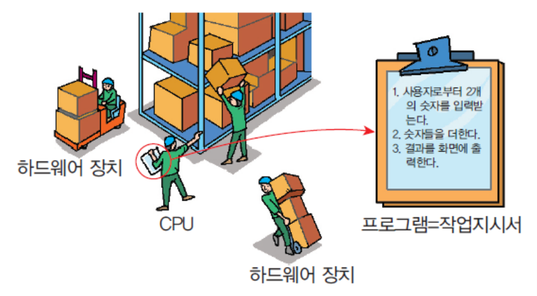

*Figure 1. A CPU and hardware devices working according to a program that serves as a work order*

Figure 1 likens a program to a work order. The work order lists three steps, "1. 사용자로부터 2개의 숫자를 입력받는다. 2. 숫자들을 더한다. 3. 결과를 화면에 출력한다." (1. Read two numbers from the user. 2. Add the numbers. 3. Print the result on the screen.), and the worker called the CPU reads the order and moves and processes boxes (data) together with the other hardware devices. Just as a worker does not do anything that is not in the work order, a computer carries out only the instructions written in the program, in order. The Python program for these three steps is written in Section 9.1.

### 1.2 Programming Languages and Translation

As seen in Lecture 1, the only thing a CPU understands directly is machine code made of 0s and 1s. Writing programs in machine code is very hard for people, so a **programming language** close to human language is needed. When a person learns a programming language and writes a program, software in charge of translation turns the program into machine code. Software that translates the whole program before execution is called a **compiler**.

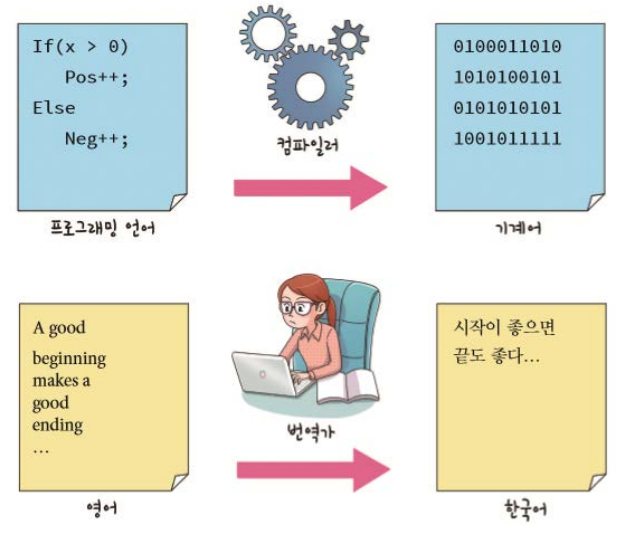

*Figure 2. The analogy between a compiler that turns a programming language into machine code and a translator who turns English into Korean*

The top of Figure 2 shows code in a programming language, which adds 1 to `Pos` if `x` is greater than 0 and to `Neg` otherwise, becoming machine code of 0s and 1s through a compiler. The bottom shows a translator rendering the English sentence "A good beginning makes a good ending" as the Korean sentence "시작이 좋으면 끝도 좋다", which is what a compiler does. Python is an interpreted language in which an **interpreter**, instead of a compiler, interprets the program when it runs (Lecture 1, Section 7.2). Either way, the programmer writes the program in a language people can read, and a translator program takes care of turning it into machine code.

> **Definition:** The text of a program written in a programming language is called **source code**. Compilers and interpreters are both translator programs that turn source code into a form the computer can execute.

---

<br>

## 2. Features of Python

Python is widely used as a first programming language because of the following features.

- **Its syntax is easy:** Much of the code can be understood intuitively at a glance.
- **It runs on many platforms:** The same program runs on Windows, macOS, and Linux.
- **It has rich libraries:** A standard library with functions for files, mathematics, the Internet, and more is installed with Python, and there are many external libraries for data analysis and artificial intelligence.
- **Animation and graphics are easy to use:** Turtle graphics for drawing pictures (Section 6) is part of the standard library.

The following code shows how easy the syntax is. Even someone seeing it for the first time can guess that it prints that there is an apple if an apple is in the list of fruits.

```python
if "apple" in ["strawberry", "banana", "grape", "apple"]:
    print("There is an apple")
```

```text
There is an apple
```

- **Line 1:** Square brackets `[...]` form a **list** of values separated by commas (Lectures 3 and 7), and `in` checks whether the value on the left is in the list on the right. `if condition:` is a conditional statement that executes the statement below only when the condition is true (Lecture 4).
- **Line 2:** A statement indented by four spaces belongs to the `if`. Since `"apple"` is in the list, the condition is true and `print()` is executed.

---

<br>

## 3. Installing Python and IDLE

### 3.1 Installing Python

Python can be downloaded free of charge from the official website http://www.python.org/. Go to the site and choose the latest version for the operating system in use from the Downloads menu.

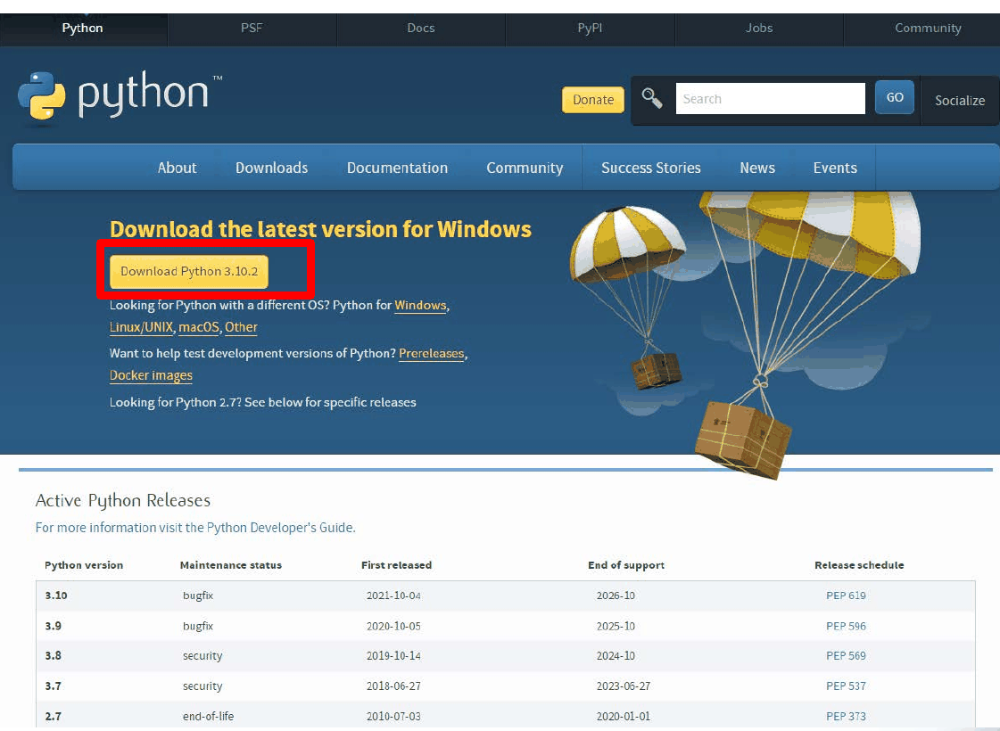

*Figure 3. The download page of python.org and the support status of each version*

The "Download Python 3.10.2" button in Figure 3 shows the latest version at the time the screen was captured. New release versions keep coming out, so download the latest stable version at the time of installation. The table at the bottom (Active Python Releases) shows when support ends for each version. The old Python 2 (2.7) reached its end of support (end-of-life) on 2020-01-01 and differs from Python 3 in parts of its syntax, so install Python 3 when learning Python today.

Running the installer for Windows displays the following window. Figure 4 is an example for version 3.5.0, but the latest versions have the same layout.

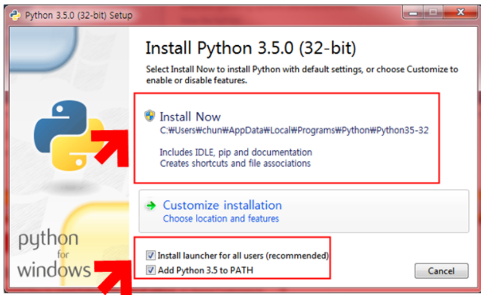

*Figure 4. The first screen of the Python installer for Windows*

1. Check **Add Python to PATH** at the bottom (Add Python 3.x to PATH or Add python.exe to PATH, depending on the version). This allows Python to be run with the `python` command from any folder in a terminal such as the Command Prompt.
2. Make sure that **Install launcher for all users (recommended)** is checked (in recent versions, Use admin privileges when installing py.exe). The launcher is a program that finds and runs the installed Python with the `py` command.
3. Click **Install Now**. This option installs IDLE, pip (a tool for installing external libraries), and the documentation together with Python, and creates shortcuts and file associations for `.py` files.

> **Definition:** **PATH** is an environment variable holding the list of folders in which the operating system looks for the executable file matching a command name. If the folder where Python is installed is not in PATH, the operating system cannot find Python even when `python` is entered in a terminal.

On macOS, running the macOS installer from python.org installs IDLE in the Python 3.x folder inside the Applications folder. Linux usually has `python3` installed already, and if IDLE is missing it can be installed with the distribution's package manager (for example, `sudo apt install idle3` on Ubuntu). After installation, the version can be checked with the following command in a terminal. On Windows, enter `python --version` or `py --version`.

```bash
python3 --version
```

```text
Python 3.13.7
```

The version number printed depends on the version installed.

### 3.2 IDLE and the Interactive Mode

**IDLE** is the Integrated Development and Learning Environment installed together with Python [1]. It provides a shell window for entering and running code and an editor window for writing code in files. On Windows, search for IDLE in the Start menu or find IDLE in the Python 3.x folder and run it.

When IDLE starts, the **Python shell** window opens. The first lines show the Python version information, and the `>>>` below them is the **prompt**, a sign that Python is waiting for a command. Typing `print("hello world!")` after the prompt and pressing Enter prints the result on the next line right away.

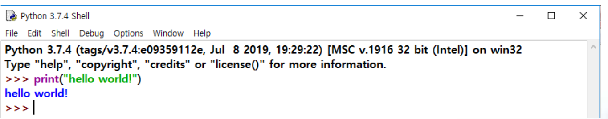

*Figure 5. The IDLE shell after printing hello world!*

> **Definition:** The mode in which Python executes each line as soon as it is entered and shows the result is called the **interactive mode**, and the window through which the user exchanges input and output with Python in this way is called the **shell**. Code entered in the shell is not saved, so programs to be kept are written in the script mode of Section 5.2.

---

<br>

## 4. The First Program

### 4.1 Statements and Sequential Execution

A Python program consists of several lines of instructions. One line of instruction is called a **statement**, and statements are executed **sequentially** from top to bottom by the Python interpreter. A statement runs only after the previous one has finished, so changing the order of statements changes what the program does.

### 4.2 The `print()` Function

The simplest Python program is a one-line program that prints text on the screen.

```python
print("Hello World!")
```

```text
Hello World!
```

- **`print`:** A **function** that prints the value in its parentheses on the screen. A function is called by putting parentheses after its name, and a value placed in the parentheses and passed to the function is called an **argument**. How to write functions is covered in Lecture 6.
- **`"Hello World!"`:** A **string**, a sequence of characters enclosed in double quotation marks. A string represents text data, and the quotation marks only mark the start and end of the string and are not printed. Writing `'Hello World!'` with single quotation marks gives the same string.

When `print()` receives several values separated by commas, it prints them one after another on the screen. The following is an example run in the interactive mode.

```pycon
>>> print("The result is", 2*7, "units.")
The result is 14 units.
```

The argument `2*7` is calculated to 14 before it is printed. `print()` puts one space between values and moves to a new line after the last value. So the output is `The result is 14 units.`.

> **Note:** The character placed between values and the character added at the end can be changed with the `sep` and `end` arguments of `print()`. Their default values are a single space and a newline character, respectively [2]. For example, `print("2024", "03", "11", sep="-")` puts a hyphen between the values and prints `2024-03-11`.

---

<br>

## 5. Interactive Mode and Script Mode

### 5.1 Calculating in the Interactive Mode: Temperature Conversion

The formula for converting a Fahrenheit temperature $F$ to a Celsius temperature $C$ is as follows.

$$C = (F - 32) \times \frac{5}{9}$$

After starting IDLE, entering the calculation that converts 90 degrees Fahrenheit to Celsius in the shell one line at a time looks like this.

```pycon
>>> ftemp = 90.0
>>> ctemp = (ftemp - 32.0) * 5.0 / 9.0
>>> print(ctemp)
32.22222222222222
```

- **Line 1:** Stores the Fahrenheit temperature 90.0 in a variable named `ftemp` (variables are covered in Section 7).
- **Line 2:** Calculates the expression on the right and stores it in `ctemp`. The parentheses are calculated first, giving 90.0 - 32.0 = 58.0, and then, from the left, 58.0 * 5.0 = 290.0 and 290.0 / 9.0 = 32.222....
- **Line 3:** Prints the value of `ctemp`. 290/9 is a never-ending decimal, so Python prints `32.22222222222222`, an approximation stored with only as many digits as a floating-point number can hold (see the note in Section 11.1).

In the interactive mode, entering just a variable name or an expression, without `print()`, also displays its value. For example, entering `>>> ctemp` shows `32.22222222222222`.

> **Note:** **Division that differs from C.** In C, dividing an integer by an integer is integer division, which keeps only the quotient. So if `.0` is removed from the constants of the formula and the calculation uses integers only, `5 / 9` becomes 0, and when the Fahrenheit temperature is the integer 90, `(90 - 32) * 5 / 9` becomes 32 instead of 32.222..., so no digits after the decimal point appear in the result. In Python 3, `/` always produces a floating-point result even when the operands are integers, so `5 / 9` is `0.5555555555555556` and `(90 - 32) * 5 / 9` is `32.22222222222222` [3]. Division that keeps only the quotient uses a separate operator, `//` (Section 8.2).

### 5.2 Script Mode and Source Files

The interactive mode is convenient for trying out a line or two, but it becomes tedious when the code gets complicated. When entering a program of dozens of lines into the shell one line at a time, a single wrong character means retyping, and closing the shell loses all the code entered.

Therefore, the instructions are saved in a file with a text editor, and then the file is read and its instructions are executed one by one. A file that stores instructions is called a **source file**, and the extension of a Python source file is `.py`. This way of running an entire source file at once is called the **script mode**. A source file is stored in secondary storage, so it remains even after the computer is turned off and can be reopened to be edited or run at any time (Lecture 1, Section 4). In a file explorer, a source file appears with an icon showing the Python logo and with Python File as its file type.

### 5.3 Writing, Saving, and Running a Source File in IDLE

Handling a source file in IDLE takes four steps.

| Step | Menu | Shortcut | What It Does |
|:-----|:-----|:-----|:-----|
| Write | [File] → [New File] in the shell window | Ctrl+N | Opens an empty editor window |
| Save | [File] → [Save] in the editor window | Ctrl+S | Saves the code as a `.py` file |
| Run | [Run] → [Run Module] in the editor window | F5 | Runs the saved file and prints the result in the shell window |
| Reopen | [File] → [Open] | Ctrl+O | Going to the folder where the file was saved and selecting it shows the source again in an editor window |

*Table 1. Menus for writing, saving, running, and reopening a source file in IDLE*

On macOS, use the Command key instead of Ctrl. Figure 6 shows the following three-line program entered in an editor window opened with [File] → [New File].

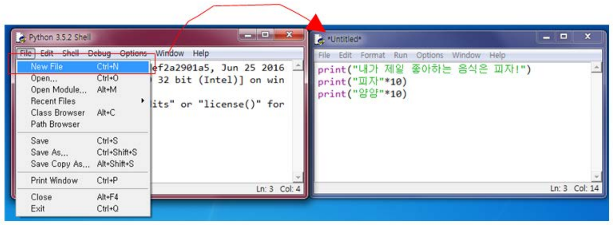

*Figure 6. An editor window opened by choosing New File from the File menu of the IDLE shell*

```python
print("My favorite food is pizza!")
print("pizza"*10)
print("yum"*10)
```

Saving this code as `test.py` and choosing [Run] → [Run Module] displays a `RESTART` line in the shell window, followed by the output.

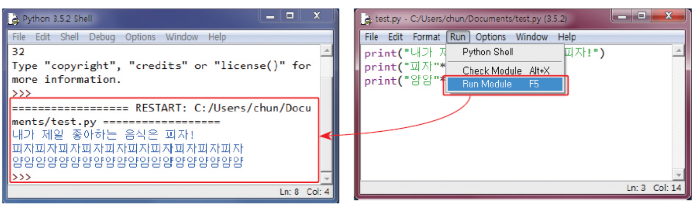

*Figure 7. The result printed in the shell window by choosing Run Module from the Run menu of the editor window*

```text
My favorite food is pizza!
pizzapizzapizzapizzapizzapizzapizzapizzapizzapizza
yumyumyumyumyumyumyumyumyumyum
```

The three statements are executed in order from the top. Multiplying a string by an integer, as in `"pizza"*10`, produces a new string in which the string is repeated and joined that many times. String operations are covered in detail in Lecture 3.

> **Caution:** Run Module runs the file in which the content of the editor window has been saved. Pressing F5 in a new, unsaved file makes IDLE ask to save it first. Also, code entered in the shell window is not kept in a file, so write programs from the start in an editor window opened with [File] → [New File].

---

<br>

## 6. Turtle Graphics

**Turtle graphics** is a facility for drawing pictures by moving a turtle-shaped cursor (the turtle) on a Cartesian coordinate plane. Think of a turtle with a pen attached to its tail: as it walks across the screen, its trail is left as a line.

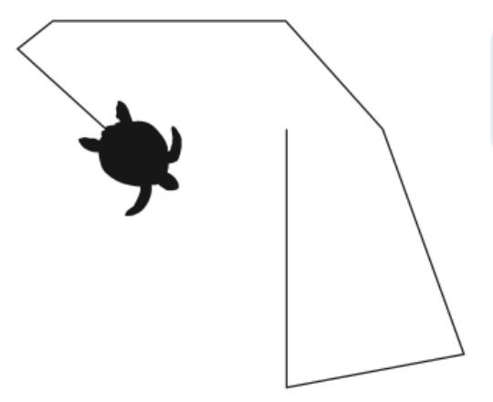

*Figure 8. The trail of a turtle that has walked across the screen, left as a line*

> **Definition:** A **Cartesian plane** is a plane on which the position of a point is written $(x, y)$ using a horizontal x-axis and a vertical y-axis. In the turtle graphics window, the center of the window is the origin $(0, 0)$, x increases to the right, and y increases upward.

After entering `import turtle` in the shell to load the turtle graphics facility, entering `t = turtle.Pen()` or `t = turtle.Turtle()` opens a new window called Python Turtle Graphics, and a turtle (initially an arrow shape) appears in the middle of the window. Subsequent drawings appear in this window. `turtle.Pen` is another name for `turtle.Turtle`, so the two statements do the same thing. The following code draws a red square whose sides are 100 long.

```python
import turtle
t = turtle.Turtle()
t.pencolor("red")
t.forward(100)
t.right(90)
t.forward(100)
t.right(90)
t.forward(100)
t.right(90)
t.forward(100)
```

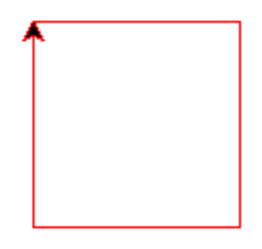

*Figure 9. The red square drawn by the code above and the turtle at its final position*

- **`import turtle`:** Loads the `turtle` **module** of the standard library so that its features can be used as `turtle.name`. Modules are covered in Lecture 6.
- **`t = turtle.Turtle()`:** Creates one turtle and stores it in the variable `t`. The turtle starts at the origin $(0, 0)$ facing right (east). Something created in this way is called an object, and how to create objects is covered in Lecture 8.
- **`t.pencolor("red")`:** Changes the turtle's pen color to red. `t.` means using a feature that belongs to the turtle `t`.
- **`t.forward(100)`:** Moves 100 forward in the direction the turtle is facing, drawing a line.
- **`t.right(90)`:** Turns 90 degrees to the right (clockwise) in place. To turn left, use `t.left(angle)`.

The state of the turtle is determined by its position and heading. The heading is an angle measured counterclockwise with east as 0 degrees, so north is 90 degrees, west is 180 degrees, and south is 270 degrees [4]. Tracing the state after each command gives the following.

| Order | Command | Position $(x, y)$ | Heading |
|:-----|:-----|:-----|:-----|
| 0 | `t = turtle.Turtle()` | (0, 0) | 0 degrees (east) |
| 1 | `t.forward(100)` | (100, 0) | 0 degrees (east) |
| 2 | `t.right(90)` | (100, 0) | 270 degrees (south) |
| 3 | `t.forward(100)` | (100, -100) | 270 degrees (south) |
| 4 | `t.right(90)` | (100, -100) | 180 degrees (west) |
| 5 | `t.forward(100)` | (0, -100) | 180 degrees (west) |
| 6 | `t.right(90)` | (0, -100) | 90 degrees (north) |
| 7 | `t.forward(100)` | (0, 0) | 90 degrees (north) |

*Table 2. Position and heading of the turtle while it draws the square*

The turtle moves from the origin right, down, left, and up in that order, so the square is drawn to the lower right of the origin, and the turtle returns to the origin facing up. The arrow at the upper-left corner of the square in Figure 9 is this final state. Changing every `right(90)` to `left(90)` draws the square to the upper right of the origin.

> **Caution:** In IDLE, the turtle graphics window stays open after the program ends, but when the program is run from a terminal with `python filename.py`, the window closes the moment the program ends. In that case, put `turtle.done()` on the last line of the program so that it waits until the user closes the window [4].

---

<br>

## 7. Variables

### 7.1 Variables and Assignment

A **variable** is a space that stores a value and lets the stored value be used again by its name. In Python, a variable is made with a statement of the form `variable_name = value` and is created at the moment a value is first assigned to it. There is no separate statement that declares a variable in advance.

```pycon
>>> score = 20
>>> score
20
>>> print(score)
20
```

- **Line 1:** Stores the value 20 in a variable called `score`. This statement prints nothing on the screen.
- **Line 2:** In the interactive mode, entering just a variable name displays its stored value.
- **Line 3:** Prints the value of the variable with `print()`. In the script mode, where a source file is run, writing only the name as in line 2 prints nothing, so `print()` must be used.

> **Definition:** `=` does not mean equality; it is the **assignment operator**, which stores the value on the right in the variable on the left. Python calculates the right side first and then stores the result in the variable on the left, so `x = x + 1`, which cannot hold in mathematics, is a valid Python statement that increases the value of `x` by 1.

Using a variable that has never been assigned a value causes an error.

```pycon
>>> print(height)
Traceback (most recent call last):
  File "<stdin>", line 1, in <module>
    print(height)
          ^^^^^^
NameError: name 'height' is not defined
```

The `NameError` on the last line means that the name `height` is not defined. When an error occurs, Python prints the location of the error (`line 1`), the code on that line with `^` marks pointing to the problematic part, and the kind of error with a description like this, and stops executing that statement. The exact format differs slightly depending on the Python version and the environment (IDLE or a terminal).

### 7.2 Kinds of Data Stored in Variables

A variable can store any kind of data. The same variable may hold an integer and later a floating-point number or a string. Passing a variable to the `type()` function tells the data type of the value currently stored.

```pycon
>>> value = 3
>>> type(value)
<class 'int'>
>>> value = 3.14
>>> type(value)
<class 'float'>
>>> value = "hello"
>>> type(value)
<class 'str'>
```

| Data Type | Python Name | Examples |
|:-----|:-----|:-----|
| Integer | `int` | ..., -2, -1, 0, 1, 2, ... |
| Floating-point number | `float` | 3.2, 3.14, 0.12 |
| String | `str` | `'Hello World!'`, `"123"` |

*Table 3. Basic data types stored in variables and their examples*

Even the same digits become a string when enclosed in quotation marks, and are not calculated like numbers. `+` between integers is addition, but `+` between strings is concatenation, which joins the two strings (Lecture 3).

```pycon
>>> 1 + 2
3
>>> "1" + "2"
'12'
```

> **Note:** This section has likened a variable to a box that holds a value, but strictly speaking, a Python variable is a **name** that refers to a value (an object) in memory. `value = 3` creates the value 3 and makes the name `value` refer to it, and `value = "hello"` changes the same name to refer to a different value. Each value has its own data type, and a variable can refer to a value of any data type, so values of different data types can be assigned to the same variable. This difference becomes visible when lists are copied, which is covered in Lecture 7.

### 7.3 Rules for Variable Names

The following rules must be followed when making variable names.

- Use English letters and digits. Python 3 also accepts Unicode letters such as Hangul in names, but the convention is to use English letters only [5].
- Uppercase and lowercase letters are distinguished. `Score` and `score` are different variables.
- A name must start with a letter and must not start with a digit.
- A name may start with `_` (the underscore character), and underscores may also appear in the middle.
- Special characters (`+`, `-`, `*`, `/`, `$`, `@`, `&`, `%`, and so on) cannot be used.
- Python **keywords** (`if`, `for`, `while`, `and`, `or`, and so on) cannot be used.

| Name | Allowed | Reason |
|:-----|:-----|:-----|
| `sum` | Yes | Starts with an English letter |
| `_count` | Yes | May start with an underscore |
| `number_of_pictures` | Yes | Underscores may appear in the middle |
| `King3` | Yes | Digits may appear if not at the very beginning |
| `2nd_base` | No | Cannot start with a digit |
| `money#` | No | Symbols such as `#` cannot be used |

*Table 4. Examples of variable names and whether they are allowed*

Using a name that breaks the rules causes an error. A name starting with a digit is read by Python as a malformed number and gives `SyntaxError: invalid decimal literal`, and `for = 3`, which uses a keyword, gives `SyntaxError: invalid syntax` (messages of Python 3.13). In `money# = 100`, everything from `#` to the end of the line is treated as a comment (Section 12), leaving only `money`, so a `NameError` occurs for the undefined name `money`. The list of Python keywords can be checked with the `keyword` module.

```pycon
>>> import keyword
>>> keyword.kwlist
['False', 'None', 'True', 'and', 'as', 'assert', 'async', 'await', 'break', 'class', 'continue', 'def', 'del', 'elif', 'else', 'except', 'finally', 'for', 'from', 'global', 'if', 'import', 'in', 'is', 'lambda', 'nonlocal', 'not', 'or', 'pass', 'raise', 'return', 'try', 'while', 'with', 'yield']
>>> len(keyword.kwlist)
35
```

There are two conventions for names made of several words. **Camel case** writes the first letter of the variable in lowercase and the first letter of each remaining word in uppercase. For example, as in `myNewCar`, the first `m` is lowercase and the first letters of the remaining words are uppercase. The name comes from the capital letters rising like the humps of a camel. On the other hand, PEP 8, Python's official style guide, recommends **snake case**, which joins lowercase words with underscores, for variable and function names (`my_new_car`) [5]. Whichever is chosen, it is best to use one consistently within a program and to use names that reveal the meaning of the value, such as `score` and `total_price`, rather than `a` and `b`.

---

<br>

## 8. Expressions and Arithmetic Operators

### 8.1 Expressions, Operators, and Operands

- **Expression:** A combination of operands and operators. An expression is evaluated to a single value.
- **Operator:** A symbol that denotes an operation (`+`, `*`, and so on).
- **Operand:** A value that is the target of an operation.

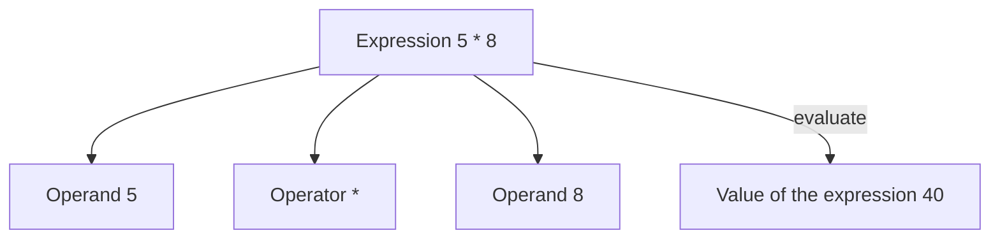

*Figure 10. The operands and operator that make up the expression 5 * 8, and its value*

### 8.2 Arithmetic Operators

Python represents addition, subtraction, multiplication, division, and the remainder operation with the following symbols.

| Operation | Symbol | Example | Result |
|:-----|:-----|:-----|:-----|
| Addition | `+` | `7 + 4` | 11 |
| Subtraction | `-` | `7 - 4` | 3 |
| Multiplication | `*` | `7 * 4` | 28 |
| Division (quotient) | `//` | `7 // 4` | 1 |
| Division | `/` | `7 / 4` | 1.75 |
| Remainder | `%` | `7 % 4` | 3 |

*Table 5. Python's arithmetic operators and examples of their calculation*

The multiplication symbol is `*`, not ×. There are two division operators. `/` is division calculated to the digits after the decimal point, and even `8 / 4`, which divides evenly, gives the floating-point number `2.0`. `//` is **floor division**, which gives only the quotient, and `%` gives the **remainder** left after division. Dividing 7 by 4 gives a quotient of 1 and a remainder of 3, so `7 // 4` is 1 and `7 % 4` is 3. In C, the same `/` produces a quotient or a floating-point result depending on whether the operands are integers or floating-point numbers, but in Python variables are not declared with data types, so the data types of the operands cannot be known just by looking at the code, and the two divisions are therefore distinguished as different operators [3].

> **Caution:** When negative numbers are involved, `//` does not discard the digits after the decimal point but rounds down toward the left on the number line, that is, toward the smaller integer. So `-7 // 2` is -4, not -3, and `-7 % 2` is 1. In Python, `a == (a // b) * b + a % b` always holds, and the result of `%` has the same sign as the divisor `b` [6]. For example, (-4) × 2 + 1 = -7.

---

<br>

## 9. User Input

### 9.1 Integer Input: `input()` and `int()`

Like the work order of Section 1.1, a program that reads two integers from the user and prints their sum is as follows.

```python
x = int(input("Enter the first integer: "))
y = int(input("Enter the second integer: "))
sum = x + y
print("The sum of", x, "and", y, "is", sum)
```

```text
Enter the first integer: 300
Enter the second integer: 400
The sum of 300 and 400 is 700
```

In the output, 300 and 400 are values the user typed on the keyboard before pressing Enter. Line 1, `x = int(input("Enter the first integer: "))`, is executed from the inside out in the following order.

1. `input("Enter the first integer: ")` prints the prompt message in the parentheses and receives what the user enters in the form of a **string**. If the user enters 300, the result is the string `"300"`.
2. `int(...)` converts the string the user entered into the number (integer) 300.
3. `x = ...` stores the integer 300 in the variable `x`.

Line 2 stores 400 in `y` in the same way, and line 3 calculates 300 + 400 = 700 and stores it in `sum`. The `print()` on line 4 prints six values separated by spaces, giving `The sum of 300 and 400 is 700`.

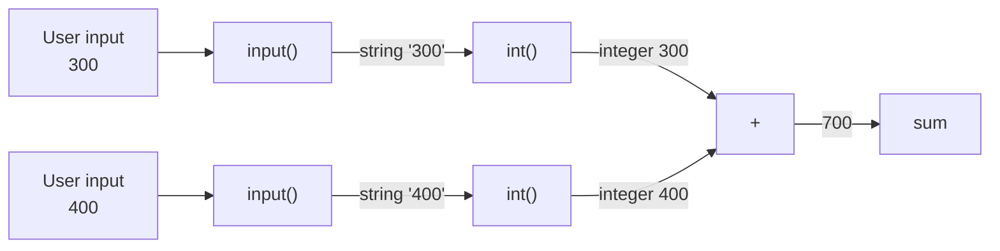

*Figure 11. How two inputs become 700 through input(), int(), and addition*

If `int()` is removed and the lines are written as `x = input(...)` and `y = input(...)`, then `x` and `y` are the strings `"300"` and `"400"`, and `+` joins the two strings (Section 7.2). So the output is `The sum of 300 and 400 is 300400`. Using `float()` instead of `int()` converts the input to floating-point numbers, printing `The sum of 300.0 and 400.0 is 700.0`.

> **Caution:** `int()` converts only strings that look like integers. Entering `3.5` or `abc` where an integer is expected causes an error such as `ValueError: invalid literal for int() with base 10: '3.5'`, and the program stops. Also, this program stores the sum in a variable named `sum`, but `sum` is also the name of a Python built-in function that adds up several values. Using the same name for a variable makes the built-in function `sum()` unusable in that program, so a name that does not clash, such as `total`, is safer.

### 9.2 String Input

For a value made of letters, such as a name, the string returned by `input()` is stored in a variable as is.

```python
name = input("Enter your name: ")
print("Nice to meet you,", name)
print("Welcome to Python.")
```

```text
Enter your name: Hong Gildong
Nice to meet you, Hong Gildong
Welcome to Python.
```

The string `"Hong Gildong"` entered by the user goes into the box named `name`, and the `print()` on line 2 takes it out and prints it together with another string. The letters entered do not need to be converted to a number, so `int()` is not used. Problems that use the input and output of this section together are [Exercise 2](Exercises.md#exercise-2-robot-reporter) and [Exercise 6](Exercises.md#exercise-6-greeting-and-the-sum-of-two-integers).

---

<br>

## 10. Uses of the Remainder Operator

Using the quotient operator `//` and the remainder operator `%` together gives both the quotient and the remainder of a division.

```python
p = int(input("Enter the numerator: "))
q = int(input("Enter the denominator: "))
print("Quotient =", p // q)
print("Remainder =", p % q)
```

```text
Enter the numerator: 7
Enter the denominator: 4
Quotient = 1
Remainder = 3
```

Since 7 = 4 × 1 + 3, the quotient is 1 and the remainder is 3. The remainder operator is used in places such as the following.

**Distinguishing even and odd numbers.** The remainder of an integer divided by 2 is 0 if the integer is even and 1 if it is odd.

```python
number = int(input("Enter an integer: "))
print(number % 2)
```

```text
Enter an integer: 28
0
```

Since 28 = 2 × 14 + 0, 0 is printed, showing that the number is even. Entering 7 prints 1, since 7 = 2 × 3 + 1. Choosing between printing "Even" and "Odd" depending on whether the remainder is 0 requires a conditional statement (Lecture 4).

**Converting a time in seconds to minutes and seconds.** One minute is 60 seconds, so dividing a time in seconds by 60 gives the minutes as the quotient and the remaining seconds as the remainder.

```python
sec = 1000
min = 1000 // 60
remainder = 1000 % 60
print(min, remainder)
```

```text
16 40
```

Since 1000 = 60 × 16 + 40, 1000 seconds is 16 minutes and 40 seconds.

> **Caution:** This code stores 1000 in `sec` on line 1 but then writes 1000 directly on lines 2 and 3, so calculating a different time requires changing all three places. Using the variable, as in `min = sec // 60` and `remainder = sec % 60`, means only line 1 has to change. Also, `min` is the name of a built-in function that finds the smallest value, so, as with `sum` in Section 9.1, another name such as `minutes` is safer.

---

<br>

## 11. The Exponentiation Operator and Compound Assignment Operators

### 11.1 The Exponentiation Operator

To calculate a power (exponentiation), use the `**` operator. `a ** b` is $a^b$.

```pycon
>>> 2 ** 7
128
```

$2^7 = 2 \times 2 \times 2 \times 2 \times 2 \times 2 \times 2 = 128$. The exponentiation operator can be used to calculate the principal plus interest. If a principal $a$ is deposited for $n$ years with compound interest at an annual rate $r$, it becomes $a(1 + r)$ after one year and $a(1 + r)(1 + r) = a(1 + r)^2$ after two years, and in the same way the principal plus interest after $n$ years is as follows.

$$a(1 + r)^n$$

Substituting a principal of 1000, an annual rate of 5% (0.05), and a period of 10 years gives the following.

```pycon
>>> a = 1000
>>> r = 0.05
>>> n = 10
>>> a * (1 + r) ** n
1628.894626777442
```

Because `**` is calculated before `*` (Section 13), $(1 + 0.05)^{10} = 1.05^{10} \approx 1.628894626777442$ is found first and then multiplied by 1000. The principal plus interest after 10 years is about 1628.89.

> **Note:** Floating-point numbers are stored in binary inside the computer, so a value such as 0.05 that cannot be represented exactly in binary is stored as the nearest approximation. As a result, a small error can appear in the last digits of floating-point calculations. For example, `0.1 + 0.2` is `0.30000000000000004` [7]. Values that must be exact, such as money, are printed after rounding the result.

### 11.2 Compound Assignment Operators

A **compound assignment operator** is an operator, such as `+=`, that combines the assignment operator with another operator. It is also called a compound operator for short.

| Compound Assignment Operator | Meaning |
|:-----|:-----|
| `x += y` | `x = x + y` |
| `x -= y` | `x = x - y` |
| `x *= y` | `x = x * y` |
| `x /= y` | `x = x / y` |
| `x %= y` | `x = x % y` |

*Table 6. Compound assignment operators and their meanings*

Other arithmetic operators have compound assignment operators of the same form, such as `//=` and `**=`. The following program increases the value of `x` by 2 and then decreases it by 2 again.

```python
x = 1000
print("Initial x =", x)
x += 2
print("After x += 2, x =", x)
x -= 2
print("After x -= 2, x =", x)
```

```text
Initial x = 1000
After x += 2, x = 1002
After x -= 2, x = 1000
```

`x += 2` is the same as `x = x + 2`, so 1000 + 2 = 1002 on the right is calculated and stored back in `x`. Then `x -= 2` stores 1002 - 2 = 1000.

> **Note:** Python has no increment and decrement operators like C's `x++` and `x--`. `x++` is a `SyntaxError: invalid syntax`, and `++x` is not an error but merely an expression with the sign `+` applied twice, so the value of `x` does not change. In Python, write `x += 1`.

---

<br>

## 12. Comments

A **comment** is like an explanatory note attached to source code. A comment explains what the program does and does not affect the result of the program. In Python, everything from `#` to the end of the line is a comment. A comment can take up a whole line or follow a statement.

```python
# Read a Fahrenheit temperature from the user.
ftemp = int(input("Fahrenheit: "))
ctemp = (ftemp - 32.0) * 5.0 / 9.0   # Fahrenheit -> Celsius
print("Celsius:", ctemp)             # print the Celsius temperature
```

```text
Fahrenheit: 90
Celsius: 32.22222222222222
```

The interpreter skips the characters after `#` without reading them, so deleting all the comments gives the same result. Entering 212 prints `100.0`, the boiling point of water. A comment should state what is hard to tell from the code alone, for example, what a calculation is for or why it was done in a certain way.

---

<br>

## 13. Operator Precedence

### 13.1 Precedence and Parentheses

When an expression has several operators, the operators with higher **operator precedence** are calculated first. As in mathematics, the multiplication, division, and remainder operators have higher precedence than the addition and subtraction operators. A part to be calculated first is enclosed in parentheses.

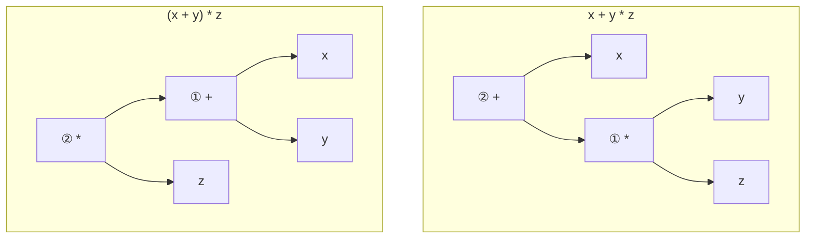

*Figure 12. Expression trees showing the order of calculation in x + y * z and (x + y) * z*

In Figure 12, the lower operator is calculated first (①). In `x + y * z`, `y * z` is calculated first and `x` is added to the result, while in `(x + y) * z`, `x + y` in the parentheses is calculated first and the result is multiplied by `z`.

```pycon
>>> 10 + 20 / 2
20.0
>>> (10 + 20) / 2
15.0
```

The first expression calculates 20 / 2 = 10.0 first, giving 10 + 10.0 = 20.0. The second expression calculates 10 + 20 = 30 in the parentheses first, giving 30 / 2 = 15.0. When the precedence is confusing, adding parentheses makes the intent clear.

### 13.2 The Precedence Table and Associativity

| Rank | Operator | Description |
|:-----|:-----|:-----|
| 1 | `**` | Exponentiation operator |
| 2 | `~` `+` `-` | Unary operators |
| 3 | `*` `/` `%` `//` | Multiplication, division, and remainder operators |
| 4 | `+` `-` | Addition, subtraction |
| 5 | `>>` `<<` | Bit shift operators |
| 6 | `&` | Bitwise AND operator |
| 7 | `^` `\|` | Bitwise XOR operator, bitwise OR operator |

*Table 7. Precedence of the arithmetic and bitwise operators (1 is the highest)*

The **unary operators** of rank 2 are operators attached to a single operand: the sign `-` in `-5`, the sign `+` in `+5`, and `~`, which flips bits (Section 13.3). The `+` and `-` of rank 4 are addition and subtraction as binary operators placed between two operands.

When operators of the same precedence follow one another, they are calculated according to their **associativity**. Most operators are calculated from left to right, so `7 - 4 - 1` is (7 - 4) - 1 = 2 and `8 / 4 / 2` is (8 / 4) / 2 = 1.0. Only exponentiation `**` is calculated from right to left, so `2 ** 3 ** 2` is $2^{(3^2)} = 2^9 = 512$, which differs from `(2 ** 3) ** 2` = 64 [6].

```pycon
>>> 7 - 4 - 1
2
>>> 2 ** 3 ** 2
512
>>> -2 ** 2
-4
>>> (-2) ** 2
4
```

> **Caution:** `**` is calculated before a unary operator on its left, so `-2 ** 2` is $-(2^2) = -4$. To square a negative number, use parentheses, as in `(-2) ** 2`. On the other hand, a unary operator on the right is applied first, so `2 ** -1` is $2^{-1} = 0.5$. Also, Table 7 is simplified; in Python, `&`, `^`, and `|` each have a different rank, in that order. Relational operators (`<`, `==`, and so on) and logical operators (`not`, `and`, `or`) have lower precedence than all the operators in the table and are covered in Lecture 4 [6].

### 13.3 Bitwise Operators

Ranks 5-7 of Table 7 are **bitwise operators**, which calculate bit by bit (0 or 1) when integers are written in binary. 6 is `110` in binary and 3 is `011`, so the following rules are applied to each position.

| A | B | A AND B (`&`) | A OR B (`\|`) | A XOR B (`^`) |
|:-----|:-----|:-----|:-----|:-----|
| 0 | 0 | 0 | 0 | 0 |
| 0 | 1 | 0 | 1 | 1 |
| 1 | 0 | 0 | 1 | 1 |
| 1 | 1 | 1 | 1 | 0 |

*Table 8. Results of AND, OR, and XOR on a single bit*

AND is 1 only when both bits are 1, OR is 1 when at least one is 1, and XOR is 1 only when the two bits differ.

```text
      110  (6)        110  (6)        110  (6)
    & 011  (3)      | 011  (3)      ^ 011  (3)
    -----           -----           -----
      010  (2)        111  (7)        101  (5)
```

The bit shift operators `<<` and `>>` move all bits to the left or right. `6 << 1` shifts `110` one place to the left, giving `1100`, which is 12, and `6 >> 1` shifts it one place to the right, dropping the last bit and giving `11`, which is 3. Shifting one place to the left gives the value multiplied by 2, and shifting one place to the right gives the quotient divided by 2.

```pycon
>>> 6 & 3
2
>>> 6 | 3
7
>>> 6 ^ 3
5
>>> 6 << 1
12
>>> 6 >> 1
3
>>> ~6
-7
```

> **[Digital Logic Design]** `&`, `|`, and `^` apply the logic gates AND, OR, and XOR to each bit of integers. `~` is NOT, which flips every bit, and for integers in which negative numbers are represented in two's complement, flipping every bit gives $-x - 1$, so `~6` is -7. Boolean algebra, logic gates, and two's complement representation are covered in Digital Logic Design.

---

<br>

## Concept Applications

**Exercises and Concepts:** The [exercises](Exercises.md) of Lecture 2 use the following concepts.

| Exercise | Concepts Used |
|:-----|:-----|
| 1. Practicing the `print()` function | Printing strings, printing several values, and expression arguments (Section 4.2) |
| 2. Robot reporter | String input, variables, and printing several values (Sections 7 and 9.2) |
| 3. Coffee shop sales | Integer input, multiplication and addition, and reassigning variables (Sections 8 and 9.1) |
| 4. Vending machine | Finding coin counts with the quotient and remainder operators (Section 10) |
| 5. Computing an average | Operator precedence and parentheses (Section 13.1) |
| 6. Greeting and the sum of two integers | Using string input and integer input together (Section 9) |
| 7. Four arithmetic operations on two integers | Arithmetic operators and the floating-point result of `/` (Section 8.2) |
| 8. Sum of digits | Taking out digits one at a time with `//` and `%` (Section 10) |

*Table 9. The exercises and the concepts each one uses*

**True/False Check:**

| Statement | Judgment and Reason |
|:-----|:------------|
| Code entered in the IDLE shell remains after IDLE is closed and opened again. | **F.** Code in the shell is not saved. Code to be kept is saved as a `.py` file by opening an editor with [File] → [New File]. |
| `print("Sum:", 3 + 4)` prints `Sum: 7`. | **T.** The argument `3 + 4` is first evaluated to 7, and one space is placed between the two values. |
| When the turtle executes `t.right(90)`, it moves 90 to the right. | **F.** `right(90)` turns the turtle 90 degrees clockwise in place; moving is done by `forward()`. |
| `_count` and `count2` are valid variable names, but `2count` is not. | **T.** A name must start with a letter or an underscore and cannot start with a digit. |
| To add 3 to `"5"` received from `input()`, it must be converted with `int()`. | **T.** `input()` always returns a string, so convert it to an integer first, as in `int("5") + 3`. `"5" + 3` is an error. |
| The result of `7 / 7` is the integer 1. | **F.** `/` always produces a floating-point result, so it is `1.0`. The integer quotient is obtained with `7 // 7`. |
| `10 - 2 * 3` and `(10 - 2) * 3` have the same value. | **F.** The first multiplies first and gives 4, and the second calculates the parentheses first and gives 24. |
| `x += 3` is the same as `x = x + 3`. | **T.** A compound assignment operator stores the result of the operation back in the same variable. |

---

<br>

## Summary

| Concept | Key Summary |
|:-----|:----------|
| Program | A document listing the instructions for a computer to carry out; the computer carries out only the instructions written, in order. |
| Programming languages and translation | A person writes source code in a high-level language, and a compiler or interpreter turns it into a form the machine can execute. |
| Features of Python | Its syntax is easy, it runs on many platforms, its libraries are rich, and graphics are easy to use. |
| Installation and IDLE | Download Python 3 from python.org, check Add Python to PATH when installing, and write code with the IDLE shell and editor. |
| Interactive mode | Statements entered after `>>>` in the shell are executed immediately, and the code entered is not saved. |
| Script mode | Code is saved in a `.py` source file and the entire file is run with Run Module (F5). |
| `print()` | Prints several comma-separated values with one space between them and then moves to a new line. |
| Turtle graphics | Draws its trail as lines while changing the position and heading of the turtle with `forward()`, `right()`, and `left()`. |
| Variables and assignment | A variable is a name that stores a value, and `=` is the assignment operator, which evaluates the right side and stores it in the variable on the left. |
| Data types | There are integers (`int`), floating-point numbers (`float`), and strings (`str`), which can be checked with `type()`. |
| Variable names | Made of English letters, digits, and underscores; cannot start with a digit; case-sensitive; and keywords cannot be used. |
| Arithmetic operators | `+`, `-`, `*`, `/` (floating-point division), `//` (quotient), `%` (remainder), and `**` (exponentiation). |
| `input()` and `int()` | `input()` always returns its input as a string, so to calculate with it as a number, convert it with `int()` or `float()`. |
| Remainder operator | Used where a quotient and remainder are needed, such as telling even from odd, converting seconds to minutes and seconds, and calculating change. |
| Compound assignment operators | `x += y` is the same as `x = x + y`, and Python has no `++` or `--`. |
| Comments | Run from `#` to the end of the line, do not affect execution, and explain the code. |
| Operator precedence | Calculation proceeds in the order `**`, unary operators, `*` `/` `//` `%`, then `+` `-`, and operators of the same rank are calculated from the left (only `**` from the right). |
| Bitwise operators | `&`, `\|`, `^`, `~`, `<<`, and `>>` calculate on the bits of integers. |

---

<br>

## Self-Check Questions

1. **Interactive mode and script mode:** Explain the difference between the two modes in terms of how code is executed and whether it is saved.

   <details>
   <summary>Answer</summary>

   The interactive mode executes each statement immediately as it is entered after the shell prompt `>>>` and shows the result, and the code entered is not kept in a file. The script mode saves code as a `.py` source file in secondary storage and runs the entire file at once, so the code remains after the computer is turned off and can be reopened and edited.

   </details>

2. **Output of `print()`:** Write the output of `print("The price is", 3 * 500, "won")`.

   <details>
   <summary>Answer</summary>

   `The price is 1500 won`. The argument `3 * 500` is first evaluated to 1500, and `print()` puts one space between each of the three values.

   </details>

3. **Turtle graphics:** A turtle is at the origin facing east. Find its position and heading after executing `t.left(90)`, `t.forward(50)`, `t.right(90)`, and `t.forward(30)` in order.

   <details>
   <summary>Answer</summary>

   `left(90)` makes it face north (90 degrees), and `forward(50)` takes it to (0, 50). `right(90)` makes it face east (0 degrees) again, and `forward(30)` takes it to (30, 50). The final state is position (30, 50) and heading 0 degrees (east).

   </details>

4. **Variable names:** Among `total_price`, `3rd_place`, `myScore`, `while`, and `price$`, choose the ones that cannot be used as variable names and give the reasons.

   <details>
   <summary>Answer</summary>

   `3rd_place` starts with a digit, `while` is a Python keyword, and `price$` contains the special character `$`, so they cannot be used. `total_price` (snake case) and `myScore` (camel case) can be used.

   </details>

5. **Division operators:** Find the values of `17 / 5`, `17 // 5`, and `17 % 5`.

   <details>
   <summary>Answer</summary>

   Since 17 = 5 × 3 + 2, `17 // 5` is 3 and `17 % 5` is 2. `17 / 5` is calculated to the digits after the decimal point and is 3.4.

   </details>

6. **Input and type conversion:** What does the following code print when 5 and 7 are entered? How must it be changed to print 12?

   ```python
   a = input("a: ")
   b = input("b: ")
   print(a + b)
   ```

   <details>
   <summary>Answer</summary>

   `input()` returns strings, so `a` is `"5"` and `b` is `"7"`, and `+` joins the two strings, printing `57`. Converting them to integers with `int()`, as in `a = int(input("a: "))` and `b = int(input("b: "))`, prints 5 + 7 = 12.

   </details>

7. **Using the remainder operator:** How many hours, minutes, and seconds are 3725 seconds? Show the calculation using `//` and `%`.

   <details>
   <summary>Answer</summary>

   One hour is 3600 seconds, so `3725 // 3600` = 1 hour, and the remaining seconds are `3725 % 3600` = 125. Dividing 125 seconds by 60 gives `125 // 60` = 2 minutes and `125 % 60` = 5 seconds. So it is 1 hour, 2 minutes, and 5 seconds.

   </details>

8. **Compound assignment operators:** Starting from `x = 10`, find the value of `x` after executing `x += 5`, `x *= 2`, `x //= 4`, and `x %= 4` in order.

   <details>
   <summary>Answer</summary>

   10 + 5 = 15, 15 × 2 = 30, 30 // 4 = 7, and 7 % 4 = 3, so `x` is 3.

   </details>

9. **Operator precedence:** Find the value of `2 + 3 * 4 ** 2 // 5` along with the order of calculation.

   <details>
   <summary>Answer</summary>

   `**` is calculated first: 4 ** 2 = 16. Next, `*` and `//`, which have the same precedence, are calculated from the left: 3 * 16 = 48 and 48 // 5 = 9. Finally, 2 + 9 = 11.

   </details>

10. **Bitwise operators:** Find the values of `5 & 6`, `5 | 6`, and `5 ^ 6` by calculating in binary.

    <details>
    <summary>Answer</summary>

    5 is `101` and 6 is `110`. AND is 1 only where both are 1, giving `100` = 4; OR is 1 where at least one is 1, giving `111` = 7; and XOR is 1 only where they differ, giving `011` = 3.

    </details>

---

<br>

## References

1. Python Software Foundation, "IDLE," *The Python Standard Library*, accessed Nov. 4, 2026. https://docs.python.org/3/library/idle.html
2. Python Software Foundation, "Built-in Functions," *The Python Standard Library*, accessed Nov. 4, 2026. https://docs.python.org/3/library/functions.html
3. M. Zadka and G. van Rossum, "PEP 238: Changing the Division Operator," *Python Enhancement Proposals*, 2001. https://peps.python.org/pep-0238/
4. Python Software Foundation, "turtle: Turtle graphics," *The Python Standard Library*, accessed Nov. 4, 2026. https://docs.python.org/3/library/turtle.html
5. G. van Rossum, B. Warsaw, and A. Coghlan, "PEP 8: Style Guide for Python Code," *Python Enhancement Proposals*, 2001. https://peps.python.org/pep-0008/
6. Python Software Foundation, "Expressions," *The Python Language Reference*, accessed Nov. 4, 2026. https://docs.python.org/3/reference/expressions.html
7. Python Software Foundation, "Floating-Point Arithmetic: Issues and Limitations," *The Python Tutorial*, accessed Nov. 4, 2026. https://docs.python.org/3/tutorial/floatingpoint.html
