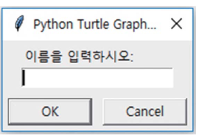
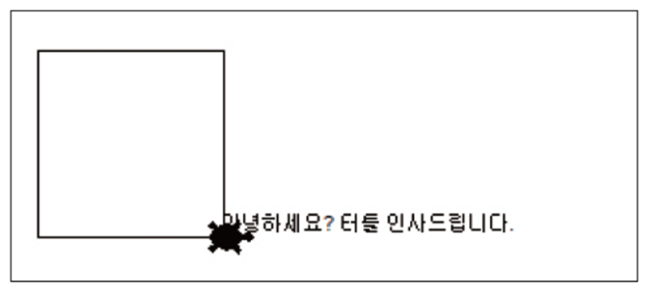

# 3강 — 자료의 종류

[레포지토리 안내](../../README.ko.md) | [English](Concepts_Lecture.md) | [한국어](Concepts_Lecture.ko.md)

> **최종 수정일:** 2026-11-19

> **학습 목표:**
> 1. 파이썬의 기본 자료형인 정수, 실수, 문자열을 구분하고, 값이 객체이며 변수는 객체를 참조하는 이름이라는 점을 이용하여 `is`와 `==`의 차이를 설명할 수 있다
> 2. `int()`, `float()`, `str()`로 문자열과 숫자를 서로 변환하고, 정수의 무한 정밀도와 실수의 반올림 오차, `round()`의 동작을 설명할 수 있다
> 3. `+`, `*`, `%` 연산자와 f-문자열, `format()`으로 문자열을 접합, 반복, 형식화하고, 문자열 메서드로 문자열을 가공할 수 있다
> 4. 인덱싱과 증가값이 있는 슬라이싱으로 문자열에서 문자와 부분 문자열을 추출하고, 이스케이프 시퀀스로 특수 문자를 표현할 수 있다
> 5. 터틀 그래픽에서 `textinput()`과 `write()`로 문자열을 입력받고 출력할 수 있다
> 6. 리스트를 만들고 `append()`로 요소를 추가하며 인덱스로 요소에 접근할 수 있다

---

## 목차

- [1. 파이썬의 자료형](#1-파이썬의-자료형)
  - [1.1 기본 자료형](#11-기본-자료형)
  - [1.2 변수와 자료형](#12-변수와-자료형)
  - [1.3 객체, 이름, 참조](#13-객체-이름-참조)
  - [1.4 정수와 실수의 성질](#14-정수와-실수의-성질)
- [2. 문자열](#2-문자열)
  - [2.1 문자열의 개념](#21-문자열의-개념)
  - [2.2 문자열 만들기](#22-문자열-만들기)
  - [2.3 숫자와 문자열의 차이](#23-숫자와-문자열의-차이)
- [3. 자료형 변환](#3-자료형-변환)
  - [3.1 문자열을 숫자로 변환](#31-문자열을-숫자로-변환)
  - [3.2 숫자를 문자열로 변환](#32-숫자를-문자열로-변환)
- [4. 문자열 연산](#4-문자열-연산)
  - [4.1 접합](#41-접합)
  - [4.2 반복](#42-반복)
  - [4.3 문자열 형식화](#43-문자열-형식화)
  - [4.4 f-문자열과 format()](#44-f-문자열과-format)
  - [4.5 문자열 메서드](#45-문자열-메서드)
- [5. 인덱싱과 슬라이싱](#5-인덱싱과-슬라이싱)
  - [5.1 인덱스](#51-인덱스)
  - [5.2 슬라이싱](#52-슬라이싱)
  - [5.3 문자열의 길이와 불변성](#53-문자열의-길이와-불변성)
  - [5.4 증가값이 있는 슬라이싱과 슬라이싱의 규칙](#54-증가값이-있는-슬라이싱과-슬라이싱의-규칙)
- [6. 이스케이프 시퀀스](#6-이스케이프-시퀀스)
- [7. 터틀 그래픽에서의 문자열 입출력](#7-터틀-그래픽에서의-문자열-입출력)
  - [7.1 문자열 입력](#71-문자열-입력)
  - [7.2 문자열 출력](#72-문자열-출력)
- [8. 리스트](#8-리스트)
  - [8.1 리스트 만들기](#81-리스트-만들기)
  - [8.2 요소 추가](#82-요소-추가)
  - [8.3 요소 접근](#83-요소-접근)
- [개념 적용](#개념-적용)
- [요약](#요약)
- [점검 문제](#점검-문제)
- [참고 문헌](#참고-문헌)

---

<br>

## 1. 파이썬의 자료형

### 1.1 기본 자료형

프로그램이 다루는 값에는 종류가 있으며, 이 종류를 **자료형(data type)** 이라고 한다. 자료형은 값이 무엇을 나타내는지, 그리고 그 값에 어떤 연산을 적용할 수 있는지를 결정한다. 예를 들어 두 정수에 `+`를 적용하면 산술 덧셈의 결과가 나오지만, 두 문자열에 `+`를 적용하면 두 문자열을 이어 붙인 결과가 나온다(2.3절). 파이썬에서 가장 기본이 되는 자료형은 다음 세 가지이다.

| 자료형 | 파이썬의 이름 | 예 | 설명 |
|:-----|:-----|:-----|:-----|
| 정수 | `int` | `..., -2, -1, 0, 1, 2, ...` | 소수점이 없는 수 |
| 실수 | `float` | `3.2`, `3.14`, `0.12` | 소수점이 있는 수 |
| 문자열 | `str` | `'Hello World!'`, `"123"` | 따옴표로 감싼 문자들의 나열 |

*표 1. 파이썬의 기본 자료형*

**정수(integer)** 는 소수점이 없는 수이다. 파이썬의 정수는 크기에 제한이 없어서 메모리가 허락하는 한 아무리 큰 정수도 정확하게 표현한다 [1]. 예를 들어 `2 ** 100`(2의 100제곱)을 계산하면 `1267650600228229401496703205376`이 그대로 나온다.

**실수(floating-point number)** 는 소수점이 있는 수이다. 컴퓨터는 실수를 2진수의 부동소수점(floating point) 방식으로 저장하며, 파이썬의 `float`는 대부분의 플랫폼에서 64비트 배정도(double precision) 형식을 쓴다 [1]. 0.1처럼 2진수로 나타내면 끝없이 반복되는 소수는 유한한 비트에 담기지 않으므로 근삿값으로 저장된다. 그래서 다음과 같이 `0.1 + 0.2`가 정확히 0.3이 되지 않는다.

```pycon
>>> 0.1 + 0.2
0.30000000000000004
```

> **[컴퓨터구조]** 실수를 부호, 지수, 가수로 나누어 저장하는 IEEE 754 부동소수점 형식과 이를 계산하는 산술 장치는 컴퓨터구조의 데이터 표현과 산술 장치에서 다룬다.

**문자열(string)** 은 따옴표로 감싼 문자들의 나열이다. `"123"`처럼 숫자로만 이루어져 있어도 따옴표로 감싸면 정수가 아니라 문자열이다(2.3절). 이 세 가지 외에 참과 거짓을 나타내는 부울(Boolean) 자료형 `bool`이 있으며, 4강에서 조건문과 함께 다룬다.

### 1.2 변수와 자료형

**변수(variable)** 는 값에 붙인 이름이다(2강). C나 Java 같은 언어에서는 변수를 만들 때 자료형을 선언하고, 그 변수에는 선언한 자료형의 값만 저장할 수 있다. 파이썬에서는 변수에 자료형을 선언하지 않으며, 한 변수에 어떤 종류의 자료도 저장할 수 있다. 자료형은 변수가 아니라 값이 가지고 있고, 변수는 지금 가리키는 값의 자료형을 따른다. 이런 방식을 **동적 타이핑(dynamic typing)** 이라고 한다.

```python
x = 10
print("x =", x)
x = 3.14
print("x =", x)
x = "Hello World!"
print("x =", x)
```

```text
x = 10
x = 3.14
x = Hello World!
```

- **1행:** 변수 `x`에 정수 10을 저장한다.
- **2행:** `print()`는 쉼표로 구분한 인수들을 차례로 출력하면서 사이에 공백 하나를 넣는다. 첫 번째 인수 `"x ="`는 그대로 출력할 문자열이고, 두 번째 인수 `x`는 변수에 저장된 값이므로 `x = 10`이 출력된다.
- **3~6행:** 같은 변수 `x`에 실수 3.14와 문자열 `"Hello World!"`를 차례로 저장하고 출력한다. 새 값을 저장하면 `x`는 새 값을 가리키며, 이전 값은 더 이상 `x`로 접근할 수 없다.

값의 자료형은 내장 함수(built-in function) `type()`으로 확인한다 [2]. 내장 함수는 파이썬이 기본으로 제공하여 `import` 없이 쓸 수 있는 함수이다.

```python
x = 10
print(type(x))
x = 3.14
print(type(x))
x = "Hello World!"
print(type(x))
```

```text
<class 'int'>
<class 'float'>
<class 'str'>
```

`<class 'int'>`는 값이 `int` 클래스, 곧 정수형이라는 뜻이다. 파이썬의 자료형은 클래스(class)로 구현되어 있으므로 `type()`의 결과가 `<class '...'>` 형태로 표시된다. 클래스는 8강에서 다룬다.

### 1.3 객체, 이름, 참조

파이썬 프로그램이 다루는 모든 값은 **객체(object)** 이다. 정수 10, 문자열 `"Hello"`, 리스트 `[1, 2]`가 모두 객체이며, 파이썬은 객체를 만들 때마다 메모리의 한 자리를 내준다. 모든 객체는 다음 세 가지를 가진다 [3].

| 성질 | 뜻 | 확인하는 방법 | 변경 가능 여부 |
|:-----|:-----|:-----|:-----|
| 정체성(identity) | 객체를 다른 객체와 구별하는 고유한 정수이며, 객체가 메모리에 놓인 위치로 생각할 수 있다 | `id()`, `is` 연산자 | 객체가 만들어진 뒤에는 바뀌지 않는다 |
| 자료형(type) | 객체가 어떤 종류의 값이고 어떤 연산을 지원하는지를 정한다 | `type()` | 바뀌지 않는다 |
| 값(value) | 객체가 나타내는 내용이다 | `==` 연산자, 출력 | 자료형에 따라 바뀔 수 있는 객체와 바뀔 수 없는 객체가 있다 |

*표 2. 모든 객체가 가지는 세 가지 성질*

> **용어 정의:** **참조(reference)** 는 이름과 객체 사이의 연결이다. 대입문 `x = 10`은 정수 객체 10을 준비하고, 이름 `x`가 그 객체를 참조하게 한다. 파이썬의 변수는 값을 담는 상자가 아니라 객체에 붙인 이름표이며, 하나의 객체에 이름표가 여러 개 붙을 수 있다.

다음 세 문장을 차례로 실행할 때 이름과 객체의 관계는 그림 1과 같이 바뀐다.

```text
① x = 10      x ──→ ┌────┐
                    │ 10 │
                    └────┘

② y = x       x ──→ ┌────┐
              y ──→ │ 10 │   두 이름이 같은 객체를 참조한다
                    └────┘

③ x = x + 1   x ──→ ┌────┐
                    │ 11 │   새 객체 11을 만들어 x에 연결한다
                    └────┘
              y ──→ ┌────┐
                    │ 10 │   y는 그대로 10을 참조한다
                    └────┘
```

*그림 1. 대입문에 따라 이름이 참조하는 객체가 바뀌는 과정*

②의 `y = x`는 값 10을 복사하여 새 상자에 넣는 것이 아니라, `x`가 참조하는 객체를 `y`도 참조하게 한다. ③의 `x = x + 1`은 오른쪽의 `x + 1`을 계산하여 새 정수 객체 11을 만들고, 이름 `x`를 그 객체로 옮겨 붙인다. 정수 객체 10 자체는 바뀌지 않으므로 `y`는 여전히 10을 참조한다. 이 과정은 `id()`와 `is`로 확인할 수 있다.

```pycon
>>> x = 10
>>> y = x
>>> x is y
True
>>> id(x) == id(y)
True
>>> x = x + 1
>>> x, y
(11, 10)
>>> x is y
False
```

`id()`는 객체의 정체성을 나타내는 정수를 돌려주며, CPython에서는 객체가 놓인 메모리 주소이다 [2]. 두 이름의 `id()`가 같다는 것은 두 이름이 하나의 객체를 참조한다는 뜻이다. `x is y`는 바로 이것, 곧 두 피연산자가 같은 객체인지를 검사하는 **동일성 비교(identity comparison)** 이다. 반면 `==`는 두 객체의 값이 같은지를 검사한다. 두 연산자의 차이는 값이 같은 객체를 따로 만들었을 때 드러난다.

```pycon
>>> a = [1, 2]
>>> b = [1, 2]
>>> a == b
True
>>> a is b
False
>>> c = a
>>> c is a
True
>>> c.append(3)
>>> a
[1, 2, 3]
>>> b
[1, 2]
```

- **1~2행:** 리스트 리터럴을 두 번 썼으므로 내용이 같은 리스트 객체가 두 개 만들어진다.
- **3~6행:** 두 리스트의 값은 같으므로 `a == b`는 `True`이지만, 서로 다른 객체이므로 `a is b`는 `False`이다.
- **7~9행:** `c = a`는 새 리스트를 만들지 않고 `a`가 참조하는 객체에 이름 `c`를 하나 더 붙인다.
- **10~14행:** `c`를 통해 요소를 추가하면 `a`로 보아도 바뀌어 있다. 두 이름이 같은 객체를 참조하기 때문이다. 따로 만든 `b`는 영향을 받지 않는다.

10행처럼 객체를 새로 만들지 않고 내용을 바꿀 수 있는 객체를 **가변(mutable)** 객체, 만든 뒤에는 내용을 바꿀 수 없는 객체를 **불변(immutable)** 객체라고 한다. 객체가 가변인지 불변인지는 자료형이 정하며, 수, 문자열, 튜플은 불변이고 리스트와 딕셔너리는 가변이다 [3]. 불변 객체의 값을 바꾸는 것처럼 보이는 문장, 예를 들어 `x = x + 1`이나 `s = s + "!"`는 언제나 새 객체를 만들어 이름을 옮겨 붙인다. 그래서 그림 1의 `y`처럼 같은 객체를 참조하던 다른 이름은 영향을 받지 않는다. 가변 객체에 이름이 여러 개 붙어 있을 때 생기는 일은 7강 9절에서 자세히 다룬다.

> **주의:** 수나 문자열의 비교에는 `is`가 아니라 `==`를 써야 한다. 값이 같은 불변 객체를 새로 만들지, 이미 있는 객체를 다시 쓸지는 구현이 정하는 문제이므로 `is`의 결과에 기대면 안 된다 [3]. 실제로 CPython은 작은 정수 객체를 미리 만들어 두고 다시 쓰기 때문에 `x = 11`에서 `x is 11`이 `True`로 나오지만 이것은 보장되지 않으며, 파이썬 3.8부터는 `is`를 수나 문자열 리터럴에 쓰면 `SyntaxWarning: "is" with 'int' literal. Did you mean "=="?` 같은 경고를 낸다 [4]. `is`는 `x is None`처럼 유일한 객체인지를 검사할 때 쓴다.

### 1.4 정수와 실수의 성질

1.1절에서 본 것처럼 파이썬의 정수는 크기에 제한이 없다 [1]. C 언어의 정수형은 정해진 비트 수(예: 64비트)에 담기므로 계산 결과가 그 범위를 넘는 오버플로(overflow)가 일어나면 올바른 값을 얻을 수 없지만, 파이썬은 정수가 커지면 그 정수를 저장하는 메모리를 늘려서 정확한 값을 유지한다.

```pycon
>>> 2 ** 64
18446744073709551616
>>> len(str(2 ** 1000))
302
```

$2^{64}$은 64비트로 나타낼 수 있는 0 이상의 정수 가운데 가장 큰 $2^{64} - 1$보다 1 큰 수이다. 둘째 줄은 $2^{1000}$을 문자열로 바꾸어 그 자릿수를 센 것으로, 302자리의 정수도 정확하게 계산된다.

실수는 사정이 다르다. 파이썬의 `float`는 대부분의 컴퓨터에서 53비트의 2진 분수를 쓰는 배정도 형식으로 저장되며 [5], 10진수로 약 15~17자리의 유효 숫자만 담긴다. 그리고 0.1처럼 10진수로는 간단한 수도 2진 분수로는 끝없이 이어지므로, 아무리 많은 비트를 써도 정확하게 저장할 수 없다 [5]. 저장된 근삿값은 소수점 아래 자리를 넉넉히 출력하면 보인다.

```pycon
>>> f"{2.675:.20f}"
'2.67499999999999982236'
>>> 0.1 + 0.2 == 0.3
False
>>> import math
>>> math.isclose(0.1 + 0.2, 0.3)
True
```

`f"{2.675:.20f}"`는 2.675를 소수점 아래 20자리까지 출력하는 f-문자열이다(4.4절). 실제로 저장된 값은 2.675보다 조금 작은 2.67499999999999982236...이다. 이 때문에 계산 결과가 같아 보여도 `==`로 비교하면 `False`가 나올 수 있으므로, 실수끼리는 정확한 같음 대신 충분히 가까운지를 검사하는 `math.isclose()`로 비교한다 [5].

실수를 정수로 바꾸거나 자릿수를 줄이는 함수는 여러 가지이고, 음수에서 결과가 갈린다.

| 함수 | 규칙 | 2.7 | -2.7 | 2.5 | -2.5 |
|:-----|:-----|:-----|:-----|:-----|:-----|
| `int()` | 0 쪽으로 자른다 | 2 | -2 | 2 | -2 |
| `round()` | 가장 가까운 정수로, 한가운데이면 짝수 쪽으로 | 3 | -3 | 2 | -2 |
| `math.floor()` | 작거나 같은 정수 중 가장 큰 것 | 2 | -3 | 2 | -3 |
| `math.ceil()` | 크거나 같은 정수 중 가장 작은 것 | 3 | -2 | 3 | -2 |

*표 3. 실수를 정수로 바꾸는 네 함수의 결과*

`round()`는 가장 가까운 값으로 반올림하되, 두 후보와의 거리가 똑같으면 짝수인 쪽을 고른다 [2]. 이 규칙을 **짝수 반올림(round half to even)** 이라고 하며, 학교에서 배운 사사오입과 달리 반올림한 값을 많이 더할 때 결과가 한쪽으로 치우치지 않게 한다.

```pycon
>>> round(0.5), round(1.5), round(2.5), round(3.5)
(0, 2, 2, 4)
>>> round(-2.5)
-2
>>> round(3.14159, 2)
3.14
>>> round(2.675, 2)
2.67
>>> round(1234, -2)
1200
```

- **1행:** 0.5, 1.5, 2.5, 3.5는 모두 두 정수의 한가운데이므로 짝수 쪽인 0, 2, 2, 4가 된다.
- **3행:** 음수도 같은 규칙이어서 -2.5는 -2가 된다.
- **5행:** 두 번째 인수 `ndigits`는 남길 소수점 아래 자릿수이다.
- **7행:** 2.675를 소수점 아래 둘째 자리로 반올림하면 2.68을 기대하기 쉽지만 2.67이 나온다. 위에서 본 것처럼 실제로 저장된 값이 2.675보다 조금 작아서 한가운데가 아니기 때문이며, 오류가 아니다 [2].
- **9행:** `ndigits`가 음수이면 소수점 왼쪽 자리에서 반올림하므로 1234가 백의 자리로 반올림되어 1200이 된다.

실수에는 범위의 한계도 있다. 가장 큰 `float`는 약 $1.8 \times 10^{308}$이며, 이를 넘는 실수의 곱셈과 덧셈은 무한대를 뜻하는 `inf`가 되고(거듭제곱 `1e308 ** 2`처럼 `OverflowError`를 내는 연산도 있다), 그보다 큰 정수를 실수로 바꾸려 하면 오류가 난다.

```pycon
>>> 1e308 * 10
inf
>>> 10 ** 400 * 1.0
Traceback (most recent call last):
  File "<stdin>", line 1, in <module>
    10 ** 400 * 1.0
    ~~~~~~~~~~^~~~~
OverflowError: int too large to convert to float
```

`1e308`은 $1 \times 10^{308}$을 뜻하는 실수의 지수 표기이다. 둘째 식에서 정수 $10^{400}$ 자체는 정확하게 계산되지만, 실수 1.0과 곱하려고 실수로 바꾸는 단계에서 `float`의 범위를 넘으므로 `OverflowError`가 발생한다.

---

<br>

## 2. 문자열

### 2.1 문자열의 개념

컴퓨터에게는 숫자 계산이 중요하지만, 인간에게는 텍스트(text)가 중요하다. 문자 메시지, 인터넷 도메인 이름, 이름과 주소처럼 일상에서 다루는 정보의 많은 부분이 텍스트이므로 컴퓨터로 텍스트를 처리하는 일도 중요하다. 파이썬은 텍스트를 문자열로 표현한다. **문자열(string)** 은 문자들의 나열(sequence of characters)이다. 문자열 `"Hello"`는 다섯 개의 문자 `H`, `e`, `l`, `l`, `o`가 이 순서대로 이어진 것이다.

```text
┌───┬───┬───┬───┬───┐
│ H │ e │ l │ l │ o │
└───┴───┴───┴───┴───┘
```

*그림 2. 문자들이 순서대로 이어진 문자열 "Hello"*

문자열에서는 순서가 중요하다. 각 문자가 정해진 위치에 놓여 있으므로 위치 번호로 원하는 문자를 꺼낼 수 있다(5절). 파이썬에는 문자 하나만을 위한 별도의 자료형이 없으며, 문자 하나도 길이가 1인 문자열이다 [1].

### 2.2 문자열 만들기

문자열은 문자들을 큰따옴표(`"`)나 작은따옴표(`'`)로 감싸서 만든다. 두 방식으로 만든 문자열은 완전히 같다. 소스 코드에 값을 직접 적은 것을 **리터럴(literal)** 이라 하며, 따옴표로 감싸서 적은 문자열을 **문자열 리터럴(string literal)** 이라고 한다.

```pycon
>>> "Hello"
'Hello'
>>> msg = "Hello"
>>> msg
'Hello'
>>> print(msg)
Hello
```

`>>>`는 대화형 셸(interactive shell)이 명령을 기다리고 있음을 나타내는 프롬프트(prompt)이다. 대화형 셸에 식을 입력하면 셸이 그 식의 값을 표시하는데, 문자열 값은 작은따옴표를 붙인 `'Hello'` 형태로 보여 준다. 이 따옴표는 값이 문자열임을 알려 주는 표기일 뿐이며 문자열의 내용에 포함되지 않는다. 반면 `print()`는 문자열의 내용만 출력하므로 따옴표 없이 `Hello`가 나온다.

문자열은 시작할 때 쓴 따옴표와 같은 종류의 따옴표로 끝나야 한다. 큰따옴표로 시작했다가 작은따옴표로 끝내면 문법 오류이다.

```pycon
>>> msg = "Hello'
  File "<stdin>", line 1
    msg = "Hello'
          ^
SyntaxError: unterminated string literal (detected at line 1)
```

파이썬은 큰따옴표로 시작한 문자열을 닫는 큰따옴표를 찾지 못한 채 줄의 끝에 이르므로 **문법 오류(syntax error)** 를 보고한다. "unterminated string literal"은 끝나지 않은 문자열 리터럴이라는 뜻이다.

> **참고:** 오류 메시지의 문구는 파이썬 버전에 따라 다르다. 파이썬 3.9 이전 버전은 같은 오류를 `SyntaxError: EOL while scanning string literal`로 표시한다. EOL(end of line)은 줄의 끝을 뜻하며, 문자열을 읽는 도중에 줄이 끝났다는 의미이다.

따옴표가 두 종류이므로 문자열 안에 따옴표를 넣기 쉽다. 작은따옴표가 들어 있는 문자열은 큰따옴표로 감싸고, 큰따옴표가 들어 있는 문자열은 작은따옴표로 감싼다. 감싸는 따옴표와 같은 종류의 따옴표를 넣으려면 그 앞에 역슬래시(`\`)를 붙인다(6절).

```pycon
>>> print("It's mine")
It's mine
>>> print('He said "Hi"')
He said "Hi"
>>> print('It\'s mine')
It's mine
```

여러 줄에 걸친 문자열은 따옴표 세 개(`"""` 또는 `'''`)로 감싼다 [6]. 대화형 셸은 문자열이 아직 끝나지 않은 줄 다음에 `...` 프롬프트를 표시하여 이어지는 입력을 받는다.

```pycon
>>> poem = """말 한마디로
... 천 냥 빚을 갚는다"""
>>> print(poem)
말 한마디로
천 냥 빚을 갚는다
```

### 2.3 숫자와 문자열의 차이

`100`은 정수이고, `"100"`과 `'100'`은 문자열이다. 겉모습은 비슷하지만 자료형이 다르므로 같은 연산자를 적용해도 결과가 다르다.

```pycon
>>> print(100+200)
300
>>> print("100"+"200")
100200
```

`100+200`은 정수와 정수의 덧셈이므로 산술 덧셈을 수행하여 300이 된다. 반면 `"100"+"200"`은 문자열과 문자열에 `+`를 적용한 것이며, 문자열에 대한 `+`는 두 문자열을 이어 붙이는 접합 연산(4.1절)이므로 결과는 두 텍스트가 붙은 문자열 `"100200"`이다. 이처럼 같은 연산자가 피연산자의 자료형에 따라 다른 연산을 수행하는 것을 **연산자 오버로딩(operator overloading)** 이라고 한다.

---

<br>

## 3. 자료형 변환

한 자료형의 값을 다른 자료형의 값으로 바꾸는 것을 **자료형 변환(type conversion)** 이라고 한다. 정수와 실수를 함께 계산하면 정수가 실수로 자동 변환되지만(`1 + 2.5`는 `3.5`), 정수와 문자열처럼 성격이 다른 자료형 사이의 변환은 자동으로 일어나지 않으므로 필요하면 프로그래머가 변환 함수를 호출해야 한다.

### 3.1 문자열을 숫자로 변환

`input()`은 사용자가 무엇을 입력하든 그 내용을 문자열로 돌려준다(2강). 사용자가 `100`을 입력해도 `input()`의 결과는 정수 100이 아니라 문자열 `"100"`이다. 입력받은 값으로 계산하려면 다음 함수로 문자열을 숫자로 바꾼다 [2].

- **`int()`:** 문자열을 정수로 변환한다.
- **`float()`:** 문자열을 실수로 변환한다.

```python
t = input("정수를 입력하시오: ")
x = int(t)
t = input("정수를 입력하시오: ")
y = int(t)
print(x+y)
```

```text
정수를 입력하시오: 100
정수를 입력하시오: 200
300
```

- **1행:** `input()`이 안내 문구를 출력하고, 사용자가 입력한 `100`을 문자열 `"100"`으로 돌려주어 `t`에 저장한다.
- **2행:** `int(t)`가 문자열 `"100"`을 정수 100으로 바꾸고, 그 결과를 `x`에 저장한다.
- **3~4행:** 같은 방법으로 두 번째 입력 `"200"`을 정수 200으로 바꾸어 `y`에 저장한다. 변수 `t`를 다시 썼으므로 `t`의 이전 값 `"100"`은 `"200"`으로 바뀐다.
- **5행:** `x`와 `y`가 모두 정수이므로 산술 덧셈을 수행하여 300을 출력한다.

변환하지 않고 `input()`의 결과를 그대로 더하면 문자열 접합이 일어난다.

```python
x = input("정수를 입력하시오: ")
y = input("정수를 입력하시오: ")
print(x+y)
```

```text
정수를 입력하시오: 100
정수를 입력하시오: 200
100200
```

변환 함수는 다음과 같이 동작한다.

```pycon
>>> int("42")
42
>>> float("3.14")
3.14
>>> float("10")
10.0
>>> int(" 42 ")
42
>>> int(3.99)
3
>>> int(-3.99)
-3
>>> int("3.14")
Traceback (most recent call last):
  File "<stdin>", line 1, in <module>
    int("3.14")
    ~~~^^^^^^^^
ValueError: invalid literal for int() with base 10: '3.14'
>>> int(float("3.14"))
3
```

- `float("10")`처럼 정수 모양의 문자열도 `float()`로 바꾸면 실수 `10.0`이 된다.
- `int()`와 `float()`는 문자열 앞뒤의 공백을 무시하므로 `int(" 42 ")`는 42이다.
- `int()`에 실수를 주면 소수점 아래를 버린다. 반올림이 아니라 0 쪽으로 자르는 것이므로 `int(3.99)`는 3, `int(-3.99)`는 -3이다.
- `int()`에 주는 문자열은 정수의 모양이어야 한다. `"3.14"`는 정수의 모양이 아니므로 **`ValueError`** (값의 형태가 잘못되었다는 오류)가 발생한다. 이런 문자열을 정수로 바꾸려면 `int(float("3.14"))`처럼 먼저 실수로 바꾼 뒤 정수로 바꾼다.

> **주의:** `int(input(...))`으로 정수를 입력받는 프로그램에 `0.1` 같은 소수나 `abc` 같은 문자를 입력하면 `ValueError`가 발생하여 프로그램이 멈춘다. 소수점이 있는 수를 입력받아야 하면 `float(input(...))`을 쓴다.

### 3.2 숫자를 문자열로 변환

다음 코드에서는 오류가 발생한다.

```pycon
>>> print('나는 현재 ' + 21 + '살이다.')
Traceback (most recent call last):
  File "<stdin>", line 1, in <module>
    print('나는 현재 ' + 21 + '살이다.')
          ~~~~~~~~~~~~~^~~~
TypeError: can only concatenate str (not "int") to str
```

`'나는 현재 '`는 문자열이고 `21`은 정수이다. 파이썬은 문자열과 숫자를 `+`로 합칠 수 없으며, 둘 중 어느 쪽으로도 자동 변환하지 않는다. **`TypeError`** 는 연산에 맞지 않는 자료형의 값이 쓰였다는 오류이고, 메시지는 문자열(`str`)에는 정수(`int`)가 아니라 문자열만 이어 붙일 수 있다는 뜻이다.

> **참고:** 파이썬 3.5 같은 이전 버전은 같은 오류를 `TypeError: Can't convert 'int' object to str implicitly`로 표시한다. 정수 객체를 문자열로 암시적으로(implicitly), 곧 자동으로 변환할 수 없다는 뜻이다.

숫자를 문자열로 바꾸려면 `str()` 함수를 쓴다 [2].

```pycon
>>> print('나는 현재 ' + str(21) + '살이다.')
나는 현재 21살이다.
>>> print('원주율은 ' + str(3.14) + '입니다.')
원주율은 3.14입니다.
```

`str(21)`은 문자열 `'21'`이므로 세 문자열의 접합이 되어 오류 없이 출력된다. 한편 `print()`에 값을 쉼표로 구분하여 넘기면 `print()`가 각 값을 문자열로 바꾸어 출력하므로 `str()`이 필요 없다. 다만 값 사이에 공백이 하나씩 들어간다.

```pycon
>>> print('나는 현재', 21, '살이다.')
나는 현재 21 살이다.
```

| 함수 | 변환 | 예 | 결과 |
|:-----|:-----|:-----|:-----|
| `int()` | 문자열이나 실수를 정수로 | `int("42")`, `int(3.99)` | `42`, `3` |
| `float()` | 문자열이나 정수를 실수로 | `float("3.14")`, `float(10)` | `3.14`, `10.0` |
| `str()` | 숫자를 문자열로 | `str(21)`, `str(3.14)` | `'21'`, `'3.14'` |

*표 4. 자료형 변환 함수*

---

<br>

## 4. 문자열 연산

### 4.1 접합

두 문자열을 하나로 합치려면 `+` 연산자를 쓴다. 문자열을 이어 붙이는 연산을 **접합(concatenation)** 이라고 한다.

```pycon
>>> 'Hello ' + 'World!'
'Hello World!'
```

```text
┌───┬───┬───┬───┬───┬───┐     ┌───┬───┬───┬───┬───┬───┐
│ H │ e │ l │ l │ o │   │  +  │ W │ o │ r │ l │ d │ ! │
└───┴───┴───┴───┴───┴───┘     └───┴───┴───┴───┴───┴───┘
                        ↓
┌───┬───┬───┬───┬───┬───┬───┬───┬───┬───┬───┬───┐
│ H │ e │ l │ l │ o │   │ W │ o │ r │ l │ d │ ! │
└───┴───┴───┴───┴───┴───┴───┴───┴───┴───┴───┴───┘
```

*그림 3. 두 문자열 'Hello '와 'World!'의 접합*

`+`는 두 문자열 사이에 공백을 넣지 않는다. 결과의 `Hello`와 `World!` 사이에 있는 공백은 첫 번째 문자열 `'Hello '`의 마지막 문자이다.

### 4.2 반복

문자열과 정수에 `*` 연산자를 적용하면 문자열을 그 횟수만큼 반복하여 이어 붙인 문자열이 만들어진다.

```pycon
>>> message = " Congratulations!"
>>> print(message*3)
 Congratulations! Congratulations! Congratulations!
>>> print("="*50)
==================================================
>>> 3 * "ab"
'ababab'
>>> "ab" * 0
''
>>> "ab" * 2.5
Traceback (most recent call last):
  File "<stdin>", line 1, in <module>
    "ab" * 2.5
    ~~~~~^~~~~
TypeError: can't multiply sequence by non-int of type 'float'
```

- `message`는 공백으로 시작하므로 세 번 반복한 결과에서도 각 `Congratulations!` 앞에 공백이 하나씩 있다.
- `"="*50`은 `=`를 50개 이어 붙인 문자열이며, 출력 화면에 구분선을 그릴 때 자주 쓴다.
- 정수와 문자열의 순서는 상관없으므로 `3 * "ab"`도 `'ababab'`이다. 0 이하의 정수를 곱하면 문자가 하나도 없는 빈 문자열(empty string) `''`이 된다.
- 반복 횟수는 정수여야 하므로 실수 2.5를 곱하면 `TypeError`가 발생한다.

### 4.3 문자열 형식화

문자열 안에 변수의 값을 넣어 출력하고 싶으면 `%` 기호를 쓴다. 이렇게 정해진 틀에 값을 채워 문자열을 만드는 것을 **문자열 형식화(string formatting)** 라고 한다.

```pycon
>>> price = 10000
>>> print("상품의 가격은 %s원입니다." % price)
상품의 가격은 10000원입니다.
```

`"상품의 가격은 %s원입니다."`는 값이 들어갈 자리를 `%s`로 표시한 틀이고, 이런 자리 표시를 **형식 지정자(format specifier)** 라고 한다. 틀과 값 사이의 `%` 연산자는 틀의 `%s` 자리에 `price`의 값을 문자열로 바꾸어 넣은 새 문자열을 만든다. 숫자 10000을 직접 `+`로 이어 붙이려면 `str()`이 필요하지만(3.2절), `%s`는 값을 알아서 문자열로 바꾸어 넣는다. 주요 형식 지정자는 다음과 같다 [1].

| 형식 지정자 | 의미 | 예 | 결과 |
|:-----|:-----|:-----|:-----|
| `%s` | 값을 문자열로 바꾸어 넣는다 | `"%s원" % 10000` | `'10000원'` |
| `%d` | 정수를 10진수로 넣는다 | `"%d세" % 21` | `'21세'` |
| `%f` | 실수를 소수점 아래 6자리로 넣는다 | `"%f" % 3.14` | `'3.140000'` |
| `%.2f` | 실수를 소수점 아래 2자리로 반올림하여 넣는다 | `"%.2f" % 3.14159` | `'3.14'` |
| `%%` | 문자 `%` 자체를 넣는다 | `"%d%%" % 30` | `'30%'` |

*표 5. 주요 형식 지정자*

값이 여러 개이면 괄호 안에 쉼표로 구분하여 순서대로 넘긴다. 괄호로 묶은 값의 모음은 튜플(tuple)이라는 자료형이며 7강에서 다룬다.

```pycon
>>> name = "홍길동"
>>> age = 21
>>> height = 175.5
>>> print("%s의 나이는 %d세, 키는 %.1fcm입니다." % (name, age, height))
홍길동의 나이는 21세, 키는 175.5cm입니다.
```

> **참고:** `%d`, `%f`, `%s` 같은 형식 지정자는 C 언어의 `printf()` 함수에서 온 표기이며, 파이썬 문서는 이 방식을 printf 스타일 문자열 형식화(printf-style string formatting)라고 부른다 [1]. 파이썬 3.6부터는 문자열 앞에 `f`를 붙이고 중괄호 안에 식을 직접 쓰는 형식 문자열 리터럴(f-string)도 쓸 수 있다 [7]. `f"상품의 가격은 {price}원입니다."`는 위 예와 같은 문자열을 만든다.

### 4.4 f-문자열과 format()

`%` 연산자 외에 파이썬에는 문자열을 형식화하는 방법이 두 가지 더 있다. 문자열 리터럴 앞에 `f`를 붙인 **f-문자열(f-string)** 은 중괄호 `{}` 안에 쓴 식을 실행할 때 계산하여 그 결과를 문자열의 그 자리에 넣는다 [7]. 중괄호와 그 안의 식을 치환 필드(replacement field)라고 한다.

```pycon
>>> price = 10000
>>> name = "홍길동"
>>> f"상품의 가격은 {price}원입니다."
'상품의 가격은 10000원입니다.'
>>> f"{name}의 나이는 {20 + 1}세"
'홍길동의 나이는 21세'
```

두 번째 예의 `{20 + 1}`처럼 중괄호 안에는 변수뿐 아니라 어떤 식이든 쓸 수 있다. 값을 넣는 모양은 식 뒤에 콜론(`:`)을 두고 형식 명세(format specification)를 적어 정한다.

```pycon
>>> f"{3.14159:.2f}"
'3.14'
>>> f"{price:,}원"
'10,000원'
>>> f"[{name:>6}]"
'[   홍길동]'
>>> f"[{42:05d}]"
'[00042]'
>>> f"{0.256:.1%}"
'25.6%'
```

| 형식 명세 | 뜻 | 예 | 결과 |
|:-----|:-----|:-----|:-----|
| `.2f` | 소수점 아래 2자리의 실수 | `f"{3.14159:.2f}"` | `'3.14'` |
| `,` | 세 자리마다 쉼표 | `f"{10000:,}"` | `'10,000'` |
| `>6` | 너비 6칸에 오른쪽 정렬 (`<`는 왼쪽, `^`는 가운데) | `f"[{'홍길동':>6}]"` | `'[   홍길동]'` |
| `05d` | 너비 5칸의 정수, 빈칸은 0으로 채움 | `f"[{42:05d}]"` | `'[00042]'` |
| `.1%` | 100을 곱하고 `%`를 붙이며 소수점 아래 1자리 | `f"{0.256:.1%}"` | `'25.6%'` |

*표 6. 자주 쓰는 형식 명세*

`.2f`는 4.3절의 `%.2f`와 같은 뜻이며, `>6`의 결과에서 `홍길동` 앞에 공백이 세 칸인 것은 세 글자를 너비 6칸의 오른쪽에 붙였기 때문이다. 같은 형식 명세는 문자열의 `format()` 메서드에도 쓴다. `format()`은 틀 안의 빈 중괄호에 인수를 차례로 넣고, 중괄호 안의 번호나 이름으로 넣을 인수를 고를 수도 있다.

```pycon
>>> "{}의 나이는 {}세".format(name, 21)
'홍길동의 나이는 21세'
>>> "{1}, {0}".format("a", "b")
'b, a'
>>> "{n}님 {p:,}원".format(n=name, p=price)
'홍길동님 10,000원'
```

`"{1}, {0}"`은 1번 인수 `"b"`를 먼저, 0번 인수 `"a"`를 나중에 넣는다. 세 방법은 같은 결과를 낼 수 있지만, f-문자열은 값이 들어갈 자리에 식을 바로 적으므로 읽기 쉽고, `format()`은 틀을 미리 만들어 두고 나중에 값을 채울 때 편하며, `%` 형식화는 C 언어의 `printf()`와 같은 표기를 쓴다. 파이썬 문서는 `%` 형식화가 튜플과 딕셔너리를 잘못 표시하는 등의 흔한 실수를 일으키기 쉬워, f-문자열이나 `format()`이 그런 실수를 피하는 데 도움이 될 수 있다고 설명한다 [1].

형식화에서 자주 하는 실수는 다음 두 가지이다.

```pycon
>>> "{price}원"
'{price}원'
>>> "{:d}".format(3.5)
Traceback (most recent call last):
  File "<stdin>", line 1, in <module>
    "{:d}".format(3.5)
    ~~~~~~~~~~~~~^^^^^
ValueError: Unknown format code 'd' for object of type 'float'
```

첫 번째는 앞의 `f`를 빠뜨린 경우로, 오류 없이 중괄호가 글자 그대로 남는다. 두 번째는 정수용 형식 코드 `d`를 실수에 쓴 경우이며, 값과 형식이 맞지 않으므로 `ValueError`가 발생한다. 실수에는 `f`, 정수에는 `d`를 쓰고, 정수를 실수 모양으로 보이려면 `f"{7:.1f}"`처럼 `f`를 쓴다.

### 4.5 문자열 메서드

문자열은 자신을 가공하는 함수를 여러 개 가지고 있다. 특정 객체에 딸려 있어 `객체.이름()`처럼 점으로 연결하여 호출하는 함수를 **메서드(method)** 라고 하며, `s.upper()`는 문자열 `s`의 `upper()` 메서드를 호출한다(메서드는 7강 1.3절과 8강에서 자세히 다룬다). 자주 쓰는 문자열 메서드는 다음과 같다 [1].

| 메서드 | 하는 일 | 예 | 결과 |
|:-----|:-----|:-----|:-----|
| `upper()`, `lower()` | 모든 영문자를 대문자, 소문자로 바꾼 문자열 | `"Hi".upper()` | `'HI'` |
| `strip()` | 앞뒤의 공백 문자를 없앤 문자열 | `"  a b  ".strip()` | `'a b'` |
| `split(sep)` | `sep`를 경계로 나눈 문자열의 리스트, `sep`를 생략하면 연속된 공백을 경계로 | `"a,b".split(",")` | `['a', 'b']` |
| `sep.join(list)` | 리스트의 문자열들을 `sep`로 이은 문자열 | `"-".join(["a", "b"])` | `'a-b'` |
| `replace(old, new)` | `old`를 모두 `new`로 바꾼 문자열 | `"aaa".replace("a", "b")` | `'bbb'` |
| `find(sub)` | `sub`가 처음 나오는 인덱스, 없으면 -1 | `"hello".find("l")` | `2` |
| `index(sub)` | `find()`와 같지만 없으면 `ValueError` | `"hello".index("l")` | `2` |
| `count(sub)` | `sub`가 겹치지 않게 나오는 횟수 | `"hello".count("l")` | `2` |
| `startswith(p)`, `endswith(p)` | `p`로 시작하는지, 끝나는지의 부울 값 | `"hello".startswith("he")` | `True` |
| `isdigit()` | 문자가 하나 이상이고 모두 숫자인지의 부울 값 | `"2024".isdigit()` | `True` |

*표 7. 자주 쓰는 문자열 메서드*

```pycon
>>> s = "  Hello, Python  "
>>> s.strip()
'Hello, Python'
>>> s.upper()
'  HELLO, PYTHON  '
>>> s
'  Hello, Python  '
>>> t = "apple,banana,cherry"
>>> t.split(",")
['apple', 'banana', 'cherry']
>>> "a b  c".split()
['a', 'b', 'c']
>>> "-".join(["2024", "03", "04"])
'2024-03-04'
>>> t.replace("an", "AN")
'apple,bANANa,cherry'
>>> t.find("banana")
6
>>> t.find("kiwi")
-1
>>> "ban" in t
True
>>> t.index("kiwi")
Traceback (most recent call last):
  File "<stdin>", line 1, in <module>
    t.index("kiwi")
    ~~~~~~~^^^^^^^^
ValueError: substring not found
```

- **2~5행:** `strip()`과 `upper()`는 결과로 새 문자열을 돌려줄 뿐이며, 6행에서 확인하듯 `s` 자체는 그대로이다. 문자열은 불변이므로(5.3절) 문자열 메서드는 원래 문자열을 바꾸지 못하고 언제나 새 문자열을 만든다.
- **9~12행:** `split(",")`는 쉼표를 경계로 나누어 리스트(8절)를 만든다. 인수 없는 `split()`은 공백이 여러 칸 이어져도 하나의 경계로 본다.
- **13행:** `join()`은 이어 붙일 문자열의 리스트를 인수로 받고, 구분자인 `"-"`에 대해 호출한다. `split()`과 반대되는 연산이다.
- **17~20행:** `"banana"`는 인덱스 6에서 시작하고, 없는 문자열을 찾으면 `find()`는 -1을 돌려준다.
- **21행:** 부분 문자열이 들어 있는지만 알고 싶으면 메서드 대신 `in` 연산자를 쓴다.
- **23행:** `index()`는 찾지 못하면 -1 대신 `ValueError`를 낸다. 찾는 문자열이 없을 수 있으면 `find()`나 `in`을 쓴다.

문자열 메서드에서 가장 흔한 실수는 결과를 받지 않는 것이다. `w = "hello"`에서 `w.upper()`만 실행하면 셸에는 `'HELLO'`가 표시되지만 `w`는 여전히 `'hello'`이다. 바뀐 문자열을 계속 쓰려면 `w = w.upper()`처럼 결과를 이름에 대입해야 한다. 이 대입은 1.3절의 설명대로 새 문자열 객체에 이름 `w`를 옮겨 붙이는 것이다.

---

<br>

## 5. 인덱싱과 슬라이싱

### 5.1 인덱스

문자열의 각 문자에는 위치 번호가 붙어 있으며, 이 번호를 **인덱스(index)** 라고 한다. 첫 문자의 인덱스는 1이 아니라 0이다. 문자열 `s`에서 인덱스가 `i`인 문자는 `s[i]`로 꺼내며, 이렇게 인덱스로 요소를 꺼내는 것을 **인덱싱(indexing)** 이라고 한다. 파이썬은 음수 인덱스도 허용한다. 음수 인덱스는 문자열의 끝에서부터 센 위치이며, `-1`이 마지막 문자이다.

```text
   0   1   2   3   4   5   6   7   8   9  10  11
 ┌───┬───┬───┬───┬───┬───┬───┬───┬───┬───┬───┬───┐
 │ M │ o │ n │ t │ y │   │ P │ y │ t │ h │ o │ n │
 └───┴───┴───┴───┴───┴───┴───┴───┴───┴───┴───┴───┘
 -12 -11 -10  -9  -8  -7  -6  -5  -4  -3  -2  -1
```

*그림 4. 문자열 "Monty Python"의 인덱스(위)와 음수 인덱스(아래)*

```pycon
>>> s = "Monty Python"
>>> s[0]
'M'
>>> s[6]
'P'
>>> s[-1]
'n'
>>> s[12]
Traceback (most recent call last):
  File "<stdin>", line 1, in <module>
    s[12]
    ~^^^^
IndexError: string index out of range
```

`"Monty Python"`은 공백을 포함하여 12개의 문자로 이루어져 있으므로 인덱스는 0부터 11까지이다. 인덱스 5의 문자는 공백이다. 범위 밖의 인덱스 12를 쓰면 **`IndexError`** (인덱스가 범위를 벗어났다는 오류)가 발생한다.

### 5.2 슬라이싱

문자열의 일부분을 잘라 내는 것을 **슬라이싱(slicing)** 이라고 한다. `s[start:end]`는 인덱스 `start`부터 `end - 1`까지의 문자로 이루어진 부분 문자열(substring)이다. 끝 인덱스 `end`의 문자는 포함되지 않는다는 점에 주의해야 한다.

```pycon
>>> s = "Monty Python"
>>> print(s[6:10])
Pyth
```

`s[6:10]`은 인덱스 6, 7, 8, 9의 문자 `P`, `y`, `t`, `h`로 이루어지며, 인덱스 10의 `o`는 포함되지 않는다. 결과의 길이는 `end - start`, 곧 10 - 6 = 4이다. 인덱스를 문자 자체가 아니라 문자와 문자 사이의 경계에 붙은 번호로 보면 이해하기 쉽다 [8]. 이렇게 보면 `s[6:10]`은 경계 6과 경계 10 사이에 있는 문자들이다.

```text
                         s[6:10] = "Pyth"
                         ├───────────────┤
 ┌───┬───┬───┬───┬───┬───┬───┬───┬───┬───┬───┬───┐
 │ M │ o │ n │ t │ y │   │ P │ y │ t │ h │ o │ n │
 └───┴───┴───┴───┴───┴───┴───┴───┴───┴───┴───┴───┘
 0   1   2   3   4   5   6   7   8   9  10  11  12
```

*그림 5. 문자 사이의 경계 번호로 본 슬라이스 s[6:10]*

시작 인덱스를 생략하면 처음부터, 끝 인덱스를 생략하면 끝까지 잘라 낸다. 슬라이싱은 범위를 벗어난 인덱스를 써도 오류를 내지 않고 문자열이 있는 부분까지만 잘라 낸다.

```pycon
>>> s[:5]
'Monty'
>>> s[6:]
'Python'
>>> s[6:100]
'Python'
```

### 5.3 문자열의 길이와 불변성

문자열의 길이, 곧 문자의 개수는 내장 함수 `len()`으로 구한다 [2]. 공백도 문자 하나로 센다. 빈 문자열이 아니면 마지막 문자의 인덱스는 항상 `len(s) - 1`이다.

```pycon
>>> len(s)
12
```

문자열은 한번 만들면 내용을 바꿀 수 없다. 이런 성질을 **불변성(immutability)** 이라고 하며, 문자열은 불변(immutable) 자료형이다 [1]. 인덱스로 문자 하나를 바꾸려고 하면 `TypeError`가 발생한다. 내용이 다른 문자열이 필요하면 슬라이싱과 접합으로 새 문자열을 만든다. 이때 원래 문자열 `s`는 바뀌지 않는다.

```pycon
>>> s[0] = 'm'
Traceback (most recent call last):
  File "<stdin>", line 1, in <module>
    s[0] = 'm'
    ~^^^
TypeError: 'str' object does not support item assignment
>>> 'm' + s[1:]
'monty Python'
>>> s
'Monty Python'
```

### 5.4 증가값이 있는 슬라이싱과 슬라이싱의 규칙

슬라이스에는 세 번째 값인 증가값을 줄 수 있다. `s[start:end:step]`은 인덱스 `start`에서 시작하여 `step`씩 건너뛰며 `end`에 이르기 전까지의 문자를 모은다. 증가값을 생략하면 1이다. 증가값이 음수이면 오른쪽에서 왼쪽으로 거꾸로 나아가며, 이때 생략한 `start`는 마지막 문자, 생략한 `end`는 첫 문자 앞을 뜻한다.

```pycon
>>> s = "Monty Python"
>>> s[::2]
'MnyPto'
>>> s[::-1]
'nohtyP ytnoM'
>>> s[-6:]
'Python'
>>> s[-6:-2]
'Pyth'
>>> s[8:3]
''
>>> s[8:3:-1]
'tyP y'
>>> s[100:]
''
>>> s[::0]
Traceback (most recent call last):
  File "<stdin>", line 1, in <module>
    s[::0]
    ~^^^^^
ValueError: slice step cannot be zero
```

- **2행:** 인덱스 0, 2, 4, 6, 8, 10의 문자 `M`, `n`, `y`, `P`, `t`, `o`를 모은다.
- **4행:** 증가값 -1은 마지막 문자부터 첫 문자까지 거꾸로 모으므로 문자열을 뒤집는다.
- **6~9행:** 슬라이스에도 음수 인덱스를 쓸 수 있다. `-6`은 `P`의 인덱스 6과 같으므로 `s[-6:-2]`는 `s[6:10]`과 같은 `'Pyth'`이다.
- **10행:** 증가값이 양수인데 시작이 끝보다 오른쪽에 있으면 모을 문자가 없으므로 오류가 아니라 빈 문자열이 된다.
- **12행:** 증가값이 -1이면 인덱스 8, 7, 6, 5, 4의 문자를 차례로 모으고, 끝 인덱스 3은 포함하지 않는다(그림 6).
- **14행:** 시작 인덱스가 문자열을 벗어나도 오류 없이 빈 문자열이 된다.
- **16행:** 증가값 0은 한 자리에서 나아가지 못하므로 `ValueError`가 발생한다.

```text
인덱스:   0   1   2   3   4   5   6   7   8   9  10  11
문자:     M   o   n   t   y       P   y   t   h   o   n
                      ↑                   ↑
                    끝(제외)            시작
s[8:3:-1]이 지나는 인덱스:  8 → 7 → 6 → 5 → 4
모은 문자:                  t   y   P  공백  y   →  'tyP y'
```

*그림 6. 증가값이 -1인 슬라이스 s[8:3:-1]이 문자를 모으는 순서*

| 경우 | 결과 | 예 (`s = "Monty Python"`) |
|:-----|:-----|:-----|
| 인덱싱의 인덱스가 범위 밖 | `IndexError` | `s[12]` |
| 슬라이싱의 인덱스가 범위 밖 | 있는 부분까지만, 없으면 빈 문자열 | `s[6:100]`은 `'Python'`, `s[100:]`은 `''` |
| 증가값이 양수이고 시작이 끝과 같거나 끝보다 오른쪽 | 빈 문자열 | `s[8:3]`은 `''` |
| 증가값이 음수 | 오른쪽에서 왼쪽으로, 생략한 시작은 마지막 문자 | `s[::-1]`은 `'nohtyP ytnoM'` |
| 증가값이 0 | `ValueError` | `s[::0]` |

*표 8. 인덱싱과 슬라이싱의 경계 규칙*

표 8의 첫 두 행의 차이에 주의해야 한다. 인덱싱은 문자 하나를 꺼내야 하므로 없는 위치이면 오류를 내지만, 슬라이싱은 범위 안의 문자를 모으는 것이므로 모을 문자가 없으면 빈 문자열로 답한다. 그래서 `s[12]`는 오류이지만 `s[12:13]`은 `''`이다. 슬라이싱은 언제나 새 문자열을 만들며 원래 문자열을 바꾸지 않는다.

---

<br>

## 6. 이스케이프 시퀀스

줄 바꿈이나 탭처럼 키보드로 문자열 안에 직접 적기 어려운 문자, 그리고 따옴표처럼 문자열 안에서 특별한 의미를 가지는 문자는 역슬래시(`\`)로 시작하는 문자 조합으로 나타낸다. 이런 표기를 **이스케이프 시퀀스(escape sequence)** 라고 하며 [6], 주요 이스케이프 시퀀스는 역슬래시와 문자 하나, 곧 두 글자로 이루어진다.

| 이스케이프 시퀀스 | 의미 |
|:-----|:-----|
| `\n` | 줄 바꿈 문자 (newline) |
| `\t` | 탭 문자 (tab) |
| `\\` | 역슬래시 자체 |
| `\"` | 큰따옴표 자체 |
| `\'` | 작은따옴표 자체 |

*표 9. 주요 이스케이프 시퀀스*

```pycon
>>> print("말 한마디로\n천 냥 빚을 갚는다")
말 한마디로
천 냥 빚을 갚는다
>>> print("이름\t나이")
이름	나이
>>> print("C:\\temp")
C:\temp
>>> print("He said \"Hi\"")
He said "Hi"
>>> len("\n")
1
```

- `\n`을 출력하면 그 자리에서 줄이 바뀐다.
- `\t`는 다음 탭 위치까지 띄운다.
- 역슬래시는 이스케이프 시퀀스의 시작을 뜻하므로, 역슬래시 문자 자체를 나타내려면 `\\`처럼 두 번 쓴다.
- 표 9의 이스케이프 시퀀스는 두 글자로 적지만 각각 문자 하나이므로 `len("\n")`은 1이다.

> **주의:** Windows의 경로를 문자열로 적을 때 역슬래시를 하나만 쓰면 뜻하지 않은 이스케이프 시퀀스가 생긴다. `"C:\new\test"`의 `\n`과 `\t`는 줄 바꿈 문자와 탭 문자로 해석된다. 역슬래시를 두 번 쓰거나, 따옴표 앞에 `r`을 붙여 이스케이프 시퀀스를 해석하지 않는 원시 문자열(raw string)로 만든다 [6].
> ```pycon
> >>> print("C:\new\test")
> C:
> ew	est
> >>> print("C:\\new\\test")
> C:\new\test
> >>> print(r"C:\new\test")
> C:\new\test
> ```

---

<br>

## 7. 터틀 그래픽에서의 문자열 입출력

터틀 그래픽(turtle graphics)은 화면 위의 거북이 모양 커서를 움직여 그림을 그리는 기능이며, 파이썬은 이 기능을 표준 모듈 `turtle`로 제공한다(2강). 터틀 그래픽 창에서도 문자열을 입력받고 출력할 수 있다.

### 7.1 문자열 입력

터틀 그래픽에서 문자열을 입력받으려면 `turtle.textinput()`을 쓴다. 먼저 `import turtle`로 모듈을 불러와야 한다.

```python
import turtle
t = turtle.Turtle()
t.shape("turtle")
s = turtle.textinput("", "이름을 입력하시오: ")
```

- **1행:** `turtle` 모듈을 불러온다. 모듈은 함수와 자료를 모아 둔 파일이며 6강에서 다룬다.
- **2행:** 거북이 하나를 만들어 변수 `t`에 저장한다. 이후 `t.forward(100)`처럼 `t`에게 명령을 내린다.
- **3행:** 커서의 모양을 거북이로 바꾼다. 기본 모양은 화살표이다.
- **4행:** `textinput(title, prompt)`는 입력 대화 상자를 띄운다. 첫 번째 인수는 대화 상자의 제목이고, 두 번째 인수는 대화 상자 안에 표시할 안내 문구이다. 이 예는 제목으로 빈 문자열 `""`을 주었다. 사용자가 입력하고 OK를 누르면 입력한 내용이 문자열로 반환되어 `s`에 저장된다 [9].



*그림 7. textinput()이 띄운 입력 대화 상자*

`input()`과 마찬가지로 `textinput()`도 항상 문자열을 돌려주므로, 숫자로 계산하려면 `int()`나 `float()`로 변환한다(3.1절).

> **주의:** 사용자가 Cancel을 누르면 `textinput()`은 문자열이 아니라 값이 없음을 나타내는 특별한 값 `None`을 돌려준다 [9]. 이 값에 문자열을 `+`로 이어 붙이면 `TypeError`가 발생한다.

### 7.2 문자열 출력

터틀 그래픽 창에 문자열을 출력하려면 거북이의 `write()`를 쓴다.

```python
t.write("안녕하세요? 터틀 인사드립니다.")
```

`write()`는 인수로 받은 문자열을 거북이의 현재 위치에 쓴다. 기본 설정에서 문자열은 거북이의 위치에서 시작하여 오른쪽으로 쓰이며, 쓴 뒤에도 거북이는 움직이지 않는다 [9]. 다음 그림에서 문자열은 거북이가 있는 정사각형의 오른쪽 아래 꼭짓점에서 시작하여 오른쪽으로 쓰여 있다.



*그림 8. 터틀 그래픽 창에 write()로 쓴 문자열*

> **주의:** 터틀 그래픽 프로그램을 IDLE이 아닌 명령 창에서 `python3 파일이름.py`로 실행하면 프로그램이 끝나는 즉시 그림 창이 닫힌다. 프로그램의 마지막 줄에 `turtle.done()`을 두면 사용자가 창을 닫을 때까지 창이 유지된다 [9].

---

<br>

## 8. 리스트

### 8.1 리스트 만들기

**리스트(list)** 는 여러 개의 자료를 모아서 하나의 묶음으로 저장하는 자료형이다. 대괄호(`[]`) 안에 값을 쉼표로 구분하여 나열하며, 리스트에 담긴 각 값을 **요소(element)** 라고 한다.

```python
slist = [ '영어', '수학', '사회', '과학' ]
```

변수 `slist`는 네 개의 요소를 가진 리스트 전체를 가리킨다. 문자열의 문자처럼 리스트의 요소에도 0부터 시작하는 인덱스가 붙는다.

| 인덱스 | 0 | 1 | 2 | 3 |
|:-----|:-----|:-----|:-----|:-----|
| 요소 | `'영어'` | `'수학'` | `'사회'` | `'과학'` |

*표 10. 리스트 slist의 인덱스와 요소*

한 리스트에 서로 다른 자료형의 값을 함께 담을 수도 있다.

```pycon
>>> mixed = [1, "a", 3.14]
>>> mixed
[1, 'a', 3.14]
```

> **주의:** 문자열 요소는 반드시 따옴표로 감싼다. 따옴표가 없으면 파이썬은 `과학`을 변수 이름으로 해석하고, 그런 변수가 없으므로 **`NameError`** (정의되지 않은 이름을 썼다는 오류)가 발생한다.
> ```pycon
> >>> slist = [ '영어', '수학', '사회', 과학 ]
> Traceback (most recent call last):
>   File "<stdin>", line 1, in <module>
>     slist = [ '영어', '수학', '사회', 과학 ]
>                                       ^^^^
> NameError: name '과학' is not defined
> ```

### 8.2 요소 추가

처음부터 요소를 모두 적지 않고, 요소가 없는 빈 리스트(empty list)를 만든 뒤 프로그램 실행 중에 요소를 하나씩 추가할 수도 있다. 리스트의 `append()`는 인수로 받은 값을 리스트의 맨 뒤에 추가한다. `list.append(1)`처럼 값 뒤에 점을 찍고 호출하는 함수를 메서드(method)라고 하며, 8강에서 다룬다.

```python
list = []
list.append(1)
list.append(2)
list.append(6)
list.append(3)

print(list)
```

```text
[1, 2, 6, 3]
```

- **1행:** 빈 리스트를 만들어 변수 `list`에 저장한다.
- **2~5행:** 1, 2, 6, 3을 차례로 맨 뒤에 추가한다. 리스트는 `[1]`, `[1, 2]`, `[1, 2, 6]`, `[1, 2, 6, 3]`으로 바뀐다.
- **7행:** 리스트 전체를 출력한다. 요소는 추가한 순서대로 놓여 있다.

> **주의:** `list`는 리스트를 만드는 내장 함수의 이름이다. 위 코드처럼 변수 이름을 `list`로 지으면 그 변수가 내장 함수를 가려서, 이후 같은 프로그램에서 `list()` 함수를 쓸 수 없게 된다. 변수 이름은 `numbers`, `nlist`처럼 내장 함수와 겹치지 않게 짓는다.
> ```pycon
> >>> list("abc")
> ['a', 'b', 'c']
> >>> list = []
> >>> list.append(1)
> >>> list("abc")
> Traceback (most recent call last):
>   File "<stdin>", line 1, in <module>
>     list("abc")
>     ~~~~^^^^^^^
> TypeError: 'list' object is not callable
> ```

### 8.3 요소 접근

리스트의 요소는 문자열과 같은 방법으로 인덱싱하고 슬라이싱한다. 리스트를 슬라이싱한 결과는 리스트이며, `len()`은 요소의 개수를 돌려준다.

```python
slist = [ '영어', '수학', '사회', '과학' ]
print(slist[0])
```

```text
영어
```

```pycon
>>> slist[3]
'과학'
>>> slist[0:3]
['영어', '수학', '사회']
>>> len(slist)
4
```

`slist[0:3]`은 인덱스 0, 1, 2의 요소로 이루어진 리스트이며, 끝 인덱스 3의 `'과학'`은 포함되지 않는다. 리스트는 문자열과 달리 요소를 바꿀 수 있는 가변(mutable) 자료형이다. 리스트의 여러 연산은 7강에서 다룬다.

```pycon
>>> slist[1] = '국어'
>>> slist
['영어', '국어', '사회', '과학']
```

---

<br>

## 개념 적용

**T/F 점검:**

| 문장 | 판단과 근거 |
|:-----|:-----|
| `"3" + "4"`의 결과는 7이다. | **F.** 두 문자열의 접합이므로 결과는 문자열 `"34"`이다. |
| 사용자가 `25`를 입력해도 `input()`이 돌려주는 값은 문자열이다. | **T.** `input()`은 입력 내용을 항상 문자열로 돌려주므로, 계산하려면 `int()`나 `float()`로 변환한다. |
| `int("3.5")`의 결과는 3이다. | **F.** `"3.5"`는 정수 모양의 문자열이 아니므로 `ValueError`가 발생한다. `int(float("3.5"))`는 3이다. |
| `s = "Python"`일 때 `s[1:3]`은 `"yth"`이다. | **F.** 끝 인덱스 3의 문자는 포함되지 않으므로 인덱스 1과 2의 문자로 이루어진 `"yt"`이다. |
| `"ab" * 3`의 결과는 `"ababab"`이다. | **T.** 문자열과 정수의 `*`는 문자열을 그 횟수만큼 반복하여 이어 붙인다. |
| `a = [1, 2]`, `b = [1, 2]`이면 `a is b`는 `True`이다. | **F.** 두 리스트의 값은 같으므로 `a == b`는 `True`이지만, 리터럴을 두 번 써서 서로 다른 객체가 만들어졌으므로 `a is b`는 `False`이다. |
| `round(2.5)`의 값은 3이다. | **F.** `round()`는 한가운데인 값을 짝수 쪽으로 반올림하므로 2이다. |
| `w = "hello"`에서 `w.upper()`를 실행하면 `w`가 `"HELLO"`로 바뀐다. | **F.** 문자열은 불변이므로 `upper()`는 새 문자열을 돌려줄 뿐이다. 바꾼 결과를 쓰려면 `w = w.upper()`로 대입한다. |
| `s = "Python"`일 때 `s[4:1]`은 `IndexError`를 낸다. | **F.** 증가값이 양수인데 시작이 끝보다 오른쪽이므로 모을 문자가 없어 빈 문자열 `''`이 된다. |
| `len("\n")`의 값은 2이다. | **F.** 이스케이프 시퀀스 `\n`은 두 글자로 적지만 줄 바꿈 문자 하나이므로 길이는 1이다. |
| 리스트의 `append()`는 요소를 맨 앞에 추가한다. | **F.** `append()`는 요소를 리스트의 맨 뒤에 추가한다. |

---

<br>

## 요약

| 개념 | 핵심 요약 |
|:-----|:-----|
| 자료형 | 값의 종류이며, 기본 자료형은 정수 `int`, 실수 `float`, 문자열 `str`이다. |
| 동적 타이핑 | 변수에 자료형을 선언하지 않고, 변수는 지금 가리키는 값의 자료형을 따르며, `type()`으로 확인한다. |
| 객체와 참조 | 모든 값은 정체성, 자료형, 값을 가진 객체이고, 변수는 객체를 참조하는 이름이며, 대입은 값을 복사하지 않고 이름을 객체에 연결한다. |
| `is`와 `==` | `is`는 두 피연산자가 같은 객체인지를, `==`는 값이 같은지를 검사하며, 수와 문자열의 비교에는 `==`를 쓴다. |
| 가변과 불변 | 리스트와 딕셔너리는 가변이어서 내용을 바꿀 수 있고, 수, 문자열, 튜플은 불변이어서 바꾸는 것처럼 보이는 연산이 새 객체를 만든다. |
| 정수와 실수의 성질 | 정수는 크기 제한 없이 정확하지만, 실수는 53비트 2진 분수의 근삿값이므로 `==` 대신 `math.isclose()`로 비교한다. |
| `round()` | 가장 가까운 값으로 반올림하되 한가운데이면 짝수 쪽을 고르며, 저장된 근삿값 때문에 `round(2.675, 2)`는 2.67이다. |
| 문자열 | 큰따옴표나 작은따옴표로 감싼 문자들의 나열이며, 시작과 끝의 따옴표 종류가 같아야 한다. |
| 자료형 변환 | `int()`와 `float()`는 문자열을 숫자로, `str()`은 숫자를 문자열로 바꾸며, `input()`의 결과는 항상 문자열이다. |
| 접합과 반복 | 문자열끼리의 `+`는 이어 붙이고, 문자열과 정수의 `*`는 반복하며, 문자열과 숫자의 `+`는 `TypeError`이다. |
| 문자열 형식화 | `%s`, `%d`, `%.2f` 같은 형식 지정자를 둔 틀에 `%` 연산자로 값을 채워 넣는다. |
| f-문자열과 `format()` | `f"{식:형식 명세}"`는 실행할 때 식을 계산하여 넣고, `format()`은 틀의 중괄호에 인수를 차례로 넣으며, `.2f`, `,`, `>6` 같은 형식 명세를 함께 쓴다. |
| 문자열 메서드 | `upper()`, `strip()`, `split()`, `join()`, `replace()`, `find()` 등은 원래 문자열을 바꾸지 않고 새 결과를 돌려주므로 결과를 대입해야 한다. |
| 인덱싱 | 인덱스는 0부터 시작하고, 음수 인덱스는 끝에서부터 세며 `-1`이 마지막 문자이다. |
| 슬라이싱 | `s[start:end]`는 `start`부터 `end - 1`까지이며, 끝 인덱스의 문자는 포함되지 않는다. |
| 증가값이 있는 슬라이싱 | `s[start:end:step]`은 `step`씩 건너뛰며, 음수 증가값은 거꾸로 나아가고, 범위 밖의 슬라이스는 오류 없이 빈 문자열이 될 수 있다. |
| 불변성 | 문자열은 내용을 바꿀 수 없으므로 바꾸려면 새 문자열을 만든다. |
| 이스케이프 시퀀스 | `\n`, `\t`, `\\`, `\"`, `\'`처럼 역슬래시로 특수 문자를 나타내며, 각각 문자 하나이다. |
| 터틀 그래픽 입출력 | `turtle.textinput()`은 대화 상자로 문자열을 입력받고, `t.write()`는 거북이의 위치에 문자열을 쓴다. |
| 리스트 | 여러 자료를 대괄호로 묶은 가변 자료형이며, `append()`로 맨 뒤에 요소를 추가하고 인덱스로 접근한다. |

---

<br>

## 점검 문제

1. **문자열과 숫자:** `"3" + "4"`, `"3" * 4`, `int("3") + 4`의 결과를 각각 쓰라.

   <details>
   <summary>정답</summary>

   차례로 `'34'`, `'3333'`, `7`이다. 첫 번째는 두 문자열의 접합이고, 두 번째는 문자열 `"3"`을 네 번 반복한 것이다. 세 번째는 `int("3")`이 정수 3이 되므로 정수끼리의 덧셈 3 + 4 = 7이다.

   </details>

2. **인덱싱과 슬라이싱:** `s = "Monty Python"`일 때 `s[1:4]`, `s[-3:]`, `len(s)`의 값을 쓰라.

   <details>
   <summary>정답</summary>

   `s[1:4]`는 인덱스 1, 2, 3의 문자이므로 `'ont'`이다. `s[-3:]`는 끝에서 세 번째 문자(인덱스 -3, 곧 9)부터 끝까지이므로 `'hon'`이다. `len(s)`는 공백을 포함한 문자의 개수이므로 12이다.

   </details>

3. **자료형 오류:** `age = 20`일 때 `print("나이: " + age)`가 오류를 내는 이유를 설명하고, 오류 없이 `나이: 20`을 출력하는 방법을 두 가지 쓰라.

   <details>
   <summary>정답</summary>

   `"나이: "`는 문자열이고 `age`는 정수이므로 `+`로 합칠 수 없어 `TypeError`가 발생한다. 첫째, `print("나이: " + str(age))`처럼 `str()`로 정수를 문자열로 바꾸어 접합한다. 둘째, `print("나이: %d" % age)`처럼 형식 지정자를 쓴다. `print("나이:", age)`처럼 쉼표로 넘겨도 `print()`가 공백 하나를 넣어 같은 결과를 출력한다.

   </details>

4. **이스케이프 시퀀스:** `print("C:\new\test")`를 실행하면 경로가 그대로 출력되지 않는다. 그 이유와 올바르게 출력하는 방법을 쓰라.

   <details>
   <summary>정답</summary>

   문자열 안의 `\n`은 줄 바꿈 문자로, `\t`는 탭 문자로 해석되므로 `C:` 다음에 줄이 바뀌고 `ew`와 `est` 사이에 탭이 들어간다. 역슬래시를 두 번 써서 `"C:\\new\\test"`로 적거나, 원시 문자열 `r"C:\new\test"`로 적으면 `C:\new\test`가 출력된다.

   </details>

5. **리스트:** 다음 코드를 실행한 뒤 `a[1]`과 `len(a)`의 값은 무엇인가?

   ```python
   a = []
   a.append(5)
   a.append(7)
   ```

   <details>
   <summary>정답</summary>

   `a`는 빈 리스트에서 시작하여 `[5]`, `[5, 7]`이 된다. 인덱스는 0부터 시작하므로 `a[1]`은 두 번째 요소 7이고, 요소가 두 개이므로 `len(a)`는 2이다.

   </details>

6. **객체와 참조:** 다음 코드를 실행한 뒤 `a`, `b`, `c`의 값과 `c is d`의 결과를 쓰고, `b`와 `c`가 서로 다르게 동작하는 이유를 설명하라.

   ```python
   a = "py"
   b = a
   a = a + "thon"
   c = [1]
   d = c
   d.append(2)
   ```

   <details>
   <summary>정답</summary>

   `a`는 `'python'`, `b`는 `'py'`, `c`는 `[1, 2]`이고 `c is d`는 `True`이다. 문자열은 불변이므로 `a = a + "thon"`은 새 문자열 객체를 만들어 `a`를 옮겨 붙일 뿐이고, `b`는 원래 객체 `'py'`를 계속 참조한다. 리스트는 가변이므로 `d.append(2)`는 `c`와 `d`가 함께 참조하는 하나의 객체를 바꾸며, 그 변화가 `c`로도 보인다.

   </details>

7. **반올림과 정수 변환:** `round(4.5)`, `round(5.5)`, `round(0.125, 2)`, `int(-3.7)`, `math.floor(-3.7)`의 값을 쓰고, 첫 두 값이 사사오입의 결과와 다른 이유를 설명하라.

   <details>
   <summary>정답</summary>

   차례로 4, 6, 0.12, -3, -4이다. `round()`는 두 정수의 한가운데인 값을 짝수 쪽으로 반올림하므로 4.5는 4, 5.5는 6이 된다. 0.125는 2진 분수로 정확하게 저장되는 수여서 실제로 한가운데이므로 짝수 쪽인 0.12가 된다. `int()`는 0 쪽으로 잘라 -3을, `math.floor()`는 작거나 같은 정수 중 가장 큰 -4를 낸다.

   </details>

8. **형식화:** `name = "Kim"`, `score = 87.456`일 때 `Kim: 87.5점`을 만드는 f-문자열을 쓰라. 또 `"{:,}".format(1234567)`과 `f"[{name:>5}]"`의 결과를 쓰라.

   <details>
   <summary>정답</summary>

   `f"{name}: {score:.1f}점"`이다. `.1f`가 87.456을 소수점 아래 1자리로 반올림하여 87.5를 넣는다. `"{:,}".format(1234567)`은 세 자리마다 쉼표를 넣은 `'1,234,567'`이고, `f"[{name:>5}]"`는 세 글자를 너비 5칸의 오른쪽에 붙인 `'[  Kim]'`이다.

   </details>

9. **메서드와 슬라이싱:** `t = "2024-03-04"`일 때 `t.split("-")`, `t.replace("-", "")`, `t[::-1]`, `t[5:7]`, `t[7:5]`, `t[-2:]`의 값을 쓰라.

   <details>
   <summary>정답</summary>

   차례로 `['2024', '03', '04']`, `'20240304'`, `'40-30-4202'`, `'03'`, `''`, `'04'`이다. `t[7:5]`는 증가값이 양수인데 시작이 끝보다 오른쪽이므로 빈 문자열이고, `t[-2:]`는 끝에서 두 번째 문자부터 끝까지이다. 어느 연산도 `t`를 바꾸지 않는다.

   </details>

---

<br>

## 참고 문헌

1. Python Software Foundation, "Built-in Types," *The Python Standard Library*. https://docs.python.org/3/library/stdtypes.html
2. Python Software Foundation, "Built-in Functions," *The Python Standard Library*. https://docs.python.org/3/library/functions.html
3. Python Software Foundation, "Data model," *The Python Language Reference*, accessed Nov. 19, 2026. https://docs.python.org/3/reference/datamodel.html
4. Python Software Foundation, "What's New In Python 3.8," *Python 3 Documentation*, accessed Nov. 19, 2026. https://docs.python.org/3/whatsnew/3.8.html
5. Python Software Foundation, "Floating-Point Arithmetic: Issues and Limitations," *The Python Tutorial*, accessed Nov. 19, 2026. https://docs.python.org/3/tutorial/floatingpoint.html
6. Python Software Foundation, "Lexical Analysis," *The Python Language Reference*. https://docs.python.org/3/reference/lexical_analysis.html
7. Python Software Foundation, "Input and Output," *The Python Tutorial*. https://docs.python.org/3/tutorial/inputoutput.html
8. Python Software Foundation, "An Informal Introduction to Python," *The Python Tutorial*. https://docs.python.org/3/tutorial/introduction.html
9. Python Software Foundation, "turtle: Turtle Graphics," *The Python Standard Library*. https://docs.python.org/3/library/turtle.html
