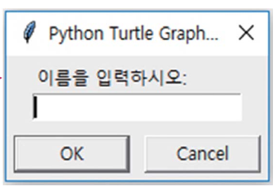
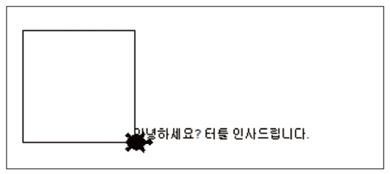

# 3강 — 자료의 종류

[레포지토리 안내](../../README.ko.md) | [English](Concepts_Lecture.md) | [한국어](Concepts_Lecture.ko.md)

> **최종 수정일:** 2026-11-04

> **학습 목표:**
> 1. 파이썬의 기본 자료형인 정수, 실수, 문자열을 구분하고 `type()`으로 값의 자료형을 확인할 수 있다
> 2. `int()`, `float()`, `str()`로 문자열과 숫자를 서로 변환하고, 변환이 필요한 이유를 설명할 수 있다
> 3. `+`, `*`, `%` 연산자로 문자열을 접합, 반복, 형식화할 수 있다
> 4. 인덱싱과 슬라이싱으로 문자열에서 문자와 부분 문자열을 추출하고, 이스케이프 시퀀스로 특수 문자를 표현할 수 있다
> 5. 터틀 그래픽에서 `textinput()`과 `write()`로 문자열을 입력받고 출력할 수 있다
> 6. 리스트를 만들고 `append()`로 요소를 추가하며 인덱스로 요소에 접근할 수 있다

---

## 목차

- [1. 파이썬의 자료형](#1-파이썬의-자료형)
  - [1.1 기본 자료형](#11-기본-자료형)
  - [1.2 변수와 자료형](#12-변수와-자료형)
- [2. 문자열](#2-문자열)
  - [2.1 문자열의 개념](#21-문자열의-개념)
  - [2.2 문자열 만들기](#22-문자열-만들기)
  - [2.3 숫자와 문자열의 차이](#23-숫자와-문자열의-차이)
- [3. 자료형 변환](#3-자료형-변환)
  - [3.1 문자열을 숫자로 변환](#31-문자열을-숫자로-변환)
  - [3.2 숫자를 문자열로 변환](#32-숫자를-문자열로-변환)
- [4. 문자열 연산](#4-문자열-연산)
  - [4.1 접합](#41-접합)
  - [4.2 반복](#42-반복)
  - [4.3 문자열 형식화](#43-문자열-형식화)
- [5. 인덱싱과 슬라이싱](#5-인덱싱과-슬라이싱)
  - [5.1 인덱스](#51-인덱스)
  - [5.2 슬라이싱](#52-슬라이싱)
  - [5.3 문자열의 길이와 불변성](#53-문자열의-길이와-불변성)
- [6. 이스케이프 시퀀스](#6-이스케이프-시퀀스)
- [7. 터틀 그래픽에서의 문자열 입출력](#7-터틀-그래픽에서의-문자열-입출력)
  - [7.1 문자열 입력](#71-문자열-입력)
  - [7.2 문자열 출력](#72-문자열-출력)
- [8. 리스트](#8-리스트)
  - [8.1 리스트 만들기](#81-리스트-만들기)
  - [8.2 요소 추가](#82-요소-추가)
  - [8.3 요소 접근](#83-요소-접근)
- [개념 적용](#개념-적용)
- [요약](#요약)
- [점검 문제](#점검-문제)
- [참고 문헌](#참고-문헌)

---

<br>

## 1. 파이썬의 자료형

### 1.1 기본 자료형

프로그램이 다루는 값에는 종류가 있으며, 이 종류를 **자료형(data type)** 이라고 한다. 자료형은 값이 무엇을 나타내는지, 그리고 그 값에 어떤 연산을 적용할 수 있는지를 결정한다. 예를 들어 두 정수에 `+`를 적용하면 산술 덧셈의 결과가 나오지만, 두 문자열에 `+`를 적용하면 두 문자열을 이어 붙인 결과가 나온다(2.3절). 파이썬에서 가장 기본이 되는 자료형은 다음 세 가지이다.

| 자료형 | 파이썬의 이름 | 예 | 설명 |
|:-----|:-----|:-----|:-----|
| 정수 | `int` | `..., -2, -1, 0, 1, 2, ...` | 소수점이 없는 수 |
| 실수 | `float` | `3.2`, `3.14`, `0.12` | 소수점이 있는 수 |
| 문자열 | `str` | `'Hello World!'`, `"123"` | 따옴표로 감싼 문자들의 나열 |

*표 1. 파이썬의 기본 자료형*

**정수(integer)** 는 소수점이 없는 수이다. 파이썬의 정수는 크기에 제한이 없어서 메모리가 허락하는 한 아무리 큰 정수도 정확하게 표현한다 [1]. 예를 들어 `2 ** 100`(2의 100제곱)을 계산하면 `1267650600228229401496703205376`이 그대로 나온다.

**실수(floating-point number)** 는 소수점이 있는 수이다. 컴퓨터는 실수를 2진수의 부동소수점(floating point) 방식으로 저장하며, 파이썬의 `float`는 대부분의 플랫폼에서 64비트 배정도(double precision) 형식을 쓴다 [1]. 0.1처럼 2진수로 나타내면 끝없이 반복되는 소수는 유한한 비트에 담기지 않으므로 근삿값으로 저장된다. 그래서 다음과 같이 `0.1 + 0.2`가 정확히 0.3이 되지 않는다.

```pycon
>>> 0.1 + 0.2
0.30000000000000004
```

> **[컴퓨터구조]** 실수를 부호, 지수, 가수로 나누어 저장하는 IEEE 754 부동소수점 형식과 이를 계산하는 산술 장치는 컴퓨터구조의 데이터 표현과 산술 장치에서 다룬다.

**문자열(string)** 은 따옴표로 감싼 문자들의 나열이다. `"123"`처럼 숫자로만 이루어져 있어도 따옴표로 감싸면 정수가 아니라 문자열이다(2.3절). 이 세 가지 외에 참과 거짓을 나타내는 부울(Boolean) 자료형 `bool`이 있으며, 4강에서 조건문과 함께 다룬다.

### 1.2 변수와 자료형

**변수(variable)** 는 값에 붙인 이름이다(2강). C나 Java 같은 언어에서는 변수를 만들 때 자료형을 선언하고, 그 변수에는 선언한 자료형의 값만 저장할 수 있다. 파이썬에서는 변수에 자료형을 선언하지 않으며, 한 변수에 어떤 종류의 자료도 저장할 수 있다. 자료형은 변수가 아니라 값이 가지고 있고, 변수는 지금 가리키는 값의 자료형을 따른다. 이런 방식을 **동적 타이핑(dynamic typing)** 이라고 한다.

```python
x = 10
print("x =", x)
x = 3.14
print("x =", x)
x = "Hello World!"
print("x =", x)
```

```text
x = 10
x = 3.14
x = Hello World!
```

- **1행:** 변수 `x`에 정수 10을 저장한다.
- **2행:** `print()`는 쉼표로 구분한 인수들을 차례로 출력하면서 사이에 공백 하나를 넣는다. 첫 번째 인수 `"x ="`는 그대로 출력할 문자열이고, 두 번째 인수 `x`는 변수에 저장된 값이므로 `x = 10`이 출력된다.
- **3~6행:** 같은 변수 `x`에 실수 3.14와 문자열 `"Hello World!"`를 차례로 저장하고 출력한다. 새 값을 저장하면 `x`는 새 값을 가리키며, 이전 값은 더 이상 `x`로 접근할 수 없다.

값의 자료형은 내장 함수(built-in function) `type()`으로 확인한다 [2]. 내장 함수는 파이썬이 기본으로 제공하여 `import` 없이 쓸 수 있는 함수이다.

```python
x = 10
print(type(x))
x = 3.14
print(type(x))
x = "Hello World!"
print(type(x))
```

```text
<class 'int'>
<class 'float'>
<class 'str'>
```

`<class 'int'>`는 값이 `int` 클래스, 곧 정수형이라는 뜻이다. 파이썬의 자료형은 클래스(class)로 구현되어 있으므로 `type()`의 결과가 `<class '...'>` 형태로 표시된다. 클래스는 8강에서 다룬다.

---

<br>

## 2. 문자열

### 2.1 문자열의 개념

컴퓨터에게는 숫자 계산이 중요하지만, 인간에게는 텍스트(text)가 중요하다. 문자 메시지, 인터넷 도메인 이름, 이름과 주소처럼 일상에서 다루는 정보의 많은 부분이 텍스트이므로 컴퓨터로 텍스트를 처리하는 일도 중요하다. 파이썬은 텍스트를 문자열로 표현한다. **문자열(string)** 은 문자들의 나열(sequence of characters)이다. 문자열 `"Hello"`는 다섯 개의 문자 `H`, `e`, `l`, `l`, `o`가 이 순서대로 이어진 것이다.

```text
┌───┬───┬───┬───┬───┐
│ H │ e │ l │ l │ o │
└───┴───┴───┴───┴───┘
```

*그림 1. 문자들이 순서대로 이어진 문자열 "Hello"*

문자열에서는 순서가 중요하다. 각 문자가 정해진 위치에 놓여 있으므로 위치 번호로 원하는 문자를 꺼낼 수 있다(5절). 파이썬에는 문자 하나만을 위한 별도의 자료형이 없으며, 문자 하나도 길이가 1인 문자열이다 [1].

### 2.2 문자열 만들기

문자열은 문자들을 큰따옴표(`"`)나 작은따옴표(`'`)로 감싸서 만든다. 두 방식으로 만든 문자열은 완전히 같다. 소스 코드에 값을 직접 적은 것을 **리터럴(literal)** 이라 하며, 따옴표로 감싸서 적은 문자열을 **문자열 리터럴(string literal)** 이라고 한다.

```pycon
>>> "Hello"
'Hello'
>>> msg = "Hello"
>>> msg
'Hello'
>>> print(msg)
Hello
```

`>>>`는 대화형 셸(interactive shell)이 명령을 기다리고 있음을 나타내는 프롬프트(prompt)이다. 대화형 셸에 식을 입력하면 셸이 그 식의 값을 표시하는데, 문자열 값은 작은따옴표를 붙인 `'Hello'` 형태로 보여 준다. 이 따옴표는 값이 문자열임을 알려 주는 표기일 뿐이며 문자열의 내용에 포함되지 않는다. 반면 `print()`는 문자열의 내용만 출력하므로 따옴표 없이 `Hello`가 나온다.

문자열은 시작할 때 쓴 따옴표와 같은 종류의 따옴표로 끝나야 한다. 큰따옴표로 시작했다가 작은따옴표로 끝내면 문법 오류이다.

```pycon
>>> msg = "Hello'
  File "<stdin>", line 1
    msg = "Hello'
          ^
SyntaxError: unterminated string literal (detected at line 1)
```

파이썬은 큰따옴표로 시작한 문자열의 끝을 나타내는 큰따옴표를 찾다가 줄이 끝나 버리므로 **문법 오류(syntax error)** 를 보고한다. "unterminated string literal"은 끝나지 않은 문자열 리터럴이라는 뜻이다.

> **참고:** 오류 메시지의 문구는 파이썬 버전에 따라 다르다. 파이썬 3.9 이전 버전은 같은 오류를 `SyntaxError: EOL while scanning string literal`로 표시한다. EOL(end of line)은 줄의 끝을 뜻하며, 문자열을 읽는 도중에 줄이 끝났다는 의미이다.

따옴표가 두 종류이므로 문자열 안에 따옴표를 넣기 쉽다. 작은따옴표가 들어 있는 문자열은 큰따옴표로 감싸고, 큰따옴표가 들어 있는 문자열은 작은따옴표로 감싼다. 감싸는 따옴표와 같은 종류의 따옴표를 넣으려면 그 앞에 역슬래시(`\`)를 붙인다(6절).

```pycon
>>> print("It's mine")
It's mine
>>> print('He said "Hi"')
He said "Hi"
>>> print('It\'s mine')
It's mine
```

여러 줄에 걸친 문자열은 따옴표 세 개(`"""` 또는 `'''`)로 감싼다 [3]. 대화형 셸은 문자열이 아직 끝나지 않은 줄 다음에 `...` 프롬프트를 표시하여 이어지는 입력을 받는다.

```pycon
>>> poem = """말 한마디로
... 천 냥 빚을 갚는다"""
>>> print(poem)
말 한마디로
천 냥 빚을 갚는다
```

### 2.3 숫자와 문자열의 차이

`100`은 정수이고, `"100"`과 `'100'`은 문자열이다. 겉모습은 비슷하지만 자료형이 다르므로 같은 연산자를 적용해도 결과가 다르다.

```pycon
>>> print(100+200)
300
>>> print("100"+"200")
100200
```

`100+200`은 정수와 정수의 덧셈이므로 산술 덧셈을 수행하여 300이 된다. 반면 `"100"+"200"`은 문자열과 문자열에 `+`를 적용한 것이며, 문자열에 대한 `+`는 두 문자열을 이어 붙이는 접합 연산(4.1절)이므로 결과는 두 텍스트가 붙은 문자열 `"100200"`이다. 이처럼 같은 연산자가 피연산자의 자료형에 따라 다른 연산을 수행하는 것을 **연산자 오버로딩(operator overloading)** 이라고 한다.

---

<br>

## 3. 자료형 변환

한 자료형의 값을 다른 자료형의 값으로 바꾸는 것을 **자료형 변환(type conversion)** 이라고 한다. 정수와 실수를 함께 계산하면 정수가 실수로 자동 변환되지만(`1 + 2.5`는 `3.5`), 정수와 문자열처럼 성격이 다른 자료형 사이의 변환은 자동으로 일어나지 않으므로 필요하면 프로그래머가 변환 함수를 호출해야 한다.

### 3.1 문자열을 숫자로 변환

`input()`은 사용자가 무엇을 입력하든 그 내용을 문자열로 돌려준다(2강). 사용자가 `100`을 입력해도 `input()`의 결과는 정수 100이 아니라 문자열 `"100"`이다. 입력받은 값으로 계산하려면 다음 함수로 문자열을 숫자로 바꾼다 [2].

- **`int()`:** 문자열을 정수로 변환한다.
- **`float()`:** 문자열을 실수로 변환한다.

```python
t = input("정수를 입력하시오: ")
x = int(t)
t = input("정수를 입력하시오: ")
y = int(t)
print(x+y)
```

```text
정수를 입력하시오: 100
정수를 입력하시오: 200
300
```

- **1행:** `input()`이 안내 문구를 출력하고, 사용자가 입력한 `100`을 문자열 `"100"`으로 돌려주어 `t`에 저장한다.
- **2행:** `int(t)`가 문자열 `"100"`을 정수 100으로 바꾸고, 그 결과를 `x`에 저장한다.
- **3~4행:** 같은 방법으로 두 번째 입력 `"200"`을 정수 200으로 바꾸어 `y`에 저장한다. 변수 `t`를 다시 썼으므로 `t`의 이전 값 `"100"`은 `"200"`으로 바뀐다.
- **5행:** `x`와 `y`가 모두 정수이므로 산술 덧셈을 수행하여 300을 출력한다.

변환하지 않고 `input()`의 결과를 그대로 더하면 문자열 접합이 일어난다.

```python
x = input("정수를 입력하시오: ")
y = input("정수를 입력하시오: ")
print(x+y)
```

```text
정수를 입력하시오: 100
정수를 입력하시오: 200
100200
```

변환 함수는 다음과 같이 동작한다.

```pycon
>>> int("42")
42
>>> float("3.14")
3.14
>>> float("10")
10.0
>>> int(" 42 ")
42
>>> int(3.99)
3
>>> int(-3.99)
-3
>>> int("3.14")
Traceback (most recent call last):
  File "<stdin>", line 1, in <module>
    int("3.14")
    ~~~^^^^^^^^
ValueError: invalid literal for int() with base 10: '3.14'
>>> int(float("3.14"))
3
```

- `float("10")`처럼 정수 모양의 문자열도 `float()`로 바꾸면 실수 `10.0`이 된다.
- `int()`와 `float()`는 문자열 앞뒤의 공백을 무시하므로 `int(" 42 ")`는 42이다.
- `int()`에 실수를 주면 소수점 아래를 버린다. 반올림이 아니라 0 쪽으로 자르는 것이므로 `int(3.99)`는 3, `int(-3.99)`는 -3이다.
- `int()`에 주는 문자열은 정수의 모양이어야 한다. `"3.14"`는 정수의 모양이 아니므로 **`ValueError`** (값의 형태가 잘못되었다는 오류)가 발생한다. 이런 문자열을 정수로 바꾸려면 `int(float("3.14"))`처럼 먼저 실수로 바꾼 뒤 정수로 바꾼다.

> **주의:** `int(input(...))`으로 정수를 입력받는 프로그램에 `0.1` 같은 소수나 `abc` 같은 문자를 입력하면 `ValueError`가 발생하여 프로그램이 멈춘다. 소수점이 있는 수를 입력받아야 하면 `float(input(...))`을 쓴다.

### 3.2 숫자를 문자열로 변환

다음 코드에서는 오류가 발생한다.

```pycon
>>> print('나는 현재 ' + 21 + '살이다.')
Traceback (most recent call last):
  File "<stdin>", line 1, in <module>
    print('나는 현재 ' + 21 + '살이다.')
          ~~~~~~~~~~~~~^~~~
TypeError: can only concatenate str (not "int") to str
```

`'나는 현재 '`는 문자열이고 `21`은 정수이다. 파이썬은 문자열과 숫자를 `+`로 합칠 수 없으며, 둘 중 어느 쪽으로도 자동 변환하지 않는다. **`TypeError`** 는 연산에 맞지 않는 자료형의 값이 쓰였다는 오류이고, 메시지는 문자열(`str`)에는 정수(`int`)가 아니라 문자열만 이어 붙일 수 있다는 뜻이다.

> **참고:** 파이썬 3.5 같은 이전 버전은 같은 오류를 `TypeError: Can't convert 'int' object to str implicitly`로 표시한다. 정수 객체를 문자열로 암시적으로(implicitly), 곧 자동으로 변환할 수 없다는 뜻이다.

숫자를 문자열로 바꾸려면 `str()` 함수를 쓴다 [2].

```pycon
>>> print('나는 현재 ' + str(21) + '살이다.')
나는 현재 21살이다.
>>> print('원주율은 ' + str(3.14) + '입니다.')
원주율은 3.14입니다.
```

`str(21)`은 문자열 `'21'`이므로 세 문자열의 접합이 되어 오류 없이 출력된다. 한편 `print()`에 값을 쉼표로 구분하여 넘기면 `print()`가 각 값을 문자열로 바꾸어 출력하므로 `str()`이 필요 없다. 다만 값 사이에 공백이 하나씩 들어간다.

```pycon
>>> print('나는 현재', 21, '살이다.')
나는 현재 21 살이다.
```

| 함수 | 변환 | 예 | 결과 |
|:-----|:-----|:-----|:-----|
| `int()` | 문자열이나 실수를 정수로 | `int("42")`, `int(3.99)` | `42`, `3` |
| `float()` | 문자열이나 정수를 실수로 | `float("3.14")`, `float(10)` | `3.14`, `10.0` |
| `str()` | 숫자를 문자열로 | `str(21)`, `str(3.14)` | `'21'`, `'3.14'` |

*표 2. 자료형 변환 함수*

---

<br>

## 4. 문자열 연산

### 4.1 접합

두 문자열을 하나로 합치려면 `+` 연산자를 쓴다. 문자열을 이어 붙이는 연산을 **접합(concatenation)** 이라고 한다.

```pycon
>>> 'Hello ' + 'World!'
'Hello World!'
```

```text
┌───┬───┬───┬───┬───┬───┐     ┌───┬───┬───┬───┬───┬───┐
│ H │ e │ l │ l │ o │   │  +  │ W │ o │ r │ l │ d │ ! │
└───┴───┴───┴───┴───┴───┘     └───┴───┴───┴───┴───┴───┘
                        ↓
┌───┬───┬───┬───┬───┬───┬───┬───┬───┬───┬───┬───┐
│ H │ e │ l │ l │ o │   │ W │ o │ r │ l │ d │ ! │
└───┴───┴───┴───┴───┴───┴───┴───┴───┴───┴───┴───┘
```

*그림 2. 두 문자열 'Hello '와 'World!'의 접합*

`+`는 두 문자열 사이에 공백을 넣지 않는다. 결과의 `Hello`와 `World!` 사이에 있는 공백은 첫 번째 문자열 `'Hello '`의 마지막 문자이다.

### 4.2 반복

문자열과 정수에 `*` 연산자를 적용하면 문자열을 그 횟수만큼 반복하여 이어 붙인 문자열이 만들어진다.

```pycon
>>> message = " Congratulations!"
>>> print(message*3)
 Congratulations! Congratulations! Congratulations!
>>> print("="*50)
==================================================
>>> 3 * "ab"
'ababab'
>>> "ab" * 0
''
>>> "ab" * 2.5
Traceback (most recent call last):
  File "<stdin>", line 1, in <module>
    "ab" * 2.5
    ~~~~~^~~~~
TypeError: can't multiply sequence by non-int of type 'float'
```

- `message`는 공백으로 시작하므로 세 번 반복한 결과에서도 각 `Congratulations!` 앞에 공백이 하나씩 있다.
- `"="*50`은 `=`를 50개 이어 붙인 문자열이며, 출력 화면에 구분선을 그릴 때 자주 쓴다.
- 정수와 문자열의 순서는 상관없으므로 `3 * "ab"`도 `'ababab'`이다. 0 이하의 정수를 곱하면 문자가 하나도 없는 빈 문자열(empty string) `''`이 된다.
- 반복 횟수는 정수여야 하므로 실수 2.5를 곱하면 `TypeError`가 발생한다.

### 4.3 문자열 형식화

문자열 안에 변수의 값을 넣어 출력하고 싶으면 `%` 기호를 쓴다. 이렇게 정해진 틀에 값을 채워 문자열을 만드는 것을 **문자열 형식화(string formatting)** 라고 한다.

```pycon
>>> price = 10000
>>> print("상품의 가격은 %s원입니다." % price)
상품의 가격은 10000원입니다.
```

`"상품의 가격은 %s원입니다."`는 값이 들어갈 자리를 `%s`로 표시한 틀이고, 이런 자리 표시를 **형식 지정자(format specifier)** 라고 한다. 틀과 값 사이의 `%` 연산자는 틀의 `%s` 자리에 `price`의 값을 문자열로 바꾸어 넣은 새 문자열을 만든다. 숫자 10000을 직접 `+`로 이어 붙이려면 `str()`이 필요하지만(3.2절), `%s`는 값을 알아서 문자열로 바꾸어 넣는다. 주요 형식 지정자는 다음과 같다 [1].

| 형식 지정자 | 의미 | 예 | 결과 |
|:-----|:-----|:-----|:-----|
| `%s` | 값을 문자열로 바꾸어 넣는다 | `"%s원" % 10000` | `'10000원'` |
| `%d` | 정수를 10진수로 넣는다 | `"%d세" % 21` | `'21세'` |
| `%f` | 실수를 소수점 아래 6자리로 넣는다 | `"%f" % 3.14` | `'3.140000'` |
| `%.2f` | 실수를 소수점 아래 2자리로 반올림하여 넣는다 | `"%.2f" % 3.14159` | `'3.14'` |
| `%%` | 문자 `%` 자체를 넣는다 | `"%d%%" % 30` | `'30%'` |

*표 3. 주요 형식 지정자*

값이 여러 개이면 괄호 안에 쉼표로 구분하여 순서대로 넘긴다. 괄호로 묶은 값의 모음은 튜플(tuple)이라는 자료형이며 7강에서 다룬다.

```pycon
>>> name = "홍길동"
>>> age = 21
>>> height = 175.5
>>> print("%s의 나이는 %d세, 키는 %.1fcm입니다." % (name, age, height))
홍길동의 나이는 21세, 키는 175.5cm입니다.
```

> **참고:** `%d`, `%f`, `%s` 같은 형식 지정자는 C 언어의 `printf()` 함수에서 온 표기이며, 파이썬 문서는 이 방식을 printf 스타일 문자열 형식화(printf-style string formatting)라고 부른다 [1]. 파이썬 3.6부터는 문자열 앞에 `f`를 붙이고 중괄호 안에 식을 직접 쓰는 형식 문자열 리터럴(f-string)도 쓸 수 있다 [4]. `f"상품의 가격은 {price}원입니다."`는 위 예와 같은 문자열을 만든다.

---

<br>

## 5. 인덱싱과 슬라이싱

### 5.1 인덱스

문자열의 각 문자에는 위치 번호가 붙어 있으며, 이 번호를 **인덱스(index)** 라고 한다. 첫 문자의 인덱스는 1이 아니라 0이다. 문자열 `s`에서 인덱스가 `i`인 문자는 `s[i]`로 꺼내며, 이렇게 인덱스로 요소를 꺼내는 것을 **인덱싱(indexing)** 이라고 한다. 파이썬은 음수 인덱스도 허용한다. 음수 인덱스는 문자열의 끝에서부터 센 위치이며, `-1`이 마지막 문자이다.

```text
   0   1   2   3   4   5   6   7   8   9  10  11
 ┌───┬───┬───┬───┬───┬───┬───┬───┬───┬───┬───┬───┐
 │ M │ o │ n │ t │ y │   │ P │ y │ t │ h │ o │ n │
 └───┴───┴───┴───┴───┴───┴───┴───┴───┴───┴───┴───┘
 -12 -11 -10  -9  -8  -7  -6  -5  -4  -3  -2  -1
```

*그림 3. 문자열 "Monty Python"의 인덱스(위)와 음수 인덱스(아래)*

```pycon
>>> s = "Monty Python"
>>> s[0]
'M'
>>> s[6]
'P'
>>> s[-1]
'n'
>>> s[12]
Traceback (most recent call last):
  File "<stdin>", line 1, in <module>
    s[12]
    ~^^^^
IndexError: string index out of range
```

`"Monty Python"`은 공백을 포함하여 12개의 문자로 이루어져 있으므로 인덱스는 0부터 11까지이다. 인덱스 5의 문자는 공백이다. 범위 밖의 인덱스 12를 쓰면 **`IndexError`** (인덱스가 범위를 벗어났다는 오류)가 발생한다.

### 5.2 슬라이싱

문자열의 일부분을 잘라 내는 것을 **슬라이싱(slicing)** 이라고 한다. `s[start:end]`는 인덱스 `start`부터 `end - 1`까지의 문자로 이루어진 부분 문자열(substring)이다. 끝 인덱스 `end`의 문자는 포함되지 않는다는 점에 주의해야 한다.

```pycon
>>> s = "Monty Python"
>>> print(s[6:10])
Pyth
```

`s[6:10]`은 인덱스 6, 7, 8, 9의 문자 `P`, `y`, `t`, `h`로 이루어지며, 인덱스 10의 `o`는 포함되지 않는다. 결과의 길이는 `end - start`, 곧 10 - 6 = 4이다. 인덱스를 문자 자체가 아니라 문자와 문자 사이의 경계에 붙은 번호로 보면 이해하기 쉽다 [5]. 이렇게 보면 `s[6:10]`은 경계 6과 경계 10 사이에 있는 문자들이다.

```text
                         s[6:10] = "Pyth"
                         ├───────────────┤
 ┌───┬───┬───┬───┬───┬───┬───┬───┬───┬───┬───┬───┐
 │ M │ o │ n │ t │ y │   │ P │ y │ t │ h │ o │ n │
 └───┴───┴───┴───┴───┴───┴───┴───┴───┴───┴───┴───┘
 0   1   2   3   4   5   6   7   8   9  10  11  12
```

*그림 4. 문자 사이의 경계 번호로 본 슬라이스 s[6:10]*

시작 인덱스를 생략하면 처음부터, 끝 인덱스를 생략하면 끝까지 잘라 낸다. 슬라이싱은 범위를 벗어난 인덱스를 써도 오류를 내지 않고 문자열이 있는 부분까지만 잘라 낸다.

```pycon
>>> s[:5]
'Monty'
>>> s[6:]
'Python'
>>> s[6:100]
'Python'
```

### 5.3 문자열의 길이와 불변성

문자열의 길이, 곧 문자의 개수는 내장 함수 `len()`으로 구한다 [2]. 공백도 문자 하나로 센다. 마지막 문자의 인덱스는 항상 `len(s) - 1`이다.

```pycon
>>> len(s)
12
```

문자열은 한번 만들면 내용을 바꿀 수 없다. 이런 성질을 **불변성(immutability)** 이라고 하며, 문자열은 불변(immutable) 자료형이다 [1]. 인덱스로 문자 하나를 바꾸려고 하면 `TypeError`가 발생한다. 내용이 다른 문자열이 필요하면 슬라이싱과 접합으로 새 문자열을 만든다. 이때 원래 문자열 `s`는 바뀌지 않는다.

```pycon
>>> s[0] = 'm'
Traceback (most recent call last):
  File "<stdin>", line 1, in <module>
    s[0] = 'm'
    ~^^^
TypeError: 'str' object does not support item assignment
>>> 'm' + s[1:]
'monty Python'
>>> s
'Monty Python'
```

---

<br>

## 6. 이스케이프 시퀀스

줄 바꿈이나 탭처럼 키보드로 문자열 안에 직접 적기 어려운 문자, 그리고 따옴표처럼 문자열 안에서 특별한 의미를 가지는 문자는 역슬래시(`\`)로 시작하는 두 글자로 나타낸다. 이런 표기를 **이스케이프 시퀀스(escape sequence)** 라고 한다 [3].

| 이스케이프 시퀀스 | 의미 |
|:-----|:-----|
| `\n` | 줄 바꿈 문자 (newline) |
| `\t` | 탭 문자 (tab) |
| `\\` | 역슬래시 자체 |
| `\"` | 큰따옴표 자체 |
| `\'` | 작은따옴표 자체 |

*표 4. 주요 이스케이프 시퀀스*

```pycon
>>> print("말 한마디로\n천 냥 빚을 갚는다")
말 한마디로
천 냥 빚을 갚는다
>>> print("이름\t나이")
이름	나이
>>> print("C:\\temp")
C:\temp
>>> print("He said \"Hi\"")
He said "Hi"
>>> len("\n")
1
```

- `\n`을 출력하면 그 자리에서 줄이 바뀐다.
- `\t`는 다음 탭 위치까지 띄운다.
- 역슬래시는 이스케이프 시퀀스의 시작을 뜻하므로, 역슬래시 문자 자체를 나타내려면 `\\`처럼 두 번 쓴다.
- 이스케이프 시퀀스는 두 글자로 적지만 문자 하나이므로 `len("\n")`은 1이다.

> **주의:** Windows의 경로를 문자열로 적을 때 역슬래시를 하나만 쓰면 뜻하지 않은 이스케이프 시퀀스가 생긴다. `"C:\new\test"`의 `\n`과 `\t`는 줄 바꿈 문자와 탭 문자로 해석된다. 역슬래시를 두 번 쓰거나, 따옴표 앞에 `r`을 붙여 이스케이프 시퀀스를 해석하지 않는 원시 문자열(raw string)로 만든다 [3].
> ```pycon
> >>> print("C:\new\test")
> C:
> ew	est
> >>> print("C:\\new\\test")
> C:\new\test
> >>> print(r"C:\new\test")
> C:\new\test
> ```

---

<br>

## 7. 터틀 그래픽에서의 문자열 입출력

터틀 그래픽(turtle graphics)은 화면 위의 거북이(커서)를 움직여 그림을 그리는 파이썬의 표준 모듈 `turtle`이다(2강). 터틀 그래픽 창에서도 문자열을 입력받고 출력할 수 있다.

### 7.1 문자열 입력

터틀 그래픽에서 문자열을 입력받으려면 `turtle.textinput()`을 쓴다. 먼저 `import turtle`로 모듈을 불러와야 한다.

```python
import turtle
t = turtle.Turtle()
t.shape("turtle")
s = turtle.textinput("", "이름을 입력하시오: ")
```

- **1행:** `turtle` 모듈을 불러온다. 모듈은 함수와 자료를 모아 둔 파일이며 6강에서 다룬다.
- **2행:** 거북이 하나를 만들어 변수 `t`에 저장한다. 이후 `t.forward(100)`처럼 `t`에게 명령을 내린다.
- **3행:** 커서의 모양을 거북이로 바꾼다. 기본 모양은 화살표이다.
- **4행:** `textinput(title, prompt)`는 입력 대화 상자를 띄운다. 첫 번째 인수는 대화 상자의 제목이고, 두 번째 인수는 대화 상자 안에 표시할 안내 문구이다. 이 예는 제목으로 빈 문자열 `""`을 주었다. 사용자가 입력하고 OK를 누르면 입력한 내용이 문자열로 반환되어 `s`에 저장된다 [6].



*그림 5. textinput()이 띄운 입력 대화 상자*

`input()`과 마찬가지로 `textinput()`도 항상 문자열을 돌려주므로, 숫자로 계산하려면 `int()`나 `float()`로 변환한다(3.1절).

> **주의:** 사용자가 Cancel을 누르면 `textinput()`은 문자열이 아니라 값이 없음을 나타내는 특별한 값 `None`을 돌려준다 [6]. 이 값에 문자열을 `+`로 이어 붙이면 `TypeError`가 발생한다.

### 7.2 문자열 출력

터틀 그래픽 창에 문자열을 출력하려면 거북이의 `write()`를 쓴다.

```python
t.write("안녕하세요? 터틀 인사드립니다.")
```

`write()`는 인수로 받은 문자열을 거북이의 현재 위치에 쓴다. 기본 설정에서 문자열은 거북이의 위치에서 시작하여 오른쪽으로 쓰이며, 쓴 뒤에도 거북이는 움직이지 않는다 [6]. 다음 그림에서 문자열은 거북이가 있는 정사각형의 오른쪽 아래 꼭짓점에서 시작하여 오른쪽으로 쓰여 있다.



*그림 6. 터틀 그래픽 창에 write()로 쓴 문자열*

> **주의:** 터틀 그래픽 프로그램을 IDLE이 아닌 명령 창에서 `python3 파일이름.py`로 실행하면 프로그램이 끝나는 즉시 그림 창이 닫힌다. 프로그램의 마지막 줄에 `turtle.done()`을 두면 사용자가 창을 닫을 때까지 창이 유지된다 [6].

---

<br>

## 8. 리스트

### 8.1 리스트 만들기

**리스트(list)** 는 여러 개의 자료를 모아서 하나의 묶음으로 저장하는 자료형이다. 대괄호(`[]`) 안에 값을 쉼표로 구분하여 나열하며, 리스트에 담긴 각 값을 **요소(element)** 라고 한다.

```python
slist = [ '영어', '수학', '사회', '과학' ]
```

변수 `slist`는 네 개의 요소를 가진 리스트 전체를 가리킨다. 문자열의 문자처럼 리스트의 요소에도 0부터 시작하는 인덱스가 붙는다.

| 인덱스 | 0 | 1 | 2 | 3 |
|:-----|:-----|:-----|:-----|:-----|
| 요소 | `'영어'` | `'수학'` | `'사회'` | `'과학'` |

*표 5. 리스트 slist의 인덱스와 요소*

한 리스트에 서로 다른 자료형의 값을 함께 담을 수도 있다.

```pycon
>>> mixed = [1, "a", 3.14]
>>> mixed
[1, 'a', 3.14]
```

> **주의:** 문자열 요소는 반드시 따옴표로 감싼다. 따옴표가 없으면 파이썬은 `과학`을 변수 이름으로 해석하고, 그런 변수가 없으므로 **`NameError`** (정의되지 않은 이름을 썼다는 오류)가 발생한다.
> ```pycon
> >>> slist = [ '영어', '수학', '사회', 과학 ]
> Traceback (most recent call last):
>   File "<stdin>", line 1, in <module>
>     slist = [ '영어', '수학', '사회', 과학 ]
>                                       ^^^^
> NameError: name '과학' is not defined
> ```

### 8.2 요소 추가

처음부터 요소를 모두 적지 않고, 요소가 없는 빈 리스트(empty list)를 만든 뒤 프로그램 실행 중에 요소를 하나씩 추가할 수도 있다. 리스트의 `append()`는 인수로 받은 값을 리스트의 맨 뒤에 추가한다. `list.append(1)`처럼 값 뒤에 점을 찍고 호출하는 함수를 메서드(method)라고 하며, 8강에서 다룬다.

```python
list = []
list.append(1)
list.append(2)
list.append(6)
list.append(3)

print(list)
```

```text
[1, 2, 6, 3]
```

- **1행:** 빈 리스트를 만들어 변수 `list`에 저장한다.
- **2~5행:** 1, 2, 6, 3을 차례로 맨 뒤에 추가한다. 리스트는 `[1]`, `[1, 2]`, `[1, 2, 6]`, `[1, 2, 6, 3]`으로 바뀐다.
- **7행:** 리스트 전체를 출력한다. 요소는 추가한 순서대로 놓여 있다.

> **주의:** `list`는 리스트를 만드는 내장 함수의 이름이다. 위 코드처럼 변수 이름을 `list`로 지으면 그 변수가 내장 함수를 가려서, 이후 같은 프로그램에서 `list()` 함수를 쓸 수 없게 된다. 변수 이름은 `numbers`, `nlist`처럼 내장 함수와 겹치지 않게 짓는다.
> ```pycon
> >>> list("abc")
> ['a', 'b', 'c']
> >>> list = []
> >>> list.append(1)
> >>> list("abc")
> Traceback (most recent call last):
>   File "<stdin>", line 1, in <module>
>     list("abc")
>     ~~~~^^^^^^^
> TypeError: 'list' object is not callable
> ```

### 8.3 요소 접근

리스트의 요소는 문자열과 같은 방법으로 인덱싱하고 슬라이싱한다. 리스트를 슬라이싱한 결과는 리스트이며, `len()`은 요소의 개수를 돌려준다.

```python
slist = [ '영어', '수학', '사회', '과학' ]
print(slist[0])
```

```text
영어
```

```pycon
>>> slist[3]
'과학'
>>> slist[0:3]
['영어', '수학', '사회']
>>> len(slist)
4
```

`slist[0:3]`은 인덱스 0, 1, 2의 요소로 이루어진 리스트이며, 끝 인덱스 3의 `'과학'`은 포함되지 않는다. 리스트는 문자열과 달리 요소를 바꿀 수 있는 가변(mutable) 자료형이다. 리스트의 여러 연산은 7강에서 다룬다.

```pycon
>>> slist[1] = '국어'
>>> slist
['영어', '국어', '사회', '과학']
```

---

<br>

## 개념 적용

**T/F 점검:**

| 문장 | 판단과 근거 |
|:-----|:-----|
| `"3" + "4"`의 결과는 7이다. | **F.** 두 문자열의 접합이므로 결과는 문자열 `"34"`이다. |
| 사용자가 `25`를 입력해도 `input()`이 돌려주는 값은 문자열이다. | **T.** `input()`은 입력 내용을 항상 문자열로 돌려주므로, 계산하려면 `int()`나 `float()`로 변환한다. |
| `int("3.5")`의 결과는 3이다. | **F.** `"3.5"`는 정수 모양의 문자열이 아니므로 `ValueError`가 발생한다. `int(float("3.5"))`는 3이다. |
| `s = "Python"`일 때 `s[1:3]`은 `"yth"`이다. | **F.** 끝 인덱스 3의 문자는 포함되지 않으므로 인덱스 1과 2의 문자로 이루어진 `"yt"`이다. |
| `"ab" * 3`의 결과는 `"ababab"`이다. | **T.** 문자열과 정수의 `*`는 문자열을 그 횟수만큼 반복하여 이어 붙인다. |
| `len("\n")`의 값은 2이다. | **F.** 이스케이프 시퀀스 `\n`은 두 글자로 적지만 줄 바꿈 문자 하나이므로 길이는 1이다. |
| 리스트의 `append()`는 요소를 맨 앞에 추가한다. | **F.** `append()`는 요소를 리스트의 맨 뒤에 추가한다. |

---

<br>

## 요약

| 개념 | 핵심 요약 |
|:-----|:-----|
| 자료형 | 값의 종류이며, 기본 자료형은 정수 `int`, 실수 `float`, 문자열 `str`이다. |
| 동적 타이핑 | 변수에 자료형을 선언하지 않고, 변수는 지금 가리키는 값의 자료형을 따르며, `type()`으로 확인한다. |
| 문자열 | 큰따옴표나 작은따옴표로 감싼 문자들의 나열이며, 시작과 끝의 따옴표 종류가 같아야 한다. |
| 자료형 변환 | `int()`와 `float()`는 문자열을 숫자로, `str()`은 숫자를 문자열로 바꾸며, `input()`의 결과는 항상 문자열이다. |
| 접합과 반복 | 문자열끼리의 `+`는 이어 붙이고, 문자열과 정수의 `*`는 반복하며, 문자열과 숫자의 `+`는 `TypeError`이다. |
| 문자열 형식화 | `%s`, `%d`, `%.2f` 같은 형식 지정자를 둔 틀에 `%` 연산자로 값을 채워 넣는다. |
| 인덱싱 | 인덱스는 0부터 시작하고, 음수 인덱스는 끝에서부터 세며 `-1`이 마지막 문자이다. |
| 슬라이싱 | `s[start:end]`는 `start`부터 `end - 1`까지이며, 끝 인덱스의 문자는 포함되지 않는다. |
| 불변성 | 문자열은 내용을 바꿀 수 없으므로 바꾸려면 새 문자열을 만든다. |
| 이스케이프 시퀀스 | `\n`, `\t`, `\\`, `\"`, `\'`처럼 역슬래시로 특수 문자를 나타내며, 각각 문자 하나이다. |
| 터틀 그래픽 입출력 | `turtle.textinput()`은 대화 상자로 문자열을 입력받고, `t.write()`는 거북이의 위치에 문자열을 쓴다. |
| 리스트 | 여러 자료를 대괄호로 묶은 가변 자료형이며, `append()`로 맨 뒤에 요소를 추가하고 인덱스로 접근한다. |

---

<br>

## 점검 문제

1. **문자열과 숫자:** `"3" + "4"`, `"3" * 4`, `int("3") + 4`의 결과를 각각 쓰라.

   <details>
   <summary>정답</summary>

   차례로 `'34'`, `'3333'`, `7`이다. 첫 번째는 두 문자열의 접합이고, 두 번째는 문자열 `"3"`을 네 번 반복한 것이다. 세 번째는 `int("3")`이 정수 3이 되므로 정수끼리의 덧셈 3 + 4 = 7이다.

   </details>

2. **인덱싱과 슬라이싱:** `s = "Monty Python"`일 때 `s[1:4]`, `s[-3:]`, `len(s)`의 값을 쓰라.

   <details>
   <summary>정답</summary>

   `s[1:4]`는 인덱스 1, 2, 3의 문자이므로 `'ont'`이다. `s[-3:]`는 끝에서 세 번째 문자(인덱스 -3, 곧 9)부터 끝까지이므로 `'hon'`이다. `len(s)`는 공백을 포함한 문자의 개수이므로 12이다.

   </details>

3. **자료형 오류:** `age = 20`일 때 `print("나이: " + age)`가 오류를 내는 이유를 설명하고, 오류 없이 `나이: 20`을 출력하는 방법을 두 가지 쓰라.

   <details>
   <summary>정답</summary>

   `"나이: "`는 문자열이고 `age`는 정수이므로 `+`로 합칠 수 없어 `TypeError`가 발생한다. 첫째, `print("나이: " + str(age))`처럼 `str()`로 정수를 문자열로 바꾸어 접합한다. 둘째, `print("나이: %d" % age)`처럼 형식 지정자를 쓴다. `print("나이:", age)`처럼 쉼표로 넘겨도 `print()`가 공백 하나를 넣어 같은 결과를 출력한다.

   </details>

4. **이스케이프 시퀀스:** `print("C:\new\test")`를 실행하면 경로가 그대로 출력되지 않는다. 그 이유와 올바르게 출력하는 방법을 쓰라.

   <details>
   <summary>정답</summary>

   문자열 안의 `\n`은 줄 바꿈 문자로, `\t`는 탭 문자로 해석되므로 `C:` 다음에 줄이 바뀌고 `ew`와 `est` 사이에 탭이 들어간다. 역슬래시를 두 번 써서 `"C:\\new\\test"`로 적거나, 원시 문자열 `r"C:\new\test"`로 적으면 `C:\new\test`가 출력된다.

   </details>

5. **리스트:** 다음 코드를 실행한 뒤 `a[1]`과 `len(a)`의 값은 무엇인가?

   ```python
   a = []
   a.append(5)
   a.append(7)
   ```

   <details>
   <summary>정답</summary>

   `a`는 빈 리스트에서 시작하여 `[5]`, `[5, 7]`이 된다. 인덱스는 0부터 시작하므로 `a[1]`은 두 번째 요소 7이고, 요소가 두 개이므로 `len(a)`는 2이다.

   </details>

---

<br>

## 참고 문헌

1. Python Software Foundation, "Built-in Types," *The Python Standard Library*. https://docs.python.org/3/library/stdtypes.html
2. Python Software Foundation, "Built-in Functions," *The Python Standard Library*. https://docs.python.org/3/library/functions.html
3. Python Software Foundation, "Lexical Analysis," *The Python Language Reference*. https://docs.python.org/3/reference/lexical_analysis.html
4. Python Software Foundation, "Input and Output," *The Python Tutorial*. https://docs.python.org/3/tutorial/inputoutput.html
5. Python Software Foundation, "An Informal Introduction to Python," *The Python Tutorial*. https://docs.python.org/3/tutorial/introduction.html
6. Python Software Foundation, "turtle: Turtle Graphics," *The Python Standard Library*. https://docs.python.org/3/library/turtle.html
