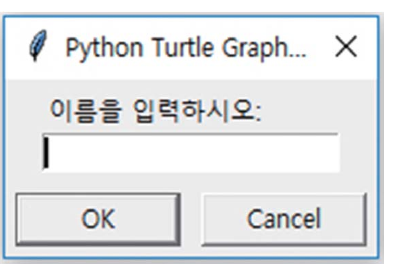
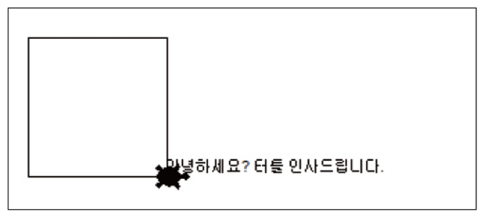

# Lecture 3 — Data Types

[Repository Guide](../../README.md) | [English](Concepts_Lecture.md) | [한국어](Concepts_Lecture.ko.md)

> **Last Updated:** 2026-11-19

> **Learning Objectives:**
> 1. Distinguish Python's basic data types, integers, floats, and strings, and explain the difference between `is` and `==` using the facts that values are objects and variables are names that refer to objects
> 2. Convert between strings and numbers with `int()`, `float()`, and `str()`, and explain the unlimited precision of integers, the rounding error of floats, and the behavior of `round()`
> 3. Concatenate, repeat, and format strings with the `+`, `*`, and `%` operators, f-strings, and `format()`, and process strings with string methods
> 4. Extract characters and substrings from a string with indexing and slicing with a step, and represent special characters with escape sequences
> 5. Read and write strings in turtle graphics with `textinput()` and `write()`
> 6. Create a list, add elements with `append()`, and access elements by index

---

## Table of Contents

- [1. Data Types in Python](#1-data-types-in-python)
  - [1.1 Basic Data Types](#11-basic-data-types)
  - [1.2 Variables and Data Types](#12-variables-and-data-types)
  - [1.3 Objects, Names, and References](#13-objects-names-and-references)
  - [1.4 Properties of Integers and Floats](#14-properties-of-integers-and-floats)
- [2. Strings](#2-strings)
  - [2.1 The Concept of a String](#21-the-concept-of-a-string)
  - [2.2 Creating Strings](#22-creating-strings)
  - [2.3 Numbers Versus Strings](#23-numbers-versus-strings)
- [3. Type Conversion](#3-type-conversion)
  - [3.1 Converting Strings to Numbers](#31-converting-strings-to-numbers)
  - [3.2 Converting Numbers to Strings](#32-converting-numbers-to-strings)
- [4. String Operations](#4-string-operations)
  - [4.1 Concatenation](#41-concatenation)
  - [4.2 Repetition](#42-repetition)
  - [4.3 String Formatting](#43-string-formatting)
  - [4.4 f-Strings and format()](#44-f-strings-and-format)
  - [4.5 String Methods](#45-string-methods)
- [5. Indexing and Slicing](#5-indexing-and-slicing)
  - [5.1 Indexes](#51-indexes)
  - [5.2 Slicing](#52-slicing)
  - [5.3 String Length and Immutability](#53-string-length-and-immutability)
  - [5.4 Slicing with a Step and the Rules of Slicing](#54-slicing-with-a-step-and-the-rules-of-slicing)
- [6. Escape Sequences](#6-escape-sequences)
- [7. String Input and Output in Turtle Graphics](#7-string-input-and-output-in-turtle-graphics)
  - [7.1 String Input](#71-string-input)
  - [7.2 String Output](#72-string-output)
- [8. Lists](#8-lists)
  - [8.1 Creating a List](#81-creating-a-list)
  - [8.2 Adding Elements](#82-adding-elements)
  - [8.3 Accessing Elements](#83-accessing-elements)
- [Concept Applications](#concept-applications)
- [Summary](#summary)
- [Self-Check Questions](#self-check-questions)
- [References](#references)

---

<br>

## 1. Data Types in Python

### 1.1 Basic Data Types

The values a program handles come in kinds, and such a kind is called a **data type**. A data type determines what a value represents and which operations can be applied to it. For example, applying `+` to two integers gives the result of arithmetic addition, but applying `+` to two strings gives the two strings joined together (Section 2.3). The three most basic data types in Python are the following.

| Data Type | Name in Python | Examples | Description |
|:-----|:-----|:-----|:-----|
| Integer | `int` | `..., -2, -1, 0, 1, 2, ...` | A number without a decimal point |
| Floating-point number | `float` | `3.2`, `3.14`, `0.12` | A number with a decimal point |
| String | `str` | `'Hello World!'`, `"123"` | A sequence of characters enclosed in quotes |

*Table 1. Basic data types of Python*

An **integer** is a number without a decimal point. Python integers have no size limit, so any integer, however large, is represented exactly as long as memory allows [1]. For example, computing `2 ** 100` (2 to the 100th power) gives `1267650600228229401496703205376` exactly.

A **floating-point number** is a number with a decimal point. A computer stores real numbers in a binary floating-point format, and Python's `float` uses the 64-bit double-precision format on most platforms [1]. A fraction such as 0.1, which repeats forever in binary, does not fit in a finite number of bits and is stored as an approximation. That is why `0.1 + 0.2` is not exactly 0.3, as shown below.

```pycon
>>> 0.1 + 0.2
0.30000000000000004
```

> **[Computer Architecture]** The IEEE 754 floating-point format, which stores a real number as a sign, an exponent, and a mantissa, and the arithmetic units that compute with it are covered under data representation and arithmetic units in computer architecture.

A **string** is a sequence of characters enclosed in quotes. Even `"123"`, which consists only of digits, is a string rather than an integer once it is enclosed in quotes (Section 2.3). Besides these three, there is the Boolean data type `bool`, which represents true and false; it is covered together with conditional statements in Lecture 4.

### 1.2 Variables and Data Types

A **variable** is a name attached to a value (Lecture 2). In languages such as C and Java, a variable is declared with a data type when it is created, and it can hold only values of the declared type. In Python, variables are not declared with a data type, and a single variable can hold data of any kind. The data type belongs to the value, not to the variable, and a variable takes on the data type of the value it currently refers to. This approach is called **dynamic typing**.

```python
x = 10
print("x =", x)
x = 3.14
print("x =", x)
x = "Hello World!"
print("x =", x)
```

```text
x = 10
x = 3.14
x = Hello World!
```

- **Line 1:** Stores the integer 10 in the variable `x`.
- **Line 2:** `print()` prints the comma-separated arguments in order and puts one space between them. The first argument `"x ="` is a string printed as is, and the second argument `x` is the value stored in the variable, so `x = 10` is printed.
- **Lines 3-6:** Store the floating-point number 3.14 and then the string `"Hello World!"` in the same variable `x` and print them. When a new value is stored, `x` refers to the new value, and the previous value can no longer be reached through `x`.

The data type of a value is checked with the built-in function `type()` [2]. A built-in function is a function that Python provides by default and that can be used without `import`.

```python
x = 10
print(type(x))
x = 3.14
print(type(x))
x = "Hello World!"
print(type(x))
```

```text
<class 'int'>
<class 'float'>
<class 'str'>
```

`<class 'int'>` means that the value belongs to the class `int`, that is, the integer type. Python data types are implemented as classes, so the result of `type()` is displayed in the form `<class '...'>`. Classes are covered in Lecture 8.

### 1.3 Objects, Names, and References

Every value a Python program handles is an **object**. The integer 10, the string `"Hello"`, and the list `[1, 2]` are all objects, and Python gives each object a place in memory when it creates it. Every object has the following three things [3].

| Property | Meaning | How to Check | Whether It Can Change |
|:-----|:-----|:-----|:-----|
| Identity | A unique integer that distinguishes the object from other objects, which can be thought of as the location of the object in memory | `id()`, the `is` operator | Does not change after the object is created |
| Type | Determines what kind of value the object is and which operations it supports | `type()` | Does not change |
| Value | The content the object represents | The `==` operator, printing | Depending on the type, some objects can change and some cannot |

*Table 2. The three properties that every object has*

> **Definition:** A **reference** is the connection between a name and an object. The assignment statement `x = 10` prepares the integer object 10 and makes the name `x` refer to that object. A Python variable is not a box that holds a value but a name tag attached to an object, and one object can carry several name tags.

When the following three statements are executed in order, the relationship between names and objects changes as in Figure 1.

```text
① x = 10      x ──→ ┌────┐
                    │ 10 │
                    └────┘

② y = x       x ──→ ┌────┐
              y ──→ │ 10 │   two names refer to the same object
                    └────┘

③ x = x + 1   x ──→ ┌────┐
                    │ 11 │   a new object 11 is made and bound to x
                    └────┘
              y ──→ ┌────┐
                    │ 10 │   y still refers to 10
                    └────┘
```

*Figure 1. How the objects that names refer to change with assignment statements*

In ②, `y = x` does not copy the value 10 into a new box; it makes `y` refer to the object that `x` refers to. In ③, `x = x + 1` computes `x + 1` on the right to make a new integer object 11 and moves the name `x` to that object. The integer object 10 itself does not change, so `y` still refers to 10. This process can be checked with `id()` and `is`.

```pycon
>>> x = 10
>>> y = x
>>> x is y
True
>>> id(x) == id(y)
True
>>> x = x + 1
>>> x, y
(11, 10)
>>> x is y
False
```

`id()` returns an integer representing the identity of an object, and in CPython this is the memory address where the object is located [2]. Two names having the same `id()` means that they refer to one object. `x is y` checks exactly this, namely whether the two operands are the same object; it is an **identity comparison**. In contrast, `==` checks whether the values of two objects are equal. The difference between the two operators shows when objects with equal values are created separately.

```pycon
>>> a = [1, 2]
>>> b = [1, 2]
>>> a == b
True
>>> a is b
False
>>> c = a
>>> c is a
True
>>> c.append(3)
>>> a
[1, 2, 3]
>>> b
[1, 2]
```

- **Lines 1-2:** The list literal is written twice, so two list objects with the same contents are created.
- **Lines 3-6:** The values of the two lists are equal, so `a == b` is `True`, but they are different objects, so `a is b` is `False`.
- **Lines 7-9:** `c = a` creates no new list; it attaches one more name, `c`, to the object that `a` refers to.
- **Lines 10-14:** When an element is added through `c`, the change is also visible through `a`, because the two names refer to the same object. The separately created `b` is not affected.

An object whose contents can be changed without creating a new object, as on line 10, is called a **mutable** object, and an object whose contents cannot be changed after it is created is called an **immutable** object. Whether an object is mutable or immutable is determined by its type: numbers, strings, and tuples are immutable, while lists and dictionaries are mutable [3]. A statement that seems to change the value of an immutable object, such as `x = x + 1` or `s = s + "!"`, always creates a new object and moves the name to it. So other names that referred to the same object, such as `y` in Figure 1, are not affected. What happens when several names are attached to a mutable object is covered in detail in Lecture 7, Section 9.

> **Caution:** Numbers and strings must be compared with `==`, not `is`. Whether a new immutable object with an equal value is created or an existing one is reused is up to the implementation, so the result of `is` must not be relied on [3]. In fact, CPython creates small integer objects in advance and reuses them, so with `x = 11`, `x is 11` comes out `True`, but this is not guaranteed, and since Python 3.8 using `is` with a number or string literal produces a warning such as `SyntaxWarning: "is" with 'int' literal. Did you mean "=="?` [4]. Use `is` to check whether a value is a unique object, as in `x is None`.

### 1.4 Properties of Integers and Floats

As seen in Section 1.1, Python integers have no size limit [1]. The integer types of C fit in a fixed number of bits (for example, 64 bits), so when a result exceeds that range, an overflow occurs and the correct value cannot be obtained, but Python enlarges the memory that stores an integer as the integer grows, keeping the exact value.

```pycon
>>> 2 ** 64
18446744073709551616
>>> len(str(2 ** 1000))
302
```

$2^{64}$ is one more than $2^{64} - 1$, the largest nonnegative integer that 64 bits can represent. The second line converts $2^{1000}$ into a string and counts its digits; even a 302-digit integer is computed exactly.

Floats are a different matter. Python's `float` is stored on most computers in double-precision format, which uses a binary fraction of 53 bits [5], so it holds only about 15-17 significant decimal digits. Moreover, a number that is simple in decimal, such as 0.1, continues forever as a binary fraction, so it cannot be stored exactly no matter how many bits are used [5]. The stored approximation becomes visible when enough decimal places are printed.

```pycon
>>> f"{2.675:.20f}"
'2.67499999999999982236'
>>> 0.1 + 0.2 == 0.3
False
>>> import math
>>> math.isclose(0.1 + 0.2, 0.3)
True
```

`f"{2.675:.20f}"` is an f-string that prints 2.675 to 20 decimal places (Section 4.4). The value actually stored is 2.67499999999999982236..., slightly less than 2.675. Because of this, a comparison with `==` can give `False` even when calculation results look equal, so floats are compared with `math.isclose()`, which checks whether they are close enough rather than exactly equal [5].

There are several functions that convert a float to an integer or reduce its digits, and their results differ for negative numbers.

| Function | Rule | 2.7 | -2.7 | 2.5 | -2.5 |
|:-----|:-----|:-----|:-----|:-----|:-----|
| `int()` | Truncates toward 0 | 2 | -2 | 2 | -2 |
| `round()` | To the nearest integer, to the even one at a tie | 3 | -3 | 2 | -2 |
| `math.floor()` | The largest integer less than or equal to the value | 2 | -3 | 2 | -3 |
| `math.ceil()` | The smallest integer greater than or equal to the value | 3 | -2 | 3 | -2 |

*Table 3. Results of the four functions that convert a float to an integer*

`round()` rounds to the nearest value, but when the distances to the two candidates are exactly equal it chooses the even one [2]. This rule is called **round half to even**, and unlike the rounding taught in school, it keeps the result from drifting to one side when many rounded values are added.

```pycon
>>> round(0.5), round(1.5), round(2.5), round(3.5)
(0, 2, 2, 4)
>>> round(-2.5)
-2
>>> round(3.14159, 2)
3.14
>>> round(2.675, 2)
2.67
>>> round(1234, -2)
1200
```

- **Line 1:** 0.5, 1.5, 2.5, and 3.5 all lie exactly halfway between two integers, so they become the even ones, 0, 2, 2, and 4.
- **Line 3:** Negative numbers follow the same rule, so -2.5 becomes -2.
- **Line 5:** The second argument `ndigits` is the number of decimal places to keep.
- **Line 7:** Rounding 2.675 to the second decimal place is easily expected to give 2.68, but it gives 2.67. As seen above, the value actually stored is slightly less than 2.675, so it is not exactly halfway; this is not a bug [2].
- **Line 9:** When `ndigits` is negative, rounding happens to the left of the decimal point, so 1234 is rounded to the hundreds place, giving 1200.

Floats also have a limited range. The largest `float` is about $1.8 \times 10^{308}$; a float multiplication or addition that exceeds it becomes `inf`, meaning infinity (some operations, such as the power `1e308 ** 2`, raise an `OverflowError` instead), and trying to convert a larger integer into a float raises an error.

```pycon
>>> 1e308 * 10
inf
>>> 10 ** 400 * 1.0
Traceback (most recent call last):
  File "<stdin>", line 1, in <module>
    10 ** 400 * 1.0
    ~~~~~~~~~~^~~~~
OverflowError: int too large to convert to float
```

`1e308` is the exponent notation for a float meaning $1 \times 10^{308}$. In the second expression the integer $10^{400}$ itself is computed exactly, but it exceeds the range of `float` at the step where it is converted to a float to be multiplied by 1.0, so an `OverflowError` occurs.

---

<br>

## 2. Strings

### 2.1 The Concept of a String

For computers numerical computation is important, but for humans text is important. Much of the information handled in daily life, such as text messages, internet domain names, names, and addresses, is text, so processing text with a computer is also important. Python represents text as strings. A **string** is a sequence of characters. The string `"Hello"` is the five characters `H`, `e`, `l`, `l`, and `o` joined in this order.

```text
┌───┬───┬───┬───┬───┐
│ H │ e │ l │ l │ o │
└───┴───┴───┴───┴───┘
```

*Figure 2. The string "Hello" as characters joined in order*

Order matters in a string. Each character sits at a fixed position, so a desired character can be taken out by its position number (Section 5). Python has no separate data type for a single character; a single character is a string of length 1 [1].

### 2.2 Creating Strings

A string is created by enclosing characters in double quotes (`"`) or single quotes (`'`). Strings created in the two ways are exactly the same. A value written directly in source code is called a **literal**, and a string written in quotes is called a **string literal**.

```pycon
>>> "Hello"
'Hello'
>>> msg = "Hello"
>>> msg
'Hello'
>>> print(msg)
Hello
```

`>>>` is the prompt with which the interactive shell indicates that it is waiting for a command. When an expression is entered in the interactive shell, the shell displays its value, and it shows a string value with single quotes, as in `'Hello'`. These quotes are only a notation telling that the value is a string and are not part of the string's content. In contrast, `print()` prints only the content of the string, so `Hello` appears without quotes.

A string must end with the same kind of quote it started with. Starting with a double quote and ending with a single quote is a syntax error.

```pycon
>>> msg = "Hello'
  File "<stdin>", line 1
    msg = "Hello'
          ^
SyntaxError: unterminated string literal (detected at line 1)
```

Python looks for the double quote that ends the string started with a double quote, reaches the end of the line instead, and reports a **syntax error**. "unterminated string literal" means a string literal that has not been closed.

> **Note:** The wording of error messages depends on the Python version. Python 3.9 and earlier report the same error as `SyntaxError: EOL while scanning string literal`. EOL (end of line) refers to the end of a line, and the message means that the line ended while the string was being read.

Because there are two kinds of quotes, it is easy to put quotes inside a string. A string containing a single quote is enclosed in double quotes, and a string containing a double quote is enclosed in single quotes. To put in a quote of the same kind as the enclosing one, place a backslash (`\`) before it (Section 6).

```pycon
>>> print("It's mine")
It's mine
>>> print('He said "Hi"')
He said "Hi"
>>> print('It\'s mine')
It's mine
```

A string spanning several lines is enclosed in three quotes (`"""` or `'''`) [6]. After a line on which the string has not yet ended, the interactive shell shows the `...` prompt and accepts the continuing input.

```pycon
>>> poem = """말 한마디로
... 천 냥 빚을 갚는다"""
>>> print(poem)
말 한마디로
천 냥 빚을 갚는다
```

### 2.3 Numbers Versus Strings

`100` is an integer, while `"100"` and `'100'` are strings. They look similar, but their data types differ, so the same operator gives different results.

```pycon
>>> print(100+200)
300
>>> print("100"+"200")
100200
```

`100+200` is the addition of an integer and an integer, so arithmetic addition gives 300. In contrast, `"100"+"200"` applies `+` to a string and a string, and `+` on strings is concatenation (Section 4.1), which joins two strings, so the result is the string `"100200"` with the two texts stuck together. When the same operator performs different operations depending on the data types of its operands, this is called **operator overloading**.

---

<br>

## 3. Type Conversion

Changing a value of one data type into a value of another data type is called **type conversion**. When an integer and a floating-point number are computed together, the integer is converted to a floating-point number automatically (`1 + 2.5` is `3.5`), but conversion between data types of different nature, such as integers and strings, does not happen automatically, so the programmer must call a conversion function when needed.

### 3.1 Converting Strings to Numbers

`input()` returns whatever the user enters as a string (Lecture 2). Even if the user enters `100`, the result of `input()` is the string `"100"`, not the integer 100. To compute with an input value, the string is converted to a number with the following functions [2].

- **`int()`:** Converts a string to an integer.
- **`float()`:** Converts a string to a floating-point number.

```python
t = input("정수를 입력하시오: ")
x = int(t)
t = input("정수를 입력하시오: ")
y = int(t)
print(x+y)
```

```text
정수를 입력하시오: 100
정수를 입력하시오: 200
300
```

- **Line 1:** `input()` prints the prompt ("Enter an integer: ") and returns the user's input `100` as the string `"100"`, which is stored in `t`.
- **Line 2:** `int(t)` converts the string `"100"` to the integer 100 and stores the result in `x`.
- **Lines 3-4:** In the same way, the second input `"200"` is converted to the integer 200 and stored in `y`. Because the variable `t` is reused, its previous value `"100"` is replaced by `"200"`.
- **Line 5:** Both `x` and `y` are integers, so arithmetic addition is performed and 300 is printed.

Adding the results of `input()` without conversion performs string concatenation.

```python
x = input("정수를 입력하시오: ")
y = input("정수를 입력하시오: ")
print(x+y)
```

```text
정수를 입력하시오: 100
정수를 입력하시오: 200
100200
```

The conversion functions behave as follows.

```pycon
>>> int("42")
42
>>> float("3.14")
3.14
>>> float("10")
10.0
>>> int(" 42 ")
42
>>> int(3.99)
3
>>> int(-3.99)
-3
>>> int("3.14")
Traceback (most recent call last):
  File "<stdin>", line 1, in <module>
    int("3.14")
    ~~~^^^^^^^^
ValueError: invalid literal for int() with base 10: '3.14'
>>> int(float("3.14"))
3
```

- Even a string that looks like an integer becomes the floating-point number `10.0` when converted with `float()`, as in `float("10")`.
- `int()` and `float()` ignore spaces before and after the string, so `int(" 42 ")` is 42.
- Given a floating-point number, `int()` discards the fractional part. This is truncation toward 0, not rounding, so `int(3.99)` is 3 and `int(-3.99)` is -3.
- A string given to `int()` must have the form of an integer. `"3.14"` does not, so a **`ValueError`** (an error saying that the form of the value is wrong) occurs. To convert such a string to an integer, first convert it to a floating-point number and then to an integer, as in `int(float("3.14"))`.

> **Caution:** If a decimal number such as `0.1` or letters such as `abc` are entered into a program that reads integers with `int(input(...))`, a `ValueError` occurs and the program stops. When numbers with a decimal point must be read, use `float(input(...))`.

### 3.2 Converting Numbers to Strings

The following code causes an error.

```pycon
>>> print('나는 현재 ' + 21 + '살이다.')
Traceback (most recent call last):
  File "<stdin>", line 1, in <module>
    print('나는 현재 ' + 21 + '살이다.')
          ~~~~~~~~~~~~~^~~~
TypeError: can only concatenate str (not "int") to str
```

`'나는 현재 '` ("I am now ") is a string and `21` is an integer. Python cannot combine a string and a number with `+` and does not convert either one automatically. A **`TypeError`** is an error saying that a value of an unsuitable data type was used in an operation, and the message means that only a string, not an integer (`int`), can be concatenated to a string (`str`).

> **Note:** Older versions such as Python 3.5 report the same error as `TypeError: Can't convert 'int' object to str implicitly`. It means that the integer object cannot be converted to a string implicitly, that is, automatically.

To convert a number to a string, use the `str()` function [2].

```pycon
>>> print('나는 현재 ' + str(21) + '살이다.')
나는 현재 21살이다.
>>> print('원주율은 ' + str(3.14) + '입니다.')
원주율은 3.14입니다.
```

`str(21)` is the string `'21'`, so the expression becomes the concatenation of three strings and is printed without error ("I am now 21 years old." and "Pi is 3.14."). Meanwhile, when values are passed to `print()` separated by commas, `print()` converts each value to a string itself, so `str()` is unnecessary. However, one space is inserted between the values.

```pycon
>>> print('나는 현재', 21, '살이다.')
나는 현재 21 살이다.
```

| Function | Conversion | Examples | Results |
|:-----|:-----|:-----|:-----|
| `int()` | String or floating-point number to integer | `int("42")`, `int(3.99)` | `42`, `3` |
| `float()` | String or integer to floating-point number | `float("3.14")`, `float(10)` | `3.14`, `10.0` |
| `str()` | Number to string | `str(21)`, `str(3.14)` | `'21'`, `'3.14'` |

*Table 4. Type conversion functions*

---

<br>

## 4. String Operations

### 4.1 Concatenation

To join two strings into one, use the `+` operator. The operation of joining strings is called **concatenation**.

```pycon
>>> 'Hello ' + 'World!'
'Hello World!'
```

```text
┌───┬───┬───┬───┬───┬───┐     ┌───┬───┬───┬───┬───┬───┐
│ H │ e │ l │ l │ o │   │  +  │ W │ o │ r │ l │ d │ ! │
└───┴───┴───┴───┴───┴───┘     └───┴───┴───┴───┴───┴───┘
                        ↓
┌───┬───┬───┬───┬───┬───┬───┬───┬───┬───┬───┬───┐
│ H │ e │ l │ l │ o │   │ W │ o │ r │ l │ d │ ! │
└───┴───┴───┴───┴───┴───┴───┴───┴───┴───┴───┴───┘
```

*Figure 3. Concatenation of the two strings 'Hello ' and 'World!'*

`+` does not insert a space between the two strings. The space between `Hello` and `World!` in the result is the last character of the first string `'Hello '`.

### 4.2 Repetition

Applying the `*` operator to a string and an integer creates a string in which the string is repeated that many times.

```pycon
>>> message = " Congratulations!"
>>> print(message*3)
 Congratulations! Congratulations! Congratulations!
>>> print("="*50)
==================================================
>>> 3 * "ab"
'ababab'
>>> "ab" * 0
''
>>> "ab" * 2.5
Traceback (most recent call last):
  File "<stdin>", line 1, in <module>
    "ab" * 2.5
    ~~~~~^~~~~
TypeError: can't multiply sequence by non-int of type 'float'
```

- `message` starts with a space, so in the result repeated three times each `Congratulations!` is also preceded by one space.
- `"="*50` is a string of 50 `=` characters and is often used to draw a separator line on the output screen.
- The order of the integer and the string does not matter, so `3 * "ab"` is also `'ababab'`. Multiplying by an integer of 0 or less gives the empty string `''`, which has no characters.
- The repetition count must be an integer, so multiplying by the floating-point number 2.5 raises a `TypeError`.

### 4.3 String Formatting

To insert the value of a variable into a string for output, use the `%` symbol. Creating a string by filling values into a fixed template in this way is called **string formatting**.

```pycon
>>> price = 10000
>>> print("상품의 가격은 %s원입니다." % price)
상품의 가격은 10000원입니다.
```

`"상품의 가격은 %s원입니다."` ("The price of the product is %s won.") is a template that marks the place for a value with `%s`, and such a placeholder is called a **format specifier**. The `%` operator between the template and the value creates a new string in which the value of `price`, converted to a string, is placed at `%s`. Joining the number 10000 directly with `+` would require `str()` (Section 3.2), but `%s` converts the value to a string by itself. The main format specifiers are as follows [1].

| Format Specifier | Meaning | Example | Result |
|:-----|:-----|:-----|:-----|
| `%s` | Inserts the value converted to a string | `"%s원" % 10000` | `'10000원'` |
| `%d` | Inserts an integer in decimal | `"%d세" % 21` | `'21세'` |
| `%f` | Inserts a floating-point number with 6 digits after the decimal point | `"%f" % 3.14` | `'3.140000'` |
| `%.2f` | Inserts a floating-point number rounded to 2 digits after the decimal point | `"%.2f" % 3.14159` | `'3.14'` |
| `%%` | Inserts the character `%` itself | `"%d%%" % 30` | `'30%'` |

*Table 5. Main format specifiers*

For several values, pass them in order inside parentheses, separated by commas. A collection of values grouped in parentheses is a data type called a tuple, which is covered in Lecture 7.

```pycon
>>> name = "홍길동"
>>> age = 21
>>> height = 175.5
>>> print("%s의 나이는 %d세, 키는 %.1fcm입니다." % (name, age, height))
홍길동의 나이는 21세, 키는 175.5cm입니다.
```

> **Note:** Format specifiers such as `%d`, `%f`, and `%s` come from the `printf()` function of the C language, and the Python documentation calls this approach printf-style string formatting [1]. Since Python 3.6, formatted string literals (f-strings), which put `f` before the string and write expressions directly inside braces, can also be used [7]. `f"상품의 가격은 {price}원입니다."` creates the same string as the example above.

### 4.4 f-Strings and format()

Besides the `%` operator, Python has two more ways to format strings. An **f-string**, a string literal prefixed with `f`, evaluates the expression written inside braces `{}` when it runs and puts the result in that position of the string [7]. The braces together with the expression inside them are called a replacement field.

```pycon
>>> price = 10000
>>> name = "홍길동"
>>> f"상품의 가격은 {price}원입니다."
'상품의 가격은 10000원입니다.'
>>> f"{name}의 나이는 {20 + 1}세"
'홍길동의 나이는 21세'
```

As `{20 + 1}` in the second example shows, any expression, not only a variable, can be written inside the braces. How the value is inserted is set by placing a colon (`:`) after the expression and writing a format specification.

```pycon
>>> f"{3.14159:.2f}"
'3.14'
>>> f"{price:,}원"
'10,000원'
>>> f"[{name:>6}]"
'[   홍길동]'
>>> f"[{42:05d}]"
'[00042]'
>>> f"{0.256:.1%}"
'25.6%'
```

| Format Specification | Meaning | Example | Result |
|:-----|:-----|:-----|:-----|
| `.2f` | A float with 2 decimal places | `f"{3.14159:.2f}"` | `'3.14'` |
| `,` | A comma every three digits | `f"{10000:,}"` | `'10,000'` |
| `>6` | Right-aligned in a width of 6 (`<` for left, `^` for center) | `f"[{'홍길동':>6}]"` | `'[   홍길동]'` |
| `05d` | An integer in a width of 5, with empty places filled with 0 | `f"[{42:05d}]"` | `'[00042]'` |
| `.1%` | Multiplied by 100, with `%` appended and 1 decimal place | `f"{0.256:.1%}"` | `'25.6%'` |

*Table 6. Frequently used format specifications*

`.2f` means the same as `%.2f` in Section 4.3, and the three spaces before `홍길동` in the result of `>6` appear because the three characters were placed at the right of a width of 6. The same format specifications are used with the `format()` method of strings. `format()` puts its arguments into the empty braces of the template in order, and the number or name inside the braces can also choose which argument to insert.

```pycon
>>> "{}의 나이는 {}세".format(name, 21)
'홍길동의 나이는 21세'
>>> "{1}, {0}".format("a", "b")
'b, a'
>>> "{n}님 {p:,}원".format(n=name, p=price)
'홍길동님 10,000원'
```

`"{1}, {0}"` inserts argument 1, `"b"`, first and argument 0, `"a"`, second. The three methods can produce the same results, but f-strings are easy to read because the expression is written right where its value goes, `format()` is convenient when a template is made in advance and filled in later, and `%` formatting uses the same notation as `printf()` in C. The Python documentation explains that `%` formatting is prone to common errors such as displaying tuples and dictionaries incorrectly, and that f-strings or `format()` may help avoid them [1].

Two mistakes are common in formatting.

```pycon
>>> "{price}원"
'{price}원'
>>> "{:d}".format(3.5)
Traceback (most recent call last):
  File "<stdin>", line 1, in <module>
    "{:d}".format(3.5)
    ~~~~~~~~~~~~~^^^^^
ValueError: Unknown format code 'd' for object of type 'float'
```

The first omits the leading `f`; there is no error, and the braces remain as literal characters. The second uses the integer format code `d` on a float, and because the value and the format do not match, a `ValueError` occurs. Use `f` for floats and `d` for integers, and to show an integer in float form, use `f`, as in `f"{7:.1f}"`.

### 4.5 String Methods

A string has many functions that process it. A function attached to a particular object and called by connecting it with a dot, as in `object.name()`, is called a **method**, and `s.upper()` calls the `upper()` method of the string `s` (methods are covered in detail in Lecture 7, Section 1.3, and Lecture 8). Frequently used string methods are as follows [1].

| Method | What It Does | Example | Result |
|:-----|:-----|:-----|:-----|
| `upper()`, `lower()` | A string with all letters converted to uppercase or lowercase | `"Hi".upper()` | `'HI'` |
| `strip()` | A string with leading and trailing whitespace removed | `"  a b  ".strip()` | `'a b'` |
| `split(sep)` | A list of strings split at `sep`; without `sep`, split at runs of whitespace | `"a,b".split(",")` | `['a', 'b']` |
| `sep.join(list)` | A string joining the strings of the list with `sep` | `"-".join(["a", "b"])` | `'a-b'` |
| `replace(old, new)` | A string with every `old` replaced by `new` | `"aaa".replace("a", "b")` | `'bbb'` |
| `find(sub)` | The index where `sub` first appears, or -1 if absent | `"hello".find("l")` | `2` |
| `index(sub)` | The same as `find()`, but `ValueError` if absent | `"hello".index("l")` | `2` |
| `count(sub)` | The number of nonoverlapping occurrences of `sub` | `"hello".count("l")` | `2` |
| `startswith(p)`, `endswith(p)` | A Boolean telling whether the string starts or ends with `p` | `"hello".startswith("he")` | `True` |
| `isdigit()` | A Boolean telling whether there is at least one character and all characters are digits | `"2024".isdigit()` | `True` |

*Table 7. Frequently used string methods*

```pycon
>>> s = "  Hello, Python  "
>>> s.strip()
'Hello, Python'
>>> s.upper()
'  HELLO, PYTHON  '
>>> s
'  Hello, Python  '
>>> t = "apple,banana,cherry"
>>> t.split(",")
['apple', 'banana', 'cherry']
>>> "a b  c".split()
['a', 'b', 'c']
>>> "-".join(["2024", "03", "04"])
'2024-03-04'
>>> t.replace("an", "AN")
'apple,bANANa,cherry'
>>> t.find("banana")
6
>>> t.find("kiwi")
-1
>>> "ban" in t
True
>>> t.index("kiwi")
Traceback (most recent call last):
  File "<stdin>", line 1, in <module>
    t.index("kiwi")
    ~~~~~~~^^^^^^^^
ValueError: substring not found
```

- **Lines 2-5:** `strip()` and `upper()` only return a new string as their result, and as line 6 confirms, `s` itself is unchanged. Strings are immutable (Section 5.3), so string methods cannot change the original string and always create a new one.
- **Lines 9-12:** `split(",")` splits at the commas to make a list (Section 8). `split()` without an argument treats a run of several spaces as a single boundary.
- **Line 13:** `join()` takes the list of strings to join as its argument and is called on the separator `"-"`. It is the reverse operation of `split()`.
- **Lines 17-20:** `"banana"` starts at index 6, and `find()` returns -1 when the string being searched for is absent.
- **Line 21:** To know only whether a substring is present, use the `in` operator instead of a method.
- **Line 23:** `index()` raises a `ValueError` instead of returning -1 when it finds nothing. When the string being searched for may be absent, use `find()` or `in`.

The most common mistake with string methods is not keeping the result. With `w = "hello"`, running only `w.upper()` shows `'HELLO'` in the shell, but `w` is still `'hello'`. To keep using the changed string, assign the result to the name, as in `w = w.upper()`. As explained in Section 1.3, this assignment moves the name `w` to a new string object.

---

<br>

## 5. Indexing and Slicing

### 5.1 Indexes

Each character of a string has a position number, and this number is called an **index**. The index of the first character is 0, not 1. The character at index `i` of a string `s` is taken out with `s[i]`, and taking out an element by its index in this way is called **indexing**. Python also allows negative indexes. A negative index counts from the end of the string, and `-1` is the last character.

```text
   0   1   2   3   4   5   6   7   8   9  10  11
 ┌───┬───┬───┬───┬───┬───┬───┬───┬───┬───┬───┬───┐
 │ M │ o │ n │ t │ y │   │ P │ y │ t │ h │ o │ n │
 └───┴───┴───┴───┴───┴───┴───┴───┴───┴───┴───┴───┘
 -12 -11 -10  -9  -8  -7  -6  -5  -4  -3  -2  -1
```

*Figure 4. Indexes (top) and negative indexes (bottom) of the string "Monty Python"*

```pycon
>>> s = "Monty Python"
>>> s[0]
'M'
>>> s[6]
'P'
>>> s[-1]
'n'
>>> s[12]
Traceback (most recent call last):
  File "<stdin>", line 1, in <module>
    s[12]
    ~^^^^
IndexError: string index out of range
```

`"Monty Python"` consists of 12 characters including the space, so its indexes run from 0 to 11. The character at index 5 is the space. Using the out-of-range index 12 raises an **`IndexError`** (an error saying that the index is out of range).

### 5.2 Slicing

Cutting out part of a string is called **slicing**. `s[start:end]` is the substring made of the characters from index `start` to `end - 1`. Note that the character at the end index `end` is not included.

```pycon
>>> s = "Monty Python"
>>> print(s[6:10])
Pyth
```

`s[6:10]` consists of the characters `P`, `y`, `t`, and `h` at indexes 6, 7, 8, and 9, and the `o` at index 10 is not included. The length of the result is `end - start`, that is, 10 - 6 = 4. It is easier to understand if the indexes are viewed as numbers attached to the boundaries between characters rather than to the characters themselves [8]. Seen this way, `s[6:10]` is the characters between boundary 6 and boundary 10.

```text
                         s[6:10] = "Pyth"
                         ├───────────────┤
 ┌───┬───┬───┬───┬───┬───┬───┬───┬───┬───┬───┬───┐
 │ M │ o │ n │ t │ y │   │ P │ y │ t │ h │ o │ n │
 └───┴───┴───┴───┴───┴───┴───┴───┴───┴───┴───┴───┘
 0   1   2   3   4   5   6   7   8   9  10  11  12
```

*Figure 5. The slice s[6:10] seen through boundary numbers between characters*

Omitting the start index slices from the beginning, and omitting the end index slices to the end. Slicing does not raise an error even with out-of-range indexes; it cuts out only the part where the string exists.

```pycon
>>> s[:5]
'Monty'
>>> s[6:]
'Python'
>>> s[6:100]
'Python'
```

### 5.3 String Length and Immutability

The length of a string, that is, the number of its characters, is obtained with the built-in function `len()` [2]. A space also counts as one character. For a nonempty string, the index of the last character is always `len(s) - 1`.

```pycon
>>> len(s)
12
```

Once a string is created, its content cannot be changed. This property is called **immutability**, and the string is an immutable data type [1]. Trying to change a single character through an index raises a `TypeError`. When a string with different content is needed, a new string is created by slicing and concatenation. The original string `s` does not change.

```pycon
>>> s[0] = 'm'
Traceback (most recent call last):
  File "<stdin>", line 1, in <module>
    s[0] = 'm'
    ~^^^
TypeError: 'str' object does not support item assignment
>>> 'm' + s[1:]
'monty Python'
>>> s
'Monty Python'
```

### 5.4 Slicing with a Step and the Rules of Slicing

A slice can take a third value, the step. `s[start:end:step]` starts at index `start`, skips by `step`, and collects the characters before reaching `end`. If the step is omitted, it is 1. When the step is negative, the slice proceeds backward from right to left, and in that case an omitted `start` means the last character and an omitted `end` means the position before the first character.

```pycon
>>> s = "Monty Python"
>>> s[::2]
'MnyPto'
>>> s[::-1]
'nohtyP ytnoM'
>>> s[-6:]
'Python'
>>> s[-6:-2]
'Pyth'
>>> s[8:3]
''
>>> s[8:3:-1]
'tyP y'
>>> s[100:]
''
>>> s[::0]
Traceback (most recent call last):
  File "<stdin>", line 1, in <module>
    s[::0]
    ~^^^^^
ValueError: slice step cannot be zero
```

- **Line 2:** Collects the characters `M`, `n`, `y`, `P`, `t`, and `o` at indices 0, 2, 4, 6, 8, and 10.
- **Line 4:** A step of -1 collects from the last character back to the first, so it reverses the string.
- **Lines 6-9:** Negative indices can also be used in slices. `-6` is the same as index 6 of `P`, so `s[-6:-2]` is `'Pyth'`, the same as `s[6:10]`.
- **Line 10:** When the step is positive but the start is to the right of the end, there are no characters to collect, so the result is an empty string, not an error.
- **Line 12:** With a step of -1, the characters at indices 8, 7, 6, 5, and 4 are collected in order, and the end index 3 is not included (Figure 6).
- **Line 14:** Even when the start index lies outside the string, the result is an empty string without an error.
- **Line 16:** A step of 0 cannot move from its position, so a `ValueError` occurs.

```text
Index:    0   1   2   3   4   5   6   7   8   9  10  11
Char:     M   o   n   t   y       P   y   t   h   o   n
                      ↑                   ↑
                 end (excluded)         start
Indices visited by s[8:3:-1]:  8 → 7 → 6 → 5 → 4
Characters collected:          t   y   P  space  y   →  'tyP y'
```

*Figure 6. The order in which the slice s[8:3:-1], with a step of -1, collects characters*

| Case | Result | Example (`s = "Monty Python"`) |
|:-----|:-----|:-----|
| Index out of range in indexing | `IndexError` | `s[12]` |
| Index out of range in slicing | Only the existing part, or an empty string if none | `s[6:100]` is `'Python'`, `s[100:]` is `''` |
| Positive step with the start at or to the right of the end | Empty string | `s[8:3]` is `''` |
| Negative step | From right to left, with an omitted start meaning the last character | `s[::-1]` is `'nohtyP ytnoM'` |
| Step of 0 | `ValueError` | `s[::0]` |

*Table 8. Boundary rules of indexing and slicing*

Note the difference between the first two rows of Table 8. Indexing must take out one character, so it raises an error for a position that does not exist, but slicing collects the characters within a range, so it answers with an empty string when there is nothing to collect. That is why `s[12]` is an error while `s[12:13]` is `''`. Slicing always creates a new string and never changes the original.

---

<br>

## 6. Escape Sequences

Characters that are hard to type directly into a string, such as a line break or a tab, and characters that have a special meaning inside a string, such as quotes, are represented by a combination of characters starting with a backslash (`\`). Such a notation is called an **escape sequence** [6], and the main escape sequences consist of a backslash and one character, that is, two characters.

| Escape Sequence | Meaning |
|:-----|:-----|
| `\n` | Newline character |
| `\t` | Tab character |
| `\\` | The backslash itself |
| `\"` | The double quote itself |
| `\'` | The single quote itself |

*Table 9. Main escape sequences*

```pycon
>>> print("말 한마디로\n천 냥 빚을 갚는다")
말 한마디로
천 냥 빚을 갚는다
>>> print("이름\t나이")
이름	나이
>>> print("C:\\temp")
C:\temp
>>> print("He said \"Hi\"")
He said "Hi"
>>> len("\n")
1
```

- Printing `\n` breaks the line at that point.
- `\t` moves to the next tab stop.
- A backslash marks the start of an escape sequence, so the backslash character itself is written twice, as in `\\`.
- The escape sequences of Table 9 are written with two characters, but each is a single character, so `len("\n")` is 1.

> **Caution:** Writing a Windows path as a string with single backslashes creates unintended escape sequences. In `"C:\new\test"`, `\n` and `\t` are interpreted as a newline character and a tab character. Write each backslash twice, or put `r` before the quote to make a raw string, in which escape sequences are not interpreted [6].
> ```pycon
> >>> print("C:\new\test")
> C:
> ew	est
> >>> print("C:\\new\\test")
> C:\new\test
> >>> print(r"C:\new\test")
> C:\new\test
> ```

---

<br>

## 7. String Input and Output in Turtle Graphics

Turtle graphics is a facility that draws pictures by moving a turtle-shaped cursor on the screen, and Python provides it in the standard module `turtle` (Lecture 2). Strings can also be read and written in a turtle graphics window.

### 7.1 String Input

To read a string in turtle graphics, use `turtle.textinput()`. The module must first be loaded with `import turtle`.

```python
import turtle
t = turtle.Turtle()
t.shape("turtle")
s = turtle.textinput("", "이름을 입력하시오: ")
```

- **Line 1:** Loads the `turtle` module. A module is a file that collects functions and data and is covered in Lecture 6.
- **Line 2:** Creates a turtle and stores it in the variable `t`. Commands are then given to `t`, as in `t.forward(100)`.
- **Line 3:** Changes the shape of the cursor to a turtle. The default shape is an arrow.
- **Line 4:** `textinput(title, prompt)` opens an input dialog. The first argument is the title of the dialog, and the second is the prompt shown inside it ("Enter your name: "). This example gives the empty string `""` as the title. When the user types and presses OK, the input is returned as a string and stored in `s` [9].



*Figure 7. Input dialog opened by textinput()*

Like `input()`, `textinput()` always returns a string, so to compute with a number, convert it with `int()` or `float()` (Section 3.1).

> **Caution:** If the user presses Cancel, `textinput()` returns `None`, a special value meaning no value, instead of a string [9]. Concatenating a string to this value with `+` raises a `TypeError`.

### 7.2 String Output

To write a string in the turtle graphics window, use the turtle's `write()`.

```python
t.write("안녕하세요? 터틀 인사드립니다.")
```

`write()` writes the string given as its argument at the turtle's current position. By default the string starts at the turtle's position and extends to the right, and the turtle does not move after writing [9]. In the following figure, the string ("Hello? The turtle greets you.") starts at the lower right corner of the square, where the turtle is, and extends to the right.



*Figure 8. String written with write() in the turtle graphics window*

> **Caution:** If a turtle graphics program is run from a command window with `python3 filename.py` instead of from IDLE, the drawing window closes as soon as the program ends. Placing `turtle.done()` on the last line of the program keeps the window open until the user closes it [9].

---

<br>

## 8. Lists

### 8.1 Creating a List

A **list** is a data type that gathers several pieces of data and stores them as one bundle. Values are written inside square brackets (`[]`) separated by commas, and each value in a list is called an **element**.

```python
slist = [ '영어', '수학', '사회', '과학' ]
```

The variable `slist` refers to the whole list of four elements (English, mathematics, social studies, and science). Like the characters of a string, the elements of a list have indexes starting from 0.

| Index | 0 | 1 | 2 | 3 |
|:-----|:-----|:-----|:-----|:-----|
| Element | `'영어'` | `'수학'` | `'사회'` | `'과학'` |

*Table 10. Indexes and elements of the list slist*

A single list can also hold values of different data types together.

```pycon
>>> mixed = [1, "a", 3.14]
>>> mixed
[1, 'a', 3.14]
```

> **Caution:** String elements must be enclosed in quotes. Without quotes, Python interprets `과학` as a variable name, and since no such variable exists, a **`NameError`** (an error saying that an undefined name was used) occurs.
> ```pycon
> >>> slist = [ '영어', '수학', '사회', 과학 ]
> Traceback (most recent call last):
>   File "<stdin>", line 1, in <module>
>     slist = [ '영어', '수학', '사회', 과학 ]
>                                       ^^^^
> NameError: name '과학' is not defined
> ```

### 8.2 Adding Elements

Instead of writing all elements from the start, an empty list with no elements can be created and elements added one at a time while the program runs. A list's `append()` adds the value given as its argument to the end of the list. A function called by putting a dot after a value, as in `list.append(1)`, is called a method and is covered in Lecture 8.

```python
list = []
list.append(1)
list.append(2)
list.append(6)
list.append(3)

print(list)
```

```text
[1, 2, 6, 3]
```

- **Line 1:** Creates an empty list and stores it in the variable `list`.
- **Lines 2-5:** Add 1, 2, 6, and 3 to the end in turn. The list changes to `[1]`, `[1, 2]`, `[1, 2, 6]`, and `[1, 2, 6, 3]`.
- **Line 7:** Prints the whole list. The elements are in the order in which they were added.

> **Caution:** `list` is the name of the built-in function that creates lists. Naming a variable `list`, as in the code above, makes the variable hide the built-in function, so the `list()` function can no longer be used later in the same program. Choose variable names that do not clash with built-in functions, such as `numbers` or `nlist`.
> ```pycon
> >>> list("abc")
> ['a', 'b', 'c']
> >>> list = []
> >>> list.append(1)
> >>> list("abc")
> Traceback (most recent call last):
>   File "<stdin>", line 1, in <module>
>     list("abc")
>     ~~~~^^^^^^^
> TypeError: 'list' object is not callable
> ```

### 8.3 Accessing Elements

The elements of a list are indexed and sliced in the same way as strings. Slicing a list gives a list, and `len()` returns the number of elements.

```python
slist = [ '영어', '수학', '사회', '과학' ]
print(slist[0])
```

```text
영어
```

```pycon
>>> slist[3]
'과학'
>>> slist[0:3]
['영어', '수학', '사회']
>>> len(slist)
4
```

`slist[0:3]` is the list of the elements at indexes 0, 1, and 2, and `'과학'` at the end index 3 is not included. Unlike a string, a list is a mutable data type whose elements can be changed. The many operations on lists are covered in Lecture 7.

```pycon
>>> slist[1] = '국어'
>>> slist
['영어', '국어', '사회', '과학']
```

---

<br>

## Concept Applications

**True/False Check:**

| Statement | Judgment and Reason |
|:-----|:-----|
| The result of `"3" + "4"` is 7. | **F.** It is the concatenation of two strings, so the result is the string `"34"`. |
| Even if the user enters `25`, the value returned by `input()` is a string. | **T.** `input()` always returns the input as a string, so it is converted with `int()` or `float()` before computing. |
| The result of `int("3.5")` is 3. | **F.** `"3.5"` is not a string in the form of an integer, so a `ValueError` occurs. `int(float("3.5"))` is 3. |
| If `s = "Python"`, then `s[1:3]` is `"yth"`. | **F.** The character at the end index 3 is not included, so it is `"yt"`, made of the characters at indexes 1 and 2. |
| The result of `"ab" * 3` is `"ababab"`. | **T.** `*` on a string and an integer repeats the string that many times and joins the copies. |
| If `a = [1, 2]` and `b = [1, 2]`, then `a is b` is `True`. | **F.** The values of the two lists are equal, so `a == b` is `True`, but the literal was written twice and two different objects were created, so `a is b` is `False`. |
| The value of `round(2.5)` is 3. | **F.** `round()` rounds a value exactly halfway to the even side, so the value is 2. |
| With `w = "hello"`, running `w.upper()` changes `w` to `"HELLO"`. | **F.** Strings are immutable, so `upper()` only returns a new string. To use the changed result, assign it, as in `w = w.upper()`. |
| With `s = "Python"`, `s[4:1]` raises an `IndexError`. | **F.** The step is positive but the start is to the right of the end, so there are no characters to collect and the result is the empty string `''`. |
| The value of `len("\n")` is 2. | **F.** The escape sequence `\n` is written with two characters but is a single newline character, so the length is 1. |
| A list's `append()` adds an element to the front. | **F.** `append()` adds an element to the end of the list. |

---

<br>

## Summary

| Concept | Key Summary |
|:-----|:-----|
| Data type | The kind of a value; the basic data types are the integer `int`, the floating-point number `float`, and the string `str`. |
| Dynamic typing | Variables are not declared with a data type; a variable takes on the data type of the value it refers to, which is checked with `type()`. |
| Objects and references | Every value is an object with an identity, a type, and a value; a variable is a name that refers to an object, and assignment binds a name to an object without copying the value. |
| `is` and `==` | `is` checks whether two operands are the same object and `==` whether their values are equal; numbers and strings are compared with `==`. |
| Mutable and immutable | Lists and dictionaries are mutable, so their contents can be changed, while numbers, strings, and tuples are immutable, so operations that seem to change them create new objects. |
| Properties of integers and floats | Integers are exact with no size limit, but floats are approximations by 53-bit binary fractions, so they are compared with `math.isclose()` instead of `==`. |
| `round()` | Rounds to the nearest value, choosing the even side at a tie, and because of the stored approximation `round(2.675, 2)` is 2.67. |
| String | A sequence of characters enclosed in double or single quotes; the opening and closing quotes must be of the same kind. |
| Type conversion | `int()` and `float()` convert strings to numbers, `str()` converts numbers to strings, and the result of `input()` is always a string. |
| Concatenation and repetition | `+` between strings joins them, `*` on a string and an integer repeats the string, and `+` between a string and a number is a `TypeError`. |
| String formatting | The `%` operator fills values into a template containing format specifiers such as `%s`, `%d`, and `%.2f`. |
| f-strings and `format()` | `f"{expression:format spec}"` evaluates the expression at run time and inserts it, `format()` inserts its arguments into the braces of a template in order, and both use format specifications such as `.2f`, `,`, and `>6`. |
| String methods | `upper()`, `strip()`, `split()`, `join()`, `replace()`, `find()`, and others return new results without changing the original string, so the result must be assigned. |
| Indexing | Indexes start at 0, negative indexes count from the end, and `-1` is the last character. |
| Slicing | `s[start:end]` runs from `start` to `end - 1`; the character at the end index is not included. |
| Slicing with a step | `s[start:end:step]` skips by `step`, a negative step proceeds backward, and a slice out of range can become an empty string without an error. |
| Immutability | The content of a string cannot be changed, so a new string is created to change it. |
| Escape sequence | Represents a special character with a backslash, as in `\n`, `\t`, `\\`, `\"`, and `\'`; each is a single character. |
| Turtle graphics input and output | `turtle.textinput()` reads a string through a dialog, and `t.write()` writes a string at the turtle's position. |
| List | A mutable data type that bundles several pieces of data in square brackets; `append()` adds an element to the end, and elements are accessed by index. |

---

<br>

## Self-Check Questions

1. **Strings and numbers:** Write the results of `"3" + "4"`, `"3" * 4`, and `int("3") + 4`.

   <details>
   <summary>Answer</summary>

   They are `'34'`, `'3333'`, and `7`, in that order. The first is the concatenation of two strings, and the second repeats the string `"3"` four times. In the third, `int("3")` becomes the integer 3, so it is integer addition, 3 + 4 = 7.

   </details>

2. **Indexing and slicing:** If `s = "Monty Python"`, write the values of `s[1:4]`, `s[-3:]`, and `len(s)`.

   <details>
   <summary>Answer</summary>

   `s[1:4]` is the characters at indexes 1, 2, and 3, so it is `'ont'`. `s[-3:]` runs from the third character from the end (index -3, that is, 9) to the end, so it is `'hon'`. `len(s)` is the number of characters including the space, so it is 12.

   </details>

3. **Type error:** If `age = 20`, explain why `print("나이: " + age)` raises an error, and write two ways to print `나이: 20` ("Age: 20") without an error.

   <details>
   <summary>Answer</summary>

   `"나이: "` is a string and `age` is an integer, so they cannot be combined with `+`, and a `TypeError` occurs. First, convert the integer to a string with `str()` and concatenate, as in `print("나이: " + str(age))`. Second, use a format specifier, as in `print("나이: %d" % age)`. Passing the values with a comma, as in `print("나이:", age)`, also prints the same result because `print()` inserts one space.

   </details>

4. **Escape sequences:** Running `print("C:\new\test")` does not print the path as written. Explain why and write how to print it correctly.

   <details>
   <summary>Answer</summary>

   Inside the string, `\n` is interpreted as a newline character and `\t` as a tab character, so the line breaks after `C:` and a tab appears between `ew` and `est`. Writing each backslash twice, as in `"C:\\new\\test"`, or writing the raw string `r"C:\new\test"` prints `C:\new\test`.

   </details>

5. **Lists:** After running the following code, what are the values of `a[1]` and `len(a)`?

   ```python
   a = []
   a.append(5)
   a.append(7)
   ```

   <details>
   <summary>Answer</summary>

   `a` starts as an empty list and becomes `[5]` and then `[5, 7]`. Indexes start at 0, so `a[1]` is the second element, 7, and there are two elements, so `len(a)` is 2.

   </details>

6. **Objects and references:** After running the following code, give the values of `a`, `b`, and `c` and the result of `c is d`, and explain why `b` and `c` behave differently.

   ```python
   a = "py"
   b = a
   a = a + "thon"
   c = [1]
   d = c
   d.append(2)
   ```

   <details>
   <summary>Answer</summary>

   `a` is `'python'`, `b` is `'py'`, `c` is `[1, 2]`, and `c is d` is `True`. Strings are immutable, so `a = a + "thon"` only creates a new string object and moves `a` to it, while `b` keeps referring to the original object `'py'`. Lists are mutable, so `d.append(2)` changes the single object that `c` and `d` both refer to, and the change is visible through `c` as well.

   </details>

7. **Rounding and integer conversion:** Give the values of `round(4.5)`, `round(5.5)`, `round(0.125, 2)`, `int(-3.7)`, and `math.floor(-3.7)`, and explain why the first two differ from the results of rounding half up.

   <details>
   <summary>Answer</summary>

   In order, they are 4, 6, 0.12, -3, and -4. `round()` rounds a value exactly halfway between two integers to the even side, so 4.5 becomes 4 and 5.5 becomes 6. 0.125 is stored exactly as a binary fraction and is therefore truly halfway, so it becomes 0.12, the even side. `int()` truncates toward 0 to give -3, and `math.floor()` gives -4, the largest integer less than or equal to the value.

   </details>

8. **Formatting:** With `name = "Kim"` and `score = 87.456`, write an f-string that makes `Kim: 87.5점`. Also give the results of `"{:,}".format(1234567)` and `f"[{name:>5}]"`.

   <details>
   <summary>Answer</summary>

   It is `f"{name}: {score:.1f}점"`. `.1f` rounds 87.456 to 1 decimal place and inserts 87.5. `"{:,}".format(1234567)` is `'1,234,567'`, with a comma every three digits, and `f"[{name:>5}]"` is `'[  Kim]'`, with the three characters placed at the right of a width of 5.

   </details>

9. **Methods and slicing:** With `t = "2024-03-04"`, give the values of `t.split("-")`, `t.replace("-", "")`, `t[::-1]`, `t[5:7]`, `t[7:5]`, and `t[-2:]`.

   <details>
   <summary>Answer</summary>

   In order, they are `['2024', '03', '04']`, `'20240304'`, `'40-30-4202'`, `'03'`, `''`, and `'04'`. `t[7:5]` is an empty string because the step is positive but the start is to the right of the end, and `t[-2:]` runs from the second-to-last character to the end. None of these operations changes `t`.

   </details>

---

<br>

## References

1. Python Software Foundation, "Built-in Types," *The Python Standard Library*. https://docs.python.org/3/library/stdtypes.html
2. Python Software Foundation, "Built-in Functions," *The Python Standard Library*. https://docs.python.org/3/library/functions.html
3. Python Software Foundation, "Data model," *The Python Language Reference*, accessed Nov. 19, 2026. https://docs.python.org/3/reference/datamodel.html
4. Python Software Foundation, "What's New In Python 3.8," *Python 3 Documentation*, accessed Nov. 19, 2026. https://docs.python.org/3/whatsnew/3.8.html
5. Python Software Foundation, "Floating-Point Arithmetic: Issues and Limitations," *The Python Tutorial*, accessed Nov. 19, 2026. https://docs.python.org/3/tutorial/floatingpoint.html
6. Python Software Foundation, "Lexical Analysis," *The Python Language Reference*. https://docs.python.org/3/reference/lexical_analysis.html
7. Python Software Foundation, "Input and Output," *The Python Tutorial*. https://docs.python.org/3/tutorial/inputoutput.html
8. Python Software Foundation, "An Informal Introduction to Python," *The Python Tutorial*. https://docs.python.org/3/tutorial/introduction.html
9. Python Software Foundation, "turtle: Turtle Graphics," *The Python Standard Library*. https://docs.python.org/3/library/turtle.html
