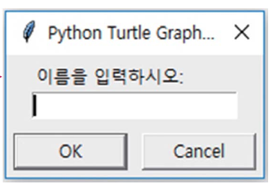
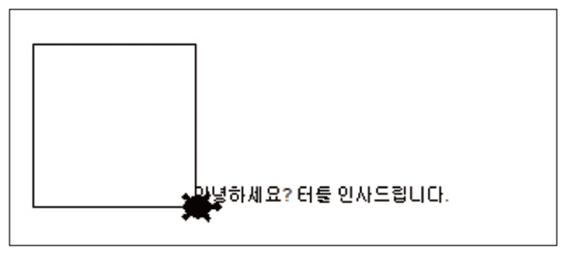

# Lecture 3 — Data Types

[Repository Guide](../../README.md) | [English](Concepts_Lecture.md) | [한국어](Concepts_Lecture.ko.md)

> **Last Updated:** 2026-11-04

> **Learning Objectives:**
> 1. Distinguish integers, floating-point numbers, and strings, the basic data types of Python, and check the data type of a value with `type()`
> 2. Convert between strings and numbers with `int()`, `float()`, and `str()`, and explain why the conversion is needed
> 3. Concatenate, repeat, and format strings with the `+`, `*`, and `%` operators
> 4. Extract characters and substrings from a string by indexing and slicing, and represent special characters with escape sequences
> 5. Read and write strings in turtle graphics with `textinput()` and `write()`
> 6. Create a list, add elements with `append()`, and access elements by index

---

## Table of Contents

- [1. Data Types in Python](#1-data-types-in-python)
  - [1.1 Basic Data Types](#11-basic-data-types)
  - [1.2 Variables and Data Types](#12-variables-and-data-types)
- [2. Strings](#2-strings)
  - [2.1 The Concept of a String](#21-the-concept-of-a-string)
  - [2.2 Creating Strings](#22-creating-strings)
  - [2.3 Numbers Versus Strings](#23-numbers-versus-strings)
- [3. Type Conversion](#3-type-conversion)
  - [3.1 Converting Strings to Numbers](#31-converting-strings-to-numbers)
  - [3.2 Converting Numbers to Strings](#32-converting-numbers-to-strings)
- [4. String Operations](#4-string-operations)
  - [4.1 Concatenation](#41-concatenation)
  - [4.2 Repetition](#42-repetition)
  - [4.3 String Formatting](#43-string-formatting)
- [5. Indexing and Slicing](#5-indexing-and-slicing)
  - [5.1 Indexes](#51-indexes)
  - [5.2 Slicing](#52-slicing)
  - [5.3 String Length and Immutability](#53-string-length-and-immutability)
- [6. Escape Sequences](#6-escape-sequences)
- [7. String Input and Output in Turtle Graphics](#7-string-input-and-output-in-turtle-graphics)
  - [7.1 String Input](#71-string-input)
  - [7.2 String Output](#72-string-output)
- [8. Lists](#8-lists)
  - [8.1 Creating a List](#81-creating-a-list)
  - [8.2 Adding Elements](#82-adding-elements)
  - [8.3 Accessing Elements](#83-accessing-elements)
- [Concept Applications](#concept-applications)
- [Summary](#summary)
- [Self-Check Questions](#self-check-questions)
- [References](#references)

---

<br>

## 1. Data Types in Python

### 1.1 Basic Data Types

The values a program handles come in kinds, and such a kind is called a **data type**. A data type determines what a value represents and which operations can be applied to it. For example, applying `+` to two integers gives the result of arithmetic addition, but applying `+` to two strings gives the two strings joined together (Section 2.3). The three most basic data types in Python are the following.

| Data Type | Name in Python | Examples | Description |
|:-----|:-----|:-----|:-----|
| Integer | `int` | `..., -2, -1, 0, 1, 2, ...` | A number without a decimal point |
| Floating-point number | `float` | `3.2`, `3.14`, `0.12` | A number with a decimal point |
| String | `str` | `'Hello World!'`, `"123"` | A sequence of characters enclosed in quotes |

*Table 1. Basic data types of Python*

An **integer** is a number without a decimal point. Python integers have no size limit, so any integer, however large, is represented exactly as long as memory allows [1]. For example, computing `2 ** 100` (2 to the 100th power) gives `1267650600228229401496703205376` exactly.

A **floating-point number** is a number with a decimal point. A computer stores real numbers in a binary floating-point format, and Python's `float` uses the 64-bit double-precision format on most platforms [1]. A fraction such as 0.1, which repeats forever in binary, does not fit in a finite number of bits and is stored as an approximation. That is why `0.1 + 0.2` is not exactly 0.3, as shown below.

```pycon
>>> 0.1 + 0.2
0.30000000000000004
```

> **[Computer Architecture]** The IEEE 754 floating-point format, which stores a real number as a sign, an exponent, and a mantissa, and the arithmetic units that compute with it are covered under data representation and arithmetic units in computer architecture.

A **string** is a sequence of characters enclosed in quotes. Even `"123"`, which consists only of digits, is a string rather than an integer once it is enclosed in quotes (Section 2.3). Besides these three, there is the Boolean data type `bool`, which represents true and false; it is covered together with conditional statements in Lecture 4.

### 1.2 Variables and Data Types

A **variable** is a name attached to a value (Lecture 2). In languages such as C and Java, a variable is declared with a data type when it is created, and it can hold only values of the declared type. In Python, variables are not declared with a data type, and a single variable can hold data of any kind. The data type belongs to the value, not to the variable, and a variable takes on the data type of the value it currently refers to. This approach is called **dynamic typing**.

```python
x = 10
print("x =", x)
x = 3.14
print("x =", x)
x = "Hello World!"
print("x =", x)
```

```text
x = 10
x = 3.14
x = Hello World!
```

- **Line 1:** Stores the integer 10 in the variable `x`.
- **Line 2:** `print()` prints the comma-separated arguments in order and puts one space between them. The first argument `"x ="` is a string printed as is, and the second argument `x` is the value stored in the variable, so `x = 10` is printed.
- **Lines 3-6:** Store the floating-point number 3.14 and then the string `"Hello World!"` in the same variable `x` and print them. When a new value is stored, `x` refers to the new value, and the previous value can no longer be reached through `x`.

The data type of a value is checked with the built-in function `type()` [2]. A built-in function is a function that Python provides by default and that can be used without `import`.

```python
x = 10
print(type(x))
x = 3.14
print(type(x))
x = "Hello World!"
print(type(x))
```

```text
<class 'int'>
<class 'float'>
<class 'str'>
```

`<class 'int'>` means that the value belongs to the class `int`, that is, the integer type. Python data types are implemented as classes, so the result of `type()` is displayed in the form `<class '...'>`. Classes are covered in Lecture 8.

---

<br>

## 2. Strings

### 2.1 The Concept of a String

For computers numerical computation is important, but for humans text is important. Much of the information handled in daily life, such as text messages, internet domain names, names, and addresses, is text, so processing text with a computer is also important. Python represents text as strings. A **string** is a sequence of characters. The string `"Hello"` is the five characters `H`, `e`, `l`, `l`, and `o` joined in this order.

```text
┌───┬───┬───┬───┬───┐
│ H │ e │ l │ l │ o │
└───┴───┴───┴───┴───┘
```

*Figure 1. The string "Hello" as characters joined in order*

Order matters in a string. Each character sits at a fixed position, so a desired character can be taken out by its position number (Section 5). Python has no separate data type for a single character; a single character is a string of length 1 [1].

### 2.2 Creating Strings

A string is created by enclosing characters in double quotes (`"`) or single quotes (`'`). Strings created in the two ways are exactly the same. A value written directly in source code is called a **literal**, and a string written in quotes is called a **string literal**.

```pycon
>>> "Hello"
'Hello'
>>> msg = "Hello"
>>> msg
'Hello'
>>> print(msg)
Hello
```

`>>>` is the prompt with which the interactive shell indicates that it is waiting for a command. When an expression is entered in the interactive shell, the shell displays its value, and it shows a string value with single quotes, as in `'Hello'`. These quotes are only a notation telling that the value is a string and are not part of the string's content. In contrast, `print()` prints only the content of the string, so `Hello` appears without quotes.

A string must end with the same kind of quote it started with. Starting with a double quote and ending with a single quote is a syntax error.

```pycon
>>> msg = "Hello'
  File "<stdin>", line 1
    msg = "Hello'
          ^
SyntaxError: unterminated string literal (detected at line 1)
```

Python looks for the double quote that ends the string started with a double quote, reaches the end of the line instead, and reports a **syntax error**. "unterminated string literal" means a string literal that has not been closed.

> **Note:** The wording of error messages depends on the Python version. Python 3.9 and earlier report the same error as `SyntaxError: EOL while scanning string literal`. EOL (end of line) refers to the end of a line, and the message means that the line ended while the string was being read.

Because there are two kinds of quotes, it is easy to put quotes inside a string. A string containing a single quote is enclosed in double quotes, and a string containing a double quote is enclosed in single quotes. To put in a quote of the same kind as the enclosing one, place a backslash (`\`) before it (Section 6).

```pycon
>>> print("It's mine")
It's mine
>>> print('He said "Hi"')
He said "Hi"
>>> print('It\'s mine')
It's mine
```

A string spanning several lines is enclosed in three quotes (`"""` or `'''`) [3]. After a line on which the string has not yet ended, the interactive shell shows the `...` prompt and accepts the continuing input.

```pycon
>>> poem = """말 한마디로
... 천 냥 빚을 갚는다"""
>>> print(poem)
말 한마디로
천 냥 빚을 갚는다
```

### 2.3 Numbers Versus Strings

`100` is an integer, while `"100"` and `'100'` are strings. They look similar, but their data types differ, so the same operator gives different results.

```pycon
>>> print(100+200)
300
>>> print("100"+"200")
100200
```

`100+200` is the addition of an integer and an integer, so arithmetic addition gives 300. In contrast, `"100"+"200"` applies `+` to a string and a string, and `+` on strings is concatenation (Section 4.1), which joins two strings, so the result is the string `"100200"` with the two texts stuck together. When the same operator performs different operations depending on the data types of its operands, this is called **operator overloading**.

---

<br>

## 3. Type Conversion

Changing a value of one data type into a value of another data type is called **type conversion**. When an integer and a floating-point number are computed together, the integer is converted to a floating-point number automatically (`1 + 2.5` is `3.5`), but conversion between data types of different nature, such as integers and strings, does not happen automatically, so the programmer must call a conversion function when needed.

### 3.1 Converting Strings to Numbers

`input()` returns whatever the user enters as a string (Lecture 2). Even if the user enters `100`, the result of `input()` is the string `"100"`, not the integer 100. To compute with an input value, the string is converted to a number with the following functions [2].

- **`int()`:** Converts a string to an integer.
- **`float()`:** Converts a string to a floating-point number.

```python
t = input("정수를 입력하시오: ")
x = int(t)
t = input("정수를 입력하시오: ")
y = int(t)
print(x+y)
```

```text
정수를 입력하시오: 100
정수를 입력하시오: 200
300
```

- **Line 1:** `input()` prints the prompt ("Enter an integer: ") and returns the user's input `100` as the string `"100"`, which is stored in `t`.
- **Line 2:** `int(t)` converts the string `"100"` to the integer 100 and stores the result in `x`.
- **Lines 3-4:** In the same way, the second input `"200"` is converted to the integer 200 and stored in `y`. Because the variable `t` is reused, its previous value `"100"` is replaced by `"200"`.
- **Line 5:** Both `x` and `y` are integers, so arithmetic addition is performed and 300 is printed.

Adding the results of `input()` without conversion performs string concatenation.

```python
x = input("정수를 입력하시오: ")
y = input("정수를 입력하시오: ")
print(x+y)
```

```text
정수를 입력하시오: 100
정수를 입력하시오: 200
100200
```

The conversion functions behave as follows.

```pycon
>>> int("42")
42
>>> float("3.14")
3.14
>>> float("10")
10.0
>>> int(" 42 ")
42
>>> int(3.99)
3
>>> int(-3.99)
-3
>>> int("3.14")
Traceback (most recent call last):
  File "<stdin>", line 1, in <module>
    int("3.14")
    ~~~^^^^^^^^
ValueError: invalid literal for int() with base 10: '3.14'
>>> int(float("3.14"))
3
```

- Even a string that looks like an integer becomes the floating-point number `10.0` when converted with `float()`, as in `float("10")`.
- `int()` and `float()` ignore spaces before and after the string, so `int(" 42 ")` is 42.
- Given a floating-point number, `int()` discards the fractional part. This is truncation toward 0, not rounding, so `int(3.99)` is 3 and `int(-3.99)` is -3.
- A string given to `int()` must have the form of an integer. `"3.14"` does not, so a **`ValueError`** (an error saying that the form of the value is wrong) occurs. To convert such a string to an integer, first convert it to a floating-point number and then to an integer, as in `int(float("3.14"))`.

> **Caution:** If a decimal number such as `0.1` or letters such as `abc` are entered into a program that reads integers with `int(input(...))`, a `ValueError` occurs and the program stops. When numbers with a decimal point must be read, use `float(input(...))`.

### 3.2 Converting Numbers to Strings

The following code causes an error.

```pycon
>>> print('나는 현재 ' + 21 + '살이다.')
Traceback (most recent call last):
  File "<stdin>", line 1, in <module>
    print('나는 현재 ' + 21 + '살이다.')
          ~~~~~~~~~~~~~^~~~
TypeError: can only concatenate str (not "int") to str
```

`'나는 현재 '` ("I am now ") is a string and `21` is an integer. Python cannot combine a string and a number with `+` and does not convert either one automatically. A **`TypeError`** is an error saying that a value of an unsuitable data type was used in an operation, and the message means that only a string, not an integer (`int`), can be concatenated to a string (`str`).

> **Note:** Older versions such as Python 3.5 report the same error as `TypeError: Can't convert 'int' object to str implicitly`. It means that the integer object cannot be converted to a string implicitly, that is, automatically.

To convert a number to a string, use the `str()` function [2].

```pycon
>>> print('나는 현재 ' + str(21) + '살이다.')
나는 현재 21살이다.
>>> print('원주율은 ' + str(3.14) + '입니다.')
원주율은 3.14입니다.
```

`str(21)` is the string `'21'`, so the expression becomes the concatenation of three strings and is printed without error ("I am now 21 years old." and "Pi is 3.14."). Meanwhile, when values are passed to `print()` separated by commas, `print()` converts each value to a string itself, so `str()` is unnecessary. However, one space is inserted between the values.

```pycon
>>> print('나는 현재', 21, '살이다.')
나는 현재 21 살이다.
```

| Function | Conversion | Examples | Results |
|:-----|:-----|:-----|:-----|
| `int()` | String or floating-point number to integer | `int("42")`, `int(3.99)` | `42`, `3` |
| `float()` | String or integer to floating-point number | `float("3.14")`, `float(10)` | `3.14`, `10.0` |
| `str()` | Number to string | `str(21)`, `str(3.14)` | `'21'`, `'3.14'` |

*Table 2. Type conversion functions*

---

<br>

## 4. String Operations

### 4.1 Concatenation

To join two strings into one, use the `+` operator. The operation of joining strings is called **concatenation**.

```pycon
>>> 'Hello ' + 'World!'
'Hello World!'
```

```text
┌───┬───┬───┬───┬───┬───┐     ┌───┬───┬───┬───┬───┬───┐
│ H │ e │ l │ l │ o │   │  +  │ W │ o │ r │ l │ d │ ! │
└───┴───┴───┴───┴───┴───┘     └───┴───┴───┴───┴───┴───┘
                        ↓
┌───┬───┬───┬───┬───┬───┬───┬───┬───┬───┬───┬───┐
│ H │ e │ l │ l │ o │   │ W │ o │ r │ l │ d │ ! │
└───┴───┴───┴───┴───┴───┴───┴───┴───┴───┴───┴───┘
```

*Figure 2. Concatenation of the two strings 'Hello ' and 'World!'*

`+` does not insert a space between the two strings. The space between `Hello` and `World!` in the result is the last character of the first string `'Hello '`.

### 4.2 Repetition

Applying the `*` operator to a string and an integer creates a string in which the string is repeated that many times.

```pycon
>>> message = " Congratulations!"
>>> print(message*3)
 Congratulations! Congratulations! Congratulations!
>>> print("="*50)
==================================================
>>> 3 * "ab"
'ababab'
>>> "ab" * 0
''
>>> "ab" * 2.5
Traceback (most recent call last):
  File "<stdin>", line 1, in <module>
    "ab" * 2.5
    ~~~~~^~~~~
TypeError: can't multiply sequence by non-int of type 'float'
```

- `message` starts with a space, so in the result repeated three times each `Congratulations!` is also preceded by one space.
- `"="*50` is a string of 50 `=` characters and is often used to draw a separator line on the output screen.
- The order of the integer and the string does not matter, so `3 * "ab"` is also `'ababab'`. Multiplying by an integer of 0 or less gives the empty string `''`, which has no characters.
- The repetition count must be an integer, so multiplying by the floating-point number 2.5 raises a `TypeError`.

### 4.3 String Formatting

To insert the value of a variable into a string for output, use the `%` symbol. Creating a string by filling values into a fixed template in this way is called **string formatting**.

```pycon
>>> price = 10000
>>> print("상품의 가격은 %s원입니다." % price)
상품의 가격은 10000원입니다.
```

`"상품의 가격은 %s원입니다."` ("The price of the product is %s won.") is a template that marks the place for a value with `%s`, and such a placeholder is called a **format specifier**. The `%` operator between the template and the value creates a new string in which the value of `price`, converted to a string, is placed at `%s`. Joining the number 10000 directly with `+` would require `str()` (Section 3.2), but `%s` converts the value to a string by itself. The main format specifiers are as follows [1].

| Format Specifier | Meaning | Example | Result |
|:-----|:-----|:-----|:-----|
| `%s` | Inserts the value converted to a string | `"%s원" % 10000` | `'10000원'` |
| `%d` | Inserts an integer in decimal | `"%d세" % 21` | `'21세'` |
| `%f` | Inserts a floating-point number with 6 digits after the decimal point | `"%f" % 3.14` | `'3.140000'` |
| `%.2f` | Inserts a floating-point number rounded to 2 digits after the decimal point | `"%.2f" % 3.14159` | `'3.14'` |
| `%%` | Inserts the character `%` itself | `"%d%%" % 30` | `'30%'` |

*Table 3. Main format specifiers*

For several values, pass them in order inside parentheses, separated by commas. A collection of values grouped in parentheses is a data type called a tuple, which is covered in Lecture 7.

```pycon
>>> name = "홍길동"
>>> age = 21
>>> height = 175.5
>>> print("%s의 나이는 %d세, 키는 %.1fcm입니다." % (name, age, height))
홍길동의 나이는 21세, 키는 175.5cm입니다.
```

> **Note:** Format specifiers such as `%d`, `%f`, and `%s` come from the `printf()` function of the C language, and the Python documentation calls this approach printf-style string formatting [1]. Since Python 3.6, formatted string literals (f-strings), which put `f` before the string and write expressions directly inside braces, can also be used [4]. `f"상품의 가격은 {price}원입니다."` creates the same string as the example above.

---

<br>

## 5. Indexing and Slicing

### 5.1 Indexes

Each character of a string has a position number, and this number is called an **index**. The index of the first character is 0, not 1. The character at index `i` of a string `s` is taken out with `s[i]`, and taking out an element by its index in this way is called **indexing**. Python also allows negative indexes. A negative index counts from the end of the string, and `-1` is the last character.

```text
   0   1   2   3   4   5   6   7   8   9  10  11
 ┌───┬───┬───┬───┬───┬───┬───┬───┬───┬───┬───┬───┐
 │ M │ o │ n │ t │ y │   │ P │ y │ t │ h │ o │ n │
 └───┴───┴───┴───┴───┴───┴───┴───┴───┴───┴───┴───┘
 -12 -11 -10  -9  -8  -7  -6  -5  -4  -3  -2  -1
```

*Figure 3. Indexes (top) and negative indexes (bottom) of the string "Monty Python"*

```pycon
>>> s = "Monty Python"
>>> s[0]
'M'
>>> s[6]
'P'
>>> s[-1]
'n'
>>> s[12]
Traceback (most recent call last):
  File "<stdin>", line 1, in <module>
    s[12]
    ~^^^^
IndexError: string index out of range
```

`"Monty Python"` consists of 12 characters including the space, so its indexes run from 0 to 11. The character at index 5 is the space. Using the out-of-range index 12 raises an **`IndexError`** (an error saying that the index is out of range).

### 5.2 Slicing

Cutting out part of a string is called **slicing**. `s[start:end]` is the substring made of the characters from index `start` to `end - 1`. Note that the character at the end index `end` is not included.

```pycon
>>> s = "Monty Python"
>>> print(s[6:10])
Pyth
```

`s[6:10]` consists of the characters `P`, `y`, `t`, and `h` at indexes 6, 7, 8, and 9, and the `o` at index 10 is not included. The length of the result is `end - start`, that is, 10 - 6 = 4. It is easier to understand if the indexes are viewed as numbers attached to the boundaries between characters rather than to the characters themselves [5]. Seen this way, `s[6:10]` is the characters between boundary 6 and boundary 10.

```text
                         s[6:10] = "Pyth"
                         ├───────────────┤
 ┌───┬───┬───┬───┬───┬───┬───┬───┬───┬───┬───┬───┐
 │ M │ o │ n │ t │ y │   │ P │ y │ t │ h │ o │ n │
 └───┴───┴───┴───┴───┴───┴───┴───┴───┴───┴───┴───┘
 0   1   2   3   4   5   6   7   8   9  10  11  12
```

*Figure 4. The slice s[6:10] seen through boundary numbers between characters*

Omitting the start index slices from the beginning, and omitting the end index slices to the end. Slicing does not raise an error even with out-of-range indexes; it cuts out only the part where the string exists.

```pycon
>>> s[:5]
'Monty'
>>> s[6:]
'Python'
>>> s[6:100]
'Python'
```

### 5.3 String Length and Immutability

The length of a string, that is, the number of its characters, is obtained with the built-in function `len()` [2]. A space also counts as one character. The index of the last character is always `len(s) - 1`.

```pycon
>>> len(s)
12
```

Once a string is created, its content cannot be changed. This property is called **immutability**, and the string is an immutable data type [1]. Trying to change a single character through an index raises a `TypeError`. When a string with different content is needed, a new string is created by slicing and concatenation. The original string `s` does not change.

```pycon
>>> s[0] = 'm'
Traceback (most recent call last):
  File "<stdin>", line 1, in <module>
    s[0] = 'm'
    ~^^^
TypeError: 'str' object does not support item assignment
>>> 'm' + s[1:]
'monty Python'
>>> s
'Monty Python'
```

---

<br>

## 6. Escape Sequences

Characters that are hard to type directly into a string, such as a line break or a tab, and characters that have a special meaning inside a string, such as quotes, are represented by two characters starting with a backslash (`\`). Such a notation is called an **escape sequence** [3].

| Escape Sequence | Meaning |
|:-----|:-----|
| `\n` | Newline character |
| `\t` | Tab character |
| `\\` | The backslash itself |
| `\"` | The double quote itself |
| `\'` | The single quote itself |

*Table 4. Main escape sequences*

```pycon
>>> print("말 한마디로\n천 냥 빚을 갚는다")
말 한마디로
천 냥 빚을 갚는다
>>> print("이름\t나이")
이름	나이
>>> print("C:\\temp")
C:\temp
>>> print("He said \"Hi\"")
He said "Hi"
>>> len("\n")
1
```

- Printing `\n` breaks the line at that point.
- `\t` moves to the next tab stop.
- A backslash marks the start of an escape sequence, so the backslash character itself is written twice, as in `\\`.
- An escape sequence is written with two characters but is a single character, so `len("\n")` is 1.

> **Caution:** Writing a Windows path as a string with single backslashes creates unintended escape sequences. In `"C:\new\test"`, `\n` and `\t` are interpreted as a newline character and a tab character. Write each backslash twice, or put `r` before the quote to make a raw string, in which escape sequences are not interpreted [3].
> ```pycon
> >>> print("C:\new\test")
> C:
> ew	est
> >>> print("C:\\new\\test")
> C:\new\test
> >>> print(r"C:\new\test")
> C:\new\test
> ```

---

<br>

## 7. String Input and Output in Turtle Graphics

Turtle graphics is Python's standard module `turtle`, which draws pictures by moving a turtle (cursor) on the screen (Lecture 2). Strings can also be read and written in a turtle graphics window.

### 7.1 String Input

To read a string in turtle graphics, use `turtle.textinput()`. The module must first be loaded with `import turtle`.

```python
import turtle
t = turtle.Turtle()
t.shape("turtle")
s = turtle.textinput("", "이름을 입력하시오: ")
```

- **Line 1:** Loads the `turtle` module. A module is a file that collects functions and data and is covered in Lecture 6.
- **Line 2:** Creates a turtle and stores it in the variable `t`. Commands are then given to `t`, as in `t.forward(100)`.
- **Line 3:** Changes the shape of the cursor to a turtle. The default shape is an arrow.
- **Line 4:** `textinput(title, prompt)` opens an input dialog. The first argument is the title of the dialog, and the second is the prompt shown inside it ("Enter your name: "). This example gives the empty string `""` as the title. When the user types and presses OK, the input is returned as a string and stored in `s` [6].



*Figure 5. Input dialog opened by textinput()*

Like `input()`, `textinput()` always returns a string, so to compute with a number, convert it with `int()` or `float()` (Section 3.1).

> **Caution:** If the user presses Cancel, `textinput()` returns `None`, a special value meaning no value, instead of a string [6]. Concatenating a string to this value with `+` raises a `TypeError`.

### 7.2 String Output

To write a string in the turtle graphics window, use the turtle's `write()`.

```python
t.write("안녕하세요? 터틀 인사드립니다.")
```

`write()` writes the string given as its argument at the turtle's current position. By default the string starts at the turtle's position and extends to the right, and the turtle does not move after writing [6]. In the following figure, the string ("Hello? The turtle greets you.") starts at the lower right corner of the square, where the turtle is, and extends to the right.



*Figure 6. String written with write() in the turtle graphics window*

> **Caution:** If a turtle graphics program is run from a command window with `python3 filename.py` instead of from IDLE, the drawing window closes as soon as the program ends. Placing `turtle.done()` on the last line of the program keeps the window open until the user closes it [6].

---

<br>

## 8. Lists

### 8.1 Creating a List

A **list** is a data type that gathers several pieces of data and stores them as one bundle. Values are written inside square brackets (`[]`) separated by commas, and each value in a list is called an **element**.

```python
slist = [ '영어', '수학', '사회', '과학' ]
```

The variable `slist` refers to the whole list of four elements (English, mathematics, social studies, and science). Like the characters of a string, the elements of a list have indexes starting from 0.

| Index | 0 | 1 | 2 | 3 |
|:-----|:-----|:-----|:-----|:-----|
| Element | `'영어'` | `'수학'` | `'사회'` | `'과학'` |

*Table 5. Indexes and elements of the list slist*

A single list can also hold values of different data types together.

```pycon
>>> mixed = [1, "a", 3.14]
>>> mixed
[1, 'a', 3.14]
```

> **Caution:** String elements must be enclosed in quotes. Without quotes, Python interprets `과학` as a variable name, and since no such variable exists, a **`NameError`** (an error saying that an undefined name was used) occurs.
> ```pycon
> >>> slist = [ '영어', '수학', '사회', 과학 ]
> Traceback (most recent call last):
>   File "<stdin>", line 1, in <module>
>     slist = [ '영어', '수학', '사회', 과학 ]
>                                       ^^^^
> NameError: name '과학' is not defined
> ```

### 8.2 Adding Elements

Instead of writing all elements from the start, an empty list with no elements can be created and elements added one at a time while the program runs. A list's `append()` adds the value given as its argument to the end of the list. A function called by putting a dot after a value, as in `list.append(1)`, is called a method and is covered in Lecture 8.

```python
list = []
list.append(1)
list.append(2)
list.append(6)
list.append(3)

print(list)
```

```text
[1, 2, 6, 3]
```

- **Line 1:** Creates an empty list and stores it in the variable `list`.
- **Lines 2-5:** Add 1, 2, 6, and 3 to the end in turn. The list changes to `[1]`, `[1, 2]`, `[1, 2, 6]`, and `[1, 2, 6, 3]`.
- **Line 7:** Prints the whole list. The elements are in the order in which they were added.

> **Caution:** `list` is the name of the built-in function that creates lists. Naming a variable `list`, as in the code above, makes the variable hide the built-in function, so the `list()` function can no longer be used later in the same program. Choose variable names that do not clash with built-in functions, such as `numbers` or `nlist`.
> ```pycon
> >>> list("abc")
> ['a', 'b', 'c']
> >>> list = []
> >>> list.append(1)
> >>> list("abc")
> Traceback (most recent call last):
>   File "<stdin>", line 1, in <module>
>     list("abc")
>     ~~~~^^^^^^^
> TypeError: 'list' object is not callable
> ```

### 8.3 Accessing Elements

The elements of a list are indexed and sliced in the same way as strings. Slicing a list gives a list, and `len()` returns the number of elements.

```python
slist = [ '영어', '수학', '사회', '과학' ]
print(slist[0])
```

```text
영어
```

```pycon
>>> slist[3]
'과학'
>>> slist[0:3]
['영어', '수학', '사회']
>>> len(slist)
4
```

`slist[0:3]` is the list of the elements at indexes 0, 1, and 2, and `'과학'` at the end index 3 is not included. Unlike a string, a list is a mutable data type whose elements can be changed. The many operations on lists are covered in Lecture 7.

```pycon
>>> slist[1] = '국어'
>>> slist
['영어', '국어', '사회', '과학']
```

---

<br>

## Concept Applications

**True/False Check:**

| Statement | Judgment and Reason |
|:-----|:-----|
| The result of `"3" + "4"` is 7. | **F.** It is the concatenation of two strings, so the result is the string `"34"`. |
| Even if the user enters `25`, the value returned by `input()` is a string. | **T.** `input()` always returns the input as a string, so it is converted with `int()` or `float()` before computing. |
| The result of `int("3.5")` is 3. | **F.** `"3.5"` is not a string in the form of an integer, so a `ValueError` occurs. `int(float("3.5"))` is 3. |
| If `s = "Python"`, then `s[1:3]` is `"yth"`. | **F.** The character at the end index 3 is not included, so it is `"yt"`, made of the characters at indexes 1 and 2. |
| The result of `"ab" * 3` is `"ababab"`. | **T.** `*` on a string and an integer repeats the string that many times and joins the copies. |
| The value of `len("\n")` is 2. | **F.** The escape sequence `\n` is written with two characters but is a single newline character, so the length is 1. |
| A list's `append()` adds an element to the front. | **F.** `append()` adds an element to the end of the list. |

---

<br>

## Summary

| Concept | Key Summary |
|:-----|:-----|
| Data type | The kind of a value; the basic data types are the integer `int`, the floating-point number `float`, and the string `str`. |
| Dynamic typing | Variables are not declared with a data type; a variable takes on the data type of the value it refers to, which is checked with `type()`. |
| String | A sequence of characters enclosed in double or single quotes; the opening and closing quotes must be of the same kind. |
| Type conversion | `int()` and `float()` convert strings to numbers, `str()` converts numbers to strings, and the result of `input()` is always a string. |
| Concatenation and repetition | `+` between strings joins them, `*` on a string and an integer repeats the string, and `+` between a string and a number is a `TypeError`. |
| String formatting | The `%` operator fills values into a template containing format specifiers such as `%s`, `%d`, and `%.2f`. |
| Indexing | Indexes start at 0, negative indexes count from the end, and `-1` is the last character. |
| Slicing | `s[start:end]` runs from `start` to `end - 1`; the character at the end index is not included. |
| Immutability | The content of a string cannot be changed, so a new string is created to change it. |
| Escape sequence | Represents a special character with a backslash, as in `\n`, `\t`, `\\`, `\"`, and `\'`; each is a single character. |
| Turtle graphics input and output | `turtle.textinput()` reads a string through a dialog, and `t.write()` writes a string at the turtle's position. |
| List | A mutable data type that bundles several pieces of data in square brackets; `append()` adds an element to the end, and elements are accessed by index. |

---

<br>

## Self-Check Questions

1. **Strings and numbers:** Write the results of `"3" + "4"`, `"3" * 4`, and `int("3") + 4`.

   <details>
   <summary>Answer</summary>

   They are `'34'`, `'3333'`, and `7`, in that order. The first is the concatenation of two strings, and the second repeats the string `"3"` four times. In the third, `int("3")` becomes the integer 3, so it is integer addition, 3 + 4 = 7.

   </details>

2. **Indexing and slicing:** If `s = "Monty Python"`, write the values of `s[1:4]`, `s[-3:]`, and `len(s)`.

   <details>
   <summary>Answer</summary>

   `s[1:4]` is the characters at indexes 1, 2, and 3, so it is `'ont'`. `s[-3:]` runs from the third character from the end (index -3, that is, 9) to the end, so it is `'hon'`. `len(s)` is the number of characters including the space, so it is 12.

   </details>

3. **Type error:** If `age = 20`, explain why `print("나이: " + age)` raises an error, and write two ways to print `나이: 20` ("Age: 20") without an error.

   <details>
   <summary>Answer</summary>

   `"나이: "` is a string and `age` is an integer, so they cannot be combined with `+`, and a `TypeError` occurs. First, convert the integer to a string with `str()` and concatenate, as in `print("나이: " + str(age))`. Second, use a format specifier, as in `print("나이: %d" % age)`. Passing the values with a comma, as in `print("나이:", age)`, also prints the same result because `print()` inserts one space.

   </details>

4. **Escape sequences:** Running `print("C:\new\test")` does not print the path as written. Explain why and write how to print it correctly.

   <details>
   <summary>Answer</summary>

   Inside the string, `\n` is interpreted as a newline character and `\t` as a tab character, so the line breaks after `C:` and a tab appears between `ew` and `est`. Writing each backslash twice, as in `"C:\\new\\test"`, or writing the raw string `r"C:\new\test"` prints `C:\new\test`.

   </details>

5. **Lists:** After running the following code, what are the values of `a[1]` and `len(a)`?

   ```python
   a = []
   a.append(5)
   a.append(7)
   ```

   <details>
   <summary>Answer</summary>

   `a` starts as an empty list and becomes `[5]` and then `[5, 7]`. Indexes start at 0, so `a[1]` is the second element, 7, and there are two elements, so `len(a)` is 2.

   </details>

---

<br>

## References

1. Python Software Foundation, "Built-in Types," *The Python Standard Library*. https://docs.python.org/3/library/stdtypes.html
2. Python Software Foundation, "Built-in Functions," *The Python Standard Library*. https://docs.python.org/3/library/functions.html
3. Python Software Foundation, "Lexical Analysis," *The Python Language Reference*. https://docs.python.org/3/reference/lexical_analysis.html
4. Python Software Foundation, "Input and Output," *The Python Tutorial*. https://docs.python.org/3/tutorial/inputoutput.html
5. Python Software Foundation, "An Informal Introduction to Python," *The Python Tutorial*. https://docs.python.org/3/tutorial/introduction.html
6. Python Software Foundation, "turtle: Turtle Graphics," *The Python Standard Library*. https://docs.python.org/3/library/turtle.html
