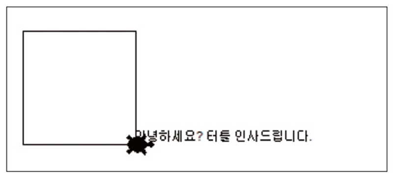

# 3강 연습 문제 — 자료의 종류

[레포지토리 안내](../../README.ko.md) | [English](Exercises.md) | [한국어](Exercises.ko.md)

> **최종 수정일:** 2026-11-04

연습 문제 1과 2는 문자열의 입력, 출력, 변환을, 연습 문제 3과 4는 리스트를 연습하는 문제이다. 모든 문제는 [3강](Concepts_Lecture.ko.md)의 내용만으로 풀 수 있다.

---

<br>

## 목차

- [연습 문제 1: 거북이와 인사하기](#연습-문제-1-거북이와-인사하기)
- [연습 문제 2: 친근하게 대화하는 프로그램](#연습-문제-2-친근하게-대화하는-프로그램)
- [연습 문제 3: 친구 목록 만들기](#연습-문제-3-친구-목록-만들기)
- [연습 문제 4: 네 수의 평균](#연습-문제-4-네-수의-평균)

---

<br>

## 연습 문제 1: 거북이와 인사하기

**문제:** 터틀 그래픽의 입력 대화 상자로 사용자의 이름을 입력받은 뒤, 거북이의 위치에 `안녕하세요? 홍길동씨, 터틀 인사드립니다.`처럼 이름을 넣은 인사말을 쓰고, 한 변의 길이가 100인 정사각형을 그리는 프로그램을 작성하라.

**실행 예시:** 다음은 인사말을 쓰고 정사각형을 그린 터틀 그래픽 창이다.



*그림 1. 인사말을 쓰고 정사각형을 그린 터틀 그래픽 창*

**[풀이](Solutions.ko.md#연습-문제-1-거북이와-인사하기)**

---

<br>

## 연습 문제 2: 친근하게 대화하는 프로그램

**문제:** 사용자의 이름과 나이를 입력받아 변수에 기억했다가, 출력할 때 그 값을 사용하는 프로그램을 작성하라. 프로그램은 인사말, 이름의 길이, 내년의 나이를 실행 예시와 같이 출력한다. 문자열의 길이는 `len()`으로 구한다.

**실행 예시:**

```text
안녕하세요?
이름이 어떻게 되시나요? 홍길동
만나서 반갑습니다. 홍길동씨
이름의 길이는 다음과 같군요: 3
나이가 어떻게 되나요? 21
내년이면 22 이 되시는군요.
```

**[풀이](Solutions.ko.md#연습-문제-2-친근하게-대화하는-프로그램)**

---

<br>

## 연습 문제 3: 친구 목록 만들기

**문제:** 제일 친한 친구 다섯 명의 이름을 하나씩 입력받아 리스트에 저장했다가, 마지막에 리스트를 출력하는 프로그램을 작성하라.

**실행 예시:**

```text
친구의 이름을 입력하시오: 홍길동
친구의 이름을 입력하시오: 강감찬
친구의 이름을 입력하시오: 이순신
친구의 이름을 입력하시오: 권율
친구의 이름을 입력하시오: 정약용
['홍길동', '강감찬', '이순신', '권율', '정약용']
```

**[풀이](Solutions.ko.md#연습-문제-3-친구-목록-만들기)**

---

<br>

## 연습 문제 4: 네 수의 평균

**문제:** 숫자 네 개를 하나씩 입력받아 리스트에 저장하고, 리스트에 저장된 수의 평균을 구하여 출력하는 프로그램을 작성하라.

**실행 예시:**

```text
숫자입력:10
숫자입력:20
숫자입력:30
숫자입력:40
평균: 25.0
```

**[풀이](Solutions.ko.md#연습-문제-4-네-수의-평균)**
