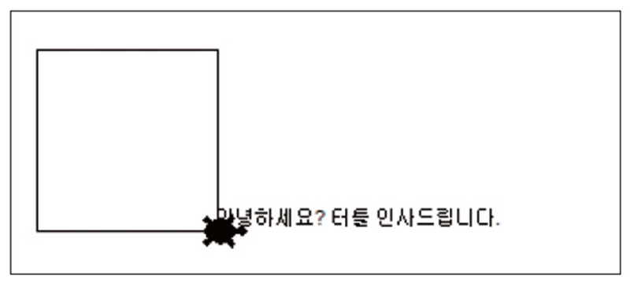

# Lecture 3 Exercises — Data Types

[Repository Guide](../../README.md) | [English](Exercises.md) | [한국어](Exercises.ko.md)

> **Last Updated:** 2026-11-04

Exercises 1 and 2 practice string input, output, and conversion, and Exercises 3 and 4 practice lists. All problems can be solved with the content of [Lecture 3](Concepts_Lecture.md) together with the turtle graphics commands and arithmetic operations of Lecture 2.

---

<br>

## Table of Contents

- [Exercise 1: Greeting the Turtle](#exercise-1-greeting-the-turtle)
- [Exercise 2: A Friendly Conversation Program](#exercise-2-a-friendly-conversation-program)
- [Exercise 3: Making a List of Friends](#exercise-3-making-a-list-of-friends)
- [Exercise 4: Average of Four Numbers](#exercise-4-average-of-four-numbers)

---

<br>

## Exercise 1: Greeting the Turtle

**Problem:** Write a program that reads the user's name through the input dialog of turtle graphics, writes at the turtle's position a greeting containing the name, such as `안녕하세요? 홍길동씨, 터틀 인사드립니다.` (a Korean greeting in which the turtle says hello to the user by name), and draws a square whose sides are 100 long.

**Sample Run:** The following is the turtle graphics window after the greeting is written and the square is drawn, showing where the greeting is placed relative to the square. The greeting in the figure contains no name, but the program to be written inserts the input name, as in `안녕하세요? 홍길동씨, 터틀 인사드립니다.`.



*Figure 1. Turtle graphics window with a greeting and a square*

**[Solution](Solutions.md#exercise-1-greeting-the-turtle)**

---

<br>

## Exercise 2: A Friendly Conversation Program

**Problem:** Write a program that reads the user's name and age, keeps them in variables, and uses the values when printing. The program prints a greeting, the length of the name, and the user's age next year as in the sample run. The length of a string is obtained with `len()`.

**Sample Run:**

```text
안녕하세요?
이름이 어떻게 되시나요? 홍길동
만나서 반갑습니다. 홍길동씨
이름의 길이는 다음과 같군요: 3
나이가 어떻게 되나요? 21
내년이면 22 이 되시는군요.
```

**[Solution](Solutions.md#exercise-2-a-friendly-conversation-program)**

---

<br>

## Exercise 3: Making a List of Friends

**Problem:** Write a program that reads the names of five best friends one at a time, stores them in a list, and prints the list at the end.

**Sample Run:**

```text
친구의 이름을 입력하시오: 홍길동
친구의 이름을 입력하시오: 강감찬
친구의 이름을 입력하시오: 이순신
친구의 이름을 입력하시오: 권율
친구의 이름을 입력하시오: 정약용
['홍길동', '강감찬', '이순신', '권율', '정약용']
```

**[Solution](Solutions.md#exercise-3-making-a-list-of-friends)**

---

<br>

## Exercise 4: Average of Four Numbers

**Problem:** Write a program that reads four numbers one at a time, stores them in a list, and computes and prints the average of the numbers stored in the list.

**Sample Run:**

```text
숫자입력:10
숫자입력:20
숫자입력:30
숫자입력:40
평균: 25.0
```

**[Solution](Solutions.md#exercise-4-average-of-four-numbers)**
