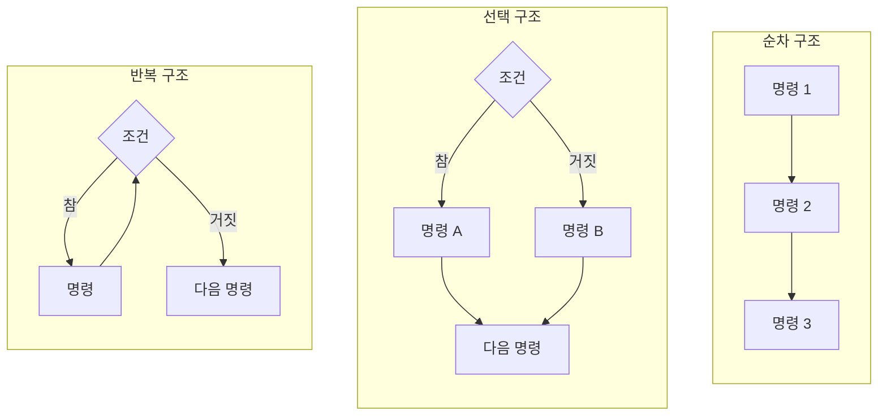
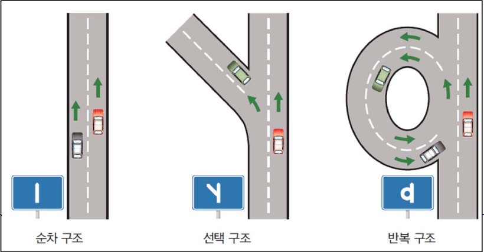
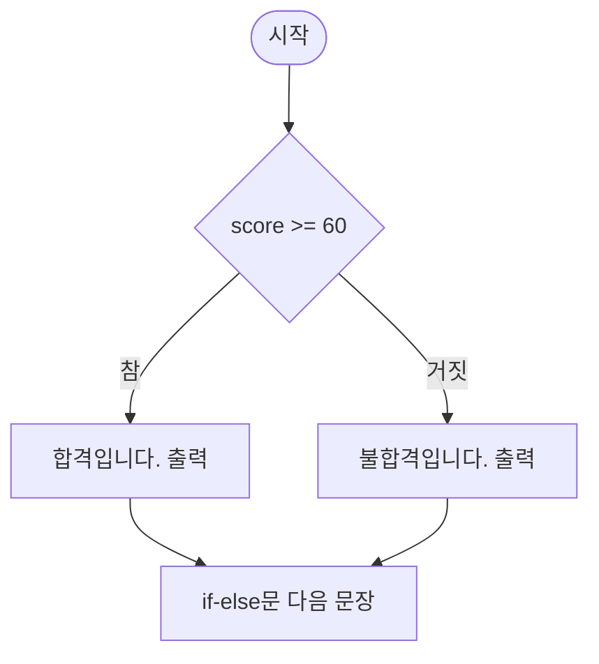
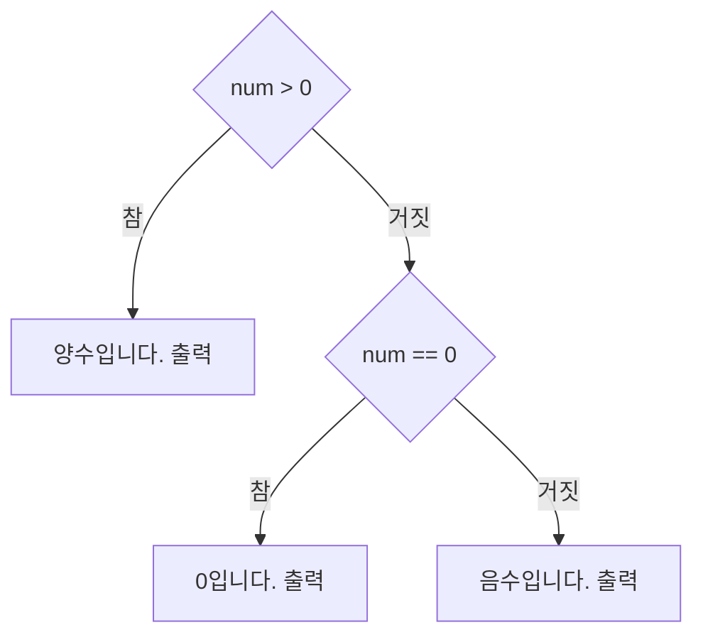
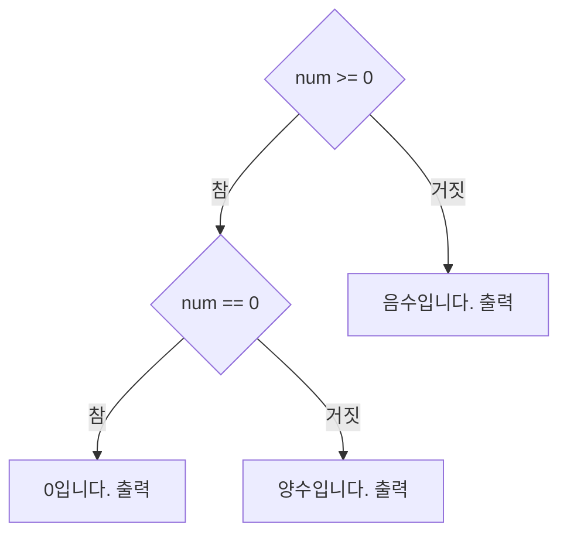

# 4강 — 조건문

[레포지토리 안내](../../README.ko.md) | [English](Concepts_Lecture.md) | [한국어](Concepts_Lecture.ko.md)

> **최종 수정일:** 2026-11-04

> **학습 목표:**
> 1. 순차, 선택, 반복의 세 가지 기본 제어 구조를 구분하고 순서도로 나타낼 수 있다
> 2. 관계 연산자와 논리 연산자로 참이나 거짓으로 평가되는 조건식을 작성할 수 있다
> 3. `if-else`문과 들여쓰기로 만든 블록으로 조건에 따라 서로 다른 문장을 실행할 수 있다
> 4. `if-elif-else`문과 중첩 `if`문으로 여러 조건을 차례로 검사하고, 두 형태를 서로 바꾸어 쓸 수 있다
> 5. `random` 모듈의 `randrange()`, `randint()`, `choice()`로 난수를 만들어 조건문과 함께 사용할 수 있다
> 6. 입력, 출력, 데이터를 분석하고 처리 순서를 정하는 과정을 거쳐 조건문이 들어간 프로그램을 설계할 수 있다

---

## 목차

- [1. 기본 제어 구조](#1-기본-제어-구조)
- [2. 조건식](#2-조건식)
  - [2.1 부울 자료형](#21-부울-자료형)
  - [2.2 관계 연산자](#22-관계-연산자)
  - [2.3 논리 연산자](#23-논리-연산자)
- [3. if-else문](#3-if-else문)
  - [3.1 기본 형태](#31-기본-형태)
  - [3.2 예제: 합격 판정](#32-예제-합격-판정)
  - [3.3 예제: 짝수와 홀수 판정](#33-예제-짝수와-홀수-판정)
  - [3.4 else가 없는 if문](#34-else가-없는-if문)
- [4. 블록과 들여쓰기](#4-블록과-들여쓰기)
- [5. if-elif-else문](#5-if-elif-else문)
  - [5.1 조건의 연속 검사](#51-조건의-연속-검사)
  - [5.2 조건의 순서](#52-조건의-순서)
- [6. 중첩 if문](#6-중첩-if문)
  - [6.1 중첩의 형태](#61-중첩의-형태)
  - [6.2 중첩 if문과 논리 연산자](#62-중첩-if문과-논리-연산자)
- [7. 난수와 조건문](#7-난수와-조건문)
- [8. 조건문이 들어간 프로그램의 설계](#8-조건문이-들어간-프로그램의-설계)
- [개념 적용](#개념-적용)
- [요약](#요약)
- [점검 문제](#점검-문제)
- [참고 문헌](#참고-문헌)

---

<br>

## 1. 기본 제어 구조

프로그램의 문장이 실행되는 순서를 **제어 흐름(control flow)** 이라 하고, 제어 흐름을 정하는 방식을 **제어 구조(control structure)** 라고 한다. 프로그램의 제어 흐름은 다음 세 가지 기본 제어 구조로 이루어진다.

- **순차 구조(sequence):** 명령들이 적힌 순서대로 하나씩 실행되는 구조이다. 2강과 3강의 프로그램은 모두 순차 구조이다.
- **선택 구조(selection):** 조건에 따라 둘 중 하나의 명령을 선택하여 실행하는 구조이다. 4강에서 다루는 조건문이 선택 구조를 만든다.
- **반복 구조(iteration):** 같은 명령을 조건이 만족되는 동안 반복하여 실행하는 구조이다. 반복문은 5강에서 다룬다.



*그림 1. 순차, 선택, 반복 구조의 순서도*

그림 1은 각 구조를 **순서도(flowchart)** 로 나타낸 것이다. 순서도에서 사각형은 명령을, 마름모는 참이나 거짓을 판단하는 조건을, 화살표는 실행 순서를 나타낸다. 세 구조는 도로에 비유할 수 있다. 순차 구조는 갈림길이 없는 곧은 길, 선택 구조는 둘로 갈라지는 길, 반복 구조는 같은 곳을 돌아 다시 지나가는 고리 모양의 길이다.



*그림 2. 도로에 비유한 순차, 선택, 반복 구조*

> **참고:** Böhm과 Jacopini는 1966년에, 순서도로 나타낼 수 있는 모든 프로그램을 순차, 선택, 반복의 세 구조만을 조합하여(필요하면 보조 변수를 더하여) 같은 동작의 프로그램으로 바꿀 수 있음을 보였다 [1]. 이 결과는 세 구조만으로 프로그램을 작성하는 구조적 프로그래밍(structured programming)의 이론적 근거가 되었다.

---

<br>

## 2. 조건식

선택 구조에서 어느 명령을 실행할지는 조건이 참인지 거짓인지로 정한다. 참이나 거짓으로 평가되는 식을 **조건식(condition)** 이라고 한다.

### 2.1 부울 자료형

참과 거짓은 **부울 자료형(Boolean type)** `bool`의 두 값 `True`와 `False`로 나타낸다. 첫 글자는 반드시 대문자이며, 따옴표로 감싸지 않는다. 따옴표로 감싼 `"True"`는 부울 값이 아니라 문자열이다.

```pycon
>>> 100 > 1
True
>>> 1 > 100
False
>>> type(True)
<class 'bool'>
```

조건식의 자리에는 부울 값이 아닌 값도 올 수 있다. 이때 파이썬은 숫자 0, 빈 문자열 `""`, 빈 리스트 `[]` 같은 비어 있는 값을 거짓으로, 그 밖의 값을 참으로 판단한다 [2]. 어떤 값이 참과 거짓 중 어느 쪽으로 판단되는지는 `bool()`로 확인한다.

```pycon
>>> bool(0)
False
>>> bool(3)
True
>>> bool("")
False
>>> bool("abc")
True
>>> bool([])
False
>>> bool([1])
True
```

### 2.2 관계 연산자

**관계 연산자(relational operator)** 는 두 개의 피연산자를 비교하는 연산자이며, 비교 결과로 `True`나 `False`를 돌려준다. 비교 연산자(comparison operator)라고도 한다.

| 연산 | 의미 |
|:-----|:-----|
| `x == y` | x와 y가 같은가? |
| `x != y` | x와 y가 다른가? |
| `x > y` | x가 y보다 큰가? |
| `x < y` | x가 y보다 작은가? |
| `x >= y` | x가 y보다 크거나 같은가? |
| `x <= y` | x가 y보다 작거나 같은가? |

*표 1. 관계 연산자*

예를 들어 `100 > 1`은 100이 1보다 크므로 참(`True`)이고, `1 > 100`은 거짓(`False`)이다.

```pycon
>>> x = 3
>>> x == 3
True
>>> x != 3
False
>>> x >= 3
True
>>> "apple" == "apple"
True
>>> "apple" == "Apple"
False
>>> 3 == 3.0
True
```

- 문자열도 `==`로 비교할 수 있으며, 두 문자열의 모든 문자가 같아야 같다. 대문자와 소문자는 다른 문자이므로 `"apple"`과 `"Apple"`은 다르다.
- 정수 3과 실수 3.0은 자료형이 달라도 수의 값이 같으므로 같다.

> **주의:** 같은지 비교하는 연산자는 `=`가 아니라 `==`이다. `=`는 변수에 값을 저장하는 대입 연산자이므로 조건식에 쓰면 문법 오류가 발생한다. 파이썬은 메시지에서 `==`를 쓰려던 것인지 묻는다.
> ```pycon
> >>> if x = 5:
>   File "<stdin>", line 1
>     if x = 5:
>        ^^^^^
> SyntaxError: invalid syntax. Maybe you meant '==' or ':=' instead of '='?
> ```

자료형이 다른 값을 비교할 때는 연산자에 따라 결과가 다르다. `==`는 숫자와 문자열처럼 비교할 수 없는 값에 대해 오류 없이 `False`를 돌려주지만, 크기를 비교하는 `<`는 `TypeError`를 낸다. 따라서 입력받은 문자열을 숫자와 비교하기 전에는 `int()`나 `float()`로 변환해야 한다(3강).

```pycon
>>> 10 == "10"
False
>>> 10 < "10"
Traceback (most recent call last):
  File "<stdin>", line 1, in <module>
    10 < "10"
TypeError: '<' not supported between instances of 'int' and 'str'
```

파이썬에서는 수학의 부등식처럼 관계 연산자를 이어 쓸 수 있다. `6 <= time < 9`는 `6 <= time and time < 9`와 같은 뜻이다 [3].

```pycon
>>> time = 7
>>> 6 <= time < 9
True
>>> time >= 6 and time < 9
True
```

### 2.3 논리 연산자

여러 조건을 하나로 묶을 때는 **논리 연산자(logical operator)** 를 쓴다. 예를 들어 "나이가 10살 이상이고, 그리고 키가 165cm 이상이면 놀이기구를 탈 수 있다"라는 규칙에는 두 조건이 있다. 조건 1은 나이가 10살 이상이라는 것이고, 조건 2는 키가 165cm 이상이라는 것이다. 두 조건이 모두 만족되어야 하므로 이 규칙은 `(나이가 10살 이상이다) and (키가 165cm 이상이다)`이며, 파이썬의 조건식으로는 `age >= 10 and height >= 165`이다.

| 연산 | 의미 |
|:-----|:-----|
| `x and y` | AND 연산. x와 y가 모두 참이면 참, 그렇지 않으면 거짓 |
| `x or y` | OR 연산. x와 y 중에서 하나만 참이어도 참, 모두 거짓이면 거짓 |
| `not x` | NOT 연산. x가 참이면 거짓, x가 거짓이면 참 |

*표 2. 논리 연산자*

| `x` | `y` | `x and y` | `x or y` | `not x` |
|:-----|:-----|:-----|:-----|:-----|
| `True` | `True` | `True` | `True` | `False` |
| `True` | `False` | `False` | `True` | `False` |
| `False` | `True` | `False` | `True` | `True` |
| `False` | `False` | `False` | `False` | `True` |

*표 3. 논리 연산자의 진리표*

```pycon
>>> age = 12
>>> height = 170
>>> age >= 10 and height >= 165
True
>>> age >= 10 and height >= 180
False
>>> age >= 15 or height >= 165
True
>>> not (age >= 10)
False
```

- `age >= 10`과 `height >= 165`가 모두 참이므로 `and`의 결과는 참이다.
- `height >= 180`이 거짓이므로 `and`의 결과는 거짓이다.
- `age >= 15`는 거짓이지만 `height >= 165`가 참이므로 `or`의 결과는 참이다.
- `age >= 10`이 참이므로 `not`의 결과는 거짓이다.

**우선순위:** 관계 연산자는 논리 연산자보다 먼저 계산되므로 `age >= 10 and height >= 165`에는 괄호가 필요 없다. 논리 연산자끼리는 `not`, `and`, `or`의 순서로 먼저 계산된다 [3]. 그래서 `True or False and False`는 `and`가 먼저 계산되어 `True or False`, 곧 `True`가 된다. 의도한 순서가 다르면 괄호로 묶는다.

```pycon
>>> True or False and False
True
>>> (True or False) and False
False
```

**단락 평가(short-circuit evaluation):** `and`는 왼쪽 피연산자가 거짓이면 결과가 거짓으로 정해지므로 오른쪽 피연산자를 계산하지 않는다. 마찬가지로 `or`는 왼쪽 피연산자가 참이면 오른쪽을 계산하지 않는다 [3]. 이 성질을 이용하면 오른쪽 식이 오류를 일으킬 수 있는 경우를 왼쪽 조건으로 미리 걸러 낼 수 있다. 다음 예에서 `x != 0`이 거짓이므로 0으로 나누는 `10 / x`는 계산되지 않는다. 순서를 바꾸면 나눗셈이 먼저 계산되어 오류가 발생한다.

```pycon
>>> x = 0
>>> x != 0 and 10 / x > 1
False
>>> 10 / x > 1 and x != 0
Traceback (most recent call last):
  File "<stdin>", line 1, in <module>
    10 / x > 1 and x != 0
    ~~~^~~
ZeroDivisionError: division by zero
```

> **[이산수학]** `and`, `or`, `not`은 명제 논리의 논리곱(conjunction), 논리합(disjunction), 부정(negation)에 해당하며, 표 3은 이 연산들의 진리표이다. 드모르간의 법칙(De Morgan's laws)에 따라 `not (A and B)`는 `(not A) or (not B)`와, `not (A or B)`는 `(not A) and (not B)`와 항상 같은 값을 가지며, 이 법칙을 이용하면 조건식을 같은 뜻의 다른 형태로 바꾸어 쓸 수 있다.

---

<br>

## 3. if-else문

### 3.1 기본 형태

조건식의 값에 따라 실행할 문장을 고르는 문장을 **조건문(conditional statement)** 이라고 하며, 파이썬의 기본 조건문은 `if-else`문이다 [4]. 기본 문법은 다음과 같다.

```text
if 조건식:            # if를 쓰고 조건식 뒤에 콜론(:)을 붙인다
    수행할 문장 1-1     # 들여쓰기 후, 조건식이 참일 때 수행할 문장을 쓴다
    수행할 문장 1-2     # 같은 조건에서 실행할 문장은 들여쓰기를 똑같이 유지한다
else:                # 조건식이 참이 아닐 때 수행할 문장이 이어진다
    수행할 문장 2-1     # 조건식이 참이 아닐 때 수행할 문장을 쓴다
    수행할 문장 2-2     # 들여쓰기를 똑같이 유지한다
```

다음 코드로 각 부분의 이름과 역할을 정리한다.

```python
if score >= 60:
    print("합격입니다.")
else:
    print("불합격입니다.")
```

- **`if`:** "만약 ~이면"에 해당하는 키워드(keyword)이다. 키워드는 파이썬이 특별한 의미로 예약해 둔 단어이며 변수 이름으로 쓸 수 없다.
- **조건식:** `score >= 60`처럼 참이나 거짓으로 평가되는 식이다. `if (score >= 60):`처럼 괄호로 감싸도 되지만 필요하지는 않다.
- **콜론(`:`):** 문장이 아직 끝나지 않았으며 실행할 문장들이 다음 줄부터 들여 써서 이어진다는 것을 뜻한다. 콜론을 빠뜨리면 문법 오류이다.
- **then 절:** 조건식이 참일 때 실행되는 문장들이다. `if` 줄보다 들여 써야 한다.
- **`else`와 else 절:** `else`는 "그렇지 않으면"을 뜻하며, else 절은 조건식이 참이 아닐 때 실행되는 문장들이다. `else`는 `if`와 같은 칸에서 시작하고 뒤에 콜론을 붙인다.

then 절과 else 절 가운데 정확히 하나만 실행되며, 어느 쪽이 실행되든 그다음에는 `if-else`문 뒤의 문장으로 넘어간다.



*그림 3. 합격 판정 if-else문의 순서도*

### 3.2 예제: 합격 판정

성적을 입력받아 60점 이상이면 합격, 그렇지 않으면 불합격을 출력한다.

```python
score = int(input("성적을 입력하시오: "))
if score >= 60:
    print("합격입니다.")
else:
    print("불합격입니다.")
```

```text
성적을 입력하시오: 80
합격입니다.
```

```text
성적을 입력하시오: 50
불합격입니다.
```

- **1행:** 입력받은 문자열을 `int()`로 정수로 바꾸어 `score`에 저장한다(3강).
- **2행:** `score >= 60`을 계산한다. 80을 입력하면 참, 50을 입력하면 거짓이다.
- **3행:** 조건식이 참일 때만 실행된다.
- **5행:** 조건식이 거짓일 때만 실행된다. 60점은 `60 >= 60`이 참이므로 합격이다.

> **주의:** `int(input(...))`으로 입력받는 프로그램에 `0.1`처럼 소수점이 있는 수를 입력하면 조건문에 이르기 전에 `ValueError`가 발생한다(3강). 점수가 소수일 수 있으면 `float(input(...))`으로 입력받는다.
> ```pycon
> >>> num = int(input("정수를 입력하시오: "))
> 정수를 입력하시오: 0.1
> Traceback (most recent call last):
>   File "<stdin>", line 1, in <module>
>     num = int(input("정수를 입력하시오: "))
>           ~~~^^^^^^^^^^^^^^^^^^^^^^^^^^^^^^
> ValueError: invalid literal for int() with base 10: '0.1'
> ```

### 3.3 예제: 짝수와 홀수 판정

정수를 입력받아 짝수인지 홀수인지 출력한다. 짝수는 2로 나눈 나머지가 0인 정수이므로, 나머지 연산자 `%`(2강)로 조건식 `num % 2 == 0`을 만든다.

```python
num = int(input("정수를 입력하시오: "))
if num % 2 == 0:
    print("짝수입니다.")
else:
    print("홀수입니다.")
```

```text
정수를 입력하시오: 10
짝수입니다.
```

```text
정수를 입력하시오: 7
홀수입니다.
```

10을 입력하면 `10 % 2`는 0이므로 `0 == 0`이 참이 되어 짝수이다. 7을 입력하면 `7 % 2`는 1이므로 홀수이다. 파이썬의 `%`는 나누는 수가 양수이면 음수를 나눌 때도 0 이상의 나머지를 돌려주므로(`-7 % 2`는 1), 음수를 입력해도 올바르게 판정한다.

### 3.4 else가 없는 if문

조건식이 참일 때만 할 일이 있고 거짓일 때 할 일이 없으면 `else` 절을 생략한다. 이때 조건식이 거짓이면 아무 일도 하지 않고 다음 문장으로 넘어간다.

```python
score = int(input("성적을 입력하시오: "))
if score > 90:
    print("합격입니다.")
    print("장학금도 받을 수 있습니다.")
print("프로그램을 종료합니다.")
```

```text
성적을 입력하시오: 95
합격입니다.
장학금도 받을 수 있습니다.
프로그램을 종료합니다.
```

```text
성적을 입력하시오: 80
프로그램을 종료합니다.
```

95를 입력하면 조건식이 참이므로 들여 쓴 두 문장이 실행되고, 80을 입력하면 두 문장을 건너뛴다. 마지막 줄은 들여 쓰지 않았으므로 `if`문에 속하지 않으며 조건과 관계없이 항상 실행된다.

> **참고:** 두 값 가운데 하나를 조건에 따라 고르기만 하면 될 때는 조건부 식(conditional expression) `A if 조건식 else B`를 쓸 수 있다. 조건식이 참이면 `A`, 거짓이면 `B`가 식의 값이다 [3]. `num = 7`일 때 `result = "짝수" if num % 2 == 0 else "홀수"`를 실행하면 `result`는 `"홀수"`가 된다.

---

<br>

## 4. 블록과 들여쓰기

조건이 참인 경우에 여러 개의 문장이 실행되어야 하면 그 문장들을 하나의 블록으로 묶는다. **블록(block)** 은 여러 문장을 묶은 것으로, 함께 실행되거나 함께 건너뛰는 문장의 단위이다. 3.4절의 예에서 `print("합격입니다.")`와 `print("장학금도 받을 수 있습니다.")`는 `if score > 90:`에 속한 하나의 블록이다.

C나 Java 같은 언어는 중괄호 `{ }`로 블록을 표시하지만, 파이썬은 **들여쓰기(indentation)**, 곧 줄 앞의 공백으로 블록을 표시한다 [5]. 들여쓰기는 보기 좋게 하려는 장식이 아니라 문법의 일부이며, 다음 규칙을 따른다.

- 콜론(`:`)으로 끝나는 줄 다음에는 반드시 들여 쓴 블록이 와야 한다.
- 같은 블록에 속한 문장은 모두 같은 칸만큼 들여 쓴다. 공백 4칸이 관례이다 [6].
- 들여쓰기가 원래 칸으로 돌아오면 블록이 끝난다.
- 한 파일에서 탭과 공백을 섞어 들여 쓰면 같은 들여쓰기인지 판단할 수 없어 `TabError`가 발생할 수 있으므로 공백만 쓴다 [5].

들여쓰기가 잘못되면 **`IndentationError`** 가 발생한다. 다음은 들여 써야 할 문장을 들여 쓰지 않은 경우와, 같은 블록의 문장을 서로 다르게 들여 쓴 경우이다.

```pycon
>>> score = 95
>>> if score > 90:
... print("합격입니다.")
  File "<stdin>", line 2
    print("합격입니다.")
    ^^^^^
IndentationError: expected an indented block after 'if' statement on line 1
```

```pycon
>>> score = 95
>>> if score > 90:
...     print("합격입니다.")
...       print("장학금도 받을 수 있습니다.")
  File "<stdin>", line 3
    print("장학금도 받을 수 있습니다.")
IndentationError: unexpected indent
```

들여쓰기는 오류를 내지 않으면서 뜻을 바꾸기도 한다. 다음 코드에서 두 번째 `print()`는 들여 쓰지 않았으므로 `if`문 밖의 문장이며, 점수가 80이어도 장학금 안내가 출력된다.

```python
score = 80
if score > 90:
    print("합격입니다.")
print("장학금도 받을 수 있습니다.")
```

```text
장학금도 받을 수 있습니다.
```

> **참고:** 블록에는 문장이 하나 이상 있어야 한다. 아직 작성하지 않은 블록처럼 아무것도 하지 않는 블록이 필요하면 아무 동작도 하지 않는 문장 `pass`를 쓴다.

---

<br>

## 5. if-elif-else문

### 5.1 조건의 연속 검사

정수를 입력받아 양수, 0, 음수 가운데 무엇인지 출력하려면 경우가 셋이므로 조건을 연속하여 검사해야 한다. 먼저 `num > 0`을 검사하여 참이면 양수이다. 거짓이면 다시 `num == 0`을 검사하여 참이면 0이고, 이것도 거짓이면 음수이다. 이런 연속 검사는 `elif`로 작성한다. `elif`는 "else if"를 줄인 키워드로, 앞의 조건이 모두 거짓일 때 검사할 새 조건을 붙인다 [4].



*그림 4. 양수, 0, 음수를 판정하는 if-elif-else문의 순서도*

```python
num = int(input("정수를 입력하시오: "))

if num > 0:
    print("양수입니다.")
elif num == 0:
    print("0입니다.")
else:
    print("음수입니다.")
```

```text
정수를 입력하시오: 10
양수입니다.
```

```text
정수를 입력하시오: 0
0입니다.
```

```text
정수를 입력하시오: -5
음수입니다.
```

- `if`, `elif`, `else`는 위에서부터 차례로 검사되며, 처음으로 참이 된 조건의 블록 하나만 실행된다. 그 뒤의 조건은 검사하지 않는다.
- `elif`는 필요한 만큼 여러 번 쓸 수 있고, 마지막의 `else`는 생략할 수 있다. `else`를 생략하면 모든 조건이 거짓일 때 아무 블록도 실행되지 않는다.
- 0을 입력하면 `num > 0`이 거짓이므로 `num == 0`을 검사하고, 이것이 참이므로 `0입니다.`가 출력된다.

### 5.2 조건의 순서

`if-elif-else`문은 처음으로 참이 된 조건 하나만 실행하므로 조건을 적는 순서가 결과를 바꿀 수 있다. 점수에 따라 학점을 매기는 다음 코드는 큰 기준부터 검사한다.

```python
score = int(input("점수를 입력하시오: "))
if score >= 90:
    print("A")
elif score >= 80:
    print("B")
elif score >= 70:
    print("C")
else:
    print("F")
```

```text
점수를 입력하시오: 85
B
```

85는 `score >= 90`이 거짓이고 `score >= 80`이 참이므로 B이다. `elif score >= 80`에 이르렀다는 것은 앞의 조건 `score >= 90`이 거짓이었다는 뜻이므로, 이 블록은 실제로 80 이상 90 미만인 경우에만 실행된다. 같은 코드에서 조건의 순서를 `score >= 70`, `score >= 80`, `score >= 90`으로 바꾸면 95점도 첫 조건 `score >= 70`에서 참이 되어 C가 출력된다.

```text
점수를 입력하시오: 95
C
```

> **참고:** 파이썬 3.10부터는 한 값을 여러 패턴과 차례로 비교하는 `match`문도 쓸 수 있다 [4]. 범위를 비교하는 위와 같은 조건에는 `if-elif-else`문이 알맞다.

---

<br>

## 6. 중첩 if문

### 6.1 중첩의 형태

`if`문의 블록 안에 다른 `if`문이 들어갈 수도 있다. 이것을 **중첩 if문(nested if statement)** 이라고 한다. 5.1절의 양수, 0, 음수 판정은 중첩 `if`문으로도 작성할 수 있다. 먼저 0 이상인지 검사하고, 0 이상인 경우 안에서 다시 0인지 검사한다.



*그림 5. 양수, 0, 음수를 판정하는 중첩 if문의 순서도*

```python
num = int(input("정수를 입력하시오: "))
if num >= 0:
    if num == 0:
        print("0입니다.")
    else:
        print("양수입니다.")
else:
    print("음수입니다.")
```

```text
정수를 입력하시오: 10
양수입니다.
```

```text
정수를 입력하시오: -3
음수입니다.
```

- **2행:** 바깥쪽 `if`문이 `num >= 0`을 검사한다.
- **3~6행:** 바깥쪽 조건이 참일 때 실행되는 블록이며, 그 안에 안쪽 `if-else`문이 들어 있다. 안쪽 `if`문은 한 번 더 들여 쓴다.
- **7~8행:** 바깥쪽 `else`는 바깥쪽 `if`와 같은 칸에 있으므로 바깥쪽 `if`의 짝이다. `else`가 어느 `if`의 짝인지는 들여쓰기로 정해진다.

10을 입력하면 `num >= 0`이 참이고 `num == 0`이 거짓이므로 `양수입니다.`가, -3을 입력하면 `num >= 0`이 거짓이므로 `음수입니다.`가 출력된다. 같은 판정을 하는 5.1절의 `if-elif-else`문과 비교하면, 중첩이 깊어질수록 들여쓰기가 늘어 읽기 어려워지므로 같은 수준에서 경우를 나열할 수 있으면 `elif`를 쓰는 편이 읽기 쉽다.

### 6.2 중첩 if문과 논리 연산자

`and`로 묶은 조건은 중첩 `if`문으로 바꾸어 쓸 수 있다. 다음 두 프로그램은 2.3절의 놀이기구 규칙을 판정하며, 모든 입력에 대해 같은 결과를 낸다.

```python
age = int(input("나이를 입력하시오: "))
height = int(input("키를 입력하시오: "))
if age >= 10:
    if height >= 165:
        print("놀이기구를 탈 수 있습니다.")
    else:
        print("놀이기구를 탈 수 없습니다.")
else:
    print("놀이기구를 탈 수 없습니다.")
```

```python
age = int(input("나이를 입력하시오: "))
height = int(input("키를 입력하시오: "))
if age >= 10 and height >= 165:
    print("놀이기구를 탈 수 있습니다.")
else:
    print("놀이기구를 탈 수 없습니다.")
```

```text
나이를 입력하시오: 12
키를 입력하시오: 170
놀이기구를 탈 수 있습니다.
```

```text
나이를 입력하시오: 12
키를 입력하시오: 150
놀이기구를 탈 수 없습니다.
```

```text
나이를 입력하시오: 8
키를 입력하시오: 170
놀이기구를 탈 수 없습니다.
```

중첩 `if`문은 바깥 조건이 참일 때만 안쪽 조건을 검사하므로 `and`의 단락 평가(2.3절)와 같은 순서로 판단한다. 두 조건 가운데 하나라도 거짓이면 탈 수 없으므로, 중첩 형태에서는 같은 출력 문장이 두 번 나오고 `and` 형태에서는 한 번만 나온다. 조건마다 다른 안내를 출력해야 하면 중첩 형태가 알맞고, 결과가 두 가지뿐이면 `and` 형태가 간결하다.

---

<br>

## 7. 난수와 조건문

게임처럼 실행할 때마다 다른 결과가 나와야 하는 프로그램에는 무작위로 정해지는 수, 곧 **난수(random number)** 가 필요하다. 파이썬은 난수를 만드는 표준 모듈 `random`을 제공하며, `import random`으로 불러온 뒤 `random.함수이름()` 형태로 쓴다 [7].

| 함수 | 결과 | 예 |
|:-----|:-----|:-----|
| `random.randrange(n)` | 0 이상 n 미만의 정수 하나 | `random.randrange(2)`는 0 또는 1 |
| `random.randrange(a, b)` | a 이상 b 미만의 정수 하나 (b는 포함하지 않음) | `random.randrange(1, 6)`은 1\~5 중 하나 |
| `random.randint(a, b)` | a 이상 b 이하의 정수 하나 (a와 b를 모두 포함) | `random.randint(1, 10)`은 1\~10 중 하나 |
| `random.choice(리스트)` | 리스트의 요소 가운데 하나 | `random.choice([True, False])`는 `True` 또는 `False` |

*표 4. random 모듈의 주요 함수*

```pycon
>>> import random
>>> random.randrange(2)
0
>>> random.randrange(2)
1
>>> random.randint(1, 10)
1
>>> random.randint(1, 10)
2
>>> random.choice([True, False])
True
>>> random.choice(['가위', '바위', '보'])
'가위'
```

결과는 실행할 때마다 달라지며, 위의 값은 한 번 실행한 예이다. `randrange()`와 `randint()`는 끝값의 포함 여부가 다르다는 점에 주의해야 한다. 문자열의 슬라이싱(3강)처럼 `randrange()`는 끝값을 포함하지 않고, `randint()`는 끝값을 포함한다.

난수를 조건식에 쓰면 실행할 때마다 다른 블록이 실행되는 프로그램이 된다. 예를 들어 `coin = random.randrange(2)`로 0이나 1을 만든 뒤 `if coin == 0:`으로 앞면과 뒷면을 가르면 동전 던지기가 된다. 이렇게 난수와 조건문을 함께 쓰는 프로그램은 [연습 문제](Exercises.ko.md) 3, 4, 7에서 다룬다.

> **참고:** `random` 모듈이 만드는 수는 정해진 알고리즘(메르센 트위스터, Mersenne Twister)으로 계산한 의사 난수(pseudo-random number)이다. 같은 시작값을 `random.seed()`로 정하면 매번 같은 순서의 수가 나오므로 프로그램을 시험할 때 유용하다. 반면 예측할 수 없어야 하는 보안 용도에는 적합하지 않다 [7].

---

<br>

## 8. 조건문이 들어간 프로그램의 설계

조건문이 들어간 프로그램을 작성할 때는 곧바로 코드를 쓰기보다 다음 순서로 문제를 정리하면 실수가 줄어든다.

| 단계 | 정리할 내용 | 커피 자동 주문 판매기의 예 |
|:-----|:-----|:-----|
| 1. 문제 분석 | 입력, 출력, 프로그램이 기억해야 할 데이터 | 입력은 커피 종류별 잔 수와 지불 금액, 출력은 커피별 한 잔 가격, 총금액, 거스름돈 |
| 2. 처리 순서 정하기 | 입력부터 출력까지의 처리 단계와 판단이 필요한 곳 | 메뉴 출력, 잔 수 입력, 총금액 계산, 금액 입력, 금액이 부족한지 판단 |
| 3. 변수 정하기 | 데이터를 담을 변수의 이름과 뜻 | `noA`(아메리카노 잔 수), `money`(지불한 금액) 등 |
| 4. 프로그래밍 | 정한 순서를 코드로 옮기고 여러 입력으로 실행해 보기 | 총금액은 복합 연산자 `+=`로 누적하고, 부족 여부는 `if-else`문으로 판단 |

*표 5. 프로그램 설계의 네 단계*

2단계에서 순서도(1절)를 그리면 판단이 필요한 곳, 곧 조건문이 들어갈 곳이 마름모로 드러난다. 4단계에서는 조건식이 참인 경우와 거짓인 경우, 그리고 `money == total`처럼 경계에 놓인 경우를 모두 입력해 보아야 한다. 이 과정 전체를 적용한 풀이는 [연습 문제 8](Exercises.ko.md#연습-문제-8-커피-자동-주문-판매기)에 있다.

---

<br>

## 개념 적용

**T/F 점검:**

| 문장 | 판단과 근거 |
|:-----|:-----|
| `if x = 10:`은 `x`가 10인지 검사하는 올바른 조건문이다. | **F.** `=`는 대입 연산자이므로 문법 오류이다. 같은지 비교하려면 `==`를 쓴다. |
| `x and y`는 `x`와 `y` 중 하나만 참이어도 참이다. | **F.** `and`는 둘 다 참일 때만 참이다. 하나만 참이어도 참인 것은 `or`이다. |
| `if-elif-else`문에서 조건이 여러 개 참이면 참인 블록이 모두 실행된다. | **F.** 위에서부터 검사하여 처음으로 참이 된 조건의 블록 하나만 실행된다. |
| 파이썬에서 들여쓰기는 문법의 일부이다. | **T.** 파이썬은 들여쓰기로 블록을 표시하므로, 들여쓰기가 바뀌면 오류가 나거나 프로그램의 뜻이 바뀐다. |
| `random.randint(1, 10)`은 10을 결과로 낼 수 있다. | **T.** `randint(a, b)`는 a와 b를 모두 포함하는 범위에서 정수를 고른다. |
| `random.randrange(1, 10)`은 10을 결과로 낼 수 있다. | **F.** `randrange(a, b)`는 b를 포함하지 않으므로 1\~9 중 하나를 낸다. |
| `if`문에는 항상 `else` 절이 있어야 한다. | **F.** `else` 절은 생략할 수 있으며, 생략하면 조건이 거짓일 때 아무 일도 하지 않는다. |

---

<br>

## 요약

| 개념 | 핵심 요약 |
|:-----|:-----|
| 기본 제어 구조 | 순차, 선택, 반복의 세 구조가 있으며, 조건문은 선택 구조를 만든다. |
| 부울 자료형 | `True`와 `False` 두 값을 가지며, 조건식에서 0, 빈 문자열, 빈 리스트는 거짓으로 판단된다. |
| 관계 연산자 | `==`, `!=`, `>`, `<`, `>=`, `<=`로 두 값을 비교하여 `True`나 `False`를 돌려준다. |
| 논리 연산자 | `and`는 모두 참일 때, `or`는 하나라도 참일 때 참이고, `not`은 참과 거짓을 뒤집으며, `not`, `and`, `or` 순으로 계산된다. |
| `if-else`문 | 조건식 뒤에 콜론을 붙이고, 참이면 then 절을, 참이 아니면 else 절을 실행한다. |
| 블록과 들여쓰기 | 같은 칸만큼 들여 쓴 문장들이 하나의 블록이며, 들여쓰기가 잘못되면 `IndentationError`가 발생한다. |
| `if-elif-else`문 | 조건을 위에서부터 검사하여 처음으로 참이 된 블록 하나만 실행하므로 조건의 순서가 중요하다. |
| 중첩 `if`문 | `if`문 안에 `if`문을 넣으며, `else`의 짝은 들여쓰기로 정해지고, `and`로 묶은 조건과 바꾸어 쓸 수 있다. |
| `random` 모듈 | `randrange()`는 끝값을 포함하지 않고, `randint()`는 끝값을 포함하며, `choice()`는 리스트의 요소 하나를 고른다. |
| 프로그램 설계 | 문제 분석, 처리 순서 정하기, 변수 정하기, 프로그래밍의 순서로 진행하며, 경계에 놓인 입력까지 시험한다. |

---

<br>

## 점검 문제

1. **조건식의 값:** `x = 7`일 때 `x > 5 and x < 10`, `x % 2 == 0 or x > 10`, `not (x == 7)`의 값을 쓰라.

   <details>
   <summary>정답</summary>

   차례로 `True`, `False`, `False`이다. 첫 번째는 `7 > 5`와 `7 < 10`이 모두 참이므로 참이다. 두 번째는 `7 % 2`가 1이어서 `x % 2 == 0`이 거짓이고 `x > 10`도 거짓이므로 거짓이다. 세 번째는 `x == 7`이 참이므로 `not`을 적용하면 거짓이다.

   </details>

2. **if와 elif의 차이:** `score = 95`일 때 다음 두 코드의 출력을 각각 쓰고, 차이가 생기는 이유를 설명하라.

   ```python
   # (가)
   if score >= 90:
       print("A")
   if score >= 80:
       print("B")

   # (나)
   if score >= 90:
       print("A")
   elif score >= 80:
       print("B")
   ```

   <details>
   <summary>정답</summary>

   (가)는 `A`와 `B`를 두 줄로 출력하고, (나)는 `A`만 출력한다. (가)의 두 `if`문은 서로 독립이므로 두 조건을 모두 검사하고, 95는 두 조건을 모두 만족한다. (나)는 하나의 `if-elif`문이므로 처음으로 참이 된 `score >= 90`의 블록만 실행하고 `elif`의 조건은 검사하지 않는다.

   </details>

3. **중첩 if문 바꾸기:** 6.1절의 중첩 `if`문을 같은 결과를 내는 `if-elif-else`문으로 바꾸라.

   <details>
   <summary>정답</summary>

   5.1절의 코드와 같다. `if num > 0:`에서 양수를, `elif num == 0:`에서 0을, `else:`에서 음수를 출력한다. 중첩 형태의 바깥 조건 `num >= 0`과 안쪽 조건 `num == 0`을 조합하면 양수는 `num >= 0`이 참이고 `num == 0`이 거짓인 경우, 곧 `num > 0`인 경우이다.

   </details>

4. **들여쓰기:** 다음 코드를 `score = 80`으로 실행하면 무엇이 출력되는가? 두 번째 `print()`가 `score`가 90보다 클 때만 출력되게 하려면 어떻게 고쳐야 하는가?

   ```python
   if score > 90:
       print("합격입니다.")
   print("장학금도 받을 수 있습니다.")
   ```

   <details>
   <summary>정답</summary>

   `장학금도 받을 수 있습니다.`만 출력된다. 두 번째 `print()`는 들여 쓰지 않았으므로 `if`문 밖의 문장이어서 조건과 관계없이 실행된다. 첫 번째 `print()`와 같은 칸만큼 들여 쓰면 같은 블록에 속하게 되어 조건이 참일 때만 실행된다.

   </details>

5. **난수의 범위:** 주사위의 눈(1\~6)을 만들려고 한다. `random.randint(1, 6)`과 `random.randrange(1, 6)` 가운데 어느 것이 알맞은가?

   <details>
   <summary>정답</summary>

   `random.randint(1, 6)`이다. `randint(a, b)`는 a와 b를 모두 포함하므로 1\~6 중 하나를 낸다. `randrange(1, 6)`은 끝값 6을 포함하지 않으므로 6이 나오지 않는다. `randrange()`로 같은 범위를 만들려면 `random.randrange(1, 7)`로 쓴다.

   </details>

---

<br>

## 참고 문헌

1. C. Böhm and G. Jacopini, "Flow diagrams, Turing machines and languages with only two formation rules," *Communications of the ACM*, vol. 9, no. 5, pp. 366-371, 1966.
2. Python Software Foundation, "Built-in Types," *The Python Standard Library*. https://docs.python.org/3/library/stdtypes.html
3. Python Software Foundation, "Expressions," *The Python Language Reference*. https://docs.python.org/3/reference/expressions.html
4. Python Software Foundation, "Compound Statements," *The Python Language Reference*. https://docs.python.org/3/reference/compound_stmts.html
5. Python Software Foundation, "Lexical Analysis," *The Python Language Reference*. https://docs.python.org/3/reference/lexical_analysis.html
6. G. van Rossum, B. Warsaw, and A. Coghlan, "PEP 8: Style Guide for Python Code," 2001. https://peps.python.org/pep-0008/
7. Python Software Foundation, "random: Generate Pseudo-Random Numbers," *The Python Standard Library*. https://docs.python.org/3/library/random.html
