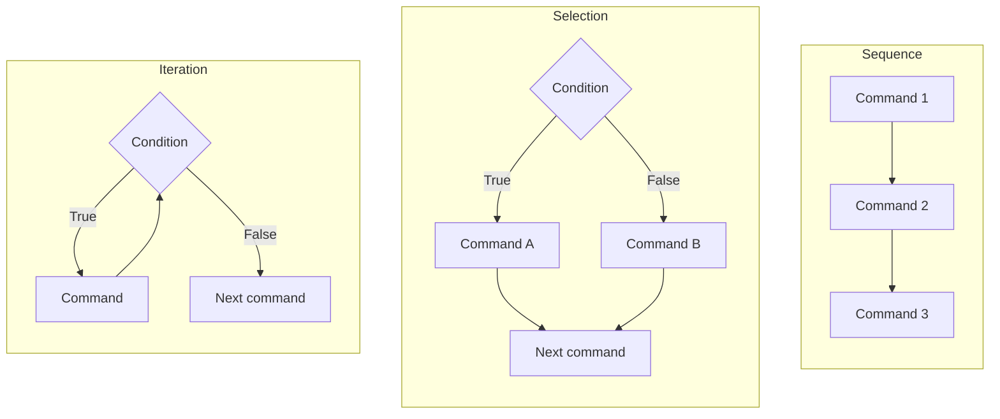
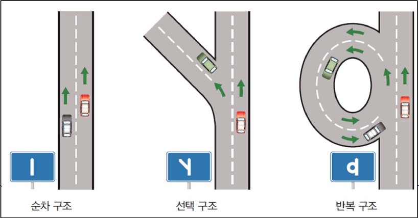
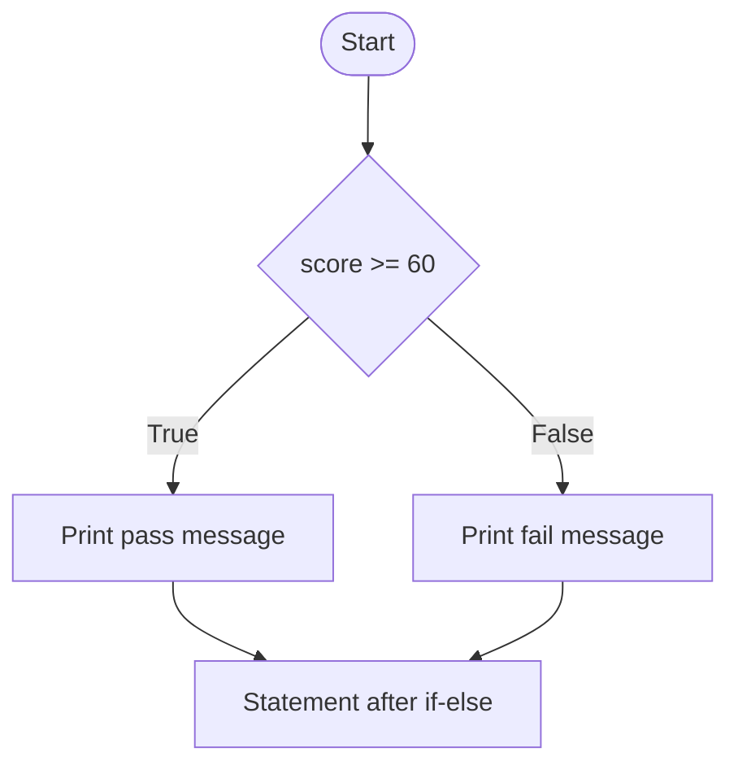
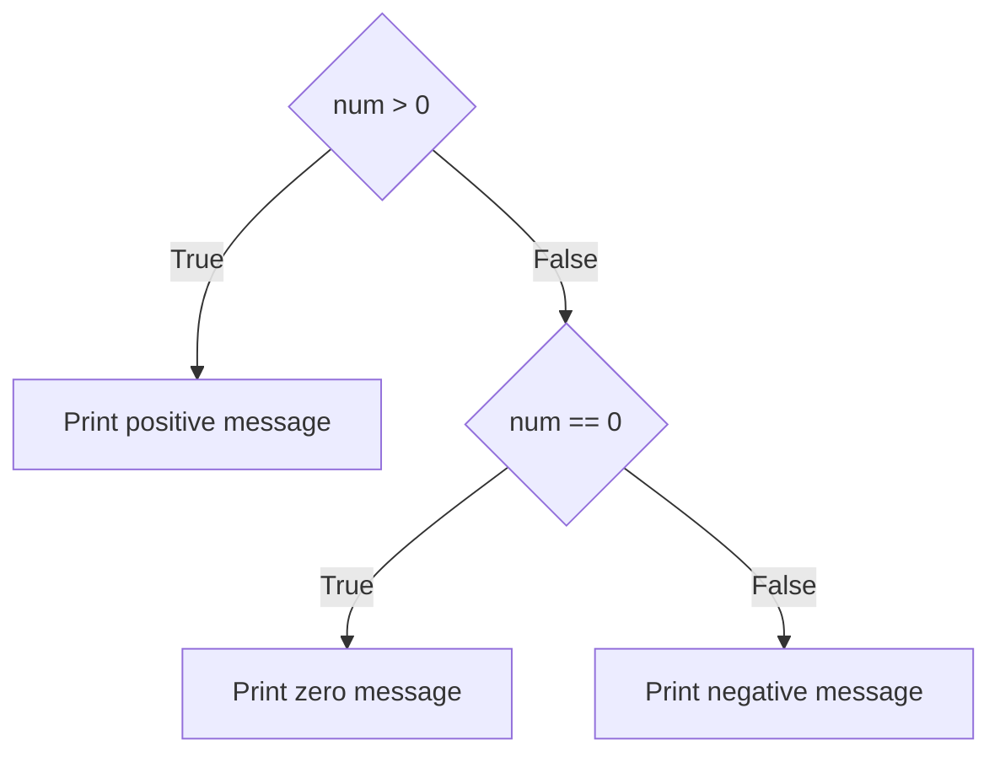
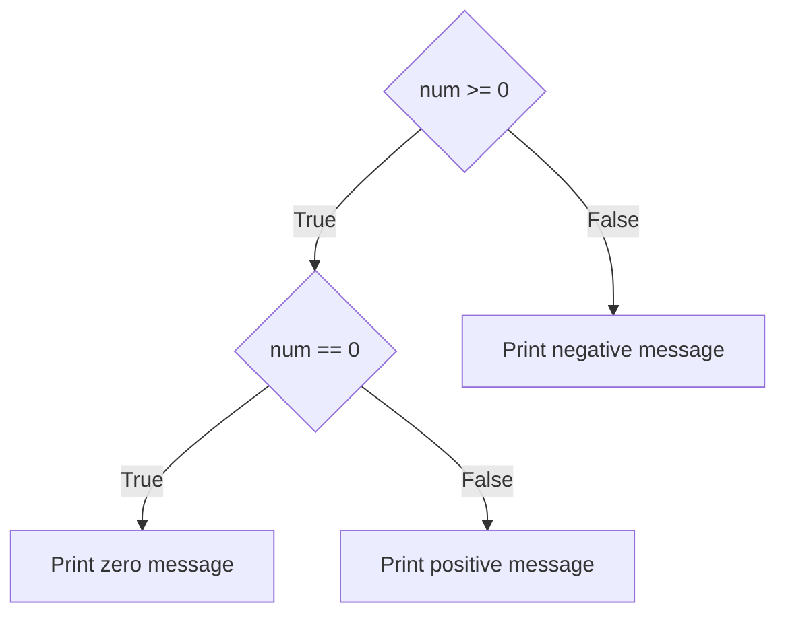

# Lecture 4 — Conditional Statements

[Repository Guide](../../README.md) | [English](Concepts_Lecture.md) | [한국어](Concepts_Lecture.ko.md)

> **Last Updated:** 2026-11-04

> **Learning Objectives:**
> 1. Distinguish the three basic control structures of sequence, selection, and iteration, and represent them as flowcharts
> 2. Write conditions that evaluate to true or false with relational and logical operators
> 3. Execute different statements depending on a condition with the `if-else` statement and blocks formed by indentation
> 4. Check several conditions in turn with the `if-elif-else` statement and nested `if` statements, and rewrite one form as the other
> 5. Generate random numbers with `randrange()`, `randint()`, and `choice()` of the `random` module and use them with conditional statements
> 6. Design a program containing conditional statements by analyzing its input, output, and data and deciding the processing order

---

## Table of Contents

- [1. Basic Control Structures](#1-basic-control-structures)
- [2. Conditions](#2-conditions)
  - [2.1 The Boolean Type](#21-the-boolean-type)
  - [2.2 Relational Operators](#22-relational-operators)
  - [2.3 Logical Operators](#23-logical-operators)
- [3. The if-else Statement](#3-the-if-else-statement)
  - [3.1 Basic Form](#31-basic-form)
  - [3.2 Example: Pass or Fail](#32-example-pass-or-fail)
  - [3.3 Example: Even or Odd](#33-example-even-or-odd)
  - [3.4 if Statements Without else](#34-if-statements-without-else)
- [4. Blocks and Indentation](#4-blocks-and-indentation)
- [5. The if-elif-else Statement](#5-the-if-elif-else-statement)
  - [5.1 Checking Conditions in Succession](#51-checking-conditions-in-succession)
  - [5.2 The Order of Conditions](#52-the-order-of-conditions)
- [6. Nested if Statements](#6-nested-if-statements)
  - [6.1 The Form of Nesting](#61-the-form-of-nesting)
  - [6.2 Nested if Statements and Logical Operators](#62-nested-if-statements-and-logical-operators)
- [7. Random Numbers and Conditional Statements](#7-random-numbers-and-conditional-statements)
- [8. Designing Programs with Conditional Statements](#8-designing-programs-with-conditional-statements)
- [Concept Applications](#concept-applications)
- [Summary](#summary)
- [Self-Check Questions](#self-check-questions)
- [References](#references)

---

<br>

## 1. Basic Control Structures

The order in which the statements of a program are executed is called the **control flow**, and the way the control flow is determined is called a **control structure**. The control flow of a program is made of the following three basic control structures.

- **Sequence:** A structure in which commands are executed one by one in the order written. All programs of Lectures 2 and 3 are sequence structures.
- **Selection:** A structure that selects and executes one of two commands depending on a condition. Conditional statements (Sections 3-6) create selection structures.
- **Iteration:** A structure that executes the same commands repeatedly while a condition holds. Loops are covered in Lecture 5.



*Figure 1. Flowcharts of the sequence, selection, and iteration structures*

Figure 1 represents each structure as a **flowchart**. In a flowchart, a rectangle is a command, a diamond is a condition judged true or false, and an arrow is the order of execution. The three structures can be compared to roads. A sequence is a straight road without forks, a selection is a road that splits in two, and an iteration is a looping road that goes around and passes the same place again.



*Figure 2. Sequence, selection, and iteration structures compared to roads*

> **Note:** In 1966, Böhm and Jacopini showed that every program that can be represented as a flowchart can be converted into a program with the same behavior by combining only the three structures of sequence, selection, and iteration (adding auxiliary variables if necessary) [1]. This result became the theoretical basis of structured programming, which writes programs with these three structures alone.

---

<br>

## 2. Conditions

In a selection structure, which command to execute is decided by whether a condition is true or false. An expression that evaluates to true or false is called a **condition**.

### 2.1 The Boolean Type

True and false are represented by the two values `True` and `False` of the **Boolean type** `bool`. The first letter must be uppercase, and they are not enclosed in quotes. `"True"` in quotes is a string, not a Boolean value.

```pycon
>>> 100 > 1
True
>>> 1 > 100
False
>>> type(True)
<class 'bool'>
```

Values that are not Boolean can also appear where a condition is expected. In that case, Python judges numeric zero (`0`, `0.0`), empty values such as the empty string `""` and the empty list `[]`, and `None` (Lecture 3), which means no value, as false, and other values as true [2]. Whether a value is judged true or false can be checked with `bool()`.

```pycon
>>> bool(0)
False
>>> bool(3)
True
>>> bool("")
False
>>> bool("abc")
True
>>> bool([])
False
>>> bool([1])
True
```

### 2.2 Relational Operators

A **relational operator** is an operator that compares two operands and returns `True` or `False` as the result of the comparison. It is also called a comparison operator.

| Operation | Meaning |
|:-----|:-----|
| `x == y` | Are x and y equal? |
| `x != y` | Are x and y different? |
| `x > y` | Is x greater than y? |
| `x < y` | Is x less than y? |
| `x >= y` | Is x greater than or equal to y? |
| `x <= y` | Is x less than or equal to y? |

*Table 1. Relational operators*

For example, `100 > 1` is true (`True`) because 100 is greater than 1, and `1 > 100` is false (`False`).

```pycon
>>> x = 3
>>> x == 3
True
>>> x != 3
False
>>> x >= 3
True
>>> "apple" == "apple"
True
>>> "apple" == "Apple"
False
>>> 3 == 3.0
True
```

- Strings can also be compared with `==`, and two strings are equal only if all their characters are the same. Uppercase and lowercase letters are different characters, so `"apple"` and `"Apple"` are different.
- The integer 3 and the floating-point number 3.0 are equal because their numerical values are the same, even though their data types differ.

> **Caution:** The operator that tests equality is `==`, not `=`. `=` is the assignment operator that stores a value in a variable, so using it in a condition is a syntax error. Python asks in the message whether `==` was intended.
> ```pycon
> >>> if x = 5:
>   File "<stdin>", line 1
>     if x = 5:
>        ^^^^^
> SyntaxError: invalid syntax. Maybe you meant '==' or ':=' instead of '='?
> ```

When values of different data types are compared, the result depends on the operator. `==` returns `False` without an error even for values whose magnitudes cannot be compared, such as a number and a string, but `<`, which compares magnitude, raises a `TypeError`. Therefore, an input string must be converted with `int()` or `float()` before being compared with a number (Lecture 3).

```pycon
>>> 10 == "10"
False
>>> 10 < "10"
Traceback (most recent call last):
  File "<stdin>", line 1, in <module>
    10 < "10"
TypeError: '<' not supported between instances of 'int' and 'str'
```

In Python, relational operators can be chained like mathematical inequalities. `6 <= time < 9` means the same as `6 <= time and time < 9` [3].

```pycon
>>> time = 7
>>> 6 <= time < 9
True
>>> time >= 6 and time < 9
True
```

### 2.3 Logical Operators

To combine several conditions into one, use **logical operators**. For example, the rule "나이가 10살 이상이고, 그리고 키가 165cm 이상이면 놀이기구를 탈 수 있다" ("If you are 10 years old or older and also 165 cm tall or taller, you can ride the ride") contains two conditions. Condition 1 is that the age is 10 or more, and condition 2 is that the height is 165 cm or more. Both must hold, so the rule is `(age is 10 or more) and (height is 165 cm or more)`, which is `age >= 10 and height >= 165` as a Python condition.

| Operation | Meaning |
|:-----|:-----|
| `x and y` | AND operation. True if both x and y are true, false otherwise |
| `x or y` | OR operation. True if even one of x and y is true, false if both are false |
| `not x` | NOT operation. False if x is true, true if x is false |

*Table 2. Logical operators*

| `x` | `y` | `x and y` | `x or y` | `not x` |
|:-----|:-----|:-----|:-----|:-----|
| `True` | `True` | `True` | `True` | `False` |
| `True` | `False` | `False` | `True` | `False` |
| `False` | `True` | `False` | `True` | `True` |
| `False` | `False` | `False` | `False` | `True` |

*Table 3. Truth table of the logical operators*

```pycon
>>> age = 12
>>> height = 170
>>> age >= 10 and height >= 165
True
>>> age >= 10 and height >= 180
False
>>> age >= 15 or height >= 165
True
>>> not (age >= 10)
False
```

- Both `age >= 10` and `height >= 165` are true, so the result of `and` is true.
- `height >= 180` is false, so the result of `and` is false.
- `age >= 15` is false, but `height >= 165` is true, so the result of `or` is true.
- `age >= 10` is true, so the result of `not` is false.

**Precedence:** Relational operators are computed before logical operators, so `age >= 10 and height >= 165` needs no parentheses. Among the logical operators, `not`, `and`, and `or` are computed first in that order [3]. So in `True or False and False`, `and` is computed first, giving `True or False`, that is, `True`. If a different order is intended, group with parentheses.

```pycon
>>> True or False and False
True
>>> (True or False) and False
False
```

**Short-circuit evaluation:** If the left operand of `and` is false, the result is already false, so the right operand is not evaluated. Likewise, if the left operand of `or` is true, the right operand is not evaluated [3]. With this property, a case in which the right expression could cause an error can be filtered out in advance by the left condition. In the following example, `x != 0` is false, so `10 / x`, which divides by 0, is not computed. If the order is reversed, the division is computed first and an error occurs.

```pycon
>>> x = 0
>>> x != 0 and 10 / x > 1
False
>>> 10 / x > 1 and x != 0
Traceback (most recent call last):
  File "<stdin>", line 1, in <module>
    10 / x > 1 and x != 0
    ~~~^~~
ZeroDivisionError: division by zero
```

> **[Discrete Mathematics]** `and`, `or`, and `not` correspond to conjunction, disjunction, and negation in propositional logic, and Table 3 is the truth table of these operations. By De Morgan's laws, `not (A and B)` always has the same value as `(not A) or (not B)`, and `not (A or B)` always has the same value as `(not A) and (not B)`; these laws allow a condition to be rewritten in another form with the same meaning.

---

<br>

## 3. The if-else Statement

### 3.1 Basic Form

A statement that chooses which statements to execute according to the value of a condition is called a **conditional statement**, and Python's basic conditional statement is the `if-else` statement [4]. Its basic syntax is as follows.

```text
if condition:             # Write if, then put a colon (:) after the condition
    statement 1-1         # Indent, then write the statements to run when the condition is true
    statement 1-2         # Statements run under the same condition keep the same indentation
else:                     # The statements to run when the condition is not true follow
    statement 2-1         # Write the statements to run when the condition is not true
    statement 2-2         # Keep the same indentation
```

The following code is used to name each part and its role.

```python
if score >= 60:
    print("합격입니다.")
else:
    print("불합격입니다.")
```

- **`if`:** A keyword corresponding to "if". A keyword is a word that Python reserves for a special meaning and cannot be used as a variable name.
- **Condition:** An expression that evaluates to true or false, such as `score >= 60`. It may be enclosed in parentheses, as in `if (score >= 60):`, but they are not necessary.
- **Colon (`:`):** Means that the statement is not finished yet and the statements to execute follow, indented, from the next line. Omitting the colon is a syntax error.
- **Then clause:** The statements executed when the condition is true ("Pass."). They must be indented more than the `if` line.
- **`else` and the else clause:** `else` means "otherwise", and the else clause is the statements executed when the condition is not true ("Fail."). `else` starts in the same column as `if` and is followed by a colon.

Exactly one of the then clause and the else clause is executed, and whichever is executed, control then moves to the statement after the `if-else` statement.



*Figure 3. Flowchart of the pass-or-fail if-else statement*

### 3.2 Example: Pass or Fail

The program reads a score and prints pass if it is 60 or higher, and fail otherwise.

```python
score = int(input("성적을 입력하시오: "))
if score >= 60:
    print("합격입니다.")
else:
    print("불합격입니다.")
```

```text
성적을 입력하시오: 80
합격입니다.
```

```text
성적을 입력하시오: 50
불합격입니다.
```

- **Line 1:** Converts the string entered at the prompt ("Enter your score: ") to an integer with `int()` and stores it in `score` (Lecture 3).
- **Line 2:** Computes `score >= 60`. It is true if 80 is entered and false if 50 is entered.
- **Line 3:** Executed only when the condition is true.
- **Line 5:** Executed only when the condition is false. A score of 60 passes because `60 >= 60` is true.

> **Caution:** If a number with a decimal point such as `0.1` is entered into a program that reads with `int(input(...))`, a `ValueError` occurs before the conditional statement is reached (Lecture 3). If scores can be decimals, read them with `float(input(...))`.
> ```pycon
> >>> num = int(input("정수를 입력하시오: "))
> 정수를 입력하시오: 0.1
> Traceback (most recent call last):
>   File "<stdin>", line 1, in <module>
>     num = int(input("정수를 입력하시오: "))
>           ~~~^^^^^^^^^^^^^^^^^^^^^^^^^^^^^^
> ValueError: invalid literal for int() with base 10: '0.1'
> ```

### 3.3 Example: Even or Odd

The program reads an integer and prints whether it is even or odd. An even number is an integer whose remainder when divided by 2 is 0, so the condition `num % 2 == 0` is made with the remainder operator `%` (Lecture 2).

```python
num = int(input("정수를 입력하시오: "))
if num % 2 == 0:
    print("짝수입니다.")
else:
    print("홀수입니다.")
```

```text
정수를 입력하시오: 10
짝수입니다.
```

```text
정수를 입력하시오: 7
홀수입니다.
```

If 10 is entered, `10 % 2` is 0, so `0 == 0` is true and the number is even ("짝수입니다."). If 7 is entered, `7 % 2` is 1, so it is odd ("홀수입니다."). When the divisor is positive, Python's `%` returns a remainder of 0 or more even when dividing a negative number (`-7 % 2` is 1), so negative inputs are also judged correctly.

### 3.4 if Statements Without else

When there is something to do only when the condition is true and nothing to do when it is false, the `else` clause is omitted. Then, if the condition is false, nothing is done and control moves to the next statement.

```python
score = int(input("성적을 입력하시오: "))
if score > 90:
    print("합격입니다.")
    print("장학금도 받을 수 있습니다.")
print("프로그램을 종료합니다.")
```

```text
성적을 입력하시오: 95
합격입니다.
장학금도 받을 수 있습니다.
프로그램을 종료합니다.
```

```text
성적을 입력하시오: 80
프로그램을 종료합니다.
```

If 95 is entered, the condition is true, so the two indented statements ("Pass." and "You can also receive a scholarship.") are executed; if 80 is entered, the two statements are skipped. The last line is not indented, so it does not belong to the `if` statement and is always executed regardless of the condition ("The program ends.").

> **Note:** When one of two values only needs to be chosen according to a condition, the conditional expression `A if condition else B` can be used. Its value is `A` if the condition is true and `B` if it is false [3]. With `num = 7`, running `result = "짝수" if num % 2 == 0 else "홀수"` makes `result` equal to `"홀수"` (odd).

---

<br>

## 4. Blocks and Indentation

When several statements must be executed if a condition is true, they are grouped into a block. A **block** is a group of statements, a unit of statements that are executed together or skipped together. In the example of Section 3.4, `print("합격입니다.")` and `print("장학금도 받을 수 있습니다.")` form one block belonging to `if score > 90:`.

Languages such as C and Java mark blocks with braces `{ }`, but Python marks blocks with **indentation**, the spaces at the beginning of a line [5]. Indentation is not decoration for readability but part of the syntax, and it follows these rules.

- A line ending with a colon (`:`) must be followed by an indented block.
- All statements in the same block are indented by the same number of columns. Four spaces is the convention [6].
- A block ends when the indentation returns to the original column.
- If tabs and spaces are mixed for indentation in one file, Python may be unable to decide whether two lines have the same indentation and raise a `TabError` [5]. For this reason, spaces alone are recommended for indentation [6].

Wrong indentation raises an **`IndentationError`**. The following are a case in which a statement that should be indented is not, and a case in which statements of the same block are indented differently.

```pycon
>>> score = 95
>>> if score > 90:
... print("합격입니다.")
  File "<stdin>", line 2
    print("합격입니다.")
    ^^^^^
IndentationError: expected an indented block after 'if' statement on line 1
```

```pycon
>>> score = 95
>>> if score > 90:
...     print("합격입니다.")
...       print("장학금도 받을 수 있습니다.")
  File "<stdin>", line 3
    print("장학금도 받을 수 있습니다.")
IndentationError: unexpected indent
```

Indentation can also change the meaning without causing an error. In the following code, the second `print()` is not indented, so it is outside the `if` statement, and the scholarship message is printed even though the score is 80.

```python
score = 80
if score > 90:
    print("합격입니다.")
print("장학금도 받을 수 있습니다.")
```

```text
장학금도 받을 수 있습니다.
```

> **Note:** A block must contain at least one statement. When a block that does nothing is needed, such as a block not yet written, use `pass`, a statement that performs no action.

---

<br>

## 5. The if-elif-else Statement

### 5.1 Checking Conditions in Succession

To read an integer and print whether it is positive, zero, or negative, conditions must be checked in succession because there are three cases. First, `num > 0` is checked; if it is true, the number is positive. If it is false, `num == 0` is checked; if that is true, the number is 0, and if it is also false, the number is negative. Such successive checking is written with `elif`. `elif` is a keyword short for "else if" that attaches a new condition to be checked when all preceding conditions are false [4].



*Figure 4. Flowchart of the if-elif-else statement that classifies positive, zero, and negative numbers*

```python
num = int(input("정수를 입력하시오: "))

if num > 0:
    print("양수입니다.")
elif num == 0:
    print("0입니다.")
else:
    print("음수입니다.")
```

```text
정수를 입력하시오: 10
양수입니다.
```

```text
정수를 입력하시오: 0
0입니다.
```

```text
정수를 입력하시오: -5
음수입니다.
```

- `if`, `elif`, and `else` are checked in turn from the top, and only the one block of the first condition that is true is executed. The conditions after it are not checked.
- `elif` can be used as many times as needed, and the final `else` can be omitted. If `else` is omitted, no block is executed when all conditions are false.
- If 0 is entered, `num > 0` is false, so `num == 0` is checked; it is true, so `0입니다.` ("It is 0.") is printed.

### 5.2 The Order of Conditions

The `if-elif-else` statement executes only the first condition that is true, so the order in which conditions are written can change the result. The following code, which assigns a letter grade according to a score, checks the highest threshold first.

```python
score = int(input("점수를 입력하시오: "))
if score >= 90:
    print("A")
elif score >= 80:
    print("B")
elif score >= 70:
    print("C")
else:
    print("F")
```

```text
점수를 입력하시오: 85
B
```

For 85, `score >= 90` is false and `score >= 80` is true, so the grade is B. Reaching `elif score >= 80` means that the preceding condition `score >= 90` was false, so this block is in fact executed only for scores of 80 or more and less than 90. If the order of the conditions in the same code is changed to `score >= 70`, `score >= 80`, and `score >= 90`, even 95 becomes true at the first condition `score >= 70`, and C is printed.

```text
점수를 입력하시오: 95
C
```

> **Note:** Since Python 3.10, the `match` statement, which compares one value with several patterns in turn, can also be used [4]. For conditions that compare ranges, as above, the `if-elif-else` statement is suitable.

---

<br>

## 6. Nested if Statements

### 6.1 The Form of Nesting

An `if` statement can also be placed inside the block of another `if` statement. This is called a **nested if statement**. The classification of positive, zero, and negative numbers in Section 5.1 can also be written with nested `if` statements. First check whether the number is 0 or more, and in that case check again whether it is 0.



*Figure 5. Flowchart of the nested if statements that classify positive, zero, and negative numbers*

```python
num = int(input("정수를 입력하시오: "))
if num >= 0:
    if num == 0:
        print("0입니다.")
    else:
        print("양수입니다.")
else:
    print("음수입니다.")
```

```text
정수를 입력하시오: 10
양수입니다.
```

```text
정수를 입력하시오: -3
음수입니다.
```

- **Line 2:** The outer `if` statement checks `num >= 0`.
- **Lines 3-6:** The block executed when the outer condition is true; it contains the inner `if-else` statement. The inner `if` statement is indented one more level.
- **Lines 7-8:** The outer `else` is in the same column as the outer `if`, so it pairs with the outer `if`. Which `if` an `else` pairs with is determined by indentation.

If 10 is entered, `num >= 0` is true and `num == 0` is false, so `양수입니다.` ("It is positive.") is printed; if -3 is entered, `num >= 0` is false, so `음수입니다.` ("It is negative.") is printed. Compared with the `if-elif-else` statement of Section 5.1, which makes the same classification, deeper nesting adds indentation and makes the code harder to read, so when the cases can be listed at the same level, `elif` is easier to read.

### 6.2 Nested if Statements and Logical Operators

Conditions combined with `and` can be rewritten as nested `if` statements. The following two programs judge the ride rule of Section 2.3 and give the same result for every input.

```python
age = int(input("나이를 입력하시오: "))
height = int(input("키를 입력하시오: "))
if age >= 10:
    if height >= 165:
        print("놀이기구를 탈 수 있습니다.")
    else:
        print("놀이기구를 탈 수 없습니다.")
else:
    print("놀이기구를 탈 수 없습니다.")
```

```python
age = int(input("나이를 입력하시오: "))
height = int(input("키를 입력하시오: "))
if age >= 10 and height >= 165:
    print("놀이기구를 탈 수 있습니다.")
else:
    print("놀이기구를 탈 수 없습니다.")
```

```text
나이를 입력하시오: 12
키를 입력하시오: 170
놀이기구를 탈 수 있습니다.
```

```text
나이를 입력하시오: 12
키를 입력하시오: 150
놀이기구를 탈 수 없습니다.
```

```text
나이를 입력하시오: 8
키를 입력하시오: 170
놀이기구를 탈 수 없습니다.
```

The nested `if` statements check the inner condition only when the outer condition is true, so they judge in the same order as the short-circuit evaluation of `and` (Section 2.3). If either condition is false, the ride is not allowed, so the same output statement appears twice in the nested form and only once in the `and` form. When a different message must be printed for each condition, the nested form is suitable; when there are only two results, the `and` form is more concise.

---

<br>

## 7. Random Numbers and Conditional Statements

Programs that must give a different result on each run, such as games, need numbers decided at random, that is, **random numbers**. Python provides the standard module `random` for generating random numbers; it is loaded with `import random` and used in the form `random.function_name()` [7].

| Function | Result | Example |
|:-----|:-----|:-----|
| `random.randrange(n)` | One integer from 0 up to but not including n | `random.randrange(2)` is 0 or 1 |
| `random.randrange(a, b)` | One integer from a up to but not including b (b excluded) | `random.randrange(1, 6)` is one of 1-5 |
| `random.randint(a, b)` | One integer from a to b inclusive (both a and b included) | `random.randint(1, 10)` is one of 1-10 |
| `random.choice(list)` | One of the elements of the list | `random.choice([True, False])` is `True` or `False` |

*Table 4. Main functions of the random module*

```pycon
>>> import random
>>> random.randrange(2)
0
>>> random.randrange(2)
1
>>> random.randint(1, 10)
1
>>> random.randint(1, 10)
2
>>> random.choice([True, False])
True
>>> random.choice(['가위', '바위', '보'])
'가위'
```

The results differ on every run, and the values above are an example of one run. Note that `randrange()` and `randint()` differ in whether the end value is included. Like string slicing (Lecture 3), `randrange()` excludes the end value, while `randint()` includes it.

Using a random number in a condition makes a program in which a different block is executed on each run. For example, generating 0 or 1 with `coin = random.randrange(2)` and then separating heads and tails with `if coin == 0:` makes a coin toss. Programs that use random numbers with conditional statements in this way appear in [Exercises](Exercises.md) 3, 4, and 7.

> **Note:** The numbers that the `random` module produces are pseudo-random numbers computed by a fixed algorithm (the Mersenne Twister). Setting the same starting value with `random.seed()` produces the same sequence of numbers every time, which is useful when testing a program. On the other hand, they are not suitable for security purposes, where numbers must be unpredictable [7].

---

<br>

## 8. Designing Programs with Conditional Statements

When writing a program containing conditional statements, organizing the problem in the following order, rather than writing code at once, reduces mistakes.

| Step | What to Organize | Example of the Automatic Coffee Ordering Machine |
|:-----|:-----|:-----|
| 1. Problem analysis | The input, the output, and the data the program must remember | The input is the number of cups of each coffee and the amount paid; the output is the price per cup of each coffee, the total, and the change |
| 2. Deciding the processing order | The processing steps from input to output and the places where a decision is needed | Print the menu, read the number of cups, compute the total, read the amount, and decide whether the amount is insufficient |
| 3. Deciding the variables | The names and meanings of the variables that hold the data | `noA` (number of americanos), `money` (amount paid), and so on |
| 4. Programming | Translate the decided order into code and run it with various inputs | Accumulate the total with the compound assignment operator `+=` and decide whether the amount is insufficient with an `if-else` statement |

*Table 5. The four steps of program design*

Drawing a flowchart (Section 1) in step 2 reveals the places where decisions are needed, that is, where conditional statements go, as diamonds. In step 4, inputs for which the condition is true, inputs for which it is false, and inputs at the boundary, such as `money == total`, must all be tried. A solution applying this whole process is in [Exercise 8](Exercises.md#exercise-8-automatic-coffee-ordering-machine).

---

<br>

## Concept Applications

**True/False Check:**

| Statement | Judgment and Reason |
|:-----|:-----|
| `if x = 10:` is a correct conditional statement that tests whether `x` is 10. | **F.** `=` is the assignment operator, so this is a syntax error. To test equality, use `==`. |
| `x and y` is true if even one of `x` and `y` is true. | **F.** `and` is true only when both are true. The operator that is true if even one is true is `or`. |
| In an `if-elif-else` statement, if several conditions are true, all the true blocks are executed. | **F.** The conditions are checked from the top, and only the block of the first true condition is executed. |
| In Python, indentation is part of the syntax. | **T.** Python marks blocks with indentation, so changing the indentation causes an error or changes the meaning of the program. |
| `random.randint(1, 10)` can return 10. | **T.** `randint(a, b)` chooses an integer from a range that includes both a and b. |
| `random.randrange(1, 10)` can return 10. | **F.** `randrange(a, b)` excludes b, so it returns one of 1-9. |
| An `if` statement must always have an `else` clause. | **F.** The `else` clause can be omitted; if it is omitted, nothing is done when the condition is false. |

---

<br>

## Summary

| Concept | Key Summary |
|:-----|:-----|
| Basic control structures | There are three structures, sequence, selection, and iteration, and conditional statements create selection structures. |
| Boolean type | Has the two values `True` and `False`; in conditions, 0, the empty string, and the empty list are judged false. |
| Relational operators | `==`, `!=`, `>`, `<`, `>=`, and `<=` compare two values and return `True` or `False`. |
| Logical operators | `and` is true when all are true, `or` is true when at least one is true, `not` flips true and false, and they are computed in the order `not`, `and`, `or`. |
| `if-else` statement | A colon follows the condition; the then clause is executed if it is true, and the else clause if it is not. |
| Blocks and indentation | Statements indented by the same number of columns form one block, and wrong indentation raises an `IndentationError`. |
| `if-elif-else` statement | Conditions are checked from the top and only the block of the first true one is executed, so the order of conditions matters. |
| Nested `if` statements | An `if` statement is placed inside another; the `if` that an `else` pairs with is determined by indentation, and they can be rewritten with conditions combined by `and`. |
| `random` module | `randrange()` excludes the end value, `randint()` includes it, and `choice()` picks one element of a list. |
| Program design | Proceeds in the order of problem analysis, deciding the processing order, deciding the variables, and programming, and tests inputs at the boundary as well. |

---

<br>

## Self-Check Questions

1. **Values of conditions:** If `x = 7`, write the values of `x > 5 and x < 10`, `x % 2 == 0 or x > 10`, and `not (x == 7)`.

   <details>
   <summary>Answer</summary>

   They are `True`, `False`, and `False`, in that order. The first is true because both `7 > 5` and `7 < 10` are true. The second is false because `7 % 2` is 1, making `x % 2 == 0` false, and `x > 10` is also false. The third is false because `x == 7` is true and `not` is applied to it.

   </details>

2. **if versus elif:** If `score = 95`, write the output of each of the following two pieces of code and explain why they differ.

   ```python
   # (a)
   if score >= 90:
       print("A")
   if score >= 80:
       print("B")

   # (b)
   if score >= 90:
       print("A")
   elif score >= 80:
       print("B")
   ```

   <details>
   <summary>Answer</summary>

   (a) prints `A` and `B` on two lines, and (b) prints only `A`. The two `if` statements of (a) are independent, so both conditions are checked, and 95 satisfies both. (b) is a single `if-elif` statement, so only the block of `score >= 90`, the first true condition, is executed and the condition of `elif` is not checked.

   </details>

3. **Rewriting nested if statements:** Rewrite the nested `if` statements of Section 6.1 as an `if-elif-else` statement with the same results.

   <details>
   <summary>Answer</summary>

   It is the same as the code in Section 5.1. Positive is printed at `if num > 0:`, zero at `elif num == 0:`, and negative at `else:`. Combining the outer condition `num >= 0` and the inner condition `num == 0` of the nested form, a positive number is the case where `num >= 0` is true and `num == 0` is false, that is, the case `num > 0`.

   </details>

4. **Indentation:** What is printed when the following code is run with `score = 80`? How should it be fixed so that the second `print()` runs only when `score` is greater than 90?

   ```python
   if score > 90:
       print("합격입니다.")
   print("장학금도 받을 수 있습니다.")
   ```

   <details>
   <summary>Answer</summary>

   Only `장학금도 받을 수 있습니다.` is printed. The second `print()` is not indented, so it is a statement outside the `if` statement and is executed regardless of the condition. Indenting it by the same number of columns as the first `print()` puts it in the same block, so it runs only when the condition is true.

   </details>

5. **Range of random numbers:** You want to generate the face of a die (1-6). Which is suitable, `random.randint(1, 6)` or `random.randrange(1, 6)`?

   <details>
   <summary>Answer</summary>

   `random.randint(1, 6)`. `randint(a, b)` includes both a and b, so it returns one of 1-6. `randrange(1, 6)` excludes the end value 6, so 6 never appears. To produce the same range with `randrange()`, write `random.randrange(1, 7)`.

   </details>

---

<br>

## References

1. C. Böhm and G. Jacopini, "Flow diagrams, Turing machines and languages with only two formation rules," *Communications of the ACM*, vol. 9, no. 5, pp. 366-371, 1966.
2. Python Software Foundation, "Built-in Types," *The Python Standard Library*. https://docs.python.org/3/library/stdtypes.html
3. Python Software Foundation, "Expressions," *The Python Language Reference*. https://docs.python.org/3/reference/expressions.html
4. Python Software Foundation, "Compound Statements," *The Python Language Reference*. https://docs.python.org/3/reference/compound_stmts.html
5. Python Software Foundation, "Lexical Analysis," *The Python Language Reference*. https://docs.python.org/3/reference/lexical_analysis.html
6. G. van Rossum, B. Warsaw, and A. Coghlan, "PEP 8: Style Guide for Python Code," 2001. https://peps.python.org/pep-0008/
7. Python Software Foundation, "random: Generate Pseudo-Random Numbers," *The Python Standard Library*. https://docs.python.org/3/library/random.html
