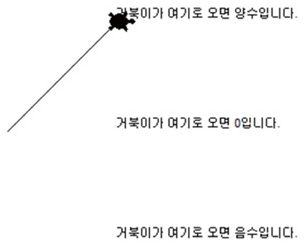
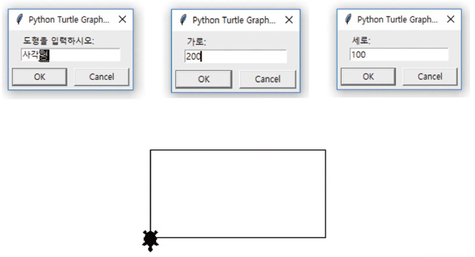

# 4강 연습 문제 — 조건문

[레포지토리 안내](../../README.ko.md) | [English](Exercises.md) | [한국어](Exercises.ko.md)

> **최종 수정일:** 2026-11-04

연습 문제 1\~7은 조건문의 여러 형태를 연습하는 문제이고, 연습 문제 8과 9는 입력, 계산, 판단을 모두 포함하는 종합 문제이다. 연습 문제 2와 6은 터틀 그래픽([3강 7절](../Lec03_Data-Types/Concepts_Lecture.ko.md#7-터틀-그래픽에서의-문자열-입출력))을, 연습 문제 3, 4, 7은 난수([4강 7절](Concepts_Lecture.ko.md#7-난수와-조건문))를 사용한다.

---

<br>

## 목차

- [연습 문제 1: 영화 나이 제한 검사](#연습-문제-1-영화-나이-제한-검사)
- [연습 문제 2: 부호에 따라 거북이 움직이기](#연습-문제-2-부호에-따라-거북이-움직이기)
- [연습 문제 3: 동전 던지기 게임](#연습-문제-3-동전-던지기-게임)
- [연습 문제 4: 종달새가 노래할까](#연습-문제-4-종달새가-노래할까)
- [연습 문제 5: 로그인 프로그램](#연습-문제-5-로그인-프로그램)
- [연습 문제 6: 도형 그리기](#연습-문제-6-도형-그리기)
- [연습 문제 7: 숫자 맞히기](#연습-문제-7-숫자-맞히기)
- [연습 문제 8: 커피 자동 주문 판매기](#연습-문제-8-커피-자동-주문-판매기)
- [연습 문제 9: 시험 과락 판별](#연습-문제-9-시험-과락-판별)

---

<br>

## 연습 문제 1: 영화 나이 제한 검사

**문제:** 15세 이상 관람가 영화의 나이 제한을 검사하는 프로그램을 작성하라. 나이를 입력받아 15세 이상이면 `이 영화를 보실 수 있습니다.`를, 그렇지 않으면 `이 영화를 보실 수 없습니다.`를 출력한다.

**실행 예시:**

```text
나이를 입력하시오: 19
이 영화를 보실 수 있습니다.
```

```text
나이를 입력하시오: 14
이 영화를 보실 수 없습니다.
```

**[풀이](Solutions.ko.md#연습-문제-1-영화-나이-제한-검사)**

---

<br>

## 연습 문제 2: 부호에 따라 거북이 움직이기

**문제:** 터틀 그래픽에서 사용자로부터 정수를 받아, 정수의 부호에 따라 거북이를 (100, 100), (100, 0), (100, -100)으로 움직이는 프로그램을 작성하라. 양수이면 (100, 100), 0이면 (100, 0), 음수이면 (100, -100)으로 움직인다. 정수를 입력받기 전에 세 위치에 `거북이가 여기로 오면 양수입니다.`, `거북이가 여기로 오면 0입니다.`, `거북이가 여기로 오면 음수입니다.`를 써 두고, 거북이를 원점으로 되돌려 놓는다.

**실행 예시:** 다음은 양수를 입력하여 거북이가 원점에서 (100, 100)으로 이동한 터틀 그래픽 창이다.



*그림 1. 양수를 입력하여 거북이가 (100, 100)으로 이동한 터틀 그래픽 창*

**[풀이](Solutions.ko.md#연습-문제-2-부호에-따라-거북이-움직이기)**

---

<br>

## 연습 문제 3: 동전 던지기 게임

**문제:** 동전 던지기 게임을 작성하라. `import random`을 한 뒤 `random.randrange(2)`를 호출하면 0이나 1을 무작위로 생성할 수 있다. 0이 나오면 `앞면입니다.`를, 1이 나오면 `뒷면입니다.`를 출력하고, 게임의 시작과 끝을 알리는 문장을 출력한다.

**실행 예시:**

```text
동전 던지기 게임을 시작합니다.
뒷면입니다.
게임이 종료되었습니다.
```

**[풀이](Solutions.ko.md#연습-문제-3-동전-던지기-게임)**

---

<br>

## 연습 문제 4: 종달새가 노래할까

**문제:** 동물원에 있는 종달새는 다음 두 가지 조건이 모두 충족될 때 노래를 한다.

- 시각이 오전 6시부터 오전 9시 사이이다(6시 이상 9시 미만).
- 날씨가 화창하다.

현재 시각을 1\~24 사이의 난수로 생성하고, 날씨도 `[True, False]` 중에서 무작위로 선택하여, 종달새가 노래를 부를 것인지 조용히 있을 것인지를 판단하는 프로그램을 작성하라. 다음 코드로 시각과 날씨를 만든다.

```python
import random
time = random.randint(1, 24)
sunny = random.choice([True, False])
```

**실행 예시:**

```text
좋은 아침입니다. 지금 시각은 1시 입니다.
현재 날씨가 화창하지 않습니다.
종달새가 노래를 하지 않는다.
```

**[풀이](Solutions.ko.md#연습-문제-4-종달새가-노래할까)**

---

<br>

## 연습 문제 5: 로그인 프로그램

**문제:** 사용자로부터 아이디를 받아서 프로그램에 저장된 아이디 `ilovepython`과 일치하는지를 출력하는 프로그램을 작성하라.

**실행 예시:**

```text
아이디를 입력하시오: ilovepython
환영합니다.
```

```text
아이디를 입력하시오: iloveruby
아이디를 찾을 수 없습니다.
```

**[풀이](Solutions.ko.md#연습-문제-5-로그인-프로그램)**

---

<br>

## 연습 문제 6: 도형 그리기

**문제:** 터틀 그래픽을 이용하여 사용자가 선택하는 도형을 화면에 그리는 프로그램을 작성하라. 도형은 `사각형`, `삼각형`, `원` 중의 하나이다. 각 도형의 치수(사각형은 가로와 세로, 삼각형은 한 변의 길이, 원은 반지름)는 사용자에게 물어보도록 한다. 입력은 모두 터틀 그래픽의 대화 상자로 받는다.

**실행 예시:** 다음은 `사각형`을 선택하고 가로 200, 세로 100을 입력했을 때의 대화 상자와 그려진 사각형이다.



*그림 2. 사각형을 선택하고 가로 200, 세로 100을 입력했을 때의 대화 상자와 그림*

**[풀이](Solutions.ko.md#연습-문제-6-도형-그리기)**

---

<br>

## 연습 문제 7: 숫자 맞히기

**문제:** `random.randint(1, 10)`을 이용하여 임의의 숫자를 만들고, 사용자가 그 숫자를 찾아가는 프로그램을 작성하라. 사용자가 1\~10 중 하나를 입력하면, 정답이 입력 값보다 작으면 `입력 값보다 작습니다.`를, 크면 `입력 값보다 큽니다.`를, 같으면 `맞습니다.`를 출력하고, 마지막에 정답을 알려 준다.

먼저 다음 코드를 실행하여 `randint()`가 1\~10 사이의 정수를 만드는 것을 확인한다.

```python
import random
val = random.randint(1, 10)
print(val)
```

**실행 예시:**

```text
1~10: 7
입력 값보다 작습니다.
답은 4입니다.
```

**[풀이](Solutions.ko.md#연습-문제-7-숫자-맞히기)**

---

<br>

## 연습 문제 8: 커피 자동 주문 판매기

**문제:** 다음과 같이 동작하는 커피 자동 주문 판매기 프로그램을 만들라. `input()` 함수, `print()` 함수, 복합 대입 연산자를 사용한다.

- 커피의 한 잔 가격은 아메리카노 2500원, 카페라테 3000원, 카푸치노 3000원이다.
- 커피 주문 판매기에서 아메리카노 2잔, 카페라테 2잔, 카푸치노 1잔을 주문하였다.
- 현금 15000원을 투입하였다.
- 잔돈을 받았다. 투입한 금액이 부족하면 부족하다고 알린다.

**실행 예시:**

```text
아메리카노 2500원, 카페라테 3000원, 카푸치노 3000원
주문할 음료를 말씀하세요.
아메리카노 개수 (잔) : 2
카페라테 개수 (잔) : 2
카푸치노 개수 (잔) : 1
총 금액은 14000원입니다.
지불하실 금액을 입력하세요. >> 15000
거스름돈은 1000원입니다.
```

**[풀이](Solutions.ko.md#연습-문제-8-커피-자동-주문-판매기)**

---

<br>

## 연습 문제 9: 시험 과락 판별

**문제:** 시험은 국어, 영어, 한국사와 선택 2과목으로 나뉜다. 이 가운데 어느 한 과목이라도 40점 미만이면 과락이다. 다섯 과목의 점수를 입력받은 후 평균을 출력하고, 어느 한 과목이라도 40점 미만일 경우 `과락`을, 반대의 경우 `과락 아님`을 출력하는 프로그램을 작성하라.

**실행 예시:**

```text
국어 점수 : 50
영어 점수 : 60
한국사 점수 : 70
선택과목 1 점수 : 58
선택과목 2 점수 : 63
평균 : 60.2
과락 아님
```

**[풀이](Solutions.ko.md#연습-문제-9-시험-과락-판별)**
