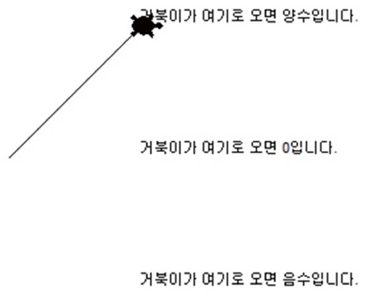
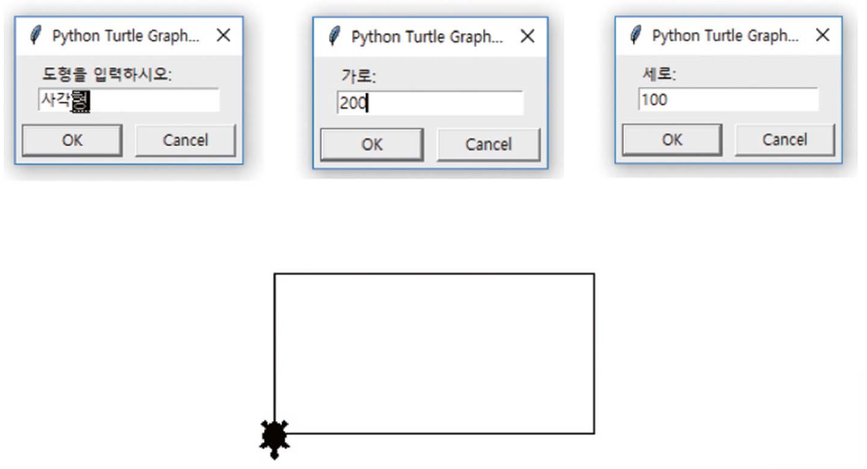

# Lecture 4 Exercises — Conditional Statements

[Repository Guide](../../README.md) | [English](Exercises.md) | [한국어](Exercises.ko.md)

> **Last Updated:** 2026-11-04

Exercises 1-7 practice the various forms of conditional statements, and Exercises 8 and 9 are comprehensive problems that include input, computation, and decisions. Exercises 2 and 6 use turtle graphics ([Lecture 3, Section 7](../Lec03_Data-Types/Concepts_Lecture.md#7-string-input-and-output-in-turtle-graphics)), and Exercises 3, 4, and 7 use random numbers ([Lecture 4, Section 7](Concepts_Lecture.md#7-random-numbers-and-conditional-statements)).

---

<br>

## Table of Contents

- [Exercise 1: Movie Age Restriction Check](#exercise-1-movie-age-restriction-check)
- [Exercise 2: Moving the Turtle by Sign](#exercise-2-moving-the-turtle-by-sign)
- [Exercise 3: Coin Toss Game](#exercise-3-coin-toss-game)
- [Exercise 4: Will the Lark Sing](#exercise-4-will-the-lark-sing)
- [Exercise 5: Login Program](#exercise-5-login-program)
- [Exercise 6: Drawing Shapes](#exercise-6-drawing-shapes)
- [Exercise 7: Guessing the Number](#exercise-7-guessing-the-number)
- [Exercise 8: Automatic Coffee Ordering Machine](#exercise-8-automatic-coffee-ordering-machine)
- [Exercise 9: Exam Failing-Score Check](#exercise-9-exam-failing-score-check)

---

<br>

## Exercise 1: Movie Age Restriction Check

**Problem:** Write a program that checks the age restriction of a movie rated for ages 15 and over. Read the age and print `이 영화를 보실 수 있습니다.` ("You may watch this movie.") if it is 15 or more, and `이 영화를 보실 수 없습니다.` ("You may not watch this movie.") otherwise.

**Sample Run:**

```text
나이를 입력하시오: 19
이 영화를 보실 수 있습니다.
```

```text
나이를 입력하시오: 14
이 영화를 보실 수 없습니다.
```

**[Solution](Solutions.md#exercise-1-movie-age-restriction-check)**

---

<br>

## Exercise 2: Moving the Turtle by Sign

**Problem:** Write a program in turtle graphics that receives an integer from the user and moves the turtle to (100, 100), (100, 0), or (100, -100) according to the sign of the integer. Move it to (100, 100) if positive, (100, 0) if zero, and (100, -100) if negative. Before reading the integer, write `거북이가 여기로 오면 양수입니다.`, `거북이가 여기로 오면 0입니다.`, and `거북이가 여기로 오면 음수입니다.` ("If the turtle comes here, the number is positive / zero / negative.") at the three positions, and return the turtle to the origin.

**Sample Run:** The following is the turtle graphics window after a positive number is entered and the turtle moves from the origin to (100, 100).



*Figure 1. Turtle graphics window after a positive input moves the turtle to (100, 100)*

**[Solution](Solutions.md#exercise-2-moving-the-turtle-by-sign)**

---

<br>

## Exercise 3: Coin Toss Game

**Problem:** Write a coin toss game. After `import random`, calling `random.randrange(2)` generates 0 or 1 at random. Print `앞면입니다.` ("Heads.") if 0 comes up and `뒷면입니다.` ("Tails.") if 1 comes up, and print sentences announcing the start and end of the game.

**Sample Run:**

```text
동전 던지기 게임을 시작합니다.
뒷면입니다.
게임이 종료되었습니다.
```

**[Solution](Solutions.md#exercise-3-coin-toss-game)**

---

<br>

## Exercise 4: Will the Lark Sing

**Problem:** A lark in a zoo sings when both of the following two conditions are met.

- The time is between 6 a.m. and 9 a.m. (6 o'clock or later and before 9 o'clock).
- The weather is sunny.

Write a program that generates the current hour as a random number between 1 and 24, also chooses the weather at random from `[True, False]`, and decides whether the lark will sing or stay quiet. Generate the time and weather with the following code.

```python
import random
time = random.randint(1, 24)
sunny = random.choice([True, False])
```

**Sample Run:**

```text
좋은 아침입니다. 지금 시각은 1시 입니다.
현재 날씨가 화창하지 않습니다.
종달새가 노래를 하지 않는다.
```

**[Solution](Solutions.md#exercise-4-will-the-lark-sing)**

---

<br>

## Exercise 5: Login Program

**Problem:** Write a program that receives an ID from the user and prints whether it matches the ID `ilovepython` stored in the program.

**Sample Run:**

```text
아이디를 입력하시오: ilovepython
환영합니다.
```

```text
아이디를 입력하시오: iloveruby
아이디를 찾을 수 없습니다.
```

**[Solution](Solutions.md#exercise-5-login-program)**

---

<br>

## Exercise 6: Drawing Shapes

**Problem:** Write a program that uses turtle graphics to draw on the screen the shape the user chooses. The shape is one of `사각형` (rectangle), `삼각형` (triangle), and `원` (circle). Ask the user for the dimensions of each shape (width and height for the rectangle, the side length for the triangle, and the radius for the circle). Read all input through turtle graphics dialogs.

**Sample Run:** The following shows the dialogs and the drawn rectangle when `사각형` is chosen and a width of 200 and a height of 100 are entered.



*Figure 2. Dialogs and drawing when the rectangle is chosen with a width of 200 and a height of 100*

**[Solution](Solutions.md#exercise-6-drawing-shapes)**

---

<br>

## Exercise 7: Guessing the Number

**Problem:** Write a program that makes an arbitrary number with `random.randint(1, 10)` and lets the user find it. When the user enters one of 1-10, print `입력 값보다 작습니다.` ("Smaller than your input.") if the answer is smaller than the input, `입력 값보다 큽니다.` ("Larger than your input.") if it is larger, and `맞습니다.` ("Correct.") if it is equal, and finally reveal the answer.

First run the following code to confirm that `randint()` produces an integer between 1 and 10.

```python
import random
val = random.randint(1, 10)
print(val)
```

**Sample Run:**

```text
1~10: 7
입력 값보다 작습니다.
답은 4입니다.
```

**[Solution](Solutions.md#exercise-7-guessing-the-number)**

---

<br>

## Exercise 8: Automatic Coffee Ordering Machine

**Problem:** Create an automatic coffee ordering machine program that works as follows. Use the `input()` function, the `print()` function, and compound assignment operators.

- The price per cup is 2500 won for an americano, 3000 won for a cafe latte, and 3000 won for a cappuccino.
- Two americanos, two cafe lattes, and one cappuccino were ordered at the coffee ordering machine.
- 15000 won in cash was inserted.
- The change was received. If the inserted amount is insufficient, the machine says so.

**Sample Run:**

```text
아메리카노 2500원, 카페라테 3000원, 카푸치노 3000원
주문할 음료를 말씀하세요.
아메리카노 개수 (잔) : 2
카페라테 개수 (잔) : 2
카푸치노 개수 (잔) : 1
총 금액은 14000원입니다.
지불하실 금액을 입력하세요. >> 15000
거스름돈은 1000원입니다.
```

**[Solution](Solutions.md#exercise-8-automatic-coffee-ordering-machine)**

---

<br>

## Exercise 9: Exam Failing-Score Check

**Problem:** An exam consists of Korean, English, Korean history, and two elective subjects. If even one of these subjects scores below 40, the result is a failing score (과락). Write a program that reads the scores of the five subjects, prints the average, and prints `과락` (failing score) if even one subject is below 40 and `과락 아님` (no failing score) otherwise.

**Sample Run:**

```text
국어 점수 : 50
영어 점수 : 60
한국사 점수 : 70
선택과목 1 점수 : 58
선택과목 2 점수 : 63
평균 : 60.2
과락 아님
```

**[Solution](Solutions.md#exercise-9-exam-failing-score-check)**
