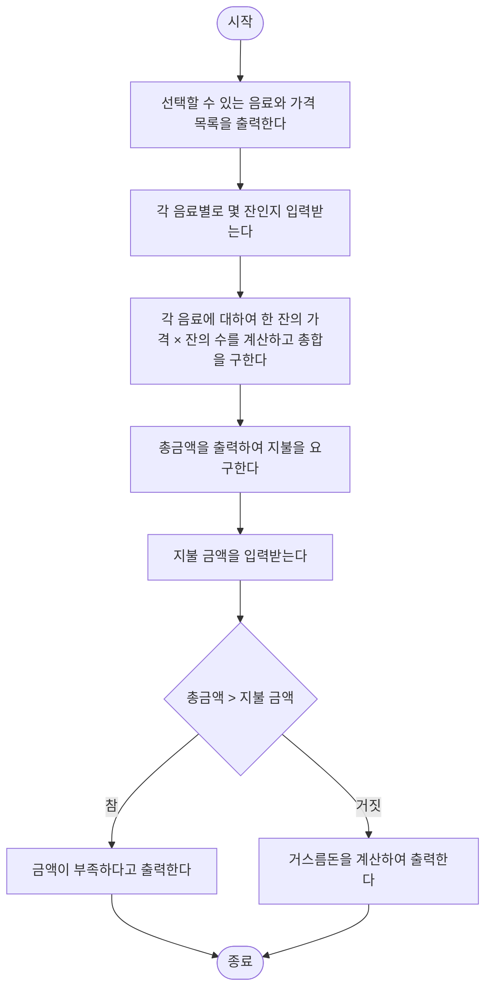

# 4강 연습 문제 풀이 — 조건문

[레포지토리 안내](../../README.ko.md) | [English](Solutions.md) | [한국어](Solutions.ko.md)

> **최종 수정일:** 2026-11-04

---

<br>

## 목차

- [연습 문제 1: 영화 나이 제한 검사](#연습-문제-1-영화-나이-제한-검사)
- [연습 문제 2: 부호에 따라 거북이 움직이기](#연습-문제-2-부호에-따라-거북이-움직이기)
- [연습 문제 3: 동전 던지기 게임](#연습-문제-3-동전-던지기-게임)
- [연습 문제 4: 종달새가 노래할까](#연습-문제-4-종달새가-노래할까)
- [연습 문제 5: 로그인 프로그램](#연습-문제-5-로그인-프로그램)
- [연습 문제 6: 도형 그리기](#연습-문제-6-도형-그리기)
- [연습 문제 7: 숫자 맞히기](#연습-문제-7-숫자-맞히기)
- [연습 문제 8: 커피 자동 주문 판매기](#연습-문제-8-커피-자동-주문-판매기)
- [연습 문제 9: 시험 과락 판별](#연습-문제-9-시험-과락-판별)

---

<br>

## 연습 문제 1: 영화 나이 제한 검사

**문제:** 나이를 입력받아 15세 이상이면 관람할 수 있다고, 그렇지 않으면 관람할 수 없다고 출력하라. 문제 전문과 실행 예시는 [연습 문제 1](Exercises.ko.md#연습-문제-1-영화-나이-제한-검사)에 있다.

### 풀이

**접근 방법:** 결과가 두 가지이므로 `if-else`문 하나로 판단한다([4강 3절](Concepts_Lecture.ko.md#3-if-else문)). 15세 이상은 15를 포함하므로 조건식은 `age > 15`가 아니라 `age >= 15`이다.

**코드:**

```python
age = int(input("나이를 입력하시오: "))
if age >= 15:
    print("이 영화를 보실 수 있습니다.")
else:
    print("이 영화를 보실 수 없습니다.")
```

- **1행:** 입력받은 나이를 정수로 바꾸어 `age`에 저장한다.
- **2~3행:** `age >= 15`가 참이면 관람할 수 있다고 출력한다.
- **4~5행:** 조건식이 거짓이면, 곧 15세 미만이면 관람할 수 없다고 출력한다.

**실행 결과:**

```text
나이를 입력하시오: 19
이 영화를 보실 수 있습니다.
```

```text
나이를 입력하시오: 14
이 영화를 보실 수 없습니다.
```

경계값 15를 입력하면 `15 >= 15`가 참이므로 관람할 수 있다.

```text
나이를 입력하시오: 15
이 영화를 보실 수 있습니다.
```

> **주의:** 조건식을 `age > 15`로 쓰면 15세가 관람할 수 없는 것으로 잘못 판정된다. 이상, 이하, 초과, 미만이 경계값을 포함하는지 확인하고, 경계값을 직접 입력하여 시험해 보아야 한다.

---

<br>

## 연습 문제 2: 부호에 따라 거북이 움직이기

**문제:** 정수를 입력받아 부호에 따라 거북이를 (100, 100), (100, 0), (100, -100)으로 움직이라. 문제 전문과 실행 예시는 [연습 문제 2](Exercises.ko.md#연습-문제-2-부호에-따라-거북이-움직이기)에 있다.

### 풀이

**접근 방법:** 먼저 펜을 올린 채 세 위치를 돌며 안내 문구를 쓰고 원점으로 돌아온 뒤 펜을 내린다. 그다음 정수를 입력받아 부호를 검사하고, 해당하는 위치로 `goto()`하면 원점에서 그 위치까지 선이 그어진다.

- **`t.penup()`, `t.pendown()`:** 펜을 올리면 거북이가 움직여도 선이 그려지지 않고, 펜을 내리면 움직인 경로에 선이 그려진다.
- **`t.goto(x, y)`:** 거북이를 좌표 (x, y)로 곧장 옮긴다.
- **입력:** `turtle.textinput()`은 문자열을 돌려주므로 `int()`로 정수로 바꾼다([3강 7.1절](../Lec03_Data-Types/Concepts_Lecture.ko.md#71-문자열-입력)).
- **판단:** 양수, 0, 음수의 세 조건은 동시에 참이 될 수 없으므로 세 개의 독립된 `if`문으로 검사해도 정확히 하나만 실행된다.

**코드:**

```python
import turtle
t = turtle.Turtle()
t.shape("turtle")
t.penup()             # lift the pen so that nothing is drawn
t.goto(100, 100)      # move the turtle to (100, 100)
t.write("거북이가 여기로 오면 양수입니다.")
t.goto(100, 0)
t.write("거북이가 여기로 오면 0입니다.")
t.goto(100, -100)
t.write("거북이가 여기로 오면 음수입니다.")
t.goto(0, 0)          # move the turtle to (0, 0)
t.pendown()           # put the pen down so that lines are drawn

s = turtle.textinput("", "숫자를 입력하시오: ")
n = int(s)
if n > 0:
    t.goto(100, 100)
if n == 0:
    t.goto(100, 0)
if n < 0:
    t.goto(100, -100)
turtle.done()
```

**실행 결과:** 세 안내 문구는 펜을 올린 상태에서 썼으므로 이동 경로에 선이 남지 않는다. 입력에 따라 거북이는 다음과 같이 움직이며, 양수를 입력한 결과는 [연습 문제 2의 그림 1](Exercises.ko.md#연습-문제-2-부호에-따라-거북이-움직이기)과 같다.

| 입력 | 참이 되는 조건 | 거북이의 이동 (선이 그어짐) |
|:-----|:-----|:-----|
| `5` | `n > 0` | (0, 0) → (100, 100) |
| `0` | `n == 0` | (0, 0) → (100, 0) |
| `-3` | `n < 0` | (0, 0) → (100, -100) |

*표 1. 입력에 따른 거북이의 이동*

> **참고:** 세 조건이 서로 겹치지 않으므로 `if-elif-else`문으로 써도 결과가 같다([4강 5절](Concepts_Lecture.ko.md#5-if-elif-else문)). 이 형태는 앞의 조건이 참이면 나머지 조건을 검사하지 않고, 마지막 경우를 `else`로 처리하므로 조건식 `n < 0`을 따로 쓸 필요도 없다.
> ```python
> if n > 0:
>     t.goto(100, 100)
> elif n == 0:
>     t.goto(100, 0)
> else:
>     t.goto(100, -100)
> ```

---

<br>

## 연습 문제 3: 동전 던지기 게임

**문제:** `random.randrange(2)`로 0이나 1을 만들어 앞면과 뒷면을 출력하라. 문제 전문과 실행 예시는 [연습 문제 3](Exercises.ko.md#연습-문제-3-동전-던지기-게임)에 있다.

### 풀이

**접근 방법:** `random.randrange(2)`는 0 이상 2 미만의 정수, 곧 0이나 1을 같은 확률로 돌려준다([4강 7절](Concepts_Lecture.ko.md#7-난수와-조건문)). 이 값을 `coin`에 저장하고 `if-else`문으로 0이면 앞면, 그렇지 않으면 뒷면을 출력한다.

**코드:**

```python
import random

print("동전 던지기 게임을 시작합니다.")
coin = random.randrange(2)
if coin == 0:
    print("앞면입니다.")
else:
    print("뒷면입니다.")
print("게임이 종료되었습니다.")
```

- **1행:** `random` 모듈을 불러온다.
- **4행:** 0이나 1을 무작위로 만들어 `coin`에 저장한다.
- **5~8행:** `coin`이 0이면 앞면, 1이면 뒷면을 출력한다. `coin`의 값은 0이나 1뿐이므로 `else`는 1인 경우이다.
- **9행:** 들여 쓰지 않았으므로 어느 면이 나왔든 실행된다.

**실행 결과:** 실행할 때마다 둘 중 하나가 무작위로 나온다.

```text
동전 던지기 게임을 시작합니다.
앞면입니다.
게임이 종료되었습니다.
```

```text
동전 던지기 게임을 시작합니다.
뒷면입니다.
게임이 종료되었습니다.
```

> **참고:** 사용자가 나온 면을 맞히는 게임으로 확장하려면, 동전을 던진 뒤 사용자의 예측을 정수로 입력받아 `coin`과 비교한다.
> ```python
> import random
>
> print("동전 던지기 게임을 시작합니다.")
> coin = random.randrange(2)
> answer = int(input("앞면은 0, 뒷면은 1입니다. 어느 면이 나왔을까요? "))
> if answer == coin:
>     print("맞았습니다.")
> else:
>     print("틀렸습니다.")
> print("게임이 종료되었습니다.")
> ```
> ```text
> 동전 던지기 게임을 시작합니다.
> 앞면은 0, 뒷면은 1입니다. 어느 면이 나왔을까요? 1
> 맞았습니다.
> 게임이 종료되었습니다.
> ```

---

<br>

## 연습 문제 4: 종달새가 노래할까

**문제:** 무작위로 정한 시각(1\~24시)과 날씨로 종달새가 노래할지 판단하라. 종달새는 6시 이상 9시 미만이면서 날씨가 화창할 때만 노래한다. 문제 전문과 실행 예시는 [연습 문제 4](Exercises.ko.md#연습-문제-4-종달새가-노래할까)에 있다.

### 풀이

**접근 방법:** 노래하는 조건은 시각에 관한 두 조건(`time >= 6`, `time < 9`)과 날씨 조건(`sunny`)이 모두 참인 것이므로, 세 조건을 `and`로 묶는다([4강 2.3절](Concepts_Lecture.ko.md#23-논리-연산자)). 시각과 날씨를 출력하는 부분과 노래 여부를 판단하는 부분은 서로 독립된 두 `if-else`문으로 작성한다.

**코드:**

```python
import random
time = random.randint(1, 24)
print("좋은 아침입니다. 지금 시각은 " + str(time) + "시 입니다.")

sunny = random.choice([True, False])
if sunny:
    print("현재 날씨가 화창합니다.")
else:
    print("현재 날씨가 화창하지 않습니다.")

# decide whether the lark will sing
if time >= 6 and time < 9 and sunny:
    print("종달새가 노래를 한다.")
else:
    print("종달새가 노래를 하지 않는다.")
```

- **2행:** `randint(1, 24)`는 1과 24를 모두 포함하므로 1\~24 중 하나를 만든다.
- **3행:** 정수 `time`을 `str()`로 문자열로 바꾸어 접합한다([3강 3.2절](../Lec03_Data-Types/Concepts_Lecture.ko.md#32-숫자를-문자열로-변환)).
- **5~9행:** `sunny`는 `True`나 `False`이므로 `if sunny:`처럼 조건식 자리에 그대로 쓴다. `if sunny == True:`와 같은 뜻이다.
- **12행:** 세 조건이 모두 참일 때만 노래한다. `time < 9`이므로 9시는 포함되지 않는다.

**실행 결과:** 시각과 날씨는 실행할 때마다 달라진다. 다음은 세 번 실행한 예이다.

```text
좋은 아침입니다. 지금 시각은 7시 입니다.
현재 날씨가 화창합니다.
종달새가 노래를 한다.
```

```text
좋은 아침입니다. 지금 시각은 1시 입니다.
현재 날씨가 화창하지 않습니다.
종달새가 노래를 하지 않는다.
```

```text
좋은 아침입니다. 지금 시각은 9시 입니다.
현재 날씨가 화창합니다.
종달새가 노래를 하지 않는다.
```

세 번째 실행에서는 날씨가 화창하지만 9시는 `time < 9`를 만족하지 않으므로 노래하지 않는다.

> **참고:** 시각 조건은 관계 연산자를 이어 써서 `6 <= time < 9 and sunny`로 간결하게 쓸 수 있다([4강 2.2절](Concepts_Lecture.ko.md#22-관계-연산자)).

---

<br>

## 연습 문제 5: 로그인 프로그램

**문제:** 아이디를 입력받아 저장된 아이디 `ilovepython`과 일치하는지 출력하라. 문제 전문과 실행 예시는 [연습 문제 5](Exercises.ko.md#연습-문제-5-로그인-프로그램)에 있다.

### 풀이

**접근 방법:** 저장된 아이디를 변수에 두고, 입력받은 문자열과 `==`로 비교한다. 아이디는 문자열이므로 입력을 변환하지 않는다.

**코드:**

```python
id = "ilovepython"
s = input("아이디를 입력하시오: ")
if s == id:
    print("환영합니다.")
else:
    print("아이디를 찾을 수 없습니다.")
```

- **1행:** 프로그램에 저장된 아이디이다.
- **3행:** 두 문자열의 모든 문자가 같을 때만 `s == id`가 참이다.

**실행 결과:**

```text
아이디를 입력하시오: ilovepython
환영합니다.
```

```text
아이디를 입력하시오: iloveruby
아이디를 찾을 수 없습니다.
```

문자열 비교는 대문자와 소문자를 구별하므로 `ILovePython`을 입력해도 일치하지 않는다.

```text
아이디를 입력하시오: ILovePython
아이디를 찾을 수 없습니다.
```

> **주의:** `id`는 객체의 고유 번호를 돌려주는 내장 함수의 이름이다. 변수 이름을 `id`로 지으면 그 프로그램에서 내장 함수 `id()`를 쓸 수 없게 되므로([3강 8.2절](../Lec03_Data-Types/Concepts_Lecture.ko.md#82-요소-추가)의 `list`와 같은 문제), `stored_id`나 `user_id`처럼 겹치지 않는 이름을 쓰는 편이 좋다.

---

<br>

## 연습 문제 6: 도형 그리기

**문제:** 사용자가 고른 도형(사각형, 삼각형, 원)을 사용자가 입력한 치수로 그리라. 문제 전문과 실행 예시는 [연습 문제 6](Exercises.ko.md#연습-문제-6-도형-그리기)에 있다.

### 풀이

**접근 방법:** 도형의 이름을 입력받아 `if-elif-else`문으로 세 경우와 그 밖의 입력을 나눈다([4강 5절](Concepts_Lecture.ko.md#5-if-elif-else문)). 각 경우의 블록 안에서 그 도형에 필요한 치수만 입력받아 그린다.

- **사각형:** 가로 `w`와 세로 `h`를 입력받아, 전진과 왼쪽 90도 회전을 번갈아 하며 `w`, `h`, `w`, `h`만큼 그린다.
- **삼각형:** 한 변의 길이 `a`를 입력받아 정삼각형을 그린다. 정삼각형의 한 내각은 60도이므로, 한 변을 그린 뒤 거북이는 180 - 60 = 120도를 돌아야 다음 변의 방향을 바라본다.
- **원:** 반지름 `r`을 입력받아 `t.circle(r)`로 그린다. 원의 중심은 거북이의 왼쪽으로 `r`만큼 떨어진 점이다.
- **그 밖의 입력:** 알 수 없는 도형이라는 문구를 쓴다.

**코드:**

```python
import turtle
t = turtle.Turtle()
t.shape("turtle")

s = turtle.textinput("", "도형을 입력하시오: ")
if s == "사각형":
    s = turtle.textinput("", "가로: ")
    w = int(s)
    s = turtle.textinput("", "세로: ")
    h = int(s)
    t.forward(w)
    t.left(90)
    t.forward(h)
    t.left(90)
    t.forward(w)
    t.left(90)
    t.forward(h)
elif s == "삼각형":
    s = turtle.textinput("", "한 변의 길이: ")
    a = int(s)
    t.forward(a)
    t.left(120)
    t.forward(a)
    t.left(120)
    t.forward(a)
elif s == "원":
    s = turtle.textinput("", "반지름: ")
    r = int(s)
    t.circle(r)
else:
    t.write("그릴 수 없는 도형입니다.")
turtle.done()
```

- **5행:** 도형의 이름을 문자열로 입력받는다. 이름은 비교에만 쓰므로 변환하지 않는다.
- **6~17행:** 사각형인 경우이다. 변수 `s`를 치수 입력에 다시 쓰지만, `if-elif-else`문은 이미 6행에서 실행할 블록을 골랐으므로 `s`의 값이 바뀌어도 뒤의 `elif` 조건은 다시 검사되지 않는다.
- **18~25행:** 삼각형인 경우이다. 세 변을 그리면 출발점으로 돌아온다.
- **26~29행:** 원인 경우이다.
- **30~31행:** 앞의 세 조건이 모두 거짓인 입력을 처리한다.

**실행 결과:** 거북이는 원점에서 오른쪽을 바라보며 시작한다. 입력에 따라 다음과 같이 그린다. 사각형의 결과는 [연습 문제 6의 그림 2](Exercises.ko.md#연습-문제-6-도형-그리기)와 같다.

| 입력 | 그리는 도형 | 거북이가 지나는 점 |
|:-----|:-----|:-----|
| `사각형`, `200`, `100` | 가로 200, 세로 100인 직사각형 | (0, 0) → (200, 0) → (200, 100) → (0, 100) → (0, 0) |
| `삼각형`, `100` | 한 변이 100인 정삼각형 | (0, 0) → (100, 0) → (50, 86.6) → (0, 0) |
| `원`, `50` | 중심이 (0, 50)이고 반지름이 50인 원 | (0, 0)에서 시작하여 시계 반대 방향으로 한 바퀴 |
| `오각형` | 없음 | 원점에 `그릴 수 없는 도형입니다.`를 쓴다 |

*표 2. 입력에 따라 그리는 도형*

정삼각형의 꼭짓점 (50, 86.6)의 y좌표는 높이 $100 \times \frac{\sqrt{3}}{2} \approx 86.6$이다.

---

<br>

## 연습 문제 7: 숫자 맞히기

**문제:** `random.randint(1, 10)`으로 만든 숫자를 사용자가 맞히게 하고, 입력 값과의 크기 관계와 정답을 출력하라. 문제 전문과 실행 예시는 [연습 문제 7](Exercises.ko.md#연습-문제-7-숫자-맞히기)에 있다.

### 풀이

**접근 방법:** 정답 `val`과 입력 `guess`의 관계는 `guess > val`, `guess < val`, `guess == val`의 세 경우뿐이므로 `if-elif-else`문으로 나눈다. 마지막 경우는 앞의 두 조건이 거짓일 때이므로 `else`로 처리한다.

**코드:**

```python
import random
val = random.randint(1, 10)
guess = int(input("1~10: "))
if guess > val:
    print("입력 값보다 작습니다.")
elif guess < val:
    print("입력 값보다 큽니다.")
else:
    print("맞습니다.")
print("답은 %s입니다." % val)
```

- **2행:** 1\~10 중 하나를 정답으로 정한다.
- **4~5행:** 입력이 정답보다 크면, 곧 정답이 입력 값보다 작으면 `입력 값보다 작습니다.`를 출력한다. 메시지의 주어는 정답이다.
- **6~9행:** 입력이 정답보다 작으면 정답이 더 크다고, 둘 다 아니면 맞았다고 출력한다.
- **10행:** 들여 쓰지 않았으므로 항상 정답을 알려 준다. `%s` 대신 `%d`를 써도 된다([3강 4.3절](../Lec03_Data-Types/Concepts_Lecture.ko.md#43-문자열-형식화)).

**실행 결과:** 정답은 실행할 때마다 달라진다. 다음은 정답이 4, 9, 6이었던 세 번의 실행이다.

```text
1~10: 7
입력 값보다 작습니다.
답은 4입니다.
```

```text
1~10: 2
입력 값보다 큽니다.
답은 9입니다.
```

```text
1~10: 6
맞습니다.
답은 6입니다.
```

> **참고:** 이 프로그램은 한 번만 입력받는다. 맞힐 때까지 다시 입력받으며 범위를 좁혀 가는 게임은 반복문(5강)으로 만든다.

---

<br>

## 연습 문제 8: 커피 자동 주문 판매기

**문제:** 커피 세 종류의 잔 수를 입력받아 총금액을 계산하고, 지불 금액을 입력받아 거스름돈을 출력하라. 문제 전문과 실행 예시는 [연습 문제 8](Exercises.ko.md#연습-문제-8-커피-자동-주문-판매기)에 있다.

### 풀이

[4강 8절](Concepts_Lecture.ko.md#8-조건문이-들어간-프로그램의-설계)의 네 단계를 차례로 적용한다.

**1단계, 문제 분석:** 입력, 출력, 데이터를 정리한다.

- **입력:** 각 커피 종류에 대한 잔의 수, 사용자가 지불할 금액
- **출력:** 커피의 종류와 한 잔 금액, 주문한 총금액, 거스름돈
- **데이터:** 각 커피의 한 잔 가격을 나타내는 변수, 각 잔의 수를 나타내는 변수, 총금액을 나타내는 변수

**2단계, 처리 순서 정하기:** 처리 순서를 순서도로 나타낸다. 금액이 부족한지 판단하는 곳이 조건문이 들어갈 자리이다.



*그림 1. 커피 자동 주문 판매기의 처리 순서*

**3단계, 변수 정하기:** 데이터를 담을 변수를 정한다.

| 변수 | 뜻 |
|:-----|:-----|
| `priceA`, `priceL`, `priceC` | 아메리카노, 카페라테, 카푸치노의 한 잔 가격 |
| `noA` | 주문한 아메리카노의 잔 수 |
| `noL` | 주문한 카페라테의 잔 수 |
| `noC` | 주문한 카푸치노의 잔 수 |
| `total` | 지불해야 할 총금액 |
| `money` | 사용자가 지불한 금액 |

*표 3. 커피 자동 주문 판매기의 변수*

**4단계, 프로그래밍:** `input()`으로 받은 값은 문자열이므로 정수형 연산을 하기 위해 `int()`를 적용하여 정수로 바꾼다. 총금액은 0에서 시작하여 복합 대입 연산자 `+=`(2강)로 음료별 금액을 하나씩 더해 구한다. `total += noA * priceA`는 `total = total + (noA * priceA)`와 같다.

**코드:**

```python
priceA = 2500    # price of one americano
priceL = 3000    # price of one cafe latte
priceC = 3000    # price of one cappuccino

print("아메리카노 %d원, 카페라테 %d원, 카푸치노 %d원" % (priceA, priceL, priceC))
print("주문할 음료를 말씀하세요.")
noA = int(input("아메리카노 개수 (잔) : "))
noL = int(input("카페라테 개수 (잔) : "))
noC = int(input("카푸치노 개수 (잔) : "))

total = 0
total += noA * priceA    # total = total + (noA * priceA)
total += noL * priceL    # total = total + (noL * priceL)
total += noC * priceC    # total = total + (noC * priceC)
print("총 금액은 %d원입니다." % total)

money = int(input("지불하실 금액을 입력하세요. >> "))
if money < total:
    print("금액이 부족합니다.")
else:
    print("거스름돈은 %d원입니다." % (money - total))
```

- **1~3행:** 한 잔 가격을 변수에 둔다. 가격이 바뀌면 이 세 줄만 고치면 된다.
- **5행:** 메뉴와 가격을 출력한다. 값이 셋이므로 괄호로 묶어 `%`에 넘긴다. 6행은 주문할 음료를 묻는 문구를 출력한다.
- **7~9행:** 커피별 잔 수를 정수로 입력받는다.
- **11~14행:** 총금액을 누적한다. 2잔 × 2500 = 5000, 2잔 × 3000 = 6000, 1잔 × 3000 = 3000이므로 `total`은 0, 5000, 11000, 14000으로 바뀐다.
- **17~21행:** 지불 금액이 총금액보다 적으면 부족하다고 알리고, 그렇지 않으면 거스름돈 `money - total`을 출력한다.

**실행 결과:** 15000원을 내면 거스름돈은 15000 - 14000 = 1000원이다.

```text
아메리카노 2500원, 카페라테 3000원, 카푸치노 3000원
주문할 음료를 말씀하세요.
아메리카노 개수 (잔) : 2
카페라테 개수 (잔) : 2
카푸치노 개수 (잔) : 1
총 금액은 14000원입니다.
지불하실 금액을 입력하세요. >> 15000
거스름돈은 1000원입니다.
```

금액이 부족한 경우와, 총금액과 같은 금액을 낸 경계의 경우도 시험한다. 경계의 경우는 `14000 < 14000`이 거짓이므로 거스름돈 0원을 출력한다.

```text
아메리카노 2500원, 카페라테 3000원, 카푸치노 3000원
주문할 음료를 말씀하세요.
아메리카노 개수 (잔) : 2
카페라테 개수 (잔) : 2
카푸치노 개수 (잔) : 1
총 금액은 14000원입니다.
지불하실 금액을 입력하세요. >> 10000
금액이 부족합니다.
```

```text
아메리카노 2500원, 카페라테 3000원, 카푸치노 3000원
주문할 음료를 말씀하세요.
아메리카노 개수 (잔) : 2
카페라테 개수 (잔) : 2
카푸치노 개수 (잔) : 1
총 금액은 14000원입니다.
지불하실 금액을 입력하세요. >> 14000
거스름돈은 0원입니다.
```

> **주의:** 총금액의 변수 이름으로 `sum`을 쓰면 리스트의 합을 구하는 내장 함수 `sum()`([3강 연습 문제 4](../Lec03_Data-Types/Solutions.ko.md#연습-문제-4-네-수의-평균))이 가려진다. 이 풀이는 그래서 `total`을 쓴다. 또 21행의 `money - total`을 괄호로 묶지 않으면 `%`가 `-`보다 먼저 계산되어 `("거스름돈은 %d원입니다." % money) - total`, 곧 문자열에서 정수를 빼는 식이 되므로 `TypeError`가 발생한다.

---

<br>

## 연습 문제 9: 시험 과락 판별

**문제:** 다섯 과목의 점수를 입력받아 평균을 출력하고, 한 과목이라도 40점 미만이면 과락, 아니면 과락 아님을 출력하라. 문제 전문과 실행 예시는 [연습 문제 9](Exercises.ko.md#연습-문제-9-시험-과락-판별)에 있다.

### 풀이

**접근 방법:** 과락은 다섯 조건 `kor < 40`, `eng < 40`, `his < 40`, `sel1 < 40`, `sel2 < 40` 가운데 하나라도 참인 경우이므로 다섯 조건을 `or`로 묶는다([4강 2.3절](Concepts_Lecture.ko.md#23-논리-연산자)). 평균은 다섯 점수의 합을 5로 나누어 구한다.

**코드:**

```python
kor = int(input("국어 점수 : "))
eng = int(input("영어 점수 : "))
his = int(input("한국사 점수 : "))
sel1 = int(input("선택과목 1 점수 : "))
sel2 = int(input("선택과목 2 점수 : "))

avg = (kor + eng + his + sel1 + sel2) / 5
print("평균 :", avg)

if kor < 40 or eng < 40 or his < 40 or sel1 < 40 or sel2 < 40:
    print("과락")
else:
    print("과락 아님")
```

- **1~5행:** 다섯 과목의 점수를 정수로 입력받는다.
- **7행:** 괄호 안의 덧셈을 먼저 계산한 뒤 5로 나눈다. 괄호가 없으면 `sel2 / 5`만 먼저 계산된다. `/`의 결과는 실수이다. 8행은 이 값을 평균으로 출력한다.
- **10행:** 다섯 조건 중 하나라도 참이면 전체가 참이 되어 과락이다.

**실행 결과:** 첫 번째 실행은 평균이 (50 + 60 + 70 + 58 + 63) / 5 = 301 / 5 = 60.2이고 모든 과목이 40점 이상이므로 과락이 아니다. 두 번째 실행은 평균이 78.0으로 높지만 한국사가 35점이므로 과락이다.

```text
국어 점수 : 50
영어 점수 : 60
한국사 점수 : 70
선택과목 1 점수 : 58
선택과목 2 점수 : 63
평균 : 60.2
과락 아님
```

```text
국어 점수 : 85
영어 점수 : 90
한국사 점수 : 35
선택과목 1 점수 : 88
선택과목 2 점수 : 92
평균 : 78.0
과락
```

경계값 40점은 40점 미만이 아니므로 과락이 아니다.

```text
국어 점수 : 40
영어 점수 : 40
한국사 점수 : 40
선택과목 1 점수 : 40
선택과목 2 점수 : 40
평균 : 40.0
과락 아님
```

> **참고:** 같은 판정을 다른 형태로도 쓸 수 있다. 드모르간의 법칙([4강 2.3절](Concepts_Lecture.ko.md#23-논리-연산자))에 따라 한 과목이라도 40점 미만이라는 조건의 부정은 모든 과목이 40점 이상이라는 조건이므로 `if kor >= 40 and eng >= 40 and his >= 40 and sel1 >= 40 and sel2 >= 40:`에서 과락 아님을, `else`에서 과락을 출력해도 된다. 또 내장 함수 `min()`은 가장 작은 값을 돌려주므로 `if min(kor, eng, his, sel1, sel2) < 40:`으로 간결하게 쓸 수도 있다. 가장 낮은 점수가 40점 미만인 것과 한 과목이라도 40점 미만인 것은 같은 뜻이다.
