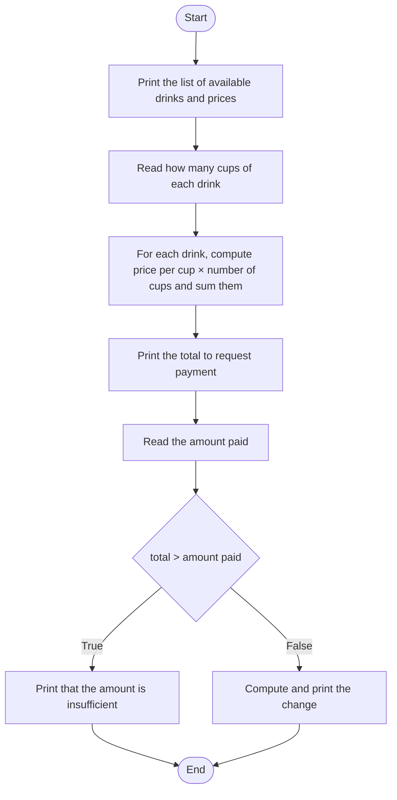

# Lecture 4 Solutions — Conditional Statements

[Repository Guide](../../README.md) | [English](Solutions.md) | [한국어](Solutions.ko.md)

> **Last Updated:** 2026-11-04

---

<br>

## Table of Contents

- [Exercise 1: Movie Age Restriction Check](#exercise-1-movie-age-restriction-check)
- [Exercise 2: Moving the Turtle by Sign](#exercise-2-moving-the-turtle-by-sign)
- [Exercise 3: Coin Toss Game](#exercise-3-coin-toss-game)
- [Exercise 4: Will the Lark Sing](#exercise-4-will-the-lark-sing)
- [Exercise 5: Login Program](#exercise-5-login-program)
- [Exercise 6: Drawing Shapes](#exercise-6-drawing-shapes)
- [Exercise 7: Guessing the Number](#exercise-7-guessing-the-number)
- [Exercise 8: Automatic Coffee Ordering Machine](#exercise-8-automatic-coffee-ordering-machine)
- [Exercise 9: Exam Failing-Score Check](#exercise-9-exam-failing-score-check)

---

<br>

## Exercise 1: Movie Age Restriction Check

**Problem:** Read an age and print that the user may watch if it is 15 or more and may not watch otherwise. The full problem and sample run are in [Exercise 1](Exercises.md#exercise-1-movie-age-restriction-check).

### Solution

**Approach:** There are two outcomes, so a single `if-else` statement decides ([Lecture 4, Section 3](Concepts_Lecture.md#3-the-if-else-statement)). Fifteen or more includes 15, so the condition is `age >= 15`, not `age > 15`.

**Code:**

```python
age = int(input("나이를 입력하시오: "))
if age >= 15:
    print("이 영화를 보실 수 있습니다.")
else:
    print("이 영화를 보실 수 없습니다.")
```

- **Line 1:** Converts the input age ("Enter your age: ") to an integer and stores it in `age`.
- **Lines 2-3:** If `age >= 15` is true, prints that the user may watch.
- **Lines 4-5:** If the condition is false, that is, under 15, prints that the user may not watch.

**Output:**

```text
나이를 입력하시오: 19
이 영화를 보실 수 있습니다.
```

```text
나이를 입력하시오: 14
이 영화를 보실 수 없습니다.
```

If the boundary value 15 is entered, `15 >= 15` is true, so the user may watch.

```text
나이를 입력하시오: 15
이 영화를 보실 수 있습니다.
```

> **Caution:** Writing the condition as `age > 15` wrongly judges that a 15-year-old may not watch. Check whether "or more", "or less", "more than", and "less than" include the boundary value, and test by entering the boundary value directly.

---

<br>

## Exercise 2: Moving the Turtle by Sign

**Problem:** Read an integer and move the turtle to (100, 100), (100, 0), or (100, -100) according to its sign. The full problem and sample run are in [Exercise 2](Exercises.md#exercise-2-moving-the-turtle-by-sign).

### Solution

**Approach:** First, with the pen up, visit the three positions to write the messages, return to the origin, and put the pen down. Then read the integer, check its sign, and `goto()` the corresponding position, which draws a line from the origin to that position.

- **`t.penup()`, `t.pendown()`:** With the pen up, no line is drawn when the turtle moves; with the pen down, a line is drawn along the path.
- **`t.goto(x, y)`:** Moves the turtle straight to the coordinates (x, y).
- **Input:** `turtle.textinput()` returns a string, so it is converted to an integer with `int()` ([Lecture 3, Section 7.1](../Lec03_Data-Types/Concepts_Lecture.md#71-string-input)).
- **Decision:** The three conditions for positive, zero, and negative cannot be true at the same time, so even checking them with three independent `if` statements executes exactly one.

**Code:**

```python
import turtle
t = turtle.Turtle()
t.shape("turtle")
t.penup()             # lift the pen so that nothing is drawn
t.goto(100, 100)      # move the turtle to (100, 100)
t.write("거북이가 여기로 오면 양수입니다.")
t.goto(100, 0)
t.write("거북이가 여기로 오면 0입니다.")
t.goto(100, -100)
t.write("거북이가 여기로 오면 음수입니다.")
t.goto(0, 0)          # move the turtle to (0, 0)
t.pendown()           # put the pen down so that lines are drawn

s = turtle.textinput("", "숫자를 입력하시오: ")
n = int(s)
if n > 0:
    t.goto(100, 100)
if n == 0:
    t.goto(100, 0)
if n < 0:
    t.goto(100, -100)
turtle.done()
```

**Output:** The three messages were written with the pen up, so no lines remain along that path. The comments say: lift the pen so nothing is drawn, move the turtle to (100, 100), move it back to (0, 0), and put the pen down so lines are drawn. Depending on the input, the turtle moves as follows, and the result of a positive input is the same as [Figure 1 of Exercise 2](Exercises.md#exercise-2-moving-the-turtle-by-sign).

| Input | Condition That Is True | Movement of the Turtle (Line Drawn) |
|:-----|:-----|:-----|
| `5` | `n > 0` | (0, 0) → (100, 100) |
| `0` | `n == 0` | (0, 0) → (100, 0) |
| `-3` | `n < 0` | (0, 0) → (100, -100) |

*Table 1. Movement of the turtle by input*

> **Note:** The three conditions do not overlap, so writing them as an `if-elif-else` statement gives the same result ([Lecture 4, Section 5](Concepts_Lecture.md#5-the-if-elif-else-statement)). This form does not check the remaining conditions once an earlier condition is true, and handles the last case with `else`, so the condition `n < 0` need not be written separately.
> ```python
> if n > 0:
>     t.goto(100, 100)
> elif n == 0:
>     t.goto(100, 0)
> else:
>     t.goto(100, -100)
> ```

---

<br>

## Exercise 3: Coin Toss Game

**Problem:** Generate 0 or 1 with `random.randrange(2)` and print heads or tails. The full problem and sample run are in [Exercise 3](Exercises.md#exercise-3-coin-toss-game).

### Solution

**Approach:** `random.randrange(2)` returns an integer from 0 up to but not including 2, that is, 0 or 1, with equal probability ([Lecture 4, Section 7](Concepts_Lecture.md#7-random-numbers-and-conditional-statements)). Store this value in `coin` and use an `if-else` statement to print heads if it is 0 and tails otherwise.

**Code:**

```python
import random

print("동전 던지기 게임을 시작합니다.")
coin = random.randrange(2)
if coin == 0:
    print("앞면입니다.")
else:
    print("뒷면입니다.")
print("게임이 종료되었습니다.")
```

- **Line 1:** Loads the `random` module.
- **Line 4:** Generates 0 or 1 at random and stores it in `coin`.
- **Lines 5-8:** Print heads if `coin` is 0 and tails if it is 1. `coin` can only be 0 or 1, so `else` is the case of 1.
- **Line 9:** Not indented, so it runs whichever face came up ("The game has ended."; line 3 prints "The coin toss game starts.").

**Output:** Each run gives one of the two at random.

```text
동전 던지기 게임을 시작합니다.
앞면입니다.
게임이 종료되었습니다.
```

```text
동전 던지기 게임을 시작합니다.
뒷면입니다.
게임이 종료되었습니다.
```

> **Note:** To extend the program into a game in which the user guesses the face, read the user's prediction as an integer after tossing the coin and compare it with `coin` ("Heads is 0 and tails is 1. Which face came up?", "Correct.", "Wrong.").
> ```python
> import random
>
> print("동전 던지기 게임을 시작합니다.")
> coin = random.randrange(2)
> answer = int(input("앞면은 0, 뒷면은 1입니다. 어느 면이 나왔을까요? "))
> if answer == coin:
>     print("맞았습니다.")
> else:
>     print("틀렸습니다.")
> print("게임이 종료되었습니다.")
> ```
> ```text
> 동전 던지기 게임을 시작합니다.
> 앞면은 0, 뒷면은 1입니다. 어느 면이 나왔을까요? 1
> 맞았습니다.
> 게임이 종료되었습니다.
> ```

---

<br>

## Exercise 4: Will the Lark Sing

**Problem:** Decide whether the lark sings from a randomly chosen hour (1-24) and weather. The lark sings only from 6 o'clock up to but not including 9 o'clock and only when the weather is sunny. The full problem and sample run are in [Exercise 4](Exercises.md#exercise-4-will-the-lark-sing).

### Solution

**Approach:** The singing condition is that the two conditions on the time (`time >= 6`, `time < 9`) and the weather condition (`sunny`) are all true, so the three conditions are combined with `and` ([Lecture 4, Section 2.3](Concepts_Lecture.md#23-logical-operators)). The part that prints the time and weather and the part that decides whether the lark sings are written as two independent `if-else` statements.

**Code:**

```python
import random
time = random.randint(1, 24)
print("좋은 아침입니다. 지금 시각은 " + str(time) + "시 입니다.")

sunny = random.choice([True, False])
if sunny:
    print("현재 날씨가 화창합니다.")
else:
    print("현재 날씨가 화창하지 않습니다.")

# 종달새가 노래를 할 것인지를 판단한다.
if time >= 6 and time < 9 and sunny:
    print("종달새가 노래를 한다.")
else:
    print("종달새가 노래를 하지 않는다.")
```

- **Line 2:** `randint(1, 24)` includes both 1 and 24, so it produces one of 1-24.
- **Line 3:** Converts the integer `time` to a string with `str()` and concatenates it ("Good morning. The time is now ... o'clock.") ([Lecture 3, Section 3.2](../Lec03_Data-Types/Concepts_Lecture.md#32-converting-numbers-to-strings)).
- **Lines 5-9:** `sunny` is `True` or `False`, so it is written directly in the place of a condition, as in `if sunny:`. This means the same as `if sunny == True:` ("The weather is sunny." or "not sunny.").
- **Line 12:** The lark sings ("The lark sings.") only when all three conditions are true. Because of `time < 9`, 9 o'clock is not included. The comment reads "Decide whether the lark will sing."

**Output:** The time and weather change on every run. The following are three example runs.

```text
좋은 아침입니다. 지금 시각은 7시 입니다.
현재 날씨가 화창합니다.
종달새가 노래를 한다.
```

```text
좋은 아침입니다. 지금 시각은 1시 입니다.
현재 날씨가 화창하지 않습니다.
종달새가 노래를 하지 않는다.
```

```text
좋은 아침입니다. 지금 시각은 9시 입니다.
현재 날씨가 화창합니다.
종달새가 노래를 하지 않는다.
```

In the third run the weather is sunny, but 9 o'clock does not satisfy `time < 9`, so the lark does not sing.

> **Note:** The time condition can be written concisely by chaining relational operators, as in `6 <= time < 9 and sunny` ([Lecture 4, Section 2.2](Concepts_Lecture.md#22-relational-operators)).

---

<br>

## Exercise 5: Login Program

**Problem:** Read an ID and print whether it matches the stored ID `ilovepython`. The full problem and sample run are in [Exercise 5](Exercises.md#exercise-5-login-program).

### Solution

**Approach:** Keep the stored ID in a variable and compare it with the input string using `==`. The ID is a string, so the input is not converted.

**Code:**

```python
id = "ilovepython"
s = input("아이디를 입력하시오: ")
if s == id:
    print("환영합니다.")
else:
    print("아이디를 찾을 수 없습니다.")
```

- **Line 1:** The ID stored in the program.
- **Line 3:** `s == id` is true only when all characters of the two strings are the same ("Welcome." or "The ID cannot be found.").

**Output:**

```text
아이디를 입력하시오: ilovepython
환영합니다.
```

```text
아이디를 입력하시오: iloveruby
아이디를 찾을 수 없습니다.
```

String comparison distinguishes uppercase from lowercase, so entering `ILovePython` does not match either.

```text
아이디를 입력하시오: ILovePython
아이디를 찾을 수 없습니다.
```

> **Caution:** `id` is the name of a built-in function that returns an object's identity number. Naming a variable `id` makes the built-in function `id()` unusable in that program (the same problem as `list` in [Lecture 3, Section 8.2](../Lec03_Data-Types/Concepts_Lecture.md#82-adding-elements)), so it is better to use a non-clashing name such as `stored_id` or `user_id`.

---

<br>

## Exercise 6: Drawing Shapes

**Problem:** Draw the shape the user chooses (rectangle, triangle, or circle) with the dimensions the user enters. The full problem and sample run are in [Exercise 6](Exercises.md#exercise-6-drawing-shapes).

### Solution

**Approach:** Read the name of the shape and separate the three cases and any other input with an `if-elif-else` statement ([Lecture 4, Section 5](Concepts_Lecture.md#5-the-if-elif-else-statement)). Inside the block of each case, read only the dimensions that the shape needs and draw it.

- **Rectangle:** Read the width `w` and height `h`, and draw `w`, `h`, `w`, and `h`, alternating moving forward and turning left by 90 degrees.
- **Triangle:** Read the side length `a` and draw an equilateral triangle. Each interior angle of an equilateral triangle is 60 degrees, so after drawing one side the turtle must turn 180 - 60 = 120 degrees to face the direction of the next side.
- **Circle:** Read the radius `r` and draw with `t.circle(r)`. The center of the circle is the point `r` to the left of the turtle.
- **Other input:** Write a message saying that the shape is unknown.

**Code:**

```python
import turtle
t = turtle.Turtle()
t.shape("turtle")

s = turtle.textinput("", "도형을 입력하시오: ")
if s == "사각형":
    s = turtle.textinput("", "가로: ")
    w = int(s)
    s = turtle.textinput("", "세로: ")
    h = int(s)
    t.forward(w)
    t.left(90)
    t.forward(h)
    t.left(90)
    t.forward(w)
    t.left(90)
    t.forward(h)
elif s == "삼각형":
    s = turtle.textinput("", "한 변의 길이: ")
    a = int(s)
    t.forward(a)
    t.left(120)
    t.forward(a)
    t.left(120)
    t.forward(a)
elif s == "원":
    s = turtle.textinput("", "반지름: ")
    r = int(s)
    t.circle(r)
else:
    t.write("그릴 수 없는 도형입니다.")
turtle.done()
```

- **Line 5:** Reads the name of the shape as a string ("Enter a shape: "). The name is used only for comparison, so it is not converted.
- **Lines 6-17:** The rectangle case (width 가로, height 세로). The variable `s` is reused for the dimension input, but the `if-elif-else` statement already chose the block to execute at line 6, so the later `elif` conditions are not checked again even though the value of `s` changes.
- **Lines 18-25:** The triangle case (side length 한 변의 길이). Drawing three sides returns to the starting point.
- **Lines 26-29:** The circle case (radius 반지름).
- **Lines 30-31:** Handle input for which all three preceding conditions are false ("This shape cannot be drawn.").

**Output:** The turtle starts at the origin facing right. It draws as follows depending on the input. The result for the rectangle is the same as [Figure 2 of Exercise 6](Exercises.md#exercise-6-drawing-shapes).

| Input | Shape Drawn | Points the Turtle Passes |
|:-----|:-----|:-----|
| `사각형`, `200`, `100` | A rectangle 200 wide and 100 high | (0, 0) → (200, 0) → (200, 100) → (0, 100) → (0, 0) |
| `삼각형`, `100` | An equilateral triangle with sides of 100 | (0, 0) → (100, 0) → (50, 86.6) → (0, 0) |
| `원`, `50` | A circle of radius 50 centered at (0, 50) | One counterclockwise turn starting from (0, 0) |
| `오각형` | None | Writes `그릴 수 없는 도형입니다.` at the origin |

*Table 2. Shape drawn by input*

The y-coordinate of the vertex (50, 86.6) of the equilateral triangle is its height, $100 \times \frac{\sqrt{3}}{2} \approx 86.6$.

---

<br>

## Exercise 7: Guessing the Number

**Problem:** Let the user guess a number made with `random.randint(1, 10)`, and print how it compares with the input and the answer. The full problem and sample run are in [Exercise 7](Exercises.md#exercise-7-guessing-the-number).

### Solution

**Approach:** The relation between the answer `val` and the input `guess` has only three cases, `guess > val`, `guess < val`, and `guess == val`, so they are separated with an `if-elif-else` statement. The last case is when the first two conditions are false, so it is handled with `else`.

**Code:**

```python
import random
val = random.randint(1, 10)
guess = int(input("1~10: "))
if guess > val:
    print("입력 값보다 작습니다.")
elif guess < val:
    print("입력 값보다 큽니다.")
else:
    print("맞습니다.")
print("답은 %s입니다." % val)
```

- **Line 2:** Sets one of 1-10 as the answer.
- **Lines 4-5:** If the input is larger than the answer, that is, if the answer is smaller than the input, prints `입력 값보다 작습니다.` ("Smaller than your input."). The subject of the message is the answer.
- **Lines 6-9:** If the input is smaller than the answer, prints that the answer is larger; if neither, prints that the guess is correct.
- **Line 10:** Not indented, so it always reveals the answer ("The answer is ..."). `%d` may be used instead of `%s` ([Lecture 3, Section 4.3](../Lec03_Data-Types/Concepts_Lecture.md#43-string-formatting)).

**Output:** The answer changes on every run. The following are three runs in which the answer was 4, 9, and 6.

```text
1~10: 7
입력 값보다 작습니다.
답은 4입니다.
```

```text
1~10: 2
입력 값보다 큽니다.
답은 9입니다.
```

```text
1~10: 6
맞습니다.
답은 6입니다.
```

> **Note:** This program reads input only once. A game that keeps reading input and narrowing the range until the guess is correct is made with a loop (Lecture 5).

---

<br>

## Exercise 8: Automatic Coffee Ordering Machine

**Problem:** Read the number of cups of three kinds of coffee, compute the total, read the amount paid, and print the change. The full problem and sample run are in [Exercise 8](Exercises.md#exercise-8-automatic-coffee-ordering-machine).

### Solution

The four steps of [Lecture 4, Section 8](Concepts_Lecture.md#8-designing-programs-with-conditional-statements) are applied in order.

**Step 1, problem analysis:** Organize the input, output, and data.

- **Input:** The number of cups of each kind of coffee, and the amount the user will pay
- **Output:** The kinds of coffee and the price per cup, the total ordered, and the change
- **Data:** Variables for the price per cup of each coffee, variables for the number of cups of each, and a variable for the total

**Step 2, deciding the processing order:** Represent the processing order as a flowchart. The place where the program decides whether the amount is insufficient is where the conditional statement goes.



*Figure 1. Processing order of the automatic coffee ordering machine*

**Step 3, deciding the variables:** Decide the variables that hold the data.

| Variable | Meaning |
|:-----|:-----|
| `priceA`, `priceL`, `priceC` | Price per cup of americano, cafe latte, and cappuccino |
| `noA` | Number of americanos ordered |
| `noL` | Number of cafe lattes ordered |
| `noC` | Number of cappuccinos ordered |
| `total` | Total amount to be paid |
| `money` | Amount the user paid |

*Table 3. Variables of the automatic coffee ordering machine*

**Step 4, programming:** The values received with `input()` are strings, so `int()` is applied to convert them to integers for integer arithmetic. The total starts from 0 and is obtained by adding the amount of each drink one at a time with the compound operator `+=` (Lecture 2). `total += noA * priceA` is the same as `total = total + (noA * priceA)`.

**Code:**

```python
priceA = 2500    # price of one americano
priceL = 3000    # price of one cafe latte
priceC = 3000    # price of one cappuccino

print("아메리카노 %d원, 카페라테 %d원, 카푸치노 %d원" % (priceA, priceL, priceC))
print("주문할 음료를 말씀하세요.")
noA = int(input("아메리카노 개수 (잔) : "))
noL = int(input("카페라테 개수 (잔) : "))
noC = int(input("카푸치노 개수 (잔) : "))

total = 0
total += noA * priceA    # total = total + (noA * priceA)
total += noL * priceL    # total = total + (noL * priceL)
total += noC * priceC    # total = total + (noC * priceC)
print("총 금액은 %d원입니다." % total)

money = int(input("지불하실 금액을 입력하세요. >> "))
if money < total:
    print("금액이 부족합니다.")
else:
    print("거스름돈은 %d원입니다." % (money - total))
```

- **Lines 1-3:** Keep the price per cup in variables (the comments name each drink). If a price changes, only these three lines need to be edited.
- **Line 5:** Prints the menu and prices. There are three values, so they are grouped in parentheses and passed to `%`. Line 6 asks the customer to order ("Please tell us the drinks you want.").
- **Lines 7-9:** Read the number of cups of each coffee as integers.
- **Lines 11-14:** Accumulate the total. 2 cups × 2500 = 5000, 2 cups × 3000 = 6000, and 1 cup × 3000 = 3000, so `total` changes to 0, 5000, 11000, and 14000 ("The total is ... won.").
- **Lines 17-21:** Read the payment ("Enter the amount to pay."); if it is less than the total, report that it is insufficient ("The amount is insufficient."); otherwise print the change `money - total` ("The change is ... won.").

**Output:** Paying 15000 won gives 15000 - 14000 = 1000 won in change.

```text
아메리카노 2500원, 카페라테 3000원, 카푸치노 3000원
주문할 음료를 말씀하세요.
아메리카노 개수 (잔) : 2
카페라테 개수 (잔) : 2
카푸치노 개수 (잔) : 1
총 금액은 14000원입니다.
지불하실 금액을 입력하세요. >> 15000
거스름돈은 1000원입니다.
```

The case of an insufficient amount and the boundary case of paying exactly the total are also tested. In the boundary case, `14000 < 14000` is false, so change of 0 won is printed.

```text
아메리카노 2500원, 카페라테 3000원, 카푸치노 3000원
주문할 음료를 말씀하세요.
아메리카노 개수 (잔) : 2
카페라테 개수 (잔) : 2
카푸치노 개수 (잔) : 1
총 금액은 14000원입니다.
지불하실 금액을 입력하세요. >> 10000
금액이 부족합니다.
```

```text
아메리카노 2500원, 카페라테 3000원, 카푸치노 3000원
주문할 음료를 말씀하세요.
아메리카노 개수 (잔) : 2
카페라테 개수 (잔) : 2
카푸치노 개수 (잔) : 1
총 금액은 14000원입니다.
지불하실 금액을 입력하세요. >> 14000
거스름돈은 0원입니다.
```

> **Caution:** Using `sum` as the variable name for the total would hide the built-in function `sum()`, which computes the sum of a list ([Lecture 3, Exercise 4](../Lec03_Data-Types/Solutions.md#exercise-4-average-of-four-numbers)). That is why this solution uses `total`. Also, if `money - total` on line 21 is not enclosed in parentheses, `%` is computed before `-`, giving `("거스름돈은 %d원입니다." % money) - total`, an expression that subtracts an integer from a string, so a `TypeError` occurs.

---

<br>

## Exercise 9: Exam Failing-Score Check

**Problem:** Read the scores of five subjects, print the average, and print 과락 (failing score) if even one subject is below 40 and 과락 아님 (no failing score) otherwise. The full problem and sample run are in [Exercise 9](Exercises.md#exercise-9-exam-failing-score-check).

### Solution

**Approach:** A failing score occurs when even one of the five conditions `kor < 40`, `eng < 40`, `his < 40`, `sel1 < 40`, and `sel2 < 40` is true, so the five conditions are combined with `or` ([Lecture 4, Section 2.3](Concepts_Lecture.md#23-logical-operators)). The average is obtained by dividing the sum of the five scores by 5.

**Code:**

```python
kor = int(input("국어 점수 : "))
eng = int(input("영어 점수 : "))
his = int(input("한국사 점수 : "))
sel1 = int(input("선택과목 1 점수 : "))
sel2 = int(input("선택과목 2 점수 : "))

avg = (kor + eng + his + sel1 + sel2) / 5
print("평균 :", avg)

if kor < 40 or eng < 40 or his < 40 or sel1 < 40 or sel2 < 40:
    print("과락")
else:
    print("과락 아님")
```

- **Lines 1-5:** Read the scores of the five subjects (Korean, English, Korean history, elective 1, elective 2) as integers.
- **Line 7:** Computes the addition in parentheses first and then divides by 5. Without the parentheses, only `sel2 / 5` would be computed first. The result of `/` is a floating-point number. Line 8 prints it as the average (평균).
- **Line 10:** If even one of the five conditions is true, the whole condition is true, and the result is a failing score.

**Output:** In the first run the average is (50 + 60 + 70 + 58 + 63) / 5 = 301 / 5 = 60.2 and every subject is 40 or more, so there is no failing score. In the second run the average is a high 78.0, but Korean history is 35, so the result is a failing score.

```text
국어 점수 : 50
영어 점수 : 60
한국사 점수 : 70
선택과목 1 점수 : 58
선택과목 2 점수 : 63
평균 : 60.2
과락 아님
```

```text
국어 점수 : 85
영어 점수 : 90
한국사 점수 : 35
선택과목 1 점수 : 88
선택과목 2 점수 : 92
평균 : 78.0
과락
```

The boundary value 40 is not below 40, so it is not a failing score.

```text
국어 점수 : 40
영어 점수 : 40
한국사 점수 : 40
선택과목 1 점수 : 40
선택과목 2 점수 : 40
평균 : 40.0
과락 아님
```

> **Note:** The same judgment can be written in other forms. By De Morgan's laws ([Lecture 4, Section 2.3](Concepts_Lecture.md#23-logical-operators)), the negation of the condition that even one subject is below 40 is the condition that every subject is 40 or more, so printing no failing score under `if kor >= 40 and eng >= 40 and his >= 40 and sel1 >= 40 and sel2 >= 40:` and a failing score under `else` also works. Also, the built-in function `min()` returns the smallest value, so the condition can be written concisely as `if min(kor, eng, his, sel1, sel2) < 40:`. The lowest score being below 40 means the same as even one subject being below 40.
