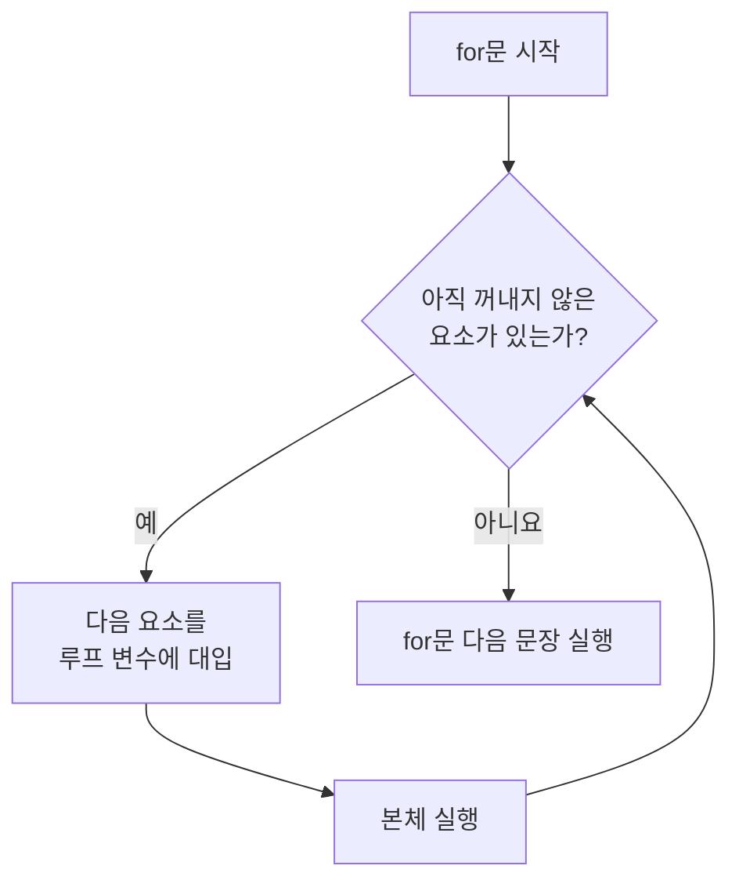
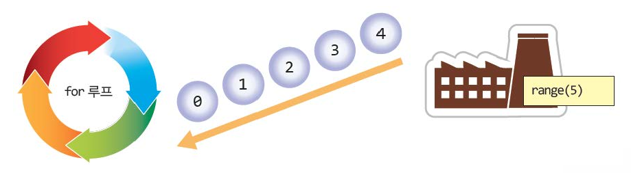
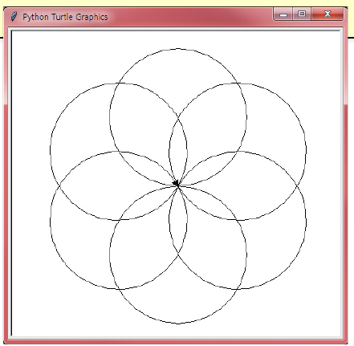
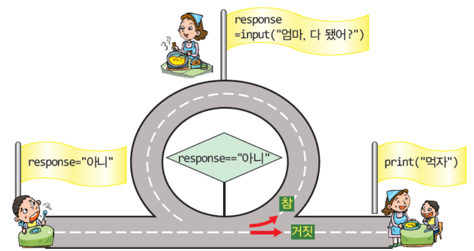
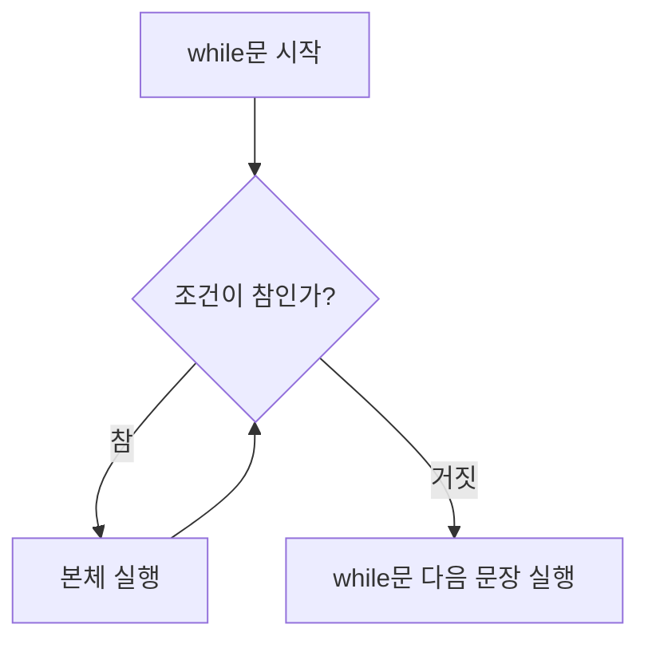
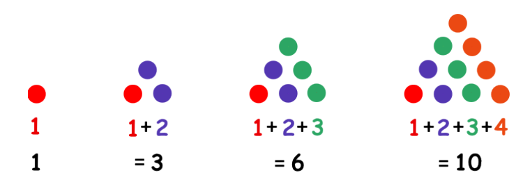
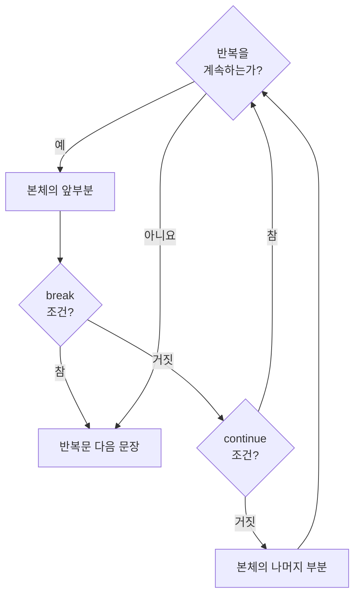

# 5강 — 반복문

[레포지토리 안내](../../README.ko.md) | [English](Concepts_Lecture.md) | [한국어](Concepts_Lecture.ko.md)

> **최종 수정일:** 2026-11-04

> **학습 목표:**
> 1. 반복 구조가 필요한 이유를 설명하고 횟수 제어 반복과 조건 제어 반복을 구분할 수 있다
> 2. `for`문과 `range()` 함수로 정해진 횟수만큼 반복하거나 문자열과 리스트의 요소를 차례로 처리할 수 있다
> 3. `while`문으로 조건이 참인 동안 반복하는 프로그램을 작성하고 무한 루프를 피할 수 있다
> 4. 누적 변수를 이용하여 합계와 곱을 반복으로 계산할 수 있다
> 5. 같은 반복을 `for`문과 `while`문으로 서로 바꾸어 쓰고 상황에 알맞은 반복문을 고를 수 있다
> 6. 중첩 반복을 작성하고 `break`문과 `continue`문으로 반복의 흐름을 제어할 수 있다

---

## 목차

- [1. 반복의 개념](#1-반복의-개념)
  - [1.1 반복이 필요한 이유](#11-반복이-필요한-이유)
  - [1.2 반복문의 두 종류](#12-반복문의-두-종류)
- [2. for문](#2-for문)
  - [2.1 for문의 구조](#21-for문의-구조)
  - [2.2 루프 변수의 활용](#22-루프-변수의-활용)
- [3. range() 함수](#3-range-함수)
  - [3.1 range(종료값)](#31-range종료값)
  - [3.2 시작값, 종료값, 증가값](#32-시작값-종료값-증가값)
  - [3.3 감소하는 범위와 빈 범위](#33-감소하는-범위와-빈-범위)
  - [3.4 range 객체의 내용 확인](#34-range-객체의-내용-확인)
- [4. 시퀀스의 순회](#4-시퀀스의-순회)
  - [4.1 문자열의 순회](#41-문자열의-순회)
  - [4.2 리스트의 순회](#42-리스트의-순회)
  - [4.3 터틀 그래픽과 반복](#43-터틀-그래픽과-반복)
- [5. 누적 패턴](#5-누적-패턴)
  - [5.1 합계의 누적](#51-합계의-누적)
  - [5.2 곱의 누적과 팩토리얼](#52-곱의-누적과-팩토리얼)
- [6. while문](#6-while문)
  - [6.1 while문의 구조](#61-while문의-구조)
  - [6.2 입력이 조건을 바꿀 때까지 반복하기](#62-입력이-조건을-바꿀-때까지-반복하기)
  - [6.3 카운터로 제어하는 반복](#63-카운터로-제어하는-반복)
  - [6.4 무한 루프](#64-무한-루프)
- [7. for문과 while문의 변환](#7-for문과-while문의-변환)
  - [7.1 변환 방법](#71-변환-방법)
  - [7.2 반복문의 선택 기준](#72-반복문의-선택-기준)
- [8. 중첩 반복](#8-중첩-반복)
- [9. 반복의 제어](#9-반복의-제어)
  - [9.1 break문](#91-break문)
  - [9.2 continue문](#92-continue문)
  - [9.3 반복문의 else 절](#93-반복문의-else-절)
- [요약](#요약)
- [점검 문제](#점검-문제)
- [참고 문헌](#참고-문헌)

---

<br>

## 1. 반복의 개념

### 1.1 반복이 필요한 이유

**반복(iteration)** 은 같은 문장이나 문장의 묶음을 여러 번 실행하는 구조이다. 컴퓨터는 사람과 달리 같은 작업을 지치지 않고 빠르고 정확하게 되풀이할 수 있으며, 이것이 컴퓨터의 가장 큰 장점이다.

회사에 중요한 손님이 와서 대형 전광판에 환영 문구를 5번 출력해야 한다고 가정한다. 지금까지 배운 문법만으로는 같은 `print()`문을 복사하여 5줄을 붙여 넣는 방법밖에 없다.

```python
print("방문을 환영합니다!")
print("방문을 환영합니다!")
print("방문을 환영합니다!")
print("방문을 환영합니다!")
print("방문을 환영합니다!")
```

```text
방문을 환영합니다!
방문을 환영합니다!
방문을 환영합니다!
방문을 환영합니다!
방문을 환영합니다!
```

5번이면 이 방법도 쓸 수 있지만, 1000번 출력해야 한다면 같은 줄을 1000번 붙여 넣어야 한다. 프로그램이 불필요하게 길어지고, 붙여 넣은 횟수를 틀리기 쉬우며, 문구를 바꾸려면 1000줄을 모두 고쳐야 한다. 이런 경우에는 **반복 구조**를 사용한다. 다음 두 줄은 환영 문구를 1000번 출력한다.

```python
for i in range(1000):
    print("방문을 환영합니다!")
```

반복 구조를 만드는 문장을 **반복문(loop statement)** 또는 **루프(loop)** 라고 하며, 반복해서 실행되는 문장들을 반복문의 **본체(body)** 라고 한다. 본체가 한 번 실행되는 것을 반복 1회라고 한다.

### 1.2 반복문의 두 종류

반복문은 반복을 언제 멈출지 정하는 방식에 따라 두 종류로 나뉜다. 파이썬은 두 방식에 각각 `for`문과 `while`문을 제공한다.

| 종류 | 반복을 멈추는 기준 | 파이썬 문장 | 예 |
|:-----|:-----|:-----|:-----|
| 횟수 제어 반복(count-controlled loop) | 정해진 횟수만큼 실행하면 멈춘다 | `for`문 | 환영 문구를 5번 출력한다 |
| 조건 제어 반복(condition-controlled loop) | 조건이 만족되는 동안 실행하고, 조건이 거짓이 되면 멈춘다 | `while`문 | 올바른 암호를 입력할 때까지 다시 묻는다 |

*표 1. 반복문의 두 종류*

---

<br>

## 2. for문

### 2.1 for문의 구조

파이썬에서 횟수 제어 반복은 **`for` 루프**라고도 부르는 `for`문으로 작성한다. 기본 형태는 다음과 같다.

```python
for 변수 in 시퀀스:
    문장
```

- **머리(header):** `for` 키워드, 변수 이름, `in` 키워드, 값들의 묶음을 차례로 쓰고 끝에 콜론(`:`)을 붙인다. 콜론은 이어지는 줄부터 본체가 시작됨을 나타낸다.
- **본체:** 머리 다음 줄부터 같은 깊이로 들여쓰기한 문장들이다. 들여쓰기가 끝나는 곳에서 본체도 끝난다. 파이썬 스타일 지침 PEP 8은 들여쓰기 한 단계에 공백 4칸을 권장한다 [1].
- **루프 변수(loop variable):** `for` 다음의 변수이다. 반복할 때마다 묶음의 요소가 앞에서부터 하나씩 대입된다. 요소를 모두 사용하면 반복이 끝난다.

`in` 뒤에는 리스트(3강)처럼 요소가 순서대로 늘어선 값의 묶음, 즉 **시퀀스(sequence)** 를 쓴다. 더 일반적으로는 요소를 하나씩 꺼내 줄 수 있는 모든 **반복 가능한 객체(iterable)** 를 쓸 수 있다 [2]. 다음 프로그램은 리스트 `[1, 2, 3, 4, 5]`의 요소 수만큼, 즉 5번 본체를 실행한다.

```python
for i in [1, 2, 3, 4, 5]:          # 끝에 콜론(:)이 있어야 한다
    print("방문을 환영합니다!")    # 들여쓰기를 해야 한다
```

```text
방문을 환영합니다!
방문을 환영합니다!
방문을 환영합니다!
방문을 환영합니다!
방문을 환영합니다!
```

`i`는 첫 번째 반복에서 1, 두 번째 반복에서 2와 같이 1부터 5까지 바뀌면서 본체가 실행된다. 이 프로그램의 본체는 `i`를 사용하지 않으므로 리스트의 요소 값과 관계없이 요소의 개수만큼 같은 문구가 출력된다.



*그림 1. for문의 실행 흐름*

> **주의:** 본체를 들여쓰지 않으면 파이썬은 본체가 없는 `for`문으로 보고 프로그램을 실행하기 전에 오류를 낸다. 다음은 `print(i)`를 들여쓰지 않은 프로그램과 그 실행 결과이다.

```python
for i in [1, 2, 3]:
print(i)
```

```text
  File "indent_error.py", line 2
    print(i)
    ^^^^^
IndentationError: expected an indented block after 'for' statement on line 1
```

> **참고:** 파이썬에서는 줄바꿈이 문장의 끝을 나타내므로, C 언어처럼 문장 끝에 세미콜론(`;`)을 붙일 필요가 없다. 세미콜론은 한 줄에 여러 문장을 쓸 때의 구분자로 허용되므로 붙여도 오류는 아니지만, 파이썬 코드에서는 쓰지 않는 것이 관례이다.

### 2.2 루프 변수의 활용

본체에서 루프 변수를 사용하면 반복할 때마다 다른 값을 처리할 수 있다. 다음 프로그램은 `i`의 값을 출력한다.

```python
for i in [1, 2, 3, 4, 5]:
    print("i=", i)
```

```text
i= 1
i= 2
i= 3
i= 4
i= 5
```

`print()`에 쉼표로 구분한 값을 여러 개 주면 값 사이에 공백 한 칸을 넣어 출력한다. 그래서 문자열 `"i="`와 `i`의 값 사이에 공백이 생긴다.

루프 변수로 계산을 하면 구구단처럼 규칙적인 표를 만들 수 있다. 다음 프로그램은 9단의 앞부분을 출력한다.

```python
for i in [1, 2, 3, 4, 5]:
    print("9*", i, "=", 9*i)
```

```text
9* 1 = 9
9* 2 = 18
9* 3 = 27
9* 4 = 36
9* 5 = 45
```

| 반복 회차 | `i` | `9*i` | 출력 |
|:-----:|:-----:|:-----:|:-----|
| 1 | 1 | 9 | `9* 1 = 9` |
| 2 | 2 | 18 | `9* 2 = 18` |
| 3 | 3 | 27 | `9* 3 = 27` |
| 4 | 4 | 36 | `9* 4 = 36` |
| 5 | 5 | 45 | `9* 5 = 45` |

*표 2. 9단 출력 프로그램의 실행 추적*

루프 변수는 반복이 끝난 뒤에도 사라지지 않고 마지막에 대입된 값을 유지한다.

```python
for i in [1, 2, 3]:
    print("반복 중:", i)
print("반복이 끝난 뒤:", i)
```

```text
반복 중: 1
반복 중: 2
반복 중: 3
반복이 끝난 뒤: 3
```

---

<br>

## 3. range() 함수

### 3.1 range(종료값)

반복 횟수가 커지면 `[1, 2, 3, 4, 5]`처럼 요소를 모두 적은 리스트를 만들기 어렵다. 내장 함수 `range()`는 일정한 간격으로 늘어선 정수의 범위를 만들어 주므로, `for`문과 함께 횟수 제어 반복에 가장 많이 쓰인다.

```python
for 변수 in range(종료값):
    문장
```

`range(종료값)`은 0부터 (종료값 - 1)까지의 정수를 차례로 내놓는다. 따라서 위 형태의 반복은 종료값이 양수이면 정확히 종료값만큼 실행되고, 0 이하이면 한 번도 실행되지 않는다. 다음 프로그램은 `range(5)`가 내놓는 0, 1, 2, 3, 4를 차례로 `i`에 대입하며 본체를 5번 실행한다.

```python
for i in range(5):
    print("방문을 환영합니다!")
```

```text
방문을 환영합니다!
방문을 환영합니다!
방문을 환영합니다!
방문을 환영합니다!
방문을 환영합니다!
```



*그림 2. range(5)가 0부터 4까지의 정수를 차례로 for 루프에 공급하는 모습*

그림 2는 `range(5)`를 정수를 만들어 내는 공장에, `for` 루프를 그 정수를 하나씩 받아 본체를 실행하는 순환 과정에 비유한 것이다. 공장에서 나온 0, 1, 2, 3, 4가 차례로 루프에 들어가고, 정수가 더 나오지 않으면 반복이 끝난다.

### 3.2 시작값, 종료값, 증가값

`range()`에는 인수를 세 개까지 줄 수 있다. 일반적인 형태는 `range(시작값, 종료값, 증가값)`이며, 시작값을 생략하면 0, 증가값을 생략하면 1이 사용된다.

| 인수 | 생략했을 때의 값 | 의미 |
|:-----|:-----:|:-----|
| 시작값(start) | 0 | 범위의 첫 번째 정수이다. 범위에 포함된다 |
| 종료값(stop) | 생략할 수 없음 | 범위가 끝나는 경계이다. 범위에 포함되지 않는다 |
| 증가값(step) | 1 | 이웃한 두 정수의 차이이다. 0이면 오류가 발생한다 |

*표 3. range() 함수의 세 인수*

증가값이 양수이면 `range(start, stop, step)`의 요소는 $r_k = \text{start} + \text{step} \times k$ ($k = 0, 1, 2, \ldots$) 가운데 $r_k < \text{stop}$인 값들이다 [3]. 즉 범위는 시작값을 포함하고 종료값을 포함하지 않는 반열린 구간 $[\text{start}, \text{stop})$에서 증가값 간격으로 고른 정수이다. 요소의 개수는 $\max\left(0, \left\lceil \frac{\text{stop} - \text{start}}{\text{step}} \right\rceil\right)$이다.

1부터 시작하여 5까지 출력하려면 종료값이 범위에 포함되지 않는다는 점을 고려하여 종료값을 6으로 준다.

```python
for i in range(1, 6, 1):
    print(i, end=" ")
```

```text
1 2 3 4 5
```

`print()`는 기본적으로 출력 끝에 줄바꿈을 붙인다. `end=" "`는 줄바꿈 대신 공백 한 칸을 붙이게 하므로 다섯 수가 한 줄에 공백으로 구분되어 출력된다. 마지막 5 뒤에도 공백이 출력되며, 줄바꿈은 출력되지 않는다.

1부터 9까지 2씩 증가시키려면 증가값을 2로 준다.

```python
for i in range(1, 10, 2):    # 1부터 9까지 2씩 증가시키면서 반복
    print(i)
```

```text
1
3
5
7
9
```

1에 2를 차례로 더하면 1, 3, 5, 7, 9, 11이 되는데, 11은 종료값 10 이상이므로 범위에 들어가지 않는다. 요소의 개수는 $\lceil (10 - 1) / 2 \rceil = \lceil 4.5 \rceil = 5$이다.

> **참고:** 위 형태를 설명하기 위해 `range(start=0, stop, step=1)`처럼 인수 이름과 기본값을 함께 적기도 하지만, 이것은 실제로 호출할 수 있는 형태가 아니다. `range()`는 위치로만 인수를 받으므로 `range(stop=5)`처럼 이름을 붙여 호출하면 `TypeError: range() takes no keyword arguments` 오류가 발생한다.

### 3.3 감소하는 범위와 빈 범위

증가값을 음수로 주면 수가 줄어드는 범위가 된다. 이때 요소는 $r_k > \text{stop}$인 값들이다. 다음 프로그램은 10부터 2까지 1씩 감소시키며 반복한다.

```python
for i in range(10, 1, -1):   # 10부터 2까지 1씩 감소시키면서 반복
    print(i)
```

```text
10
9
8
7
6
5
4
3
2
```

> **주의:** 감소하는 범위에서도 종료값은 포함되지 않는다. `range(10, 1, -1)`은 1까지가 아니라 2까지이고, 0까지는 더욱 아니다. 10부터 1까지 반복하려면 `range(10, 0, -1)`로 쓴다.

증가값을 생략하면 1이 사용되므로, 시작값이 종료값보다 크거나 같으면 조건을 만족하는 요소가 하나도 없는 **빈 범위**가 된다. 빈 범위로 반복하면 본체가 한 번도 실행되지 않으며, 다음 프로그램은 아무것도 출력하지 않는다.

```python
for i in range(10, 0):       # range(10, 0)은 빈 범위이다
    print('Hello, world!', i)
```

증가값으로 0을 주면 범위가 끝나지 않으므로 파이썬은 `ValueError: range() arg 3 must not be zero` 오류를 낸다.

### 3.4 range 객체의 내용 확인

`range()`가 돌려주는 값은 리스트가 아니라 **range 객체**이다. range 객체는 요소를 모두 저장하지 않고 시작값, 종료값, 증가값만 기억하다가 필요할 때 요소를 계산하므로, 범위의 길이와 관계없이 차지하는 메모리가 작고 일정하다 [3]. 그래서 `print(range(5))`는 요소 대신 `range(0, 5)`를 출력한다. 요소를 눈으로 확인하려면 `list()`로 리스트로 바꾸어 출력하고, 요소의 개수는 `len()`으로 구한다.

```python
print(range(5))
print(list(range(5)))
print(list(range(1, 6)))
print(list(range(1, 10, 2)))
print(list(range(10, 1, -1)))
print(list(range(10, 0)))
print(len(range(1, 10, 2)))
```

```text
range(0, 5)
[0, 1, 2, 3, 4]
[1, 2, 3, 4, 5]
[1, 3, 5, 7, 9]
[10, 9, 8, 7, 6, 5, 4, 3, 2]
[]
5
```

---

<br>

## 4. 시퀀스의 순회

시퀀스의 요소를 처음부터 끝까지 하나씩 차례로 처리하는 것을 **순회(traversal)** 라고 한다. `for`문은 숫자 리스트와 range 객체뿐 아니라 문자열과 문자열 리스트도 같은 방법으로 순회한다.

### 4.1 문자열의 순회

문자열(3강)도 문자들이 순서대로 늘어선 시퀀스이므로, `for`문은 문자열의 각 문자를 차례로 변수 `i`에 대입한다.

```python
for i in 'abcdefg':
    print(i)
```

```text
a
b
c
d
e
f
g
```

### 4.2 리스트의 순회

숫자를 출력할 때와 마찬가지로, 문자열로 이루어진 리스트의 요소도 차례로 꺼내 사용할 수 있다.

```python
for i in ['americano', 'latte', 'frappuccino']:
    print(i)
```

```text
americano
latte
frappuccino
```

리스트의 요소 개수가 바뀌어도 `for`문은 고칠 필요가 없다. 요소가 있는 만큼 반복하기 때문이다.

### 4.3 터틀 그래픽과 반복

반복문은 터틀 그래픽(2강)에서 같은 도형을 규칙적으로 되풀이해 그릴 때 유용하다. 다음 프로그램은 원을 6개 그리면서, 원 하나를 그릴 때마다 거북이의 방향을 왼쪽으로 60도씩 돌린다.

```python
import turtle
t = turtle.Turtle()

for count in range(6):
    t.circle(100)
    t.left(360/6)
```

- **`t.circle(100)`:** 반지름이 100인 원을 그린다. 원의 중심은 거북이의 왼쪽으로 반지름만큼 떨어진 곳이며, 거북이는 원을 한 바퀴 돌아 출발점과 같은 위치, 같은 방향으로 돌아온다 [4].
- **`t.left(360/6)`:** 거북이를 왼쪽으로 $360 / 6 = 60$도 회전시킨다. 나눗셈 연산자 `/`의 결과는 실수이므로 회전 각도는 `60.0`이다.
- **반복:** 6번 회전하면 모두 $6 \times 60 = 360$도를 돌아 처음 방향으로 돌아온다. 그동안 원의 중심이 출발점 주위를 60도 간격으로 옮겨 가므로, 출발점에서 만나는 원 6개가 꽃 모양을 이룬다.



*그림 3. 원 6개를 60도씩 돌려 그린 터틀 그래픽의 실행 화면*

원의 개수를 $n$으로 바꾸고 회전 각도를 `360/n`으로 주면 원 $n$개로 이루어진 꽃 모양을 그릴 수 있다.

---

<br>

## 5. 누적 패턴

반복문의 대표적인 용도는 값을 차례로 모아 하나의 결과를 만드는 것이다. 반복할 때마다 값을 더하거나 곱해 결과를 모아 가는 변수를 **누적 변수(accumulator)** 라고 한다.

### 5.1 합계의 누적

1부터 $n$까지의 합을 구하려면 합을 저장할 누적 변수를 0으로 초기화한 뒤, 반복할 때마다 루프 변수의 값을 더한다.

```python
n = 10
total = 0                    # 누적 변수는 0으로 시작한다
for i in range(1, n+1):
    total = total + i        # 지금까지의 합에 i를 더한다
print("합계:", total)
```

```text
합계: 55
```

`range(1, n+1)`은 종료값이 포함되지 않으므로 1부터 $n$까지를 내놓는다. 대입문 `total = total + i`는 오른쪽의 `total + i`를 먼저 계산한 뒤 그 결과를 다시 `total`에 저장하므로, 반복할 때마다 `total`이 다음과 같이 커진다.

| `i` | 1 | 2 | 3 | 4 | 5 | 6 | 7 | 8 | 9 | 10 |
|:-----|:---:|:---:|:---:|:---:|:---:|:---:|:---:|:---:|:---:|:---:|
| 본체 실행 후 `total` | 1 | 3 | 6 | 10 | 15 | 21 | 28 | 36 | 45 | 55 |

*표 4. 1부터 10까지의 합을 누적하는 과정*

결과는 등차수열의 합 공식으로 확인할 수 있다. 합 $S = 1 + 2 + \cdots + n$과 이를 거꾸로 쓴 $S = n + (n-1) + \cdots + 1$을 같은 자리끼리 더하면 $(1 + n), (2 + (n-1)), \ldots$처럼 합이 $n + 1$인 쌍이 $n$개 생기므로 $2S = n(n+1)$이 되어 다음이 성립한다.

$$1 + 2 + \cdots + n = \frac{n(n+1)}{2}, \qquad \frac{10 \times 11}{2} = 55$$

### 5.2 곱의 누적과 팩토리얼

양의 정수 $n$의 **팩토리얼(factorial)** $n!$은 1부터 $n$까지의 정수를 모두 곱한 값이다. 즉 $n! = 1 \times 2 \times 3 \times \cdots \times (n-1) \times n$이고, 정의에 따라 $0! = 1$이다. 곱을 누적할 때는 누적 변수를 1로 초기화한다. 0으로 시작하면 무엇을 곱해도 0이 되기 때문이다. 1은 곱셈의 항등원이고 0은 덧셈의 항등원이므로, 누적 변수의 초깃값은 누적하는 연산의 항등원으로 정한다.

```python
product = 1                  # 곱의 누적 변수는 1로 시작한다
for i in range(1, 6):
    product = product * i
print(product)
```

```text
120
```

`product`는 1에서 시작하여 $1 \times 1 = 1$, $1 \times 2 = 2$, $2 \times 3 = 6$, $6 \times 4 = 24$, $24 \times 5 = 120$으로 바뀌므로 $5! = 120$이 출력된다. 입력받은 정수의 팩토리얼을 구하는 프로그램은 [연습 문제 2](Exercises.ko.md#연습-문제-2-팩토리얼-계산)에서 다룬다.

---

<br>

## 6. while문

### 6.1 while문의 구조

**조건 제어 반복**은 어떤 조건이 만족되는 동안 반복하는 구조이며, 파이썬에서는 `while`문으로 작성한다. 기본 형태는 다음과 같다.

```python
while 조건:
    반복 문장
```

- **조건:** 반복을 계속할지 정하는 식이다. 조건이 참이면 본체를 실행하고, 거짓이면 `while`문을 빠져나간다.
- **반복 문장:** 들여쓰기한 본체이다. 본체를 한 번 실행할 때마다 다시 조건을 검사한다.

`while`문은 본체를 실행하기 **전에** 조건을 검사한다. 따라서 처음부터 조건이 거짓이면 본체는 한 번도 실행되지 않는다. 또 본체 안에서 조건에 쓰인 값이 언젠가 바뀌지 않으면 반복이 끝나지 않으므로(6.4절), 본체는 조건을 거짓으로 만들 수 있는 문장을 포함해야 한다.



*그림 4. 대답이 "아니"인 동안 같은 질문을 되풀이하는 while 루프의 비유*

그림 4는 `while`문을 순환 도로에 비유한 것이다. 아이는 `response = "아니"`인 상태로 출발하여 순환 도로 입구에서 조건 `response == "아니"`를 검사한다. 조건이 참이면 순환 도로를 한 바퀴 돌며 엄마에게 "엄마, 다 됐어?"라고 묻고(`input()`), 엄마의 대답으로 `response`를 바꾼 뒤 다시 입구로 돌아온다. 대답이 "아니"가 아니게 되어 조건이 거짓이 되면 순환 도로를 빠져나가 `print("먹자")`에 도착한다.

```python
response = "아니"
while response == "아니":
    response = input("엄마, 다됐어? ")
print("먹자")
```

다음은 "아니"를 두 번 입력한 뒤 "응"을 입력했을 때의 실행 결과이다.

```text
엄마, 다됐어? 아니
엄마, 다됐어? 아니
엄마, 다됐어? 응
먹자
```

첫 번째 줄에서 `response`를 `"아니"`로 정해 두었기 때문에 처음 검사에서 조건이 참이 되어 질문이 적어도 한 번은 출력된다. `"응"`을 입력하면 `response == "아니"`가 거짓이 되므로 반복이 끝나고 `"먹자"`가 출력된다.



*그림 5. while문의 실행 흐름*

### 6.2 입력이 조건을 바꿀 때까지 반복하기

사용자가 암호를 입력하고, 프로그램이 암호가 맞는지 확인한다고 가정한다. 사용자가 몇 번 만에 올바른 암호를 입력할지는 미리 알 수 없으므로 반복 횟수를 정할 수 없다. 이런 경우에 `while`문을 사용한다.

```python
password = ""
while password != "pythonisfun":
    password = input("암호를 입력하시오: ")
print("로그인 성공")
```

```text
암호를 입력하시오: idontknow
암호를 입력하시오: 12345678
암호를 입력하시오: password
암호를 입력하시오: pythonisfun
로그인 성공
```

`password`의 초깃값인 빈 문자열 `""`은 올바른 암호와 다르므로 처음 검사에서 조건 `password != "pythonisfun"`이 참이 된다. 틀린 암호를 입력하는 동안 조건은 계속 참이고, `pythonisfun`을 입력하는 순간 거짓이 되어 반복이 끝난다. 이처럼 미리 정한 특별한 값이 입력되면 반복을 끝내는 방식에서 그 값을 **감시값(sentinel value)** 이라고 부른다.

### 6.3 카운터로 제어하는 반복

`while`문으로 횟수를 세며 반복할 수도 있다. 이때 반복 횟수를 세는 변수를 **카운터(counter)** 라고 한다. 다음 프로그램은 1부터 10까지의 합을 `while`문으로 계산한다.

```python
count = 1
sum = 0
while count <= 10:
    sum = sum + count
    count = count + 1
print("합계는", sum)
```

```text
합계는 55
```

카운터로 제어하는 `while`문은 다음 세 부분으로 이루어진다.

- **초기화:** 반복하기 전에 카운터의 처음 값을 정한다(`count = 1`).
- **조건:** 카운터가 범위 안에 있는 동안 반복한다(`count <= 10`).
- **갱신:** 본체의 끝에서 카운터를 바꾼다(`count = count + 1`).

| 반복 회차 | 1 | 2 | 3 | 4 | 5 | 6 | 7 | 8 | 9 | 10 |
|:-----|:---:|:---:|:---:|:---:|:---:|:---:|:---:|:---:|:---:|:---:|
| 본체 실행 전 `count` | 1 | 2 | 3 | 4 | 5 | 6 | 7 | 8 | 9 | 10 |
| 본체 실행 후 `sum` | 1 | 3 | 6 | 10 | 15 | 21 | 28 | 36 | 45 | 55 |
| 본체 실행 후 `count` | 2 | 3 | 4 | 5 | 6 | 7 | 8 | 9 | 10 | 11 |

*표 5. while문으로 1부터 10까지의 합을 구하는 과정*

10번째 반복이 끝나면 `count`가 11이 되어 조건 `count <= 10`이 거짓이 되므로 반복이 끝나고, 그때의 `sum`인 55가 출력된다.



*그림 6. 1부터 n까지의 합을 점으로 쌓은 삼각형으로 나타낸 그림*

그림 6처럼 $k$번째 줄에 점을 $k$개 놓아 삼각형을 쌓으면, $n$줄까지의 점의 개수가 1부터 $n$까지의 합이다. 이 수 1, 3, 6, 10, ...을 **삼각수(triangular number)** 라고 한다. 반복할 때마다 한 줄씩 점을 더하는 과정이 누적 변수 `sum`이 커지는 과정과 같다.

> **주의:** `sum`은 파이썬의 내장 함수 이름이기도 하다. `sum = 0`처럼 같은 이름의 변수를 만들면 그 뒤로는 내장 함수 `sum()`을 쓸 수 없고, `sum([1, 2, 3])`을 호출하면 `TypeError: 'int' object is not callable` 오류가 발생한다. 합계를 저장하는 변수에는 `total`처럼 내장 함수와 겹치지 않는 이름을 쓰는 것이 안전하다.

### 6.4 무한 루프

조건이 영원히 참으로 남아 끝나지 않는 반복을 **무한 루프(infinite loop)** 라고 한다. 카운터를 갱신하는 문장을 빠뜨리는 것이 가장 흔한 원인이다.

```python
count = 1
while count <= 5:
    print(count)
```

이 프로그램은 본체에서 `count`를 바꾸지 않으므로 조건 `count <= 5`가 계속 참이고, 1을 끝없이 출력한다. 실행 중인 프로그램은 터미널에서 Ctrl+C를 눌러 멈출 수 있으며, 이때 파이썬은 `KeyboardInterrupt` 예외를 내고 프로그램을 끝낸다.

반대로 일부러 무한 루프를 만들고 본체 안에서 반복을 끝내는 방법도 있다. 조건 자리에 항상 참인 `True`를 쓰고, 끝낼 조건이 만족되면 `break`문(9.1절)으로 반복을 빠져나간다. 다음 프로그램은 0이 입력될 때까지 정수를 입력받아 합계를 구한다.

```python
total = 0
while True:                          # 조건이 항상 참인 반복
    n = int(input("정수(0이면 끝): "))
    if n == 0:
        break                        # 0을 입력하면 반복을 끝낸다
    total = total + n
print("합계:", total)
```

```text
정수(0이면 끝): 3
정수(0이면 끝): 5
정수(0이면 끝): -2
정수(0이면 끝): 0
합계: 6
```

이 방법은 반복을 끝낼지 판단하는 데 필요한 값을 본체 안에서 입력받는 경우에 유용하다. 여기서는 0이 감시값이다.

---

<br>

## 7. for문과 while문의 변환

### 7.1 변환 방법

`for`문과 `while`문은 기본적으로 비슷하며 서로 바꾸어 쓸 수 있다. 증가값이 양수인 `range()`로 반복하는 `for`문은 6.3절의 세 부분을 이용하여 다음과 같이 `while`문으로 바꾼다.

| 역할 | `for i in range(a, b, s):` | `while`문 |
|:-----|:-----|:-----|
| 초기화 | 시작값 `a`가 첫 요소이다 | 반복 전에 `i = a` |
| 조건 | 요소가 종료값 `b`보다 작은 동안 반복한다 | `while i < b:` |
| 갱신 | 다음 요소는 `s`만큼 크다 | 본체 끝에 `i = i + s` |

*표 6. range()를 쓰는 for문과 while문의 대응 (증가값 s가 양수인 경우)*

다음 두 프로그램은 모두 0부터 4까지를 출력한다. 첫 번째 `for`문은 반복 실행 횟수를 명확히 알 때 쓰는 형태이고, 두 번째 `while`문은 반복 실행 횟수가 명확하지 않을 때에도 쓸 수 있는 형태이다.

```python
for i in range(0, 5):
    print(i)
```

```python
i = 0
while i < 5:
    print(i)
    i = i + 1
```

```text
0
1
2
3
4
```

> **주의:** 두 형태는 반복이 끝난 뒤 `i`의 값이 다르다. `for`문은 마지막 요소인 4를 남기지만, `while`문은 조건을 거짓으로 만든 값인 5를 남긴다. 또 `while`문으로 바꿀 때 갱신 문장 `i = i + 1`을 빠뜨리면 무한 루프가 된다.

### 7.2 반복문의 선택 기준

두 반복문은 서로 바꿀 수 있지만 쓰임에는 차이가 있다. `for`문은 일반적으로 반복 횟수를 정확하게 알고 있고 그 횟수가 변하지 않을 때 사용한다. 반면 `while`문은 반복 실행 횟수가 명확하지 않고, 어떤 조건이 만족되면 반복을 끝내야 할 때 사용한다.

| 상황 | 알맞은 반복문 | 이유 |
|:-----|:-----|:-----|
| 학생들의 성적을 채점한다 | `for`문 | 학생이 모두 몇 명인지 미리 알고 있다 |
| 가위바위보를 이길 때까지 한다 | `while`문 | 언제 이길지 미리 알 수 없다 |
| 문자열의 문자를 하나씩 검사한다 | `for`문 | 문자열의 길이만큼 반복하면 된다 |
| 올바른 값이 입력될 때까지 다시 묻는다 | `while`문 | 사용자가 몇 번 만에 올바른 값을 입력할지 알 수 없다 |

*표 7. 상황에 따른 반복문의 선택*

---

<br>

## 8. 중첩 반복

반복문의 본체 안에 다른 반복문을 넣은 구조를 **중첩 반복(nested loop)** 이라고 한다. 바깥 반복이 한 번 실행될 때마다 안쪽 반복은 처음부터 끝까지 모두 실행된다. 다음 프로그램은 2단과 3단의 앞부분을 출력한다.

```python
for dan in range(2, 4):              # 바깥 반복: 단
    for i in range(1, 4):            # 안쪽 반복: 곱하는 수
        print(dan, "*", i, "=", dan*i)
    print("---")
```

```text
2 * 1 = 2
2 * 2 = 4
2 * 3 = 6
---
3 * 1 = 3
3 * 2 = 6
3 * 3 = 9
---
```

바깥 반복의 `dan`이 2일 때 안쪽 반복이 `i`를 1, 2, 3으로 바꾸며 세 줄을 출력하고, 안쪽 반복이 끝나면 `"---"`를 출력한다. 이어서 `dan`이 3이 되면 안쪽 반복이 다시 `i = 1`부터 시작한다. 안쪽 본체는 모두 $2 \times 3 = 6$번 실행된다. 일반적으로 바깥 반복이 $m$번, 안쪽 반복이 $n$번 실행되면 안쪽 본체는 $m \times n$번 실행된다. `print("---")`는 안쪽 `for`문과 같은 깊이로 들여썼으므로 바깥 반복의 본체에 속한다. 구구단 전체를 출력하는 프로그램은 [연습 문제 4](Exercises.ko.md#연습-문제-4-구구단-전체-출력)에서 다룬다.

---

<br>

## 9. 반복의 제어

반복문은 보통 조건이나 요소에 따라 정해진 대로 반복하지만, 본체 안에서 반복의 흐름을 바꿀 수도 있다. 파이썬은 이를 위해 `break`문과 `continue`문을 제공한다.



*그림 7. break문과 continue문이 바꾸는 반복의 흐름*

### 9.1 break문

**`break`문**은 반복문을 논리적으로 끝내는 방법이다. 본체에서 `break`가 실행되면 남은 반복과 관계없이 즉시 반복문을 빠져나가 반복문 다음 문장을 실행한다.

```python
for i in range(10):
    if i == 5: break                 # i가 5가 되면 반복을 끝낸다
    print(i)
print("End of Program")              # 반복이 끝난 뒤 'End of Program' 출력
```

```text
0
1
2
3
4
End of Program
```

`i`가 0부터 4까지일 때는 조건 `i == 5`가 거짓이므로 `i`가 출력된다. `i`가 5가 되면 `break`가 실행되어 `print(i)`를 실행하지 않고 반복문을 빠져나가므로, 6부터 9까지는 대입조차 되지 않는다. `if i == 5: break`처럼 `if`문의 본체가 한 문장뿐이면 콜론 뒤에 같은 줄로 쓸 수 있다.

### 9.2 continue문

**`continue`문**은 특정 조건에서 본체의 남은 문장을 건너뛰고 다음 반복을 수행한다. 반복문 자체를 끝내지는 않는다.

```python
for i in range(10):
    if i == 5: continue              # i가 5이면 i를 출력하지 않는다
    print(i)
print("End of Program")              # 반복이 끝난 뒤 'End of Program' 출력
```

```text
0
1
2
3
4
6
7
8
9
End of Program
```

`i`가 5일 때만 `continue`가 실행되어 `print(i)`를 건너뛰고 곧바로 `i = 6`인 다음 반복으로 넘어간다. 그래서 출력에서 5만 빠진다.

> **주의:** 중첩 반복에서 `break`와 `continue`는 그 문장을 감싸는 가장 안쪽 반복문에만 적용된다. 또 카운터로 제어하는 `while`문에서 `continue`가 갱신 문장보다 앞에 있으면 갱신을 건너뛰게 되어 무한 루프가 될 수 있다.

### 9.3 반복문의 else 절

파이썬의 `for`문과 `while`문에는 `else` 절을 붙일 수 있다. `else` 절은 반복이 `break`로 중단되지 않고 정상적으로 끝났을 때만 실행된다 [2]. 원하는 값을 찾다가 끝내 찾지 못한 경우를 처리할 때 유용하다.

```python
for n in [3, 5, 7]:
    if n % 2 == 0:
        print("짝수 발견:", n)
        break
else:
    print("짝수가 없다")
```

```text
짝수가 없다
```

리스트에 짝수가 없으므로 `break`가 한 번도 실행되지 않고 반복이 끝나, `else` 절이 실행된다. 리스트를 `[3, 8, 7]`로 바꾸면 8에서 `짝수 발견: 8`을 출력하고 `break`로 빠져나가므로 `else` 절은 실행되지 않는다. `else`는 `if`가 아니라 `for`와 같은 깊이로 들여쓴다는 점에 주의해야 한다.

---

<br>

## 요약

| 개념 | 핵심 요약 |
|:-----|:-----|
| 반복 | 같은 문장을 여러 번 실행하는 구조이며, 복사하여 붙여 넣는 대신 반복문으로 작성한다. |
| 횟수 제어 반복과 조건 제어 반복 | 정해진 횟수만큼 반복하면 `for`문, 조건이 참인 동안 반복하면 `while`문을 쓴다. |
| `for`문 | 시퀀스나 반복 가능한 객체의 요소를 차례로 루프 변수에 대입하며 들여쓴 본체를 실행한다. |
| `range()` | `range(시작값, 종료값, 증가값)`은 시작값을 포함하고 종료값을 포함하지 않는 정수 범위를 만들며, 시작값의 기본값은 0, 증가값의 기본값은 1이다. |
| 감소하는 범위와 빈 범위 | 증가값이 음수이면 감소하는 범위가 되고, 조건을 만족하는 요소가 없으면 본체가 한 번도 실행되지 않는다. |
| 순회 | `for`문은 문자열의 문자와 리스트의 요소를 처음부터 끝까지 하나씩 처리한다. |
| 누적 변수 | 합은 0에서, 곱은 1에서 시작하여 반복할 때마다 값을 더하거나 곱해 결과를 모은다. |
| `while`문 | 본체를 실행하기 전에 조건을 검사하며, 조건이 처음부터 거짓이면 본체를 한 번도 실행하지 않는다. |
| 감시값 | 미리 정한 특별한 값이 입력되면 반복을 끝내는 방식에서 그 값을 말한다. |
| 카운터 | 초기화, 조건, 갱신의 세 부분으로 반복 횟수를 제어하는 변수이다. |
| 무한 루프 | 조건이 영원히 참인 반복이며, 의도한 경우에는 `while True`와 `break`를 함께 쓴다. |
| `for`와 `while`의 변환 | `range(a, b, s)`는 `i = a`, `while i < b`, `i = i + s`로 바꿀 수 있으며, 반복 후 `i`의 값은 다를 수 있다. |
| 중첩 반복 | 바깥 반복이 한 번 실행될 때마다 안쪽 반복이 처음부터 끝까지 실행된다. |
| `break`와 `continue` | `break`는 가장 안쪽 반복문을 즉시 끝내고, `continue`는 본체의 나머지를 건너뛰고 다음 반복으로 넘어간다. |
| 반복문의 `else` 절 | 반복이 `break` 없이 정상적으로 끝났을 때만 실행된다. |

---

<br>

## 점검 문제

1. **range의 요소:** `range(3, 15, 4)`, `range(20, 5, -5)`, `range(5, 5)`가 내놓는 정수를 각각 모두 쓰라.

   <details>
   <summary>정답</summary>

   `range(3, 15, 4)`는 3에서 시작하여 4씩 더한 3, 7, 11이다. 다음 값 15는 종료값이므로 포함되지 않는다. `range(20, 5, -5)`는 20, 15, 10이다. 다음 값 5는 종료값이므로 포함되지 않는다. `range(5, 5)`는 시작값과 종료값이 같아 조건을 만족하는 요소가 없으므로 빈 범위이다.

   </details>

2. **반복 횟수:** 다음 프로그램이 출력하는 값을 쓰라.

   ```python
   count = 0
   for i in range(2, 20, 3):
       count = count + 1
   print(count, i)
   ```

   <details>
   <summary>정답</summary>

   `6 17`이 출력된다. `range(2, 20, 3)`의 요소는 2, 5, 8, 11, 14, 17의 6개이므로 본체가 6번 실행되어 `count`는 6이 된다. 개수는 $\lceil (20 - 2) / 3 \rceil = 6$으로도 구할 수 있다. 반복이 끝난 뒤 루프 변수 `i`는 마지막 요소인 17을 유지한다.

   </details>

3. **while문의 추적:** 다음 프로그램의 출력을 쓰고, 마지막 줄의 `n`이 어떤 의미인지 설명하라.

   ```python
   n = 0
   total = 0
   while total < 20:
       n = n + 1
       total = total + n
   print(n, total)
   ```

   <details>
   <summary>정답</summary>

   `6 21`이 출력된다. `total`은 1, 3, 6, 10, 15, 21로 커지며, 21이 되었을 때 조건 `total < 20`이 거짓이 되어 반복이 끝난다. 이때 `n`은 6이다. 즉 `n`은 1부터 차례로 더하여 합이 처음으로 20 이상이 되었을 때 마지막으로 더한 수이다.

   </details>

4. **for문을 while문으로:** `for i in range(10, 0, -2): print(i)`와 같은 값을 출력하는 `while`문을 작성하라.

   <details>
   <summary>정답</summary>

   증가값이 음수이므로 조건의 부등호 방향이 바뀐다. 초기화는 `i = 10`, 조건은 `i > 0`, 갱신은 `i = i - 2`이다.

   ```python
   i = 10
   while i > 0:
       print(i)
       i = i - 2
   ```

   두 프로그램 모두 10, 8, 6, 4, 2를 한 줄에 하나씩 출력한다.

   </details>

5. **break와 continue:** 다음 프로그램의 출력을 쓰라.

   ```python
   for i in range(1, 10):
       if i % 3 == 0:
           continue
       if i == 8:
           break
       print(i, end=" ")
   ```

   <details>
   <summary>정답</summary>

   `1 2 4 5 7 `이 출력된다(끝에 공백 한 칸이 있다). 3과 6은 3의 배수이므로 `continue`로 출력을 건너뛰고, `i`가 8이 되면 `break`로 반복이 끝나므로 8과 9는 출력되지 않는다. 9는 3의 배수이기도 하지만 그 전에 반복이 끝났으므로 검사조차 되지 않는다.

   </details>

6. **누적 변수의 초깃값:** 1부터 5까지의 곱을 구하려고 `product = 0`으로 초기화한 뒤 `for i in range(1, 6): product = product * i`를 실행하면 결과는 무엇이고, 왜 그런가?

   <details>
   <summary>정답</summary>

   결과는 0이다. 0에 어떤 수를 곱해도 0이므로 `product`는 반복하는 동안 계속 0으로 남는다. 곱의 누적 변수는 곱셈의 항등원인 1로 초기화해야 $5! = 120$을 얻는다.

   </details>

---

<br>

## 참고 문헌

1. G. van Rossum, B. Warsaw, and A. Coghlan, "PEP 8 - Style Guide for Python Code," *Python Enhancement Proposals*, 2001. https://peps.python.org/pep-0008/
2. Python Software Foundation, "Compound statements," *The Python Language Reference*, Python 3.13. https://docs.python.org/3.13/reference/compound_stmts.html
3. Python Software Foundation, "Built-in Types," *The Python Standard Library*, Python 3.13. https://docs.python.org/3.13/library/stdtypes.html
4. Python Software Foundation, "turtle - Turtle graphics," *The Python Standard Library*, Python 3.13. https://docs.python.org/3.13/library/turtle.html
