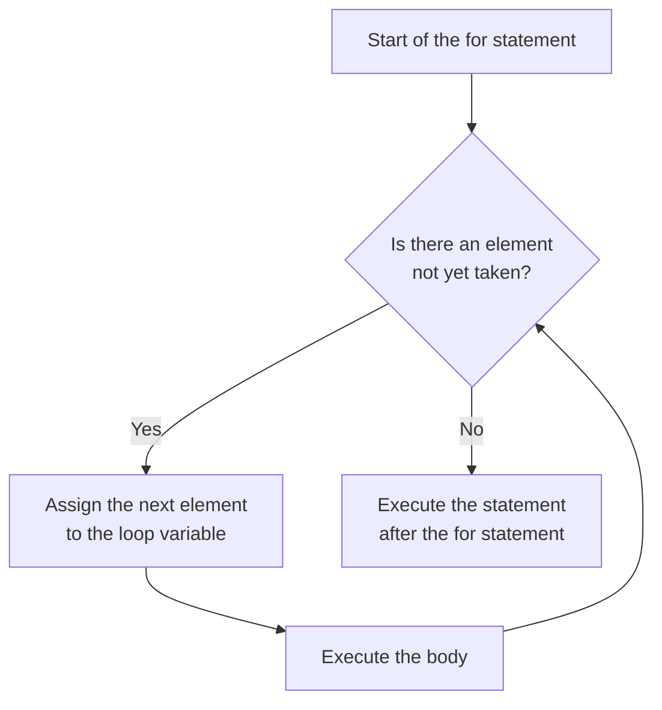
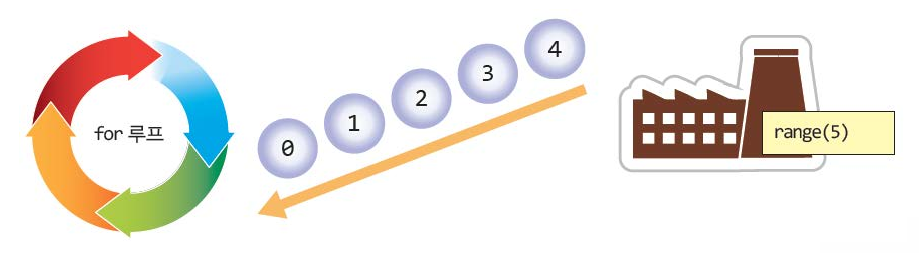
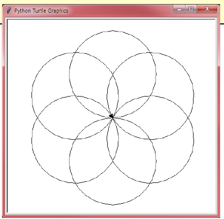
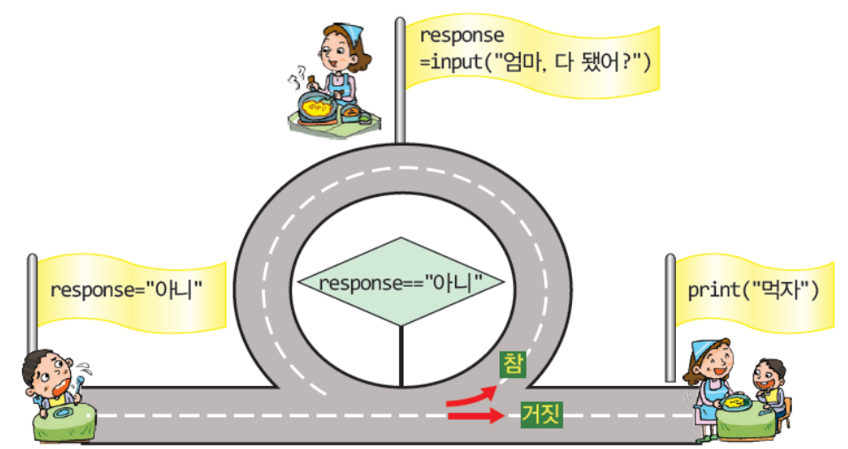
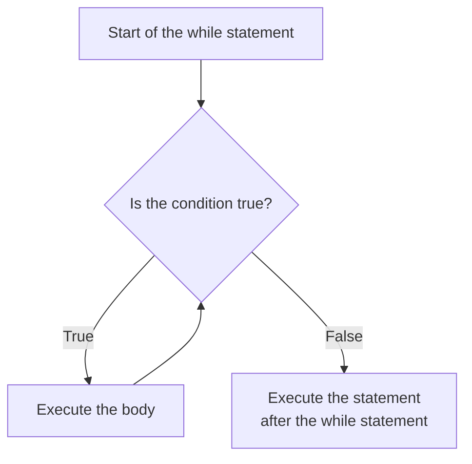
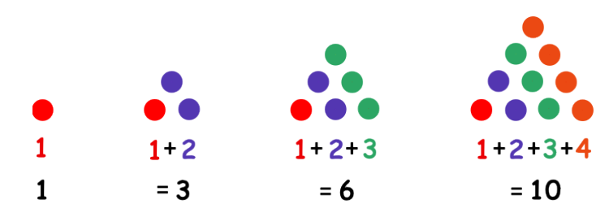
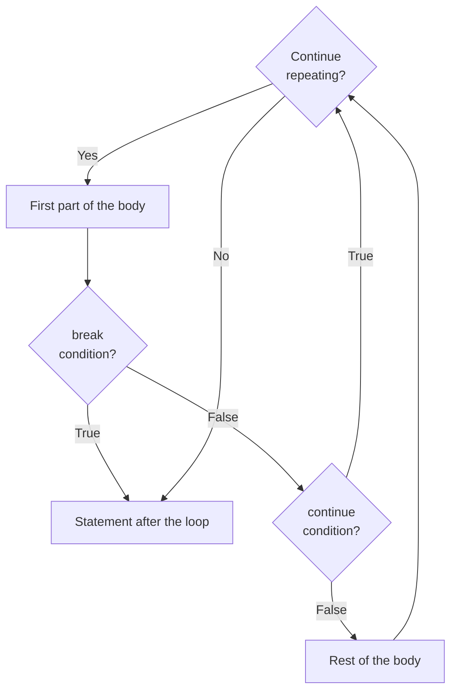

# Lecture 5 — Loops

[Repository Guide](../../README.md) | [English](Concepts_Lecture.md) | [한국어](Concepts_Lecture.ko.md)

> **Last Updated:** 2026-11-04

> **Learning Objectives:**
> 1. Explain why repetition structures are needed and distinguish count-controlled loops from condition-controlled loops
> 2. Use the `for` statement and the `range()` function to repeat a fixed number of times or to process the elements of strings and lists in order
> 3. Write programs that repeat while a condition is true with the `while` statement, and avoid infinite loops
> 4. Compute sums and products by repetition using accumulator variables
> 5. Rewrite the same repetition with either the `for` statement or the `while` statement and choose the loop that suits a situation
> 6. Write nested loops and control the flow of a loop with the `break` and `continue` statements

---

## Table of Contents

- [1. The Concept of Repetition](#1-the-concept-of-repetition)
  - [1.1 Why Repetition Is Needed](#11-why-repetition-is-needed)
  - [1.2 Two Kinds of Loops](#12-two-kinds-of-loops)
- [2. The for Statement](#2-the-for-statement)
  - [2.1 Structure of the for Statement](#21-structure-of-the-for-statement)
  - [2.2 Using the Loop Variable](#22-using-the-loop-variable)
- [3. The range() Function](#3-the-range-function)
  - [3.1 range(stop)](#31-rangestop)
  - [3.2 Start, Stop, and Step](#32-start-stop-and-step)
  - [3.3 Decreasing Ranges and Empty Ranges](#33-decreasing-ranges-and-empty-ranges)
  - [3.4 Inspecting the Contents of a range Object](#34-inspecting-the-contents-of-a-range-object)
- [4. Traversing Sequences](#4-traversing-sequences)
  - [4.1 Traversing a String](#41-traversing-a-string)
  - [4.2 Traversing a List](#42-traversing-a-list)
  - [4.3 Turtle Graphics and Repetition](#43-turtle-graphics-and-repetition)
- [5. The Accumulation Pattern](#5-the-accumulation-pattern)
  - [5.1 Accumulating a Sum](#51-accumulating-a-sum)
  - [5.2 Accumulating a Product and the Factorial](#52-accumulating-a-product-and-the-factorial)
- [6. The while Statement](#6-the-while-statement)
  - [6.1 Structure of the while Statement](#61-structure-of-the-while-statement)
  - [6.2 Repeating Until the Input Changes the Condition](#62-repeating-until-the-input-changes-the-condition)
  - [6.3 Counter-Controlled Repetition](#63-counter-controlled-repetition)
  - [6.4 Infinite Loops](#64-infinite-loops)
- [7. Converting Between for and while](#7-converting-between-for-and-while)
  - [7.1 How to Convert](#71-how-to-convert)
  - [7.2 Choosing a Loop](#72-choosing-a-loop)
- [8. Nested Loops](#8-nested-loops)
- [9. Controlling a Loop](#9-controlling-a-loop)
  - [9.1 The break Statement](#91-the-break-statement)
  - [9.2 The continue Statement](#92-the-continue-statement)
  - [9.3 The else Clause of a Loop](#93-the-else-clause-of-a-loop)
- [Summary](#summary)
- [Self-Check Questions](#self-check-questions)
- [References](#references)

---

<br>

## 1. The Concept of Repetition

### 1.1 Why Repetition Is Needed

**Iteration** is a structure that executes the same statement or group of statements several times. Unlike people, computers can repeat the same task quickly and accurately without tiring, and this is the greatest strength of computers.

Suppose an important guest visits a company and a welcome message must be shown 5 times on a large electronic display. With the syntax covered so far, the only way is to copy the same `print()` statement and paste it into 5 lines.

```python
print("Welcome to our company!")
print("Welcome to our company!")
print("Welcome to our company!")
print("Welcome to our company!")
print("Welcome to our company!")
```

```text
Welcome to our company!
Welcome to our company!
Welcome to our company!
Welcome to our company!
Welcome to our company!
```

This works for 5 times, but printing the message 1000 times would require pasting the same line 1000 times. The program becomes needlessly long, the number of pasted lines is easy to get wrong, and changing the message means editing all 1000 lines. In such cases a **repetition structure** is used. The following two lines print the welcome message 1000 times.

```python
for i in range(1000):
    print("Welcome to our company!")
```

A statement that creates a repetition structure is called a **loop statement** or a **loop**, and the statements executed repeatedly are called the **body** of the loop. One execution of the body is called one iteration.

### 1.2 Two Kinds of Loops

Loops are divided into two kinds according to how they decide when to stop. Python provides the `for` statement and the `while` statement for the two kinds.

| Kind | When the Repetition Stops | Python Statement | Example |
|:-----|:-----|:-----|:-----|
| Count-controlled loop | Stops after executing a fixed number of times | `for` statement | Print a welcome message 5 times |
| Condition-controlled loop | Executes while a condition holds and stops when it becomes false | `while` statement | Ask again until the correct password is entered |

*Table 1. The two kinds of loops*

---

<br>

## 2. The for Statement

### 2.1 Structure of the for Statement

In Python, count-controlled repetition is written with the `for` statement, also called the **`for` statement**. Its basic form is as follows.

```python
for variable in sequence:
    statement
```

- **Header:** Write the `for` keyword, a variable name, the `in` keyword, and a collection of values in order, and end with a colon (`:`). The colon indicates that the body starts on the following lines.
- **Body:** The statements indented to the same depth on the lines after the header. The body ends where the indentation ends. The Python style guide PEP 8 recommends 4 spaces per indentation level [1].
- **Loop variable:** The variable after `for`. On each iteration, the elements of the collection are assigned to it one at a time from the front. When all elements have been used, the repetition ends.

After `in` comes a collection whose elements are arranged in order, such as a list (Lecture 3), that is, a **sequence**. More generally, any **iterable**, an object that can hand out its elements one at a time, can be used [2]. The following program executes the body as many times as the list `[1, 2, 3, 4, 5]` has elements, that is, 5 times.

```python
for i in [1, 2, 3, 4, 5]:          # the header must end with a colon (:)
    print("Welcome to our company!")  # the body must be indented
```

```text
Welcome to our company!
Welcome to our company!
Welcome to our company!
Welcome to our company!
Welcome to our company!
```

The body is executed while `i` changes from 1 to 5, being 1 on the first iteration, 2 on the second, and so on. The body of this program does not use `i`, so the same message is printed as many times as there are elements, regardless of the element values.



*Figure 1. Execution flow of the for statement*

> **Caution:** If the body is not indented, Python treats the `for` statement as having no body and reports an error before running the program. The following is a program in which `print(i)` is not indented, and its result.

```python
for i in [1, 2, 3]:
print(i)
```

```text
  File "indent_error.py", line 2
    print(i)
    ^^^^^
IndentationError: expected an indented block after 'for' statement on line 1
```

> **Note:** In Python a line break marks the end of a statement, so there is no need to end statements with a semicolon (`;`) as in C. A semicolon is allowed as a separator for writing several statements on one line, so adding one is not an error, but by convention Python code does not use it.

### 2.2 Using the Loop Variable

Using the loop variable in the body lets each iteration process a different value. The following program prints the value of `i`.

```python
for i in [1, 2, 3, 4, 5]:
    print("i=", i)
```

```text
i= 1
i= 2
i= 3
i= 4
i= 5
```

When `print()` is given several values separated by commas, it prints them with one space between values. That is why a space appears between the string `"i="` and the value of `i`.

Computing with the loop variable produces regular tables such as a multiplication table. The following program prints the first part of the table of 9.

```python
for i in [1, 2, 3, 4, 5]:
    print("9*", i, "=", 9*i)
```

```text
9* 1 = 9
9* 2 = 18
9* 3 = 27
9* 4 = 36
9* 5 = 45
```

| Iteration | `i` | `9*i` | Output |
|:-----:|:-----:|:-----:|:-----|
| 1 | 1 | 9 | `9* 1 = 9` |
| 2 | 2 | 18 | `9* 2 = 18` |
| 3 | 3 | 27 | `9* 3 = 27` |
| 4 | 4 | 36 | `9* 4 = 36` |
| 5 | 5 | 45 | `9* 5 = 45` |

*Table 2. Execution trace of the program that prints the table of 9*

The loop variable does not disappear after the loop ends; it keeps the value assigned last.

```python
for i in [1, 2, 3]:
    print("in the loop:", i)
print("after the loop:", i)
```

```text
in the loop: 1
in the loop: 2
in the loop: 3
after the loop: 3
```

---

<br>

## 3. The range() Function

### 3.1 range(stop)

When the number of iterations grows, it becomes impractical to write a list with every element, such as `[1, 2, 3, 4, 5]`. The built-in function `range()` creates a range of integers spaced at a regular interval, so it is the most common companion of the `for` statement in count-controlled repetition.

```python
for variable in range(stop):
    statement
```

`range(stop)` produces the integers from 0 to (stop - 1) in order. A loop of the form above therefore executes exactly stop times. The following program assigns 0, 1, 2, 3, 4 produced by `range(5)` to `i` in turn and executes the body 5 times.

```python
for i in range(5):
    print("Welcome to our company!")
```

```text
Welcome to our company!
Welcome to our company!
Welcome to our company!
Welcome to our company!
Welcome to our company!
```



*Figure 2. range(5) feeding the integers 0 to 4 into a for loop one at a time*

Figure 2 likens `range(5)` to a factory that produces integers and the `for` statement (labeled "for 루프") to a cycle that receives those integers one at a time and executes the body. The 0, 1, 2, 3, 4 coming out of the factory enter the loop in turn, and when no more integers come out, the repetition ends.

### 3.2 Start, Stop, and Step

`range()` accepts up to three arguments. The general form is `range(start, stop, step)`; if the start is omitted, 0 is used, and if the step is omitted, 1 is used.

| Argument | Value When Omitted | Meaning |
|:-----|:-----:|:-----|
| start | 0 | The first integer of the range. It is included in the range |
| stop | Cannot be omitted | The boundary where the range ends. It is not included in the range |
| step | 1 | The difference between two neighboring integers. A step of 0 causes an error |

*Table 3. The three arguments of the range() function*

When the step is positive, the elements of `range(start, stop, step)` are the values $r_k = \text{start} + \text{step} \times k$ ($k = 0, 1, 2, \ldots$) that satisfy $r_k < \text{stop}$ [3]. In other words, the range consists of the integers taken at intervals of the step from the half-open interval $[\text{start}, \text{stop})$, which includes the start and excludes the stop. The number of elements is $\max\left(0, \left\lceil \frac{\text{stop} - \text{start}}{\text{step}} \right\rceil\right)$.

To print from 1 to 5, the stop is given as 6, because the stop is not included in the range.

```python
for i in range(1, 6, 1):
    print(i, end=" ")
```

```text
1 2 3 4 5
```

By default `print()` adds a line break at the end of its output. `end=" "` makes it add one space instead of a line break, so the five numbers are printed on one line separated by spaces. A space is printed after the last 5 as well, and no line break is printed.

To increase from 1 to 9 by 2, the step is given as 2.

```python
for i in range(1, 10, 2):    # from 1 to 9, increasing by 2
    print(i)
```

```text
1
3
5
7
9
```

Adding 2 repeatedly to 1 gives 1, 3, 5, 7, 9, 11, but 11 is not less than the stop 10, so it is not in the range. The number of elements is $\lceil (10 - 1) / 2 \rceil = \lceil 4.5 \rceil = 5$.

> **Note:** To explain the form above, the argument names and defaults are sometimes written together as in `range(start=0, stop, step=1)`, but this is not a form that can actually be called. `range()` takes its arguments only by position, so a call with names such as `range(stop=5)` raises the error `TypeError: range() takes no keyword arguments`.

### 3.3 Decreasing Ranges and Empty Ranges

A negative step gives a range in which the numbers decrease. In this case the elements are the values with $r_k > \text{stop}$. The following program repeats from 10 down to 2, decreasing by 1.

```python
for i in range(10, 1, -1):   # from 10 down to 2, decreasing by 1
    print(i)
```

```text
10
9
8
7
6
5
4
3
2
```

> **Caution:** The stop is excluded in a decreasing range as well. `range(10, 1, -1)` goes down to 2, not to 1, and certainly not to 0. To repeat from 10 down to 1, write `range(10, 0, -1)`.

If the step is omitted, 1 is used, so when the start is greater than the stop, no element satisfies the condition and the result is an **empty range**. Looping over an empty range never executes the body, and the following program prints nothing.

```python
for i in range(10, 0):       # range(10, 0) is an empty range
    print('Hello, world!', i)
```

Giving 0 as the step would make the range endless, so Python raises the error `ValueError: range() arg 3 must not be zero`.

### 3.4 Inspecting the Contents of a range Object

The value returned by `range()` is not a list but a **range object**. A range object does not store all its elements; it remembers only the start, stop, and step and computes elements when they are needed, so it always takes the same small amount of memory regardless of the length of the range [3]. That is why `print(range(5))` prints `range(0, 5)` instead of the elements. To see the elements, convert the range to a list with `list()` and print it, and use `len()` to get the number of elements.

```python
print(range(5))
print(list(range(5)))
print(list(range(1, 6)))
print(list(range(1, 10, 2)))
print(list(range(10, 1, -1)))
print(list(range(10, 0)))
print(len(range(1, 10, 2)))
```

```text
range(0, 5)
[0, 1, 2, 3, 4]
[1, 2, 3, 4, 5]
[1, 3, 5, 7, 9]
[10, 9, 8, 7, 6, 5, 4, 3, 2]
[]
5
```

---

<br>

## 4. Traversing Sequences

Processing the elements of a sequence one at a time from beginning to end is called **traversal**. The `for` statement traverses not only lists of numbers and range objects but also strings and lists of strings in the same way.

### 4.1 Traversing a String

A string (Lecture 3) is also a sequence of characters arranged in order, so the `for` statement assigns each character of the string to the variable `i` in turn.

```python
for i in 'abcdefg':
    print(i)
```

```text
a
b
c
d
e
f
g
```

### 4.2 Traversing a List

Just as with numbers, the elements of a list of strings can be taken out and used in order.

```python
for i in ['americano', 'latte', 'frappuccino']:
    print(i)
```

```text
americano
latte
frappuccino
```

Even if the number of elements in the list changes, the `for` statement needs no modification, because it repeats as many times as there are elements.

### 4.3 Turtle Graphics and Repetition

Loops are useful in turtle graphics (Lecture 2) for drawing the same shape repeatedly in a regular pattern. The following program draws 6 circles and turns the turtle 60 degrees to the left after each circle.

```python
import turtle
t = turtle.Turtle()

for count in range(6):
    t.circle(100)
    t.left(360/6)
```

- **`t.circle(100)`:** Draws a circle of radius 100. The center of the circle lies a radius to the left of the turtle, and the turtle goes once around the circle and returns to the starting point facing the same direction [4].
- **`t.left(360/6)`:** Turns the turtle $360 / 6 = 60$ degrees to the left. The result of the division operator `/` is a floating-point number, so the angle is `60.0`.
- **Repetition:** After 6 turns the turtle has turned $6 \times 60 = 360$ degrees in total and faces its original direction again. Meanwhile the center of the circle moves around the starting point at 60-degree intervals, so the 6 circles meeting at the starting point form a flower shape.



*Figure 3. Turtle graphics window showing 6 circles drawn at 60-degree turns*

Changing the number of circles to $n$ and the turning angle to `360/n` draws a flower shape made of $n$ circles.

---

<br>

## 5. The Accumulation Pattern

A typical use of loops is to collect values one after another into a single result. A variable that collects the result by adding or multiplying a value on each iteration is called an **accumulator**.

### 5.1 Accumulating a Sum

To compute the sum from 1 to $n$, initialize an accumulator for the sum to 0 and add the value of the loop variable on each iteration.

```python
n = 10
total = 0                    # an additive accumulator starts at 0
for i in range(1, n+1):
    total = total + i        # add i to the running sum
print("Sum:", total)
```

```text
Sum: 55
```

`range(1, n+1)` produces 1 to $n$ because the stop is not included. The assignment `total = total + i` first computes `total + i` on the right and then stores the result back in `total`, so `total` grows on each iteration as follows.

| `i` | 1 | 2 | 3 | 4 | 5 | 6 | 7 | 8 | 9 | 10 |
|:-----|:---:|:---:|:---:|:---:|:---:|:---:|:---:|:---:|:---:|:---:|
| `total` after the body | 1 | 3 | 6 | 10 | 15 | 21 | 28 | 36 | 45 | 55 |

*Table 4. Accumulating the sum from 1 to 10*

The result can be checked with the formula for an arithmetic series. Pairing the numbers 1 to $n$ from both ends gives $n/2$ pairs, $(1 + n), (2 + (n-1)), \ldots$, each summing to $n + 1$, so the following holds.

$$1 + 2 + \cdots + n = \frac{n(n+1)}{2}, \qquad \frac{10 \times 11}{2} = 55$$

### 5.2 Accumulating a Product and the Factorial

The **factorial** $n!$ of a positive integer $n$ is the product of all integers from 1 to $n$. That is, $n! = 1 \times 2 \times 3 \times \cdots \times (n-1) \times n$, and by definition $0! = 1$. When accumulating a product, initialize the accumulator to 1, because starting from 0 would give 0 no matter what is multiplied. Since 1 is the identity element of multiplication and 0 is the identity element of addition, the initial value of an accumulator is the identity element of the operation being accumulated.

```python
product = 1                  # a multiplicative accumulator starts at 1
for i in range(1, 6):
    product = product * i
print(product)
```

```text
120
```

`product` starts at 1 and changes as $1 \times 1 = 1$, $1 \times 2 = 2$, $2 \times 3 = 6$, $6 \times 4 = 24$, $24 \times 5 = 120$, so $5! = 120$ is printed. A program that computes the factorial of an input integer is covered in [Exercise 2](Exercises.md#exercise-2-computing-a-factorial).

---

<br>

## 6. The while Statement

### 6.1 Structure of the while Statement

A **condition-controlled loop** is a structure that repeats while a condition holds, and Python writes it with the `while` statement. Its basic form is as follows.

```python
while condition:
    repeated statement
```

- **Condition:** An expression that decides whether to continue. If the condition is true, the body is executed; if it is false, execution leaves the `while` statement.
- **Repeated statement:** The indented body. Each time the body has been executed, the condition is checked again.

The `while` statement checks the condition **before** executing the body. Therefore, if the condition is false from the start, the body is never executed. Also, if the values used in the condition never change inside the body, the repetition never ends (Section 6.4), so the body must contain a statement that can make the condition false.



*Figure 4. Analogy of a while loop that repeats the same question while the answer is "아니"*

Figure 4 likens the `while` statement to a loop road. The child starts with `response = "아니"` ("no") and checks the condition `response == "아니"` at the entrance of the loop road. If the condition is true, the child goes once around the loop, asking the mother "엄마, 다 됐어?" ("Mom, is it ready?") with `input()`, changes `response` to the mother's answer, and comes back to the entrance. When the answer is no longer "아니" and the condition becomes false, the child leaves the loop road and arrives at `print("먹자")` ("Let us eat").

```python
response = "no"
while response == "no":
    response = input("Mom, is it ready? ")
print("Let's eat!")
```

The following is the result when "no" is entered twice and then "yes" is entered.

```text
Mom, is it ready? no
Mom, is it ready? no
Mom, is it ready? yes
Let's eat!
```

Because the first line sets `response` to `"no"`, the condition is true at the first check, so the question is printed at least once. Entering `"yes"` makes `response == "no"` false, so the repetition ends and `"Let's eat!"` is printed.



*Figure 5. Execution flow of the while statement*

### 6.2 Repeating Until the Input Changes the Condition

Suppose a user enters a password and the program checks whether it is correct. It is impossible to know in advance after how many attempts the user will enter the correct password, so the number of iterations cannot be fixed. The `while` statement is used in such cases.

```python
password = ""
while password != "pythonisfun":
    password = input("Enter the password: ")
print("Login successful")
```

```text
Enter the password: idontknow
Enter the password: 12345678
Enter the password: password
Enter the password: pythonisfun
Login successful
```

The initial value of `password`, the empty string `""`, differs from the correct password, so the condition `password != "pythonisfun"` is true at the first check. While wrong passwords are entered the condition stays true, and the moment `pythonisfun` is entered it becomes false and the repetition ends. In this kind of loop, which ends when a predetermined special value is entered, that value is called a **sentinel value**.

### 6.3 Counter-Controlled Repetition

The `while` statement can also repeat while counting. A variable that counts iterations in this way is called a **counter**. The following program computes the sum from 1 to 10 with the `while` statement.

```python
count = 1
sum = 0
while count <= 10:
    sum = sum + count
    count = count + 1
print("The sum is", sum)
```

```text
The sum is 55
```

A counter-controlled `while` statement consists of the following three parts.

- **Initialization:** Sets the first value of the counter before the loop (`count = 1`).
- **Condition:** Repeats while the counter is within the range (`count <= 10`).
- **Update:** Changes the counter at the end of the body (`count = count + 1`).

| Iteration | 1 | 2 | 3 | 4 | 5 | 6 | 7 | 8 | 9 | 10 |
|:-----|:---:|:---:|:---:|:---:|:---:|:---:|:---:|:---:|:---:|:---:|
| `count` before the body | 1 | 2 | 3 | 4 | 5 | 6 | 7 | 8 | 9 | 10 |
| `sum` after the body | 1 | 3 | 6 | 10 | 15 | 21 | 28 | 36 | 45 | 55 |
| `count` after the body | 2 | 3 | 4 | 5 | 6 | 7 | 8 | 9 | 10 | 11 |

*Table 5. Computing the sum from 1 to 10 with the while statement*

After the 10th iteration, `count` becomes 11 and the condition `count <= 10` becomes false, so the repetition ends and the `sum` at that point, 55, is printed.



*Figure 6. The sum from 1 to n drawn as a triangle of stacked dots*

If a triangle is built by placing $k$ dots on the $k$-th row as in Figure 6, the number of dots up to row $n$ is the sum from 1 to $n$. These numbers 1, 3, 6, 10, ... are called **triangular numbers**. Adding one row of dots per iteration is the same process as the growth of the accumulator `sum`.

> **Caution:** `sum` is also the name of a Python built-in function. Once a variable with that name is created, as in `sum = 0`, the built-in function `sum()` can no longer be used, and calling `sum([1, 2, 3])` raises the error `TypeError: 'int' object is not callable`. It is safer to give a variable that stores a sum a name that does not clash with built-in functions, such as `total`.

### 6.4 Infinite Loops

A loop whose condition stays true forever and never ends is called an **infinite loop**. The most common cause is leaving out the statement that updates the counter.

```python
count = 1
while count <= 5:
    print(count)
```

This program never changes `count` in the body, so the condition `count <= 5` stays true and it prints 1 endlessly. A running program can be stopped by pressing Ctrl+C in the terminal, in which case Python raises a `KeyboardInterrupt` exception and ends the program.

Conversely, one can create an infinite loop on purpose and end the repetition from inside the body. Write `True`, which is always true, as the condition, and leave the loop with the `break` statement (Section 9.1) when the ending condition is met. The following program reads integers until 0 is entered and computes their total.

```python
total = 0
while True:                          # the condition is always true
    n = int(input("Integer (0 to stop): "))
    if n == 0:
        break                        # entering 0 ends the loop
    total = total + n
print("Total:", total)
```

```text
Integer (0 to stop): 3
Integer (0 to stop): 5
Integer (0 to stop): -2
Integer (0 to stop): 0
Total: 6
```

This approach is useful when the value needed to decide whether to stop is read inside the body. Here 0 is the sentinel value.

---

<br>

## 7. Converting Between for and while

### 7.1 How to Convert

The `for` statement and the `while` statement are fundamentally similar and can be converted into each other. A `for` statement that loops over a `range()` with a positive step is converted into a `while` statement with the three parts from Section 6.3 as follows.

| Role | `for i in range(a, b, s):` | `while` Statement |
|:-----|:-----|:-----|
| Initialization | The start `a` is the first element | `i = a` before the loop |
| Condition | Repeats while the element is less than the stop `b` | `while i < b:` |
| Update | The next element is larger by `s` | `i = i + s` at the end of the body |

*Table 6. Correspondence between a for statement over range() and a while statement (for a positive step s)*

The following two programs both print 0 to 4. The first, a `for` statement, is the form used when the number of iterations is clearly known, and the second, a `while` statement, is a form that can also be used when the number of iterations is not clear.

```python
for i in range(0, 5):
    print(i)
```

```python
i = 0
while i < 5:
    print(i)
    i = i + 1
```

```text
0
1
2
3
4
```

> **Caution:** The two forms leave different values in `i` after the loop. The `for` statement leaves the last element, 4, while the `while` statement leaves 5, the value that made the condition false. Also, if the update `i = i + 1` is left out when converting to a `while` statement, the result is an infinite loop.

### 7.2 Choosing a Loop

The two loops can be converted into each other, but they are used differently. The `for` statement is generally used when the number of iterations is known exactly and does not change. The `while` statement, on the other hand, is used when the number of iterations is not clear and the repetition must end once some condition is met.

| Situation | Suitable Loop | Reason |
|:-----|:-----|:-----|
| Grading the scores of students | `for` statement | The total number of students is known in advance |
| Playing rock-paper-scissors until winning | `while` statement | It is impossible to know in advance when one will win |
| Checking the characters of a string one by one | `for` statement | It suffices to repeat as many times as the length of the string |
| Asking again until a valid value is entered | `while` statement | It is unknown after how many attempts the user will enter a valid value |

*Table 7. Choosing a loop according to the situation*

---

<br>

## 8. Nested Loops

A structure in which a loop is placed inside the body of another loop is called a **nested loop**. Each time the outer loop executes once, the inner loop executes completely from beginning to end. The following program prints the first parts of the tables of 2 and 3.

```python
for dan in range(2, 4):              # outer loop: the table (dan)
    for i in range(1, 4):            # inner loop: the multiplier
        print(dan, "*", i, "=", dan*i)
    print("---")
```

```text
2 * 1 = 2
2 * 2 = 4
2 * 3 = 6
---
3 * 1 = 3
3 * 2 = 6
3 * 3 = 9
---
```

When `dan` of the outer loop is 2, the inner loop changes `i` to 1, 2, 3 and prints three lines, and after the inner loop ends, `"---"` is printed. When `dan` then becomes 3, the inner loop starts again from `i = 1`. The inner body is executed $2 \times 3 = 6$ times in total. In general, if the outer loop executes $m$ times and the inner loop $n$ times, the inner body executes $m \times n$ times. `print("---")` is indented to the same depth as the inner `for` statement, so it belongs to the body of the outer loop. A program that prints the entire multiplication table is covered in [Exercise 4](Exercises.md#exercise-4-printing-the-entire-multiplication-table).

---

<br>

## 9. Controlling a Loop

A loop usually repeats as determined by its condition or elements, but the flow of repetition can also be changed inside the body. Python provides the `break` statement and the `continue` statement for this purpose.



*Figure 7. How the break and continue statements change the flow of a loop*

### 9.1 The break Statement

The **`break` statement** is a way to end a loop logically. When `break` is executed in the body, execution leaves the loop immediately, regardless of the remaining iterations, and continues with the statement after the loop.

```python
for i in range(10):
    if i == 5: break                 # end the loop when i becomes 5
    print(i)
print("End of Program")              # printed after the loop ends
```

```text
0
1
2
3
4
End of Program
```

While `i` is 0 to 4, the condition `i == 5` is false, so `i` is printed. When `i` becomes 5, `break` is executed and leaves the loop without executing `print(i)`, so 6 to 9 are never even assigned. When the body of an `if` statement is a single statement, as in `if i == 5: break`, it can be written on the same line after the colon.

### 9.2 The continue Statement

The **`continue` statement** skips the remaining statements of the body under a specific condition and proceeds with the next iteration. It does not end the loop itself.

```python
for i in range(10):
    if i == 5: continue              # skip printing when i is 5
    print(i)
print("End of Program")              # printed after the loop ends
```

```text
0
1
2
3
4
6
7
8
9
End of Program
```

Only when `i` is 5 is `continue` executed, which skips `print(i)` and moves directly to the next iteration with `i = 6`. That is why only 5 is missing from the output.

> **Caution:** In nested loops, `break` and `continue` apply only to the innermost loop that encloses them. Also, in a counter-controlled `while` statement, if `continue` comes before the update statement, the update is skipped and the result can be an infinite loop.

### 9.3 The else Clause of a Loop

Python's `for` and `while` statements can have an `else` clause. The `else` clause is executed only when the loop ends normally without being stopped by `break` [2]. It is useful for handling the case where a search for a desired value ends without finding it.

```python
for n in [3, 5, 7]:
    if n % 2 == 0:
        print("even number found:", n)
        break
else:
    print("no even number")
```

```text
no even number
```

The list contains no even number, so `break` is never executed and the loop ends, and the `else` clause runs. If the list is changed to `[3, 8, 7]`, the program prints `even number found: 8` at 8 and leaves with `break`, so the `else` clause is not executed. Note that `else` is indented to the same depth as `for`, not as `if`.

---

<br>

## Summary

| Concept | Key Summary |
|:-----|:-----|
| Iteration | A structure that executes the same statement several times, written with a loop instead of copying and pasting. |
| Count-controlled and condition-controlled loops | Use the `for` statement to repeat a fixed number of times and the `while` statement to repeat while a condition is true. |
| `for` statement | Assigns the elements of a sequence or iterable to the loop variable in turn and executes the indented body. |
| `range()` | `range(start, stop, step)` creates a range of integers that includes the start and excludes the stop, with a default start of 0 and a default step of 1. |
| Decreasing and empty ranges | A negative step gives a decreasing range, and if no element satisfies the condition the body is never executed. |
| Traversal | The `for` statement processes the characters of a string and the elements of a list one at a time from beginning to end. |
| Accumulator | Starts at 0 for a sum and at 1 for a product, and collects the result by adding or multiplying a value on each iteration. |
| `while` statement | Checks the condition before executing the body, and never executes the body if the condition is false from the start. |
| Sentinel value | The predetermined special value whose input ends the repetition. |
| Counter | A variable that controls the number of iterations through initialization, condition, and update. |
| Infinite loop | A loop whose condition is true forever; when intended, `while True` is used together with `break`. |
| Converting `for` and `while` | `range(a, b, s)` can be converted into `i = a`, `while i < b`, and `i = i + s`, and the value of `i` after the loop may differ. |
| Nested loop | Each time the outer loop executes once, the inner loop executes completely from beginning to end. |
| `break` and `continue` | `break` ends the innermost loop immediately, and `continue` skips the rest of the body and proceeds with the next iteration. |
| `else` clause of a loop | Executed only when the loop ends normally without `break`. |

---

<br>

## Self-Check Questions

1. **Elements of a range:** Write all integers produced by `range(3, 15, 4)`, `range(20, 5, -5)`, and `range(5, 5)`.

   <details>
   <summary>Answer</summary>

   `range(3, 15, 4)` starts at 3 and adds 4 each time: 3, 7, 11. The next value, 15, is the stop and is not included. `range(20, 5, -5)` is 20, 15, 10. The next value, 5, is the stop and is not included. `range(5, 5)` has equal start and stop, so no element satisfies the condition and it is an empty range.

   </details>

2. **Number of iterations:** Write the values printed by the following program.

   ```python
   count = 0
   for i in range(2, 20, 3):
       count = count + 1
   print(count, i)
   ```

   <details>
   <summary>Answer</summary>

   `6 17` is printed. `range(2, 20, 3)` has the 6 elements 2, 5, 8, 11, 14, 17, so the body is executed 6 times and `count` becomes 6. The count can also be obtained as $\lceil (20 - 2) / 3 \rceil = 6$. After the loop, the loop variable `i` keeps the last element, 17.

   </details>

3. **Tracing a while statement:** Write the output of the following program and explain what the final `n` means.

   ```python
   n = 0
   total = 0
   while total < 20:
       n = n + 1
       total = total + n
   print(n, total)
   ```

   <details>
   <summary>Answer</summary>

   `6 21` is printed. `total` grows as 1, 3, 6, 10, 15, 21, and when it reaches 21 the condition `total < 20` becomes false and the repetition ends. At that point `n` is 6. That is, `n` is the last number added when the running sum from 1 first reaches 20 or more.

   </details>

4. **From for to while:** Write a `while` statement that prints the same values as `for i in range(10, 0, -2): print(i)`.

   <details>
   <summary>Answer</summary>

   The step is negative, so the direction of the inequality in the condition is reversed. The initialization is `i = 10`, the condition is `i > 0`, and the update is `i = i - 2`.

   ```python
   i = 10
   while i > 0:
       print(i)
       i = i - 2
   ```

   Both programs print 10, 8, 6, 4, 2, one per line.

   </details>

5. **break and continue:** Write the output of the following program.

   ```python
   for i in range(1, 10):
       if i % 3 == 0:
           continue
       if i == 8:
           break
       print(i, end=" ")
   ```

   <details>
   <summary>Answer</summary>

   `1 2 4 5 7 ` is printed (with one space at the end). 3 and 6 are multiples of 3, so `continue` skips printing them, and when `i` becomes 8 the loop ends with `break`, so 8 and 9 are not printed. 9 is also a multiple of 3, but the loop has already ended before it, so it is never even checked.

   </details>

6. **Initial value of an accumulator:** If `product = 0` is used as the initialization when computing the product from 1 to 5 and `for i in range(1, 6): product = product * i` is executed, what is the result and why?

   <details>
   <summary>Answer</summary>

   The result is 0. Any number multiplied by 0 is 0, so `product` stays 0 throughout the loop. A product accumulator must be initialized to 1, the identity element of multiplication, to obtain $5! = 120$.

   </details>

---

<br>

## References

1. G. van Rossum, B. Warsaw, and A. Coghlan, "PEP 8 - Style Guide for Python Code," *Python Enhancement Proposals*, 2001. https://peps.python.org/pep-0008/
2. Python Software Foundation, "Compound statements," *The Python Language Reference*, Python 3.13. https://docs.python.org/3.13/reference/compound_stmts.html
3. Python Software Foundation, "Built-in Types," *The Python Standard Library*, Python 3.13. https://docs.python.org/3.13/library/stdtypes.html
4. Python Software Foundation, "turtle - Turtle graphics," *The Python Standard Library*, Python 3.13. https://docs.python.org/3.13/library/turtle.html
