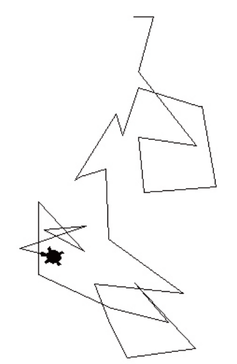

# 5강 연습 문제 — 반복문

[레포지토리 안내](../../README.ko.md) | [English](Exercises.md) | [한국어](Exercises.ko.md)

> **최종 수정일:** 2026-11-04

연습 문제 1\~4는 반복문으로 프로그램을 작성하는 문제이고, 연습 문제 5\~6은 한 반복문을 다른 반복문으로 바꾸어 쓰는 문제이다.

---

<br>

## 목차

- [연습 문제 1: 거북이의 무작위 이동](#연습-문제-1-거북이의-무작위-이동)
- [연습 문제 2: 팩토리얼 계산](#연습-문제-2-팩토리얼-계산)
- [연습 문제 3: 구구단 한 단 출력](#연습-문제-3-구구단-한-단-출력)
- [연습 문제 4: 구구단 전체 출력](#연습-문제-4-구구단-전체-출력)
- [연습 문제 5: for문을 while문으로 바꾸기](#연습-문제-5-for문을-while문으로-바꾸기)
- [연습 문제 6: while문을 for문으로 바꾸기](#연습-문제-6-while문을-for문으로-바꾸기)

---

<br>

## 연습 문제 1: 거북이의 무작위 이동

**문제:** 터틀 그래픽에서 거북이가 술에 취한 것처럼 무작위로 움직이게 하는 프로그램을 작성하라. 거북이의 모양은 `"turtle"`로 바꾸고, 다음 동작을 30번 반복한다.

- 1 이상 100 이하의 난수를 만들어 그 길이만큼 앞으로 이동한다.
- -180 이상 180 이하의 난수를 만들어 그 각도만큼 오른쪽으로 회전한다.

**실행 예시:** 난수를 사용하므로 실행할 때마다 경로가 달라진다. 다음은 실행 결과의 한 예이다.



*그림 1. 거북이가 무작위 길이와 각도로 30번 이동한 경로의 예*

**[풀이](Solutions.ko.md#연습-문제-1-거북이의-무작위-이동)**

---

<br>

## 연습 문제 2: 팩토리얼 계산

**문제:** `for`문을 이용하여 팩토리얼을 계산하는 프로그램을 작성하라. 팩토리얼 $n!$은 1부터 $n$까지의 정수를 모두 곱한 값이다. 즉 $n! = 1 \times 2 \times 3 \times \cdots \times (n-1) \times n$이다. 정수 $n$을 입력받아 $n!$을 출력한다. 입력 안내 문구는 `정수를 입력하시오: `이고, 결과는 `10!은 3628800이다.`처럼 출력한다.

**실행 예시:**

```text
정수를 입력하시오: 10
10!은 3628800이다.
```

**[풀이](Solutions.ko.md#연습-문제-2-팩토리얼-계산)**

---

<br>

## 연습 문제 3: 구구단 한 단 출력

**문제:** 구구단 가운데 원하는 단을 입력받아 반복문으로 출력하는 프로그램을 작성하라. 예를 들어 9를 입력하면 `9*1`, `9*2`, `9*3`, ..., `9*9`까지 9번 반복하며 출력한다. 입력 안내 문구는 `원하는 단은: `이다.

**실행 예시:**

```text
원하는 단은: 9
9*1=9
9*2=18
9*3=27
9*4=36
9*5=45
9*6=54
9*7=63
9*8=72
9*9=81
```

**[풀이](Solutions.ko.md#연습-문제-3-구구단-한-단-출력)**

---

<br>

## 연습 문제 4: 구구단 전체 출력

**문제:** 구구단의 1단부터 9단까지를 모두 출력하도록 연습 문제 3의 프로그램을 수정하라. 단은 입력받지 않으며, 한 단을 한 줄에 출력한다.

**실행 예시:**

```text
1*1=1 1*2=2 1*3=3 1*4=4 1*5=5 1*6=6 1*7=7 1*8=8 1*9=9
2*1=2 2*2=4 2*3=6 2*4=8 2*5=10 2*6=12 2*7=14 2*8=16 2*9=18
3*1=3 3*2=6 3*3=9 3*4=12 3*5=15 3*6=18 3*7=21 3*8=24 3*9=27
4*1=4 4*2=8 4*3=12 4*4=16 4*5=20 4*6=24 4*7=28 4*8=32 4*9=36
5*1=5 5*2=10 5*3=15 5*4=20 5*5=25 5*6=30 5*7=35 5*8=40 5*9=45
6*1=6 6*2=12 6*3=18 6*4=24 6*5=30 6*6=36 6*7=42 6*8=48 6*9=54
7*1=7 7*2=14 7*3=21 7*4=28 7*5=35 7*6=42 7*7=49 7*8=56 7*9=63
8*1=8 8*2=16 8*3=24 8*4=32 8*5=40 8*6=48 8*7=56 8*8=64 8*9=72
9*1=9 9*2=18 9*3=27 9*4=36 9*5=45 9*6=54 9*7=63 9*8=72 9*9=81
```

**[풀이](Solutions.ko.md#연습-문제-4-구구단-전체-출력)**

---

<br>

## 연습 문제 5: for문을 while문으로 바꾸기

**문제:** 다음 프로그램을 `while`문으로 바꾸라.

```python
sum=0
for i in range(1001):
    sum=sum+1
```

**[풀이](Solutions.ko.md#연습-문제-5-for문을-while문으로-바꾸기)**

---

<br>

## 연습 문제 6: while문을 for문으로 바꾸기

**문제:** 다음 프로그램을 `for`문으로 바꾸라.

```python
i=1
sum=0
while sum<10000:
   sum=sum+i
   i+=1
```

**[풀이](Solutions.ko.md#연습-문제-6-while문을-for문으로-바꾸기)**
