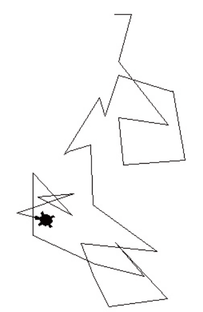

# Lecture 5 Exercises — Loops

[Repository Guide](../../README.md) | [English](Exercises.md) | [한국어](Exercises.ko.md)

> **Last Updated:** 2026-11-04

Exercises 1-4 ask for programs written with loops, and Exercises 5-6 ask for rewriting one kind of loop as the other.

---

<br>

## Table of Contents

- [Exercise 1: Random Movement of the Turtle](#exercise-1-random-movement-of-the-turtle)
- [Exercise 2: Computing a Factorial](#exercise-2-computing-a-factorial)
- [Exercise 3: Printing One Multiplication Table](#exercise-3-printing-one-multiplication-table)
- [Exercise 4: Printing the Entire Multiplication Table](#exercise-4-printing-the-entire-multiplication-table)
- [Exercise 5: Rewriting a for Statement as a while Statement](#exercise-5-rewriting-a-for-statement-as-a-while-statement)
- [Exercise 6: Rewriting a while Statement as a for Statement](#exercise-6-rewriting-a-while-statement-as-a-for-statement)

---

<br>

## Exercise 1: Random Movement of the Turtle

**Problem:** Write a program that makes the turtle in turtle graphics move randomly, as if it were drunk. Change the shape of the turtle to `"turtle"` and repeat the following actions 30 times.

- Generate a random number from 1 to 100 inclusive and move forward by that length.
- Generate a random number from -180 to 180 inclusive and turn right by that angle.

**Sample Run:** Because random numbers are used, the path differs on every run. The following is one example of the result.



*Figure 1. Example path of the turtle after 30 moves of random length and angle*

**[Solution](Solutions.md#exercise-1-random-movement-of-the-turtle)**

---

<br>

## Exercise 2: Computing a Factorial

**Problem:** Write a program that computes a factorial with the `for` statement. The factorial $n!$ is the product of all integers from 1 to $n$, that is, $n! = 1 \times 2 \times 3 \times \cdots \times (n-1) \times n$. Read an integer $n$ and print $n!$. The input prompt is `정수를 입력하시오: ` (Enter an integer:), and the result is printed in the form `10!은 3628800이다.` (10! is 3628800.).

**Sample Run:**

```text
정수를 입력하시오: 10
10!은 3628800이다.
```

**[Solution](Solutions.md#exercise-2-computing-a-factorial)**

---

<br>

## Exercise 3: Printing One Multiplication Table

**Problem:** Write a program that reads the desired table (dan) of the multiplication table and prints it with a loop. For example, entering 9 prints `9*1`, `9*2`, `9*3`, ..., `9*9`, repeating 9 times. The input prompt is `원하는 단은: ` (Desired table:).

**Sample Run:**

```text
원하는 단은: 9
9*1=9
9*2=18
9*3=27
9*4=36
9*5=45
9*6=54
9*7=63
9*8=72
9*9=81
```

**[Solution](Solutions.md#exercise-3-printing-one-multiplication-table)**

---

<br>

## Exercise 4: Printing the Entire Multiplication Table

**Problem:** Modify the program of Exercise 3 so that it prints all tables from 1 to 9. The table is not read from input, and each table is printed on one line.

**Sample Run:**

```text
1*1=1 1*2=2 1*3=3 1*4=4 1*5=5 1*6=6 1*7=7 1*8=8 1*9=9
2*1=2 2*2=4 2*3=6 2*4=8 2*5=10 2*6=12 2*7=14 2*8=16 2*9=18
3*1=3 3*2=6 3*3=9 3*4=12 3*5=15 3*6=18 3*7=21 3*8=24 3*9=27
4*1=4 4*2=8 4*3=12 4*4=16 4*5=20 4*6=24 4*7=28 4*8=32 4*9=36
5*1=5 5*2=10 5*3=15 5*4=20 5*5=25 5*6=30 5*7=35 5*8=40 5*9=45
6*1=6 6*2=12 6*3=18 6*4=24 6*5=30 6*6=36 6*7=42 6*8=48 6*9=54
7*1=7 7*2=14 7*3=21 7*4=28 7*5=35 7*6=42 7*7=49 7*8=56 7*9=63
8*1=8 8*2=16 8*3=24 8*4=32 8*5=40 8*6=48 8*7=56 8*8=64 8*9=72
9*1=9 9*2=18 9*3=27 9*4=36 9*5=45 9*6=54 9*7=63 9*8=72 9*9=81
```

**[Solution](Solutions.md#exercise-4-printing-the-entire-multiplication-table)**

---

<br>

## Exercise 5: Rewriting a for Statement as a while Statement

**Problem:** Rewrite the following program with the `while` statement.

```python
sum=0
for i in range(1001):
    sum=sum+1
```

**[Solution](Solutions.md#exercise-5-rewriting-a-for-statement-as-a-while-statement)**

---

<br>

## Exercise 6: Rewriting a while Statement as a for Statement

**Problem:** Rewrite the following program with the `for` statement.

```python
i=1
sum=0
while sum<10000:
   sum=sum+i
   i+=1
```

**[Solution](Solutions.md#exercise-6-rewriting-a-while-statement-as-a-for-statement)**
