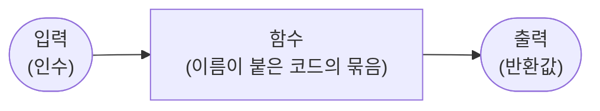
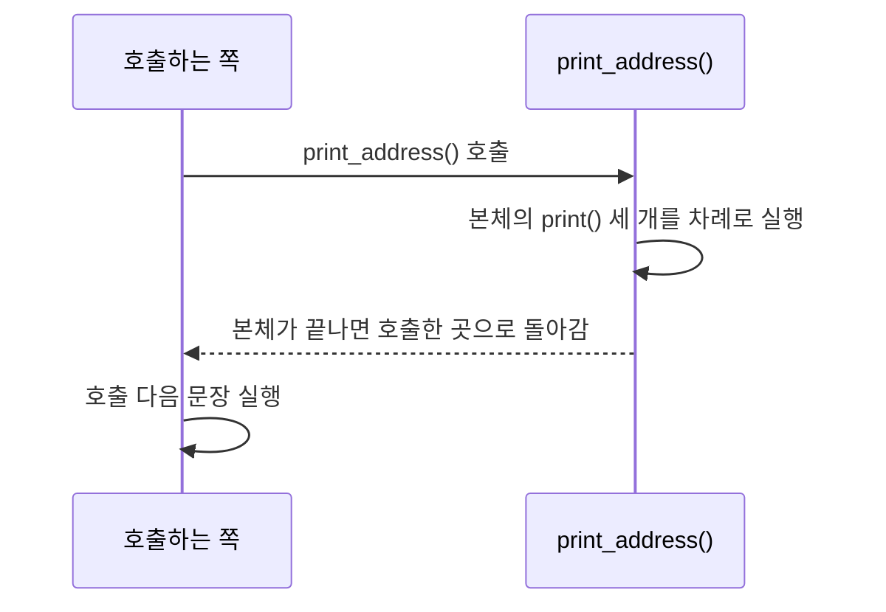
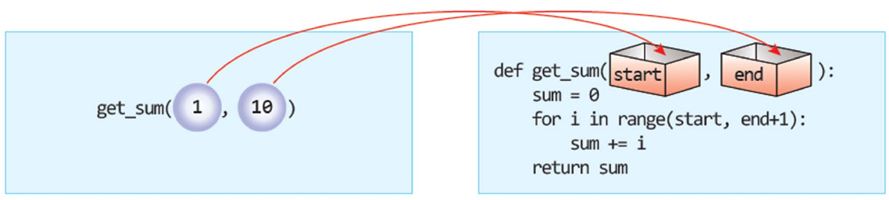
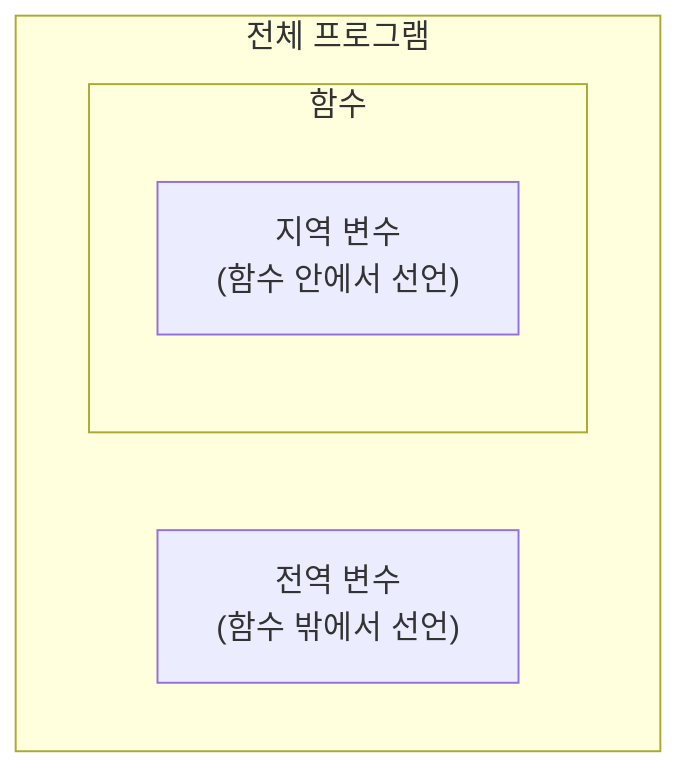
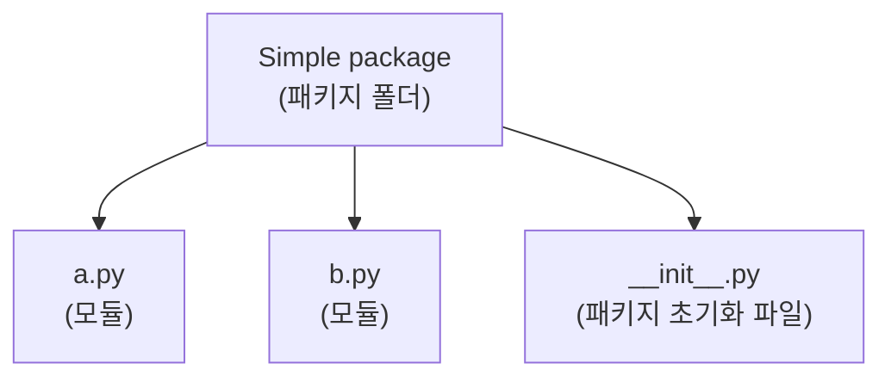

# 6강 — 함수

[레포지토리 안내](../../README.ko.md) | [English](Concepts_Lecture.md) | [한국어](Concepts_Lecture.ko.md)

> **최종 수정일:** 2026-11-04

> **학습 목표:**
> 1. 함수의 개념과 장점을 설명하고 `def`문으로 함수를 정의하고 호출할 수 있다
> 2. 매개변수와 인수를 구분하고 인수를 전달받아 값을 반환하는 함수를 작성할 수 있다
> 3. 지역 변수와 전역 변수의 유효 범위를 설명하고 `global`문이 필요한 경우를 판단할 수 있다
> 4. 디폴트 인수, 키워드 인수, 여러 개의 반환값을 사용하는 함수를 작성하고 호출할 수 있다
> 5. `lambda` 키워드로 무명 함수를 만들 수 있다
> 6. 모듈을 작성하고 `import`문으로 다른 파일의 함수를 불러 쓰며, 파이썬이 모듈을 찾는 방법을 설명할 수 있다

---

## 목차

- [1. 함수의 개념](#1-함수의-개념)
  - [1.1 함수란](#11-함수란)
  - [1.2 내장 함수와 함수 호출](#12-내장-함수와-함수-호출)
  - [1.3 함수를 쓰는 이유](#13-함수를-쓰는-이유)
- [2. 함수의 정의와 호출](#2-함수의-정의와-호출)
  - [2.1 def문의 구조](#21-def문의-구조)
  - [2.2 함수 호출과 실행 흐름](#22-함수-호출과-실행-흐름)
  - [2.3 정의하기 전에 호출하면 생기는 오류](#23-정의하기-전에-호출하면-생기는-오류)
  - [2.4 함수로 중복 줄이기](#24-함수로-중복-줄이기)
- [3. 매개변수와 인수](#3-매개변수와-인수)
  - [3.1 인수 전달하기](#31-인수-전달하기)
  - [3.2 여러 개의 인수](#32-여러-개의-인수)
- [4. 반환값](#4-반환값)
  - [4.1 return문](#41-return문)
  - [4.2 함수 작성의 예](#42-함수-작성의-예)
  - [4.3 여러 개의 값 반환하기](#43-여러-개의-값-반환하기)
- [5. 변수의 유효 범위](#5-변수의-유효-범위)
  - [5.1 지역 변수와 전역 변수](#51-지역-변수와-전역-변수)
  - [5.2 지역 변수의 범위](#52-지역-변수의-범위)
  - [5.3 함수 안에서 전역 변수 읽기](#53-함수-안에서-전역-변수-읽기)
  - [5.4 함수 안에서 전역 변수 변경하기](#54-함수-안에서-전역-변수-변경하기)
  - [5.5 전역 상수](#55-전역-상수)
- [6. 인수를 전달하는 여러 방법](#6-인수를-전달하는-여러-방법)
  - [6.1 디폴트 인수](#61-디폴트-인수)
  - [6.2 키워드 인수](#62-키워드-인수)
- [7. 무명 함수](#7-무명-함수)
- [8. 모듈](#8-모듈)
  - [8.1 모듈과 패키지](#81-모듈과-패키지)
  - [8.2 모듈의 작성과 사용](#82-모듈의-작성과-사용)
  - [8.3 import문이 모듈을 찾는 방법](#83-import문이-모듈을-찾는-방법)
  - [8.4 직접 실행할 때와 import될 때](#84-직접-실행할-때와-import될-때)
- [요약](#요약)
- [점검 문제](#점검-문제)
- [참고 문헌](#참고-문헌)

---

<br>

## 1. 함수의 개념

### 1.1 함수란

**함수(function)** 는 코드의 묶음에 이름을 붙인 것이다. 함수는 입력을 받아서 출력을 내보내는 상자로 생각할 수 있다. 상자 안에서 어떤 일이 일어나는지 몰라도, 무엇을 넣으면 무엇이 나오는지만 알면 함수를 사용할 수 있다.



*그림 1. 입력을 받아 출력을 내보내는 상자로 본 함수*

함수의 입력을 **인수(argument)**, 함수가 일을 마치고 돌려주는 출력을 **반환값(return value)** 이라고 한다. 입력이 없는 함수와 반환값이 없는 함수도 있다.

### 1.2 내장 함수와 함수 호출

지금까지 사용한 `print()`, `input()`, `abs()`는 모두 파이썬이 미리 만들어 둔 **내장 함수(built-in function)** 이다. 함수 안의 명령어들을 실행하려면 함수를 **호출(call)** 한다. 호출은 함수 이름 뒤에 괄호를 붙이고, 괄호 안에 인수를 넣어 작성한다. 다음은 파이썬 대화형 셸에서 절댓값 함수 `abs()`를 호출한 예이다.

```pycon
>>> value = abs(-100)
>>> value
100
```

`abs(-100)`이 실행되면 함수는 -100의 절댓값 100을 반환하고, 호출식 `abs(-100)` 자리는 그 반환값 100으로 바뀌어 `value`에 저장된다. 대화형 셸에서 변수 이름만 입력하면 그 값이 표시된다.

사용자가 `def`문으로 직접 만드는 함수를 **사용자 정의 함수(user-defined function)** 라고 한다. 2절부터는 사용자 정의 함수를 정의하고 사용하는 방법을 다룬다.

### 1.3 함수를 쓰는 이유

함수를 한 번만 정의하면 필요할 때마다 언제든지 함수를 불러서 일을 시킬 수 있다. 이 밖에도 함수는 다음과 같은 장점이 있다.

- **재사용:** 같은 코드를 여러 번 쓰지 않고 이름으로 불러 쓴다. 코드가 짧아지고 복사 과정의 실수가 줄어든다.
- **분해(decomposition):** 큰 문제를 작은 함수들로 나누어 하나씩 해결할 수 있다.
- **추상화(abstraction):** 함수를 쓰는 쪽은 함수가 무엇을 하는지만 알면 되고 내부의 구현은 몰라도 된다.
- **유지보수:** 동작을 바꿀 때 함수의 정의 한 곳만 고치면 그 함수를 호출하는 모든 곳에 반영된다.

---

<br>

## 2. 함수의 정의와 호출

### 2.1 def문의 구조

함수는 `def` 키워드로 정의한다. 전체적인 구조는 다음과 같다.

```python
def 함수이름(매개변수1, 매개변수2):
    문장1
    문장2
```

| 구성 요소 | 역할 |
|:-----|:-----|
| `def` | 함수를 정의하는 키워드이다 |
| 함수 이름 | 함수를 호출할 때 쓰는 이름이다. 변수 이름과 같은 식별자 규칙을 따른다 |
| 매개변수 | 외부로부터 작업에 필요한 데이터를 받는 변수이다. 없어도 되며, 그때는 빈 괄호 `()`를 쓴다 |
| 콜론(`:`) | 함수 정의의 머리가 끝나고 본체가 이어짐을 표시한다 |
| 함수의 본체 | 머리 다음 줄부터 들여쓰기한 문장들이며, 함수가 호출될 때 실행된다 |

*표 1. def문의 구성 요소*

함수 이름은 그 함수가 하는 일을 나타내도록 짓는다. 파이썬 스타일 지침 PEP 8은 함수 이름을 소문자로 쓰고 단어 사이를 밑줄로 잇는 방식(`print_address`, `calculate_area`)을 권장한다 [1].

### 2.2 함수 호출과 실행 흐름

다음 프로그램은 주소 세 줄을 출력하는 함수 `print_address()`를 정의하고 호출한다.

```python
def print_address():
    print("서울특별시 종로구 1번지")
    print("파이썬 빌딩 7층")
    print("홍길동")

print_address()
```

```text
서울특별시 종로구 1번지
파이썬 빌딩 7층
홍길동
```

- **함수 정의(1\~4행):** `def`문이 실행되면 파이썬은 함수를 만들어 `print_address`라는 이름에 연결할 뿐, 본체의 `print()`문들은 실행하지 않는다.
- **함수 호출(6행):** `print_address()`가 실행되면 실행 흐름이 함수의 본체로 옮겨 가 세 `print()`문을 차례로 실행한다. 본체가 끝나면 흐름은 호출한 곳으로 돌아와 그다음 문장을 이어서 실행한다.



*그림 2. 함수를 호출할 때의 실행 흐름*

정의한 함수는 원하는 만큼 여러 번 호출할 수 있다. 다음은 같은 함수를 세 번 호출한 예이다.

```python
def print_address():
    print("서울특별시 종로구 1번지")
    print("파이썬 빌딩 7층")
    print("홍길동")

print_address()
print_address()
print_address()
```

```text
서울특별시 종로구 1번지
파이썬 빌딩 7층
홍길동
서울특별시 종로구 1번지
파이썬 빌딩 7층
홍길동
서울특별시 종로구 1번지
파이썬 빌딩 7층
홍길동
```

### 2.3 정의하기 전에 호출하면 생기는 오류

파이썬 인터프리터는 프로그램을 위에서 아래로 한 문장씩 실행한다. 함수 정의를 만나면 함수를 만들기만 하고 함수 안의 문장들은 즉시 실행하지 않으며, 함수 정의가 아닌 문장들은 즉시 실행한다. 그래서 다음 프로그램은 오류를 낸다.

```python
print(power(10, 2))

def power(x, y):
    result = 1
    for i in range(y):
        result = result * x
    return result
```

```text
Traceback (most recent call last):
  File "power_first.py", line 1, in <module>
    print(power(10, 2))
          ^^^^^
NameError: name 'power' is not defined
```

1행을 실행하는 시점에는 3행의 `def`문이 아직 실행되지 않았으므로 `power`라는 이름이 존재하지 않는다. 오류 메시지 `NameError: name 'power' is not defined`가 이 사실을 알려 준다. 함수는 호출하기 전에 정의해야 한다.

> **참고:** 이 규칙은 함수가 **호출되는 시점**을 기준으로 한다. 함수 A의 본체에서 아래쪽에 정의된 함수 B를 호출해도, A를 실제로 호출하는 문장이 B의 정의보다 뒤에 있으면 오류가 나지 않는다. 본체는 호출될 때 실행되기 때문이다. 프로그램의 맨 끝에서 `main()` 함수를 호출하는 구성이 이 성질을 이용하며, [연습 문제 3](Exercises.ko.md#연습-문제-3-전역-상수를-이용한-원의-넓이와-둘레)에서 다룬다.

### 2.4 함수로 중복 줄이기

같은 계산과 출력을 반복하는 코드가 있으면 함수로 묶을 수 있다. 다음 프로그램은 50과 60의 합과 평균을 두 번 출력한다.

```python
print("합=", 50+60)
print("평균=", (50+60)/2)
print("합=", 50+60)
print("평균=", (50+60)/2)
```

반복되는 두 문장을 함수 `sumandavg()`의 본체로 옮기면 같은 출력을 함수 호출 두 번으로 얻는다.

```python
def sumandavg():
    print("합=", 50+60)
    print("평균=", (50+60)/2)

sumandavg()
sumandavg()
```

두 프로그램의 출력은 모두 다음과 같다.

```text
합= 110
평균= 55.0
합= 110
평균= 55.0
```

나눗셈 연산자 `/`의 결과는 항상 실수이므로 평균은 `55.0`으로 출력된다. 그런데 이 함수는 언제나 50과 60만 계산한다. 다른 수로 계산하려면 함수가 값을 전달받아야 한다(3절).

---

<br>

## 3. 매개변수와 인수

### 3.1 인수 전달하기

함수에 값(정보)을 전달할 수 있다. 함수를 호출할 때 괄호 안에 넣어 전달하는 값을 **인수(argument)** 라고 하며, **인자**라고도 부른다. 함수 정의의 괄호 안에 적어 전달된 값을 받는 변수를 **매개변수(parameter)** 라고 한다.

```python
def print_address(name):
    print("서울특별시 종로구 1번지")
    print("파이썬 빌딩 7층")
    print(name)

print_address("홍길동")
```

```text
서울특별시 종로구 1번지
파이썬 빌딩 7층
홍길동
```

`print_address("홍길동")`을 호출하면 인수 `"홍길동"`이 매개변수 `name`에 대입된 뒤 본체가 실행된다. 따라서 본체의 `print(name)`은 `홍길동`을 출력한다. 다른 이름을 인수로 주면 같은 함수로 다른 사람의 주소를 출력할 수 있다.

> **용어 정의:** **매개변수**는 함수 정의에 쓰는 변수 이름(`def print_address(name):`의 `name`)이고, **인수**는 호출할 때 실제로 넘기는 값(`print_address("홍길동")`의 `"홍길동"`)이다. 호출할 때마다 인수의 값이 매개변수에 대입된다.

2.4절의 `sumandavg()`에 매개변수 `a`, `b`를 두면 어떤 두 수의 합과 평균도 계산할 수 있다.

```python
def sumandavg(a, b):
    print("합=", a+b)
    print("평균=", (a+b)/2)

a=50
b=60
sumandavg(a, b)
sumandavg(70, 80)
```

```text
합= 110
평균= 55.0
합= 150
평균= 75.0
```

첫 번째 호출은 변수 `a`, `b`의 값 50과 60을, 두 번째 호출은 값 70과 80을 직접 인수로 전달한다. 인수로는 변수, 값, 계산식을 모두 쓸 수 있다.

### 3.2 여러 개의 인수

함수는 매개변수를 여러 개 가질 수 있다. 다음 함수는 `start`부터 `end`까지의 정수의 합을 계산하여 반환한다.

```python
def get_sum(start, end):
    sum = 0
    for i in range(start, end+1):
        sum += i
    return sum

print(get_sum(1, 10))
```

```text
55
```



*그림 3. 인수 1과 10이 순서대로 매개변수 start와 end에 전달되는 모습*

그림 3처럼 인수는 적힌 순서대로 매개변수에 대응한다. 첫 번째 인수 1은 첫 번째 매개변수 `start`에, 두 번째 인수 10은 두 번째 매개변수 `end`에 들어간다. 이렇게 위치로 대응하는 인수를 **위치 인수(positional argument)** 라고 한다. `sum += i`는 `sum = sum + i`를 줄여 쓴 복합 대입 연산이다(2강). 본체의 반복은 5강의 누적 패턴과 같다.

위치 인수의 개수가 매개변수의 개수와 다르면 오류가 발생한다. 예를 들어 `get_sum(1)`처럼 인수를 하나만 주면 `TypeError: get_sum() missing 1 required positional argument: 'end'`가 발생한다.

> **참고:** 함수 안의 `sum`은 내장 함수 `sum()`과 이름이 같다. 이 `sum`은 함수 안에서만 쓰이는 지역 변수(5절)이므로 함수 밖의 내장 함수 `sum()`에는 영향을 주지 않지만, 함수 안에서는 내장 함수를 가린다. 내장 함수와 겹치지 않는 `total` 같은 이름을 쓰는 편이 안전하다(5강 6.3절).

---

<br>

## 4. 반환값

### 4.1 return문

함수는 값을 반환할 수 있다. **`return`문**은 함수에서 실행한 결과를 호출한 쪽으로 넘겨준다. `return`문이 실행되면 함수는 즉시 끝나며, 호출식은 반환된 값으로 바뀐다.

```python
def calculate_area(radius):
    area = 3.14 * radius**2
    return area

c_area = calculate_area(5.0)
print(c_area)
```

```text
78.5
```

`calculate_area(5.0)`이 호출되면 `radius`에 5.0이 대입되고, `area`에 $3.14 \times 5.0^2 = 3.14 \times 25.0 = 78.5$가 저장된 뒤 `return area`가 78.5를 반환한다. 호출식 자리가 78.5로 바뀌므로 `c_area`에는 78.5가 저장된다. `**`는 거듭제곱 연산자이다.

반환값은 다른 계산의 일부로 바로 쓸 수 있다. 다음 함수 `avg()`는 두 수의 평균을 반환하고, 호출한 쪽은 그 값을 `print()`에 넘긴다.

```python
def avg(a, b):
    return (a+b)/2

a=50
b=60
print("합=", a + b)
print("평균=", avg(a, b))
```

```text
합= 110
평균= 55.0
```

`return`문이 없는 함수나 값 없이 `return`만 쓴 함수는 특별한 값 `None`을 반환한다 [2]. `None`은 값이 없음을 나타내는 파이썬의 값이다.

```python
def say_hello():
    print("안녕하세요")

result = say_hello()
print(result)
```

```text
안녕하세요
None
```

> **주의:** 함수 안에서 `print()`로 출력하는 것과 `return`으로 반환하는 것은 다르다. `print()`는 값을 화면에 보여 줄 뿐 호출한 쪽에 넘기지 않으므로, 그 값을 변수에 저장하거나 다른 계산에 쓸 수 없다. 위 예에서 `result`에 `None`이 저장된 것이 그 예이다. 결과를 다른 곳에서 써야 하는 함수는 `return`으로 값을 반환해야 한다.

### 4.2 함수 작성의 예

함수를 작성할 때는 먼저 함수의 이름과 입력(매개변수), 출력(반환값)만 결정한다. 본체는 그다음에 작성한다. 다음 세 함수는 이 순서로 설계한 예이다.

| 함수 | 입력 | 출력 | 하는 일 |
|:-----|:-----|:-----|:-----|
| `square(n)` | 정수 `n` | `n`의 제곱 | 정수를 입력받아 제곱한 값을 반환한다 |
| `get_max(x, y)` | 두 정수 `x`, `y` | 둘 중 큰 수 | 두 수 중에서 더 큰 수를 찾아서 반환한다 |
| `power(x, y)` | 정수 `x`, 지수 `y` | $x^y$ | 정수의 거듭제곱값을 계산하여 반환한다 |

*표 2. 이름, 입력, 출력으로 설계한 세 함수*

**제곱 함수:** 정수를 입력받아서 제곱한 값을 반환한다.

```python
def square(n):
    return(n*n)

print(square(10))
```

```text
100
```

`return(n*n)`의 괄호는 식을 묶는 괄호일 뿐이며, `return n*n`과 같다. `return`은 함수가 아니라 문장이므로 괄호 없이 쓰는 것이 일반적이다.

**최댓값 함수:** 두 개의 정수가 주어지면 두 수 중에서 더 큰 수를 찾아서 반환한다.

```python
def get_max(x, y):
    if( x > y ):
        return x
    else:
        return y

print(get_max(10, 20))
```

```text
20
```

`get_max(10, 20)`에서는 `x > y`가 거짓이므로 `else` 쪽의 `return y`가 실행되어 20을 반환한다. 이 함수처럼 `return`문이 여러 개일 수 있으며, 실행되는 첫 번째 `return`에서 함수가 끝난다. 두 수가 같으면 `y`를 반환하는데, 이때 `x`와 `y`의 값이 같으므로 결과는 올바르다.

**거듭제곱 함수:** 파이썬에는 거듭제곱 연산자 `**`가 있지만, 반복문으로 $x^y$를 직접 계산할 수도 있다.

```python
def power(x, y):
    result = 1
    for i in range(y):
        result = result * x
    return result

print(power(10, 2))
```

```text
100
```

| 반복 회차 | `i` | 본체 실행 후 `result` |
|:-----:|:-----:|:-----:|
| 시작 전 | 없음 | 1 |
| 1 | 0 | $1 \times 10 = 10$ |
| 2 | 1 | $10 \times 10 = 100$ |

*표 3. power(10, 2)의 실행 추적*

`range(y)`는 본체를 정확히 `y`번 실행하므로 `result`에 `x`가 `y`번 곱해진다. `y`가 0이면 본체가 실행되지 않아 $x^0 = 1$을 반환한다. 이 함수는 음이 아닌 정수 지수만 처리하며, 음수 지수를 주면 `range(y)`가 빈 범위가 되어 1을 반환하므로 올바르지 않다.

### 4.3 여러 개의 값 반환하기

파이썬의 함수는 2개 이상의 값을 반환할 수 있다. `return` 뒤에 값을 쉼표로 구분하여 쓰고, 호출한 쪽에서는 같은 개수의 변수로 받는다.

```python
def sumandavg(a, b):
    sum = a+b
    avg = (a+b)/2
    return sum, avg

a1=50
b1=60
sum1, avg1 = sumandavg(a1, b1)
print("합=", sum1)
print("평균=", avg1)

a2=70
b2=80
sum2, avg2 = sumandavg(a2, b2)
print("합=", sum2)
print("평균=", avg2)
```

```text
합= 110
평균= 55.0
합= 150
평균= 75.0
```

실제로 함수가 반환하는 것은 여러 값을 묶은 **튜플(tuple)** 하나이다. 튜플은 리스트처럼 여러 값을 순서대로 담는 자료형이며, 7강에서 자세히 다룬다.

```python
def sub():
    return 1, 2, 3

a, b, c = sub()
print(a, b, c)

t = sub()
print(t, type(t))
```

```text
1 2 3
(1, 2, 3) <class 'tuple'>
```

```text
return 1, 2, 3          →  튜플 (1, 2, 3) 하나를 반환한다     (묶기, packing)

a, b, c = (1, 2, 3)     →  a = 1,  b = 2,  c = 3              (풀기, unpacking)
```

*그림 4. 여러 값의 반환에서 일어나는 튜플의 묶기와 풀기*

`return 1, 2, 3`은 세 값을 튜플 `(1, 2, 3)`으로 묶어 반환하고, `a, b, c = sub()`는 그 튜플의 요소를 왼쪽의 변수들에 순서대로 나누어 대입한다. 튜플을 하나의 변수 `t`로 받으면 튜플 그대로 저장된다. 왼쪽 변수의 개수가 튜플의 요소 수와 다르면, 예를 들어 `a, b = sub()`이면 `ValueError: too many values to unpack (expected 2)`가 발생한다.

> **참고:** C 언어의 함수는 값을 하나만 반환할 수 있어서, 여러 결과를 돌려주려면 포인터 매개변수나 구조체를 써야 한다. 파이썬은 여러 값을 튜플 하나로 묶어 반환하므로 이런 장치 없이 여러 결과를 돌려줄 수 있다.

---

<br>

## 5. 변수의 유효 범위

### 5.1 지역 변수와 전역 변수

변수가 사용될 수 있는 프로그램의 영역을 그 변수의 **유효 범위(scope)** 라고 한다. 변수는 선언되는 위치에 따라 두 종류로 나뉜다. 파이썬에서는 변수에 처음 값을 대입하는 것이 변수의 선언이다.

- **지역 변수(local variable):** 함수 안에서 선언되는 변수이다. 매개변수도 지역 변수이다. 함수가 호출될 때 만들어지고 함수가 끝나면 사라지며, 그 함수 안에서만 사용할 수 있다.
- **전역 변수(global variable):** 함수 외부에서 선언되는 변수이다. 프로그램이 끝날 때까지 유지되며, 프로그램의 어디서나 사용할 수 있다.



*그림 5. 전체 프로그램 안의 전역 변수와 함수 안의 지역 변수*

### 5.2 지역 변수의 범위

지역 변수는 함수 안에서만 사용이 가능하다. 다음 코드에서 지역 변수는 매개변수 `radius`와 함수 안에서 값을 대입한 `result`이다.

```python
def calculate_area(radius):
    result = 3.14 * radius**2
    return result

r = float(input("원의 반지름: "))
area = calculate_area(r)
print(result)
```

```text
원의 반지름: 10
Traceback (most recent call last):
  File "area.py", line 7, in <module>
    print(result)
          ^^^^^^
NameError: name 'result' is not defined
```

`result`는 `calculate_area()`의 지역 변수이므로 함수가 끝나면 사라진다. 그래서 함수 밖의 7행에서 `result`를 사용하면 `NameError`가 발생한다. 함수 안에서 계산한 값은 반환값으로 받아 써야 한다. 이 프로그램에서는 반환값을 받은 전역 변수 `area`를 `print(area)`로 출력하면 `314.0`이 출력된다.

### 5.3 함수 안에서 전역 변수 읽기

전역 변수는 어디서나 사용할 수 있다. 다음 코드에서 `r`은 함수 밖에서 값을 대입한 전역 변수이며, 함수 `calculate_area()`는 매개변수 없이 전역 변수 `r`의 값을 읽어서 계산한다.

```python
def calculate_area():
    result = 3.14 * r**2
    return result

r = float(input("원의 반지름: "))
area = calculate_area()
print(area)
```

```text
원의 반지름: 10
314.0
```

함수 안에서 이름 `r`을 찾을 때 지역 변수 가운데 `r`이 없으므로 파이썬은 전역 변수 `r`을 사용한다. 함수가 호출되는 5\~6행 시점에는 이미 `r`에 10.0이 저장되어 있다.

> **주의:** 전역 변수에 의존하는 함수는 그 전역 변수가 있는 프로그램에서만 동작하고, 어디서 값이 바뀌는지 추적하기 어렵다. 함수에 필요한 값은 가능하면 매개변수로 전달받는 것이 좋다.

### 5.4 함수 안에서 전역 변수 변경하기

함수 안에서 전역 변수에 계산값을 저장하려고 다음과 같이 작성하면 기대와 다른 결과가 나온다.

```python
def calculate_area(radius):
    area = 3.14 * radius**2   # 전역 변수 area에 계산값을 저장하려고 했다
    return

area = 0
r = float(input("원의 반지름: "))
calculate_area(r)
print(area)
```

```text
원의 반지름: 10
0
```

0이 출력되는 이유는 함수 안의 대입문 `area = 3.14 * radius**2`가 전역 변수 `area`를 바꾸는 것이 아니라, 함수 안에 **새로운 지역 변수 `area`** 를 만들기 때문이다. 파이썬에서 함수 안에서 값을 대입한 이름은 그 함수의 지역 변수가 된다. 지역 변수 `area`는 함수가 끝나면 사라지고, 전역 변수 `area`는 처음 값 0을 그대로 유지한다.

함수 안에서 전역 변수에 값을 저장하려면 **`global`문**으로 그 이름이 전역 변수임을 알려야 한다.

```python
def calculate_area(radius):
    global area
    area = 3.14 * radius**2
    return

area = 0
r = float(input("원의 반지름: "))
calculate_area(r)
print(area)
```

```text
원의 반지름: 10
314.0
```

`global area`가 있으면 함수 안의 `area`는 전역 변수 `area`를 가리키므로, 대입한 값 314.0이 함수가 끝난 뒤에도 남는다.

같은 이름이라도 함수 안의 변수와 함수 밖의 변수는 별개이다. 다음 예제에서 함수 안의 두 변수 `a`, `b`와 함수 밖의 두 변수 `a`, `b`는 서로 다른 변수이다.

```python
def avg():
    a=0
    b=0
    return (a+b)/2

a=80
b=60
print("평균=", avg())
print("합=", a + b)
```

```text
평균= 0.0
합= 140
```

`avg()`는 자신의 지역 변수 `a`, `b`(모두 0)로 평균 0.0을 계산하고, 함수 밖의 `a + b`는 전역 변수 80과 60으로 140을 계산한다.

함수를 호출할 때 다음과 같이 인수로 전달하는 경우에도, 함수 안에서의 `a`, `b`에 대한 연산 결과는 함수 밖의 `a`, `b`에 영향을 주지 못한다.

```python
def avg(a, b):
    a= a + 10
    b= b + 10
    return (a+b)/2

a=50
b=60
print("평균=", avg(a, b))
print("합=", a + b)
```

```text
평균= 65.0
합= 110
```

호출할 때 매개변수 `a`, `b`에는 전역 변수 `a`, `b`의 값 50과 60이 대입된다. 함수 안에서 매개변수에 10씩 더해 60과 70으로 바꾸고 평균 $(60 + 70) / 2 = 65.0$을 반환하지만, 바뀐 것은 지역 변수인 매개변수뿐이다. 함수 밖의 `a`, `b`는 여전히 50과 60이므로 합은 110이다.

두 번째 예제에서도 함수 안에서의 연산 결과 값은 함수 밖에 영향을 주지 못한다.

```python
def sumandavg(a, b):
    sum = a+b
    avg = (a+b)/2

sum =0
avg =0
a =50
b =60
sumandavg(a, b)
print("합=", sum)
print("평균=", avg)
```

```text
합= 0
평균= 0
```

함수 안의 `sum`과 `avg`는 값을 대입했으므로 지역 변수이다. 함수가 계산한 110과 55.0은 함수가 끝날 때 사라지고, 전역 변수 `sum`과 `avg`는 0으로 남는다. 변수 앞에 `global` 키워드를 붙이면 결과가 함수 밖에 반영된다. 여러 이름은 쉼표로 구분하여 한 번에 선언할 수 있다.

```python
def sumandavg(a, b):
    global sum, avg
    sum = a+b
    avg = (a+b)/2

sum =0
avg =0
a =50
b =60
sumandavg(a, b)
print("합=", sum)
print("평균=", avg)
```

```text
합= 110
평균= 55.0
```

> **주의:** 함수 안에서 어떤 이름에 값을 대입하는 문장이 **어디에든** 있으면, 그 이름은 함수 전체에서 지역 변수로 취급된다 [3]. 그래서 다음 함수는 대입문보다 앞에 있는 `print(x)`에서 전역 변수 `x`를 읽지 못하고 오류를 낸다.

```python
x = 10

def show():
    print(x)
    x = 20

show()
```

```text
Traceback (most recent call last):
  File "unbound.py", line 7, in <module>
    show()
    ~~~~^^
  File "unbound.py", line 4, in show
    print(x)
          ^
UnboundLocalError: cannot access local variable 'x' where it is not associated with a value
```

> **[프로그래밍언어]** 파이썬은 이름을 찾을 때 지역(Local), 바깥 함수(Enclosing), 전역(Global), 내장(Built-in) 범위의 순서로 찾으며, 이를 머리글자를 따서 LEGB 규칙이라고 부른다 [3]. 어떤 이름이 어느 범위에 속하는지는 실행 중이 아니라 프로그램의 텍스트 구조로 정해지며(정적 유효 범위), 이것이 위의 `UnboundLocalError`가 생기는 이유이다. 또 파이썬은 인수를 전달할 때 값을 복사하지 않고 같은 객체를 가리키는 참조를 매개변수에 대입하는데, 매개변수에 새 값을 대입하는 것은 지역 이름을 다른 객체에 다시 연결하는 일일 뿐이므로 호출한 쪽의 변수는 바뀌지 않는다. 이런 유효 범위와 바인딩, 인수 전달 방식의 일반 원리는 프로그래밍언어에서 다룬다.

전역 변수를 함수 안에서 바꾸는 방식은 프로그램의 여러 곳이 같은 변수를 바꿀 수 있게 하므로 오류를 찾기 어렵게 만든다. 결과를 함수 밖으로 전달할 때는 4절의 반환값을 쓰는 것이 바람직하다.

### 5.5 전역 상수

**상수(constant)** 는 프로그램이 실행되는 동안 값이 바뀌지 않는 데이터이다. 파이썬에는 상수를 만드는 별도의 키워드가 없으므로, 전역 변수를 상수로 쓰되 이름을 모두 대문자로 짓고 단어 사이를 밑줄로 잇는 관례(`PI`, `MAX_SIZE`)로 상수임을 나타낸다 [1]. 함수 안에서 전역 상수의 값을 읽기만 하므로 `global`문이 필요 없다.

```python
PI = 3.14159265358979      # 전역 상수

def circle_area(radius):
    return PI * radius * radius

print(circle_area(1))
print(circle_area(10))
```

```text
3.14159265358979
314.159265358979
```

원주율 같은 값을 한 곳에 상수로 정의해 두면, 값을 바꾸어야 할 때 정의 한 곳만 고치면 되고 숫자 대신 의미 있는 이름이 코드에 드러난다. 다만 대문자 이름은 관례일 뿐이어서 파이썬이 값의 변경을 막지는 않는다. 전역 상수로 원의 넓이와 둘레를 계산하는 프로그램은 [연습 문제 3](Exercises.ko.md#연습-문제-3-전역-상수를-이용한-원의-넓이와-둘레)에서 다룬다.

---

<br>

## 6. 인수를 전달하는 여러 방법

### 6.1 디폴트 인수

파이썬에서는 함수의 매개변수가 기본값을 가질 수 있다. 이것을 **디폴트 인수(default argument)** 라고 한다. 호출할 때 그 매개변수에 대응하는 인수를 생략하면 기본값이 사용된다.

```python
def greet(name, msg="별일없죠?"):
    print("안녕 ", name + ', ' + msg)

greet("영희")
greet("철수", "잘 지내요?")
```

```text
안녕  영희, 별일없죠?
안녕  철수, 잘 지내요?
```

`greet("영희")`는 `msg`에 대응하는 인수가 없으므로 기본값 `"별일없죠?"`가 사용되고, `greet("철수", "잘 지내요?")`는 기본값 대신 전달한 값을 사용한다. `name + ', ' + msg`는 문자열 연결(3강)로 `"영희, 별일없죠?"`를 만든다. 출력에서 `안녕` 뒤에 공백이 두 칸인 것은 문자열 `"안녕 "` 끝의 공백 하나와 `print()`가 두 값 사이에 넣는 공백 하나가 합쳐졌기 때문이다.

> **주의:** 기본값이 있는 매개변수는 기본값이 없는 매개변수보다 뒤에 와야 한다. `def greet(msg="hi", name):`처럼 쓰면 `SyntaxError: parameter without a default follows parameter with a default` 오류가 발생한다.

### 6.2 키워드 인수

**키워드 인수(keyword argument)** 는 인수의 이름을 명시적으로 지정해서 전달하는 방법이다. `매개변수이름=값` 형태로 쓰면 순서와 관계없이 이름이 같은 매개변수에 값이 전달된다 [2].

```python
def calc(x, y, z):
    return x+y+z

print(calc(y=20, x=10, z=30))
print(calc(10, z=30, y=20))
```

```text
60
60
```

첫 번째 호출은 세 인수를 모두 이름으로 지정했으므로 순서를 바꾸어 써도 `x = 10`, `y = 20`, `z = 30`이 된다. 두 번째 호출처럼 위치 인수와 키워드 인수를 섞을 수도 있는데, 이때는 위치 인수를 먼저 써야 한다. 위치 인수 10은 첫 번째 매개변수 `x`에 대응한다.

| 방식 | 호출의 예 | 값이 대응하는 기준 | 규칙 |
|:-----|:-----|:-----|:-----|
| 위치 인수 | `calc(10, 20, 30)` | 인수의 순서 | 매개변수와 개수가 같아야 한다 |
| 키워드 인수 | `calc(y=20, x=10, z=30)` | 매개변수의 이름 | 순서와 관계없지만 위치 인수보다 뒤에 쓴다 |
| 디폴트 인수 | `greet("영희")` | 생략된 매개변수는 기본값 | 기본값이 있는 매개변수는 정의에서 뒤쪽에 둔다 |

*표 4. 인수를 전달하는 세 가지 방식*

키워드 인수를 잘못 쓰면 다음과 같은 오류가 발생한다.

- **키워드 인수 뒤의 위치 인수:** `calc(x=10, 20, 30)`은 `SyntaxError: positional argument follows keyword argument`이다.
- **같은 매개변수에 값을 두 번 전달:** `calc(10, x=20, z=30)`은 위치 인수 10이 이미 `x`에 대응했는데 `x=20`이 또 전달되므로 `TypeError: calc() got multiple values for argument 'x'`이다.

키워드 인수는 매개변수가 많은 함수에서 각 값의 의미를 호출문에 드러내 주므로 읽기 쉬운 코드를 만든다.

---

<br>

## 7. 무명 함수

**무명 함수(anonymous function)** 는 이름은 없고 본체만 있는 함수이다. 파이썬에서 무명 함수는 `lambda` 키워드로 만들어지며, **람다 함수(lambda function)** 라고도 부른다. 전체적인 구조는 다음과 같다.

```python
lambda 인수1, 인수2: 수식
```

- **인수:** `lambda` 뒤에 쉼표로 구분하여 쓰며, 함수의 매개변수에 해당한다.
- **수식:** 콜론 뒤의 식 하나가 함수의 본체이다. 이 식의 값이 자동으로 반환되므로 `return`을 쓰지 않는다. 본체에는 식 하나만 쓸 수 있고, `if`문이나 `for`문 같은 문장은 쓸 수 없다.

```python
sum = lambda x, y: x+y

print( "정수의 합 : ", sum( 10, 20 ))
print( "정수의 합 : ", sum( 20, 20 ))
```

```text
정수의 합 :  30
정수의 합 :  40
```

`lambda x, y: x+y`는 두 인수의 합을 반환하는 함수를 만들고, 그 함수를 변수 `sum`에 대입한다. 따라서 `sum(10, 20)`은 30을 반환한다. 이 람다 함수는 다음 `def`문과 같은 일을 한다. 출력에서 콜론 뒤에 공백이 두 칸인 것은 문자열 끝의 공백과 `print()`가 넣는 공백이 합쳐졌기 때문이다.

```python
def sum(x, y):
    return x+y
```

무명 함수는 짧은 함수를 한 번만 쓰고 버릴 때, 특히 다른 함수에 함수를 인수로 넘길 때 유용하다.

```python
square = lambda n: n * n
print(square(7))
print((lambda x, y: x * y)(3, 4))
print(sorted([-5, 2, -1, 4], key=lambda v: abs(v)))
```

```text
49
12
[-1, 2, 4, -5]
```

두 번째 줄은 람다 함수를 만들자마자 인수 3, 4로 호출한다. 세 번째 줄의 내장 함수 `sorted()`는 리스트를 정렬한 새 리스트를 반환하는데, `key`로 받은 함수의 결과를 기준으로 정렬한다. 여기서는 절댓값을 기준으로 정렬하므로 $\vert -1 \vert = 1$, $\vert 2 \vert = 2$, $\vert 4 \vert = 4$, $\vert -5 \vert = 5$의 순서가 된다.

> **주의:** PEP 8은 람다 함수를 변수에 대입하여 이름을 붙이기보다 `def`문을 쓰도록 권장한다 [1]. 이름이 필요한 함수라면 `def`가 더 읽기 쉽고 오류 메시지에도 함수 이름이 나타나기 때문이다. 또 위 예처럼 변수 이름을 `sum`으로 지으면 내장 함수 `sum()`을 가리게 된다.

---

<br>

## 8. 모듈

### 8.1 모듈과 패키지

함수나 변수들을 모아 놓은 파일을 **모듈(module)** 이라고 한다. 파이썬 코드가 들어 있는 `.py` 파일 하나가 하나의 모듈이며, 파일 이름에서 `.py`를 뺀 것이 모듈 이름이다. 지금까지 `import turtle`, `import random`으로 불러 쓴 `turtle`과 `random`도 파이썬이 제공하는 표준 모듈이다. 여러 모듈을 한 폴더에 모은 것을 **패키지(package)** 라고 한다.



*그림 6. 모듈 a.py, b.py와 초기화 파일 __init__.py로 이루어진 패키지*

`__init__.py`는 그 폴더가 패키지임을 나타내고, 패키지를 처음 불러올 때 실행할 초기화 코드를 담는 파일이다. 모듈로 프로그램을 나누면 관련된 함수를 한 파일에 모아 관리할 수 있고, 한 번 작성한 함수를 여러 프로그램에서 다시 쓸 수 있다.

### 8.2 모듈의 작성과 사용

모듈을 만드는 방법은 일반 파이썬 파일을 만드는 것과 같다. 다음은 두 수의 합을 출력하는 함수 `add()`를 담은 모듈 파일 `h.py`이다.

```python
# 모듈
def add(a,b):
    print (a+b)
```

모듈의 함수를 쓰려면 `import`문으로 모듈을 불러온다. 다음은 `h.py`가 있는 폴더에서 대화형 셸을 실행하여 모듈을 사용한 예이다.

```pycon
>>> import h
>>> h.add(10,20)
30
>>> from h import *
>>> add(10,20)
30
```

- **`import h`:** 모듈 `h`를 불러와 이름 `h`에 연결한다. 모듈 안의 함수는 `모듈이름.함수이름` 형태(`h.add`)로 사용한다.
- **`from h import *`:** 모듈 `h`의 이름들(밑줄로 시작하는 이름 제외)을 현재 프로그램으로 모두 가져온다. 그 뒤로는 모듈 이름 없이 `add()`처럼 바로 쓸 수 있다.

`h.add(10,20)`의 30은 함수 안의 `print()`가 출력한 것이다. `add()`는 반환값이 없어 `None`을 반환하며, 대화형 셸은 결과가 `None`이면 아무것도 표시하지 않는다.

같은 모듈을 프로그램 파일에서 쓸 때는 두 파일을 같은 폴더에 둔다.

```text
project/
├── h.py        모듈: add() 함수를 정의한다
└── main.py     프로그램: h 모듈을 import하여 사용한다
```

*그림 7. 모듈과 그 모듈을 사용하는 프로그램의 폴더 배치*

`main.py`의 내용은 다음과 같다.

```python
import h

h.add(10, 20)
```

이 폴더에서 `python main.py`로 실행하면 다음이 출력된다.

```text
30
```

`import`문의 형태는 다음과 같이 정리할 수 있다.

| 형태 | 사용 방법 | 특징 |
|:-----|:-----|:-----|
| `import h` | `h.add(10, 20)` | 이름의 출처가 분명하고 이름이 충돌하지 않는다 |
| `import h as m` | `m.add(10, 20)` | 긴 모듈 이름에 짧은 별명을 붙인다 |
| `from h import add` | `add(10, 20)` | 필요한 이름만 가져와 모듈 이름 없이 쓴다 |
| `from h import *` | `add(10, 20)` | 모든 이름을 가져오므로 현재 프로그램의 같은 이름을 덮어쓸 수 있다 |

*표 5. import문의 네 가지 형태*

> **주의:** `from h import *`는 어떤 이름이 들어오는지 코드에 드러나지 않고, 현재 프로그램에 같은 이름의 변수나 함수가 있으면 조용히 덮어쓴다. 짧은 시험 코드가 아니라면 `import h`나 `from h import add`처럼 가져올 이름을 분명히 하는 것이 좋다.

### 8.3 import문이 모듈을 찾는 방법

`import h`가 실행되면 파이썬은 다음 순서로 일을 한다 [4].

1. **이미 불러온 모듈인지 확인한다.** 같은 프로그램에서 이미 불러온 모듈이면 그 모듈을 다시 사용하고, 아래 단계를 건너뛴다.
2. **모듈 검색 경로에서 `h.py`를 찾는다.** 검색 경로는 `sys.path`라는 목록에 들어 있으며, 실행한 프로그램 파일이 있는 폴더(대화형 셸이면 현재 폴더), 환경 변수 `PYTHONPATH`에 지정한 폴더, 표준 라이브러리와 설치한 외부 패키지가 있는 폴더의 순서로 찾는다.
3. **모듈을 실행한다.** 찾은 파일을 바이트코드로 컴파일하고 모듈의 맨 위 수준 코드를 위에서부터 한 번 실행한다. `def`문도 이때 실행되어 함수들이 만들어진다. 컴파일한 결과는 `__pycache__` 폴더에 `h.cpython-313.pyc`처럼 파이썬 버전이 붙은 이름으로 저장되어, 다음 실행에서 원본이 바뀌지 않았으면 컴파일을 생략한다.
4. **이름을 연결한다.** 만들어진 모듈 객체를 현재 프로그램의 이름 `h`에 연결한다.

그림 7의 배치에서 `python main.py`를 실행하면 검색 경로의 첫 번째 항목이 `main.py`가 있는 `project/` 폴더이므로 같은 폴더의 `h.py`가 발견된다. `h.py`를 다른 폴더에 두면 `ModuleNotFoundError: No module named 'h'` 오류가 발생한다.

> **주의:** 내 파일의 이름을 `turtle.py`나 `random.py`처럼 표준 모듈과 같게 지으면, 검색 경로에서 프로그램이 있는 폴더가 표준 라이브러리보다 먼저 검색되므로 `import turtle`이 표준 모듈 대신 내 파일을 불러온다. 그러면 `AttributeError: module 'turtle' has no attribute 'Turtle'`처럼 원인을 알기 어려운 오류가 생긴다. 파이썬 3.13은 이 경우 오류 메시지 끝에 표준 모듈과 이름이 같은 파일의 이름을 바꾸라는 안내를 덧붙인다. 모듈 파일에는 표준 모듈과 겹치지 않는 이름을 붙인다.

### 8.4 직접 실행할 때와 import될 때

모듈의 맨 위 수준 코드는 `import`될 때 실행된다. 모듈 파일 안에 함수를 시험하는 코드를 넣어 두고 싶을 때, 그 코드가 `import`할 때마다 실행되면 곤란하다. 이때 모듈마다 자동으로 만들어지는 변수 `__name__`을 이용한다. `__name__`은 파일을 직접 실행하면 `"__main__"`이고, 다른 파일이 `import`하면 모듈 이름이 된다 [4].

`calc_mod.py`:

```python
print("calc_mod 모듈의 맨 위 코드가 실행된다")

def add(a, b):
    return a + b

def mul(a, b):
    return a * b

if __name__ == "__main__":
    print("직접 실행할 때만 수행하는 시험:", add(2, 3))
```

`use_calc.py`:

```python
import calc_mod
import calc_mod          # 두 번째 import는 모듈을 다시 실행하지 않는다

print(calc_mod.add(10, 20))
print(calc_mod.mul(10, 20))
print(calc_mod.__name__)
```

`python calc_mod.py`로 모듈을 직접 실행한 결과는 다음과 같다.

```text
calc_mod 모듈의 맨 위 코드가 실행된다
직접 실행할 때만 수행하는 시험: 5
```

`python use_calc.py`로 모듈을 불러 쓰는 프로그램을 실행한 결과는 다음과 같다.

```text
calc_mod 모듈의 맨 위 코드가 실행된다
30
200
calc_mod
```

직접 실행하면 `__name__`이 `"__main__"`이므로 `if`문의 시험 코드가 실행된다. `import`되면 `__name__`이 `"calc_mod"`이므로 시험 코드는 실행되지 않는다. 또 `import calc_mod`를 두 번 썼지만 첫 줄의 메시지는 한 번만 출력된다. 8.3절의 1단계에 따라 두 번째 `import`는 이미 불러온 모듈을 다시 사용하기 때문이다.

---

<br>

## 요약

| 개념 | 핵심 요약 |
|:-----|:-----|
| 함수 | 코드의 묶음에 이름을 붙인 것으로, 인수를 입력받아 반환값을 출력하는 상자로 볼 수 있다. |
| 함수 정의와 호출 | `def`문은 함수를 만들기만 하고, 본체는 함수 이름 뒤에 괄호를 붙여 호출할 때 실행된다. |
| 정의 전 호출 | 인터프리터는 위에서 아래로 실행하므로 정의되기 전에 함수를 호출하면 `NameError`가 발생한다. |
| 매개변수와 인수 | 매개변수는 함수 정의에서 값을 받는 변수이고, 인수는 호출할 때 넘기는 값이며, 위치 인수는 순서대로 대응한다. |
| `return`문 | 결과를 호출한 쪽으로 넘기고 함수를 즉시 끝내며, `return`이 없는 함수는 `None`을 반환한다. |
| 여러 개의 반환값 | `return a, b`는 튜플 하나를 반환하고, 호출한 쪽은 같은 개수의 변수로 풀어 받는다. |
| 지역 변수 | 함수 안에서 값을 대입한 변수와 매개변수이며, 함수가 끝나면 사라지고 함수 밖에서 쓸 수 없다. |
| 전역 변수 | 함수 밖에서 선언한 변수이며, 함수 안에서 읽을 수 있지만 대입하려면 `global` 선언이 필요하다. |
| `UnboundLocalError` | 함수 안 어디에서든 대입한 이름은 함수 전체에서 지역 변수이므로, 대입 전에 읽으면 오류가 발생한다. |
| 전역 상수 | 대문자 이름의 전역 변수로 바뀌지 않는 값을 나타내며, 읽기만 하므로 `global`이 필요 없다. |
| 디폴트 인수 | 매개변수에 기본값을 주어 인수를 생략할 수 있게 하며, 기본값이 있는 매개변수는 뒤쪽에 둔다. |
| 키워드 인수 | `이름=값`으로 전달하여 순서와 관계없이 대응하며, 위치 인수보다 뒤에 쓴다. |
| 무명 함수 | `lambda 인수: 수식`으로 만드는 이름 없는 함수이며, 식 하나의 값을 반환한다. |
| 모듈과 패키지 | 모듈은 함수와 변수를 모은 `.py` 파일이고, 패키지는 모듈을 모은 폴더이다. |
| `import` | 검색 경로(`sys.path`)에서 모듈을 찾아 처음 한 번만 실행하고 모듈 객체를 이름에 연결한다. |
| `__name__` | 직접 실행하면 `"__main__"`, `import`되면 모듈 이름이므로 시험 코드를 구분하는 데 쓴다. |

---

<br>

## 점검 문제

1. **반환값과 출력:** 다음 프로그램의 출력을 쓰고, 두 번째 줄이 그렇게 출력되는 이유를 설명하라.

   ```python
   def double(n):
       print(n * 2)

   x = double(5)
   print(x)
   ```

   <details>
   <summary>정답</summary>

   첫 줄은 `10`, 두 번째 줄은 `None`이다. `double(5)`는 본체의 `print(n * 2)`로 10을 출력하지만 `return`문이 없으므로 `None`을 반환한다. 그래서 `x`에는 `None`이 저장된다. 10을 `x`에 저장하려면 `print(n * 2)` 대신 `return n * 2`를 써야 한다.

   </details>

2. **지역 변수와 전역 변수:** 다음 프로그램의 출력을 쓰라.

   ```python
   count = 0

   def increase():
       count = 100
       return count + 1

   result = increase()
   print(result, count)
   ```

   <details>
   <summary>정답</summary>

   `101 0`이 출력된다. 함수 안의 `count = 100`은 새로운 지역 변수 `count`를 만들므로 함수는 101을 반환하지만, 전역 변수 `count`는 0으로 남는다. 전역 변수를 바꾸려면 함수 안에 `global count`를 써야 한다.

   </details>

3. **global문:** 함수 안에서 전역 변수의 값을 **읽기만** 할 때와 **대입할** 때 각각 `global`문이 필요한지 설명하라.

   <details>
   <summary>정답</summary>

   읽기만 할 때는 필요 없다. 함수 안에 그 이름의 지역 변수가 없으면 파이썬이 전역 변수를 찾아 사용하기 때문이다(5.3절의 `r`, 5.5절의 `PI`). 대입할 때는 필요하다. `global` 선언 없이 대입하면 그 이름이 함수의 지역 변수가 되어 전역 변수는 바뀌지 않으며(5.4절), 대입문보다 앞에서 그 이름을 읽으면 `UnboundLocalError`가 발생한다.

   </details>

4. **인수 전달:** `def f(a, b=2, c=3): return a + b * c`일 때 `f(1)`, `f(1, c=10)`, `f(c=1, a=2, b=5)`의 값을 구하라.

   <details>
   <summary>정답</summary>

   `f(1)`은 `a = 1`이고 `b`, `c`가 기본값 2, 3이므로 $1 + 2 \times 3 = 7$이다. `f(1, c=10)`은 `a = 1`, `b = 2`(기본값), `c = 10`이므로 $1 + 2 \times 10 = 21$이다. `f(c=1, a=2, b=5)`는 키워드 인수로 `a = 2`, `b = 5`, `c = 1`이므로 $2 + 5 \times 1 = 7$이다.

   </details>

5. **여러 개의 반환값과 람다:** 두 수의 몫과 나머지를 함께 반환하는 함수 `div_mod(a, b)`를 작성하고, `q, r = div_mod(17, 5)`의 결과를 쓰라. 또 두 수 가운데 작은 수를 반환하는 람다 함수를 작성하라.

   <details>
   <summary>정답</summary>

   몫은 `//`, 나머지는 `%` 연산자(2강)로 구하여 쉼표로 묶어 반환한다.

   ```python
   def div_mod(a, b):
       return a // b, a % b

   q, r = div_mod(17, 5)
   smaller = lambda x, y: x if x < y else y
   print(q, r, smaller(3, 8))
   ```

   출력은 `3 2 3`이다. $17 = 5 \times 3 + 2$이므로 몫은 3, 나머지는 2이다. 람다 함수의 본체에는 문장을 쓸 수 없으므로 `if`문 대신 조건부 식 `x if x < y else y`를 쓴다. 이 식은 `x < y`가 참이면 `x`, 거짓이면 `y`의 값을 가진다.

   </details>

6. **모듈 검색:** `tools.py`에 함수 `hello()`를 정의하고, 다른 폴더에 있는 `app.py`에서 `import tools`를 실행했더니 `ModuleNotFoundError`가 발생했다. 원인과 가장 간단한 해결 방법을 쓰라.

   <details>
   <summary>정답</summary>

   `python app.py`로 실행하면 모듈 검색 경로의 첫 항목은 `app.py`가 있는 폴더이다. `tools.py`가 그 폴더에도, `PYTHONPATH`에도, 표준 라이브러리 경로에도 없으므로 파이썬이 모듈을 찾지 못한 것이다. 가장 간단한 해결 방법은 `tools.py`를 `app.py`와 같은 폴더로 옮기는 것이다. 폴더를 옮길 수 없으면 `tools.py`가 있는 폴더를 환경 변수 `PYTHONPATH`에 추가한다.

   </details>

---

<br>

## 참고 문헌

1. G. van Rossum, B. Warsaw, and A. Coghlan, "PEP 8 - Style Guide for Python Code," *Python Enhancement Proposals*, 2001. https://peps.python.org/pep-0008/
2. Python Software Foundation, "More Control Flow Tools," *The Python Tutorial*, Python 3.13. https://docs.python.org/3.13/tutorial/controlflow.html
3. Python Software Foundation, "Execution model," *The Python Language Reference*, Python 3.13. https://docs.python.org/3.13/reference/executionmodel.html
4. Python Software Foundation, "Modules," *The Python Tutorial*, Python 3.13. https://docs.python.org/3.13/tutorial/modules.html
