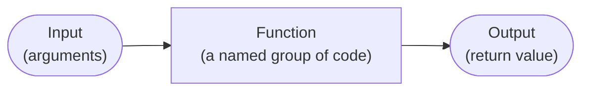
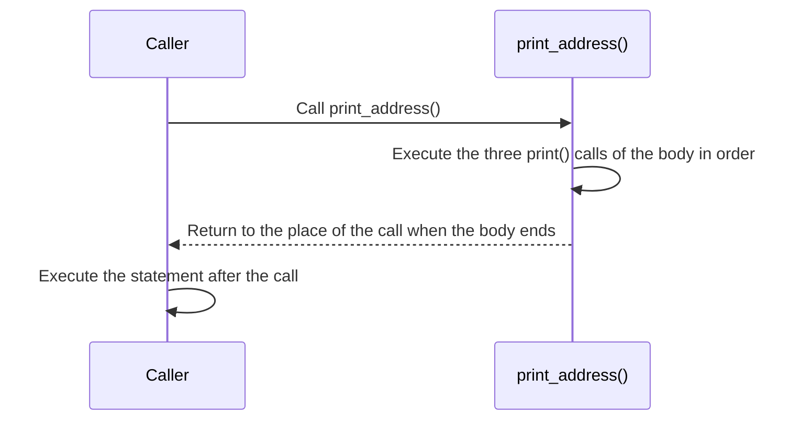
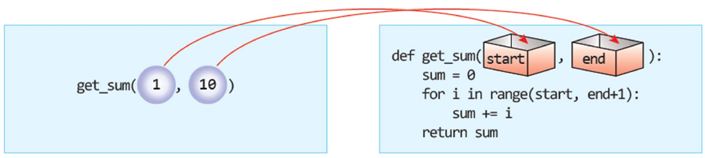
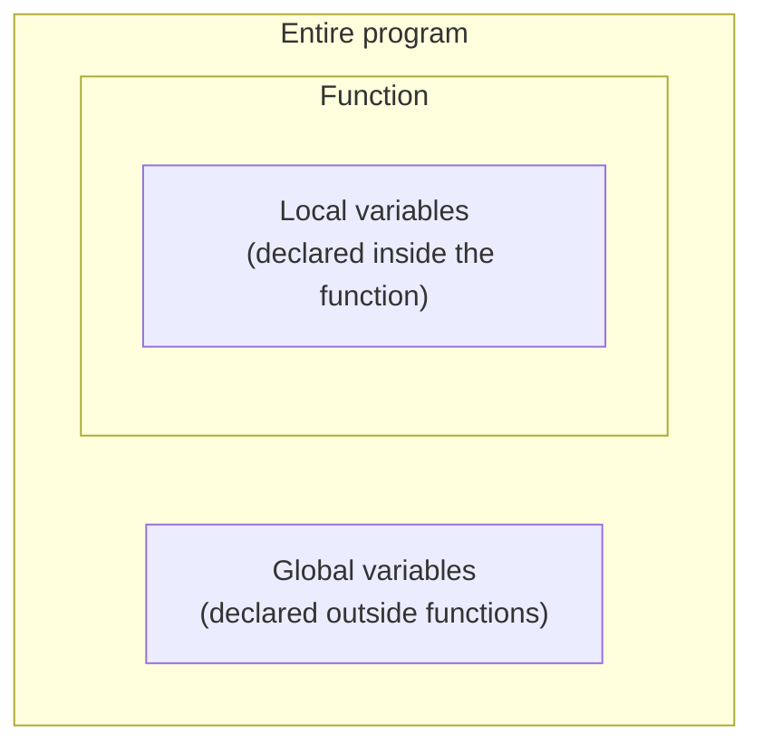
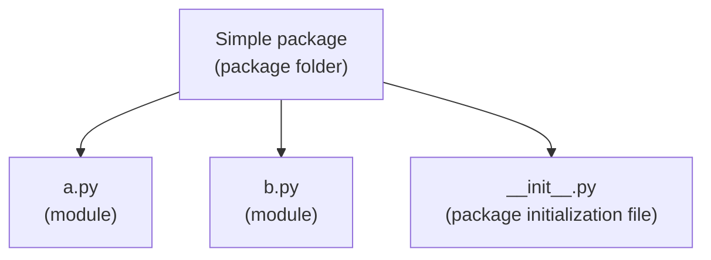

# Lecture 6 — Functions

[Repository Guide](../../README.md) | [English](Concepts_Lecture.md) | [한국어](Concepts_Lecture.ko.md)

> **Last Updated:** 2026-11-04

> **Learning Objectives:**
> 1. Explain the concept and advantages of functions, and define and call functions with the `def` statement
> 2. Distinguish parameters from arguments and write functions that receive arguments and return values
> 3. Explain the scope of local and global variables and judge when the `global` statement is needed
> 4. Write and call functions that use default arguments, keyword arguments, and multiple return values
> 5. Create anonymous functions with the `lambda` keyword
> 6. Write modules, use functions from other files with the `import` statement, and explain how Python finds modules

---

## Table of Contents

- [1. The Concept of a Function](#1-the-concept-of-a-function)
  - [1.1 What Is a Function](#11-what-is-a-function)
  - [1.2 Built-in Functions and Function Calls](#12-built-in-functions-and-function-calls)
  - [1.3 Why Use Functions](#13-why-use-functions)
- [2. Defining and Calling Functions](#2-defining-and-calling-functions)
  - [2.1 Structure of the def Statement](#21-structure-of-the-def-statement)
  - [2.2 Function Calls and the Flow of Execution](#22-function-calls-and-the-flow-of-execution)
  - [2.3 The Error of Calling Before Defining](#23-the-error-of-calling-before-defining)
  - [2.4 Reducing Duplication with Functions](#24-reducing-duplication-with-functions)
- [3. Parameters and Arguments](#3-parameters-and-arguments)
  - [3.1 Passing Arguments](#31-passing-arguments)
  - [3.2 Multiple Arguments](#32-multiple-arguments)
- [4. Return Values](#4-return-values)
  - [4.1 The return Statement](#41-the-return-statement)
  - [4.2 Examples of Writing Functions](#42-examples-of-writing-functions)
  - [4.3 Returning Multiple Values](#43-returning-multiple-values)
- [5. Scope of Variables](#5-scope-of-variables)
  - [5.1 Local and Global Variables](#51-local-and-global-variables)
  - [5.2 Scope of Local Variables](#52-scope-of-local-variables)
  - [5.3 Reading a Global Variable Inside a Function](#53-reading-a-global-variable-inside-a-function)
  - [5.4 Changing a Global Variable Inside a Function](#54-changing-a-global-variable-inside-a-function)
  - [5.5 Global Constants](#55-global-constants)
- [6. Ways of Passing Arguments](#6-ways-of-passing-arguments)
  - [6.1 Default Arguments](#61-default-arguments)
  - [6.2 Keyword Arguments](#62-keyword-arguments)
- [7. Anonymous Functions](#7-anonymous-functions)
- [8. Modules](#8-modules)
  - [8.1 Modules and Packages](#81-modules-and-packages)
  - [8.2 Writing and Using a Module](#82-writing-and-using-a-module)
  - [8.3 How the import Statement Finds a Module](#83-how-the-import-statement-finds-a-module)
  - [8.4 Running Directly Versus Being Imported](#84-running-directly-versus-being-imported)
- [Summary](#summary)
- [Self-Check Questions](#self-check-questions)
- [References](#references)

---

<br>

## 1. The Concept of a Function

### 1.1 What Is a Function

A **function** is a named group of code. A function can be thought of as a box that receives input and produces output. Even without knowing what happens inside the box, one can use a function as long as one knows what comes out for what goes in.



*Figure 1. A function viewed as a box that receives input and produces output*

The input of a function is called an **argument**, and the output that the function hands back after finishing its work is called the **return value**. There are also functions without input and functions without a return value.

### 1.2 Built-in Functions and Function Calls

`print()`, `input()`, and `abs()`, which have been used so far, are all **built-in functions** that Python provides in advance. To execute the instructions inside a function, one **calls** the function. A call is written by putting parentheses after the function name, with the arguments inside the parentheses. The following example calls the absolute value function `abs()` in the Python interactive shell.

```pycon
>>> value = abs(-100)
>>> value
100
```

When `abs(-100)` is executed, the function returns 100, the absolute value of -100, and the call expression `abs(-100)` is replaced by that return value 100, which is stored in `value`. Entering just a variable name in the interactive shell displays its value.

A function that users create themselves with the `def` statement is called a **user-defined function**. Section 2 onward covers how to define and use user-defined functions.

### 1.3 Why Use Functions

Once a function is defined, it can be called to do its work whenever it is needed. Functions have the following further advantages.

- **Reuse:** Instead of writing the same code several times, one calls it by name. Code becomes shorter and copying mistakes decrease.
- **Decomposition:** A large problem can be divided into small functions and solved one at a time.
- **Abstraction:** The code using a function needs to know only what the function does, not how it is implemented inside.
- **Maintenance:** To change a behavior, only the one definition of the function needs editing, and the change applies everywhere the function is called.

---

<br>

## 2. Defining and Calling Functions

### 2.1 Structure of the def Statement

A function is defined with the `def` keyword. The overall structure is as follows.

```python
def function_name(parameter1, parameter2):
    statement1
    statement2
```

| Component | Role |
|:-----|:-----|
| `def` | The keyword that defines a function |
| Function name | The name used to call the function. It follows the same identifier rules as variable names |
| Parameters | Variables that receive from outside the data needed for the work. They may be absent, in which case empty parentheses `()` are written |
| Colon (`:`) | Marks that the header of the function definition ends and the body follows |
| Body of the function | The statements indented from the line after the header, executed when the function is called |

*Table 1. Components of the def statement*

A function name should describe what the function does. The Python style guide PEP 8 recommends writing function names in lowercase with words joined by underscores (`print_address`, `calculate_area`) [1].

### 2.2 Function Calls and the Flow of Execution

The following program defines and calls a function `print_address()` that prints three lines of an address.

```python
def print_address():
    print("1 Jongno-gu, Seoul")
    print("7F, Python Building")
    print("Gildong Hong")

print_address()
```

```text
1 Jongno-gu, Seoul
7F, Python Building
Gildong Hong
```

- **Function definition (lines 1-4):** When the `def` statement is executed, Python only creates the function and binds it to the name `print_address`; it does not execute the `print()` statements of the body.
- **Function call (line 6):** When `print_address()` is executed, the flow of execution moves into the body of the function and executes the three `print()` statements in order. When the body ends, the flow returns to the place of the call and continues with the next statement.



*Figure 2. Flow of execution when a function is called*

A defined function can be called as many times as desired. The following example calls the same function three times.

```python
def print_address():
    print("1 Jongno-gu, Seoul")
    print("7F, Python Building")
    print("Gildong Hong")

print_address()
print_address()
print_address()
```

```text
1 Jongno-gu, Seoul
7F, Python Building
Gildong Hong
1 Jongno-gu, Seoul
7F, Python Building
Gildong Hong
1 Jongno-gu, Seoul
7F, Python Building
Gildong Hong
```

### 2.3 The Error of Calling Before Defining

The Python interpreter executes a program one statement at a time from top to bottom. When it meets a function definition, it only creates the function and does not immediately execute the statements inside it, while statements that are not function definitions are executed immediately. That is why the following program raises an error.

```python
print(power(10, 2))

def power(x, y):
    result = 1
    for i in range(y):
        result = result * x
    return result
```

```text
Traceback (most recent call last):
  File "power_first.py", line 1, in <module>
    print(power(10, 2))
          ^^^^^
NameError: name 'power' is not defined
```

When line 1 is executed, the `def` statement on line 3 has not been executed yet, so the name `power` does not exist. The error message `NameError: name 'power' is not defined` reports this fact. A function must be defined before it is called.

> **Note:** This rule is based on **the time at which a function is called**. Even if the body of function A calls a function B defined further down, no error occurs as long as the statement that actually calls A comes after the definition of B, because the body is executed only when it is called. A program structure that calls a `main()` function at the very end uses this property and is covered in [Exercise 3](Exercises.md#exercise-3-circle-area-and-circumference-with-a-global-constant).

### 2.4 Reducing Duplication with Functions

Code that repeats the same computation and output can be grouped into a function. The following program prints the sum and average of 50 and 60 twice.

```python
print("sum =", 50+60)
print("average =", (50+60)/2)
print("sum =", 50+60)
print("average =", (50+60)/2)
```

Moving the two repeated statements into the body of a function `sumandavg()` gives the same output with two function calls.

```python
def sumandavg():
    print("sum =", 50+60)
    print("average =", (50+60)/2)

sumandavg()
sumandavg()
```

Both programs print the following.

```text
sum = 110
average = 55.0
sum = 110
average = 55.0
```

The result of the division operator `/` is always a floating-point number, so the average is printed as `55.0`. However, this function always computes only 50 and 60. To compute with other numbers, the function must receive values (Section 3).

---

<br>

## 3. Parameters and Arguments

### 3.1 Passing Arguments

Values (information) can be passed to a function. A value placed inside the parentheses and passed when calling a function is called an **argument**, also known as an **actual parameter**. A variable written inside the parentheses of the function definition to receive the passed value is called a **parameter**.

```python
def print_address(name):
    print("1 Jongno-gu, Seoul")
    print("7F, Python Building")
    print(name)

print_address("Gildong Hong")
```

```text
1 Jongno-gu, Seoul
7F, Python Building
Gildong Hong
```

When `print_address("Gildong Hong")` is called, the argument `"Gildong Hong"` is assigned to the parameter `name`, and then the body is executed. Therefore `print(name)` in the body prints `Gildong Hong`. Giving another name as the argument prints the address of another person with the same function.

> **Definition:** A **parameter** is a variable name written in the function definition (`name` in `def print_address(name):`), and an **argument** is the value actually passed in a call (`"Gildong Hong"` in `print_address("Gildong Hong")`). On each call, the value of the argument is assigned to the parameter.

Giving `sumandavg()` of Section 2.4 the parameters `a` and `b` lets it compute the sum and average of any two numbers.

```python
def sumandavg(a, b):
    print("sum =", a+b)
    print("average =", (a+b)/2)

a=50
b=60
sumandavg(a, b)
sumandavg(70, 80)
```

```text
sum = 110
average = 55.0
sum = 150
average = 75.0
```

The first call passes the values 50 and 60 of the variables `a` and `b` as arguments, and the second call passes the values 70 and 80 directly. Variables, values, and expressions can all be used as arguments.

### 3.2 Multiple Arguments

A function can have several parameters. The following function computes and returns the sum of the integers from `start` to `end`.

```python
def get_sum(start, end):
    sum = 0
    for i in range(start, end+1):
        sum += i
    return sum

print(get_sum(1, 10))
```

```text
55
```



*Figure 3. Arguments 1 and 10 passed in order to the parameters start and end*

As in Figure 3, arguments correspond to parameters in the order in which they are written. The first argument 1 goes into the first parameter `start`, and the second argument 10 into the second parameter `end`. Arguments matched by position in this way are called **positional arguments**. `sum += i` is a compound assignment that abbreviates `sum = sum + i` (Lecture 2). The loop in the body is the same as the accumulation pattern of Lecture 5.

If the number of positional arguments differs from the number of parameters, an error occurs. For example, giving only one argument as in `get_sum(1)` raises `TypeError: get_sum() missing 1 required positional argument: 'end'`.

> **Note:** The `sum` inside the function has the same name as the built-in function `sum()`. This `sum` is a local variable used only inside the function (Section 5), so it does not affect the built-in `sum()` outside the function, but inside the function it hides the built-in. It is safer to use a name that does not clash with built-in functions, such as `total` (Lecture 5, Section 6.3).

---

<br>

## 4. Return Values

### 4.1 The return Statement

A function can return a value. The **`return` statement** hands the result computed in the function back to the caller. When the `return` statement is executed, the function ends immediately, and the call expression is replaced by the returned value.

```python
def calculate_area(radius):
    area = 3.14 * radius**2
    return area

c_area = calculate_area(5.0)
print(c_area)
```

```text
78.5
```

When `calculate_area(5.0)` is called, 5.0 is assigned to `radius`, $3.14 \times 5.0^2 = 3.14 \times 25.0 = 78.5$ is stored in `area`, and `return area` returns 78.5. The call expression is replaced by 78.5, so 78.5 is stored in `c_area`. `**` is the exponentiation operator.

A return value can be used directly as part of another computation. The following function `avg()` returns the average of two numbers, and the caller passes that value to `print()`.

```python
def avg(a, b):
    return (a+b)/2

a=50
b=60
print("sum =", a + b)
print("average =", avg(a, b))
```

```text
sum = 110
average = 55.0
```

A function without a `return` statement, or with a bare `return` and no value, returns the special value `None` [2]. `None` is a Python value that represents the absence of a value.

```python
def say_hello():
    print("Hello")

result = say_hello()
print(result)
```

```text
Hello
None
```

> **Caution:** Printing with `print()` inside a function is different from returning with `return`. `print()` only shows a value on the screen and does not hand it to the caller, so that value cannot be stored in a variable or used in another computation. The `None` stored in `result` in the example above shows this. A function whose result must be used elsewhere has to return the value with `return`.

### 4.2 Examples of Writing Functions

When writing a function, first decide only its name, input (parameters), and output (return value). The body is written after that. The following three functions are examples designed in this order.

| Function | Input | Output | What It Does |
|:-----|:-----|:-----|:-----|
| `square(n)` | An integer `n` | The square of `n` | Receives an integer and returns its square |
| `get_max(x, y)` | Two integers `x`, `y` | The larger of the two | Finds and returns the larger of two numbers |
| `power(x, y)` | An integer `x`, an exponent `y` | $x^y$ | Computes and returns a power of an integer |

*Table 2. Three functions designed by name, input, and output*

**Square function:** Receives an integer and returns its square.

```python
def square(n):
    return(n*n)

print(square(10))
```

```text
100
```

The parentheses in `return(n*n)` only group the expression, so it is the same as `return n*n`. `return` is a statement, not a function, so it is usually written without parentheses.

**Maximum function:** Given two integers, finds and returns the larger of the two.

```python
def get_max(x, y):
    if( x > y ):
        return x
    else:
        return y

print(get_max(10, 20))
```

```text
20
```

In `get_max(10, 20)`, `x > y` is false, so `return y` in the `else` branch is executed and returns 20. A function can have several `return` statements, as this one does, and it ends at the first `return` executed. When the two numbers are equal it returns `y`, which is correct because `x` and `y` then have the same value.

**Power function:** Python has the exponentiation operator `**`, but $x^y$ can also be computed directly with a loop.

```python
def power(x, y):
    result = 1
    for i in range(y):
        result = result * x
    return result

print(power(10, 2))
```

```text
100
```

| Iteration | `i` | `result` After the Body |
|:-----:|:-----:|:-----:|
| Before the loop | None | 1 |
| 1 | 0 | $1 \times 10 = 10$ |
| 2 | 1 | $10 \times 10 = 100$ |

*Table 3. Execution trace of power(10, 2)*

`range(y)` executes the body exactly `y` times, so `x` is multiplied into `result` `y` times. If `y` is 0 the body is not executed and $x^0 = 1$ is returned. This function handles only non-negative integer exponents; given a negative exponent, `range(y)` is an empty range and it returns 1, which is incorrect.

### 4.3 Returning Multiple Values

A Python function can return two or more values. Write the values after `return` separated by commas, and receive them on the calling side with the same number of variables.

```python
def sumandavg(a, b):
    sum = a+b
    avg = (a+b)/2
    return sum, avg

a1=50
b1=60
sum1, avg1 = sumandavg(a1, b1)
print("sum =", sum1)
print("average =", avg1)

a2=70
b2=80
sum2, avg2 = sumandavg(a2, b2)
print("sum =", sum2)
print("average =", avg2)
```

```text
sum = 110
average = 55.0
sum = 150
average = 75.0
```

What the function actually returns is a single **tuple** that groups the values. A tuple is a data type that holds several values in order, like a list, and is covered in detail in Lecture 7.

```python
def sub():
    return 1, 2, 3

a, b, c = sub()
print(a, b, c)

t = sub()
print(t, type(t))
```

```text
1 2 3
(1, 2, 3) <class 'tuple'>
```

```text
return 1, 2, 3          →  returns a single tuple (1, 2, 3)   (packing)

a, b, c = (1, 2, 3)     →  a = 1,  b = 2,  c = 3              (unpacking)
```

*Figure 4. Packing and unpacking of a tuple when returning multiple values*

`return 1, 2, 3` packs the three values into the tuple `(1, 2, 3)` and returns it, and `a, b, c = sub()` distributes the elements of that tuple to the variables on the left in order. Receiving the tuple with a single variable `t` stores the tuple as it is. If the number of variables on the left differs from the number of elements in the tuple, as in `a, b = sub()`, `ValueError: too many values to unpack (expected 2)` is raised.

> **Note:** A function in C can return only one value, so returning several results requires pointer parameters or a structure. Python packs several values into one tuple and returns it, so it can return several results without such devices.

---

<br>

## 5. Scope of Variables

### 5.1 Local and Global Variables

The region of a program in which a variable can be used is called the **scope** of that variable. Variables are divided into two kinds according to where they are declared. In Python, assigning a value to a variable for the first time declares the variable.

- **Local variable:** A variable declared inside a function. Parameters are also local variables. It is created when the function is called, disappears when the function ends, and can be used only inside that function.
- **Global variable:** A variable declared outside functions. It remains until the program ends and can be used anywhere in the program.



*Figure 5. Global variables in the whole program and local variables in a function*

### 5.2 Scope of Local Variables

A local variable can be used only inside its function. In the following code, the local variables are the parameter `radius` and `result`, which is assigned inside the function.

```python
def calculate_area(radius):
    result = 3.14 * radius**2
    return result

r = float(input("Radius of the circle: "))
area = calculate_area(r)
print(result)
```

```text
Radius of the circle: 10
Traceback (most recent call last):
  File "area.py", line 7, in <module>
    print(result)
          ^^^^^^
NameError: name 'result' is not defined
```

`result` is a local variable of `calculate_area()`, so it disappears when the function ends. Using `result` on line 7 outside the function therefore raises `NameError`. A value computed inside a function must be received as a return value. In this program, printing the global variable `area`, which received the return value, with `print(area)` prints `314.0`.

### 5.3 Reading a Global Variable Inside a Function

A global variable can be used anywhere. In the following code, `r` is a global variable assigned outside the function, and the function `calculate_area()` takes no parameters and computes by reading the value of the global variable `r`.

```python
def calculate_area():
    result = 3.14 * r**2
    return result

r = float(input("Radius of the circle: "))
area = calculate_area()
print(area)
```

```text
Radius of the circle: 10
314.0
```

When looking up the name `r` inside the function, there is no local variable `r`, so Python uses the global variable `r`. By the time the function is called on lines 5-6, 10.0 has already been stored in `r`.

> **Caution:** A function that depends on a global variable works only in a program that has that global variable, and it is hard to trace where the value changes. Values that a function needs should be received as parameters whenever possible.

### 5.4 Changing a Global Variable Inside a Function

Writing the following in an attempt to store a computed value in a global variable inside a function gives an unexpected result.

```python
def calculate_area(radius):
    area = 3.14 * radius**2   # meant to store the result in the global area
    return

area = 0
r = float(input("Radius of the circle: "))
calculate_area(r)
print(area)
```

```text
Radius of the circle: 10
0
```

0 is printed because the assignment `area = 3.14 * radius**2` inside the function does not change the global variable `area`; instead it creates **a new local variable `area`** inside the function. In Python, a name assigned inside a function becomes a local variable of that function. The local variable `area` disappears when the function ends, and the global variable `area` keeps its initial value 0.

To store a value in a global variable inside a function, the **`global` statement** must declare that the name is a global variable.

```python
def calculate_area(radius):
    global area
    area = 3.14 * radius**2
    return

area = 0
r = float(input("Radius of the circle: "))
calculate_area(r)
print(area)
```

```text
Radius of the circle: 10
314.0
```

With `global area`, the `area` inside the function refers to the global variable `area`, so the assigned value 314.0 remains after the function ends.

Even with the same name, a variable inside a function and a variable outside it are separate. In the following example, the two variables `a`, `b` inside the function and the two variables `a`, `b` outside it are different variables.

```python
def avg():
    a=0
    b=0
    return (a+b)/2

a=80
b=60
print("average =", avg())
print("sum =", a + b)
```

```text
average = 0.0
sum = 140
```

`avg()` computes the average 0.0 from its own local variables `a` and `b` (both 0), while `a + b` outside the function computes 140 from the global variables 80 and 60.

Even when values are passed as arguments in the call, as below, the results of operations on `a` and `b` inside the function do not affect `a` and `b` outside the function.

```python
def avg(a, b):
    a= a + 10
    b= b + 10
    return (a+b)/2

a=50
b=60
print("average =", avg(a, b))
print("sum =", a + b)
```

```text
average = 65.0
sum = 110
```

In the call, the values 50 and 60 of the global variables `a` and `b` are assigned to the parameters `a` and `b`. Inside the function, 10 is added to each parameter, changing them to 60 and 70, and the average $(60 + 70) / 2 = 65.0$ is returned, but only the parameters, which are local variables, have changed. `a` and `b` outside the function are still 50 and 60, so the sum is 110.

In a second example as well, the values computed inside the function do not affect the outside.

```python
def sumandavg(a, b):
    sum = a+b
    avg = (a+b)/2

sum =0
avg =0
a =50
b =60
sumandavg(a, b)
print("sum =", sum)
print("average =", avg)
```

```text
sum = 0
average = 0
```

`sum` and `avg` inside the function are assigned values, so they are local variables. The 110 and 55.0 computed by the function disappear when the function ends, and the global variables `sum` and `avg` remain 0. Putting the `global` keyword before the variables makes the results appear outside the function. Several names can be declared at once, separated by commas.

```python
def sumandavg(a, b):
    global sum, avg
    sum = a+b
    avg = (a+b)/2

sum =0
avg =0
a =50
b =60
sumandavg(a, b)
print("sum =", sum)
print("average =", avg)
```

```text
sum = 110
average = 55.0
```

> **Caution:** If a statement assigning a value to a name appears **anywhere** inside a function, that name is treated as a local variable throughout the function [3]. That is why the following function cannot read the global variable `x` in `print(x)`, which comes before the assignment, and raises an error.

```python
x = 10

def show():
    print(x)
    x = 20

show()
```

```text
Traceback (most recent call last):
  File "unbound.py", line 7, in <module>
    show()
    ~~~~^^
  File "unbound.py", line 4, in show
    print(x)
          ^
UnboundLocalError: cannot access local variable 'x' where it is not associated with a value
```

> **[Programming Languages]** Python looks up a name in the order of the local (Local), enclosing function (Enclosing), global (Global), and built-in (Built-in) scopes, which is called the LEGB rule after the initials [3]. The scope a name belongs to is determined by the textual structure of the program rather than at run time (static scoping), and this is why the `UnboundLocalError` above occurs. Also, when passing arguments, Python does not copy values but assigns to the parameter a reference to the same object; assigning a new value to the parameter merely rebinds the local name to another object, so the caller's variable does not change. The general principles of such scope, binding, and parameter passing are covered in Programming Languages.

Changing global variables inside functions lets many places in a program change the same variable, which makes errors hard to find. To pass a result out of a function, it is preferable to use the return values of Section 4.

### 5.5 Global Constants

A **constant** is data whose value does not change while the program runs. Python has no separate keyword for creating constants, so a global variable is used as a constant, and the convention of writing its name in all capital letters with words joined by underscores (`PI`, `MAX_SIZE`) indicates that it is a constant [1]. A function only reads the value of a global constant, so no `global` statement is needed.

```python
PI = 3.14159265358979      # global constant

def circle_area(radius):
    return PI * radius * radius

print(circle_area(1))
print(circle_area(10))
```

```text
3.14159265358979
314.159265358979
```

Defining a value such as pi as a constant in one place means that only that one definition needs editing when the value must change, and a meaningful name appears in the code instead of a number. However, capitalized names are only a convention, and Python does not prevent the value from being changed. A program that computes the area and circumference of a circle with a global constant is covered in [Exercise 3](Exercises.md#exercise-3-circle-area-and-circumference-with-a-global-constant).

---

<br>

## 6. Ways of Passing Arguments

### 6.1 Default Arguments

In Python, the parameters of a function can have default values. This is called a **default argument**. If the argument corresponding to that parameter is omitted in a call, the default value is used.

```python
def greet(name, msg="How have you been?"):
    print("Hello ", name + ', ' + msg)

greet("Younghee")
greet("Cheolsu", "Long time no see!")
```

```text
Hello  Younghee, How have you been?
Hello  Cheolsu, Long time no see!
```

`greet("Younghee")` has no argument corresponding to `msg`, so the default value `"How have you been?"` is used, while `greet("Cheolsu", "Long time no see!")` uses the passed value instead of the default. `name + ', ' + msg` builds `"Younghee, How have you been?"` by string concatenation (Lecture 3). The two spaces after `Hello` in the output come from the one space at the end of the string `"Hello "` plus the one space that `print()` puts between two values.

> **Caution:** Parameters with default values must come after parameters without default values. Writing `def greet(msg="hi", name):` raises the error `SyntaxError: parameter without a default follows parameter with a default`.

### 6.2 Keyword Arguments

A **keyword argument** is a way of passing an argument by explicitly specifying its name. Writing it in the form `parameter_name=value` passes the value to the parameter with that name regardless of order [2].

```python
def calc(x, y, z):
    return x+y+z

print(calc(y=20, x=10, z=30))
print(calc(10, z=30, y=20))
```

```text
60
60
```

The first call specifies all three arguments by name, so even in a different order they become `x = 10`, `y = 20`, `z = 30`. Positional and keyword arguments can also be mixed, as in the second call, but the positional arguments must come first. The positional argument 10 corresponds to the first parameter `x`.

| Method | Example Call | Basis of Correspondence | Rule |
|:-----|:-----|:-----|:-----|
| Positional argument | `calc(10, 20, 30)` | The order of the arguments | The count must equal that of the parameters |
| Keyword argument | `calc(y=20, x=10, z=30)` | The names of the parameters | Order does not matter, but they come after positional arguments |
| Default argument | `greet("Younghee")` | Omitted parameters take their default values | Parameters with defaults are placed last in the definition |

*Table 4. Three ways of passing arguments*

Misusing keyword arguments causes the following errors.

- **Positional argument after a keyword argument:** `calc(x=10, 20, 30)` gives `SyntaxError: positional argument follows keyword argument`.
- **Passing a value to the same parameter twice:** In `calc(10, x=20, z=30)`, the positional argument 10 already corresponds to `x` and `x=20` is passed again, so it gives `TypeError: calc() got multiple values for argument 'x'`.

Keyword arguments make the meaning of each value visible in the call of a function with many parameters, which makes code easier to read.

---

<br>

## 7. Anonymous Functions

An **anonymous function** is a function that has a body but no name. In Python, anonymous functions are created with the `lambda` keyword and are also called **lambda functions**. The overall structure is as follows.

```python
lambda argument1, argument2: expression
```

- **Arguments:** Written after `lambda`, separated by commas; they correspond to the parameters of the function.
- **Expression:** The single expression after the colon is the body of the function. The value of this expression is returned automatically, so `return` is not written. The body can contain only one expression, not statements such as `if` or `for` statements.

```python
sum = lambda x, y: x+y

print( "Sum of the integers : ", sum( 10, 20 ))
print( "Sum of the integers : ", sum( 20, 20 ))
```

```text
Sum of the integers :  30
Sum of the integers :  40
```

`lambda x, y: x+y` creates a function that returns the sum of its two arguments and assigns that function to the variable `sum`. Therefore `sum(10, 20)` returns 30. This lambda function does the same work as the following `def` statement. The two spaces after the colon in the output come from the space at the end of the string plus the space that `print()` inserts.

```python
def sum(x, y):
    return x+y
```

Anonymous functions are useful when a short function is used once and discarded, especially when a function is passed as an argument to another function.

```python
square = lambda n: n * n
print(square(7))
print((lambda x, y: x * y)(3, 4))
print(sorted([-5, 2, -1, 4], key=lambda v: abs(v)))
```

```text
49
12
[-1, 2, 4, -5]
```

The second line calls a lambda function with the arguments 3 and 4 right after creating it. The built-in function `sorted()` on the third line returns a new sorted list and sorts by the result of the function given as `key`. Here it sorts by absolute value, giving the order $\vert -1 \vert = 1$, $\vert 2 \vert = 2$, $\vert 4 \vert = 4$, $\vert -5 \vert = 5$.

> **Caution:** PEP 8 recommends using a `def` statement rather than assigning a lambda function to a variable to give it a name [1]. If a function needs a name, `def` is easier to read and the function name also appears in error messages. Also, naming the variable `sum` as in the example above hides the built-in function `sum()`.

---

<br>

## 8. Modules

### 8.1 Modules and Packages

A file that collects functions and variables is called a **module**. Each `.py` file containing Python code is one module, and the module name is the file name without `.py`. `turtle` and `random`, used so far with `import turtle` and `import random`, are also standard modules provided by Python. A collection of several modules in one folder is called a **package**.



*Figure 6. A package made of the modules a.py and b.py and the initialization file __init__.py*

`__init__.py` is a file that marks the folder as a package and holds initialization code to run when the package is first imported. Dividing a program into modules lets related functions be managed together in one file and lets a function written once be reused in several programs.

### 8.2 Writing and Using a Module

Creating a module is the same as creating an ordinary Python file. The following is a module file `h.py` containing a function `add()` that prints the sum of two numbers.

```python
# module
def add(a,b):
    print (a+b)
```

To use the functions of a module, import the module with the `import` statement. The following example runs the interactive shell in the folder containing `h.py` and uses the module.

```pycon
>>> import h
>>> h.add(10,20)
30
>>> from h import *
>>> add(10,20)
30
```

- **`import h`:** Imports the module `h` and binds it to the name `h`. Functions in the module are used in the form `module_name.function_name` (`h.add`).
- **`from h import *`:** Brings all names of the module `h` (except those beginning with an underscore) into the current program. After that, they can be used directly without the module name, as in `add()`.

The 30 of `h.add(10,20)` is printed by the `print()` inside the function. `add()` has no return value and returns `None`, and the interactive shell displays nothing when the result is `None`.

To use the same module from a program file, put the two files in the same folder.

```text
project/
├── h.py        module: defines the add() function
└── main.py     program: imports and uses the h module
```

*Figure 7. Folder layout of a module and the program that uses it*

The content of `main.py` is as follows.

```python
import h

h.add(10, 20)
```

Running it with `python main.py` in this folder prints the following.

```text
30
```

The forms of the `import` statement can be summarized as follows.

| Form | Usage | Characteristic |
|:-----|:-----|:-----|
| `import h` | `h.add(10, 20)` | The origin of each name is clear and names do not clash |
| `import h as m` | `m.add(10, 20)` | Gives a long module name a short alias |
| `from h import add` | `add(10, 20)` | Brings in only the needed names and uses them without the module name |
| `from h import *` | `add(10, 20)` | Brings in all names, so it can overwrite names of the same name in the current program |

*Table 5. Four forms of the import statement*

> **Caution:** With `from h import *`, the code does not show which names come in, and if the current program has a variable or function with the same name, it is silently overwritten. Except in short test code, it is better to make the imported names explicit, as in `import h` or `from h import add`.

### 8.3 How the import Statement Finds a Module

When `import h` is executed, Python does the following in order [4].

1. **Checks whether the module has already been imported.** If the module was already imported in the same program, that module is reused and the steps below are skipped.
2. **Looks for `h.py` on the module search path.** The search path is stored in a list called `sys.path`, and it is searched in the order of the folder containing the program file that was run (the current folder for the interactive shell), the folders specified in the environment variable `PYTHONPATH`, and the folders holding the standard library and installed third-party packages.
3. **Executes the module.** The file found is compiled to bytecode, and the top-level code of the module is executed once from the top. `def` statements are executed at this point too, creating the functions. The compiled result is saved in the `__pycache__` folder under a name carrying the Python version, such as `h.cpython-313.pyc`, so that the next run skips compilation if the source has not changed.
4. **Binds the name.** The created module object is bound to the name `h` in the current program.

With the layout of Figure 7, running `python main.py` makes the `project/` folder containing `main.py` the first entry of the search path, so `h.py` in the same folder is found. If `h.py` is placed in a different folder, the error `ModuleNotFoundError: No module named 'h'` occurs.

> **Caution:** If one of your files has the same name as a standard module, such as `turtle.py` or `random.py`, `import turtle` loads your file instead of the standard module, because the folder of the program is searched before the standard library. This leads to errors whose cause is hard to see, such as `AttributeError: module 'turtle' has no attribute 'Turtle'`. In this case Python 3.13 appends to the error message a hint to rename the file that has the same name as the standard module. Give module files names that do not clash with standard modules.

### 8.4 Running Directly Versus Being Imported

The top-level code of a module is executed when it is imported. If one wants to keep code that tests the functions inside a module file, it is a problem if that code runs on every import. In this case one uses the variable `__name__`, created automatically for each module. `__name__` is `"__main__"` when the file is run directly and the module name when another file imports it [4].

`calc_mod.py`:

```python
print("top-level code of calc_mod is running")

def add(a, b):
    return a + b

def mul(a, b):
    return a * b

if __name__ == "__main__":
    print("test run only when executed directly:", add(2, 3))
```

`use_calc.py`:

```python
import calc_mod
import calc_mod          # a second import does not run the module again

print(calc_mod.add(10, 20))
print(calc_mod.mul(10, 20))
print(calc_mod.__name__)
```

Running the module directly with `python calc_mod.py` gives the following.

```text
top-level code of calc_mod is running
test run only when executed directly: 5
```

Running the program that imports the module with `python use_calc.py` gives the following.

```text
top-level code of calc_mod is running
30
200
calc_mod
```

When run directly, `__name__` is `"__main__"`, so the test code in the `if` statement is executed. When imported, `__name__` is `"calc_mod"`, so the test code is not executed. Also, although `import calc_mod` is written twice, the message on the first line is printed only once, because by step 1 of Section 8.3 the second `import` reuses the module that was already imported.

---

<br>

## Summary

| Concept | Key Summary |
|:-----|:-----|
| Function | A named group of code that can be viewed as a box receiving arguments as input and producing a return value as output. |
| Defining and calling a function | The `def` statement only creates the function, and the body is executed when the function is called with parentheses after its name. |
| Calling before defining | The interpreter executes from top to bottom, so calling a function before it is defined raises `NameError`. |
| Parameters and arguments | A parameter is a variable that receives a value in the function definition, an argument is the value passed in a call, and positional arguments correspond in order. |
| `return` statement | Hands the result back to the caller and ends the function immediately, and a function without `return` returns `None`. |
| Multiple return values | `return a, b` returns a single tuple, which the caller unpacks into the same number of variables. |
| Local variable | A variable assigned inside a function, or a parameter, which disappears when the function ends and cannot be used outside it. |
| Global variable | A variable declared outside functions, which can be read inside a function but requires a `global` declaration to be assigned. |
| `UnboundLocalError` | A name assigned anywhere in a function is local throughout the function, so reading it before the assignment raises an error. |
| Global constant | A global variable with a capitalized name representing an unchanging value, read only and therefore needing no `global`. |
| Default argument | Gives a parameter a default value so that its argument can be omitted, and parameters with defaults are placed last. |
| Keyword argument | Passed as `name=value` and matched regardless of order, written after positional arguments. |
| Anonymous function | A nameless function created with `lambda arguments: expression`, which returns the value of a single expression. |
| Modules and packages | A module is a `.py` file collecting functions and variables, and a package is a folder collecting modules. |
| `import` | Finds a module on the search path (`sys.path`), executes it only the first time, and binds the module object to a name. |
| `__name__` | `"__main__"` when run directly and the module name when imported, so it is used to separate test code. |

---

<br>

## Self-Check Questions

1. **Return value and output:** Write the output of the following program and explain why the second line is printed as it is.

   ```python
   def double(n):
       print(n * 2)

   x = double(5)
   print(x)
   ```

   <details>
   <summary>Answer</summary>

   The first line is `10` and the second line is `None`. `double(5)` prints 10 with `print(n * 2)` in the body, but it has no `return` statement, so it returns `None`. That is why `None` is stored in `x`. To store 10 in `x`, `return n * 2` must be used instead of `print(n * 2)`.

   </details>

2. **Local and global variables:** Write the output of the following program.

   ```python
   count = 0

   def increase():
       count = 100
       return count + 1

   result = increase()
   print(result, count)
   ```

   <details>
   <summary>Answer</summary>

   `101 0` is printed. `count = 100` inside the function creates a new local variable `count`, so the function returns 101, but the global variable `count` remains 0. To change the global variable, `global count` must be written inside the function.

   </details>

3. **The global statement:** Explain whether the `global` statement is needed when a function only **reads** a global variable and when it **assigns** to one.

   <details>
   <summary>Answer</summary>

   It is not needed for reading only, because if the function has no local variable with that name, Python finds and uses the global variable (`r` in Section 5.3 and `PI` in Section 5.5). It is needed for assigning. Assigning without a `global` declaration makes the name a local variable of the function, so the global variable does not change (Section 5.4), and reading the name before the assignment raises `UnboundLocalError`.

   </details>

4. **Passing arguments:** For `def f(a, b=2, c=3): return a + b * c`, compute `f(1)`, `f(1, c=10)`, and `f(c=1, a=2, b=5)`.

   <details>
   <summary>Answer</summary>

   `f(1)` has `a = 1` and the defaults 2 and 3 for `b` and `c`, so it is $1 + 2 \times 3 = 7$. `f(1, c=10)` has `a = 1`, `b = 2` (default), and `c = 10`, so it is $1 + 2 \times 10 = 21$. `f(c=1, a=2, b=5)` has `a = 2`, `b = 5`, and `c = 1` by keyword arguments, so it is $2 + 5 \times 1 = 7$.

   </details>

5. **Multiple return values and lambda:** Write a function `div_mod(a, b)` that returns both the quotient and the remainder of two numbers, and write the result of `q, r = div_mod(17, 5)`. Also write a lambda function that returns the smaller of two numbers.

   <details>
   <summary>Answer</summary>

   Compute the quotient with the `//` operator and the remainder with the `%` operator (Lecture 2), and return them separated by a comma.

   ```python
   def div_mod(a, b):
       return a // b, a % b

   q, r = div_mod(17, 5)
   smaller = lambda x, y: x if x < y else y
   print(q, r, smaller(3, 8))
   ```

   The output is `3 2 3`. Since $17 = 5 \times 3 + 2$, the quotient is 3 and the remainder is 2. The body of a lambda function cannot contain statements, so the conditional expression `x if x < y else y` is used instead of an `if` statement. This expression has the value of `x` if `x < y` is true and the value of `y` otherwise.

   </details>

6. **Module search:** A function `hello()` was defined in `tools.py`, and running `import tools` from `app.py` in a different folder raised `ModuleNotFoundError`. Write the cause and the simplest fix.

   <details>
   <summary>Answer</summary>

   When the program is run with `python app.py`, the first entry of the module search path is the folder containing `app.py`. `tools.py` is in neither that folder, `PYTHONPATH`, nor the standard library path, so Python could not find the module. The simplest fix is to move `tools.py` into the same folder as `app.py`. If the folder cannot be moved, add the folder containing `tools.py` to the environment variable `PYTHONPATH`.

   </details>

---

<br>

## References

1. G. van Rossum, B. Warsaw, and A. Coghlan, "PEP 8 - Style Guide for Python Code," *Python Enhancement Proposals*, 2001. https://peps.python.org/pep-0008/
2. Python Software Foundation, "More Control Flow Tools," *The Python Tutorial*, Python 3.13. https://docs.python.org/3.13/tutorial/controlflow.html
3. Python Software Foundation, "Execution model," *The Python Language Reference*, Python 3.13. https://docs.python.org/3.13/reference/executionmodel.html
4. Python Software Foundation, "Modules," *The Python Tutorial*, Python 3.13. https://docs.python.org/3.13/tutorial/modules.html
