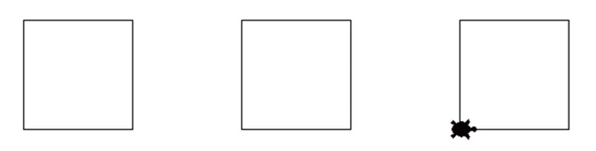
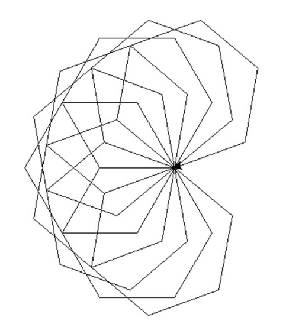

# 6강 연습 문제 — 함수

[레포지토리 안내](../../README.ko.md) | [English](Exercises.md) | [한국어](Exercises.ko.md)

> **최종 수정일:** 2026-11-04

연습 문제 1\~2는 터틀 그래픽에서 함수를 정의하고 호출하는 문제이고, 연습 문제 3은 전역 상수, 연습 문제 4는 키워드 인수, 연습 문제 5는 함수 안에서 다른 함수를 호출하는 문제, 연습 문제 6은 모듈을 만들어 쓰는 문제이다.

---

<br>

## 목차

- [연습 문제 1: 정사각형을 그리는 함수](#연습-문제-1-정사각형을-그리는-함수)
- [연습 문제 2: n각형을 그리는 함수](#연습-문제-2-n각형을-그리는-함수)
- [연습 문제 3: 전역 상수를 이용한 원의 넓이와 둘레](#연습-문제-3-전역-상수를-이용한-원의-넓이와-둘레)
- [연습 문제 4: 사칙 연산 함수와 키워드 인수](#연습-문제-4-사칙-연산-함수와-키워드-인수)
- [연습 문제 5: 세 정수 가운데 가장 큰 수](#연습-문제-5-세-정수-가운데-가장-큰-수)
- [연습 문제 6: 계산기 모듈](#연습-문제-6-계산기-모듈)

---

<br>

## 연습 문제 1: 정사각형을 그리는 함수

**문제:** 터틀 그래픽에서 정사각형을 그리는 함수는 다음과 같다. 매개변수 `length`는 한 변의 길이이다.

```python
def square(length):           # length is the side length
    for i in range(4):
        t.forward(length)
        t.left(90)
```

위의 함수를 호출하여 한 변의 길이가 100인 정사각형 3개를 그리라. 세 정사각형의 시작 위치는 각각 (-200, 0), (0, 0), (200, 0)이고, 정사각형 사이를 이동할 때는 선을 그리지 않는다. 거북이의 모양은 `"turtle"`로 바꾼다.

**실행 예시:**



*그림 1. 함수 square()를 세 번 호출하여 그린 정사각형 3개*

**[풀이](Solutions.ko.md#연습-문제-1-정사각형을-그리는-함수)**

---

<br>

## 연습 문제 2: n각형을 그리는 함수

**문제:** 정 $n$각형을 그리는 함수 `n_polygon(n, length)`를 작성하라. `n`은 변의 개수, `length`는 한 변의 길이이다. 이 함수를 이용하여 왼쪽으로 20도 회전한 뒤 한 변의 길이가 100인 정육각형을 그리는 일을 10번 반복하여 다음과 같은 그림을 그리라.

**실행 예시:**



*그림 2. 20도씩 회전하며 그린 정육각형 10개*

**[풀이](Solutions.ko.md#연습-문제-2-n각형을-그리는-함수)**

---

<br>

## 연습 문제 3: 전역 상수를 이용한 원의 넓이와 둘레

**문제:** 원주율 $\pi$를 전역 변수로 선언하고, 이것을 이용하여 원의 넓이와 원의 둘레를 계산하는 함수를 작성하라. 반지름을 입력받아 두 값을 출력한다. 입력 안내 문구는 `원의 반지름을 입력하시오: `이고, 넓이와 둘레는 `원의 면적:`, `원의 둘레:` 뒤에 출력한다.

**실행 예시:**

```text
원의 반지름을 입력하시오: 10
원의 면적: 314.159265358979
원의 둘레: 62.8318530717958
```

**[풀이](Solutions.ko.md#연습-문제-3-전역-상수를-이용한-원의-넓이와-둘레)**

---

<br>

## 연습 문제 4: 사칙 연산 함수와 키워드 인수

**문제:** 사칙 연산을 수행하는 4개의 함수 `add()`, `sub()`, `mul()`, `div()`를 작성하라. 각 함수는 두 수를 받아 연산 결과를 반환한다. 이들 함수를 이용하여 `10+20*30`을 계산하라. 함수를 호출할 때에는 키워드 인수를 사용한다.

**실행 예시:**

```text
610
```

**[풀이](Solutions.ko.md#연습-문제-4-사칙-연산-함수와-키워드-인수)**

---

<br>

## 연습 문제 5: 세 정수 가운데 가장 큰 수

**문제:** 3개의 정수가 주어지면 가장 큰 수를 찾아서 반환하는 함수를 작성하라. 두 수에서 큰 수를 찾는 함수 `get_max(x, y)`([6강 4.2절](Concepts_Lecture.ko.md#42-함수-작성의-예))를 이용한다. 예를 들어 10, 30, 20이 주어지면 30을 반환한다.

**[풀이](Solutions.ko.md#연습-문제-5-세-정수-가운데-가장-큰-수)**

---

<br>

## 연습 문제 6: 계산기 모듈

**문제:** 사칙 연산을 수행하는 계산기 함수들을 모듈로 만들고(파일 이름: `cals`), 이 모듈을 사용하여 다음을 계산하라. 연산자의 우선순위는 적용하지 않고 왼쪽부터 차례로 계산한다.

```text
30+10/5*10
```

**[풀이](Solutions.ko.md#연습-문제-6-계산기-모듈)**
