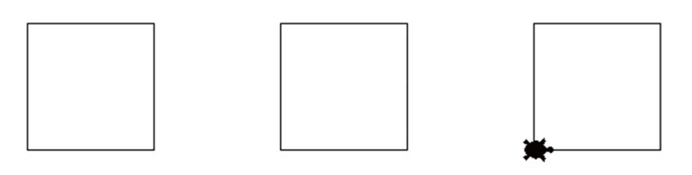
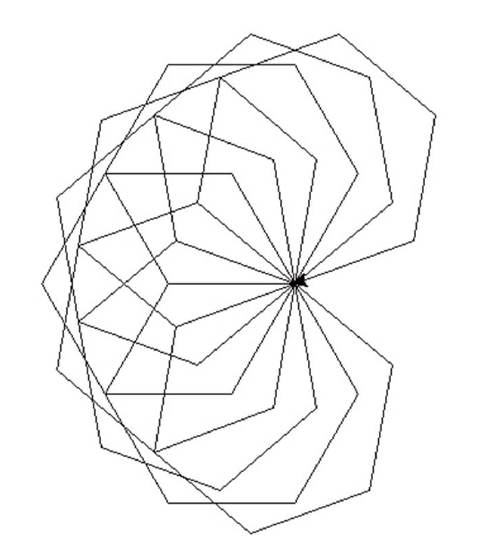

# Lecture 6 Exercises — Functions

[Repository Guide](../../README.md) | [English](Exercises.md) | [한국어](Exercises.ko.md)

> **Last Updated:** 2026-11-04

Exercises 1-2 ask for defining and calling functions in turtle graphics; Exercise 3 is about a global constant, Exercise 4 about keyword arguments, Exercise 5 about calling one function inside another, and Exercise 6 about creating and using a module.

---

<br>

## Table of Contents

- [Exercise 1: A Function That Draws a Square](#exercise-1-a-function-that-draws-a-square)
- [Exercise 2: A Function That Draws an n-Sided Polygon](#exercise-2-a-function-that-draws-an-n-sided-polygon)
- [Exercise 3: Circle Area and Circumference with a Global Constant](#exercise-3-circle-area-and-circumference-with-a-global-constant)
- [Exercise 4: Arithmetic Functions and Keyword Arguments](#exercise-4-arithmetic-functions-and-keyword-arguments)
- [Exercise 5: The Largest of Three Integers](#exercise-5-the-largest-of-three-integers)
- [Exercise 6: A Calculator Module](#exercise-6-a-calculator-module)

---

<br>

## Exercise 1: A Function That Draws a Square

**Problem:** A function that draws a square in turtle graphics is as follows. The parameter `length` is the side length.

```python
def square(length):           # length is the side length
    for i in range(4):
        t.forward(length)
        t.left(90)
```

Call the function above to draw 3 squares with side length 100. The three squares start at (-200, 0), (0, 0), and (200, 0), respectively, and no line is drawn while moving between squares. Change the shape of the turtle to `"turtle"`.

**Sample Run:**



*Figure 1. Three squares drawn by calling the function square() three times*

**[Solution](Solutions.md#exercise-1-a-function-that-draws-a-square)**

---

<br>

## Exercise 2: A Function That Draws an n-Sided Polygon

**Problem:** Write a function `n_polygon(n, length)` that draws a regular $n$-sided polygon, where `n` is the number of sides and `length` is the side length. Using this function, repeat 10 times the task of turning 20 degrees to the left and then drawing a regular hexagon with side length 100, to draw the following picture.

**Sample Run:**



*Figure 2. Ten regular hexagons drawn with 20-degree turns*

**[Solution](Solutions.md#exercise-2-a-function-that-draws-an-n-sided-polygon)**

---

<br>

## Exercise 3: Circle Area and Circumference with a Global Constant

**Problem:** Declare pi ($`\pi`$) as a global variable and use it to write functions that compute the area and the circumference of a circle. Read the radius and print the two values. The input prompt is `원의 반지름을 입력하시오: ` (Enter the radius of the circle:), and the area and circumference are printed after `원의 면적:` (Area of the circle:) and `원의 둘레:` (Circumference of the circle:).

**Sample Run:**

```text
원의 반지름을 입력하시오: 10
원의 면적: 314.159265358979
원의 둘레: 62.8318530717958
```

**[Solution](Solutions.md#exercise-3-circle-area-and-circumference-with-a-global-constant)**

---

<br>

## Exercise 4: Arithmetic Functions and Keyword Arguments

**Problem:** Write 4 functions `add()`, `sub()`, `mul()`, and `div()` that perform the four arithmetic operations. Each function receives two numbers and returns the result of the operation. Use these functions to compute `10+20*30`. Use keyword arguments when calling the functions.

**Sample Run:**

```text
610
```

**[Solution](Solutions.md#exercise-4-arithmetic-functions-and-keyword-arguments)**

---

<br>

## Exercise 5: The Largest of Three Integers

**Problem:** Write a function that, given 3 integers, finds and returns the largest. Use the function `get_max(x, y)` that finds the larger of two numbers ([Lecture 6, Section 4.2](Concepts_Lecture.md#42-examples-of-writing-functions)). For example, given 10, 30, and 20, it returns 30.

**[Solution](Solutions.md#exercise-5-the-largest-of-three-integers)**

---

<br>

## Exercise 6: A Calculator Module

**Problem:** Make calculator functions that perform the four arithmetic operations into a module (file name: `cals`), and use this module to compute the following. Operator precedence is not applied; compute from left to right.

```text
30+10/5*10
```

**[Solution](Solutions.md#exercise-6-a-calculator-module)**
