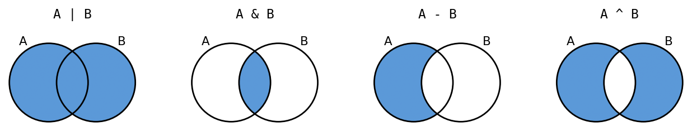
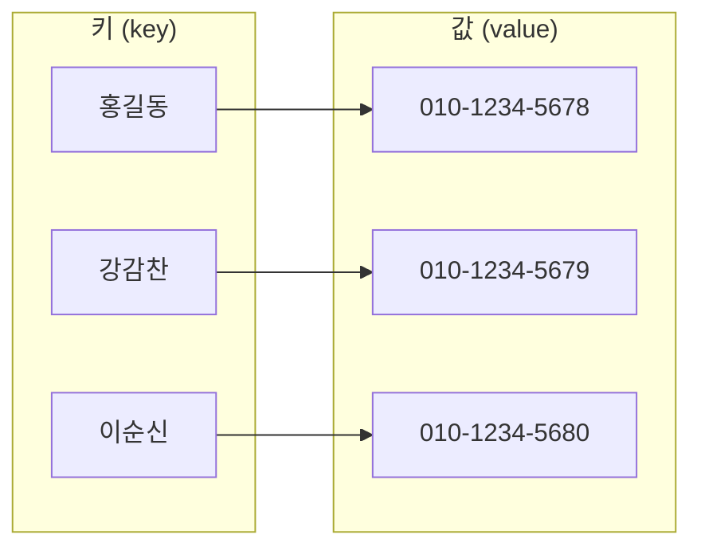

# 7강 — 리스트와 딕셔너리

[레포지토리 안내](../../README.ko.md) | [English](Concepts_Lecture.md) | [한국어](Concepts_Lecture.ko.md)

> **최종 수정일:** 2026-11-04

> **학습 목표:**
> 1. 리스트를 만들고 인덱싱, 슬라이싱, 메서드로 요소를 조회, 추가, 변경, 삭제할 수 있다
> 2. 리스트 컴프리헨션과 2차원 리스트로 데이터를 생성하고 처리할 수 있다
> 3. 튜플과 리스트를 가변성으로 구분하고 시퀀스 자료형의 공통 연산을 사용할 수 있다
> 4. 별칭, 얕은 복사, 깊은 복사를 구분하고 함수에 객체 참조가 전달되는 방식을 설명할 수 있다
> 5. 세트로 중복을 제거하고 소속 검사와 집합 연산을 수행할 수 있다
> 6. 딕셔너리에 키와 값을 저장하고 조회, 추가, 삭제, 순회할 수 있다

---

## 목차

- [1. 리스트](#1-리스트)
  - [1.1 여러 값을 하나로 묶기](#11-여러-값을-하나로-묶기)
  - [1.2 리스트의 생성](#12-리스트의-생성)
  - [1.3 객체와 점 표기법](#13-객체와-점-표기법)
- [2. 요소의 접근](#2-요소의-접근)
  - [2.1 인덱싱](#21-인덱싱)
  - [2.2 슬라이싱](#22-슬라이싱)
  - [2.3 리스트의 순회](#23-리스트의-순회)
- [3. 요소의 변경, 추가, 삭제](#3-요소의-변경-추가-삭제)
  - [3.1 요소 변경](#31-요소-변경)
  - [3.2 요소 추가](#32-요소-추가)
  - [3.3 요소 삭제](#33-요소-삭제)
- [4. 탐색, 길이, 정렬](#4-탐색-길이-정렬)
  - [4.1 요소 탐색](#41-요소-탐색)
  - [4.2 길이, 최솟값, 최댓값](#42-길이-최솟값-최댓값)
  - [4.3 정렬](#43-정렬)
- [5. 리스트 컴프리헨션](#5-리스트-컴프리헨션)
  - [5.1 기본 형식](#51-기본-형식)
  - [5.2 조건이 있는 리스트 컴프리헨션](#52-조건이-있는-리스트-컴프리헨션)
- [6. 2차원 리스트](#6-2차원-리스트)
  - [6.1 표를 2차원 리스트로 나타내기](#61-표를-2차원-리스트로-나타내기)
  - [6.2 2차원 리스트의 동적 생성](#62-2차원-리스트의-동적-생성)
  - [6.3 요소 접근과 순회](#63-요소-접근과-순회)
- [7. 튜플](#7-튜플)
  - [7.1 튜플의 생성](#71-튜플의-생성)
  - [7.2 튜플의 불변성](#72-튜플의-불변성)
  - [7.3 튜플 연산과 함수](#73-튜플-연산과-함수)
  - [7.4 튜플 언패킹](#74-튜플-언패킹)
- [8. 시퀀스 자료형](#8-시퀀스-자료형)
  - [8.1 시퀀스의 종류](#81-시퀀스의-종류)
  - [8.2 시퀀스 공통 연산](#82-시퀀스-공통-연산)
  - [8.3 접합, 반복, 비교](#83-접합-반복-비교)
- [9. 리스트의 복사와 함수](#9-리스트의-복사와-함수)
  - [9.1 변수와 객체](#91-변수와-객체)
  - [9.2 별칭](#92-별칭)
  - [9.3 얕은 복사](#93-얕은-복사)
  - [9.4 깊은 복사](#94-깊은-복사)
  - [9.5 함수에 리스트 전달](#95-함수에-리스트-전달)
  - [9.6 전역 리스트와 global](#96-전역-리스트와-global)
- [10. 세트](#10-세트)
  - [10.1 세트의 성질](#101-세트의-성질)
  - [10.2 소속 검사와 순회](#102-소속-검사와-순회)
  - [10.3 요소 추가와 삭제](#103-요소-추가와-삭제)
  - [10.4 부분 집합과 집합 연산](#104-부분-집합과-집합-연산)
- [11. 딕셔너리](#11-딕셔너리)
  - [11.1 키와 값](#111-키와-값)
  - [11.2 값의 조회](#112-값의-조회)
  - [11.3 항목의 추가, 변경, 삭제](#113-항목의-추가-변경-삭제)
  - [11.4 키, 값, 항목의 순회](#114-키-값-항목의-순회)
- [개념 적용](#개념-적용)
- [요약](#요약)
- [점검 문제](#점검-문제)
- [참고 문헌](#참고-문헌)

---

<br>

## 1. 리스트

### 1.1 여러 값을 하나로 묶기

학생 10명의 점수를 처리하는 프로그램을 생각한다. 변수 하나에 값 하나를 저장한다면 `score1`, `score2`, ..., `score10`처럼 변수 10개가 필요하고, 합계를 구하는 식에도 변수 이름을 모두 적어야 한다. 학생이 100명으로 늘면 코드도 그만큼 길어진다. 이처럼 같은 종류의 데이터 여러 개를 한 이름 아래 묶어서 저장하고 번호로 꺼내 쓰는 방법이 필요하다.

> **용어 정의:** **리스트(list)** 는 여러 값을 순서대로 저장하는 파이썬의 자료형이다. 리스트에 들어 있는 각 값을 **요소(element)** 라고 하며, 요소는 0부터 시작하는 위치 번호인 **인덱스(index)** 로 구별된다.

리스트는 대괄호 `[` `]` 안에 값을 쉼표로 구분하여 나열해서 만든다. 이 기본 문법과 `append()`, 인덱스를 이용한 접근은 [3강 8절](../Lec03_Data-Types/Concepts_Lecture.ko.md#8-리스트)에서 처음 소개하였다.

```python
리스트 = [값1, 값2, ...]
```

예를 들어 영웅 네 명을 적은 체크리스트와 학생 10명의 점수는 각각 다음과 같은 리스트 하나로 저장할 수 있다.

```python
heroes = ["아이언맨", "토르", "헐크", "스칼렛 위치"]
scores = [32, 56, 64, 72, 12, 37, 98, 77, 59, 69]
print(heroes)
print(scores)
print(type(scores))
```

```text
['아이언맨', '토르', '헐크', '스칼렛 위치']
[32, 56, 64, 72, 12, 37, 98, 77, 59, 69]
<class 'list'>
```

`print()`는 리스트를 대괄호와 쉼표로 감싼 형태로 출력하고, 문자열 요소는 작은따옴표로 감싸서 보여 준다. `type()`이 `<class 'list'>`를 출력하는 것은 `scores`가 `list`라는 **클래스(class)** 의 객체라는 뜻이다. 클래스는 [8강](../Lec08_Classes-and-Objects/Concepts_Lecture.ko.md)에서 직접 정의한다.

### 1.2 리스트의 생성

리스트는 여러 방법으로 만든다. 요소가 하나도 없는 **빈 리스트(empty list)** 는 `[]`이나 `list()`로 만들고, 요소의 자료형은 서로 달라도 된다. 리스트 자체도 하나의 값이므로 다른 리스트의 요소가 될 수 있으며, 이런 리스트를 **중첩 리스트(nested list)** 라고 한다.

```python
list1 = []                      # 빈 리스트
list2 = list()                  # list 클래스로 만든 빈 리스트
list3 = [12, "dog", 180.14]     # 자료형이 서로 다른 요소
list4 = [["Seoul", 10], ["Paris", 12], ["London", 50]]   # 중첩 리스트
print(list1, list2)
print(list3)
print(list4[1])
print(list4[1][0])
list5 = ["aaa", ["bbb", ["ccc", ["ddd", "eee", 45]]]]
print(list5[1][1][1][2])
print(list("Hello"))
print(list(range(5)))
```

```text
[] []
[12, 'dog', 180.14]
['Paris', 12]
Paris
45
['H', 'e', 'l', 'l', 'o']
[0, 1, 2, 3, 4]
```

- **`list4[1]`:** 인덱스 1의 요소인 리스트 `["Paris", 12]`이다. 여기에 인덱스를 한 번 더 붙인 `list4[1][0]`은 그 안쪽 리스트의 첫 요소 `"Paris"`이다.
- **`list5[1][1][1][2]`:** 바깥에서부터 차례로 `["bbb", [...]]`, `["ccc", [...]]`, `["ddd", "eee", 45]`로 들어간 뒤 인덱스 2의 요소 45를 꺼낸다. 대괄호 하나가 중첩 한 단계에 대응한다.
- **`list("Hello")`, `list(range(5))`:** `list()`에 문자열이나 `range` 객체처럼 요소를 하나씩 꺼낼 수 있는 값을 주면 그 요소들로 새 리스트를 만든다. 문자열은 문자 하나하나가, `range(5)`는 0~4의 정수가 요소가 된다.

### 1.3 객체와 점 표기법

파이썬에서 다루는 모든 값은 **객체(object)** 이다. 객체는 관련된 데이터와 그 데이터를 다루는 함수를 하나로 묶은 것이며, 객체에 속한 함수를 **메서드(method)** 라고 한다. 리스트도 객체이므로 요소를 추가하는 `append()` 같은 메서드를 가진다.

객체에 속한 메서드를 사용할 때는 객체의 이름 뒤에 점(`.`)을 찍고 메서드 이름을 쓴다. 이 표기를 **점 표기법(dot notation)** 이라고 한다.

```python
heroes.append("아이언맨")      # heroes 객체의 append 메서드를 호출한다
```

`len(heroes)`처럼 괄호 안에 객체를 넘기는 **내장 함수(built-in function)** 와 `heroes.append(...)`처럼 점 뒤에 쓰는 메서드는 구별해야 한다. 내장 함수는 여러 자료형에 공통으로 쓰이고, 메서드는 그 객체의 자료형이 제공하는 기능이다. 예를 들어 `append()`는 리스트의 메서드이므로 문자열이나 튜플에는 없다.

---

<br>

## 2. 요소의 접근

### 2.1 인덱싱

리스트 이름 뒤에 대괄호와 인덱스를 써서 요소 하나를 꺼내는 것을 **인덱싱(indexing)** 이라고 한다. 첫 요소의 인덱스는 0이고, 요소가 $n$개인 리스트의 마지막 요소의 인덱스는 $n-1$이다. 인덱스에 음수를 쓰면 끝에서부터 센다. 마지막 요소가 -1, 그 앞이 -2이며, 첫 요소는 $-n$이다. 이를 **음수 인덱스(negative index)** 라고 한다.

```text
letters = ['A', 'B', 'C', 'D', 'E', 'F']

┌─────┬─────┬─────┬─────┬─────┬─────┐
│ 'A' │ 'B' │ 'C' │ 'D' │ 'E' │ 'F' │    요소
└─────┴─────┴─────┴─────┴─────┴─────┘
   0     1     2     3     4     5       양수 인덱스
  -6    -5    -4    -3    -2    -1       음수 인덱스
```

*그림 1. 리스트 `letters`의 요소와 양수 인덱스, 음수 인덱스*

```python
letters = ['A', 'B', 'C', 'D', 'E', 'F']
print(letters[0])
print(letters[1])
print(letters[2])
print(letters[-1])
print(letters[-6])
print(letters[len(letters) - 1])
shopping_list = ["두부", "양배추", "딸기", "사과", "토마토"]
print(shopping_list[-1], shopping_list[-5])
```

```text
A
B
C
F
A
F
토마토 두부
```

`letters[-1]`과 `letters[len(letters) - 1]`은 같은 요소를 가리킨다. 음수 인덱스 $-k$는 인덱스 $n-k$와 같기 때문이다. 요소가 5개인 `shopping_list`에서 `-1`은 인덱스 4의 `"토마토"`, `-5`는 인덱스 0의 `"두부"`이다.

> **주의:** 요소가 $n$개인 리스트에서 쓸 수 있는 인덱스는 $-n$부터 $n-1$까지이다. 이 범위 밖의 인덱스를 쓰면 `IndexError: list index out of range` 오류가 발생한다. 예를 들어 `letters[6]`은 요소가 6개인 `letters`에 인덱스 6인 요소가 없으므로 오류이다.

### 2.2 슬라이싱

**슬라이싱(slicing)** 은 리스트에서 연속한 여러 요소를 한 번에 꺼내 새 리스트로 만드는 기법이다. `리스트[start:end]`는 인덱스 `start`부터 `end - 1`까지의 요소를 담은 새 리스트이며, `end` 위치의 요소는 포함하지 않는다. `start`를 생략하면 처음부터, `end`를 생략하면 끝까지를 뜻한다.

```python
letters = ['A', 'B', 'C', 'D', 'E', 'F']
print(letters[0:3])      # 인덱스 0, 1, 2
print(letters[:3])       # 처음부터 인덱스 2까지
print(letters[3:])       # 인덱스 3부터 끝까지
print(letters[:])        # 처음부터 끝까지 (리스트 전체의 복사본)
print(letters[1:5:2])    # 인덱스 1, 3
print(letters[::2])      # 인덱스 0, 2, 4
print(letters[::-1])     # 거꾸로
print(letters[-3:])      # 마지막 세 요소
print(letters[4:100])    # end가 길이보다 커도 오류가 아니다
print(letters[10:20])    # 범위에 요소가 없으면 빈 리스트
```

```text
['A', 'B', 'C']
['A', 'B', 'C']
['D', 'E', 'F']
['A', 'B', 'C', 'D', 'E', 'F']
['B', 'D']
['A', 'C', 'E']
['F', 'E', 'D', 'C', 'B', 'A']
['D', 'E', 'F']
['E', 'F']
[]
```

슬라이스의 경계는 요소 사이의 칸막이로 생각하면 이해하기 쉽다. 칸막이에 0부터 번호를 붙이면 `letters[1:4]`는 칸막이 1과 4 사이의 요소 `'B'`, `'C'`, `'D'`이고, 결과의 길이는 `end - start` = 3이다.

```text
0     1     2     3     4     5     6     칸막이 번호
│ 'A' │ 'B' │ 'C' │ 'D' │ 'E' │ 'F' │
      └──── letters[1:4] ───┘
```

*그림 2. 칸막이 번호로 본 슬라이스 `letters[1:4]`의 범위*

- **세 번째 값(step):** `리스트[start:end:step]`은 `start`에서 시작하여 `step`씩 건너뛰며 `end` 앞까지 요소를 고른다. `letters[1:5:2]`는 인덱스 1, 3의 요소이다.
- **음수 step:** step이 음수이면 뒤에서 앞으로 진행하고, 생략한 `start`와 `end`는 각각 마지막 요소와 첫 요소 앞을 뜻한다. 그래서 `letters[::-1]`은 리스트를 뒤집은 새 리스트이다.
- **범위 밖의 경계:** 인덱싱과 달리 슬라이싱은 `start`나 `end`가 범위를 벗어나도 오류를 내지 않고 실제로 있는 요소까지만 잘라 낸다.

> **핵심:** `letters[:]`는 원래 리스트와 같은 요소를 가진 **새 리스트**를 만든다. 이 성질 때문에 `[:]`는 리스트를 복사할 때 쓰이며, 이때 만들어지는 복사본의 성질은 [9.3절](#93-얕은-복사)에서 정확히 다룬다.

### 2.3 리스트의 순회

리스트의 요소를 처음부터 끝까지 하나씩 차례로 처리하는 것을 **순회(traversal)** 라고 한다. `for`문에 리스트를 주면 리스트의 요소가 차례대로 루프 변수에 대입되면서 반복 본문이 실행된다([5강 4.2절](../Lec05_Loops/Concepts_Lecture.ko.md#42-리스트의-순회)).

```python
for 변수 in 리스트:
    문장1
    문장2
```

아래 코드는 먼저 `scores[5] = 80`으로 인덱스 5의 요소를 80으로 바꾼 뒤, 리스트를 두 가지 방식으로 순회한다.

```python
scores = [32, 56, 64, 72, 12, 37, 98, 77, 59, 69]
scores[5] = 80
for element in scores:
    print(element, end=" ")
print()
for i in range(len(scores)):
    print(i, scores[i])
```

```text
32 56 64 72 12 80 98 77 59 69
0 32
1 56
2 64
3 72
4 12
5 80
6 98
7 77
8 59
9 69
```

```text
scores  ┌────┬────┬────┬────┬────┬────┬────┬────┬────┬────┐
        │ 32 │ 56 │ 64 │ 72 │ 12 │ 80 │ 98 │ 77 │ 59 │ 69 │
        └────┴────┴────┴────┴────┴────┴────┴────┴────┴────┘
          [0]  [1]  [2]  [3]  [4]  [5]  [6]  [7]  [8]  [9]
                                     ▲
                              scores[5] = 80
```

*그림 3. 인덱스 5의 요소에 80을 저장한 리스트 `scores`*

- **`for element in scores`:** 요소의 값만 필요할 때 쓴다. 첫 반복에서 `element`는 32, 다음 반복에서 56이 되며, 마지막 반복에서 69가 된다. `print(element, end=" ")`는 줄을 바꾸는 대신 공백을 출력하므로 요소가 한 줄에 나열되고, 반복이 끝난 뒤의 `print()`가 줄을 바꾼다.
- **`for i in range(len(scores))`:** `len(scores)`가 10이므로 `i`는 0~9의 인덱스가 된다. 인덱스와 요소가 함께 필요하거나 `scores[i] = ...`처럼 그 위치의 요소를 바꿔야 할 때 쓴다.

---

<br>

## 3. 요소의 변경, 추가, 삭제

### 3.1 요소 변경

리스트는 만든 뒤에도 요소를 바꿀 수 있는 **가변(mutable)** 자료형이다. 인덱스로 위치를 지정하고 대입 연산자 `=`로 새 값을 저장하면 그 위치의 요소가 바뀐다.

```python
heroes = ["아이언맨", "토르", "헐크", "스칼렛 위치"]
heroes[1] = "닥터 스트레인지"
print(heroes)
squares = [0, 1, 4, 9, 16, 25, 36, 48]   # 마지막 요소가 잘못되었다
print(7 ** 2)
squares[7] = 49
print(squares)
```

```text
['아이언맨', '닥터 스트레인지', '헐크', '스칼렛 위치']
49
[0, 1, 4, 9, 16, 25, 36, 49]
```

`squares`는 0~7의 제곱을 저장하려던 리스트인데 인덱스 7의 요소가 48로 잘못 들어가 있다. $7^2 = 49$이므로 `squares[7] = 49`로 그 요소만 고친다. 리스트 전체를 다시 만들 필요가 없다는 것이 가변 자료형의 특징이다. 반면 문자열은 내용을 바꿀 수 없는 불변 자료형이므로 `s[0] = "x"` 같은 대입이 오류가 된다([3강 5.3절](../Lec03_Data-Types/Concepts_Lecture.ko.md#53-문자열의-길이와-불변성)).

### 3.2 요소 추가

빈 리스트에서 시작하여 요소를 하나씩 넣어 가는 일이 흔하다. 빈 장바구니에 물건을 하나씩 담는 것과 같다. `append(x)`는 리스트의 끝에 `x`를 추가하고, `insert(i, x)`는 인덱스 `i`의 위치에 `x`를 끼워 넣는다.

```python
heroes = []
print(heroes.append("아이언맨"))
heroes.append("닥터 스트레인지")
print(heroes)
```

```text
None
['아이언맨', '닥터 스트레인지']
```

`append()`는 리스트 자체를 바꾸고 아무 값도 반환하지 않으므로, 그 반환값을 출력하면 값이 없음을 뜻하는 `None`이 나온다. 대화형 셸에서 `heroes.append("아이언맨")`을 입력해도 아무것도 출력되지 않는 것은 이 때문이다. 바뀐 리스트를 보려면 `print(heroes)`처럼 리스트를 따로 출력한다.

```python
heroes = ["아이언맨", "닥터 스트레인지", "헐크", "스칼렛 위치"]
heroes.append("스파이더맨")
print(heroes)
heroes.insert(1, "배트맨")
print(heroes)
heroes.insert(100, "슈퍼맨")
print(heroes)
a = [1, 2]
a.extend([3, 4])
print(a)
a.append([5, 6])
print(a)
```

```text
['아이언맨', '닥터 스트레인지', '헐크', '스칼렛 위치', '스파이더맨']
['아이언맨', '배트맨', '닥터 스트레인지', '헐크', '스칼렛 위치', '스파이더맨']
['아이언맨', '배트맨', '닥터 스트레인지', '헐크', '스칼렛 위치', '스파이더맨', '슈퍼맨']
[1, 2, 3, 4]
[1, 2, 3, 4, [5, 6]]
```

- **`insert(1, "배트맨")`:** 새 요소가 인덱스 1이 되고, 원래 인덱스 1 이후의 요소는 한 칸씩 뒤로 밀린다. 인덱스가 리스트의 길이 이상이면(`insert(100, ...)`) 끝에 추가된다.
- **`extend(리스트)`:** 다른 리스트의 요소를 하나씩 끝에 이어 붙인다. `append([5, 6])`은 리스트 `[5, 6]` 전체를 요소 하나로 추가하므로 결과가 다르다.

### 3.3 요소 삭제

요소를 삭제하는 방법은 세 가지이다. 값으로 찾아 지우는 `remove()`, 인덱스로 지우는 `del`문, 꺼내면서 지우는 `pop()`이다.

```python
heroes = ["아이언맨", "토르", "헐크", "스칼렛 위치"]
heroes.remove("스칼렛 위치")
print(heroes)
if "슈퍼맨" in heroes:
    heroes.remove("슈퍼맨")
print(heroes)
heroes = ["아이언맨", "토르", "헐크", "스칼렛 위치"]
del heroes[0]
print(heroes)
heroes = ["아이언맨", "토르", "헐크", "스칼렛 위치"]
last_hero = heroes.pop()
print(last_hero)
print(heroes)
first = heroes.pop(0)
print(first, heroes)
```

```text
['아이언맨', '토르', '헐크']
['아이언맨', '토르', '헐크']
['토르', '헐크', '스칼렛 위치']
스칼렛 위치
['아이언맨', '토르', '헐크']
아이언맨 ['토르', '헐크']
```

| 방법 | 지정하는 것 | 반환값 | 대상이 없을 때 |
|:-----|:-----|:-----|:-----|
| `리스트.remove(x)` | 값 `x` (같은 값이 여럿이면 가장 앞의 것) | `None` | `ValueError` |
| `del 리스트[i]` | 인덱스 `i` (슬라이스 `del 리스트[i:j]`도 가능) | 없음 (문장이다) | `IndexError` |
| `리스트.pop()` | 인덱스 생략 시 마지막 요소 | 삭제한 요소 | 빈 리스트이면 `IndexError` |
| `리스트.pop(i)` | 인덱스 `i` | 삭제한 요소 | `IndexError` |

*표 1. 리스트 요소를 삭제하는 세 방법의 비교*

- **`remove()`와 `in`:** 리스트에 없는 값을 `remove()`하면 `ValueError: list.remove(x): x not in list` 오류가 난다. 그래서 `if "슈퍼맨" in heroes:`처럼 `in` 연산자로 값이 있는지 먼저 확인한 뒤 지운다. `in`은 값이 리스트에 있으면 `True`, 없으면 `False`이다.
- **`del`:** 함수나 메서드가 아니라 파이썬의 문장(statement)이므로 괄호 없이 `del heroes[0]`으로 쓴다.
- **`pop()`:** 삭제한 요소를 반환하므로 `last_hero = heroes.pop()`처럼 지우면서 그 값을 변수에 받아 쓸 수 있다. 위 코드에서 `pop()`은 마지막 요소 `"스칼렛 위치"`를, `pop(0)`은 첫 요소 `"아이언맨"`을 꺼낸다.

---

<br>

## 4. 탐색, 길이, 정렬

### 4.1 요소 탐색

`index(x)`는 값이 `x`인 요소의 인덱스를 반환한다. 같은 값이 여럿이면 가장 앞에 있는 요소의 인덱스를 반환하고, 없으면 `ValueError`가 발생한다. 개수가 필요하면 `count(x)`를 쓴다.

```python
heroes = ["아이언맨", "토르", "헐크", "스칼렛 위치"]
print(heroes.index("헐크"))
print("토르" in heroes, "슈퍼맨" in heroes, "슈퍼맨" not in heroes)
names = ["아", "토", "헐", "스", "헐"]
print(names.index("헐"))
print(names.count("헐"))
```

```text
2
True False True
2
2
```

`index()`가 내부에서 하는 일은 앞에서부터 요소를 하나씩 비교하다가 처음 일치하는 위치에서 멈추는 **순차 탐색(sequential search)** 이다. 같은 동작을 함수로 직접 쓰면 다음과 같다.

```python
def find_index(items, target):
    for i in range(len(items)):
        if items[i] == target:
            return i          # 처음 일치한 위치에서 바로 끝낸다
    return -1                 # 끝까지 없으면 -1을 반환한다

names = ["아", "토", "헐", "스", "헐"]
print(find_index(names, "헐"))
print(find_index(names, "슈"))
```

```text
2
-1
```

`return i`가 반복문 안에 있으므로 첫 번째 `"헐"`(인덱스 2)에서 함수가 끝난다. `return` 없이 일치할 때마다 변수에 인덱스를 저장하고 반복을 끝까지 돌면 마지막 일치 위치(인덱스 4)가 남는다. 값이 없을 때 오류 대신 -1을 반환하도록 한 것은 이 함수의 설계이며, `index()`는 이 경우 `ValueError`를 낸다.

> **[알고리즘]** 순차 탐색은 최악의 경우 $n$개의 요소를 모두 비교하므로 시간 복잡도가 $O(n)$이다. 리스트에 대한 `in` 연산과 `index()`, `count()`, `remove()`도 모두 이와 같이 요소를 차례로 비교한다. 정렬된 리스트에서는 가운데 요소와 비교하여 범위를 절반씩 줄이는 이진 탐색으로 $O(\log n)$에 찾을 수 있다.

### 4.2 길이, 최솟값, 최댓값

`len()`은 리스트의 요소 개수를 반환하는 내장 함수이고, `min()`과 `max()`는 가장 작은 요소와 가장 큰 요소를, `sum()`은 수로 된 요소의 합을 반환한다.

```python
letters = ['a', 'b', 'c', 'd']
print(len(letters))
print(len([]))
print(len([[1, 2], [3, 4, 5]]))
values = [1, 2, 3, 4, 5, 6, 7, 8, 9, 10]
print(min(values), max(values), sum(values))
print(min(["banana", "apple", "cherry"]))
```

```text
4
0
2
1 10 55
apple
```

- **중첩 리스트의 길이:** `len([[1, 2], [3, 4, 5]])`는 2이다. 바깥 리스트의 요소는 안쪽 리스트 두 개이며, 안쪽 리스트의 요소 수는 세지 않는다.
- **비교 가능성:** `min()`과 `max()`는 요소끼리 크기를 비교하므로 요소들이 서로 비교 가능해야 한다. 문자열끼리는 사전식으로 비교되어 `"apple"`이 가장 작다. `max([1, "a"])`처럼 정수와 문자열이 섞이면 `TypeError`가 나고, 빈 리스트의 `min([])`은 `ValueError`가 난다.

### 4.3 정렬

`sort()`는 리스트의 요소를 오름차순으로 정렬하는 메서드이다. 사람들을 키가 작은 순서대로 줄 세우는 것처럼 작은 값이 앞에 오도록 요소를 재배열한다. 새 리스트를 만들지 않고 원래 리스트의 요소 순서를 바꾸며(제자리 정렬), 반환값은 `None`이다.

```python
heroes = ["아이언맨", "토르", "헐크", "스칼렛 위치"]
heroes.sort()
print(heroes)
nums = [5, 2, 9, 1]
result = nums.sort()
print(result, nums)
nums.sort(reverse=True)
print(nums)
data = [5, 2, 9, 1]
new = sorted(data)
print(data, new)
print(sorted(["b", "B", "a", "A"]))
```

```text
['스칼렛 위치', '아이언맨', '토르', '헐크']
None [1, 2, 5, 9]
[9, 5, 2, 1]
[5, 2, 9, 1] [1, 2, 5, 9]
['A', 'B', 'a', 'b']
```

- **문자열의 순서:** 문자열은 첫 문자부터 차례로 각 문자의 유니코드 코드 포인트(`ord()`의 값)를 비교하여 정렬된다 [1]. 한글 음절은 유니코드에서 초성, 중성, 종성 순서의 가나다순으로 배열되어 있으므로 [2], 한글 문자열은 가나다순으로 정렬된다. `'스'`(49828), `'아'`(50500), `'토'`(53664), `'헐'`(54736)의 순서가 위 결과와 같다.
- **대문자와 소문자:** `'A'`의 코드 포인트는 65, `'a'`는 97이므로 대문자가 소문자보다 앞에 온다. 그래서 `["b", "B", "a", "A"]`는 `['A', 'B', 'a', 'b']`가 된다.
- **`reverse=True`:** 내림차순으로 정렬한다.
- **`sorted()`:** 원래 리스트는 그대로 두고 정렬된 **새 리스트**를 반환하는 내장 함수이다. 원본을 보존해야 하면 `sorted()`를, 원본을 바꿔도 되면 `sort()`를 쓴다.

> **주의:** `nums = nums.sort()`처럼 쓰면 `sort()`의 반환값 `None`이 `nums`에 대입되어 리스트를 잃는다. `sort()`, `append()`, `insert()`, `remove()`처럼 리스트를 제자리에서 바꾸는 메서드는 모두 `None`을 반환한다.

---

<br>

## 5. 리스트 컴프리헨션

### 5.1 기본 형식

**리스트 컴프리헨션(list comprehension)** 은 기존 시퀀스의 요소마다 식을 계산하여 새 리스트를 만드는 문법이다. 리스트 함축이라고도 하며, 수학에서 집합을 조건 제시법 $S = \lbrace x^2 \mid x \in \lbrace 0, 1, \ldots, 9 \rbrace \rbrace$로 정의하는 것과 형태가 비슷하다.

```text
  [ expression   for i in old_list   if filter(i) ]
        │                │                 │
        │                │                 └─ 선택 사항: 이 조건이 참인 i만 새 리스트에 추가된다
        │                └─ 루프 변수 i가 입력 리스트 old_list의 요소를 차례로 가리킨다
        └─ 출력식: 계산 결과가 새 리스트의 요소가 된다

  S = [ x**2   for x in range(10) ]
         │         │       │
         │         │       └─ 입력 시퀀스
         │         └─ 입력 시퀀스의 각 요소 x에 대하여
         └─ 출력식 x**2의 값이 새 리스트의 요소가 된다
```

*그림 4. 리스트 컴프리헨션의 구성 요소*

```python
list1 = [3, 4, 5]
list2 = [x*2 for x in list1]
print(list2)
S = [x**2 for x in range(10)]
print(S)
s = []
for x in range(10):
    s.append(x**2)
print(s == S)
```

```text
[6, 8, 10]
[0, 1, 4, 9, 16, 25, 36, 49, 64, 81]
True
```

`[x*2 for x in list1]`은 `list1`의 요소 3, 4, 5를 차례로 `x`에 대입하여 `x*2`를 계산하고, 그 값 6, 8, 10으로 새 리스트를 만든다. 마지막 비교가 `True`인 것처럼, 리스트 컴프리헨션은 빈 리스트를 만들고 `for`문에서 `append()`하는 코드와 같은 결과를 한 줄로 표현한다.

### 5.2 조건이 있는 리스트 컴프리헨션

`for` 절 뒤에 `if` 조건을 붙이면 조건이 참인 요소에 대해서만 출력식을 계산하여 새 리스트에 넣는다.

```python
M = [x for x in range(10) if x % 2 == 0]
print(M)
evens_sq = [x**2 for x in range(10) if x % 2 == 0]
print(evens_sq)
pairs = [(x, y) for x in range(1, 3) for y in range(1, 4)]
print(pairs)
words = ["apple", "kiwi", "banana"]
print([len(w) for w in words])
print([w.upper() for w in words if len(w) > 4])
```

```text
[0, 2, 4, 6, 8]
[0, 4, 16, 36, 64]
[(1, 1), (1, 2), (1, 3), (2, 1), (2, 2), (2, 3)]
[5, 4, 6]
['APPLE', 'BANANA']
```

- **`M`:** 0~9 가운데 2로 나눈 나머지가 0인 수, 즉 짝수만 남는다. 출력식이 `x` 자체이므로 걸러진 값이 그대로 요소가 된다.
- **`evens_sq`:** 짝수만 골라 제곱한다. 조건 검사가 출력식 계산보다 먼저 일어난다.
- **`for` 절이 둘인 경우:** `for` 절을 여러 개 쓰면 왼쪽 절이 바깥 반복, 오른쪽 절이 안쪽 반복인 중첩 반복문과 같다. `pairs`는 `x`가 1일 때 `y`가 1, 2, 3을 모두 돈 뒤 `x`가 2로 넘어간다. 이 형식은 세 변의 길이를 동시에 바꿔 가며 조건을 검사하는 [연습 문제 1](Exercises.ko.md#연습-문제-1-피타고라스-삼각형)에 쓰인다.
- **문자열 리스트:** 출력식에는 `len(w)`, `w.upper()`처럼 어떤 식이든 쓸 수 있다.

---

<br>

## 6. 2차원 리스트

### 6.1 표를 2차원 리스트로 나타내기

행과 열로 된 표는 리스트를 요소로 갖는 리스트, 즉 **2차원 리스트(two-dimensional list)** 로 나타낸다. 바깥 리스트의 요소 하나가 표의 한 행이고, 각 행은 그 행의 열 값을 담은 리스트이다.

| 학생 | 국어 | 영어 | 수학 | 과학 | 사회 |
|:-----|-----:|-----:|-----:|-----:|-----:|
| 김철수 | 1 | 2 | 3 | 4 | 5 |
| 김영희 | 6 | 7 | 8 | 9 | 10 |
| 최자영 | 11 | 12 | 13 | 14 | 15 |

*표 2. 학생 세 명의 과목별 값을 나타낸 표*

```python
# 2차원 리스트를 생성한다.
s = [
    [ 1,  2,  3,  4,  5],
    [ 6,  7,  8,  9, 10],
    [11, 12, 13, 14, 15]
]
print(s)
print(s[1])
print(s[1][3])
s[2][0] = 99
print(s[2])
```

```text
[[1, 2, 3, 4, 5], [6, 7, 8, 9, 10], [11, 12, 13, 14, 15]]
[6, 7, 8, 9, 10]
9
[99, 12, 13, 14, 15]
```

`s[r]`는 `r`번 행 전체(리스트)이고, `s[r][c]`는 그 행의 `c`번 열 요소이다. 표 2에서 김영희(1번 행)의 수학(3번 열) 값은 `s[1][3]`, 즉 9이다. `s[2][0] = 99`는 2번 행의 0번 열 요소만 바꾼다. 대괄호 안에서 줄을 바꾸어 행마다 한 줄씩 쓰면 표의 모양이 코드에 그대로 드러나며, 파이썬은 괄호가 닫힐 때까지 줄 바꿈을 문장의 끝으로 보지 않는다.

### 6.2 2차원 리스트의 동적 생성

행과 열의 개수가 프로그램 실행 중에 정해지면 반복문으로 2차원 리스트를 만든다.

```python
# 동적으로 2차원 리스트를 생성한다.
rows = 3
cols = 5

s = []
for row in range(rows):
    s += [[0]*cols]

print("s =", s)
s[0][0] = 7
print("s =", s)
```

```text
s = [[0, 0, 0, 0, 0], [0, 0, 0, 0, 0], [0, 0, 0, 0, 0]]
s = [[7, 0, 0, 0, 0], [0, 0, 0, 0, 0], [0, 0, 0, 0, 0]]
```

- **`[0]*cols`:** 0이 `cols`개인 리스트 `[0, 0, 0, 0, 0]`이다([8.3절](#83-접합-반복-비교)의 반복 연산).
- **`s += [[0]*cols]`:** `[[0]*cols]`는 그 행 하나를 요소로 가진 리스트이고, 리스트의 `+=`는 오른쪽 리스트의 요소를 `s`의 끝에 이어 붙인다. 따라서 반복할 때마다 행이 하나씩 늘어나며, `s.append([0]*cols)`와 결과가 같다.
- **행의 독립성:** 반복할 때마다 `[0]*cols`가 다시 계산되어 새 행 리스트가 만들어진다. 그래서 `s[0][0] = 7`은 0번 행만 바꾼다.

> **주의:** `[[0]*cols]*rows`로 같은 모양을 한 줄에 만들면 행들이 모두 **같은 리스트 객체 하나**를 가리킨다 [3]. 리스트의 `*`는 요소를 복제하지 않고 같은 요소에 대한 참조를 반복하기 때문이다. 이 경우 한 행의 요소를 바꾸면 모든 행이 함께 바뀐다. 행마다 새 리스트가 필요하면 반복문이나 `[[0]*cols for _ in range(rows)]`처럼 리스트 컴프리헨션을 쓴다(`_`는 값을 쓰지 않는 루프 변수에 관례로 붙이는 이름이다).

```python
t = [[0]*3]*2          # 2 x 3 표처럼 보인다
print(t)
t[0][0] = 7
print(t)
print(t[0] is t[1])
u = [[0]*3 for _ in range(2)]
u[0][0] = 7
print(u)
print(u[0] is u[1])
```

```text
[[0, 0, 0], [0, 0, 0]]
[[7, 0, 0], [7, 0, 0]]
True
[[7, 0, 0], [0, 0, 0]]
False
```

```text
t = [[0]*3]*2                         u = [[0]*3 for _ in range(2)]

t ──▶ ┌─────┬─────┐                    u ──▶ ┌─────┬─────┐
      │  ●  │  ●  │                          │  ●  │  ●  │
      └──┼──┴──┼──┘                          └──┼──┴──┼──┘
         └──┬──┘                                ▼     ▼
            ▼                           [7, 0, 0]     [0, 0, 0]
        [7, 0, 0]
```

*그림 5. 행 하나를 공유하는 `t`와 행마다 다른 리스트를 가진 `u`*

`is` 연산자는 두 식이 **같은 객체**인지 검사한다([9.1절](#91-변수와-객체)). `t[0] is t[1]`이 `True`이므로 `t`의 두 행은 한 객체이고, `u[0] is u[1]`은 `False`이므로 `u`의 두 행은 서로 다른 객체이다.

### 6.3 요소 접근과 순회

2차원 리스트의 모든 요소는 중첩 반복문으로 순회한다. 바깥 반복이 행을, 안쪽 반복이 그 행의 열을 차례로 지나간다.

```python
s = [
    [ 1,  2,  3,  4,  5],
    [ 6,  7,  8,  9, 10],
    [11, 12, 13, 14, 15]
]

# 행과 열의 개수를 구한다.
rows = len(s)
cols = len(s[0])

for r in range(rows):
    for c in range(cols):
        print(s[r][c], end=",")
    print()
```

```text
1,2,3,4,5,
6,7,8,9,10,
11,12,13,14,15,
```

- **행과 열의 개수:** `len(s)`는 바깥 리스트의 요소 수이므로 행의 개수 3이고, `len(s[0])`은 0번 행의 길이이므로 열의 개수 5이다.
- **출력:** 안쪽 반복은 한 행의 요소를 쉼표와 함께 이어서 출력하고, 안쪽 반복이 끝나면 `print()`로 줄을 바꾼다. 그래서 표의 한 행이 출력의 한 줄이 된다.

> **참고:** **행마다 길이가 다른 리스트.** 파이썬의 2차원 리스트는 리스트를 담은 리스트일 뿐이므로 행마다 길이가 달라도 된다. 예를 들어 `[[1, 2, 3, 4], [1, 2, 3, 4], [5, 6, 7]]`에서 `len(s[0])`은 4이지만 2번 행의 길이는 3이다. 이런 리스트에 위 코드처럼 `cols = len(s[0])`을 쓰면 2번 행에서 `IndexError`가 난다. 행마다 길이가 다를 수 있으면 `for row in s:`와 `for value in row:`처럼 각 행을 직접 순회한다.

---

<br>

## 7. 튜플

### 7.1 튜플의 생성

**튜플(tuple)** 은 리스트처럼 여러 값을 순서대로 저장하지만 만든 뒤에는 바꿀 수 없는 자료형이다. 소괄호 `(` `)` 안에 요소를 쉼표로 구분하여 쓴다.

```python
튜플 = (항목1, 항목2, ..., 항목n)
```

```python
colors = ("red", "green", "blue")
print(colors)
numbers = (1, 2, 3, 4, 5)
print(numbers)
print(type(colors))
one = ("Hi!",)
not_tuple = ("Hi!")
print(type(one), type(not_tuple))
p = 3, 4
print(p, type(p))
```

```text
('red', 'green', 'blue')
(1, 2, 3, 4, 5)
<class 'tuple'>
<class 'tuple'> <class 'str'>
(3, 4) <class 'tuple'>
```

- **요소가 하나인 튜플:** `("Hi!")`는 괄호로 감싼 문자열일 뿐이고, 요소가 하나인 튜플은 `("Hi!",)`처럼 쉼표를 붙여야 한다. 튜플을 만드는 것은 괄호가 아니라 쉼표이다.
- **괄호의 생략:** `p = 3, 4`처럼 괄호 없이 쉼표로 나열해도 튜플이 된다. 빈 튜플 `()`이나 함수 인수 안처럼 뜻이 모호한 곳에서는 괄호를 쓴다.

### 7.2 튜플의 불변성

튜플은 **불변(immutable)** 자료형이므로 요소에 새 값을 대입하면 오류가 난다. `+`로 두 튜플을 접합하는 것은 기존 튜플을 바꾸는 것이 아니라 새 튜플을 만드는 것이므로 허용된다.

```python
t1 = (1, 2, 3, 4, 5)
t1[0] = 100
```

```text
Traceback (most recent call last):
  File "<stdin>", line 2, in <module>
TypeError: 'tuple' object does not support item assignment
```

오류가 나면 파이썬은 **트레이스백(traceback)** 을 출력하고 프로그램을 멈춘다. 마지막 줄은 오류의 종류(`TypeError`)와 내용이고, 그 위의 줄은 오류가 난 위치(코드의 2번 줄)이다. `<stdin>`은 코드를 파일이 아니라 표준 입력으로 실행했다는 뜻이며, 파일로 실행하면 그 자리에 파일 이름이 나온다.

```python
numbers = (1, 2, 3, 4, 5)
colors = ("red", "green", "blue")
t = numbers + colors
print(t)
```

```text
(1, 2, 3, 4, 5, 'red', 'green', 'blue')
```

바뀌면 안 되는 데이터(좌표, 날짜, 학생 한 명의 고정된 정보)를 튜플로 저장하면 실수로 값을 바꾸는 일을 막을 수 있다. 또 불변인 튜플은 [10절](#10-세트)의 세트 요소와 [11절](#11-딕셔너리)의 딕셔너리 키로 쓸 수 있지만 리스트는 쓸 수 없다.

> **주의:** 튜플의 불변성은 튜플이 어떤 객체들을 가리키는지가 바뀌지 않는다는 뜻이다. 요소 자체가 리스트처럼 가변 객체이면 그 객체의 내용은 바뀔 수 있다. `t = (1, [2, 3])`에서 `t[1].append(4)`를 실행하면 `t`는 `(1, [2, 3, 4])`가 된다. 이런 튜플은 세트의 요소나 딕셔너리의 키로 쓸 수 없다.

### 7.3 튜플 연산과 함수

튜플은 리스트와 같은 시퀀스이므로 길이, 접합, 반복, 소속 검사, 순회 같은 연산을 리스트와 똑같이 쓸 수 있다. 바꾸는 연산(`append()`, `sort()`, 요소 대입)만 없다.

| 파이썬 식 | 결과 | 설명 |
|:-----|:-----|:-----|
| `len((1, 2, 3))` | `3` | 튜플의 길이 |
| `(1, 2, 3) + (4, 5, 6)` | `(1, 2, 3, 4, 5, 6)` | 접합 |
| `('Hi!',) * 4` | `('Hi!', 'Hi!', 'Hi!', 'Hi!')` | 반복 |
| `3 in (1, 2, 3)` | `True` | 소속 검사 |
| `for x in (1, 2, 3): print(x, end=" ")` | `1 2 3` | 순회 |

*표 3. 기본적인 튜플 연산*

| 함수 | 설명 |
|:-----|:-----|
| `len(t)` | 튜플의 길이를 반환한다. |
| `max(t)` | 튜플에 저장된 최댓값을 반환한다. |
| `min(t)` | 튜플에 저장된 최솟값을 반환한다. |
| `tuple(seq)` | 리스트나 문자열 같은 시퀀스를 튜플로 변환한다. |
| `t1 < t2`, `t1 == t2` | 두 튜플을 사전식으로 비교한다([8.3절](#83-접합-반복-비교)). |

*표 4. 튜플에 쓰는 함수와 비교 연산*

```python
tt = (3, 1, 2)
print(len(tt), max(tt), min(tt))
print(tuple([1, 2, 3]), tuple("abc"))
print((1, 2, 3) < (1, 2, 4), (1, 2) == (1, 2))
numbers = (1, 2, 3, 4, 5)
print(numbers[1:3], numbers[-1], numbers.index(3), numbers.count(3))
```

```text
3 3 1
(1, 2, 3) ('a', 'b', 'c')
True True
(2, 3) 5 2 1
```

튜플도 인덱싱과 슬라이싱을 지원하며, 슬라이싱의 결과는 새 튜플이다. 튜플의 메서드는 값을 찾는 `index()`와 개수를 세는 `count()` 두 가지뿐이다.

> **참고:** 두 튜플을 비교하는 함수로 `cmp(t1, t2)`가 소개되기도 하지만, 이 함수는 파이썬 2에만 있고 파이썬 3에서 제거되었다 [4]. 파이썬 3에서 `cmp(1, 2)`를 호출하면 `NameError: name 'cmp' is not defined`가 난다. 대신 `<`, `==`, `>` 같은 비교 연산자를 쓴다. 또 파이썬 3에서는 `print`가 문장에서 함수로 바뀌었으므로, 줄을 바꾸지 않고 출력하는 파이썬 2의 `print x,`문은 파이썬 3에서 `print(x, end=" ")`로 쓴다 [4].

### 7.4 튜플 언패킹

튜플의 요소들을 같은 개수의 변수에 한 번에 나누어 대입하는 것을 **튜플 언패킹(tuple unpacking)** 또는 튜플 대입이라고 한다.

```python
student1 = ("철수", 19, "CS")
(name, age, major) = student1
print(name)
print(age)
print(major)
a, b = 1, 2
a, b = b, a
print(a, b)
```

```text
철수
19
CS
2 1
```

- **대입 순서:** `(name, age, major) = student1`은 `student1`의 요소를 왼쪽부터 차례로 `name`, `age`, `major`에 대입한다. 왼쪽 괄호는 생략하여 `name, age, major = student1`로 써도 된다.
- **개수의 일치:** 왼쪽 변수의 개수와 오른쪽 요소의 개수가 다르면 `ValueError`가 난다. 예를 들어 `x, y = (1, 2, 3)`은 `ValueError: too many values to unpack (expected 2)`이다.
- **두 변수의 값 교환:** `a, b = b, a`는 오른쪽에서 먼저 튜플 `(2, 1)`을 만든 뒤 언패킹하므로, 임시 변수 없이 두 값을 맞바꾼다. 이 기법은 [8강](../Lec08_Classes-and-Objects/Concepts_Lecture.ko.md)의 정렬 함수에서 리스트의 두 요소를 교환하는 데 쓰인다.

---

<br>

## 8. 시퀀스 자료형

### 8.1 시퀀스의 종류

**시퀀스(sequence)** 는 요소들이 순서를 가지고 나열된 자료형을 통틀어 부르는 말이다. 줄지어 걷는 코끼리들처럼 각 요소에 앞뒤 순서가 있으므로 인덱스로 위치를 지정할 수 있다. 문자열은 문자의 시퀀스이고, 리스트는 임의의 값의 시퀀스이다.

| 자료형 | 예 | 요소 | 가변성 |
|:-----|:-----|:-----|:-----|
| 문자열 (`str`) | `"Hello"` | 문자 | 불변 |
| 바이트 시퀀스 (`bytes`) | `b"Hi"` | 0~255의 정수 | 불변 |
| 바이트 배열 (`bytearray`) | `bytearray(b"Hi")` | 0~255의 정수 | 가변 |
| 리스트 (`list`) | `['Z', 'Hello', 3.1415, 'Yes', 25]` | 임의의 객체 | 가변 |
| 튜플 (`tuple`) | `(1, 2, 3)` | 임의의 객체 | 불변 |
| range 객체 (`range`) | `range(0, 10, 2)` | 등차수열의 정수 | 불변 |

*표 5. 파이썬의 시퀀스 자료형*

바이트 시퀀스와 바이트 배열은 파일이나 네트워크에서 다루는 이진 데이터를 담는 자료형으로, 요소가 0~255의 정수(1바이트)이다. range 객체는 `range(0, 10, 2)`처럼 등차수열을 나타내며, 모든 수를 메모리에 저장하지 않고 필요할 때 계산하지만 인덱싱과 `len()`, `in`을 지원하는 시퀀스이다.

### 8.2 시퀀스 공통 연산

시퀀스 자료형은 다음 연산을 공통으로 지원한다. 그래서 리스트에서 익힌 연산을 문자열과 튜플에도 그대로 쓸 수 있다. 다만 range 객체는 정해진 규칙의 등차수열만 나타낼 수 있으므로 접합(`+`)과 반복(`*`)은 지원하지 않는다 [5].

| 함수나 연산자 | 설명 | 예 | 결과 |
|:-----|:-----|:-----|:-----|
| `len()` | 길이 계산 | `len([1, 2, 3])` | `3` |
| `+` | 두 시퀀스의 접합 | `[1, 2] + [3, 4, 5]` | `[1, 2, 3, 4, 5]` |
| `*` | 반복 | `['Welcome!'] * 3` | `['Welcome!', 'Welcome!', 'Welcome!']` |
| `in` | 소속 | `3 in [1, 2, 3]` | `True` |
| `not in` | 소속하지 않음 | `5 not in [1, 2, 3]` | `True` |
| `[]` | 인덱싱 | `myList[1]` | `myList`의 인덱스 1의 요소 |
| `min()` | 시퀀스에서 가장 작은 요소 | `min([1, 2, 3])` | `1` |
| `max()` | 시퀀스에서 가장 큰 요소 | `max([1, 2, 3])` | `3` |
| `for` 루프 | 순회 | `for x in [1, 2, 3]: print(x)` | `1`, `2`, `3`을 한 줄씩 출력 |

*표 6. 시퀀스에서 쓸 수 있는 공통 연산과 함수*

```python
print("Hello"[1], "Hello" + "!", "ab" * 3, "ell" in "Hello")
r = range(0, 10, 2)
print(r[2], len(r), 4 in r, list(r))
```

```text
e Hello! ababab True
4 5 True [0, 2, 4, 6, 8]
```

문자열에서는 `in`이 요소 하나뿐 아니라 연속한 부분 문자열의 포함 여부도 검사한다(`"ell" in "Hello"`). `range(0, 10, 2)`는 0, 2, 4, 6, 8을 나타내므로 `r[2]`는 4, 길이는 5이다.

### 8.3 접합, 반복, 비교

두 리스트를 합칠 때는 **접합 연산자(concatenation operator)** `+`를 쓰고, 같은 리스트를 여러 번 이어 붙일 때는 **반복 연산자(repetition operator)** `*`를 쓴다. 두 연산 모두 피연산자를 바꾸지 않고 새 리스트를 만든다.

```python
marvel_heroes = ["스파이더맨", "헐크", "아이언맨"]
dc_heroes = ["슈퍼맨", "배트맨", "원더우먼"]
heroes = marvel_heroes + dc_heroes
print(heroes)
values = [1, 2, 3] * 3
print(values)
print([0] * 5)
```

```text
['스파이더맨', '헐크', '아이언맨', '슈퍼맨', '배트맨', '원더우먼']
[1, 2, 3, 1, 2, 3, 1, 2, 3]
[0, 0, 0, 0, 0]
```

비교 연산자 `==`, `!=`, `>`, `<`, `>=`, `<=`로 두 리스트를 비교할 수 있다.

```python
list1 = [1, 2, 3]
list2 = [1, 2, 3]
print(list1 == list2, list1 != list2)
print([1, 2, 3] < [1, 2, 4], [1, 2] < [1, 2, 0], [2] > [1, 9, 9])
print(["apple"] < ["banana"])
print(list1 is list2)
```

```text
True False
True True True
True
False
```

- **`==`:** 두 리스트의 길이가 같고 같은 위치의 요소가 모두 같으면 `True`이다.
- **크기 비교는 사전식이다:** 앞에서부터 요소를 하나씩 비교하여 처음으로 다른 요소의 크기로 결과를 정한다 [1]. `[1, 2, 3] < [1, 2, 4]`는 세 번째 요소 3 < 4로 `True`이고, `[2] > [1, 9, 9]`는 첫 요소 2 > 1에서 바로 `True`로 정해진다. 한쪽이 다른 쪽의 앞부분과 같으면 짧은 쪽이 작으므로 `[1, 2] < [1, 2, 0]`이다. 문자열을 사전에서 찾는 순서와 같은 규칙이다.
- **`==`와 `is`:** `list1 == list2`는 내용이 같으므로 `True`이지만, `list1 is list2`는 두 리스트가 따로 만들어진 다른 객체이므로 `False`이다. 이 차이는 [9절](#9-리스트의-복사와-함수)에서 다룬다.

---

<br>

## 9. 리스트의 복사와 함수

### 9.1 변수와 객체

파이썬에서 모든 값은 메모리에 있는 객체이고, 변수는 객체를 가리키는 **이름(name)** 이다. 대입문 `x = [1, 2, 3]`은 리스트 객체를 하나 만들고 이름 `x`가 그 객체를 가리키게 한다. 이처럼 이름이 가리키는 대상을 객체에 대한 **참조(reference)** 라고 한다. 모든 객체는 고유한 **정체성(identity)** 을 가지며, 내장 함수 `id()`는 이 정체성을 정수로 반환한다. 이 정수는 객체가 존재하는 동안 변하지 않고, 동시에 존재하는 다른 객체의 값과 겹치지 않는다.

- **`a == b`:** 두 객체의 **값(내용)** 이 같은지 비교한다.
- **`a is b`:** `a`와 `b`가 **같은 객체**인지 비교한다. `id(a) == id(b)`와 같다.

> **핵심:** 파이썬의 대입문 `y = x`는 객체를 복사하지 않는다. 이름 `y`가 `x`와 같은 객체를 가리키게 할 뿐이다. 리스트를 다룰 때 생기는 복사와 함수 전달의 성질은 모두 이 한 가지 규칙에서 나온다.

### 9.2 별칭

```python
scores = [10, 20, 30, 40, 50]
values = scores          # 새 리스트가 생기지 않는다: 같은 리스트의 두 번째 이름
values[2] = 99
print(scores)
print(values)
print(values is scores)
```

```text
[10, 20, 99, 40, 50]
[10, 20, 99, 40, 50]
True
```

```text
scores ──┐
         ├──▶ [10, 20, 99, 40, 50]
values ──┘
```

*그림 6. 이름 `scores`와 `values`가 리스트 객체 하나를 함께 가리키는 별칭*

`values = scores`는 리스트를 복사하는 것처럼 보이지만, 실제로는 같은 리스트 객체에 이름을 하나 더 붙인다. 하나의 객체를 여러 이름이 가리키는 것을 **별칭(alias)** 이라고 한다. 그래서 `values[2] = 99`로 바꾼 내용이 `scores`로 보아도 그대로 보인다. 리스트는 가변 객체이므로 별칭을 통한 변경이 다른 이름에도 드러난다.

### 9.3 얕은 복사

원래 리스트와 독립된 리스트가 필요하면 새 리스트 객체를 만들어야 한다. `list(scores)`, `scores[:]`, `scores.copy()`는 모두 같은 요소를 가진 새 리스트를 만든다.

```python
scores = [10, 20, 30, 40, 50]
values = list(scores)    # 같은 요소를 가진 새 리스트
values[2] = 99
print(scores)
print(values)
print(values is scores)
c1 = scores[:]
c2 = scores.copy()
print(c1 is scores, c2 is scores, c1 == scores)
```

```text
[10, 20, 30, 40, 50]
[10, 20, 99, 40, 50]
False
False False True
```

```text
scores ──▶ [10, 20, 30, 40, 50]       (원래 리스트)
values ──▶ [10, 20, 99, 40, 50]       (새 리스트, values[2]만 바뀌었다)
```

*그림 7. `list(scores)`로 만든 새 리스트 `values`와 원래 리스트 `scores`*

이 방법들은 **얕은 복사(shallow copy)** 를 만든다. 얕은 복사는 새 바깥 리스트를 만들고, 그 안에 원래 리스트의 요소들이 가리키던 **같은 객체에 대한 참조**를 넣는다 [6]. 요소가 정수나 문자열처럼 불변 객체이면 요소 자체를 바꿀 방법이 없으므로, 얕은 복사본은 원본과 완전히 독립된 것처럼 동작한다. 위 예에서 `values[2] = 99`는 `values`의 2번 칸이 다른 정수 객체 99를 가리키게 바꾸는 것이고, `scores`의 2번 칸은 여전히 30을 가리킨다.

> **참고:** `list(scores)`로 만든 복사본을 깊은 복사라고 부르는 경우가 있지만 정확한 용어는 얕은 복사이다. 요소가 모두 정수인 `scores`에서는 얕은 복사와 깊은 복사의 결과가 구별되지 않아서 생기는 혼동이며, 요소가 리스트인 경우에는 [9.4절](#94-깊은-복사)처럼 두 복사의 결과가 다르다.

### 9.4 깊은 복사

요소가 리스트처럼 가변 객체이면 얕은 복사본과 원본이 안쪽 객체를 공유한다. 안쪽 객체까지 모두 새로 만들려면 `copy` 모듈의 `deepcopy()` 함수로 **깊은 복사(deep copy)** 를 한다. 깊은 복사는 새 바깥 리스트를 만들고 원래 요소들의 복사본을 재귀적으로 만들어 넣는다 [6].

```python
import copy

table = [[1, 2], [3, 4]]
shallow = list(table)          # table[:]이나 table.copy()와 같다
deep = copy.deepcopy(table)

print(shallow is table, shallow[0] is table[0])
print(deep is table, deep[0] is table[0])

table[0][0] = 99               # 안쪽 리스트를 바꾼다
table.append([5, 6])           # 바깥 리스트를 바꾼다
print(table)
print(shallow)
print(deep)
```

```text
False True
False False
[[99, 2], [3, 4], [5, 6]]
[[99, 2], [3, 4]]
[[1, 2], [3, 4]]
```

```text
shallow = list(table)                  deep = copy.deepcopy(table)

table   ──▶ [ ● , ● ]                  table ──▶ [ ● , ● ]
              │   │                                │   │
              ▼   ▼                                ▼   ▼
           [1,2] [3,4]                          [1,2] [3,4]
              ▲   ▲
              │   │                    deep  ──▶ [ ● , ● ]
shallow ──▶ [ ● , ● ]                              │   │
                                                   ▼   ▼
                                                [1,2] [3,4]
```

*그림 8. 복사 직후 얕은 복사본과 깊은 복사본이 가리키는 객체*

- **`table[0][0] = 99`:** `shallow[0]`은 `table[0]`과 같은 객체이므로 `shallow`에서도 99가 보인다. `deep[0]`은 별개의 리스트이므로 바뀌지 않는다.
- **`table.append([5, 6])`:** 바깥 리스트는 `shallow`와 `table`이 서로 다른 객체이므로 `shallow`에는 행이 추가되지 않는다.

| 방법 | 새 바깥 리스트 | 안쪽 객체 | 원본의 안쪽 리스트를 바꾸면 |
|:-----|:-----|:-----|:-----|
| `b = a` (대입) | 만들지 않는다 (별칭) | 공유 | `b`에도 보인다 |
| `list(a)`, `a[:]`, `a.copy()` (얕은 복사) | 만든다 | 공유 | `b`에도 보인다 |
| `copy.deepcopy(a)` (깊은 복사) | 만든다 | 재귀적으로 새로 만든다 | `b`에는 보이지 않는다 |

*표 7. 대입, 얕은 복사, 깊은 복사의 비교*

### 9.5 함수에 리스트 전달

함수를 호출하면 매개변수는 인수로 전달된 객체를 가리키는 지역 이름이 된다([6강 3.1절](../Lec06_Functions/Concepts_Lecture.ko.md#31-인수-전달하기)). 즉 호출은 `매개변수 = 인수`라는 대입과 같이 동작하여, 매개변수와 인수가 **같은 객체**를 가리킨다. 그래서 함수 안에서 매개변수를 통해 리스트의 내용을 바꾸면 함수 밖에서도 그 변경이 보인다.

```python
def func2(list_):
    list_[0] = 99

values = [0, 1, 1, 2, 3, 5, 8]
print(values)
func2(values)
print(values)
```

```text
[0, 1, 1, 2, 3, 5, 8]
[99, 1, 1, 2, 3, 5, 8]
```

```text
func2(values) 호출 중

values ──┐                                 전역 이름
         ├──▶ [99, 1, 1, 2, 3, 5, 8]
list_  ──┘                                 지역 이름
```

*그림 9. 호출 중에 인수 `values`와 매개변수 `list_`가 같은 리스트를 가리키는 모습*

그러나 함수 안에서 매개변수에 **새 객체를 대입**하면 지역 이름만 다른 객체를 가리키게 될 뿐, 호출한 쪽의 변수는 영향을 받지 않는다.

```python
def rebind(lst):
    lst = [7, 7, 7]      # 지역 이름이 새 리스트를 가리키게 된다
    print("inside:", lst)

def add_one(n):
    n = n + 1            # int는 불변: 새 정수 객체가 n에 대입된다
    print("inside:", n)

values = [0, 1, 2]
rebind(values)
print("outside:", values)

k = 10
add_one(k)
print("outside:", k)
```

```text
inside: [7, 7, 7]
outside: [0, 1, 2]
inside: 11
outside: 10
```

> **핵심:** 파이썬은 인수를 **객체 참조로 전달(call by object reference)** 한다. 전달되는 것은 객체를 가리키는 참조이며, 함수는 그 참조를 통해 **같은 객체**를 사용한다 [7]. 따라서 (1) 가변 객체의 내용을 바꾸는 연산(`list_[0] = 99`, `append()`)은 호출한 쪽에도 보이고, (2) 매개변수에 다른 객체를 대입하는 것은 호출한 쪽의 변수를 바꾸지 않는다. 정수, 문자열, 튜플처럼 불변 객체는 내용을 바꾸는 연산 자체가 없으므로, 함수가 호출한 쪽의 값을 바꿀 수 없다.

> **참고:** 리스트의 전달 방식을 "참조로 호출하기"라고 부르기도 한다. 다만 C++의 참조 호출(call by reference)에서는 함수 안에서 매개변수에 대입하면 호출한 쪽의 변수 자체가 바뀌지만, 파이썬에서는 위의 `rebind()`처럼 바뀌지 않는다. 파이썬 공식 튜토리얼은 이 방식을 값에 의한 호출이되 그 값이 항상 객체 참조인 것으로 설명하고, 객체 참조에 의한 호출(call by object reference)이 더 정확한 표현이라고 밝힌다 [7]. 이 방식은 공유에 의한 호출(call by sharing)이라고도 한다.

### 9.6 전역 리스트와 global

함수 안에서 전역 변수를 **읽는** 것은 자유롭지만, 전역 이름에 **대입**하려면 `global` 선언이 필요하다([6강 5.4절](../Lec06_Functions/Concepts_Lecture.ko.md#54-함수-안에서-전역-변수-변경하기)). 리스트에서는 이 구별이 다음과 같이 드러난다.

```python
global_list = [1, 2, 3, 4]
global_var = 10

def modify_list():
    global_list.append(5)      # 전역 리스트의 내용을 바꾼다: global이 필요 없다
    global_list.extend([6, 7])

def modify_var():
    global global_var          # 전역 이름에 대입하려면 필요하다
    global_var = 20

modify_list()
modify_var()
print(global_list)
print(global_var)
```

```text
[1, 2, 3, 4, 5, 6, 7]
20
```

- **`modify_list()`:** `global_list.append(5)`는 이름 `global_list`에 대입하는 것이 아니라, 그 이름이 가리키는 리스트 객체의 메서드를 호출하여 내용을 바꾼다. 이름을 찾는 과정에서 지역에 `global_list`가 없으므로 전역 이름이 쓰이고, `global` 선언 없이도 전역 리스트가 바뀐다.
- **`modify_var()`:** `global_var = 20`은 이름에 대한 대입이다. `global` 선언이 없으면 이 대입이 함수 안에 새 지역 변수 `global_var`를 만든다.

```python
global_var = 10

def modify_global():
    print("Before modification:", global_var)
    global_var = 20
    print("After modification:", global_var)

modify_global()
```

```text
Traceback (most recent call last):
  File "<stdin>", line 8, in <module>
  File "<stdin>", line 4, in modify_global
UnboundLocalError: cannot access local variable 'global_var' where it is not associated with a value
```

트레이스백은 8번 줄의 호출에서 들어간 함수의 4번 줄, 즉 첫 `print()`에서 오류가 났음을 보여 준다. 함수 본문 어디에든 `global_var = ...` 같은 대입이 있으면, 파이썬은 함수를 실행하기 전에 그 이름을 함수 전체에서 지역 변수로 정한다. 그래서 대입보다 앞에 있는 첫 `print()`도 아직 값이 없는 지역 변수를 읽으려 하여 `UnboundLocalError`가 난다. 오류 메시지의 문구는 파이썬 버전에 따라 조금 다르다.

> **주의:** 리스트의 `global_list += [5]`는 내용을 제자리에서 늘리지만, 문법상 이름 `global_list`에 대한 대입이기도 하다. 그래서 `global` 선언 없이 함수 안에서 쓰면 위와 같은 `UnboundLocalError`가 난다. 전역 리스트의 내용만 바꿀 때는 `append()`, `extend()`, 인덱스 대입을 쓰고, 전역 이름이 다른 객체를 가리키게 하려면 `global`을 선언한다.

---

<br>

## 10. 세트

### 10.1 세트의 성질

**세트(set)** 는 수학의 집합을 나타내는 자료형이다. 세트에는 같은 요소가 두 번 들어갈 수 없고, 요소 사이에 순서가 없다. 중괄호 `{` `}` 안에 요소를 쉼표로 구분하여 쓰거나, `set()`에 리스트 같은 시퀀스를 주어 만든다.

```python
세트 = {항목1, 항목2, ..., 항목n}
```

```python
numbers = {2, 1, 3}
print(numbers)
print(len(numbers))
fruits = {"Apple", "Banana", "Pineapple"}
mySet = {1.0, 2.0, "Hello World", (1, 2, 3)}
print(len(fruits), len(mySet))
print({1, 2, 2, 3, 3, 3})
print(set([3, 1, 3, 2, 1]))
print(type({}), type(set()))
```

```text
{1, 2, 3}
3
3 4
{1, 2, 3}
{1, 2, 3}
<class 'dict'> <class 'set'>
```

- **중복 제거:** `{1, 2, 2, 3, 3, 3}`과 `set([3, 1, 3, 2, 1])`은 모두 `{1, 2, 3}`이 된다. 리스트에서 중복을 없앨 때 `set()`으로 바꾸는 방법이 자주 쓰인다.
- **순서 없음:** `{2, 1, 3}`을 출력했을 때 `{1, 2, 3}`으로 보이는 것은 세트 내부의 저장 위치가 그렇게 정해졌기 때문이며, 요소가 정렬된다는 보장은 없다. 문자열 요소는 실행할 때마다 출력 순서가 달라질 수 있다([10.2절](#102-소속-검사와-순회)).
- **빈 세트:** `{}`는 빈 딕셔너리이다([11절](#11-딕셔너리)). 요소가 없는 세트는 반드시 `set()`으로 만든다.
- **요소의 조건:** 세트의 요소는 **해시 가능(hashable)** 한 객체여야 한다 [5]. 정수, 실수, 문자열, 해시 가능한 요소만 담은 튜플은 요소가 될 수 있지만, 리스트처럼 가변 객체를 넣으면 `TypeError: unhashable type: 'list'`가 난다. `mySet`에 튜플 `(1, 2, 3)`이 들어갈 수 있는 것은 튜플이 불변이기 때문이다. 또 `1`, `1.0`, `True`처럼 `==`로 같은 값은 같은 요소로 취급되므로 `{1, 1.0, True}`는 요소가 하나인 `{1}`이 된다.

> **[자료구조]** 세트와 딕셔너리는 **해시 테이블(hash table)** 로 구현된다. 해시 테이블은 각 요소의 **해시값(hash value)**, 즉 객체의 값으로 계산한 정수로 저장 위치를 정한다. 그래서 요소를 찾을 때 리스트처럼 처음부터 하나씩 비교하지 않고 해시값으로 바로 위치를 찾아가며, 평균 $O(1)$ 시간이 걸린다. 저장한 뒤 값이 바뀌면 해시값도 바뀌어 저장 위치를 다시 찾을 수 없게 되므로, 가변 객체는 해시 테이블의 키로 쓰지 않는다.

### 10.2 소속 검사와 순회

`in` 연산자로 요소가 세트에 있는지 검사하고, `for`문으로 모든 요소를 순회한다.

```python
numbers = {2, 1, 3}
if 1 in numbers:
    print("집합 안에 1이 있습니다.")
for x in numbers:
    print(x, end=" ")
print()
```

```text
집합 안에 1이 있습니다.
1 2 3
```

세트를 순회하는 순서는 세트 내부의 저장 위치를 따르며 프로그램이 정할 수 없다. 특히 문자열의 해시값은 보안상의 이유로 기본 설정에서 파이썬을 실행할 때마다 무작위 값이 섞여 계산되므로 [8], 문자열 세트는 실행할 때마다 출력 순서가 바뀔 수 있다. 정해진 순서가 필요하면 `sorted(세트)`로 정렬된 리스트를 만들어 순회한다.

### 10.3 요소 추가와 삭제

세트에는 순서가 없으므로 인덱스가 없다. `numbers[0]`처럼 인덱싱하면 `TypeError: 'set' object is not subscriptable`이 난다. 요소는 메서드로 추가하고 삭제한다.

```python
numbers = {2, 1, 3}
numbers.add(4)
print(numbers)
numbers.add(4)
print(numbers)
numbers.update([2, 3, 4, 5])
print(numbers)
numbers.discard(5)
print(numbers)
numbers.discard(100)
print(numbers)
numbers.clear()
print(numbers)
```

```text
{1, 2, 3, 4}
{1, 2, 3, 4}
{1, 2, 3, 4, 5}
{1, 2, 3, 4}
{1, 2, 3, 4}
set()
```

| 메서드 | 동작 | 요소가 없을 때 |
|:-----|:-----|:-----|
| `add(x)` | 요소 `x` 하나를 추가한다. 이미 있으면 변화가 없다. | 해당 없음 |
| `update(seq)` | 시퀀스 `seq`의 요소를 모두 추가한다. | 해당 없음 |
| `discard(x)` | 요소 `x`를 삭제한다. | 아무 일도 하지 않는다 |
| `remove(x)` | 요소 `x`를 삭제한다. | `KeyError` |
| `clear()` | 모든 요소를 삭제하여 빈 세트로 만든다. | 해당 없음 |

*표 8. 세트의 요소를 추가하고 삭제하는 메서드*

두 번째 `add(4)`는 4가 이미 있으므로 세트를 바꾸지 않는다. `update([2, 3, 4, 5])`에서도 새로 들어가는 요소는 5뿐이다. 빈 세트는 `{}`가 아니라 `set()`으로 출력된다.

### 10.4 부분 집합과 집합 연산

두 세트의 포함 관계는 비교 연산자로 검사한다.

```python
A = {1, 2, 3}
B = {1, 2, 3}
print(A == B)
A = {1, 2, 3, 4, 5}
B = {1, 2, 3}
print(B < A, B <= A, A < A, A <= A)
print(B.issubset(A), A.issuperset(B))
```

```text
True
True True False True
True True
```

- **`A == B`:** 두 세트의 요소가 같으면 `True`이다. 순서가 없으므로 요소를 적은 순서는 상관없다.
- **`B <= A`, `B.issubset(A)`:** `B`의 모든 요소가 `A`에 있으면, 즉 $B \subseteq A$이면 `True`이다.
- **`B < A`:** $B$가 $A$의 **진부분 집합(proper subset)** 이면, 즉 $B \subseteq A$이고 $B \neq A$이면 `True`이다. 그래서 `A < A`는 `False`, `A <= A`는 `True`이다.
- **`A.issuperset(B)`:** $A \supseteq B$이면 `True`이다.

합집합, 교집합, 차집합, 대칭 차집합은 연산자나 메서드로 계산한다. 결과는 새 세트이다.

```python
A = {1, 2, 3}
B = {3, 4, 5}
print(A | B)
print(A & B)
print(A - B)
print(B - A)
print(A ^ B)
print(A.union(B), A.intersection(B), A.difference(B), A.symmetric_difference(B))
```

```text
{1, 2, 3, 4, 5}
{3}
{1, 2}
{4, 5}
{1, 2, 4, 5}
{1, 2, 3, 4, 5} {3} {1, 2} {1, 2, 4, 5}
```

| 집합 연산 | 수학 기호 | 연산자 | 메서드 | 결과의 요소 |
|:-----|:-----|:-----|:-----|:-----|
| 합집합 (union) | $A \cup B$ | `A \| B` | `A.union(B)` | `A`나 `B`에 있는 요소 |
| 교집합 (intersection) | $A \cap B$ | `A & B` | `A.intersection(B)` | `A`와 `B`에 모두 있는 요소 |
| 차집합 (difference) | $A - B$ | `A - B` | `A.difference(B)` | `A`에는 있고 `B`에는 없는 요소 |
| 대칭 차집합 (symmetric difference) | $A \triangle B$ | `A ^ B` | `A.symmetric_difference(B)` | 둘 중 한쪽에만 있는 요소 |

*표 9. 세트의 집합 연산과 대응하는 연산자, 메서드*



*그림 10. 두 세트 A, B에 대한 합집합, 교집합, 차집합, 대칭 차집합의 영역*

차집합은 순서에 따라 결과가 다르다. `A - B`는 `{1, 2}`이고 `B - A`는 `{4, 5}`이다. 연산자는 양쪽이 모두 세트여야 하지만, 메서드는 `A.union([5, 6])`처럼 리스트 같은 시퀀스도 인수로 받는다. 두 파티의 참석자 명단에서 양쪽에 모두 참석한 사람을 찾는 문제는 교집합으로 풀린다([연습 문제 2](Exercises.ko.md#연습-문제-2-파티-동시-참석자)).

---

<br>

## 11. 딕셔너리

### 11.1 키와 값

**딕셔너리(dictionary)** 는 **키(key)** 와 그 키에 연결된 **값(value)** 의 쌍을 저장하는 자료형이다. 리스트가 0, 1, 2 같은 정수 위치로 값을 찾는다면, 딕셔너리는 이름이나 단어 같은 키로 값을 찾는다. 사람의 이름으로 전화번호를 찾는 전화번호부, 단어로 뜻을 찾는 사전이 대표적인 예이다. 키와 값 한 쌍을 딕셔너리의 **항목(item)** 이라고 한다.



*그림 11. 이름을 키로, 전화번호를 값으로 저장한 딕셔너리*

딕셔너리는 중괄호 안에 `키: 값` 쌍을 쉼표로 구분하여 쓰거나, 빈 딕셔너리 `{}`나 `dict()`를 만든 뒤 `딕셔너리[키] = 값`으로 항목을 하나씩 넣는다.

```python
phone_book = {}
phone_book["홍길동"] = "010-1234-5678"
print(phone_book)

phone_book = {"홍길동": "010-1234-5678"}
phone_book["강감찬"] = "010-1234-5679"
phone_book["이순신"] = "010-1234-5680"
print(phone_book)
```

```text
{'홍길동': '010-1234-5678'}
{'홍길동': '010-1234-5678', '강감찬': '010-1234-5679', '이순신': '010-1234-5680'}
```

- **키의 조건:** 한 딕셔너리 안에서 키는 중복될 수 없고, 세트의 요소처럼 해시 가능해야 한다. 문자열, 정수, 튜플은 키가 될 수 있지만 리스트는 키가 될 수 없다. 같은 키를 두 번 쓰면 나중 값이 남는다(`{"k": 1, "k": 2}`는 `{'k': 2}`).
- **값의 조건:** 값에는 제한이 없다. 리스트나 다른 딕셔너리도 값이 될 수 있으며, 여러 키가 같은 값을 가져도 된다.

> **참고:** 파이썬 3.7부터 딕셔너리는 항목을 **추가한 순서**를 유지하는 것이 언어 규칙으로 보장된다 [5]. 그래서 위 출력은 항목을 넣은 순서인 홍길동, 강감찬, 이순신 순이다. 파이썬 3.5 이전 버전에서는 순서가 보장되지 않아 `{'이순신': ..., '홍길동': ..., '강감찬': ...}`처럼 추가한 순서와 다르게 출력될 수 있었다.

### 11.2 값의 조회

`딕셔너리[키]`는 키에 연결된 값을 반환한다. 키가 없으면 `KeyError`가 나므로, 키가 없을 수 있으면 `get()` 메서드나 `in` 연산자를 쓴다.

```python
contacts = {'Kim': '01012345678', 'Park': '01012345679', 'Lee': '01012345680'}
print(contacts['Kim'])
print(contacts.get('Kim'))
print(contacts.get('Choi'))
print(contacts.get('Choi', '없음'))
if "Kim" in contacts:
    print("키가 딕셔너리에 있음")
print('01012345678' in contacts, '01012345678' in contacts.values())
```

```text
01012345678
01012345678
None
없음
키가 딕셔너리에 있음
False True
```

- **`get(키)`:** 키가 있으면 값을, 없으면 `None`을 반환하며 오류를 내지 않는다. `get(키, 기본값)`은 키가 없을 때 `None` 대신 기본값을 반환한다.
- **`in`:** 딕셔너리에 대한 `in`은 **키**를 검사한다. 그래서 값인 `'01012345678'`은 `in contacts`로는 `False`이고, 값을 찾으려면 `in contacts.values()`로 쓴다.
- **탐색 속도:** 딕셔너리는 세트처럼 키의 해시값으로 위치를 찾으므로, 항목이 많아도 키로 값을 찾는 데 평균 $O(1)$ 시간이 걸린다. 리스트에서 값을 찾는 순차 탐색($`O(n)`$)과 대비된다.

다음 예는 학생 한 명의 정보를 항목 이름을 키로 하여 저장한다.

```python
dict = {'Name': '홍길동', 'Age': 7, 'Class': '초급'}
print(dict['Name'])
print(dict['Age'])
```

```text
홍길동
7
```

> **주의:** 위 코드는 변수 이름으로 `dict`를 쓴다. 이 대입 이후에는 이름 `dict`가 내장 클래스 대신 이 딕셔너리를 가리키므로, 같은 프로그램에서 `dict()`로 새 딕셔너리를 만들려 하면 `TypeError: 'dict' object is not callable`이 난다. `list`, `dict`, `set`, `str`, `sum`, `max`처럼 내장 함수나 클래스의 이름은 변수 이름으로 쓰지 않고, `student`처럼 내용을 나타내는 이름을 쓴다.

### 11.3 항목의 추가, 변경, 삭제

`딕셔너리[키] = 값`은 키가 없으면 새 항목을 **추가**하고, 키가 있으면 그 값을 **변경**한다. 항목을 삭제할 때는 `pop(키)`나 `del`문을 쓴다.

```python
contacts = {'Kim': '01012345678', 'Park': '01012345679', 'Lee': '01012345680'}
contacts['Choi'] = '01056781234'
print(contacts)
contacts['Kim'] = '01099999999'
print(contacts)
print(contacts.pop("Kim"))
print(contacts)
del contacts["Park"]
print(contacts)
print(contacts.pop("Kim", None))
contacts.update({"Lee": "01000000000", "Choi": "01056781235"})
print(contacts)
```

```text
{'Kim': '01012345678', 'Park': '01012345679', 'Lee': '01012345680', 'Choi': '01056781234'}
{'Kim': '01099999999', 'Park': '01012345679', 'Lee': '01012345680', 'Choi': '01056781234'}
01099999999
{'Park': '01012345679', 'Lee': '01012345680', 'Choi': '01056781234'}
{'Lee': '01012345680', 'Choi': '01056781234'}
None
{'Lee': '01000000000', 'Choi': '01056781235'}
```

- **추가와 변경:** `'Choi'`는 없던 키이므로 새 항목이 끝에 추가된다. `'Kim'`은 있던 키이므로 값만 바뀌고 항목의 위치는 그대로이다.
- **`pop(키)`:** 항목을 삭제하고 그 값을 반환한다. 키가 없으면 `KeyError`가 나지만, `pop("Kim", None)`처럼 두 번째 인수를 주면 오류 대신 그 값을 반환한다.
- **`del 딕셔너리[키]`:** 항목을 삭제하며 값을 반환하지 않는다.
- **`update(딕셔너리)`:** 인수로 준 딕셔너리의 항목을 한꺼번에 추가하거나 변경한다.

### 11.4 키, 값, 항목의 순회

`keys()`, `values()`, `items()`는 각각 키 전체, 값 전체, `(키, 값)` 튜플 전체를 담은 **뷰 객체(view object)** 를 반환한다. 뷰는 딕셔너리를 들여다보는 창과 같아서, 딕셔너리가 바뀌면 이미 만든 뷰에도 그 변화가 반영된다.

```python
phone_book = {"홍길동": "010-1234-5678", "강감찬": "010-1234-5679", "이순신": "010-1234-5680"}
print(phone_book.keys())
print(phone_book.values())
print(phone_book.items())
for key in sorted(phone_book.keys()):
    print(key, phone_book[key])
for name, number in phone_book.items():
    print(name, number)
```

```text
dict_keys(['홍길동', '강감찬', '이순신'])
dict_values(['010-1234-5678', '010-1234-5679', '010-1234-5680'])
dict_items([('홍길동', '010-1234-5678'), ('강감찬', '010-1234-5679'), ('이순신', '010-1234-5680')])
강감찬 010-1234-5679
이순신 010-1234-5680
홍길동 010-1234-5678
홍길동 010-1234-5678
강감찬 010-1234-5679
이순신 010-1234-5680
```

- **`sorted(phone_book.keys())`:** 키를 가나다순으로 정렬한 리스트이다. 정렬된 키를 하나씩 꺼내 `phone_book[key]`로 값을 찾으므로 이름순으로 출력된다.
- **`for name, number in phone_book.items()`:** `items()`의 각 요소가 `(키, 값)` 튜플이므로 루프 변수 두 개로 언패킹하여([7.4절](#74-튜플-언패킹)) 받는다. 항목을 추가한 순서로 순회한다.
- **`for key in phone_book`:** 딕셔너리 자체를 순회하면 키가 차례로 나온다. `for key in phone_book.keys()`와 같다.

| 작업 | 코드 | 키가 없을 때 |
|:-----|:-----|:-----|
| 조회 | `d[k]` | `KeyError` |
| 안전한 조회 | `d.get(k)`, `d.get(k, 기본값)` | `None`이나 기본값 |
| 추가 또는 변경 | `d[k] = v` | 새 항목 추가 |
| 삭제 후 값 반환 | `d.pop(k)` | `KeyError` (기본값을 주면 기본값) |
| 삭제 | `del d[k]` | `KeyError` |
| 키 검사 | `k in d` | `False` |
| 키, 값, 항목 | `d.keys()`, `d.values()`, `d.items()` | 해당 없음 |

*표 10. 딕셔너리의 주요 연산*

---

<br>

## 개념 적용

같은 데이터라도 어떤 연산이 필요한지에 따라 알맞은 자료형이 다르다.

| 상황 | 알맞은 자료형과 이유 |
|:-----|:-----|
| 학생 30명의 점수를 입력 순서대로 저장하고 평균과 순위를 구한다. | **리스트.** 순서가 있고 값을 추가하거나 정렬해야 한다. |
| 한 점의 좌표 (x, y)를 저장하고 이후 바뀌지 않게 한다. | **튜플.** 불변이어서 실수로 값을 바꾸는 일을 막는다. |
| 동아리 회원 명단에서 중복 가입을 없애고 두 동아리에 모두 속한 학생을 찾는다. | **세트.** 중복이 자동으로 제거되고 교집합 연산이 있다. |
| 영어 단어를 입력하면 뜻을 출력한다. | **딕셔너리.** 단어(키)로 뜻(값)을 바로 찾는다. |
| 3행 5열의 성적표를 저장하고 행과 열로 접근한다. | **2차원 리스트.** `s[r][c]`로 행과 열을 지정한다. |

*표 11. 상황별로 알맞은 자료형과 그 이유*

**T/F 점검:**

| 문장 | 판단과 근거 |
|:-----|:-----|
| `b = a`를 실행하면 `a`와 같은 내용의 새 리스트가 `b`에 만들어진다. | **F.** 새 리스트를 만들지 않고 `b`가 같은 리스트를 가리키는 별칭이 된다. |
| `list(a)`로 만든 복사본은 `a`의 안쪽 리스트까지 새로 만든다. | **F.** 얕은 복사이므로 안쪽 객체는 공유한다. 안쪽까지 복사하려면 `copy.deepcopy()`를 쓴다. |
| 함수 안에서 매개변수로 받은 리스트에 `append()`하면 호출한 쪽의 리스트도 바뀐다. | **T.** 매개변수와 인수가 같은 리스트 객체를 가리키기 때문이다. |
| `{}`는 빈 세트이다. | **F.** `{}`는 빈 딕셔너리이고, 빈 세트는 `set()`이다. |
| 딕셔너리에서 `"Kim" in contacts`는 값 중에 `"Kim"`이 있는지 검사한다. | **F.** 딕셔너리의 `in`은 키를 검사한다. |
| 튜플은 리스트를 요소로 가질 수 있고, 그 리스트의 내용은 바뀔 수 있다. | **T.** 튜플은 어떤 객체를 가리키는지만 고정하며, 가리키는 리스트는 여전히 가변이다. |

---

<br>

## 요약

| 개념 | 핵심 요약 |
|:-----|:-----|
| 리스트 | 여러 값을 순서대로 저장하는 가변 시퀀스이며, `[]`나 `list()`로 만든다. |
| 인덱싱 | 요소가 $n$개이면 인덱스는 0~$`n-1`$이고, 음수 인덱스 $-k$는 $n-k$와 같으며, 범위 밖이면 `IndexError`이다. |
| 슬라이싱 | `a[start:end:step]`은 `end` 앞까지의 요소로 새 리스트를 만들고, 범위 밖의 경계는 잘라 낸다. |
| 추가와 삭제 | `append()`, `insert()`, `extend()`로 추가하고 `remove()`(값), `del`(인덱스), `pop()`(꺼내기)으로 삭제한다. |
| 탐색과 정렬 | `index()`와 `in`은 순차 탐색이고, `sort()`는 제자리 정렬 후 `None`을, `sorted()`는 새 리스트를 반환한다. |
| 리스트 컴프리헨션 | `[식 for 변수 in 시퀀스 if 조건]`으로 조건을 만족하는 요소마다 식을 계산하여 새 리스트를 만든다. |
| 2차원 리스트 | 리스트의 리스트이며 `s[r][c]`로 접근하고, 행은 `[[0]*cols]*rows`가 아니라 반복문이나 컴프리헨션으로 따로 만든다. |
| 튜플 | 불변 시퀀스이며, 요소가 하나이면 `(x,)`로 쓰고, 언패킹으로 여러 변수에 나누어 대입한다. |
| 시퀀스 | 문자열, 바이트, 바이트 배열, 리스트, 튜플, range는 `len()`, `in`, 인덱싱, 순회를 공통으로 지원하며, range를 뺀 나머지는 `+`와 `*`도 지원한다. |
| 별칭 | `b = a`는 복사하지 않고 같은 객체에 이름을 하나 더 붙이며, `is`로 같은 객체인지 확인한다. |
| 얕은 복사와 깊은 복사 | `list(a)`, `a[:]`, `a.copy()`는 안쪽 객체를 공유하는 얕은 복사이고, `copy.deepcopy(a)`는 안쪽까지 새로 만든다. |
| 인수 전달 | 파이썬은 객체 참조로 전달하므로 가변 인수의 내용 변경은 호출한 쪽에 보이고, 매개변수에 대한 재대입은 보이지 않는다. |
| 세트 | 해시 가능한 요소의 순서 없는 모임으로 중복이 없고, `\|`, `&`, `-`, `^`와 `<=`, `<`로 집합 연산과 포함 관계를 계산한다. |
| 딕셔너리 | 해시 가능한 키와 값의 쌍을 저장하고, `d[k]`, `get()`, `pop()`, `keys()`, `values()`, `items()`로 다루며, 추가한 순서를 유지한다. |

---

<br>

## 점검 문제

1. **인덱싱과 슬라이싱:** `a = [10, 20, 30, 40, 50, 60]`일 때 `a[-2]`, `a[1:4]`, `a[::-2]`, `a[4:10]`의 값을 쓰라.

   <details>
   <summary>정답</summary>

   `a[-2]`는 인덱스 $6-2=4$의 요소이므로 50이다. `a[1:4]`는 인덱스 1, 2, 3의 요소이므로 `[20, 30, 40]`이다. `a[::-2]`는 마지막 요소에서 시작하여 두 칸씩 앞으로 가므로 인덱스 5, 3, 1의 요소 `[60, 40, 20]`이다. `a[4:10]`은 `end`가 길이 6보다 크지만 슬라이싱은 범위를 잘라 내므로 인덱스 4, 5의 요소 `[50, 60]`이다.

   </details>

2. **삭제 메서드:** `h = ["a", "b", "c", "b"]`에 차례로 `h.remove("b")`, `x = h.pop()`, `del h[0]`을 실행한 뒤 `h`와 `x`의 값을 쓰라.

   <details>
   <summary>정답</summary>

   `remove("b")`는 가장 앞의 `"b"`(인덱스 1)만 지우므로 `h`는 `["a", "c", "b"]`가 된다. `pop()`은 마지막 요소 `"b"`를 꺼내 반환하므로 `x`는 `"b"`이고 `h`는 `["a", "c"]`가 된다. `del h[0]`은 인덱스 0의 `"a"`를 지우므로 최종적으로 `h`는 `["c"]`, `x`는 `"b"`이다.

   </details>

3. **리스트 컴프리헨션:** 1~20의 정수 가운데 3의 배수의 제곱으로 이루어진 리스트를 리스트 컴프리헨션으로 만들고, 결과를 쓰라.

   <details>
   <summary>정답</summary>

   `[x**2 for x in range(1, 21) if x % 3 == 0]`이다. `range(1, 21)`은 1~20이고, 조건 `x % 3 == 0`을 만족하는 3, 6, 9, 12, 15, 18의 제곱을 계산하므로 결과는 `[9, 36, 81, 144, 225, 324]`이다.

   </details>

4. **2차원 리스트의 생성:** `grid = [[0]*2]*3`을 실행한 뒤 `grid[1][0] = 5`를 실행하면 `grid`는 어떻게 되는가? 원인과 바르게 만드는 방법을 설명하라.

   <details>
   <summary>정답</summary>

   `grid`는 `[[5, 0], [5, 0], [5, 0]]`이 된다. `[[0]*2]*3`은 행 리스트 `[0, 0]` 하나에 대한 참조를 세 번 반복한 리스트이므로, 세 행이 모두 같은 리스트 객체이다. 그래서 한 행을 통해 바꾼 내용이 세 행 모두에 보인다. 행마다 새 리스트를 만들려면 `grid = [[0]*2 for _ in range(3)]`이나 반복문에서 `grid.append([0]*2)`를 쓴다.

   </details>

5. **얕은 복사와 깊은 복사:** `a = [[1, 2], [3, 4]]`, `b = a[:]`, `c = copy.deepcopy(a)`를 실행한 뒤 `a[1][0] = 30`과 `a[0] = [9]`를 차례로 실행하면 `b`와 `c`는 각각 어떻게 되는가?

   <details>
   <summary>정답</summary>

   `b`는 `[[1, 2], [30, 4]]`, `c`는 `[[1, 2], [3, 4]]`이다. `b`는 얕은 복사본이므로 안쪽 리스트를 `a`와 공유하여 `a[1][0] = 30`의 변경이 보인다. `a[0] = [9]`는 `a`의 0번 칸이 새 리스트를 가리키게 바꾸는 것이고 `b`의 0번 칸은 여전히 원래의 `[1, 2]`를 가리키므로 `b[0]`은 바뀌지 않는다. `c`는 깊은 복사본이므로 어떤 변경의 영향도 받지 않는다.

   </details>

6. **인수 전달:** 다음 코드의 출력을 쓰고, 두 함수의 결과가 다른 이유를 설명하라.

   ```python
   def f(x):
       x.append(4)

   def g(x):
       x = x + [4]

   a = [1, 2, 3]
   f(a)
   g(a)
   print(a)
   ```

   <details>
   <summary>정답</summary>

   출력은 `[1, 2, 3, 4]`이다. 파이썬은 객체 참조로 인수를 전달하므로 `f`의 `x`와 `g`의 `x`는 호출 시점에 `a`와 같은 리스트를 가리킨다. `f`의 `x.append(4)`는 그 리스트의 내용을 바꾸므로 `a`에 4가 추가된다. `g`의 `x + [4]`는 새 리스트 `[1, 2, 3, 4, 4]`를 만들고 지역 이름 `x`만 그 새 리스트를 가리키게 하므로 `a`는 바뀌지 않는다.

   </details>

7. **세트 연산:** `A = {1, 2, 3, 4}`, `B = {3, 4, 5}`일 때 `A | B`, `A & B`, `B - A`, `A ^ B`, `{3, 4} < B`의 결과를 쓰라.

   <details>
   <summary>정답</summary>

   `A | B`는 `{1, 2, 3, 4, 5}`, `A & B`는 `{3, 4}`, `B - A`는 `B`에만 있는 `{5}`, `A ^ B`는 한쪽에만 있는 `{1, 2, 5}`이다. `{3, 4}`의 요소는 모두 `B`에 있고 `B`와 같지 않으므로 진부분 집합이며 `{3, 4} < B`는 `True`이다.

   </details>

8. **딕셔너리:** `stock = {"pen": 3, "cup": 0}`에 대해 `stock["pen"] += 2`, `stock["ink"] = 5`, `stock.pop("cup")`을 차례로 실행한 뒤의 `stock`과, 그 상태에서 `stock.get("cup", -1)`과 `stock["cup"]`의 결과를 쓰라.

   <details>
   <summary>정답</summary>

   `stock["pen"] += 2`로 `"pen"`의 값이 5가 되고, `stock["ink"] = 5`로 새 항목이 끝에 추가되며, `pop("cup")`으로 `"cup"` 항목이 삭제된다. 따라서 `stock`은 `{'pen': 5, 'ink': 5}`이다. `get("cup", -1)`은 키가 없으므로 기본값 -1을 반환하고, `stock["cup"]`은 키가 없으므로 `KeyError: 'cup'`이 난다.

   </details>

---

<br>

## 참고 문헌

1. Python Software Foundation, "Expressions: Value comparisons," *The Python Language Reference*, accessed Nov. 4, 2026. https://docs.python.org/3/reference/expressions.html#value-comparisons
2. The Unicode Consortium, "Conjoining Jamo Behavior," in *The Unicode Standard, Version 16.0.0*, ch. 3, sec. 3.12, 2024. https://www.unicode.org/versions/Unicode16.0.0/
3. Python Software Foundation, "How do I create a multidimensional list?," *Programming FAQ*, accessed Nov. 4, 2026. https://docs.python.org/3/faq/programming.html#how-do-i-create-a-multidimensional-list
4. Python Software Foundation, "What's New In Python 3.0," accessed Nov. 4, 2026. https://docs.python.org/3/whatsnew/3.0.html
5. Python Software Foundation, "Built-in Types," *The Python Standard Library*, accessed Nov. 4, 2026. https://docs.python.org/3/library/stdtypes.html
6. Python Software Foundation, "copy: Shallow and deep copy operations," *The Python Standard Library*, accessed Nov. 4, 2026. https://docs.python.org/3/library/copy.html
7. Python Software Foundation, "Defining Functions," *The Python Tutorial*, accessed Nov. 4, 2026. https://docs.python.org/3/tutorial/controlflow.html#defining-functions
8. Python Software Foundation, "Data model: object.\_\_hash\_\_," *The Python Language Reference*, accessed Nov. 4, 2026. https://docs.python.org/3/reference/datamodel.html#object.__hash__
