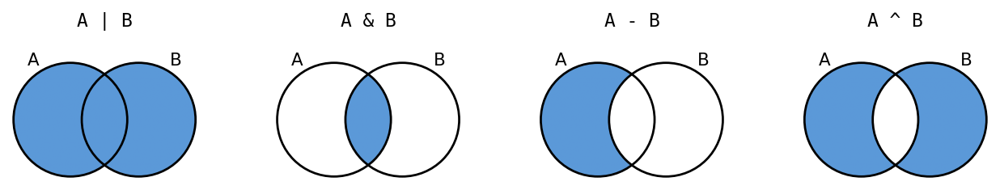
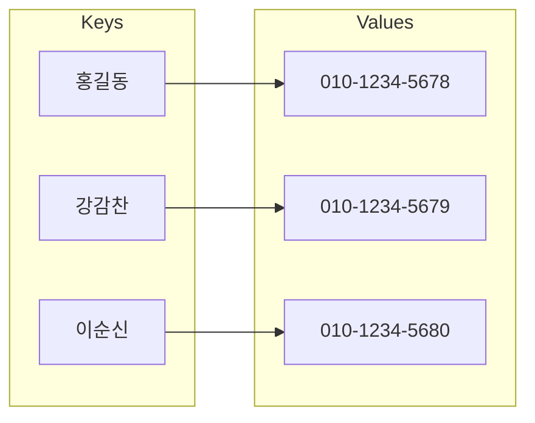

# Lecture 7 — Lists and Dictionaries

[Repository Guide](../../README.md) | [English](Concepts_Lecture.md) | [한국어](Concepts_Lecture.ko.md)

> **Last Updated:** 2026-11-04

> **Learning Objectives:**
> 1. Create lists and look up, add, change, and remove elements with indexing, slicing, and methods
> 2. Generate and process data with list comprehensions and two-dimensional lists
> 3. Distinguish tuples from lists by mutability and use the operations common to all sequence types
> 4. Distinguish aliasing, shallow copies, and deep copies, and explain how object references are passed to functions
> 5. Remove duplicates, test membership, and perform set operations with sets
> 6. Store keys and values in a dictionary and look up, add, remove, and iterate over its items

---

## Table of Contents

- [1. Lists](#1-lists)
  - [1.1 Grouping Several Values](#11-grouping-several-values)
  - [1.2 Creating Lists](#12-creating-lists)
  - [1.3 Objects and Dot Notation](#13-objects-and-dot-notation)
- [2. Accessing Elements](#2-accessing-elements)
  - [2.1 Indexing](#21-indexing)
  - [2.2 Slicing](#22-slicing)
  - [2.3 Iterating over a List](#23-iterating-over-a-list)
- [3. Changing, Adding, and Removing Elements](#3-changing-adding-and-removing-elements)
  - [3.1 Changing Elements](#31-changing-elements)
  - [3.2 Adding Elements](#32-adding-elements)
  - [3.3 Removing Elements](#33-removing-elements)
- [4. Searching, Length, and Sorting](#4-searching-length-and-sorting)
  - [4.1 Searching for Elements](#41-searching-for-elements)
  - [4.2 Length, Minimum, and Maximum](#42-length-minimum-and-maximum)
  - [4.3 Sorting](#43-sorting)
- [5. List Comprehensions](#5-list-comprehensions)
  - [5.1 Basic Form](#51-basic-form)
  - [5.2 List Comprehensions with a Condition](#52-list-comprehensions-with-a-condition)
- [6. Two-Dimensional Lists](#6-two-dimensional-lists)
  - [6.1 Representing a Table](#61-representing-a-table)
  - [6.2 Creating a Two-Dimensional List Dynamically](#62-creating-a-two-dimensional-list-dynamically)
  - [6.3 Accessing and Traversing Elements](#63-accessing-and-traversing-elements)
- [7. Tuples](#7-tuples)
  - [7.1 Creating Tuples](#71-creating-tuples)
  - [7.2 Immutability of Tuples](#72-immutability-of-tuples)
  - [7.3 Tuple Operations and Functions](#73-tuple-operations-and-functions)
  - [7.4 Tuple Unpacking](#74-tuple-unpacking)
- [8. Sequence Types](#8-sequence-types)
  - [8.1 Kinds of Sequences](#81-kinds-of-sequences)
  - [8.2 Common Sequence Operations](#82-common-sequence-operations)
  - [8.3 Concatenation, Repetition, and Comparison](#83-concatenation-repetition-and-comparison)
- [9. Copying Lists and Passing Them to Functions](#9-copying-lists-and-passing-them-to-functions)
  - [9.1 Variables and Objects](#91-variables-and-objects)
  - [9.2 Aliasing](#92-aliasing)
  - [9.3 Shallow Copy](#93-shallow-copy)
  - [9.4 Deep Copy](#94-deep-copy)
  - [9.5 Passing a List to a Function](#95-passing-a-list-to-a-function)
  - [9.6 Global Lists and global](#96-global-lists-and-global)
- [10. Sets](#10-sets)
  - [10.1 Properties of Sets](#101-properties-of-sets)
  - [10.2 Membership Tests and Iteration](#102-membership-tests-and-iteration)
  - [10.3 Adding and Removing Elements](#103-adding-and-removing-elements)
  - [10.4 Subsets and Set Operations](#104-subsets-and-set-operations)
- [11. Dictionaries](#11-dictionaries)
  - [11.1 Keys and Values](#111-keys-and-values)
  - [11.2 Looking Up Values](#112-looking-up-values)
  - [11.3 Adding, Changing, and Removing Items](#113-adding-changing-and-removing-items)
  - [11.4 Iterating over Keys, Values, and Items](#114-iterating-over-keys-values-and-items)
- [Concept Applications](#concept-applications)
- [Summary](#summary)
- [Self-Check Questions](#self-check-questions)
- [References](#references)

---

<br>

## 1. Lists

### 1.1 Grouping Several Values

Consider a program that processes the scores of 10 students. If each variable stores one value, ten variables such as `score1`, `score2`, ..., `score10` are needed, and the expression for the total must name every one of them. When the number of students grows to 100, the code grows with it. What is needed is a way to store many values of the same kind under one name and retrieve them by number.

> **Definition:** A **list** is a Python data type that stores several values in order. Each value in a list is called an **element**, and elements are distinguished by their position number, the **index**, which starts from 0.

A list is written by placing values, separated by commas, inside square brackets `[` `]`. This basic syntax, together with `append()` and access by index, was first introduced in [Lecture 3, Section 8](../Lec03_Data-Types/Concepts_Lecture.md#8-lists).

```python
list_name = [value1, value2, ...]
```

For example, a checklist of four heroes and the scores of 10 students can each be stored in one list as follows.

```python
heroes = ["아이언맨", "토르", "헐크", "스칼렛 위치"]
scores = [32, 56, 64, 72, 12, 37, 98, 77, 59, 69]
print(heroes)
print(scores)
print(type(scores))
```

```text
['아이언맨', '토르', '헐크', '스칼렛 위치']
[32, 56, 64, 72, 12, 37, 98, 77, 59, 69]
<class 'list'>
```

`print()` displays a list enclosed in square brackets with commas between elements, and shows string elements in single quotes. That `type()` prints `<class 'list'>` means that `scores` is an object of the **class** named `list`. Classes are defined directly in [Lecture 8](../Lec08_Classes-and-Objects/Concepts_Lecture.md).

### 1.2 Creating Lists

Lists can be created in several ways. An **empty list**, which has no elements, is made with `[]` or `list()`, and the elements may be of different types. A list is itself a value, so it can be an element of another list; such a list is called a **nested list**.

```python
list1 = []                      # empty list
list2 = list()                  # empty list made by the list class
list3 = [12, "dog", 180.14]     # elements of different types
list4 = [["Seoul", 10], ["Paris", 12], ["London", 50]]   # nested list
print(list1, list2)
print(list3)
print(list4[1])
print(list4[1][0])
list5 = ["aaa", ["bbb", ["ccc", ["ddd", "eee", 45]]]]
print(list5[1][1][1][2])
print(list("Hello"))
print(list(range(5)))
```

```text
[] []
[12, 'dog', 180.14]
['Paris', 12]
Paris
45
['H', 'e', 'l', 'l', 'o']
[0, 1, 2, 3, 4]
```

- **`list4[1]`:** This is the element at index 1, the list `["Paris", 12]`. Adding one more index, `list4[1][0]` is the first element of that inner list, `"Paris"`.
- **`list5[1][1][1][2]`:** Starting from the outside, the expression enters `["bbb", [...]]`, `["ccc", [...]]`, and `["ddd", "eee", 45]` in turn and then takes the element 45 at index 2. Each pair of brackets corresponds to one level of nesting.
- **`list("Hello")`, `list(range(5))`:** Given a value whose elements can be taken out one at a time, such as a string or a `range` object, `list()` builds a new list from those elements. For a string each character becomes an element, and for `range(5)` the integers 0-4 become the elements.

### 1.3 Objects and Dot Notation

Every value handled in Python is an **object**. An object bundles related data with the functions that operate on that data, and a function that belongs to an object is called a **method**. A list is also an object, so it has methods such as `append()`, which adds an element.

To use a method of an object, write the name of the object, a dot (`.`), and then the name of the method. This notation is called **dot notation**.

```python
heroes.append("아이언맨")      # calls the append method of the heroes object
```

A **built-in function**, which receives an object inside its parentheses as in `len(heroes)`, must be distinguished from a method, which is written after a dot as in `heroes.append(...)`. Built-in functions are used with many data types, whereas a method is a feature provided by the data type of that object. For example, `append()` is a method of lists, so strings and tuples do not have it.

---

<br>

## 2. Accessing Elements

### 2.1 Indexing

Taking out one element by writing square brackets and an index after the name of a list is called **indexing**. The index of the first element is 0, and the index of the last element of a list with $n$ elements is $n-1$. A negative index counts from the end: the last element is -1, the one before it is -2, and the first element is $-n$. This is called a **negative index**.

```text
letters = ['A', 'B', 'C', 'D', 'E', 'F']

┌─────┬─────┬─────┬─────┬─────┬─────┐
│ 'A' │ 'B' │ 'C' │ 'D' │ 'E' │ 'F' │    element
└─────┴─────┴─────┴─────┴─────┴─────┘
   0     1     2     3     4     5       positive index
  -6    -5    -4    -3    -2    -1       negative index
```

*Figure 1. Elements of the list `letters` with their positive and negative indices*

```python
letters = ['A', 'B', 'C', 'D', 'E', 'F']
print(letters[0])
print(letters[1])
print(letters[2])
print(letters[-1])
print(letters[-6])
print(letters[len(letters) - 1])
shopping_list = ["두부", "양배추", "딸기", "사과", "토마토"]
print(shopping_list[-1], shopping_list[-5])
```

```text
A
B
C
F
A
F
토마토 두부
```

`letters[-1]` and `letters[len(letters) - 1]` refer to the same element, because the negative index $-k$ is the same as the index $n-k$. In `shopping_list`, which has five elements, `-1` is `"토마토"` (tomato) at index 4 and `-5` is `"두부"` (tofu) at index 0.

> **Caution:** The indices that can be used with a list of $n$ elements range from $-n$ to $n-1$. Using an index outside this range raises the error `IndexError: list index out of range`. For example, `letters[6]` is an error because `letters` has six elements and no element at index 6.

### 2.2 Slicing

**Slicing** is a technique that takes several consecutive elements of a list at once and makes them into a new list. `list[start:end]` is a new list containing the elements from index `start` to `end - 1`; the element at position `end` is not included. Omitting `start` means from the beginning, and omitting `end` means to the end.

```python
letters = ['A', 'B', 'C', 'D', 'E', 'F']
print(letters[0:3])      # indices 0, 1, 2
print(letters[:3])       # from the beginning to index 2
print(letters[3:])       # from index 3 to the end
print(letters[:])        # from the beginning to the end (a copy of the whole list)
print(letters[1:5:2])    # indices 1, 3
print(letters[::2])      # indices 0, 2, 4
print(letters[::-1])     # reversed
print(letters[-3:])      # the last three elements
print(letters[4:100])    # an end larger than the length is not an error
print(letters[10:20])    # an empty list if no element is in range
```

```text
['A', 'B', 'C']
['A', 'B', 'C']
['D', 'E', 'F']
['A', 'B', 'C', 'D', 'E', 'F']
['B', 'D']
['A', 'C', 'E']
['F', 'E', 'D', 'C', 'B', 'A']
['D', 'E', 'F']
['E', 'F']
[]
```

The boundaries of a slice are easiest to understand as dividers between elements. Numbering the dividers from 0, `letters[1:4]` is the elements `'B'`, `'C'`, `'D'` between dividers 1 and 4, and the length of the result is `end - start` = 3.

```text
0     1     2     3     4     5     6     divider number
│ 'A' │ 'B' │ 'C' │ 'D' │ 'E' │ 'F' │
      └──── letters[1:4] ───┘
```

*Figure 2. Range of the slice `letters[1:4]` in terms of divider numbers*

- **Third value (step):** `list[start:end:step]` starts at `start` and picks elements every `step` positions up to just before `end`. `letters[1:5:2]` is the elements at indices 1 and 3.
- **Negative step:** If the step is negative, the slice proceeds from back to front, and an omitted `start` and `end` mean the last element and the position before the first element, respectively. Hence `letters[::-1]` is a new list with the elements reversed.
- **Boundaries out of range:** Unlike indexing, slicing raises no error when `start` or `end` is out of range; it cuts out only the elements that actually exist.

> **Key Point:** `letters[:]` creates a **new list** with the same elements as the original. Because of this property, `[:]` is used to copy a list, and the exact nature of the resulting copy is covered in [Section 9.3](#93-shallow-copy).

### 2.3 Iterating over a List

Processing the elements of a list one at a time from first to last is called **traversal** (iteration). When a list is given to a `for` statement, the elements of the list are assigned to the loop variable in order and the loop body runs for each of them ([Lecture 5, Section 4.2](../Lec05_Loops/Concepts_Lecture.md#42-traversing-a-list)).

```python
for variable in list_name:
    statement1
    statement2
```

The code below first changes the element at index 5 to 80 with `scores[5] = 80` and then traverses the list in two ways.

```python
scores = [32, 56, 64, 72, 12, 37, 98, 77, 59, 69]
scores[5] = 80
for element in scores:
    print(element, end=" ")
print()
for i in range(len(scores)):
    print(i, scores[i])
```

```text
32 56 64 72 12 80 98 77 59 69
0 32
1 56
2 64
3 72
4 12
5 80
6 98
7 77
8 59
9 69
```

```text
scores  ┌────┬────┬────┬────┬────┬────┬────┬────┬────┬────┐
        │ 32 │ 56 │ 64 │ 72 │ 12 │ 80 │ 98 │ 77 │ 59 │ 69 │
        └────┴────┴────┴────┴────┴────┴────┴────┴────┴────┘
          [0]  [1]  [2]  [3]  [4]  [5]  [6]  [7]  [8]  [9]
                                     ▲
                              scores[5] = 80
```

*Figure 3. The list `scores` after storing 80 in the element at index 5*

- **`for element in scores`:** Used when only the values of the elements are needed. In the first iteration `element` is 32, in the next it is 56, and in the last it is 69. `print(element, end=" ")` prints a space instead of a newline, so the elements are listed on one line, and the `print()` after the loop ends the line.
- **`for i in range(len(scores))`:** Since `len(scores)` is 10, `i` takes the indices 0-9. Used when both the index and the element are needed, or when the element at that position must be changed as in `scores[i] = ...`.

---

<br>

## 3. Changing, Adding, and Removing Elements

### 3.1 Changing Elements

A list is a **mutable** data type: its elements can be changed after it is created. Specifying a position with an index and storing a new value with the assignment operator `=` changes the element at that position.

```python
heroes = ["아이언맨", "토르", "헐크", "스칼렛 위치"]
heroes[1] = "닥터 스트레인지"
print(heroes)
squares = [0, 1, 4, 9, 16, 25, 36, 48]   # the last element is wrong
print(7 ** 2)
squares[7] = 49
print(squares)
```

```text
['아이언맨', '닥터 스트레인지', '헐크', '스칼렛 위치']
49
[0, 1, 4, 9, 16, 25, 36, 49]
```

`squares` is meant to store the squares of 0-7, but the element at index 7 was entered incorrectly as 48. Since $7^2 = 49$, `squares[7] = 49` corrects only that element. Not having to rebuild the whole list is the characteristic of a mutable data type. Strings, in contrast, are immutable, so an assignment such as `s[0] = "x"` is an error ([Lecture 3, Section 5.3](../Lec03_Data-Types/Concepts_Lecture.md#53-string-length-and-immutability)).

### 3.2 Adding Elements

It is common to start from an empty list and add elements one at a time, like putting items one by one into an empty shopping cart. `append(x)` adds `x` at the end of the list, and `insert(i, x)` inserts `x` at index `i`.

```python
heroes = []
print(heroes.append("아이언맨"))
heroes.append("닥터 스트레인지")
print(heroes)
```

```text
None
['아이언맨', '닥터 스트레인지']
```

`append()` changes the list itself and returns no value, so printing its return value shows `None`, which means the absence of a value. This is why entering `heroes.append("아이언맨")` in the interactive shell displays nothing. To see the changed list, print the list separately with `print(heroes)`.

```python
heroes = ["아이언맨", "닥터 스트레인지", "헐크", "스칼렛 위치"]
heroes.append("스파이더맨")
print(heroes)
heroes.insert(1, "배트맨")
print(heroes)
heroes.insert(100, "슈퍼맨")
print(heroes)
a = [1, 2]
a.extend([3, 4])
print(a)
a.append([5, 6])
print(a)
```

```text
['아이언맨', '닥터 스트레인지', '헐크', '스칼렛 위치', '스파이더맨']
['아이언맨', '배트맨', '닥터 스트레인지', '헐크', '스칼렛 위치', '스파이더맨']
['아이언맨', '배트맨', '닥터 스트레인지', '헐크', '스칼렛 위치', '스파이더맨', '슈퍼맨']
[1, 2, 3, 4]
[1, 2, 3, 4, [5, 6]]
```

- **`insert(1, "배트맨")`:** The new element becomes index 1, and the elements from the original index 1 onward each move back by one position. If the index is greater than or equal to the length of the list (`insert(100, ...)`), the element is added at the end.
- **`extend(list)`:** Appends the elements of another list one by one at the end. `append([5, 6])` adds the whole list `[5, 6]` as a single element, so the result differs.

### 3.3 Removing Elements

There are three ways to remove an element: `remove()`, which finds the element by value; the `del` statement, which removes by index; and `pop()`, which removes an element while taking it out.

```python
heroes = ["아이언맨", "토르", "헐크", "스칼렛 위치"]
heroes.remove("스칼렛 위치")
print(heroes)
if "슈퍼맨" in heroes:
    heroes.remove("슈퍼맨")
print(heroes)
heroes = ["아이언맨", "토르", "헐크", "스칼렛 위치"]
del heroes[0]
print(heroes)
heroes = ["아이언맨", "토르", "헐크", "스칼렛 위치"]
last_hero = heroes.pop()
print(last_hero)
print(heroes)
first = heroes.pop(0)
print(first, heroes)
```

```text
['아이언맨', '토르', '헐크']
['아이언맨', '토르', '헐크']
['토르', '헐크', '스칼렛 위치']
스칼렛 위치
['아이언맨', '토르', '헐크']
아이언맨 ['토르', '헐크']
```

| Method | What is specified | Return value | When the target is missing |
|:-----|:-----|:-----|:-----|
| `list.remove(x)` | Value `x` (the first one if several are equal) | `None` | `ValueError` |
| `del list[i]` | Index `i` (a slice `del list[i:j]` is also allowed) | No value (it is a statement) | `IndexError` |
| `list.pop()` | The last element when the index is omitted | The removed element | `IndexError` for an empty list |
| `list.pop(i)` | Index `i` | The removed element | `IndexError` |

*Table 1. Comparison of the three ways to remove list elements*

- **`remove()` and `in`:** Calling `remove()` with a value that is not in the list raises the error `ValueError: list.remove(x): x not in list`. Therefore, as in `if "슈퍼맨" in heroes:`, first check with the `in` operator that the value is present and then remove it. `in` is `True` if the value is in the list and `False` otherwise.
- **`del`:** It is a Python statement, not a function or method, so it is written without parentheses as `del heroes[0]`.
- **`pop()`:** It returns the removed element, so the value can be received in a variable while removing it, as in `last_hero = heroes.pop()`. In the code above, `pop()` takes out the last element `"스칼렛 위치"` and `pop(0)` takes out the first element `"아이언맨"`.

---

<br>

## 4. Searching, Length, and Sorting

### 4.1 Searching for Elements

`index(x)` returns the index of the element whose value is `x`. If several elements are equal to `x`, it returns the index of the first one, and if none is, it raises `ValueError`. Use `count(x)` when the number of occurrences is needed.

```python
heroes = ["아이언맨", "토르", "헐크", "스칼렛 위치"]
print(heroes.index("헐크"))
print("토르" in heroes, "슈퍼맨" in heroes, "슈퍼맨" not in heroes)
names = ["아", "토", "헐", "스", "헐"]
print(names.index("헐"))
print(names.count("헐"))
```

```text
2
True False True
2
2
```

What `index()` does internally is a **sequential search**: it compares the elements one by one from the front and stops at the first match. Written as a function, the same behavior looks like this.

```python
def find_index(items, target):
    for i in range(len(items)):
        if items[i] == target:
            return i          # stop at the first match
    return -1                 # -1 if there is no match up to the end

names = ["아", "토", "헐", "스", "헐"]
print(find_index(names, "헐"))
print(find_index(names, "슈"))
```

```text
2
-1
```

Because `return i` is inside the loop, the function ends at the first `"헐"` (index 2). If, instead of returning, the index were stored in a variable at every match and the loop ran to the end, the last match (index 4) would remain. Returning -1 instead of raising an error when the value is missing is a design choice of this function; `index()` raises `ValueError` in that case.

> **[Algorithms]** In the worst case a sequential search compares all $n$ elements, so its time complexity is $O(n)$. The `in` operator, `index()`, `count()`, and `remove()` on lists all compare elements one after another in this way. In a sorted list, binary search, which compares with the middle element and halves the range each time, finds a value in $O(\log n)$.

### 4.2 Length, Minimum, and Maximum

`len()` is a built-in function that returns the number of elements in a list, `min()` and `max()` return the smallest and largest elements, and `sum()` returns the sum of numeric elements.

```python
letters = ['a', 'b', 'c', 'd']
print(len(letters))
print(len([]))
print(len([[1, 2], [3, 4, 5]]))
values = [1, 2, 3, 4, 5, 6, 7, 8, 9, 10]
print(min(values), max(values), sum(values))
print(min(["banana", "apple", "cherry"]))
```

```text
4
0
2
1 10 55
apple
```

- **Length of a nested list:** `len([[1, 2], [3, 4, 5]])` is 2. The elements of the outer list are the two inner lists, and the elements of the inner lists are not counted.
- **Comparability:** `min()` and `max()` compare elements with each other, so the elements must be mutually comparable. Strings are compared lexicographically, so `"apple"` is the smallest. A mix of integers and strings as in `max([1, "a"])` raises `TypeError`, and `min([])` on an empty list raises `ValueError`.

### 4.3 Sorting

`sort()` is a method that sorts the elements of a list in ascending order. Like lining people up from shortest to tallest, it rearranges the elements so that smaller values come first. It does not create a new list but rearranges the elements of the original list (in-place sorting), and its return value is `None`.

```python
heroes = ["아이언맨", "토르", "헐크", "스칼렛 위치"]
heroes.sort()
print(heroes)
nums = [5, 2, 9, 1]
result = nums.sort()
print(result, nums)
nums.sort(reverse=True)
print(nums)
data = [5, 2, 9, 1]
new = sorted(data)
print(data, new)
print(sorted(["b", "B", "a", "A"]))
```

```text
['스칼렛 위치', '아이언맨', '토르', '헐크']
None [1, 2, 5, 9]
[9, 5, 2, 1]
[5, 2, 9, 1] [1, 2, 5, 9]
['A', 'B', 'a', 'b']
```

- **Order of strings:** Strings are sorted by comparing the Unicode code points (the values of `ord()`) of their characters, starting from the first character [1]. Hangul syllables are arranged in Unicode in the traditional Korean dictionary order of initial consonant, vowel, and final consonant [2], so Korean strings sort in that dictionary order. The order of `'스'` (49828), `'아'` (50500), `'토'` (53664), `'헐'` (54736) matches the result above.
- **Uppercase and lowercase:** The code point of `'A'` is 65 and that of `'a'` is 97, so uppercase letters come before lowercase letters. Hence `["b", "B", "a", "A"]` becomes `['A', 'B', 'a', 'b']`.
- **`reverse=True`:** Sorts in descending order.
- **`sorted()`:** A built-in function that leaves the original list unchanged and returns a sorted **new list**. Use `sorted()` when the original must be preserved and `sort()` when changing the original is acceptable.

> **Caution:** Writing `nums = nums.sort()` assigns `None`, the return value of `sort()`, to `nums`, and the list is lost. Methods that change a list in place, such as `sort()`, `append()`, `insert()`, and `remove()`, all return `None`.

---

<br>

## 5. List Comprehensions

### 5.1 Basic Form

A **list comprehension** is a syntax that builds a new list by evaluating an expression for each element of an existing sequence. Its form resembles the set-builder notation of mathematics, $S = \lbrace x^2 \mid x \in \lbrace 0, 1, \ldots, 9 \rbrace \rbrace$.

```text
  [ expression   for i in old_list   if filter(i) ]
        │                │                 │
        │                │                 └─ optional: only an i for which this condition is true is added
        │                └─ the loop variable i refers to the elements of the input list old_list in turn
        └─ output expression: its value becomes an element of the new list

  S = [ x**2   for x in range(10) ]
         │         │       │
         │         │       └─ input sequence
         │         └─ for each element x of the input sequence
         └─ the value of the output expression x**2 becomes an element of the new list
```

*Figure 4. Components of a list comprehension*

```python
list1 = [3, 4, 5]
list2 = [x*2 for x in list1]
print(list2)
S = [x**2 for x in range(10)]
print(S)
s = []
for x in range(10):
    s.append(x**2)
print(s == S)
```

```text
[6, 8, 10]
[0, 1, 4, 9, 16, 25, 36, 49, 64, 81]
True
```

`[x*2 for x in list1]` assigns the elements 3, 4, 5 of `list1` to `x` in turn, computes `x*2`, and builds a new list from the values 6, 8, 10. As the final comparison `True` shows, a list comprehension expresses in one line the same result as creating an empty list and calling `append()` in a `for` statement.

### 5.2 List Comprehensions with a Condition

Attaching an `if` condition after the `for` clause evaluates the output expression and adds it to the new list only for elements for which the condition is true.

```python
M = [x for x in range(10) if x % 2 == 0]
print(M)
evens_sq = [x**2 for x in range(10) if x % 2 == 0]
print(evens_sq)
pairs = [(x, y) for x in range(1, 3) for y in range(1, 4)]
print(pairs)
words = ["apple", "kiwi", "banana"]
print([len(w) for w in words])
print([w.upper() for w in words if len(w) > 4])
```

```text
[0, 2, 4, 6, 8]
[0, 4, 16, 36, 64]
[(1, 1), (1, 2), (1, 3), (2, 1), (2, 2), (2, 3)]
[5, 4, 6]
['APPLE', 'BANANA']
```

- **`M`:** Of 0-9, only the numbers whose remainder modulo 2 is 0, that is, the even numbers, remain. The output expression is `x` itself, so the filtered values become the elements unchanged.
- **`evens_sq`:** Only even numbers are selected and squared. The condition is checked before the output expression is evaluated.
- **Two `for` clauses:** Several `for` clauses are equivalent to nested loops in which the left clause is the outer loop and the right clause is the inner loop. In `pairs`, while `x` is 1, `y` runs through 1, 2, 3, and then `x` moves on to 2. This form is used in [Exercise 1](Exercises.md#exercise-1-pythagorean-triangles), which varies three side lengths simultaneously and checks a condition.
- **List of strings:** Any expression, such as `len(w)` or `w.upper()`, can be the output expression.

---

<br>

## 6. Two-Dimensional Lists

### 6.1 Representing a Table

A table of rows and columns is represented by a list whose elements are lists, a **two-dimensional list**. Each element of the outer list is one row of the table, and each row is a list holding the column values of that row.

| Student | Korean | English | Math | Science | Social Studies |
|:-----|-----:|-----:|-----:|-----:|-----:|
| 김철수 | 1 | 2 | 3 | 4 | 5 |
| 김영희 | 6 | 7 | 8 | 9 | 10 |
| 최자영 | 11 | 12 | 13 | 14 | 15 |

*Table 2. A table of values for three students by subject*

```python
# Create a two-dimensional list.
s = [
    [ 1,  2,  3,  4,  5],
    [ 6,  7,  8,  9, 10],
    [11, 12, 13, 14, 15]
]
print(s)
print(s[1])
print(s[1][3])
s[2][0] = 99
print(s[2])
```

```text
[[1, 2, 3, 4, 5], [6, 7, 8, 9, 10], [11, 12, 13, 14, 15]]
[6, 7, 8, 9, 10]
9
[99, 12, 13, 14, 15]
```

`s[r]` is the whole row `r` (a list), and `s[r][c]` is the element in column `c` of that row. In Table 2, the math value (column 3) of 김영희 (row 1) is `s[1][3]`, that is, 9. `s[2][0] = 99` changes only the element in column 0 of row 2. Writing one row per line inside the brackets makes the shape of the table visible in the code, and Python does not treat a line break as the end of a statement until the brackets are closed.

### 6.2 Creating a Two-Dimensional List Dynamically

When the numbers of rows and columns are determined while the program runs, a loop builds the two-dimensional list.

```python
# Create a two-dimensional list dynamically.
rows = 3
cols = 5

s = []
for row in range(rows):
    s += [[0]*cols]

print("s =", s)
s[0][0] = 7
print("s =", s)
```

```text
s = [[0, 0, 0, 0, 0], [0, 0, 0, 0, 0], [0, 0, 0, 0, 0]]
s = [[7, 0, 0, 0, 0], [0, 0, 0, 0, 0], [0, 0, 0, 0, 0]]
```

- **`[0]*cols`:** A list `[0, 0, 0, 0, 0]` of `cols` zeros (the repetition operation of [Section 8.3](#83-concatenation-repetition-and-comparison)).
- **`s += [[0]*cols]`:** `[[0]*cols]` is a list whose single element is that row, and `+=` on a list appends the elements of the right-hand list to the end of `s`. Hence each iteration adds one row, with the same result as `s.append([0]*cols)`.
- **Independence of rows:** `[0]*cols` is evaluated again in every iteration, creating a new row list each time. Therefore `s[0][0] = 7` changes only row 0.

> **Caution:** Building the same shape in one line with `[[0]*cols]*rows` makes all the rows refer to **one and the same list object** [3]. This is because `*` on a list does not duplicate the elements but repeats references to the same elements. In that case changing an element of one row changes every row. When each row needs its own list, use a loop or a list comprehension such as `[[0]*cols for _ in range(rows)]` (`_` is the conventional name for a loop variable whose value is not used).

```python
t = [[0]*3]*2          # looks like a 2 x 3 table
print(t)
t[0][0] = 7
print(t)
print(t[0] is t[1])
u = [[0]*3 for _ in range(2)]
u[0][0] = 7
print(u)
print(u[0] is u[1])
```

```text
[[0, 0, 0], [0, 0, 0]]
[[7, 0, 0], [7, 0, 0]]
True
[[7, 0, 0], [0, 0, 0]]
False
```

```text
t = [[0]*3]*2                         u = [[0]*3 for _ in range(2)]

t ──▶ ┌─────┬─────┐                    u ──▶ ┌─────┬─────┐
      │  ●  │  ●  │                          │  ●  │  ●  │
      └──┼──┴──┼──┘                          └──┼──┴──┼──┘
         └──┬──┘                                ▼     ▼
            ▼                           [7, 0, 0]     [0, 0, 0]
        [7, 0, 0]
```

*Figure 5. `t`, whose rows share one list, and `u`, which has a different list for each row*

The `is` operator tests whether two expressions are **the same object** ([Section 9.1](#91-variables-and-objects)). Since `t[0] is t[1]` is `True`, the two rows of `t` are one object, and since `u[0] is u[1]` is `False`, the two rows of `u` are different objects.

### 6.3 Accessing and Traversing Elements

All elements of a two-dimensional list are traversed with nested loops. The outer loop goes through the rows, and the inner loop goes through the columns of that row in turn.

```python
s = [
    [ 1,  2,  3,  4,  5],
    [ 6,  7,  8,  9, 10],
    [11, 12, 13, 14, 15]
]

# Find the numbers of rows and columns.
rows = len(s)
cols = len(s[0])

for r in range(rows):
    for c in range(cols):
        print(s[r][c], end=",")
    print()
```

```text
1,2,3,4,5,
6,7,8,9,10,
11,12,13,14,15,
```

- **Numbers of rows and columns:** `len(s)` is the number of elements of the outer list, so it is the number of rows, 3, and `len(s[0])` is the length of row 0, so it is the number of columns, 5.
- **Output:** The inner loop prints the elements of one row consecutively, each followed by a comma, and when the inner loop ends, `print()` moves to a new line. Thus one row of the table becomes one line of output.

> **Note:** **Lists whose rows differ in length.** A two-dimensional list in Python is simply a list containing lists, so its rows may have different lengths. For example, in `[[1, 2, 3, 4], [1, 2, 3, 4], [5, 6, 7]]`, `len(s[0])` is 4 but row 2 has length 3. Using `cols = len(s[0])` on such a list as in the code above raises `IndexError` at row 2. When rows may differ in length, traverse each row directly with `for row in s:` and `for value in row:`.

---

<br>

## 7. Tuples

### 7.1 Creating Tuples

A **tuple** stores several values in order like a list, but cannot be changed after it is created. Its elements are written inside parentheses `(` `)`, separated by commas.

```python
tuple_name = (item1, item2, ..., itemn)
```

```python
colors = ("red", "green", "blue")
print(colors)
numbers = (1, 2, 3, 4, 5)
print(numbers)
print(type(colors))
one = ("Hi!",)
not_tuple = ("Hi!")
print(type(one), type(not_tuple))
p = 3, 4
print(p, type(p))
```

```text
('red', 'green', 'blue')
(1, 2, 3, 4, 5)
<class 'tuple'>
<class 'tuple'> <class 'str'>
(3, 4) <class 'tuple'>
```

- **Tuple with one element:** `("Hi!")` is merely a string in parentheses; a tuple with one element needs a comma, as in `("Hi!",)`. It is the comma, not the parentheses, that makes a tuple.
- **Omitting parentheses:** Listing values separated by commas without parentheses, as in `p = 3, 4`, also makes a tuple. Use parentheses for the empty tuple `()` and where the meaning would be ambiguous, such as inside function arguments.

### 7.2 Immutability of Tuples

A tuple is **immutable**, so assigning a new value to an element is an error. Concatenating two tuples with `+` is allowed, because it does not change an existing tuple but creates a new one.

```python
t1 = (1, 2, 3, 4, 5)
t1[0] = 100
```

```text
Traceback (most recent call last):
  File "<stdin>", line 2, in <module>
TypeError: 'tuple' object does not support item assignment
```

When an error occurs, Python prints a **traceback** and stops the program. The last line is the kind of error (`TypeError`) and its message, and the line above it is the location of the error (line 2 of the code). `<stdin>` means the code was run from standard input rather than from a file; when the code is run from a file, the file name appears there.

```python
numbers = (1, 2, 3, 4, 5)
colors = ("red", "green", "blue")
t = numbers + colors
print(t)
```

```text
(1, 2, 3, 4, 5, 'red', 'green', 'blue')
```

Storing data that must not change (coordinates, dates, the fixed information of one student) in a tuple prevents the values from being changed by mistake. Also, an immutable tuple can be used as an element of a set in [Section 10](#10-sets) and as a key of a dictionary in [Section 11](#11-dictionaries), whereas a list cannot.

> **Caution:** The immutability of a tuple means that the objects the tuple refers to do not change. If an element is itself a mutable object such as a list, the contents of that object can change. Running `t[1].append(4)` on `t = (1, [2, 3])` makes `t` equal to `(1, [2, 3, 4])`. Such a tuple cannot be used as a set element or a dictionary key.

### 7.3 Tuple Operations and Functions

A tuple is a sequence like a list, so operations such as length, concatenation, repetition, membership tests, and traversal work exactly as they do for lists. Only the operations that change the object (`append()`, `sort()`, element assignment) are missing.

| Python Expression | Result | Description |
|:-----|:-----|:-----|
| `len((1, 2, 3))` | `3` | Length of the tuple |
| `(1, 2, 3) + (4, 5, 6)` | `(1, 2, 3, 4, 5, 6)` | Concatenation |
| `('Hi!',) * 4` | `('Hi!', 'Hi!', 'Hi!', 'Hi!')` | Repetition |
| `3 in (1, 2, 3)` | `True` | Membership |
| `for x in (1, 2, 3): print(x, end=" ")` | `1 2 3` | Traversal |

*Table 3. Basic tuple operations*

| Function | Description |
|:-----|:-----|
| `len(t)` | Returns the length of the tuple. |
| `max(t)` | Returns the largest value stored in the tuple. |
| `min(t)` | Returns the smallest value stored in the tuple. |
| `tuple(seq)` | Converts a sequence such as a list or a string into a tuple. |
| `t1 < t2`, `t1 == t2` | Compares two tuples lexicographically ([Section 8.3](#83-concatenation-repetition-and-comparison)). |

*Table 4. Functions and comparison operations used with tuples*

```python
tt = (3, 1, 2)
print(len(tt), max(tt), min(tt))
print(tuple([1, 2, 3]), tuple("abc"))
print((1, 2, 3) < (1, 2, 4), (1, 2) == (1, 2))
numbers = (1, 2, 3, 4, 5)
print(numbers[1:3], numbers[-1], numbers.index(3), numbers.count(3))
```

```text
3 3 1
(1, 2, 3) ('a', 'b', 'c')
True True
(2, 3) 5 2 1
```

Tuples also support indexing and slicing, and the result of slicing is a new tuple. Tuples have only two methods: `index()`, which finds a value, and `count()`, which counts occurrences.

> **Note:** `cmp(t1, t2)` is sometimes introduced as a function that compares two tuples, but it existed only in Python 2 and was removed in Python 3 [4]. Calling `cmp(1, 2)` in Python 3 raises `NameError: name 'cmp' is not defined`. Use comparison operators such as `<`, `==`, and `>` instead. Likewise, because `print` changed from a statement into a function in Python 3, the Python 2 statement `print x,`, which prints without a newline, is written `print(x, end=" ")` in Python 3 [4].

### 7.4 Tuple Unpacking

Assigning the elements of a tuple to the same number of variables at once is called **tuple unpacking** or tuple assignment.

```python
student1 = ("철수", 19, "CS")
(name, age, major) = student1
print(name)
print(age)
print(major)
a, b = 1, 2
a, b = b, a
print(a, b)
```

```text
철수
19
CS
2 1
```

- **Order of assignment:** `(name, age, major) = student1` assigns the elements of `student1` from the left to `name`, `age`, and `major` in turn. The parentheses on the left may be omitted, as in `name, age, major = student1`.
- **Matching counts:** If the number of variables on the left differs from the number of elements on the right, `ValueError` is raised. For example, `x, y = (1, 2, 3)` gives `ValueError: too many values to unpack (expected 2)`.
- **Exchanging two values:** `a, b = b, a` first builds the tuple `(2, 1)` on the right and then unpacks it, so the two values are swapped without a temporary variable. This technique is used to exchange two elements of a list in the sorting functions of [Lecture 8](../Lec08_Classes-and-Objects/Concepts_Lecture.md).

---

<br>

## 8. Sequence Types

### 8.1 Kinds of Sequences

**Sequence** is the general name for data types whose elements are arranged in order. Like elephants walking in a line, each element has a place before or after the others, so a position can be specified with an index. A string is a sequence of characters, and a list is a sequence of arbitrary values.

| Type | Example | Elements | Mutability |
|:-----|:-----|:-----|:-----|
| String (`str`) | `"Hello"` | Characters | Immutable |
| Byte sequence (`bytes`) | `b"Hi"` | Integers 0-255 | Immutable |
| Byte array (`bytearray`) | `bytearray(b"Hi")` | Integers 0-255 | Mutable |
| List (`list`) | `['Z', 'Hello', 3.1415, 'Yes', 25]` | Arbitrary objects | Mutable |
| Tuple (`tuple`) | `(1, 2, 3)` | Arbitrary objects | Immutable |
| Range object (`range`) | `range(0, 10, 2)` | Integers of an arithmetic progression | Immutable |

*Table 5. Sequence types of Python*

Byte sequences and byte arrays hold binary data handled in files or over networks, and their elements are integers 0-255 (one byte each). A range object such as `range(0, 10, 2)` represents an arithmetic progression; it does not store every number in memory but computes them when needed, and it is still a sequence that supports indexing, `len()`, and `in`.

### 8.2 Common Sequence Operations

Sequence types support the following operations in common. Therefore the operations learned for lists can be used as they are for strings and tuples. A range object, however, can only represent an arithmetic sequence that follows a fixed rule, so it does not support concatenation (`+`) or repetition (`*`) [5].

| Function or Operator | Description | Example | Result |
|:-----|:-----|:-----|:-----|
| `len()` | Computes the length | `len([1, 2, 3])` | `3` |
| `+` | Concatenates two sequences | `[1, 2] + [3, 4, 5]` | `[1, 2, 3, 4, 5]` |
| `*` | Repetition | `['Welcome!'] * 3` | `['Welcome!', 'Welcome!', 'Welcome!']` |
| `in` | Membership | `3 in [1, 2, 3]` | `True` |
| `not in` | Non-membership | `5 not in [1, 2, 3]` | `True` |
| `[]` | Indexing | `myList[1]` | The element of `myList` at index 1 |
| `min()` | The smallest element of the sequence | `min([1, 2, 3])` | `1` |
| `max()` | The largest element of the sequence | `max([1, 2, 3])` | `3` |
| `for` statement | Traversal | `for x in [1, 2, 3]: print(x)` | Prints `1`, `2`, `3` on separate lines |

*Table 6. Operations and functions common to sequences*

```python
print("Hello"[1], "Hello" + "!", "ab" * 3, "ell" in "Hello")
r = range(0, 10, 2)
print(r[2], len(r), 4 in r, list(r))
```

```text
e Hello! ababab True
4 5 True [0, 2, 4, 6, 8]
```

For strings, `in` tests not only for a single element but also for a contiguous substring (`"ell" in "Hello"`). `range(0, 10, 2)` represents 0, 2, 4, 6, 8, so `r[2]` is 4 and the length is 5.

### 8.3 Concatenation, Repetition, and Comparison

To join two lists, use the **concatenation operator** `+`; to join the same list several times, use the **repetition operator** `*`. Both operations leave their operands unchanged and create a new list.

```python
marvel_heroes = ["스파이더맨", "헐크", "아이언맨"]
dc_heroes = ["슈퍼맨", "배트맨", "원더우먼"]
heroes = marvel_heroes + dc_heroes
print(heroes)
values = [1, 2, 3] * 3
print(values)
print([0] * 5)
```

```text
['스파이더맨', '헐크', '아이언맨', '슈퍼맨', '배트맨', '원더우먼']
[1, 2, 3, 1, 2, 3, 1, 2, 3]
[0, 0, 0, 0, 0]
```

Two lists can be compared with the comparison operators `==`, `!=`, `>`, `<`, `>=`, and `<=`.

```python
list1 = [1, 2, 3]
list2 = [1, 2, 3]
print(list1 == list2, list1 != list2)
print([1, 2, 3] < [1, 2, 4], [1, 2] < [1, 2, 0], [2] > [1, 9, 9])
print(["apple"] < ["banana"])
print(list1 is list2)
```

```text
True False
True True True
True
False
```

- **`==`:** `True` if the two lists have the same length and the elements at every position are equal.
- **Ordering comparisons are lexicographic:** The elements are compared one by one from the front, and the first pair of differing elements decides the result [1]. `[1, 2, 3] < [1, 2, 4]` is `True` because of the third elements 3 < 4, and `[2] > [1, 9, 9]` is decided as `True` immediately by the first elements 2 > 1. If one list equals the beginning of the other, the shorter one is smaller, so `[1, 2] < [1, 2, 0]`. This is the same rule as the order of words in a dictionary.
- **`==` and `is`:** `list1 == list2` is `True` because the contents are equal, but `list1 is list2` is `False` because the two lists were created separately and are different objects. This difference is covered in [Section 9](#9-copying-lists-and-passing-them-to-functions).

---

<br>

## 9. Copying Lists and Passing Them to Functions

### 9.1 Variables and Objects

In Python every value is an object in memory, and a variable is a **name** that refers to an object. The assignment statement `x = [1, 2, 3]` creates one list object and makes the name `x` refer to it. What a name refers to in this way is called a **reference** to the object. Every object has a unique **identity**, and the built-in function `id()` returns this identity as an integer. The integer does not change while the object exists, and it never coincides with that of another object existing at the same time.

- **`a == b`:** Compares whether the **values (contents)** of two objects are equal.
- **`a is b`:** Compares whether `a` and `b` are **the same object**. It is equivalent to `id(a) == id(b)`.

> **Key Point:** The Python assignment statement `y = x` does not copy an object. It only makes the name `y` refer to the same object as `x`. All the behavior of copying lists and passing them to functions follows from this single rule.

### 9.2 Aliasing

```python
scores = [10, 20, 30, 40, 50]
values = scores          # no new list: a second name for the same list
values[2] = 99
print(scores)
print(values)
print(values is scores)
```

```text
[10, 20, 99, 40, 50]
[10, 20, 99, 40, 50]
True
```

```text
scores ──┐
         ├──▶ [10, 20, 99, 40, 50]
values ──┘
```

*Figure 6. Aliasing, in which the names `scores` and `values` refer to one list object together*

`values = scores` looks like copying the list, but in fact it attaches one more name to the same list object. Several names referring to one object are called **aliases**. Therefore the change made with `values[2] = 99` is visible through `scores` as well. Because a list is mutable, a change made through an alias shows through the other names too.

### 9.3 Shallow Copy

When a list independent of the original is needed, a new list object must be created. `list(scores)`, `scores[:]`, and `scores.copy()` all create a new list with the same elements.

```python
scores = [10, 20, 30, 40, 50]
values = list(scores)    # a new list with the same elements
values[2] = 99
print(scores)
print(values)
print(values is scores)
c1 = scores[:]
c2 = scores.copy()
print(c1 is scores, c2 is scores, c1 == scores)
```

```text
[10, 20, 30, 40, 50]
[10, 20, 99, 40, 50]
False
False False True
```

```text
scores ──▶ [10, 20, 30, 40, 50]       (original list)
values ──▶ [10, 20, 99, 40, 50]       (new list, only values[2] changed)
```

*Figure 7. The new list `values` made by `list(scores)` and the original list `scores`*

These methods make a **shallow copy**. A shallow copy creates a new outer list and puts into it **references to the same objects** that the elements of the original list referred to [6]. If the elements are immutable objects such as integers or strings, there is no way to change the elements themselves, so the shallow copy behaves as if it were completely independent of the original. In the example above, `values[2] = 99` makes slot 2 of `values` refer to a different integer object 99, while slot 2 of `scores` still refers to 30.

> **Note:** A copy made with `list(scores)` is sometimes called a deep copy, but the correct term is shallow copy. The confusion arises because for `scores`, whose elements are all integers, the results of a shallow copy and a deep copy cannot be told apart; when the elements are lists, the two copies give different results, as in [Section 9.4](#94-deep-copy).

### 9.4 Deep Copy

If the elements are mutable objects such as lists, a shallow copy and the original share the inner objects. To create every inner object anew as well, make a **deep copy** with the `deepcopy()` function of the `copy` module. A deep copy creates a new outer list and recursively inserts copies of the original elements [6].

```python
import copy

table = [[1, 2], [3, 4]]
shallow = list(table)          # same as table[:] or table.copy()
deep = copy.deepcopy(table)

print(shallow is table, shallow[0] is table[0])
print(deep is table, deep[0] is table[0])

table[0][0] = 99               # change an inner list
table.append([5, 6])           # change the outer list
print(table)
print(shallow)
print(deep)
```

```text
False True
False False
[[99, 2], [3, 4], [5, 6]]
[[99, 2], [3, 4]]
[[1, 2], [3, 4]]
```

```text
shallow = list(table)                  deep = copy.deepcopy(table)

table   ──▶ [ ● , ● ]                  table ──▶ [ ● , ● ]
              │   │                                │   │
              ▼   ▼                                ▼   ▼
           [1,2] [3,4]                          [1,2] [3,4]
              ▲   ▲
              │   │                    deep  ──▶ [ ● , ● ]
shallow ──▶ [ ● , ● ]                              │   │
                                                   ▼   ▼
                                                [1,2] [3,4]
```

*Figure 8. Objects referred to by the shallow copy and the deep copy right after copying*

- **`table[0][0] = 99`:** `shallow[0]` is the same object as `table[0]`, so 99 is visible through `shallow` as well. `deep[0]` is a separate list, so it does not change.
- **`table.append([5, 6])`:** The outer lists of `shallow` and `table` are different objects, so no row is added to `shallow`.

| Method | New outer list | Inner objects | When an inner list of the original changes |
|:-----|:-----|:-----|:-----|
| `b = a` (assignment) | Not created (alias) | Shared | Visible through `b` |
| `list(a)`, `a[:]`, `a.copy()` (shallow copy) | Created | Shared | Visible through `b` |
| `copy.deepcopy(a)` (deep copy) | Created | Recreated recursively | Not visible through `b` |

*Table 7. Comparison of assignment, shallow copy, and deep copy*

### 9.5 Passing a List to a Function

When a function is called, each parameter becomes a local name that refers to the object passed as the argument ([Lecture 6, Section 3.1](../Lec06_Functions/Concepts_Lecture.md#31-passing-arguments)). That is, the call behaves like the assignment `parameter = argument`, so the parameter and the argument refer to **the same object**. Therefore, if the contents of a list are changed through the parameter inside the function, the change is visible outside the function as well.

```python
def func2(list_):
    list_[0] = 99

values = [0, 1, 1, 2, 3, 5, 8]
print(values)
func2(values)
print(values)
```

```text
[0, 1, 1, 2, 3, 5, 8]
[99, 1, 1, 2, 3, 5, 8]
```

```text
during the call func2(values)

values ──┐                                 global name
         ├──▶ [99, 1, 1, 2, 3, 5, 8]
list_  ──┘                                 local name
```

*Figure 9. The argument `values` and the parameter `list_` referring to the same list during the call*

However, if a **new object is assigned** to the parameter inside the function, only the local name comes to refer to a different object, and the caller's variable is not affected.

```python
def rebind(lst):
    lst = [7, 7, 7]      # the local name now refers to a new list
    print("inside:", lst)

def add_one(n):
    n = n + 1            # int is immutable: a new int object is bound to n
    print("inside:", n)

values = [0, 1, 2]
rebind(values)
print("outside:", values)

k = 10
add_one(k)
print("outside:", k)
```

```text
inside: [7, 7, 7]
outside: [0, 1, 2]
inside: 11
outside: 10
```

> **Key Point:** Python passes arguments **by object reference** (call by object reference). What is passed is a reference to an object, and the function uses **the same object** through that reference [7]. Consequently, (1) operations that change the contents of a mutable object (`list_[0] = 99`, `append()`) are visible to the caller, and (2) assigning a different object to a parameter does not change the caller's variable. Immutable objects such as integers, strings, and tuples have no operations that change their contents, so a function cannot change the caller's value.

> **Note:** The way lists are passed is sometimes called "call by reference." In C++ call by reference, however, assigning to the parameter inside the function changes the caller's variable itself, whereas in Python it does not, as `rebind()` above shows. The official Python tutorial describes the mechanism as call by value where the value is always an object reference, and states that call by object reference would be a better description [7]. The mechanism is also called call by sharing.

### 9.6 Global Lists and global

Inside a function, **reading** a global variable is free, but **assigning** to a global name requires a `global` declaration ([Lecture 6, Section 5.4](../Lec06_Functions/Concepts_Lecture.md#54-changing-a-global-variable-inside-a-function)). With lists, this distinction appears as follows.

```python
global_list = [1, 2, 3, 4]
global_var = 10

def modify_list():
    global_list.append(5)      # mutates the global list: no global needed
    global_list.extend([6, 7])

def modify_var():
    global global_var          # needed to assign to the global name
    global_var = 20

modify_list()
modify_var()
print(global_list)
print(global_var)
```

```text
[1, 2, 3, 4, 5, 6, 7]
20
```

- **`modify_list()`:** `global_list.append(5)` is not an assignment to the name `global_list`; it calls a method of the list object that the name refers to and changes its contents. When the name is looked up there is no local `global_list`, so the global name is used, and the global list changes without a `global` declaration.
- **`modify_var()`:** `global_var = 20` is an assignment to a name. Without the `global` declaration, this assignment would create a new local variable `global_var` inside the function.

```python
global_var = 10

def modify_global():
    print("Before modification:", global_var)
    global_var = 20
    print("After modification:", global_var)

modify_global()
```

```text
Traceback (most recent call last):
  File "<stdin>", line 8, in <module>
  File "<stdin>", line 4, in modify_global
UnboundLocalError: cannot access local variable 'global_var' where it is not associated with a value
```

The traceback shows that the error occurred at line 4 of the function, the first `print()`, entered from the call on line 8. If there is an assignment such as `global_var = ...` anywhere in a function body, Python decides before running the function that the name is a local variable throughout the whole function. Hence even the first `print()`, which comes before the assignment, tries to read a local variable that has no value yet, and `UnboundLocalError` is raised. The wording of the error message differs slightly between Python versions.

> **Caution:** For a list, `global_list += [5]` extends the contents in place, but syntactically it is also an assignment to the name `global_list`. Therefore using it inside a function without a `global` declaration raises the same `UnboundLocalError` as above. To change only the contents of a global list, use `append()`, `extend()`, or index assignment; to make the global name refer to a different object, declare it `global`.

---

<br>

## 10. Sets

### 10.1 Properties of Sets

A **set** is a data type that represents a set in mathematics. The same element cannot appear twice in a set, and there is no order among its elements. A set is written with elements separated by commas inside braces `{` `}`, or made by giving a sequence such as a list to `set()`.

```python
set_name = {item1, item2, ..., itemn}
```

```python
numbers = {2, 1, 3}
print(numbers)
print(len(numbers))
fruits = {"Apple", "Banana", "Pineapple"}
mySet = {1.0, 2.0, "Hello World", (1, 2, 3)}
print(len(fruits), len(mySet))
print({1, 2, 2, 3, 3, 3})
print(set([3, 1, 3, 2, 1]))
print(type({}), type(set()))
```

```text
{1, 2, 3}
3
3 4
{1, 2, 3}
{1, 2, 3}
<class 'dict'> <class 'set'>
```

- **Removing duplicates:** `{1, 2, 2, 3, 3, 3}` and `set([3, 1, 3, 2, 1])` both become `{1, 2, 3}`. Converting a list with `set()` is a common way to remove its duplicates.
- **No order:** That `{2, 1, 3}` prints as `{1, 2, 3}` is because the storage positions inside the set happened to be arranged that way; there is no guarantee that the elements are sorted. For string elements, the output order can differ from run to run ([Section 10.2](#102-membership-tests-and-iteration)).
- **Empty set:** `{}` is an empty dictionary ([Section 11](#11-dictionaries)). A set with no elements must be created with `set()`.
- **Requirement on elements:** The elements of a set must be **hashable** objects [5]. Integers, floats, strings, and tuples containing only hashable elements can be elements, but putting in a mutable object such as a list raises `TypeError: unhashable type: 'list'`. `mySet` can hold the tuple `(1, 2, 3)` because a tuple is immutable. Also, values that are equal under `==`, such as `1`, `1.0`, and `True`, are treated as the same element, so `{1, 1.0, True}` becomes `{1}` with a single element.

> **[Data Structures]** Sets and dictionaries are implemented as **hash tables**. A hash table decides the storage position of each element by its **hash value**, an integer computed from the value of the object. Therefore, to find an element, it does not compare elements one by one from the beginning as a list does but goes straight to the position given by the hash value, taking $O(1)$ time on average. If a value changed after being stored, its hash value would change and its storage position could no longer be found, so mutable objects are not used as keys of a hash table.

### 10.2 Membership Tests and Iteration

The `in` operator tests whether an element is in a set, and a `for` statement traverses all elements.

```python
numbers = {2, 1, 3}
if 1 in numbers:
    print("집합 안에 1이 있습니다.")
for x in numbers:
    print(x, end=" ")
print()
```

```text
집합 안에 1이 있습니다.
1 2 3
```

The order in which a set is traversed follows the internal storage positions of the set and cannot be determined by the program. In particular, for security reasons the hash values of strings are computed with an unpredictable random value mixed in each time Python starts under the default settings [8], so a set of strings may print in a different order from run to run. When a fixed order is needed, traverse a sorted list made with `sorted(set_name)`.

### 10.3 Adding and Removing Elements

A set has no order and therefore no indices. Indexing it as in `numbers[0]` raises `TypeError: 'set' object is not subscriptable`. Elements are added and removed with methods.

```python
numbers = {2, 1, 3}
numbers.add(4)
print(numbers)
numbers.add(4)
print(numbers)
numbers.update([2, 3, 4, 5])
print(numbers)
numbers.discard(5)
print(numbers)
numbers.discard(100)
print(numbers)
numbers.clear()
print(numbers)
```

```text
{1, 2, 3, 4}
{1, 2, 3, 4}
{1, 2, 3, 4, 5}
{1, 2, 3, 4}
{1, 2, 3, 4}
set()
```

| Method | Behavior | When the element is missing |
|:-----|:-----|:-----|
| `add(x)` | Adds one element `x`. Nothing changes if it is already present. | Not applicable |
| `update(seq)` | Adds all elements of the sequence `seq`. | Not applicable |
| `discard(x)` | Removes the element `x`. | Does nothing |
| `remove(x)` | Removes the element `x`. | `KeyError` |
| `clear()` | Removes all elements, leaving an empty set. | Not applicable |

*Table 8. Methods that add and remove set elements*

The second `add(4)` does not change the set because 4 is already present. In `update([2, 3, 4, 5])` as well, the only element newly added is 5. An empty set prints as `set()`, not `{}`.

### 10.4 Subsets and Set Operations

The inclusion relation between two sets is tested with comparison operators.

```python
A = {1, 2, 3}
B = {1, 2, 3}
print(A == B)
A = {1, 2, 3, 4, 5}
B = {1, 2, 3}
print(B < A, B <= A, A < A, A <= A)
print(B.issubset(A), A.issuperset(B))
```

```text
True
True True False True
True True
```

- **`A == B`:** `True` if the two sets have the same elements. Since there is no order, the order in which the elements are written does not matter.
- **`B <= A`, `B.issubset(A)`:** `True` if every element of `B` is in `A`, that is, if $B \subseteq A$.
- **`B < A`:** `True` if $B$ is a **proper subset** of $A$, that is, if $B \subseteq A$ and $B \neq A$. Hence `A < A` is `False` and `A <= A` is `True`.
- **`A.issuperset(B)`:** `True` if $A \supseteq B$.

Union, intersection, difference, and symmetric difference are computed with operators or methods. The result is a new set.

```python
A = {1, 2, 3}
B = {3, 4, 5}
print(A | B)
print(A & B)
print(A - B)
print(B - A)
print(A ^ B)
print(A.union(B), A.intersection(B), A.difference(B), A.symmetric_difference(B))
```

```text
{1, 2, 3, 4, 5}
{3}
{1, 2}
{4, 5}
{1, 2, 4, 5}
{1, 2, 3, 4, 5} {3} {1, 2} {1, 2, 4, 5}
```

| Set Operation | Math Symbol | Operator | Method | Elements of the Result |
|:-----|:-----|:-----|:-----|:-----|
| Union | $A \cup B$ | `A \| B` | `A.union(B)` | Elements in `A` or `B` |
| Intersection | $A \cap B$ | `A & B` | `A.intersection(B)` | Elements in both `A` and `B` |
| Difference | $A - B$ | `A - B` | `A.difference(B)` | Elements in `A` but not in `B` |
| Symmetric difference | $A \triangle B$ | `A ^ B` | `A.symmetric_difference(B)` | Elements in exactly one of the two |

*Table 9. Set operations with the corresponding operators and methods*



*Figure 10. Regions of the union, intersection, difference, and symmetric difference of two sets A and B*

The result of a difference depends on the order: `A - B` is `{1, 2}` and `B - A` is `{4, 5}`. The operators require both operands to be sets, but the methods also accept a sequence such as a list as the argument, as in `A.union([5, 6])`. Finding the people who attended both of two parties from their guest lists is solved by an intersection ([Exercise 2](Exercises.md#exercise-2-guests-at-both-parties)).

---

<br>

## 11. Dictionaries

### 11.1 Keys and Values

A **dictionary** is a data type that stores pairs of a **key** and the **value** associated with that key. Whereas a list finds a value by an integer position such as 0, 1, 2, a dictionary finds a value by a key such as a name or a word. A phone book that finds a phone number by a person's name and a dictionary that finds a meaning by a word are typical examples. One key-value pair is called an **item** of the dictionary.



*Figure 11. A dictionary that stores names as keys and phone numbers as values*

A dictionary is written with `key: value` pairs separated by commas inside braces, or by creating an empty dictionary `{}` or `dict()` and then inserting items one at a time with `dictionary[key] = value`.

```python
phone_book = {}
phone_book["홍길동"] = "010-1234-5678"
print(phone_book)

phone_book = {"홍길동": "010-1234-5678"}
phone_book["강감찬"] = "010-1234-5679"
phone_book["이순신"] = "010-1234-5680"
print(phone_book)
```

```text
{'홍길동': '010-1234-5678'}
{'홍길동': '010-1234-5678', '강감찬': '010-1234-5679', '이순신': '010-1234-5680'}
```

- **Requirement on keys:** Keys cannot be duplicated within one dictionary and must be hashable, like set elements. Strings, integers, and tuples can be keys, but lists cannot. If the same key is written twice, the later value remains (`{"k": 1, "k": 2}` is `{'k': 2}`).
- **Requirement on values:** There is no restriction on values. Lists and other dictionaries can be values, and several keys may have the same value.

> **Note:** Since Python 3.7, the language guarantees that dictionaries preserve the **order in which items were added** [5]. That is why the output above is in insertion order: 홍길동, 강감찬, 이순신. In Python 3.5 and earlier the order was not guaranteed, and the output could differ from the insertion order, as in `{'이순신': ..., '홍길동': ..., '강감찬': ...}`.

### 11.2 Looking Up Values

`dictionary[key]` returns the value associated with the key. A missing key raises `KeyError`, so when the key may be missing, use the `get()` method or the `in` operator.

```python
contacts = {'Kim': '01012345678', 'Park': '01012345679', 'Lee': '01012345680'}
print(contacts['Kim'])
print(contacts.get('Kim'))
print(contacts.get('Choi'))
print(contacts.get('Choi', '없음'))
if "Kim" in contacts:
    print("키가 딕셔너리에 있음")
print('01012345678' in contacts, '01012345678' in contacts.values())
```

```text
01012345678
01012345678
None
없음
키가 딕셔너리에 있음
False True
```

- **`get(key)`:** Returns the value if the key exists and `None` otherwise, without raising an error. `get(key, default)` returns the default instead of `None` when the key is missing.
- **`in`:** `in` on a dictionary tests the **keys**. Hence the value `'01012345678'` gives `False` with `in contacts`; to search the values, write `in contacts.values()`.
- **Lookup speed:** Like a set, a dictionary finds positions by the hash values of keys, so looking up a value by its key takes $O(1)$ time on average even when there are many items. This contrasts with the sequential search ($`O(n)`$) for a value in a list.

The next example stores the information of one student with the names of the fields as keys.

```python
dict = {'Name': '홍길동', 'Age': 7, 'Class': '초급'}
print(dict['Name'])
print(dict['Age'])
```

```text
홍길동
7
```

> **Caution:** The code above uses `dict` as a variable name. After this assignment the name `dict` refers to this dictionary instead of the built-in class, so trying to create a new dictionary with `dict()` later in the same program raises `TypeError: 'dict' object is not callable`. Do not use the names of built-in functions or classes, such as `list`, `dict`, `set`, `str`, `sum`, and `max`, as variable names; use a name that describes the contents, such as `student`.

### 11.3 Adding, Changing, and Removing Items

`dictionary[key] = value` **adds** a new item if the key is missing and **changes** its value if the key exists. To remove an item, use `pop(key)` or the `del` statement.

```python
contacts = {'Kim': '01012345678', 'Park': '01012345679', 'Lee': '01012345680'}
contacts['Choi'] = '01056781234'
print(contacts)
contacts['Kim'] = '01099999999'
print(contacts)
print(contacts.pop("Kim"))
print(contacts)
del contacts["Park"]
print(contacts)
print(contacts.pop("Kim", None))
contacts.update({"Lee": "01000000000", "Choi": "01056781235"})
print(contacts)
```

```text
{'Kim': '01012345678', 'Park': '01012345679', 'Lee': '01012345680', 'Choi': '01056781234'}
{'Kim': '01099999999', 'Park': '01012345679', 'Lee': '01012345680', 'Choi': '01056781234'}
01099999999
{'Park': '01012345679', 'Lee': '01012345680', 'Choi': '01056781234'}
{'Lee': '01012345680', 'Choi': '01056781234'}
None
{'Lee': '01000000000', 'Choi': '01056781235'}
```

- **Adding and changing:** `'Choi'` was not a key, so a new item is added at the end. `'Kim'` was a key, so only its value changes and the position of the item stays the same.
- **`pop(key)`:** Removes the item and returns its value. A missing key raises `KeyError`, but with a second argument, as in `pop("Kim", None)`, that argument is returned instead of an error.
- **`del dictionary[key]`:** Removes the item without returning its value.
- **`update(dictionary)`:** Adds or changes all items of the argument dictionary at once.

### 11.4 Iterating over Keys, Values, and Items

`keys()`, `values()`, and `items()` return **view objects** containing all keys, all values, and all `(key, value)` tuples, respectively. A view is like a window onto the dictionary: when the dictionary changes, the change is reflected in views that were already created.

```python
phone_book = {"홍길동": "010-1234-5678", "강감찬": "010-1234-5679", "이순신": "010-1234-5680"}
print(phone_book.keys())
print(phone_book.values())
print(phone_book.items())
for key in sorted(phone_book.keys()):
    print(key, phone_book[key])
for name, number in phone_book.items():
    print(name, number)
```

```text
dict_keys(['홍길동', '강감찬', '이순신'])
dict_values(['010-1234-5678', '010-1234-5679', '010-1234-5680'])
dict_items([('홍길동', '010-1234-5678'), ('강감찬', '010-1234-5679'), ('이순신', '010-1234-5680')])
강감찬 010-1234-5679
이순신 010-1234-5680
홍길동 010-1234-5678
홍길동 010-1234-5678
강감찬 010-1234-5679
이순신 010-1234-5680
```

- **`sorted(phone_book.keys())`:** A list of the keys sorted in Korean dictionary order. Each sorted key is taken in turn and its value is found with `phone_book[key]`, so the output is in order of name.
- **`for name, number in phone_book.items()`:** Each element of `items()` is a `(key, value)` tuple, so it is unpacked into two loop variables ([Section 7.4](#74-tuple-unpacking)). The items are traversed in insertion order.
- **`for key in phone_book`:** Traversing the dictionary itself yields the keys in turn. It is the same as `for key in phone_book.keys()`.

| Task | Code | When the key is missing |
|:-----|:-----|:-----|
| Look up | `d[k]` | `KeyError` |
| Safe lookup | `d.get(k)`, `d.get(k, default)` | `None` or the default |
| Add or change | `d[k] = v` | A new item is added |
| Remove and return the value | `d.pop(k)` | `KeyError` (the default if one is given) |
| Remove | `del d[k]` | `KeyError` |
| Test for a key | `k in d` | `False` |
| Keys, values, items | `d.keys()`, `d.values()`, `d.items()` | Not applicable |

*Table 10. Main dictionary operations*

---

<br>

## Concept Applications

Even for the same data, the appropriate data type depends on which operations are needed.

| Situation | Appropriate Data Type and Reason |
|:-----|:-----|
| Store the scores of 30 students in input order and compute the average and ranks. | **List.** There is an order, and values must be added or sorted. |
| Store the coordinates (x, y) of a point and keep them from changing afterward. | **Tuple.** It is immutable, which prevents values from being changed by mistake. |
| Remove duplicate registrations from a club membership roster and find students who belong to both of two clubs. | **Set.** Duplicates are removed automatically, and there is an intersection operation. |
| Print the meaning of an English word when it is entered. | **Dictionary.** The meaning (value) is found directly by the word (key). |
| Store a grade table of 3 rows and 5 columns and access it by row and column. | **Two-dimensional list.** `s[r][c]` specifies the row and column. |

*Table 11. Appropriate data types for each situation and the reasons*

**True/False Check:**

| Statement | Judgment and Reason |
|:-----|:-----|
| Running `b = a` creates in `b` a new list with the same contents as `a`. | **F.** No new list is created; `b` becomes an alias referring to the same list. |
| A copy made with `list(a)` creates new inner lists of `a` as well. | **F.** It is a shallow copy, so the inner objects are shared. Use `copy.deepcopy()` to copy the inner lists too. |
| Calling `append()` on a list received as a parameter inside a function also changes the caller's list. | **T.** The parameter and the argument refer to the same list object. |
| `{}` is an empty set. | **F.** `{}` is an empty dictionary, and an empty set is `set()`. |
| In a dictionary, `"Kim" in contacts` tests whether `"Kim"` is among the values. | **F.** `in` on a dictionary tests the keys. |
| A tuple can have a list as an element, and the contents of that list can change. | **T.** A tuple fixes only which objects it refers to, and the list it refers to remains mutable. |

---

<br>

## Summary

| Concept | Key Summary |
|:-----|:-----|
| List | A mutable sequence that stores several values in order, created with `[]` or `list()`. |
| Indexing | With $n$ elements the indices are 0 to $n-1$, a negative index $-k$ equals $n-k$, and an index out of range raises `IndexError`. |
| Slicing | `a[start:end:step]` makes a new list of the elements before `end`, and boundaries out of range are clipped. |
| Adding and removing | Elements are added with `append()`, `insert()`, and `extend()` and removed with `remove()` (by value), `del` (by index), and `pop()` (taking out). |
| Searching and sorting | `index()` and `in` are sequential searches; `sort()` sorts in place and returns `None`, while `sorted()` returns a new list. |
| List comprehension | `[expression for variable in sequence if condition]` builds a new list by evaluating the expression for each element that satisfies the condition. |
| Two-dimensional list | A list of lists accessed with `s[r][c]`; rows are created separately with a loop or a comprehension, not with `[[0]*cols]*rows`. |
| Tuple | An immutable sequence; a one-element tuple is written `(x,)`, and unpacking assigns its elements to several variables. |
| Sequence | Strings, bytes, byte arrays, lists, tuples, and ranges all support `len()`, `in`, indexing, and traversal, and all of them except ranges also support `+` and `*`. |
| Aliasing | `b = a` does not copy but attaches one more name to the same object, and `is` checks whether two names refer to the same object. |
| Shallow and deep copy | `list(a)`, `a[:]`, and `a.copy()` are shallow copies that share inner objects, while `copy.deepcopy(a)` creates the inner objects anew. |
| Argument passing | Python passes by object reference, so changes to the contents of a mutable argument are visible to the caller while reassigning a parameter is not. |
| Set | An unordered collection of hashable elements without duplicates; `\|`, `&`, `-`, `^` and `<=`, `<` compute set operations and inclusion. |
| Dictionary | Stores pairs of hashable keys and values, is handled with `d[k]`, `get()`, `pop()`, `keys()`, `values()`, and `items()`, and preserves insertion order. |

---

<br>

## Self-Check Questions

1. **Indexing and slicing:** For `a = [10, 20, 30, 40, 50, 60]`, write the values of `a[-2]`, `a[1:4]`, `a[::-2]`, and `a[4:10]`.

   <details>
   <summary>Answer</summary>

   `a[-2]` is the element at index $6-2=4$, so it is 50. `a[1:4]` is the elements at indices 1, 2, 3, so it is `[20, 30, 40]`. `a[::-2]` starts from the last element and moves two positions toward the front each time, so it is the elements at indices 5, 3, 1, `[60, 40, 20]`. In `a[4:10]`, `end` exceeds the length 6, but slicing clips the range, so it is the elements at indices 4 and 5, `[50, 60]`.

   </details>

2. **Removal methods:** After running `h.remove("b")`, `x = h.pop()`, and `del h[0]` in turn on `h = ["a", "b", "c", "b"]`, write the values of `h` and `x`.

   <details>
   <summary>Answer</summary>

   `remove("b")` removes only the first `"b"` (index 1), so `h` becomes `["a", "c", "b"]`. `pop()` takes out and returns the last element `"b"`, so `x` is `"b"` and `h` becomes `["a", "c"]`. `del h[0]` removes `"a"` at index 0, so finally `h` is `["c"]` and `x` is `"b"`.

   </details>

3. **List comprehension:** Using a list comprehension, build the list of the squares of the multiples of 3 among the integers 1-20, and write the result.

   <details>
   <summary>Answer</summary>

   It is `[x**2 for x in range(1, 21) if x % 3 == 0]`. `range(1, 21)` is 1-20, and the squares of 3, 6, 9, 12, 15, 18, which satisfy the condition `x % 3 == 0`, are computed, so the result is `[9, 36, 81, 144, 225, 324]`.

   </details>

4. **Creating a two-dimensional list:** After running `grid = [[0]*2]*3` and then `grid[1][0] = 5`, what is `grid`? Explain the cause and the correct way to build it.

   <details>
   <summary>Answer</summary>

   `grid` becomes `[[5, 0], [5, 0], [5, 0]]`. `[[0]*2]*3` is a list that repeats a reference to one row list `[0, 0]` three times, so all three rows are the same list object. Hence a change made through one row is visible in all three rows. To create a new list for each row, use `grid = [[0]*2 for _ in range(3)]` or `grid.append([0]*2)` in a loop.

   </details>

5. **Shallow and deep copy:** After running `a = [[1, 2], [3, 4]]`, `b = a[:]`, and `c = copy.deepcopy(a)`, and then `a[1][0] = 30` and `a[0] = [9]` in turn, what are `b` and `c`?

   <details>
   <summary>Answer</summary>

   `b` is `[[1, 2], [30, 4]]` and `c` is `[[1, 2], [3, 4]]`. `b` is a shallow copy, so it shares the inner lists with `a`, and the change `a[1][0] = 30` is visible. `a[0] = [9]` makes slot 0 of `a` refer to a new list, while slot 0 of `b` still refers to the original `[1, 2]`, so `b[0]` does not change. `c` is a deep copy, so it is unaffected by either change.

   </details>

6. **Argument passing:** Write the output of the following code and explain why the two functions behave differently.

   ```python
   def f(x):
       x.append(4)

   def g(x):
       x = x + [4]

   a = [1, 2, 3]
   f(a)
   g(a)
   print(a)
   ```

   <details>
   <summary>Answer</summary>

   The output is `[1, 2, 3, 4]`. Python passes arguments by object reference, so at the time of each call, the `x` of `f` and the `x` of `g` refer to the same list as `a`. `x.append(4)` in `f` changes the contents of that list, so 4 is added to `a`. `x + [4]` in `g` creates a new list `[1, 2, 3, 4, 4]` and makes only the local name `x` refer to that new list, so `a` does not change.

   </details>

7. **Set operations:** For `A = {1, 2, 3, 4}` and `B = {3, 4, 5}`, write the results of `A | B`, `A & B`, `B - A`, `A ^ B`, and `{3, 4} < B`.

   <details>
   <summary>Answer</summary>

   `A | B` is `{1, 2, 3, 4, 5}`, `A & B` is `{3, 4}`, `B - A` is `{5}`, which is only in `B`, and `A ^ B` is `{1, 2, 5}`, which is in only one of the two. Every element of `{3, 4}` is in `B` and the two sets are not equal, so it is a proper subset and `{3, 4} < B` is `True`.

   </details>

8. **Dictionaries:** After running `stock["pen"] += 2`, `stock["ink"] = 5`, and `stock.pop("cup")` in turn on `stock = {"pen": 3, "cup": 0}`, write `stock` and, in that state, the results of `stock.get("cup", -1)` and `stock["cup"]`.

   <details>
   <summary>Answer</summary>

   `stock["pen"] += 2` makes the value of `"pen"` 5, `stock["ink"] = 5` adds a new item at the end, and `pop("cup")` removes the `"cup"` item. Therefore `stock` is `{'pen': 5, 'ink': 5}`. `get("cup", -1)` returns the default -1 because the key is missing, and `stock["cup"]` raises `KeyError: 'cup'` because the key is missing.

   </details>

---

<br>

## References

1. Python Software Foundation, "Expressions: Value comparisons," *The Python Language Reference*, accessed Nov. 4, 2026. https://docs.python.org/3/reference/expressions.html#value-comparisons
2. The Unicode Consortium, "Conjoining Jamo Behavior," in *The Unicode Standard, Version 16.0.0*, ch. 3, sec. 3.12, 2024. https://www.unicode.org/versions/Unicode16.0.0/
3. Python Software Foundation, "How do I create a multidimensional list?," *Programming FAQ*, accessed Nov. 4, 2026. https://docs.python.org/3/faq/programming.html#how-do-i-create-a-multidimensional-list
4. Python Software Foundation, "What's New In Python 3.0," accessed Nov. 4, 2026. https://docs.python.org/3/whatsnew/3.0.html
5. Python Software Foundation, "Built-in Types," *The Python Standard Library*, accessed Nov. 4, 2026. https://docs.python.org/3/library/stdtypes.html
6. Python Software Foundation, "copy: Shallow and deep copy operations," *The Python Standard Library*, accessed Nov. 4, 2026. https://docs.python.org/3/library/copy.html
7. Python Software Foundation, "Defining Functions," *The Python Tutorial*, accessed Nov. 4, 2026. https://docs.python.org/3/tutorial/controlflow.html#defining-functions
8. Python Software Foundation, "Data model: object.\_\_hash\_\_," *The Python Language Reference*, accessed Nov. 4, 2026. https://docs.python.org/3/reference/datamodel.html#object.__hash__
