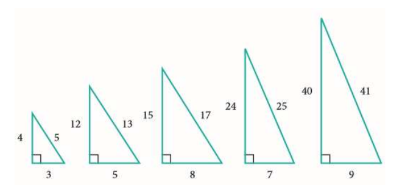

# 7강 연습 문제 — 리스트와 딕셔너리

[레포지토리 안내](../../README.ko.md) | [English](Exercises.md) | [한국어](Exercises.ko.md)

> **최종 수정일:** 2026-11-04

연습 문제 1\~4는 리스트 컴프리헨션, 세트, 딕셔너리를 하나씩 적용하는 실습 문제이고, 연습 문제 5\~6은 리스트와 반복문, `random` 모듈을 함께 쓰는 도전 문제이다.

---

<br>

## 목차

- [연습 문제 1: 피타고라스 삼각형](#연습-문제-1-피타고라스-삼각형)
- [연습 문제 2: 파티 동시 참석자](#연습-문제-2-파티-동시-참석자)
- [연습 문제 3: 편의점 재고 관리](#연습-문제-3-편의점-재고-관리)
- [연습 문제 4: 영한사전](#연습-문제-4-영한사전)
- [연습 문제 5: 다섯 수의 평균](#연습-문제-5-다섯-수의-평균)
- [연습 문제 6: 주사위 눈의 확률](#연습-문제-6-주사위-눈의-확률)

---

<br>

## 연습 문제 1: 피타고라스 삼각형

**문제:** 직각삼각형의 세 변의 길이 $a$, $b$, $c$($c$는 빗변)는 피타고라스의 정리 $a^2 + b^2 = c^2$을 만족한다. 각 변의 길이가 1 이상 30 이하의 정수일 때 이 정리를 만족하는 정수 조합 $(a, b, c)$를 모두 찾아 리스트로 출력하라. 같은 삼각형을 두 번 세지 않도록 $a \le b \le c$인 조합만 찾고, 리스트 컴프리헨션을 이용한다.



*그림 1. 피타고라스의 정리를 만족하는 정수 변 직각삼각형의 예*

**실행 예시:**

```text
[(3, 4, 5), (5, 12, 13), (6, 8, 10), (7, 24, 25), (8, 15, 17), (9, 12, 15), (10, 24, 26), (12, 16, 20), (15, 20, 25), (18, 24, 30), (20, 21, 29)]
```

**[풀이](Solutions.ko.md#연습-문제-1-피타고라스-삼각형)**

---

<br>

## 연습 문제 2: 파티 동시 참석자

**문제:** 두 파티에 참석한 사람들의 명단이 다음과 같이 세트 `partyA`와 `partyB`에 저장되어 있다.

```python
partyA = set(["Park", "Kim", "Lee"])
partyB = set(["Park", "Choi"])
```

1. 두 파티에 모두 참석한 사람들의 명단을 출력하라.
2. 두 파티 가운데 적어도 한 곳에 참석한 사람들과 A 파티에만 참석한 사람들의 명단을 이름순으로 출력하라.

**실행 예시:**

```text
2개의 파티에 모두 참석한 사람은 다음과 같습니다.
{'Park'}
```

```text
한 파티 이상 참석: ['Choi', 'Kim', 'Lee', 'Park']
A 파티에만 참석: ['Kim', 'Lee']
```

**[풀이](Solutions.ko.md#연습-문제-2-파티-동시-참석자)**

---

<br>

## 연습 문제 3: 편의점 재고 관리

**문제:** 편의점에서 판매하는 물건의 재고를 다음 딕셔너리에 저장한다. 물건의 이름을 입력받아 그 물건의 재고를 출력하는 프로그램을 작성하라. 판매하지 않는 물건의 이름을 입력해도 프로그램이 오류로 멈추지 않게 한다.

```python
items = {"커피음료": 7, "펜": 3, "종이컵": 2, "우유": 1, "콜라": 4, "책": 5}
```

**실행 예시:**

```text
물건의 이름을 입력하시오: 콜라
4
```

```text
물건의 이름을 입력하시오: 라면
라면은(는) 판매하지 않는 물건입니다.
```

**[풀이](Solutions.ko.md#연습-문제-3-편의점-재고-관리)**

---

<br>

## 연습 문제 4: 영한사전

**문제:** 영어 단어를 키로, 그 뜻을 값으로 저장하는 영한사전을 구현하라. 빈 딕셔너리를 만든 뒤 `'one'`, `'two'`, `'three'`의 뜻 `'하나'`, `'둘'`, `'셋'`을 차례로 추가하고, 단어를 입력받아 뜻을 출력한다.

**실행 예시:** 프로그램을 두 번 실행하여 각각 `one`과 `two`를 입력한 결과이다.

```text
단어를 입력하시오: one
하나
```

```text
단어를 입력하시오: two
둘
```

**[풀이](Solutions.ko.md#연습-문제-4-영한사전)**

---

<br>

## 연습 문제 5: 다섯 수의 평균

**문제:** 정수 5개를 입력받아 리스트에 저장하고, 저장된 정수의 평균을 계산하여 출력하는 프로그램을 작성하라. 입력 안내 문구는 `정수를 입력하시오: `이고, 결과는 `평균= 3.0`처럼 출력한다.

**실행 예시:**

```text
정수를 입력하시오: 1
정수를 입력하시오: 2
정수를 입력하시오: 3
정수를 입력하시오: 4
정수를 입력하시오: 5
평균= 3.0
```

**[풀이](Solutions.ko.md#연습-문제-5-다섯-수의-평균)**

---

<br>

## 연습 문제 6: 주사위 눈의 확률

**문제:** 주사위를 1000번 던져서 각 눈(1~6)이 나올 확률을 구하는 프로그램을 작성하라. 주사위 던지기는 `random` 모듈로 흉내 내고, 각 눈이 나온 횟수를 던진 횟수로 나눈 값을 그 눈이 나올 확률로 출력한다.

**실행 예시:** 난수를 사용하므로 실행할 때마다 값이 달라진다. 다음은 한 번 실행한 결과이다.

```text
주사위가 1 인 확률은 0.162
주사위가 2 인 확률은 0.18
주사위가 3 인 확률은 0.181
주사위가 4 인 확률은 0.17
주사위가 5 인 확률은 0.144
주사위가 6 인 확률은 0.163
```

**[풀이](Solutions.ko.md#연습-문제-6-주사위-눈의-확률)**
