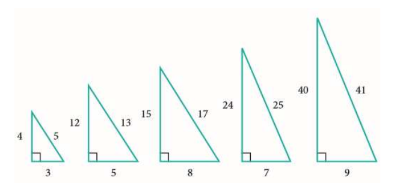

# Lecture 7 Exercises — Lists and Dictionaries

[Repository Guide](../../README.md) | [English](Exercises.md) | [한국어](Exercises.ko.md)

> **Last Updated:** 2026-11-04

Exercises 1-4 are lab problems that apply list comprehensions, sets, and dictionaries one at a time, and Exercises 5-6 are challenge problems that combine lists, loops, and the `random` module.

---

<br>

## Table of Contents

- [Exercise 1: Pythagorean Triangles](#exercise-1-pythagorean-triangles)
- [Exercise 2: Guests at Both Parties](#exercise-2-guests-at-both-parties)
- [Exercise 3: Convenience Store Inventory](#exercise-3-convenience-store-inventory)
- [Exercise 4: English-Korean Dictionary](#exercise-4-english-korean-dictionary)
- [Exercise 5: Average of Five Numbers](#exercise-5-average-of-five-numbers)
- [Exercise 6: Probabilities of Dice Faces](#exercise-6-probabilities-of-dice-faces)

---

<br>

## Exercise 1: Pythagorean Triangles

**Problem:** The three side lengths $a$, $b$, $c$ of a right triangle ($c$ is the hypotenuse) satisfy the Pythagorean theorem $a^2 + b^2 = c^2$. When every side length is an integer from 1 to 30 inclusive, find all integer combinations $(a, b, c)$ that satisfy the theorem and print them as a list. To avoid counting the same triangle twice, find only the combinations with $a \le b \le c$, and use a list comprehension.



*Figure 1. Examples of right triangles with integer sides satisfying the Pythagorean theorem*

**Sample Run:**

```text
[(3, 4, 5), (5, 12, 13), (6, 8, 10), (7, 24, 25), (8, 15, 17), (9, 12, 15), (10, 24, 26), (12, 16, 20), (15, 20, 25), (18, 24, 30), (20, 21, 29)]
```

**[Solution](Solutions.md#exercise-1-pythagorean-triangles)**

---

<br>

## Exercise 2: Guests at Both Parties

**Problem:** The lists of people who attended two parties are stored in the sets `partyA` and `partyB` as follows.

```python
partyA = set(["Park", "Kim", "Lee"])
partyB = set(["Park", "Choi"])
```

1. Print the list of people who attended both parties.
2. Print, in alphabetical order, the list of people who attended at least one of the two parties and the list of people who attended only party A.

**Sample Run:**

```text
2개의 파티에 모두 참석한 사람은 다음과 같습니다.
{'Park'}
```

```text
한 파티 이상 참석: ['Choi', 'Kim', 'Lee', 'Park']
A 파티에만 참석: ['Kim', 'Lee']
```

**[Solution](Solutions.md#exercise-2-guests-at-both-parties)**

---

<br>

## Exercise 3: Convenience Store Inventory

**Problem:** The stock of the items sold at a convenience store is stored in the following dictionary. Write a program that reads the name of an item and prints its stock. The program must not stop with an error even when the name of an item that is not sold is entered.

```python
items = {"커피음료": 7, "펜": 3, "종이컵": 2, "우유": 1, "콜라": 4, "책": 5}
```

**Sample Run:**

```text
물건의 이름을 입력하시오: 콜라
4
```

```text
물건의 이름을 입력하시오: 라면
라면은(는) 판매하지 않는 물건입니다.
```

**[Solution](Solutions.md#exercise-3-convenience-store-inventory)**

---

<br>

## Exercise 4: English-Korean Dictionary

**Problem:** Implement an English-Korean dictionary that stores English words as keys and their meanings as values. Create an empty dictionary, add the meanings `'하나'`, `'둘'`, `'셋'` of `'one'`, `'two'`, `'three'` in turn, and then read a word and print its meaning.

**Sample Run:** These are the results of running the program twice, entering `one` and `two`, respectively.

```text
단어를 입력하시오: one
하나
```

```text
단어를 입력하시오: two
둘
```

**[Solution](Solutions.md#exercise-4-english-korean-dictionary)**

---

<br>

## Exercise 5: Average of Five Numbers

**Problem:** Write a program that reads five integers, stores them in a list, and computes and prints the average of the stored integers. The input prompt is `정수를 입력하시오: ` ("Enter an integer: "), and the result is printed as `평균= 3.0` ("average= 3.0").

**Sample Run:**

```text
정수를 입력하시오: 1
정수를 입력하시오: 2
정수를 입력하시오: 3
정수를 입력하시오: 4
정수를 입력하시오: 5
평균= 3.0
```

**[Solution](Solutions.md#exercise-5-average-of-five-numbers)**

---

<br>

## Exercise 6: Probabilities of Dice Faces

**Problem:** Write a program that rolls a die 1000 times and finds the probability that each face (1-6) comes up. Simulate the rolls with the `random` module, and print, as the probability of each face, the number of times the face came up divided by the number of rolls.

**Sample Run:** Because random numbers are used, the values differ every time the program runs. The following is the result of one run.

```text
주사위가 1 인 확률은 0.162
주사위가 2 인 확률은 0.18
주사위가 3 인 확률은 0.181
주사위가 4 인 확률은 0.17
주사위가 5 인 확률은 0.144
주사위가 6 인 확률은 0.163
```

**[Solution](Solutions.md#exercise-6-probabilities-of-dice-faces)**
