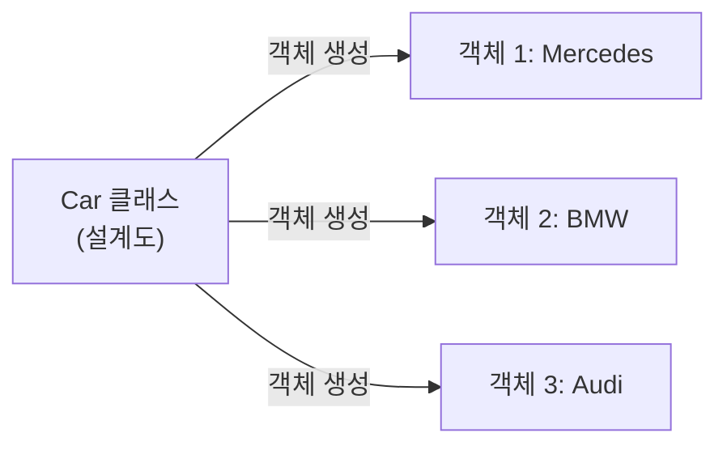
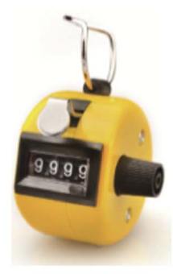

# 8강 — 클래스와 객체

[레포지토리 안내](../../README.ko.md) | [English](Concepts_Lecture.md) | [한국어](Concepts_Lecture.ko.md)

> **최종 수정일:** 2026-11-04

> **학습 목표:**
> 1. 관련된 데이터를 여러 리스트에 나누어 저장할 때 생기는 문제를 설명하고 데이터를 하나로 묶는 방법을 비교할 수 있다
> 2. 객체, 상태, 동작, 클래스, 인스턴스의 관계를 설명할 수 있다
> 3. `class`문으로 인스턴스 변수와 메서드를 정의하고 `self`의 역할을 설명할 수 있다
> 4. 생성자 `__init__()`으로 객체를 초기화하고 한 클래스로 여러 객체를 만들어 사용할 수 있다
> 5. 이름이 `__`로 시작하는 인스턴스 변수로 정보를 은닉하고 접근자와 설정자로 다룰 수 있다

---

## 목차

- [1. 여러 리스트로 관련 데이터 다루기](#1-여러-리스트로-관련-데이터-다루기)
  - [1.1 문제 상황](#11-문제-상황)
  - [1.2 정렬 함수 만들기](#12-정렬-함수-만들기)
  - [1.3 여러 리스트를 함께 정렬하기](#13-여러-리스트를-함께-정렬하기)
  - [1.4 관련 데이터를 하나로 묶는 방법](#14-관련-데이터를-하나로-묶는-방법)
- [2. 객체 지향 프로그래밍](#2-객체-지향-프로그래밍)
  - [2.1 객체와 객체 지향](#21-객체와-객체-지향)
  - [2.2 객체 사이의 상호 작용](#22-객체-사이의-상호-작용)
  - [2.3 상태와 동작](#23-상태와-동작)
- [3. 클래스와 인스턴스](#3-클래스와-인스턴스)
  - [3.1 객체의 설계도](#31-객체의-설계도)
  - [3.2 클래스 정의의 형식](#32-클래스-정의의-형식)
  - [3.3 하나의 클래스로 여러 객체 만들기](#33-하나의-클래스로-여러-객체-만들기)
- [4. Counter 클래스](#4-counter-클래스)
  - [4.1 클래스 정의와 인스턴스 변수](#41-클래스-정의와-인스턴스-변수)
  - [4.2 객체 생성과 메서드 호출](#42-객체-생성과-메서드-호출)
  - [4.3 self의 의미](#43-self의-의미)
  - [4.4 독립된 상태를 가진 두 객체](#44-독립된-상태를-가진-두-객체)
- [5. 생성자](#5-생성자)
  - [5.1 생성자 메서드](#51-생성자-메서드)
  - [5.2 매개변수가 있는 생성자](#52-매개변수가-있는-생성자)
- [6. 메서드](#6-메서드)
  - [6.1 메서드의 정의](#61-메서드의-정의)
  - [6.2 메서드의 호출](#62-메서드의-호출)
  - [6.3 문자열 표현 메서드](#63-문자열-표현-메서드)
- [7. 정보 은닉](#7-정보-은닉)
  - [7.1 비공개 인스턴스 변수](#71-비공개-인스턴스-변수)
  - [7.2 이름 맹글링](#72-이름-맹글링)
  - [7.3 접근자와 설정자](#73-접근자와-설정자)
- [8. 개인 정보 정렬 다시 보기](#8-개인-정보-정렬-다시-보기)
- [개념 적용](#개념-적용)
- [요약](#요약)
- [점검 문제](#점검-문제)
- [참고 문헌](#참고-문헌)

---

<br>

## 1. 여러 리스트로 관련 데이터 다루기

### 1.1 문제 상황

여러 사람의 개인 정보(이름, 나이, 키)를 저장하고, 이름순이나 나이순, 키순으로 정렬하여 각 사람의 정보를 차례로 보여 주는 프로그램을 생각한다. [7강](../Lec07_Lists-and-Dictionaries/Concepts_Lecture.ko.md)의 리스트만 사용한다면 정보의 종류마다 리스트를 하나씩 만들고, 같은 인덱스에 같은 사람의 정보를 저장하는 방법이 자연스럽다. 이처럼 인덱스로 서로 대응하는 여러 리스트를 **병렬 리스트(parallel lists)** 라고 한다.

```python
names = ["Kim", "Lee", "Park"]
ages = [30, 50, 20]
heights = [175, 168, 181]
for i in range(len(names)):
    print(names[i], ages[i], heights[i])
```

```text
Kim 30 175
Lee 50 168
Park 20 181
```

```text
           0        1        2             인덱스
names    [ "Kim",   "Lee",   "Park" ]
ages     [ 30,      50,      20     ]
heights  [ 175,     168,     181    ]
           ▲
           └── 인덱스 0의 세 값이 한 사람(Kim)의 정보이다
```

*그림 1. 같은 인덱스로 한 사람의 정보를 나타내는 병렬 리스트*

이 프로그램을 만들려면 두 가지가 필요하다. 첫째, 한 리스트를 크기 순서대로 정렬하는 함수가 있어야 한다. 둘째, 어떤 리스트(예를 들어 `ages`)를 기준으로 정렬할 때 다른 리스트(`names`, `heights`)도 같은 순서로 따라 움직여야 한다. 먼저 숫자를 저장한 리스트 하나를 오름차순으로 정렬하는 함수부터 만든다.

### 1.2 정렬 함수 만들기

리스트를 정렬하는 가장 잘 알려진 방법의 하나는 **버블 정렬(bubble sort)** 이다. 이웃한 두 요소를 앞에서부터 차례로 비교하여 앞의 요소가 더 크면 서로 교환한다. 이 과정을 한 번 끝까지 진행하는 것을 한 **회전(pass)** 이라고 하며, 한 회전이 끝나면 남은 요소 가운데 가장 큰 값이 맨 뒤로 이동한다. 거품이 물 위로 떠오르는 모습과 비슷하여 이런 이름이 붙었다.

| 회전 | 비교와 교환 | 회전 후의 리스트 |
|:-----|:-----|:-----|
| 초기 상태 | 없음 | `[7, 4, 5, 1, 3]` |
| 1회전 | 7과 4, 7과 5, 7과 1, 7과 3을 차례로 교환한다 | `[4, 5, 1, 3, 7]` |
| 2회전 | 4와 5는 그대로 두고, 5와 1, 5와 3을 교환한다 | `[4, 1, 3, 5, 7]` |
| 3회전 | 4와 1, 4와 3을 교환한다 | `[1, 3, 4, 5, 7]` |
| 4회전 | 1과 3은 그대로 둔다 | `[1, 3, 4, 5, 7]` |

*표 1. 리스트 `[7, 4, 5, 1, 3]`을 버블 정렬하는 과정*

1회전이 끝나면 가장 큰 7이 맨 뒤에 자리를 잡고, 2회전 뒤에는 5가, 3회전 뒤에는 4가 자리를 잡는다. 요소가 $n$개이면 $n-1$회전 뒤에 모든 요소가 정렬되며, $k$회전에서는 이미 자리를 잡은 뒤쪽 $k-1$개를 비교하지 않아도 된다.

```python
def bubble_sort(a):
    n = len(a)
    for p in range(n - 1):             # p+1회전
        for i in range(n - 1 - p):     # 이웃한 a[i]와 a[i+1]을 비교한다
            if a[i] > a[i + 1]:
                a[i], a[i + 1] = a[i + 1], a[i]
        print("pass", p + 1, ":", a)

data = [7, 4, 5, 1, 3]
bubble_sort(data)
print(data)
```

```text
pass 1 : [4, 5, 1, 3, 7]
pass 2 : [4, 1, 3, 5, 7]
pass 3 : [1, 3, 4, 5, 7]
pass 4 : [1, 3, 4, 5, 7]
[1, 3, 4, 5, 7]
```

- **바깥 반복:** `p`가 0\~3일 때 1\~4회전을 수행한다.
- **안쪽 반복:** `p`번의 회전이 끝나면 맨 뒤의 `p`개가 이미 자리를 잡으므로, `p + 1`회전에서는 `i`가 0부터 `n - 2 - p`까지 바뀌며 `a[i]`와 `a[i + 1]`을 비교하고 자리를 잡은 뒤쪽 `p`개는 비교하지 않는다.
- **교환:** `a[i], a[i + 1] = a[i + 1], a[i]`는 튜플 언패킹으로 두 요소를 맞바꾼다([7강 7.4절](../Lec07_Lists-and-Dictionaries/Concepts_Lecture.ko.md#74-튜플-언패킹)).
- **마지막 `print(data)`:** 함수가 리스트를 반환하지 않았는데도 `data`가 정렬되어 있다. 매개변수 `a`가 인수 `data`와 같은 리스트 객체를 가리키므로, 함수 안에서 요소를 교환한 결과가 호출한 쪽에 그대로 보이기 때문이다([7강 9.5절](../Lec07_Lists-and-Dictionaries/Concepts_Lecture.ko.md#95-함수에-리스트-전달)).

정렬 함수를 만드는 방법은 여러 가지이다. 다음 `sort_func_v1`은 이웃한 요소만 비교하는 대신 모든 인덱스 쌍 `(i, j)`를 비교하여, `list_[i] < list_[j]`이면 두 요소를 교환하는 더 단순한 방법이다.

```python
def sort_func_v1(list_):
    temp = 0
    for i in range(len(list_)):
        for j in range(len(list_)):
            if (list_[i] < list_[j]):
                temp = list_[i]
                list_[i] = list_[j]
                list_[j] = temp
    for k in list_:
        print(k)

## main ##
age_list = []
num_p = 3

for i in range(num_p):
    age = int(input("숫자를 입력하시오: "))
    age_list.append(age)

sort_func_v1(age_list)
```

```text
숫자를 입력하시오: 30
숫자를 입력하시오: 50
숫자를 입력하시오: 20
20
30
50
```

- **교환:** `temp`에 `list_[i]`를 잠시 보관한 뒤 `list_[i]`에 `list_[j]`를, `list_[j]`에 보관한 값을 넣는다. 임시 변수 없이 바로 대입하면 먼저 대입한 값에 원래 값이 덮어써지므로 임시 변수가 필요하다.
- **입력:** 주 프로그램은 빈 리스트 `age_list`에 정수 세 개를 입력받아 추가한 뒤 정렬 함수에 넘긴다.

| `i` | 교환이 일어난 `j`와 그 결과 | `i`번 반복이 끝난 뒤의 리스트 |
|:-----|:-----|:-----|
| 0 | `j = 1`: 30 < 50이므로 교환하여 `[50, 30, 20]` | `[50, 30, 20]` |
| 1 | `j = 0`: 30 < 50이므로 교환하여 `[30, 50, 20]` | `[30, 50, 20]` |
| 2 | `j = 0`: 20 < 30이므로 교환하여 `[20, 50, 30]`, `j = 1`: 30 < 50이므로 교환하여 `[20, 30, 50]` | `[20, 30, 50]` |

*표 2. `sort_func_v1`이 `[30, 50, 20]`을 정렬하는 과정*

조건이 `list_[i] < list_[j]`인데도 결과가 오름차순인 이유는 다음 성질에 있다. `i`가 0일 때 `j`가 모든 인덱스를 돌며 더 큰 값을 만날 때마다 교환하므로, 반복이 끝나면 `list_[0]`에 최댓값이 온다. 그 뒤 `i`번 반복이 끝날 때마다 앞부분 `list_[0]`~`list_[i]`는 오름차순으로 정렬되어 있고 `list_[i]`는 리스트 전체의 최댓값이다. 따라서 마지막 반복이 끝나면 리스트 전체가 오름차순이 된다 [1]. 비교 횟수는 항상 $n^2$이므로 버블 정렬보다 느리지만, 코드가 짧아 정렬의 원리를 익히는 데 쓰인다.

> **[알고리즘]** 버블 정렬과 `sort_func_v1`은 모두 비교를 $O(n^2)$번 하는 정렬이다. 실무에서는 [7강 4.3절](../Lec07_Lists-and-Dictionaries/Concepts_Lecture.ko.md#43-정렬)의 `sort()`나 `sorted()`를 쓰며, 표준 구현인 CPython에서 이 함수들은 최악의 경우에도 $O(n \log n)$번 비교하는 정렬 알고리즘으로 구현되어 있다.

### 1.3 여러 리스트를 함께 정렬하기

두 요소를 교환하는 일을 함수 `swap()`으로 따로 만들면 정렬 함수가 짧아진다. 다음 `sort_func_v2`는 첫 번째 리스트를 정렬하고, 정렬이 끝나면 세 리스트의 같은 인덱스 값을 한 줄씩 출력한다.

```python
def swap(x, i, j):
    x[i], x[j] = x[j], x[i]

def sort_func_v2(list_1, list_2, list_3):
    for i in range(len(list_1)):
        for j in range(len(list_1)):
            if (list_1[i] < list_1[j]):
                swap(list_1, i, j)
    for k in range(len(list_1)):
        print(list_1[k], list_2[k], list_3[k])

names = ["Kim", "Lee", "Park"]
ages = [30, 50, 20]
heights = [175, 168, 181]
sort_func_v2(ages, names, heights)
```

```text
20 Kim 175
30 Lee 168
50 Park 181
```

- **`swap(x, i, j)`:** 리스트 `x`의 인덱스 `i`, `j` 요소를 맞바꾼다. 반환값이 없어도 매개변수 `x`가 호출한 쪽의 리스트와 같은 객체를 가리키므로 교환 결과가 남는다.
- **잘못된 결과:** 나이는 20, 30, 50으로 정렬되었지만 이름과 키는 원래 순서 그대로이다. 그래서 20세가 Kim으로, 30세가 Lee로 출력되어 사람과 정보의 대응이 깨졌다. 실제로 20세는 Park이고, Kim은 30세이다.

기준 리스트에서 두 요소를 교환할 때 다른 리스트에서도 **같은 인덱스의 요소를 함께 교환**해야 대응이 유지된다. 다음 `sort_func_v3`은 정렬 전의 정보를 먼저 출력한 뒤, 세 리스트를 함께 교환하며 정렬한다.

```python
def swap(x, i, j):
    x[i], x[j] = x[j], x[i]

def sort_func_v3(list_1, list_2, list_3):
    for a in range(len(list_1)):
        print(list_1[a], list_2[a], list_3[a])
    for i in range(len(list_1)):
        for j in range(len(list_1)):
            if (list_1[i] < list_1[j]):
                swap(list_1, i, j)
                swap(list_2, i, j)
                swap(list_3, i, j)
    for k in range(len(list_1)):
        print(list_1[k], list_2[k], list_3[k])

names = ["Kim", "Lee", "Park"]
ages = [30, 50, 20]
heights = [175, 168, 181]
sort_func_v3(ages, names, heights)
print(names)
```

```text
30 Kim 175
50 Lee 168
20 Park 181
20 Park 181
30 Kim 175
50 Lee 168
['Park', 'Kim', 'Lee']
```

처음 세 줄은 정렬 전, 다음 세 줄은 나이순으로 정렬한 뒤의 정보이며, 이제 각 줄이 한 사람의 올바른 정보이다. 마지막 줄처럼 함수 밖의 `names`도 나이순으로 바뀌어 있다. 이름순으로 보려면 `sort_func_v3(names, ages, heights)`처럼 기준이 될 리스트를 첫 번째 인수로 넘긴다.

> **참고:** `sort_func_v2`와 `sort_func_v3`은 매개변수가 세 개이므로 `sort_func_v2(age_list)`처럼 리스트 하나만 넘기면 `TypeError: sort_func_v2() missing 2 required positional arguments: 'list_2' and 'list_3'`가 난다. 리스트 하나만 정렬하려면 매개변수가 하나인 `sort_func_v1`에서 교환 부분을 `swap(list_, i, j)`로 바꾸어 쓴다.

### 1.4 관련 데이터를 하나로 묶는 방법

병렬 리스트는 리스트의 개수가 늘수록 다루기 어렵다. 정렬뿐 아니라 사람을 추가하거나 삭제할 때도 모든 리스트를 같은 인덱스에서 똑같이 바꿔야 하고, 하나라도 빠뜨리면 정보의 대응이 조용히 깨진다. 근본적인 해결책은 한 사람의 정보를 **하나의 단위**로 묶는 것이다.

| 방법 | 한 사람의 정보 | 특징 |
|:-----|:-----|:-----|
| 병렬 리스트 | `names[i]`, `ages[i]`, `heights[i]` | 정렬, 추가, 삭제 때 모든 리스트를 함께 바꿔야 한다. |
| 2차원 리스트 | `people[i]` = `["Kim", 30, 175]` | 행 하나가 한 사람이므로 행 단위로 정렬하면 대응이 유지된다. 열의 의미는 번호(0, 1, 2)로만 드러난다. |
| 클래스 | `people[i]` = 이름, 나이, 키를 속성으로 가진 객체 | 속성을 `p.age`처럼 이름으로 쓰고, 데이터와 그 데이터를 다루는 함수를 함께 정의한다. |
| 그 밖의 방법 | 튜플 `("Kim", 30, 175)`, 딕셔너리 `{"name": "Kim", ...}` | 튜플은 바꿀 수 없는 기록에, 딕셔너리는 키로 항목을 찾을 때 알맞다. |

*표 3. 관련 데이터를 하나의 단위로 묶는 방법의 비교*

2차원 리스트로 바꾸면 정렬은 행을 단위로 하므로 대응이 깨질 수 없다. 다음 코드는 `sort()`의 `key`에 각 행의 1번 열(나이)을 돌려주는 람다 함수를 주어 나이순으로 정렬한다([6강 7절](../Lec06_Functions/Concepts_Lecture.ko.md#7-무명-함수)).

```python
people = [["Kim", 30, 175], ["Lee", 50, 168], ["Park", 20, 181]]

people.sort(key=lambda p: p[1])     # 1번 열(나이)을 기준으로 행을 정렬한다
for p in people:
    print(p[0], p[1], p[2])
```

```text
Park 20 181
Kim 30 175
Lee 50 168
```

`key=lambda p: p[1]`은 행 `p`마다 `p[1]`을 계산하여 그 값의 순서로 행들을 정렬하라는 뜻이다. 행 전체가 함께 움직이므로 이름, 나이, 키가 흩어지지 않는다. 하지만 `p[1]`이 나이라는 사실은 코드만 보아서는 알 수 없다. 데이터에 이름을 붙이고, 그 데이터를 다루는 기능까지 함께 묶는 방법이 **클래스(class)** 이며, 이 문제는 클래스를 배운 뒤 [8절](#8-개인-정보-정렬-다시-보기)에서 다시 푼다.

---

<br>

## 2. 객체 지향 프로그래밍

### 2.1 객체와 객체 지향

> **용어 정의:** **객체(object)** 는 관련된 변수(데이터)와 함수(기능)를 하나의 단위로 묶은 것이다. 프로그램을 객체들과 그 객체들 사이의 상호 작용으로 구성하는 프로그래밍 방식을 **객체 지향 프로그래밍(object-oriented programming, OOP)** 이라고 한다.

현실 세계는 사물로 가득하다. 뜨개질을 하는 사람, 태블릿, 텔레비전, 강아지, 털실 뭉치는 각자 고유한 특성을 가지고 서로 영향을 주고받는다. 객체 지향 프로그래밍은 문제 속의 사물을 각각 객체로 표현하고, 객체들이 서로 기능을 요청하며 일을 처리하도록 프로그램을 짠다.

이와 대비되는 방식이 **절차 지향 프로그래밍(procedural programming)** 이다. 절차 지향에서는 데이터와 그 데이터를 처리하는 함수가 따로 있고, 프로그램은 함수를 차례로 호출하는 절차로 표현된다. [1.3절](#13-여러-리스트를-함께-정렬하기)에서 병렬 리스트와 정렬 함수를 따로 둔 것이 그 예이다. 객체 지향에서는 데이터와 그 데이터를 다루는 함수가 한 객체 안에 함께 있으므로, 관련된 코드가 한곳에 모이고 데이터를 잘못 다룰 가능성이 줄어든다.

[7강 1.3절](../Lec07_Lists-and-Dictionaries/Concepts_Lecture.ko.md#13-객체와-점-표기법)에서 본 것처럼 파이썬에서는 리스트, 문자열, 정수를 포함한 모든 값이 이미 객체이다. 클래스를 정의하면 원하는 종류의 객체를 직접 만들 수 있다.

### 2.2 객체 사이의 상호 작용

텔레비전과 리모컨은 각각 특정한 기능을 수행하는 객체로 볼 수 있다. 리모컨의 채널 버튼을 누르면 리모컨 객체가 텔레비전 객체에 채널을 바꾸라는 **메시지(message)** 를 보내고, 텔레비전 객체는 그 메시지에 따라 자신의 채널을 바꾼다.


*그림 2. 메시지를 통해 상호 작용하는 리모컨 객체와 텔레비전 객체*

프로그램에서 객체에 메시지를 보내는 것은 그 객체의 메서드를 호출하는 것이다. 위의 메시지는 코드로 `tv.setChannel(11)`처럼 쓰며, 이런 코드는 [6절](#6-메서드)에서 직접 만든다.

### 2.3 상태와 동작

객체는 **속성(attribute)** 과 **동작(action)** 을 가진다. 자동차를 예로 들면 다음과 같다.

| 속성 | 동작 |
|:-----|:-----|
| 메이커, 모델, 색상, 연식, 가격 | 주행하기, 방향 바꾸기, 주차하기 |

*표 4. 자동차 객체의 속성과 동작*

속성의 현재 값들을 객체의 **상태(state)** 라고 하고, 객체가 할 수 있는 동작을 객체의 **동작(behavior)** 이라고 한다. 텔레비전 객체의 상태는 채널 번호, 볼륨, 전원 상태이고, 동작은 켜기, 끄기, 채널 변경하기, 볼륨 변경하기이다. 프로그램에서 상태는 객체마다 따로 가지는 변수인 **인스턴스 변수(instance variable)** 로, 동작은 객체에 속한 함수인 **메서드(method)** 로 구현한다. 인스턴스 변수를 **필드(field)** 라고도 한다.

| 구분 | 텔레비전 객체의 예 | 구현 |
|:-----|:-----|:-----|
| 상태 | 채널 번호, 볼륨, 전원 상태 | 인스턴스 변수 `channel`, `volume`, `on` |
| 동작 | 켜기, 끄기, 채널 변경하기, 볼륨 변경하기 | 메서드 `turnOn()`, `turnOff()`, `changeChannel()`, `changeVolume()` |

*표 5. 텔레비전 객체의 상태와 동작, 그리고 그 구현*

> **핵심:** 객체 = 상태(인스턴스 변수) + 동작(메서드). 상태는 객체가 지금 어떤 값을 가지고 있는지이고, 동작은 객체가 무엇을 할 수 있는지이다. 메서드는 대개 그 객체의 상태를 읽거나 바꾼다.

---

<br>

## 3. 클래스와 인스턴스

### 3.1 객체의 설계도

> **용어 정의:** 객체를 만들기 위한 설계도를 **클래스(class)** 라고 한다. 클래스로부터 만들어지는 각각의 객체를 그 클래스의 **인스턴스(instance)** 라고 한다.

클래스는 와플을 찍어 내는 와플 틀과 같다. 틀 하나로 와플을 여러 개 구울 수 있고, 구워진 와플들은 모양이 같지만 각각 별개의 와플이다. 집의 설계도 한 장으로 집을 여러 채 지을 수 있는 것도 같은 관계이다. 마찬가지로 `Car` 클래스 하나로 여러 자동차 객체를 만들 수 있으며, 각 객체는 같은 종류의 속성을 가지지만 그 값(색상, 모델 등)은 객체마다 다르다.



*그림 3. 하나의 클래스로부터 만들어지는 여러 인스턴스*

따라서 객체를 사용하려면 두 단계가 필요하다.

1. 객체의 설계도인 클래스를 작성한다.
2. 클래스로부터 객체를 생성한다.

### 3.2 클래스 정의의 형식

클래스는 `class` 키워드로 정의하며, 클래스 안에 메서드들을 `def`로 정의한다.

```python
class 클래스_이름:
    def 메서드1(self, ...):
        ...
    def 메서드2(self, ...):
        ...
```

- **클래스 이름:** 관례적으로 `Car`, `BankAccount`처럼 단어의 첫 글자를 대문자로 쓰는 CapWords 방식으로 짓는다 [2]. 변수와 함수 이름은 `my_car`처럼 소문자와 밑줄로 쓴다.
- **메서드:** 클래스 안에 정의된 함수이다. 정의하는 방법은 함수와 같지만, 첫 번째 매개변수는 항상 그 메서드가 호출된 객체를 받는 `self`이다([4.3절](#43-self의-의미)).
- **들여쓰기:** 메서드 정의는 `class` 줄보다 한 단계, 메서드의 본문은 `def` 줄보다 한 단계 들여 쓴다.

### 3.3 하나의 클래스로 여러 객체 만들기

다음 `Car` 클래스는 속도, 색상, 모델을 인스턴스 변수로 가지고, 주행하면 속도를 60으로 만드는 `drive()` 메서드를 가진다. 클래스 이름 뒤에 괄호를 붙여 `Car(...)`처럼 호출하면 새 객체가 만들어진다.

```python
class Car:
    def __init__(self, speed, color, model):
        self.speed = speed
        self.color = color
        self.model = model

    def drive(self):
        self.speed = 60

dadCar = Car(0, "silver", "A6")
momCar = Car(0, "white", "520d")
myCar = Car(0, "blue", "E-class")

myCar.drive()
print(dadCar.color, dadCar.model, dadCar.speed)
print(myCar.color, myCar.model, myCar.speed)
print(type(myCar))
print(isinstance(myCar, Car))
print(dadCar is momCar)
```

```text
silver A6 0
blue E-class 60
<class '__main__.Car'>
True
False
```

```text
dadCar ──▶ [Car] speed = 0,  color = "silver", model = "A6"
momCar ──▶ [Car] speed = 0,  color = "white",  model = "520d"
myCar  ──▶ [Car] speed = 60, color = "blue",   model = "E-class"
```

*그림 4. `Car` 클래스로 만든 세 객체와 각 객체의 인스턴스 변수*

- **객체 생성:** `Car(0, "silver", "A6")`는 `Car` 객체를 하나 만들고, `__init__()` 메서드로 그 객체의 `speed`, `color`, `model`을 0, `"silver"`, `"A6"`으로 초기화한 뒤 객체를 반환한다. `__init__()`은 [5절](#5-생성자)에서 다룬다.
- **독립된 상태:** `myCar.drive()`는 `myCar`의 `speed`만 60으로 바꾸고, `dadCar`의 `speed`는 0 그대로이다. 세 객체는 같은 클래스에서 만들어졌지만 각자 자기 인스턴스 변수를 가진다.
- **`객체.변수`:** 점 표기법으로 객체의 인스턴스 변수를 읽는다.
- **`type()`과 `isinstance()`:** `type(myCar)`는 `myCar`의 클래스를 보여 주며, `__main__`은 이 클래스가 직접 실행한 프로그램에서 정의되었다는 뜻이다. `isinstance(myCar, Car)`는 `myCar`가 `Car`의 인스턴스이므로 `True`이다.

---

<br>

## 4. Counter 클래스

### 4.1 클래스 정의와 인스턴스 변수

경기장이나 공연장 입구에서 들어오는 관객 수를 셀 때 쓰는 기계식 계수기를 클래스로 만든다. 계수기는 지금까지 센 수를 상태로 가지며, 버튼을 누르면 수가 1 늘고, 손잡이를 돌리면 0으로 돌아간다.



*그림 5. 관객 수를 세는 기계식 계수기*

이 계수기를 나타내는 `Counter` 클래스는 센 수를 저장하는 인스턴스 변수 `count`와, 0으로 되돌리는 `reset()`, 1 늘리는 `increment()`, 현재 값을 반환하는 `get()` 메서드를 가진다.

```python
class Counter:
    def reset(self):
        self.count = 0
    def increment(self):
        self.count += 1
    def get(self):
        return self.count
```

파이썬에서 인스턴스 변수를 만들려면 메서드 안에서 `self.`를 붙인 변수에 값을 대입한다. `reset()`의 `self.count = 0`은 이 메서드가 호출된 객체에 `count`라는 인스턴스 변수를 만들고(이미 있으면 값을 바꾸고) 0을 저장한다. `self.`를 붙이지 않은 `count = 0`은 메서드가 끝나면 사라지는 지역 변수일 뿐이다.

### 4.2 객체 생성과 메서드 호출

```python
a = Counter()

a.reset()
a.increment()
print("카운터 a의 값은", a.get())
```

```text
카운터 a의 값은 1
```

```text
a ──▶ ┌───────────────┐         Counter 클래스
      │ count │   1   │  ─────▶  reset(), increment(), get()
      └───────────────┘
```

*그림 6. 변수 `a`가 가리키는 `Counter` 객체와 그 클래스*

- **`a = Counter()`:** `Counter` 클래스의 객체를 하나 만들고 변수 `a`가 그 객체를 가리키게 한다. 이 시점의 객체에는 아직 인스턴스 변수가 없다.
- **`a.reset()`:** `a`가 가리키는 객체에 `count`를 만들고 0을 저장한다.
- **`a.increment()`:** 그 객체의 `count`를 1 늘린다.
- **`a.get()`:** 그 객체의 `count` 값 1을 반환한다.

그림 6처럼 인스턴스 변수 `count`는 객체 안에 있고, 메서드는 클래스에 한 번만 정의되어 그 클래스의 모든 객체가 함께 쓴다. `a.increment()`처럼 호출하면 파이썬은 `a`의 클래스인 `Counter`에서 `increment`를 찾아 실행한다.

### 4.3 self의 의미

메서드를 정의할 때는 매개변수에 `self`가 있지만, 호출할 때는 `a.increment()`처럼 `self`에 해당하는 인수를 쓰지 않는다. `a.increment()`는 파이썬이 다음과 같이 바꾸어 실행하기 때문이다 [3].

```python
Counter.increment(a)     # a.increment()와 같다: self에 a가 전달된다
```

즉 점 앞의 객체 `a`가 첫 번째 인수로 자동 전달되어 매개변수 `self`에 들어간다. 그래서 메서드 안의 `self.count`는 메서드를 호출한 바로 그 객체의 `count`이다. 같은 메서드라도 `b.increment()`로 호출하면 `self`는 `b`가 된다.

```python
a = Counter()
a.reset()
a.increment()
Counter.increment(a)
print(a.get())
print(a.__dict__)
```

```text
2
{'count': 2}
```

`Counter.increment(a)`로 직접 호출해도 `a.increment()`와 똑같이 `a`의 `count`가 1에서 2로 늘어난다. 직접 정의한 클래스의 객체가 가지는 특별한 속성 `__dict__`는 그 객체의 인스턴스 변수를 딕셔너리로 보여 준다. 정수, 문자열, 리스트처럼 이 속성이 없는 객체도 있다.

> **참고:** `self`는 파이썬의 키워드가 아니라 관례적인 이름이다. 첫 번째 매개변수의 이름을 다르게 지어도 동작은 같지만, 다른 이름을 쓰면 다른 파이썬 프로그래머가 코드를 읽기 어려워지므로 `self`를 쓰는 관례를 따른다 [3].

### 4.4 독립된 상태를 가진 두 객체

한 클래스로 객체를 두 개 만들면 각 객체는 자기만의 `count`를 가진다.

```python
a = Counter()
b = Counter()

a.reset()
b.reset()
a.increment()
b.increment()
b.increment()
print(a.get(), b.get())
print(a.__dict__, b.__dict__)
print(a is b)
```

```text
1 2
{'count': 1} {'count': 2}
False
```

```text
a ──▶ ┌───────────────┐
      │ count │   1   │
      └───────────────┘
b ──▶ ┌───────────────┐
      │ count │   2   │
      └───────────────┘
```

*그림 7. 각자 인스턴스 변수 `count`를 가진 두 `Counter` 객체*

`a`와 `b`는 서로 다른 객체이므로 `a.increment()`는 `b`의 `count`에 영향을 주지 않는다. 경기장 입구 두 곳에 계수기를 하나씩 두는 것과 같다.

> **주의:** 이 `Counter` 클래스는 `reset()`을 호출하기 전에는 `count`가 없다. 새로 만든 객체에 바로 `c.increment()`를 호출하면 없는 `self.count`를 읽으려 하므로 `AttributeError: 'Counter' object has no attribute 'count'`가 난다. 객체를 만들자마자 인스턴스 변수를 준비해 두는 방법이 다음 절의 생성자이다.

---

<br>

## 5. 생성자

### 5.1 생성자 메서드

> **용어 정의:** **생성자(constructor)** 는 객체가 생성될 때 자동으로 호출되어 객체의 인스턴스 변수를 기본값으로 초기화하는 특수한 메서드이다. 파이썬에서는 이름이 `__init__`인 메서드가 이 역할을 한다.

공장에서 막 나온 자동차에 도색 작업자가 색을 입힌 뒤 출고하는 것처럼, 생성자는 새로 만들어진 객체를 사용할 수 있는 상태로 준비한다. `__init__`의 앞뒤에는 밑줄이 두 개씩 붙는다.

```python
class 클래스_이름:
    def __init__(self, ...):    # 생성자: 객체의 초기화를 담당한다
        ...
```

`Counter`에 생성자를 더하면 객체를 만드는 순간 `count`가 0으로 준비되므로, `reset()`을 먼저 호출하지 않아도 된다.

```python
class Counter:
    def __init__(self):
        self.count = 0
    def reset(self):
        self.count = 0
    def increment(self):
        self.count += 1
    def get(self):
        return self.count

c = Counter()          # 여기서 __init__이 실행된다
c.increment()
print(c.get())
```

```text
1
```

`Counter()`를 호출하면 파이썬은 새 객체를 만들고, 그 객체를 `self`로 하여 `__init__()`을 자동으로 호출한 뒤, 초기화된 객체를 반환한다. 보통은 프로그램에서 `__init__()`을 직접 호출하지 않는다.

> **참고:** 엄밀히 말하면 파이썬에서 객체를 만드는 일은 `__new__()`라는 다른 특수 메서드가 하고, `__init__()`은 이미 만들어진 객체의 초기화를 담당한다 [4]. 그래서 `__init__()`을 초기화 메서드(initializer)라고 부르기도 한다. 일반적인 클래스에서는 `__init__()`만 정의하면 되므로, `__init__()`을 생성자라고 부르는 것이 관례이다.

### 5.2 매개변수가 있는 생성자

생성자에 매개변수를 더하면 객체마다 다른 초기값을 줄 수 있다. 객체를 만들 때 클래스 이름 뒤의 괄호에 넣은 인수가 `self` 다음의 매개변수에 차례로 전달된다.

```python
class Car:
    def __init__(self, speed, color, model):
        self.speed = speed
        self.color = color
        self.model = model

    def drive(self):
        self.speed = 60

myCar = Car(0, "blue", "E-class")

print("자동차 객체를 생성하였습니다.")
print("자동차의 속도는", myCar.speed)
print("자동차의 색상은", myCar.color)
print("자동차의 모델은", myCar.model)
print("자동차를 주행합니다.")
myCar.drive()
print("자동차의 속도는", myCar.speed)
```

```text
자동차 객체를 생성하였습니다.
자동차의 속도는 0
자동차의 색상은 blue
자동차의 모델은 E-class
자동차를 주행합니다.
자동차의 속도는 60
```

- **인수 전달:** `Car(0, "blue", "E-class")`에서 `self`에는 새 객체가, `speed`, `color`, `model`에는 0, `"blue"`, `"E-class"`가 전달된다.
- **`self.speed = speed`:** 오른쪽 `speed`는 생성자의 매개변수(지역 변수)이고, 왼쪽 `self.speed`는 객체의 인스턴스 변수이다. 이름이 같아도 서로 다른 변수이며, 이 대입으로 매개변수의 값이 객체에 저장되어 생성자가 끝난 뒤에도 남는다.
- **인수 개수:** 생성자가 받는 인수의 개수는 `self`를 뺀 매개변수의 개수와 맞아야 한다. 매개변수가 `self`뿐인 `Counter`에 `Counter(5)`처럼 인수를 주면 `TypeError: Counter.__init__() takes 1 positional argument but 2 were given`이 난다. `self`까지 세므로 "2 were given"이라고 나온다.

생성자의 매개변수에 `def __init__(self, name=None, age=0):`처럼 기본값을 주면 인수를 생략할 수 있다([6강 6.1절](../Lec06_Functions/Concepts_Lecture.ko.md#61-디폴트-인수)). `None`은 값이 없음을 나타내는 파이썬의 특수한 값이다.

---

<br>

## 6. 메서드

### 6.1 메서드의 정의

메서드는 클래스 안에 정의된 함수이므로 함수를 정의하는 것과 거의 같다. 다만 첫 번째 매개변수는 항상 `self`이어야 한다. 다음 `Television` 클래스는 생성자에서 인스턴스 변수 세 개를 정의하고, 상태를 출력하는 `show()`, 채널을 바꾸는 `setChannel()`, 채널을 반환하는 `getChannel()`을 가진다.

```python
class Television:
    def __init__(self, channel, volume, on):
        self.channel = channel      # 인스턴스 변수 정의
        self.volume = volume        # 인스턴스 변수 정의
        self.on = on                # 인스턴스 변수 정의

    def show(self):
        print(self.channel, self.volume, self.on)

    def setChannel(self, channel):
        self.channel = channel

    def getChannel(self):
        return self.channel
```

- **생성자:** `channel`, `volume`, `on`(전원이 켜져 있는지 나타내는 `True`나 `False`)을 받아 같은 이름의 인스턴스 변수에 저장한다. 클래스의 모든 인스턴스 변수를 생성자에서 정의해 두면 객체가 어떤 상태를 가지는지 한눈에 알 수 있다.
- **`show()`:** 매개변수가 `self`뿐이며, 객체의 상태 세 가지를 출력한다.
- **`setChannel(self, channel)`:** `self` 다음의 매개변수로 새 채널을 받아 인스턴스 변수에 저장한다.
- **`getChannel()`:** 인스턴스 변수의 값을 반환한다.

### 6.2 메서드의 호출

```python
t = Television(9, 10, True)

t.show()
t.setChannel(11)
t.show()
print(t.getChannel())
```

```text
9 10 True
11 10 True
11
```

`t.setChannel(11)`은 `Television.setChannel(t, 11)`과 같으므로 `self`에는 `t`가, `channel`에는 11이 전달되어 `t`의 채널이 11로 바뀐다. 두 번째 `show()`의 출력에서 채널만 바뀌고 볼륨과 전원 상태는 그대로이다. [2.2절](#22-객체-사이의-상호-작용)의 리모컨이 보내는 메시지가 바로 이런 메서드 호출이다.

> **주의:** 인스턴스 변수와 메서드에 같은 이름을 쓰면 안 된다. 예를 들어 생성자에서 `self.heal = 50`으로 인스턴스 변수를 만들고 같은 클래스에 `def heal(self, other):` 메서드도 정의하면, `a.heal(b)`를 호출할 때 파이썬은 객체 안의 인스턴스 변수 `heal`(정수 50)을 먼저 찾는다. 그 결과 정수를 함수처럼 호출하게 되어 `TypeError: 'int' object is not callable`이 난다.

### 6.3 문자열 표현 메서드

객체를 `print()`로 출력하면 기본적으로 클래스 이름과 메모리 주소가 나온다. 특수 메서드 `__str__()`을 정의하면 `print()`와 `str()`이 그 메서드가 반환하는 문자열을 쓴다 [4].

```python
class Point:
    def __init__(self, x, y):
        self.x = x
        self.y = y

class Point2:
    def __init__(self, x, y):
        self.x = x
        self.y = y

    def __str__(self):
        return '(%d, %d)' % (self.x, self.y)

print(Point(3, 4))
p = Point2(3, 4)
print(p)
print(str(p))
print("p =", p)
```

```text
<__main__.Point object at 0x103a0ef90>
(3, 4)
(3, 4)
p = (3, 4)
```

- **기본 출력:** `__str__()`이 없는 `Point`의 객체는 `<__main__.Point object at 0x...>` 형태로 출력된다. `0x` 뒤의 16진수는 객체의 식별 번호(`id()`의 값)이며, 표준 구현인 CPython에서는 객체의 메모리 주소이므로 실행할 때마다 달라질 수 있다.
- **`__str__()`:** `self`만 매개변수로 받고 반드시 문자열을 반환한다. 여기서는 `%` 형식화([3강 4.3절](../Lec03_Data-Types/Concepts_Lecture.ko.md#43-문자열-형식화))로 `'(3, 4)'`를 만든다.
- **호출 시점:** `print(p)`, `str(p)`, `print("p =", p)` 모두 내부에서 `__str__()`을 호출하므로 같은 문자열이 출력된다. `__init__()`처럼 이름 앞뒤에 밑줄이 두 개씩 있는 메서드는 파이썬이 특별한 상황에서 자동으로 호출하는 **특수 메서드(special method)** 이다.

---

<br>

## 7. 정보 은닉

### 7.1 비공개 인스턴스 변수

> **용어 정의:** **정보 은닉(information hiding)** 은 구현의 세부 사항을 클래스 안에 감추고, 클래스 밖에서는 정해진 메서드를 통해서만 객체를 사용하게 하는 것이다.

정보 은닉을 하면 객체의 상태가 클래스 밖에서 함부로 바뀌지 않으므로, 잘못된 값이 들어가는 것을 막고 클래스 내부의 구현을 바꾸어도 그 클래스를 쓰는 코드를 고치지 않아도 된다. 파이썬에서는 인스턴스 변수의 이름을 밑줄 두 개(`__`)로 시작하여 클래스 밖에서 그 이름으로 접근할 수 없게 한다. 이런 변수를 **비공개(private)** 인스턴스 변수라고 한다.

```python
class Student:
    def __init__(self, name=None, age=0):
        self.__name = name
        self.__age = age

obj = Student()
print(obj.__age)
```

```text
Traceback (most recent call last):
  File "<stdin>", line 7, in <module>
AttributeError: 'Student' object has no attribute '__age'
```

클래스 안의 메서드에서는 `self.__age`로 자유롭게 쓸 수 있지만, 클래스 밖에서 `obj.__age`로 읽으려 하면 그런 속성이 없다는 `AttributeError`가 난다.

### 7.2 이름 맹글링

파이썬에는 다른 언어의 `private` 키워드처럼 접근을 완전히 막는 장치가 없다. 클래스 정의 안에서 `__age`처럼 밑줄 두 개로 시작하고 밑줄 두 개로 끝나지 않는 이름은 `_Student__age`처럼 앞에 `_클래스이름`이 붙은 이름으로 바뀌어 저장된다. 이를 **이름 맹글링(name mangling)** 이라고 한다 [3].

```python
class Student:
    def __init__(self, name=None, age=0):
        self.__name = name
        self.__age = age

obj = Student()
print(obj.__dict__)
print(obj._Student__age)
obj.__age = 100            # 클래스 정의 밖이므로 이름이 바뀌지 않는다
print(obj.__age)
print(obj.__dict__)
```

```text
{'_Student__name': None, '_Student__age': 0}
0
100
{'_Student__name': None, '_Student__age': 0, '__age': 100}
```

- **저장된 이름:** `__dict__`를 보면 인스턴스 변수가 `_Student__name`, `_Student__age`라는 이름으로 저장되어 있다. 그래서 `obj.__age`로는 찾을 수 없고, `obj._Student__age`로는 읽을 수 있다. 맹글링은 실수로 접근하는 것을 막는 장치이며, 바뀐 이름으로 일부러 접근하는 것까지 막지는 않는다.
- **클래스 밖에서의 대입:** `obj.__age = 100`은 클래스 정의 밖에 있으므로 이름이 바뀌지 않고, 객체에 `__age`라는 **새 인스턴스 변수**를 만든다. 그 뒤 `print(obj.__age)`는 100을 출력하지만, 클래스의 메서드가 쓰는 `_Student__age`는 여전히 0이다. 클래스 밖에서 비공개 변수를 바꾼 것처럼 보이지만 실제로는 다른 변수가 생긴 것이다.

> **참고:** 파이썬에서는 밑줄 하나로 시작하는 이름(`_age`)을 "클래스 밖에서 쓰지 말라"는 표시로 쓰는 관례도 널리 쓰인다. 밑줄 하나는 이름을 바꾸지 않으며 순전히 프로그래머 사이의 약속이다. 밑줄 두 개는 주로 상속 관계에서 하위 클래스의 이름과 충돌하지 않게 할 때 쓴다 [3].

### 7.3 접근자와 설정자

비공개 인스턴스 변수는 클래스 밖에서 직접 쓸 수 없으므로, 값을 읽고 바꾸는 메서드를 따로 둔다. 인스턴스 변수의 값을 반환하는 메서드를 **접근자(getter)**, 인스턴스 변수의 값을 설정하는 메서드를 **설정자(setter)** 라고 한다. 설정자를 **변경자(mutator)** 라고도 한다. 은행 창구에서 고객이 금고에 직접 들어가지 않고 창구 직원을 통해서만 돈을 맡기고 찾는 것처럼, 클래스 밖의 코드는 접근자와 설정자를 통해서만 인스턴스 변수에 접근한다.

```python
class Student:
    def __init__(self, name=None, age=0):
        self.__name = name
        self.__age = age

    def getAge(self):
        return self.__age

    def getName(self):
        return self.__name

    def setAge(self, age):
        self.__age = age

    def setName(self, name):
        self.__name = name

obj = Student("Hong", 20)
print(obj.getName())
obj.setAge(21)
print(obj.getAge())
obj.getName()
```

```text
Hong
21
```

- **접근자:** `getName()`과 `getAge()`는 비공개 변수의 값을 반환한다.
- **설정자:** `setAge(21)`은 `self.__age`를 21로 바꾼다.
- **마지막 줄:** `obj.getName()`은 `"Hong"`을 반환하지만 그 값을 출력하는 코드가 없으므로 아무것도 출력되지 않는다. 대화형 셸에서는 식의 값을 자동으로 보여 주므로 `'Hong'`이 표시되지만, 파일로 실행하는 프로그램에서는 `print(obj.getName())`처럼 써야 한다.

설정자를 두면 값을 저장하기 전에 올바른지 검사할 수 있다. 다음 `setAge()`는 음수 나이를 거부한다. 생성자도 이 설정자를 거치게 하면 처음 만들 때의 값도 같은 규칙으로 검사된다.

```python
class Student:
    def __init__(self, name=None, age=0):
        self.__name = name
        self.__age = 0
        self.setAge(age)            # 설정자의 검사를 재사용한다

    def getAge(self):
        return self.__age

    def setAge(self, age):
        if age < 0:
            print("나이는 음수일 수 없습니다.")
            return
        self.__age = age

s = Student("Hong", 20)
s.setAge(-5)
print(s.getAge())
```

```text
나이는 음수일 수 없습니다.
20
```

`s.setAge(-5)`는 검사에 걸려 안내 문구를 출력하고 `return`으로 끝나므로, 나이는 20으로 유지된다. 인스턴스 변수가 공개되어 있었다면 `s.age = -5` 같은 잘못된 대입을 막을 방법이 없다.

> **핵심:** 정보 은닉의 목적은 값을 숨기는 것 자체가 아니라, 객체의 상태를 **클래스가 정한 규칙대로만** 바뀌게 하는 것이다. 설정자는 그 규칙을 검사하는 자리이다.

---

<br>

## 8. 개인 정보 정렬 다시 보기

[1절](#1-여러-리스트로-관련-데이터-다루기)의 문제를 클래스로 다시 푼다. 한 사람의 이름, 나이, 키를 인스턴스 변수로 가지는 `Person` 클래스를 정의하고, 사람마다 객체를 하나씩 만들어 리스트에 담는다.

```python
class Person:
    def __init__(self, name, age, height):
        self.name = name
        self.age = age
        self.height = height

people = [Person("Kim", 30, 175), Person("Lee", 50, 168), Person("Park", 20, 181)]

people.sort(key=lambda p: p.age)     # 나이순으로 정렬한다
for p in people:
    print(p.name, p.age, p.height)

people.sort(key=lambda p: p.name)    # 이름순으로 정렬한다
for p in people:
    print(p.name, p.age, p.height)
```

```text
Park 20 181
Kim 30 175
Lee 50 168
Kim 30 175
Lee 50 168
Park 20 181
```

- **한 사람 = 한 객체:** 이름, 나이, 키가 한 객체 안에 있으므로 리스트를 어떤 기준으로 정렬해도 객체 단위로 움직이며 정보가 흩어지지 않는다. 병렬 리스트에서처럼 세 리스트를 함께 교환할 필요가 없다.
- **이름이 있는 속성:** 정렬 기준을 `p[1]` 대신 `p.age`, `p.name`처럼 의미가 드러나는 이름으로 쓴다.
- **확장:** 사람에게 새 정보(예: 몸무게)를 더하려면 생성자에 인스턴스 변수 하나를 추가하면 되고, 정렬하는 코드는 바꿀 필요가 없다.

---

<br>

## 개념 적용

현실의 대상을 클래스로 설계할 때는 대상의 상태를 인스턴스 변수로, 대상이 할 수 있는 일을 메서드로 정한다.

| 대상 | 클래스 설계 |
|:-----|:-----|
| 전구를 켜고 끄며 현재 켜져 있는지 확인한다. | 인스턴스 변수 `on`(켜짐 여부)과 메서드 `turnOn()`, `turnOff()`, `isOn()`을 둔다. |
| 학생마다 이름과 여러 과목의 점수를 저장하고 평균을 구한다. | 인스턴스 변수 `name`, `scores`(리스트)와 메서드 `addScore(score)`, `getAverage()`를 둔다. |
| 신호등이 빨강, 초록, 노랑 순서로 바뀐다. | 인스턴스 변수 `color`와, 현재 색에 따라 다음 색으로 바꾸는 메서드 `next()`를 둔다. |
| 온도계의 섭씨온도가 절대 영도(-273.15℃)보다 낮아지지 않게 한다. | 비공개 인스턴스 변수 `__celsius`를 두고, 설정자 `setCelsius()`에서 -273.15보다 낮은 값을 거부한다. |

*표 6. 현실의 대상을 클래스로 설계한 예*

**T/F 점검:**

| 문장 | 판단과 근거 |
|:-----|:-----|
| 한 클래스로 만든 두 객체는 인스턴스 변수를 공유한다. | **F.** 각 객체가 자기 인스턴스 변수를 따로 가진다. 메서드는 클래스에 하나만 정의되어 함께 쓴다. |
| 메서드를 호출할 때 `self`에 해당하는 인수를 직접 넘겨야 한다. | **F.** `a.increment()`처럼 호출하면 파이썬이 점 앞의 객체 `a`를 `self`에 자동으로 전달한다. |
| `__init__()`은 객체가 생성될 때 자동으로 호출된다. | **T.** `Counter()`처럼 클래스를 호출하면 새 객체에 대해 `__init__()`이 실행된다. |
| 이름이 `__`로 시작하는 인스턴스 변수는 클래스 밖에서 어떤 방법으로도 접근할 수 없다. | **F.** 이름이 `_클래스이름__변수`로 바뀌어 저장될 뿐이므로, 바뀐 이름으로는 접근할 수 있다. |
| 파일로 실행하는 프로그램에서 `obj.getName()`만 쓰면 이름이 화면에 출력된다. | **F.** 반환값은 자동으로 출력되지 않으므로 `print()`가 필요하다. |
| 병렬 리스트에서 한 리스트만 정렬하면 다른 리스트와의 대응이 깨진다. | **T.** 같은 인덱스가 같은 사람을 가리켜야 하는데, 한 리스트의 요소만 자리를 옮겼기 때문이다. |

---

<br>

## 요약

| 개념 | 핵심 요약 |
|:-----|:-----|
| 병렬 리스트 | 인덱스로 서로 대응하는 여러 리스트이며, 정렬이나 삭제 때 모든 리스트를 같은 인덱스에서 함께 바꿔야 한다. |
| 정렬 함수 | 버블 정렬은 이웃한 요소를 비교하여 교환하고, 함수가 인수로 받은 리스트를 바꾸면 그 변경이 호출한 쪽에 남는다. |
| 객체 | 관련된 데이터(상태)와 기능(동작)을 하나로 묶은 것이며, 상태는 인스턴스 변수로, 동작은 메서드로 구현한다. |
| 객체 지향 프로그래밍 | 프로그램을 객체들과 객체 사이의 메시지(메서드 호출)로 구성하는 방식이다. |
| 클래스와 인스턴스 | 클래스는 객체의 설계도이고, 클래스로 만든 각 객체가 인스턴스이며, 한 클래스로 독립된 상태를 가진 여러 객체를 만든다. |
| 인스턴스 변수 | 메서드 안에서 `self.이름 = 값`으로 만들며, 객체마다 따로 존재한다. |
| `self` | 메서드를 호출한 객체를 받는 첫 번째 매개변수이며, `a.m()`은 `클래스.m(a)`와 같다. |
| 생성자 | `__init__()`은 객체 생성 시 자동으로 호출되어 인스턴스 변수를 초기화하고, `self` 다음의 매개변수로 초기값을 받는다. |
| `__str__()` | `print()`와 `str()`이 쓰는 객체의 문자열 표현을 반환하는 특수 메서드이다. |
| 정보 은닉 | 이름이 `__`로 시작하는 인스턴스 변수는 이름 맹글링으로 `_클래스이름__변수`로 바뀌어 클래스 밖에서 그 이름으로 접근할 수 없다. |
| 접근자와 설정자 | 접근자는 인스턴스 변수의 값을 반환하고, 설정자는 값을 검사한 뒤 설정하여 상태가 클래스의 규칙대로만 바뀌게 한다. |

---

<br>

## 점검 문제

1. **병렬 리스트:** `names = ["A", "B", "C"]`, `scores = [70, 90, 80]`에서 `scores`만 `scores.sort()`로 정렬하고 `for i in range(3): print(names[i], scores[i])`를 실행하면 무엇이 출력되는가? 무엇이 잘못되었는지 설명하라.

   <details>
   <summary>정답</summary>

   `A 70`, `B 80`, `C 90`이 출력된다. 정렬 후 `scores`는 `[70, 80, 90]`이지만 `names`는 그대로이므로, 인덱스 1에서 B의 점수가 80으로, 인덱스 2에서 C의 점수가 90으로 잘못 짝지어진다. 실제로 B는 90점, C는 80점이다. 병렬 리스트는 같은 인덱스가 같은 대상을 가리켜야 하므로, 한 리스트의 요소를 교환할 때 다른 리스트도 같은 인덱스에서 함께 교환해야 한다.

   </details>

2. **정렬 함수의 추적:** `sort_func_v1`에 `[3, 1, 2]`를 넘기면 `i`가 0, 1, 2인 반복이 각각 끝났을 때 리스트는 어떻게 되는가?

   <details>
   <summary>정답</summary>

   `i = 0`에서는 3보다 큰 값이 없으므로 교환이 없어 `[3, 1, 2]`이다. `i = 1`에서는 `j = 0`일 때 1 < 3이므로 교환하여 `[1, 3, 2]`가 된다. `i = 2`에서는 `j = 1`일 때 2 < 3이므로 교환하여 `[1, 2, 3]`이 된다. 각 반복이 끝날 때 앞부분이 오름차순이고 `list_[i]`가 최댓값 3이라는 성질이 유지된다.

   </details>

3. **별칭과 객체:** 다음 코드의 출력을 쓰고 그 이유를 설명하라.

   ```python
   class Counter:
       def __init__(self):
           self.count = 0
       def increment(self):
           self.count += 1

   a = Counter()
   b = a
   c = Counter()
   a.increment()
   b.increment()
   c.increment()
   print(a.count, b.count, c.count)
   ```

   <details>
   <summary>정답</summary>

   출력은 `2 2 1`이다. `b = a`는 새 객체를 만들지 않고 `b`가 `a`와 같은 객체를 가리키게 하는 별칭이므로([7강 9.2절](../Lec07_Lists-and-Dictionaries/Concepts_Lecture.ko.md#92-별칭)), `a.increment()`와 `b.increment()`는 같은 객체의 `count`를 두 번 늘린다. `c`는 `Counter()`로 따로 만든 객체이므로 자기 `count`만 1이 된다.

   </details>

4. **self:** `t = Television(9, 10, True)`일 때 `t.setChannel(11)`이 실행되는 과정을 `self`를 이용하여 설명하라.

   <details>
   <summary>정답</summary>

   `t.setChannel(11)`은 `Television.setChannel(t, 11)`과 같다. 파이썬은 `t`의 클래스 `Television`에서 `setChannel`을 찾고, 점 앞의 객체 `t`를 첫 번째 매개변수 `self`에, 11을 `channel`에 전달한다. 메서드 본문의 `self.channel = channel`은 `t`의 인스턴스 변수 `channel`에 11을 저장하므로 `t`의 채널이 11로 바뀐다.

   </details>

5. **생성자:** 생성자가 없고 `reset()`에서만 `self.count = 0`을 하는 `Counter` 클래스에서 `c = Counter()` 다음에 바로 `c.increment()`를 호출하면 어떻게 되는가? 이 문제를 생성자로 해결하라.

   <details>
   <summary>정답</summary>

   `c`에는 아직 인스턴스 변수 `count`가 없는데 `self.count += 1`이 `count`를 읽으려 하므로 `AttributeError: 'Counter' object has no attribute 'count'`가 난다. 클래스에 `def __init__(self): self.count = 0`을 더하면 `Counter()`로 객체를 만드는 순간 `count`가 0으로 준비되므로, 곧바로 `increment()`를 호출해도 된다.

   </details>

6. **이름 맹글링:** `Student` 클래스(생성자에서 `self.__age = age`, 접근자 `getAge()`가 `self.__age`를 반환)에 대해 `obj = Student("Hong", 20)`, `obj.__age = 30`을 실행한 뒤 `obj.getAge()`, `obj.__age`, `obj._Student__age`의 값을 쓰라.

   <details>
   <summary>정답</summary>

   차례로 20, 30, 20이다. 클래스 정의 안의 `self.__age`는 `self._Student__age`로 바뀌어 저장되므로, 생성자가 저장한 값 20은 `_Student__age`에 있다. 클래스 밖의 `obj.__age = 30`은 이름이 바뀌지 않아 `__age`라는 새 인스턴스 변수를 만들 뿐이므로, `getAge()`가 읽는 `_Student__age`는 20 그대로이다.

   </details>

7. **문자열 표현:** 좌표 `x`, `y`를 인스턴스 변수로 가지는 `Point` 클래스에 `__str__()`을 정의하여 `print(Point(2, 5))`가 `Point(2, 5)`를 출력하게 하라.

   <details>
   <summary>정답</summary>

   ```python
   class Point:
       def __init__(self, x, y):
           self.x = x
           self.y = y
       def __str__(self):
           return "Point(%d, %d)" % (self.x, self.y)
   ```

   `print()`는 객체를 출력할 때 `__str__()`이 반환한 문자열을 쓰므로 `print(Point(2, 5))`는 `Point(2, 5)`를 출력한다. `__str__()`은 문자열을 반환해야 하며, 메서드 안에서 직접 `print()`하는 것이 아니다.

   </details>

---

<br>

## 참고 문헌

1. S. P. Y. Fung, "Is this the simplest (and most surprising) sorting algorithm ever?," arXiv:2110.01111, 2021. https://arxiv.org/abs/2110.01111
2. G. van Rossum, B. Warsaw, and A. Coghlan, "PEP 8: Style Guide for Python Code," Python Enhancement Proposals, 2001. https://peps.python.org/pep-0008/
3. Python Software Foundation, "Classes," *The Python Tutorial*, accessed Nov. 4, 2026. https://docs.python.org/3/tutorial/classes.html
4. Python Software Foundation, "Data model: Basic customization," *The Python Language Reference*, accessed Nov. 4, 2026. https://docs.python.org/3/reference/datamodel.html#basic-customization
