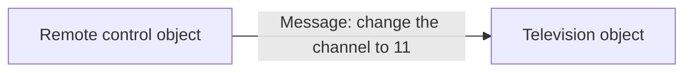
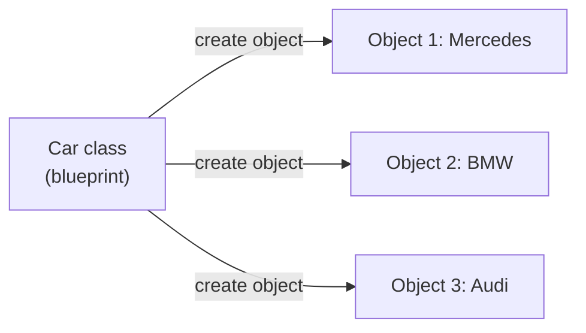
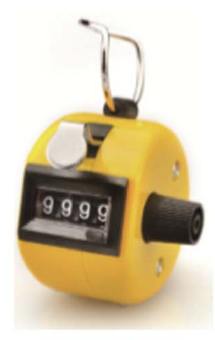

# Lecture 8 — Classes and Objects

[Repository Guide](../../README.md) | [English](Concepts_Lecture.md) | [한국어](Concepts_Lecture.ko.md)

> **Last Updated:** 2026-11-04

> **Learning Objectives:**
> 1. Explain the problems that arise when related data are stored in several separate lists, and compare ways of bundling the data together
> 2. Explain the relationships among objects, state, behavior, classes, and instances
> 3. Define instance variables and methods with the `class` statement and explain the role of `self`
> 4. Initialize objects with the constructor `__init__()` and create and use several objects from one class
> 5. Hide information with instance variables whose names start with `__` and handle them with getters and setters

---

## Table of Contents

- [1. Handling Related Data with Several Lists](#1-handling-related-data-with-several-lists)
  - [1.1 The Problem](#11-the-problem)
  - [1.2 Writing a Sort Function](#12-writing-a-sort-function)
  - [1.3 Sorting Several Lists Together](#13-sorting-several-lists-together)
  - [1.4 Ways to Bundle Related Data](#14-ways-to-bundle-related-data)
- [2. Object-Oriented Programming](#2-object-oriented-programming)
  - [2.1 Objects and Object Orientation](#21-objects-and-object-orientation)
  - [2.2 Interaction between Objects](#22-interaction-between-objects)
  - [2.3 State and Behavior](#23-state-and-behavior)
- [3. Classes and Instances](#3-classes-and-instances)
  - [3.1 The Blueprint of Objects](#31-the-blueprint-of-objects)
  - [3.2 Form of a Class Definition](#32-form-of-a-class-definition)
  - [3.3 Creating Many Objects from One Class](#33-creating-many-objects-from-one-class)
- [4. The Counter Class](#4-the-counter-class)
  - [4.1 Class Definition and Instance Variables](#41-class-definition-and-instance-variables)
  - [4.2 Creating an Object and Calling Methods](#42-creating-an-object-and-calling-methods)
  - [4.3 The Meaning of self](#43-the-meaning-of-self)
  - [4.4 Two Objects with Independent State](#44-two-objects-with-independent-state)
- [5. Constructors](#5-constructors)
  - [5.1 The Constructor Method](#51-the-constructor-method)
  - [5.2 Constructors with Parameters](#52-constructors-with-parameters)
- [6. Methods](#6-methods)
  - [6.1 Defining Methods](#61-defining-methods)
  - [6.2 Calling Methods](#62-calling-methods)
  - [6.3 The String Representation Method](#63-the-string-representation-method)
- [7. Information Hiding](#7-information-hiding)
  - [7.1 Private Instance Variables](#71-private-instance-variables)
  - [7.2 Name Mangling](#72-name-mangling)
  - [7.3 Getters and Setters](#73-getters-and-setters)
- [8. Revisiting the Sorting of Personal Records](#8-revisiting-the-sorting-of-personal-records)
- [Concept Applications](#concept-applications)
- [Summary](#summary)
- [Self-Check Questions](#self-check-questions)
- [References](#references)

---

<br>

## 1. Handling Related Data with Several Lists

### 1.1 The Problem

Consider a program that stores the personal records (name, age, height) of several people and shows each person's record in turn, sorted by name, age, or height. Using only the lists of [Lecture 7](../Lec07_Lists-and-Dictionaries/Concepts_Lecture.md), the natural approach is to make one list for each kind of information and store the information of the same person at the same index. Several lists that correspond to one another by index in this way are called **parallel lists**.

```python
names = ["Kim", "Lee", "Park"]
ages = [30, 50, 20]
heights = [175, 168, 181]
for i in range(len(names)):
    print(names[i], ages[i], heights[i])
```

```text
Kim 30 175
Lee 50 168
Park 20 181
```

```text
           0        1        2             index
names    [ "Kim",   "Lee",   "Park" ]
ages     [ 30,      50,      20     ]
heights  [ 175,     168,     181    ]
           ▲
           └── the three values at index 0 are one person's (Kim's) record
```

*Figure 1. Parallel lists in which one index represents one person's record*

This program needs two things. First, there must be a function that sorts a list in order of size. Second, when the lists are sorted by one of them (for example, `ages`), the other lists (`names`, `heights`) must move in the same order. Let us start with a function that sorts a single list of numbers in ascending order.

### 1.2 Writing a Sort Function

One of the best-known ways to sort a list is **bubble sort**. Adjacent elements are compared from the front, and if the front element is larger, the two are exchanged. Going through the list once to the end in this way is called one **pass**, and at the end of a pass the largest of the remaining values has moved to the back. The name comes from the resemblance to bubbles rising to the surface of water.

| Pass | Comparisons and Exchanges | List after the Pass |
|:-----|:-----|:-----|
| Initial state | None | `[7, 4, 5, 1, 3]` |
| Pass 1 | Exchange 7 with 4, 7 with 5, 7 with 1, and 7 with 3 in turn | `[4, 5, 1, 3, 7]` |
| Pass 2 | Leave 4 and 5 as they are, exchange 5 with 1 and 5 with 3 | `[4, 1, 3, 5, 7]` |
| Pass 3 | Exchange 4 with 1 and 4 with 3 | `[1, 3, 4, 5, 7]` |
| Pass 4 | Leave 1 and 3 as they are | `[1, 3, 4, 5, 7]` |

*Table 1. Bubble sort of the list `[7, 4, 5, 1, 3]`*

After pass 1 the largest value, 7, has settled at the back; after pass 2, 5 has settled; and after pass 3, 4 has settled. With $n$ elements, all elements are sorted after $n-1$ passes, and pass $k$ need not compare the last $k-1$ elements, which have already settled.

```python
def bubble_sort(a):
    n = len(a)
    for p in range(n - 1):             # pass p+1
        for i in range(n - 1 - p):     # compare neighbours a[i], a[i+1]
            if a[i] > a[i + 1]:
                a[i], a[i + 1] = a[i + 1], a[i]
        print("pass", p + 1, ":", a)

data = [7, 4, 5, 1, 3]
bubble_sort(data)
print(data)
```

```text
pass 1 : [4, 5, 1, 3, 7]
pass 2 : [4, 1, 3, 5, 7]
pass 3 : [1, 3, 4, 5, 7]
pass 4 : [1, 3, 4, 5, 7]
[1, 3, 4, 5, 7]
```

- **Outer loop:** When `p` is 0-3, passes 1-4 are performed.
- **Inner loop:** After `p` passes the last `p` elements have already settled, so in pass `p + 1`, `i` runs from 0 to `n - 2 - p` and `a[i]` is compared with `a[i + 1]`, leaving the settled last `p` elements uncompared.
- **Exchange:** `a[i], a[i + 1] = a[i + 1], a[i]` swaps the two elements by tuple unpacking ([Lecture 7, Section 7.4](../Lec07_Lists-and-Dictionaries/Concepts_Lecture.md#74-tuple-unpacking)).
- **Final `print(data)`:** `data` is sorted even though the function returned no list. The parameter `a` refers to the same list object as the argument `data`, so the exchanges made inside the function are visible to the caller as they are ([Lecture 7, Section 9.5](../Lec07_Lists-and-Dictionaries/Concepts_Lecture.md#95-passing-a-list-to-a-function)).

There are many ways to write a sort function. The following `sort_func_v1` is a simpler method that, instead of comparing only adjacent elements, compares every pair of indices `(i, j)` and exchanges the two elements if `list_[i] < list_[j]`.

```python
def sort_func_v1(list_):
    temp = 0
    for i in range(len(list_)):
        for j in range(len(list_)):
            if (list_[i] < list_[j]):
                temp = list_[i]
                list_[i] = list_[j]
                list_[j] = temp
    for k in list_:
        print(k)

## main ##
age_list = []
num_p = 3

for i in range(num_p):
    age = int(input("숫자를 입력하시오: "))
    age_list.append(age)

sort_func_v1(age_list)
```

```text
숫자를 입력하시오: 30
숫자를 입력하시오: 50
숫자를 입력하시오: 20
20
30
50
```

- **Exchange:** `list_[i]` is kept temporarily in `temp`, then `list_[j]` is put into `list_[i]` and the kept value into `list_[j]`. Assigning directly without a temporary variable would overwrite the original value with the one assigned first, so the temporary variable is needed.
- **Input:** The main program reads three integers (the prompt means "Enter a number: "), appends them to the empty list `age_list`, and passes the list to the sort function.

| `i` | `j` at Which an Exchange Occurs and Its Result | List after Iteration `i` |
|:-----|:-----|:-----|
| 0 | `j = 1`: 30 < 50, so exchange, giving `[50, 30, 20]` | `[50, 30, 20]` |
| 1 | `j = 0`: 30 < 50, so exchange, giving `[30, 50, 20]` | `[30, 50, 20]` |
| 2 | `j = 0`: 20 < 30, so exchange, giving `[20, 50, 30]`; `j = 1`: 30 < 50, so exchange, giving `[20, 30, 50]` | `[20, 30, 50]` |

*Table 2. How `sort_func_v1` sorts `[30, 50, 20]`*

The result is in ascending order despite the condition `list_[i] < list_[j]` because of the following property. When `i` is 0, `j` runs over every index and an exchange occurs whenever a larger value is met, so after that iteration `list_[0]` holds the maximum. Thereafter, at the end of each iteration `i`, the front part `list_[0]`-`list_[i]` is sorted in ascending order and `list_[i]` is the maximum of the whole list. Therefore, after the last iteration the entire list is in ascending order [1]. The number of comparisons is always $n^2$, so it is slower than bubble sort, but its code is short, which makes it useful for learning the principle of sorting.

> **[Algorithms]** Bubble sort and `sort_func_v1` both make $O(n^2)$ comparisons. In practice `sort()` and `sorted()` of [Lecture 7, Section 4.3](../Lec07_Lists-and-Dictionaries/Concepts_Lecture.md#43-sorting) are used, and in CPython, the standard implementation, these functions are implemented with a sorting algorithm that makes $O(n \log n)$ comparisons even in the worst case.

### 1.3 Sorting Several Lists Together

Making the exchange of two elements a separate function `swap()` shortens the sort function. The following `sort_func_v2` sorts the first list and, when the sort is done, prints the values at the same index of the three lists, one line per index.

```python
def swap(x, i, j):
    x[i], x[j] = x[j], x[i]

def sort_func_v2(list_1, list_2, list_3):
    for i in range(len(list_1)):
        for j in range(len(list_1)):
            if (list_1[i] < list_1[j]):
                swap(list_1, i, j)
    for k in range(len(list_1)):
        print(list_1[k], list_2[k], list_3[k])

names = ["Kim", "Lee", "Park"]
ages = [30, 50, 20]
heights = [175, 168, 181]
sort_func_v2(ages, names, heights)
```

```text
20 Kim 175
30 Lee 168
50 Park 181
```

- **`swap(x, i, j)`:** Swaps the elements at indices `i` and `j` of the list `x`. Even without a return value, the exchange persists because the parameter `x` refers to the same object as the caller's list.
- **Wrong result:** The ages are sorted as 20, 30, 50, but the names and heights remain in their original order. Hence age 20 is printed with Kim and age 30 with Lee, and the correspondence between people and their information is broken. In fact Park is 20, and Kim is 30.

The correspondence is preserved only if, whenever two elements of the key list are exchanged, **the elements at the same indices are exchanged together** in the other lists as well. The following `sort_func_v3` first prints the records before sorting and then sorts while exchanging all three lists together.

```python
def swap(x, i, j):
    x[i], x[j] = x[j], x[i]

def sort_func_v3(list_1, list_2, list_3):
    for a in range(len(list_1)):
        print(list_1[a], list_2[a], list_3[a])
    for i in range(len(list_1)):
        for j in range(len(list_1)):
            if (list_1[i] < list_1[j]):
                swap(list_1, i, j)
                swap(list_2, i, j)
                swap(list_3, i, j)
    for k in range(len(list_1)):
        print(list_1[k], list_2[k], list_3[k])

names = ["Kim", "Lee", "Park"]
ages = [30, 50, 20]
heights = [175, 168, 181]
sort_func_v3(ages, names, heights)
print(names)
```

```text
30 Kim 175
50 Lee 168
20 Park 181
20 Park 181
30 Kim 175
50 Lee 168
['Park', 'Kim', 'Lee']
```

The first three lines are the records before sorting and the next three lines are the records after sorting by age, and now each line is one person's correct record. As the last line shows, `names` outside the function has also been reordered by age. To view the records by name, pass the key list as the first argument, as in `sort_func_v3(names, ages, heights)`.

> **Note:** `sort_func_v2` and `sort_func_v3` have three parameters, so passing only one list, as in `sort_func_v2(age_list)`, raises `TypeError: sort_func_v2() missing 2 required positional arguments: 'list_2' and 'list_3'`. To sort a single list, use `sort_func_v1`, which has one parameter, with its exchange part replaced by `swap(list_, i, j)`.

### 1.4 Ways to Bundle Related Data

Parallel lists become harder to handle as the number of lists grows. Not only for sorting but also when adding or removing a person, every list must be changed in the same way at the same index, and missing even one silently breaks the correspondence of the records. The fundamental solution is to bundle one person's information into **a single unit**.

| Method | One Person's Record | Characteristics |
|:-----|:-----|:-----|
| Parallel lists | `names[i]`, `ages[i]`, `heights[i]` | Every list must be changed together when sorting, adding, or removing. |
| Two-dimensional list | `people[i]` = `["Kim", 30, 175]` | One row is one person, so sorting by rows preserves the correspondence. The meaning of each column is shown only by its number (0, 1, 2). |
| Class | `people[i]` = an object with name, age, and height as attributes | Attributes are used by name, as in `p.age`, and the data are defined together with the functions that handle them. |
| Other methods | Tuple `("Kim", 30, 175)`, dictionary `{"name": "Kim", ...}` | A tuple suits a record that must not change, and a dictionary suits finding fields by key. |

*Table 3. Comparison of ways to bundle related data into a single unit*

With a two-dimensional list, sorting works on rows, so the correspondence cannot break. The following code sorts by age by giving the `key` of `sort()` a lambda function that returns column 1 (age) of each row ([Lecture 6, Section 7](../Lec06_Functions/Concepts_Lecture.md#7-anonymous-functions)).

```python
people = [["Kim", 30, 175], ["Lee", 50, 168], ["Park", 20, 181]]

people.sort(key=lambda p: p[1])     # sort the rows by age (column 1)
for p in people:
    print(p[0], p[1], p[2])
```

```text
Park 20 181
Kim 30 175
Lee 50 168
```

`key=lambda p: p[1]` means: compute `p[1]` for each row `p` and sort the rows in the order of those values. Whole rows move together, so names, ages, and heights do not get separated. However, the fact that `p[1]` is the age cannot be seen from the code alone. A **class** is the method that gives names to the data and bundles them together with the functions that handle them, and this problem is solved again in [Section 8](#8-revisiting-the-sorting-of-personal-records) after classes are introduced.

---

<br>

## 2. Object-Oriented Programming

### 2.1 Objects and Object Orientation

> **Definition:** An **object** bundles related variables (data) and functions (features) into a single unit. The programming style that builds a program out of objects and the interactions between them is called **object-oriented programming (OOP)**.

The real world is full of things. A person knitting, a tablet, a television, a dog, and a ball of yarn each have their own characteristics and influence one another. Object-oriented programming represents each thing in a problem as an object and writes the program so that the objects get work done by requesting features from each other.

The contrasting style is **procedural programming**. In procedural programming, data and the functions that process them are separate, and a program is expressed as a procedure that calls functions in sequence. Keeping parallel lists and sort functions separate, as in [Section 1.3](#13-sorting-several-lists-together), is an example. In object orientation, data and the functions that handle them are together in one object, so related code gathers in one place and the chance of mishandling the data decreases.

As seen in [Lecture 7, Section 1.3](../Lec07_Lists-and-Dictionaries/Concepts_Lecture.md#13-objects-and-dot-notation), every value in Python, including lists, strings, and integers, is already an object. Defining a class makes it possible to create objects of any kind one wants.

### 2.2 Interaction between Objects

A television and a remote control can each be regarded as an object that performs particular functions. Pressing the channel button of the remote control makes the remote control object send a **message** asking the television object to change the channel, and the television object changes its own channel according to that message.



*Figure 2. A remote control object and a television object interacting through a message*

In a program, sending a message to an object means calling a method of that object. The message above is written in code as `tv.setChannel(11)`, and such code is written in [Section 6](#6-methods).

### 2.3 State and Behavior

An object has **attributes** and **actions**. Taking a car as an example:

| Attributes | Actions |
|:-----|:-----|
| Maker, model, color, year, price | Driving, turning, parking |

*Table 4. Attributes and actions of a car object*

The current values of the attributes are called the **state** of the object, and the actions the object can perform are called its **behavior**. The state of a television object is its channel number, volume, and power state, and its behavior is turning on, turning off, changing the channel, and changing the volume. In a program, state is implemented as **instance variables**, variables that each object has separately, and behavior as **methods**, functions that belong to the object. Instance variables are also called **fields**.

| Category | Example for a Television Object | Implementation |
|:-----|:-----|:-----|
| State | Channel number, volume, power state | Instance variables `channel`, `volume`, `on` |
| Behavior | Turning on, turning off, changing the channel, changing the volume | Methods `turnOn()`, `turnOff()`, `changeChannel()`, `changeVolume()` |

*Table 5. State and behavior of a television object and their implementation*

> **Key Point:** Object = state (instance variables) + behavior (methods). State is what values the object holds now, and behavior is what the object can do. Methods usually read or change the state of their object.

---

<br>

## 3. Classes and Instances

### 3.1 The Blueprint of Objects

> **Definition:** The blueprint for creating objects is called a **class**. Each object created from a class is called an **instance** of that class.

A class is like a waffle iron that stamps out waffles. One iron can bake many waffles, and the baked waffles have the same shape but are each separate waffles. The same relationship holds between one blueprint of a house and the many houses that can be built from it. Likewise, one `Car` class can create many car objects; each object has the same kinds of attributes, but their values (color, model, and so on) differ from object to object.



*Figure 3. Several instances created from one class*

Using objects therefore takes two steps.

1. Write a class, the blueprint of the objects.
2. Create objects from the class.

### 3.2 Form of a Class Definition

A class is defined with the `class` keyword, and its methods are defined with `def` inside the class.

```python
class ClassName:
    def method1(self, ...):
        ...
    def method2(self, ...):
        ...
```

- **Class name:** By convention, class names are written in CapWords style, with the first letter of each word capitalized, as in `Car` and `BankAccount` [2]. Variable and function names are written in lowercase with underscores, as in `my_car`.
- **Method:** A function defined inside a class. It is defined in the same way as a function, but its first parameter is always `self`, which receives the object on which the method was called ([Section 4.3](#43-the-meaning-of-self)).
- **Indentation:** Method definitions are indented one level more than the `class` line, and method bodies one level more than the `def` line.

### 3.3 Creating Many Objects from One Class

The following `Car` class has speed, color, and model as instance variables, and a `drive()` method that sets the speed to 60 when the car drives. Calling the class name with parentheses, as in `Car(...)`, creates a new object.

```python
class Car:
    def __init__(self, speed, color, model):
        self.speed = speed
        self.color = color
        self.model = model

    def drive(self):
        self.speed = 60

dadCar = Car(0, "silver", "A6")
momCar = Car(0, "white", "520d")
myCar = Car(0, "blue", "E-class")

myCar.drive()
print(dadCar.color, dadCar.model, dadCar.speed)
print(myCar.color, myCar.model, myCar.speed)
print(type(myCar))
print(isinstance(myCar, Car))
print(dadCar is momCar)
```

```text
silver A6 0
blue E-class 60
<class '__main__.Car'>
True
False
```

```text
dadCar ──▶ [Car] speed = 0,  color = "silver", model = "A6"
momCar ──▶ [Car] speed = 0,  color = "white",  model = "520d"
myCar  ──▶ [Car] speed = 60, color = "blue",   model = "E-class"
```

*Figure 4. Three objects created from the `Car` class and the instance variables of each*

- **Creating an object:** `Car(0, "silver", "A6")` creates one `Car` object, initializes its `speed`, `color`, and `model` to 0, `"silver"`, and `"A6"` with the `__init__()` method, and returns the object. `__init__()` is covered in [Section 5](#5-constructors).
- **Independent state:** `myCar.drive()` changes only the `speed` of `myCar` to 60, and the `speed` of `dadCar` stays 0. The three objects were created from the same class, but each has its own instance variables.
- **`object.variable`:** Dot notation reads an instance variable of an object.
- **`type()` and `isinstance()`:** `type(myCar)` shows the class of `myCar`, and `__main__` means the class was defined in the program that was run directly. `isinstance(myCar, Car)` is `True` because `myCar` is an instance of `Car`.

---

<br>

## 4. The Counter Class

### 4.1 Class Definition and Instance Variables

Let us make a class for the mechanical counter used to count spectators entering a stadium or a concert hall. The counter has the number counted so far as its state; pressing the button increases the number by 1, and turning the knob resets it to 0.



*Figure 5. A mechanical tally counter for counting spectators*

The `Counter` class representing this counter has an instance variable `count` that stores the number counted, and the methods `reset()`, which resets it to 0, `increment()`, which increases it by 1, and `get()`, which returns the current value.

```python
class Counter:
    def reset(self):
        self.count = 0
    def increment(self):
        self.count += 1
    def get(self):
        return self.count
```

In Python, an instance variable is created by assigning a value to a variable prefixed with `self.` inside a method. `self.count = 0` in `reset()` creates an instance variable named `count` in the object on which this method was called (or changes its value if it already exists) and stores 0 in it. Without `self.`, `count = 0` would only be a local variable that disappears when the method ends.

### 4.2 Creating an Object and Calling Methods

```python
a = Counter()

a.reset()
a.increment()
print("카운터 a의 값은", a.get())
```

```text
카운터 a의 값은 1
```

```text
a ──▶ ┌───────────────┐         class Counter
      │ count │   1   │  ─────▶  reset(), increment(), get()
      └───────────────┘
```

*Figure 6. The `Counter` object referred to by the variable `a`, and its class*

- **`a = Counter()`:** Creates one object of the `Counter` class and makes the variable `a` refer to it. At this point the object has no instance variables yet.
- **`a.reset()`:** Creates `count` in the object referred to by `a` and stores 0 in it.
- **`a.increment()`:** Increases the `count` of that object by 1.
- **`a.get()`:** Returns 1, the value of that object's `count`. (The printed text means "The value of counter a is 1".)

As Figure 6 shows, the instance variable `count` is inside the object, whereas the methods are defined only once in the class and shared by all objects of the class. For a call such as `a.increment()`, Python finds `increment` in `Counter`, the class of `a`, and runs it.

### 4.3 The Meaning of self

A method has `self` among its parameters when it is defined, but when it is called, as in `a.increment()`, no argument is written for `self`. This is because Python runs `a.increment()` by turning it into the following [3].

```python
Counter.increment(a)     # same as a.increment(): a is passed to self
```

That is, the object `a` before the dot is passed automatically as the first argument and goes into the parameter `self`. Hence `self.count` inside the method is the `count` of exactly the object on which the method was called. If the same method is called as `b.increment()`, `self` becomes `b`.

```python
a = Counter()
a.reset()
a.increment()
Counter.increment(a)
print(a.get())
print(a.__dict__)
```

```text
2
{'count': 2}
```

Calling `Counter.increment(a)` directly increases the `count` of `a` from 1 to 2, exactly as `a.increment()` would. The special attribute `__dict__`, which objects of user-defined classes have, shows the instance variables of the object as a dictionary. Some objects, such as integers, strings, and lists, do not have this attribute.

> **Note:** `self` is not a Python keyword but a conventional name. Naming the first parameter differently would work the same, but other Python programmers would find such code harder to read, so the convention of using `self` is followed [3].

### 4.4 Two Objects with Independent State

When two objects are created from one class, each object has its own `count`.

```python
a = Counter()
b = Counter()

a.reset()
b.reset()
a.increment()
b.increment()
b.increment()
print(a.get(), b.get())
print(a.__dict__, b.__dict__)
print(a is b)
```

```text
1 2
{'count': 1} {'count': 2}
False
```

```text
a ──▶ ┌───────────────┐
      │ count │   1   │
      └───────────────┘
b ──▶ ┌───────────────┐
      │ count │   2   │
      └───────────────┘
```

*Figure 7. Two `Counter` objects, each with its own instance variable `count`*

`a` and `b` are different objects, so `a.increment()` does not affect the `count` of `b`. It is like placing one counter at each of two stadium entrances.

> **Caution:** This `Counter` class has no `count` until `reset()` is called. Calling `c.increment()` right after creating a new object tries to read a nonexistent `self.count`, raising `AttributeError: 'Counter' object has no attribute 'count'`. The way to prepare instance variables as soon as an object is created is the constructor of the next section.

---

<br>

## 5. Constructors

### 5.1 The Constructor Method

> **Definition:** A **constructor** is a special method that is called automatically when an object is created and initializes the instance variables of the object to default values. In Python, the method named `__init__` plays this role.

Just as a painter applies color to a car fresh from the factory before it is shipped, a constructor prepares a newly created object so that it can be used. `__init__` has two underscores on each side.

```python
class ClassName:
    def __init__(self, ...):    # constructor: initializes the object
        ...
```

Adding a constructor to `Counter` prepares `count` as 0 the moment an object is created, so `reset()` need not be called first.

```python
class Counter:
    def __init__(self):
        self.count = 0
    def reset(self):
        self.count = 0
    def increment(self):
        self.count += 1
    def get(self):
        return self.count

c = Counter()          # __init__ runs here
c.increment()
print(c.get())
```

```text
1
```

When `Counter()` is called, Python creates a new object, automatically calls `__init__()` with that object as `self`, and returns the initialized object. A program normally does not call `__init__()` directly.

> **Note:** Strictly speaking, creating an object in Python is done by another special method, `__new__()`, and `__init__()` is responsible for initializing the object that has already been created [4]. For this reason `__init__()` is also called the initializer. In ordinary classes only `__init__()` needs to be defined, so it is conventional to call `__init__()` the constructor.

### 5.2 Constructors with Parameters

Adding parameters to the constructor makes it possible to give each object different initial values. The arguments placed in the parentheses after the class name when an object is created are passed in order to the parameters after `self`.

```python
class Car:
    def __init__(self, speed, color, model):
        self.speed = speed
        self.color = color
        self.model = model

    def drive(self):
        self.speed = 60

myCar = Car(0, "blue", "E-class")

print("자동차 객체를 생성하였습니다.")
print("자동차의 속도는", myCar.speed)
print("자동차의 색상은", myCar.color)
print("자동차의 모델은", myCar.model)
print("자동차를 주행합니다.")
myCar.drive()
print("자동차의 속도는", myCar.speed)
```

```text
자동차 객체를 생성하였습니다.
자동차의 속도는 0
자동차의 색상은 blue
자동차의 모델은 E-class
자동차를 주행합니다.
자동차의 속도는 60
```

- **Passing arguments:** In `Car(0, "blue", "E-class")`, the new object is passed to `self`, and 0, `"blue"`, and `"E-class"` to `speed`, `color`, and `model`. (The program prints "The car object has been created," the speed, color, and model, "The car drives," and the new speed.)
- **`self.speed = speed`:** The `speed` on the right is a parameter of the constructor (a local variable), and `self.speed` on the left is an instance variable of the object. They are different variables despite the same name, and this assignment stores the value of the parameter in the object so that it remains after the constructor ends.
- **Number of arguments:** The number of arguments given to the constructor must match the number of parameters other than `self`. Giving an argument, as in `Counter(5)`, to `Counter`, whose only parameter is `self`, raises `TypeError: Counter.__init__() takes 1 positional argument but 2 were given`. The message says "2 were given" because `self` is counted too.

Giving the constructor's parameters default values, as in `def __init__(self, name=None, age=0):`, allows the arguments to be omitted ([Lecture 6, Section 6.1](../Lec06_Functions/Concepts_Lecture.md#61-default-arguments)). `None` is a special Python value that represents the absence of a value.

---

<br>

## 6. Methods

### 6.1 Defining Methods

A method is a function defined inside a class, so defining one is almost the same as defining a function. However, the first parameter must always be `self`. The following `Television` class defines three instance variables in its constructor and has `show()`, which prints the state, `setChannel()`, which changes the channel, and `getChannel()`, which returns the channel.

```python
class Television:
    def __init__(self, channel, volume, on):
        self.channel = channel      # instance variable definition
        self.volume = volume        # instance variable definition
        self.on = on                # instance variable definition

    def show(self):
        print(self.channel, self.volume, self.on)

    def setChannel(self, channel):
        self.channel = channel

    def getChannel(self):
        return self.channel
```

- **Constructor:** Receives `channel`, `volume`, and `on` (`True` or `False`, indicating whether the power is on) and stores them in instance variables of the same names. Defining all instance variables of a class in its constructor shows at a glance what state the objects have.
- **`show()`:** Its only parameter is `self`, and it prints the three parts of the object's state.
- **`setChannel(self, channel)`:** Receives a new channel through the parameter after `self` and stores it in the instance variable.
- **`getChannel()`:** Returns the value of the instance variable.

### 6.2 Calling Methods

```python
t = Television(9, 10, True)

t.show()
t.setChannel(11)
t.show()
print(t.getChannel())
```

```text
9 10 True
11 10 True
11
```

`t.setChannel(11)` is the same as `Television.setChannel(t, 11)`, so `t` is passed to `self` and 11 to `channel`, and the channel of `t` changes to 11. In the output of the second `show()`, only the channel has changed, while the volume and power state are unchanged. The message sent by the remote control in [Section 2.2](#22-interaction-between-objects) is exactly such a method call.

> **Caution:** Do not use the same name for an instance variable and a method. For example, if the constructor creates an instance variable with `self.heal = 50` and the same class also defines a method `def heal(self, other):`, then when `a.heal(b)` is called, Python finds the instance variable `heal` (the integer 50) in the object first. As a result it tries to call an integer as if it were a function, raising `TypeError: 'int' object is not callable`.

### 6.3 The String Representation Method

Printing an object with `print()` shows, by default, the class name and a memory address. If the special method `__str__()` is defined, `print()` and `str()` use the string that method returns [4].

```python
class Point:
    def __init__(self, x, y):
        self.x = x
        self.y = y

class Point2:
    def __init__(self, x, y):
        self.x = x
        self.y = y

    def __str__(self):
        return '(%d, %d)' % (self.x, self.y)

print(Point(3, 4))
p = Point2(3, 4)
print(p)
print(str(p))
print("p =", p)
```

```text
<__main__.Point object at 0x103a0ef90>
(3, 4)
(3, 4)
p = (3, 4)
```

- **Default output:** An object of `Point`, which has no `__str__()`, is printed in the form `<__main__.Point object at 0x...>`. The hexadecimal number after `0x` is the identity of the object (the value of `id()`); in CPython, the standard implementation, it is the memory address of the object, so it may differ from run to run.
- **`__str__()`:** Takes only `self` as a parameter and must return a string. Here `%` formatting ([Lecture 3, Section 4.3](../Lec03_Data-Types/Concepts_Lecture.md#43-string-formatting)) builds `'(3, 4)'`.
- **When it is called:** `print(p)`, `str(p)`, and `print("p =", p)` all call `__str__()` internally, so the same string is printed. Methods whose names have two underscores on each side, like `__init__()`, are **special methods** that Python calls automatically in particular situations.

---

<br>

## 7. Information Hiding

### 7.1 Private Instance Variables

> **Definition:** **Information hiding** means hiding the details of an implementation inside a class so that code outside the class uses the object only through designated methods.

With information hiding, the state of an object cannot be changed carelessly from outside the class, which prevents invalid values from getting in and allows the internal implementation of the class to change without modifying the code that uses the class. In Python, starting the name of an instance variable with two underscores (`__`) prevents access by that name from outside the class. Such a variable is called a **private** instance variable.

```python
class Student:
    def __init__(self, name=None, age=0):
        self.__name = name
        self.__age = age

obj = Student()
print(obj.__age)
```

```text
Traceback (most recent call last):
  File "<stdin>", line 7, in <module>
AttributeError: 'Student' object has no attribute '__age'
```

Methods inside the class can use `self.__age` freely, but trying to read `obj.__age` outside the class raises `AttributeError`, saying there is no such attribute.

### 7.2 Name Mangling

Python has no mechanism that blocks access completely, like the `private` keyword of other languages. Inside a class definition, a name such as `__age` that starts with two underscores and does not end with two underscores is stored under a name prefixed with `_ClassName`, such as `_Student__age`. This is called **name mangling** [3].

```python
class Student:
    def __init__(self, name=None, age=0):
        self.__name = name
        self.__age = age

obj = Student()
print(obj.__dict__)
print(obj._Student__age)
obj.__age = 100            # outside a class body: no name mangling
print(obj.__age)
print(obj.__dict__)
```

```text
{'_Student__name': None, '_Student__age': 0}
0
100
{'_Student__name': None, '_Student__age': 0, '__age': 100}
```

- **Stored names:** `__dict__` shows that the instance variables are stored under the names `_Student__name` and `_Student__age`. Hence they cannot be found as `obj.__age` but can be read as `obj._Student__age`. Mangling is a device that prevents accidental access; it does not prevent deliberate access by the mangled name.
- **Assignment outside the class:** `obj.__age = 100` is outside the class definition, so the name is not changed, and a **new instance variable** named `__age` is created in the object. After that `print(obj.__age)` prints 100, but `_Student__age`, which the methods of the class use, is still 0. It looks as if the private variable was changed from outside the class, but in fact a different variable was created.

> **Note:** In Python, the convention of starting a name with a single underscore (`_age`) to mean "do not use this outside the class" is also widely used. A single underscore does not change the name and is purely an agreement among programmers. Two underscores are used mainly to avoid name clashes with subclasses in inheritance [3].

### 7.3 Getters and Setters

Private instance variables cannot be used directly outside the class, so separate methods read and change their values. A method that returns the value of an instance variable is called a **getter**, and a method that sets the value of an instance variable is called a **setter**. A setter is also called a **mutator**. Just as bank customers do not walk into the vault but deposit and withdraw money only through a teller, code outside the class accesses instance variables only through getters and setters.

```python
class Student:
    def __init__(self, name=None, age=0):
        self.__name = name
        self.__age = age

    def getAge(self):
        return self.__age

    def getName(self):
        return self.__name

    def setAge(self, age):
        self.__age = age

    def setName(self, name):
        self.__name = name

obj = Student("Hong", 20)
print(obj.getName())
obj.setAge(21)
print(obj.getAge())
obj.getName()
```

```text
Hong
21
```

- **Getters:** `getName()` and `getAge()` return the values of the private variables.
- **Setter:** `setAge(21)` changes `self.__age` to 21.
- **Last line:** `obj.getName()` returns `"Hong"`, but there is no code to print that value, so nothing is printed. The interactive shell displays the value of an expression automatically, so `'Hong'` appears there, but in a program run from a file one must write `print(obj.getName())`.

A setter makes it possible to check a value before storing it. The following `setAge()` rejects a negative age. Making the constructor go through this setter as well checks the initial value by the same rule.

```python
class Student:
    def __init__(self, name=None, age=0):
        self.__name = name
        self.__age = 0
        self.setAge(age)            # reuse the check in the setter

    def getAge(self):
        return self.__age

    def setAge(self, age):
        if age < 0:
            print("나이는 음수일 수 없습니다.")
            return
        self.__age = age

s = Student("Hong", 20)
s.setAge(-5)
print(s.getAge())
```

```text
나이는 음수일 수 없습니다.
20
```

`s.setAge(-5)` fails the check, prints a message ("Age cannot be negative."), and ends with `return`, so the age remains 20. If the instance variable were public, there would be no way to prevent an invalid assignment such as `s.age = -5`.

> **Key Point:** The purpose of information hiding is not hiding values for its own sake but making the state of an object change **only according to the rules set by the class**. A setter is the place where those rules are checked.

---

<br>

## 8. Revisiting the Sorting of Personal Records

The problem of [Section 1](#1-handling-related-data-with-several-lists) is solved again with a class. Define a `Person` class whose instance variables are a person's name, age, and height, create one object per person, and put the objects in a list.

```python
class Person:
    def __init__(self, name, age, height):
        self.name = name
        self.age = age
        self.height = height

people = [Person("Kim", 30, 175), Person("Lee", 50, 168), Person("Park", 20, 181)]

people.sort(key=lambda p: p.age)     # sort by age
for p in people:
    print(p.name, p.age, p.height)

people.sort(key=lambda p: p.name)    # sort by name
for p in people:
    print(p.name, p.age, p.height)
```

```text
Park 20 181
Kim 30 175
Lee 50 168
Kim 30 175
Lee 50 168
Park 20 181
```

- **One person = one object:** Name, age, and height are inside one object, so whatever key the list is sorted by, objects move as units and the information does not get separated. There is no need to exchange three lists together as with parallel lists.
- **Named attributes:** The sort key is written with names that show its meaning, such as `p.age` and `p.name`, instead of `p[1]`.
- **Extension:** To add new information about people (for example, weight), adding one instance variable to the constructor suffices, and the sorting code does not need to change.

---

<br>

## Concept Applications

When designing a class for a real-world thing, the state of the thing becomes instance variables and what the thing can do becomes methods.

| Thing | Class Design |
|:-----|:-----|
| Turn a light bulb on and off and check whether it is currently on. | Provide an instance variable `on` (whether it is on) and the methods `turnOn()`, `turnOff()`, and `isOn()`. |
| Store each student's name and scores in several subjects and compute the average. | Provide instance variables `name` and `scores` (a list) and the methods `addScore(score)` and `getAverage()`. |
| A traffic light changes in the order red, green, yellow. | Provide an instance variable `color` and a method `next()` that changes to the next color according to the current one. |
| Keep the Celsius temperature of a thermometer from going below absolute zero (-273.15℃). | Keep a private instance variable `__celsius` and reject values below -273.15 in the setter `setCelsius()`. |

*Table 6. Examples of designing classes for real-world things*

**True/False Check:**

| Statement | Judgment and Reason |
|:-----|:-----|
| Two objects created from one class share their instance variables. | **F.** Each object has its own instance variables. The methods are defined once in the class and shared. |
| When calling a method, the argument for `self` must be passed explicitly. | **F.** With a call such as `a.increment()`, Python automatically passes the object `a` before the dot to `self`. |
| `__init__()` is called automatically when an object is created. | **T.** Calling a class, as in `Counter()`, runs `__init__()` on the new object. |
| An instance variable whose name starts with `__` cannot be accessed from outside the class by any means. | **F.** Its name is merely stored as `_ClassName__variable`, so it can be accessed by the mangled name. |
| In a program run from a file, writing only `obj.getName()` prints the name on the screen. | **F.** Return values are not printed automatically, so `print()` is needed. |
| Sorting only one of several parallel lists breaks the correspondence with the other lists. | **T.** The same index must refer to the same person, but only the elements of one list were moved. |

---

<br>

## Summary

| Concept | Key Summary |
|:-----|:-----|
| Parallel lists | Several lists that correspond by index; when sorting or removing, every list must be changed together at the same index. |
| Sort function | Bubble sort compares and exchanges adjacent elements, and when a function changes a list it received as an argument, the change remains for the caller. |
| Object | A bundle of related data (state) and features (behavior); state is implemented as instance variables and behavior as methods. |
| Object-oriented programming | A style that builds a program out of objects and messages (method calls) between them. |
| Class and instance | A class is the blueprint of objects, each object made from a class is an instance, and one class creates many objects with independent state. |
| Instance variable | Created inside a method with `self.name = value`, and exists separately in each object. |
| `self` | The first parameter, which receives the object on which the method was called; `a.m()` is the same as `ClassName.m(a)`. |
| Constructor | `__init__()` is called automatically when an object is created, initializes the instance variables, and receives initial values through the parameters after `self`. |
| `__str__()` | A special method that returns the string representation of an object used by `print()` and `str()`. |
| Information hiding | An instance variable whose name starts with `__` is renamed to `_ClassName__variable` by name mangling and cannot be accessed by its name from outside the class. |
| Getters and setters | A getter returns the value of an instance variable, and a setter checks a value before setting it so that the state changes only according to the rules of the class. |

---

<br>

## Self-Check Questions

1. **Parallel lists:** With `names = ["A", "B", "C"]` and `scores = [70, 90, 80]`, if only `scores` is sorted with `scores.sort()` and `for i in range(3): print(names[i], scores[i])` is run, what is printed? Explain what went wrong.

   <details>
   <summary>Answer</summary>

   `A 70`, `B 80`, and `C 90` are printed. After sorting, `scores` is `[70, 80, 90]` but `names` is unchanged, so at index 1 B is wrongly paired with 80 and at index 2 C with 90. In fact B scored 90 and C scored 80. In parallel lists the same index must refer to the same subject, so whenever elements of one list are exchanged, the other lists must be exchanged together at the same indices.

   </details>

2. **Tracing a sort function:** When `[3, 1, 2]` is passed to `sort_func_v1`, what is the list at the end of the iterations with `i` equal to 0, 1, and 2?

   <details>
   <summary>Answer</summary>

   For `i = 0` there is no value larger than 3, so no exchange occurs and the list is `[3, 1, 2]`. For `i = 1`, when `j = 0`, 1 < 3, so an exchange gives `[1, 3, 2]`. For `i = 2`, when `j = 1`, 2 < 3, so an exchange gives `[1, 2, 3]`. At the end of each iteration the property holds that the front part is in ascending order and `list_[i]` is the maximum, 3.

   </details>

3. **Aliasing and objects:** Write the output of the following code and explain why.

   ```python
   class Counter:
       def __init__(self):
           self.count = 0
       def increment(self):
           self.count += 1

   a = Counter()
   b = a
   c = Counter()
   a.increment()
   b.increment()
   c.increment()
   print(a.count, b.count, c.count)
   ```

   <details>
   <summary>Answer</summary>

   The output is `2 2 1`. `b = a` does not create a new object but makes `b` an alias referring to the same object as `a` ([Lecture 7, Section 9.2](../Lec07_Lists-and-Dictionaries/Concepts_Lecture.md#92-aliasing)), so `a.increment()` and `b.increment()` increase the `count` of the same object twice. `c` is a separate object created with `Counter()`, so only its own `count` becomes 1.

   </details>

4. **self:** With `t = Television(9, 10, True)`, explain how `t.setChannel(11)` is executed in terms of `self`.

   <details>
   <summary>Answer</summary>

   `t.setChannel(11)` is the same as `Television.setChannel(t, 11)`. Python finds `setChannel` in `Television`, the class of `t`, and passes the object `t` before the dot to the first parameter `self` and 11 to `channel`. `self.channel = channel` in the method body stores 11 in the instance variable `channel` of `t`, so the channel of `t` changes to 11.

   </details>

5. **Constructors:** In a `Counter` class that has no constructor and sets `self.count = 0` only in `reset()`, what happens if `c.increment()` is called right after `c = Counter()`? Fix the problem with a constructor.

   <details>
   <summary>Answer</summary>

   `c` does not yet have the instance variable `count`, but `self.count += 1` tries to read `count`, so `AttributeError: 'Counter' object has no attribute 'count'` is raised. Adding `def __init__(self): self.count = 0` to the class prepares `count` as 0 the moment an object is created with `Counter()`, so `increment()` can be called immediately.

   </details>

6. **Name mangling:** For a `Student` class (the constructor does `self.__age = age`, and the getter `getAge()` returns `self.__age`), after running `obj = Student("Hong", 20)` and `obj.__age = 30`, write the values of `obj.getAge()`, `obj.__age`, and `obj._Student__age`.

   <details>
   <summary>Answer</summary>

   They are 20, 30, and 20 in turn. `self.__age` inside the class definition is stored as `self._Student__age`, so the value 20 stored by the constructor is in `_Student__age`. `obj.__age = 30` outside the class is not renamed and merely creates a new instance variable named `__age`, so `_Student__age`, which `getAge()` reads, is still 20.

   </details>

7. **String representation:** Define `__str__()` for a `Point` class with coordinates `x` and `y` as instance variables so that `print(Point(2, 5))` prints `Point(2, 5)`.

   <details>
   <summary>Answer</summary>

   ```python
   class Point:
       def __init__(self, x, y):
           self.x = x
           self.y = y
       def __str__(self):
           return "Point(%d, %d)" % (self.x, self.y)
   ```

   When printing an object, `print()` uses the string returned by `__str__()`, so `print(Point(2, 5))` prints `Point(2, 5)`. `__str__()` must return a string; it does not call `print()` itself inside the method.

   </details>

---

<br>

## References

1. S. P. Y. Fung, "Is this the simplest (and most surprising) sorting algorithm ever?," arXiv:2110.01111, 2021. https://arxiv.org/abs/2110.01111
2. G. van Rossum, B. Warsaw, and A. Coghlan, "PEP 8: Style Guide for Python Code," Python Enhancement Proposals, 2001. https://peps.python.org/pep-0008/
3. Python Software Foundation, "Classes," *The Python Tutorial*, accessed Nov. 4, 2026. https://docs.python.org/3/tutorial/classes.html
4. Python Software Foundation, "Data model: Basic customization," *The Python Language Reference*, accessed Nov. 4, 2026. https://docs.python.org/3/reference/datamodel.html#basic-customization
