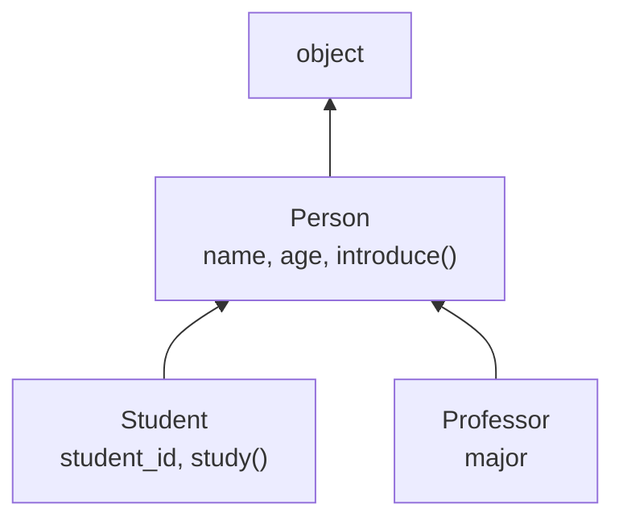
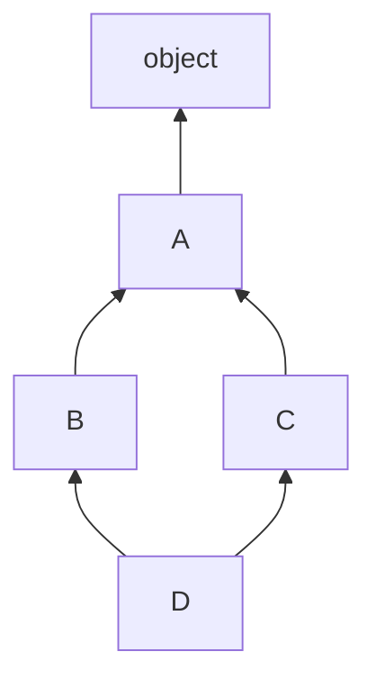

# 9강 — 상속과 다형성

[레포지토리 안내](../../README.ko.md) | [English](Concepts_Lecture.md) | [한국어](Concepts_Lecture.ko.md)

> **최종 수정일:** 2026-11-19

> **학습 목표:**
> 1. 상속으로 기존 클래스를 확장하는 하위 클래스를 정의하고, 속성을 찾는 과정이 객체에서 하위 클래스, 상위 클래스로 진행됨을 설명할 수 있다
> 2. 메서드를 재정의하고 `super()`로 상위 클래스의 메서드를 호출하며, 동적 디스패치에 따라 실행되는 메서드를 추적할 수 있다
> 3. 다형성과 덕 타이핑을 설명하고 `isinstance()`와 `issubclass()`로 클래스 사이의 관계를 검사할 수 있다
> 4. 다중 상속에서 메서드 결정 순서(MRO)를 손으로 구하고 `__mro__`로 확인하며, 협력적 `super()` 호출의 순서를 설명할 수 있다
> 5. `abc` 모듈로 추상 기반 클래스를 정의하고, 두 클래스의 관계에 상속과 합성 가운데 알맞은 것을 고를 수 있다
> 6. 연산자와 내장 함수에 대응하는 특수 메서드를 정의하여 객체가 `+`, `==`, `<`, `len()`과 함께 동작하게 할 수 있다

---

## 목차

- [1. 상속의 개념](#1-상속의-개념)
  - [1.1 비슷한 클래스를 따로 만들 때의 문제](#11-비슷한-클래스를-따로-만들-때의-문제)
  - [1.2 상위 클래스와 하위 클래스](#12-상위-클래스와-하위-클래스)
  - [1.3 하위 클래스의 정의](#13-하위-클래스의-정의)
  - [1.4 속성을 찾는 순서](#14-속성을-찾는-순서)
- [2. 메서드 재정의와 super()](#2-메서드-재정의와-super)
  - [2.1 메서드 재정의](#21-메서드-재정의)
  - [2.2 super()로 상위 클래스의 메서드 호출하기](#22-super로-상위-클래스의-메서드-호출하기)
  - [2.3 생성자를 재정의할 때의 흔한 실수](#23-생성자를-재정의할-때의-흔한-실수)
  - [2.4 동적 디스패치의 추적](#24-동적-디스패치의-추적)
- [3. 다형성](#3-다형성)
  - [3.1 같은 메시지, 다른 동작](#31-같은-메시지-다른-동작)
  - [3.2 덕 타이핑](#32-덕-타이핑)
  - [3.3 isinstance()와 issubclass()](#33-isinstance와-issubclass)
- [4. 다중 상속과 메서드 결정 순서](#4-다중-상속과-메서드-결정-순서)
  - [4.1 다중 상속](#41-다중-상속)
  - [4.2 다이아몬드 상속과 MRO](#42-다이아몬드-상속과-mro)
  - [4.3 협력적 super() 호출](#43-협력적-super-호출)
  - [4.4 MRO를 만들 수 없는 경우](#44-mro를-만들-수-없는-경우)
- [5. 추상 기반 클래스](#5-추상-기반-클래스)
  - [5.1 상위 클래스가 강제하지 못하는 약속](#51-상위-클래스가-강제하지-못하는-약속)
  - [5.2 abc 모듈](#52-abc-모듈)
- [6. 상속과 합성](#6-상속과-합성)
  - [6.1 is-a 관계와 has-a 관계](#61-is-a-관계와-has-a-관계)
  - [6.2 상속을 합성으로 바꾸기](#62-상속을-합성으로-바꾸기)
  - [6.3 상속과 합성을 고르는 기준](#63-상속과-합성을-고르는-기준)
- [7. 연산자와 특수 메서드](#7-연산자와-특수-메서드)
  - [7.1 산술 연산자의 정의](#71-산술-연산자의-정의)
  - [7.2 비교 연산자의 정의](#72-비교-연산자의-정의)
  - [7.3 문자열 표현과 길이](#73-문자열-표현과-길이)
  - [7.4 NotImplemented와 반사 연산](#74-notimplemented와-반사-연산)
- [개념 적용](#개념-적용)
- [요약](#요약)
- [점검 문제](#점검-문제)
- [참고 문헌](#참고-문헌)

---

<br>

## 1. 상속의 개념

### 1.1 비슷한 클래스를 따로 만들 때의 문제

[8강](../Lec08_Classes-and-Objects/Concepts_Lecture.ko.md)에서는 사람의 정보를 클래스로 묶었다. 학교의 정보를 다루는 프로그램이라면 사람 가운데서도 학생과 교수를 구분해야 한다. 학생은 사람이 가진 이름과 나이에 더해 학번을 가지고 공부를 한다. 교수는 이름과 나이에 더해 전공을 가진다. 지금까지 배운 방법만으로 학생 클래스를 만들면 다음과 같다.

```python
class Person:
    def __init__(self, name, age):
        self.name = name
        self.age = age

    def introduce(self):
        return "이름: " + self.name + ", 나이: " + str(self.age)

class Student:
    def __init__(self, name, age, student_id):
        self.name = name
        self.age = age
        self.student_id = student_id

    def introduce(self):
        return "이름: " + self.name + ", 나이: " + str(self.age)

    def study(self):
        return self.name + " 학생이 공부한다"
```

`Student`의 생성자 가운데 두 줄과 `introduce()` 메서드 전체가 `Person`과 똑같다. 이렇게 같은 코드를 복사하여 쓰면 세 가지 문제가 생긴다.

- **중복:** 교수, 직원, 조교 클래스를 더 만들 때마다 같은 코드가 다시 복사된다.
- **어긋남:** 자기소개의 형식을 바꾸려면 복사된 모든 클래스를 찾아 똑같이 고쳐야 하고, 한 곳이라도 빠뜨리면 클래스마다 형식이 달라진다.
- **관계가 드러나지 않음:** 학생이 사람의 한 종류라는 사실이 코드에 나타나지 않는다. 그래서 사람을 다루는 함수에 학생 객체를 넘겨도 되는지 코드만 보아서는 알 수 없다.

필요한 것은 "학생은 사람과 같되, 학번과 공부하는 기능이 더 있다"라고 쓰는 방법이다. 이것이 상속이다.

### 1.2 상위 클래스와 하위 클래스

> **용어 정의:** **상속(inheritance)** 은 기존 클래스의 인스턴스 변수와 메서드를 물려받고 필요한 것을 더하거나 바꾸어 새 클래스를 정의하는 것이다.

물려주는 클래스를 **상위 클래스(superclass)**, 물려받는 클래스를 **하위 클래스(subclass)** 라고 한다. 상위 클래스를 기반 클래스(base class)나 부모 클래스(parent class)로, 하위 클래스를 파생 클래스(derived class)나 자식 클래스(child class)로 부르기도 한다. 하위 클래스는 상위 클래스를 **특수화(specialization)** 한 것이고, 상위 클래스는 여러 하위 클래스의 공통점을 모은 **일반화(generalization)** 이다.

상속은 "하위 클래스의 객체는 상위 클래스의 객체의 한 종류이다(is-a)"라는 관계를 나타낸다. 학생은 사람이고(Student is a Person), 교수도 사람이다. 반대로 모든 사람이 학생인 것은 아니다.



*그림 1. Person을 상위 클래스로 하는 Student와 Professor의 상속 관계*

그림 1의 화살표는 하위 클래스에서 상위 클래스를 향한다. `Student`와 `Professor`는 `Person`의 이름, 나이, `introduce()`를 물려받고, 각자 학번과 `study()`, 전공을 더한다. 맨 위의 `object`는 파이썬의 모든 클래스가 최종적으로 물려받는 내장 클래스이며, 1.4절에서 다룬다.

### 1.3 하위 클래스의 정의

하위 클래스는 `class` 문에서 클래스 이름 뒤의 괄호에 상위 클래스를 적어 정의한다.

```python
class 하위클래스(상위클래스):
    본체
```

1.1절의 `Student`를 상속으로 다시 쓰면 다음과 같다.

```python
class Person:
    def __init__(self, name, age):
        self.name = name
        self.age = age

    def introduce(self):
        return "이름: " + self.name + ", 나이: " + str(self.age)

class Student(Person):
    def __init__(self, name, age, student_id):
        super().__init__(name, age)
        self.student_id = student_id

    def study(self):
        return self.name + " 학생이 공부한다"

p = Person("Kim", 45)
s = Student("Lee", 20, "2024001")
print(p.introduce())
print(s.introduce())
print(s.study())
print(s.__dict__)
print(Student.__bases__)
print(Person.__bases__)
```

```text
이름: Kim, 나이: 45
이름: Lee, 나이: 20
Lee 학생이 공부한다
{'name': 'Lee', 'age': 20, 'student_id': '2024001'}
(<class '__main__.Person'>,)
(<class 'object'>,)
```

- **`class Student(Person):`** `Student`가 `Person`을 상속한다는 선언이다. `Student`의 본체에는 `Person`과 달라지는 부분만 쓴다.
- **`super().__init__(name, age)`:** 상위 클래스 `Person`의 생성자를 호출하여 `self.name`과 `self.age`를 초기화한다. `super()`는 2.2절에서 자세히 다룬다.
- **`self.student_id = student_id`:** `Student`에만 있는 인스턴스 변수를 더한다.
- **`s.introduce()`:** `Student`에는 `introduce()`가 없지만, 상위 클래스 `Person`에서 물려받았으므로 호출할 수 있다.
- **`s.__dict__`:** 학생 객체 안에는 상위 클래스의 생성자가 만든 `name`, `age`와 하위 클래스의 생성자가 만든 `student_id`가 모두 들어 있다. 인스턴스 변수는 클래스가 아니라 객체에 저장되므로, 어느 클래스의 메서드가 만들었는지와 관계없이 한 객체의 `__dict__`에 모인다.
- **`__bases__`:** 클래스가 직접 상속하는 상위 클래스들을 튜플로 보여 준다. `Person`처럼 괄호 없이 정의한 클래스의 상위 클래스는 `object`이다.

이제 자기소개의 형식을 바꾸려면 `Person.introduce()` 한 곳만 고치면 되고, 그 변경은 `Student`와 앞으로 만들 모든 하위 클래스에 반영된다.

### 1.4 속성을 찾는 순서

`s.introduce`처럼 점 뒤에 이름을 쓰면 파이썬은 그 이름의 속성을 정해진 순서로 찾는다 [1]. 먼저 객체 자신의 `__dict__`(인스턴스 변수)를 보고, 없으면 객체의 클래스를, 그래도 없으면 그 클래스의 상위 클래스를 차례로 본다. 처음 찾은 것을 쓰고 탐색을 멈추며, 끝까지 없으면 `AttributeError`가 난다.

```python
s = Student("Lee", 20, "2024001")
print("introduce" in s.__dict__)
print("introduce" in Student.__dict__)
print("introduce" in Person.__dict__)
print(s.introduce)
```

```text
False
False
True
<bound method Person.introduce of <__main__.Student object at 0x1008a6f90>>
```

```text
s.introduce 를 찾는 과정

  ① 객체 s의 __dict__       {'name', 'age', 'student_id'}     없음
          │
          ▼
  ② 클래스 Student          __init__, study                   없음
          │
          ▼
  ③ 상위 클래스 Person      __init__, introduce               있음 → Person.introduce를 사용
          │
          ▼
  ④ object                  (③에서 찾았으므로 보지 않음)
```

*그림 2. 학생 객체에서 introduce를 찾는 순서*

`introduce`는 객체에도 `Student`에도 없고 `Person`에서 발견된다. 출력의 `bound method Person.introduce of <... Student object ...>`는 찾은 함수가 `Person`에 정의된 것이고, 그 함수가 학생 객체 `s`에 묶여(bound) 있다는 뜻이다. 호출하면 `self`에 `s`가 전달되므로 `self.name`은 `"Lee"`이다([8강 4.3절](../Lec08_Classes-and-Objects/Concepts_Lecture.ko.md#43-self의-의미)).

탐색 사슬의 끝에는 항상 `object`가 있다. 객체를 만들 때 생성자가 없으면 쓰이는 기본 `__init__()`, `print()`가 기본으로 쓰는 `__str__()`과 `__repr__()`, 기본 `==` 비교(7.2절)는 모두 `object`에서 물려받은 것이다. [8강 6.3절](../Lec08_Classes-and-Objects/Concepts_Lecture.ko.md#63-문자열-표현-메서드)에서 `__str__()`이 없는 객체가 `<__main__.Point object at 0x...>`로 출력된 것도 `object.__str__()`이 쓰였기 때문이다.

> **핵심:** 속성 탐색은 객체 → 클래스 → 상위 클래스 → ... → `object`의 순서로 진행하고, 처음 찾은 것을 쓴다. 상속은 이 탐색 사슬을 길게 이어 붙이는 장치이며, 하위 클래스가 같은 이름을 정의하면 사슬의 앞에서 먼저 발견되어 상위 클래스의 것을 가린다.

---

<br>

## 2. 메서드 재정의와 super()

### 2.1 메서드 재정의

> **용어 정의:** **재정의(overriding)** 는 하위 클래스가 상위 클래스에 있는 메서드와 같은 이름의 메서드를 다시 정의하여 동작을 바꾸는 것이다.

학생의 자기소개에는 학번이 먼저 나오게 하려면 `Student`에 `introduce()`를 새로 정의한다.

```python
class Student(Person):
    def __init__(self, name, age, student_id):
        super().__init__(name, age)
        self.student_id = student_id

    def introduce(self):                       # 재정의
        return "학번: " + self.student_id + ", 이름: " + self.name

p = Person("Kim", 45)
s = Student("Lee", 20, "2024001")
print(p.introduce())
print(s.introduce())
print(Person.introduce(s))
```

```text
이름: Kim, 나이: 45
학번: 2024001, 이름: Lee
이름: Lee, 나이: 20
```

- **`p.introduce()`:** `p`의 클래스 `Person`에서 `introduce`를 찾으므로 원래의 형식이 나온다.
- **`s.introduce()`:** 1.4절의 순서에 따라 `Student`에서 먼저 `introduce`를 찾으므로 재정의한 형식이 나온다. `Person.introduce()`는 지워진 것이 아니라 가려졌을 뿐이다.
- **`Person.introduce(s)`:** 클래스 이름으로 메서드를 직접 꺼내 `self`에 `s`를 넘기면 가려진 상위 클래스의 메서드도 호출할 수 있다 [1].

재정의하는 메서드는 상위 클래스의 메서드와 같은 방식으로 호출할 수 있어야 한다. 매개변수의 개수나 의미, 반환값의 종류를 바꾸면, 상위 클래스의 객체를 다루던 코드에 하위 클래스의 객체를 넘겼을 때 호출이 깨진다.

### 2.2 super()로 상위 클래스의 메서드 호출하기

2.1절의 재정의는 상위 클래스의 동작을 **대체**한다. 상위 클래스의 동작을 그대로 쓰면서 무엇인가를 **덧붙이고** 싶을 때가 더 많다. 이때 하위 클래스의 메서드 안에서 `super()`를 통해 상위 클래스의 같은 메서드를 호출한다.

```python
class Student(Person):
    def __init__(self, name, age, student_id):
        super().__init__(name, age)
        self.student_id = student_id

    def introduce(self):
        return super().introduce() + ", 학번: " + self.student_id

class Professor(Person):
    def __init__(self, name, age, major):
        super().__init__(name, age)
        self.major = major

    def introduce(self):
        return super().introduce() + ", 전공: " + self.major

print(Student("Lee", 20, "2024001").introduce())
print(Professor("Park", 52, "Computer Science").introduce())
```

```text
이름: Lee, 나이: 20, 학번: 2024001
이름: Park, 나이: 52, 전공: Computer Science
```

`super().introduce()`는 `Person.introduce()`를 현재 객체에 대해 호출하여 `"이름: Lee, 나이: 20"`을 돌려받고, `Student.introduce()`는 그 뒤에 학번을 붙인다. 공통 형식은 `Person` 한 곳에 있고, 하위 클래스는 자기에게만 있는 정보만 덧붙인다.

- **`super()`의 뜻:** `super()`는 "지금 정의하고 있는 클래스의 다음 클래스부터" 속성을 찾는 대리 객체(proxy)를 돌려준다. `Student` 안의 `super().introduce()`는 `Student`를 건너뛰고 `Person`부터 `introduce`를 찾는다. 단일 상속에서 다음 클래스는 바로 위의 상위 클래스이고, 다중 상속에서는 4.3절의 순서를 따른다.
- **인수가 없는 형태:** `super()`처럼 괄호 안을 비우는 형태는 클래스 정의 안의 메서드에서만 쓸 수 있으며, 이때 파이썬이 현재 클래스와 `self`를 알아서 채운다 [2].
- **클래스 이름으로 호출하는 형태:** `Person.__init__(self, name, age)`처럼 상위 클래스의 이름으로 호출해도 단일 상속에서는 같은 일을 한다 [1]. 다만 상위 클래스의 이름을 바꾸면 이 호출도 모두 고쳐야 하고, 다중 상속에서는 4.3절처럼 같은 메서드가 두 번 실행될 수 있으므로 `super()`를 쓰는 것이 바람직하다.

### 2.3 생성자를 재정의할 때의 흔한 실수

하위 클래스가 `__init__()`을 정의하면 그것도 재정의이므로, 상위 클래스의 `__init__()`은 자동으로 호출되지 않는다. 다음 `missing_super.py`는 `super().__init__()`을 빠뜨렸다.

```python
class Person:
    def __init__(self, name, age):
        self.name = name
        self.age = age

class Student(Person):
    def __init__(self, name, age, student_id):
        self.student_id = student_id         # super().__init__()을 빠뜨림

s = Student("Lee", 20, "2024001")
print(s.__dict__)
print(s.name)
```

```text
{'student_id': '2024001'}
Traceback (most recent call last):
  File "missing_super.py", line 12, in <module>
    print(s.name)
          ^^^^^^
AttributeError: 'Student' object has no attribute 'name'
```

`Student.__init__()`이 `Person.__init__()`을 가렸으므로 `name`과 `age`를 만드는 코드가 실행되지 않았다. `s.__dict__`에 `student_id`만 있는 것이 그 증거이다. 하위 클래스의 생성자는 보통 첫 줄에서 `super().__init__(...)`을 호출하여 상위 클래스가 맡은 인스턴스 변수부터 준비한다.

반대로 하위 클래스가 `__init__()`을 정의하지 않으면 1.4절의 탐색에 따라 상위 클래스의 `__init__()`이 쓰인다. 다음 `inherit_init.py`에서 `Student`는 `study()`만 더했다.

```python
class Person:
    def __init__(self, name, age):
        self.name = name
        self.age = age

class Student(Person):
    def study(self):
        return self.name + " 학생이 공부한다"

s = Student("Lee", 20)
print(s.study())
t = Student("Choi", 21, "2024002")
```

```text
Lee 학생이 공부한다
Traceback (most recent call last):
  File "inherit_init.py", line 12, in <module>
    t = Student("Choi", 21, "2024002")
TypeError: Person.__init__() takes 3 positional arguments but 4 were given
```

`Student("Lee", 20)`은 물려받은 `Person.__init__()`으로 초기화되어 잘 동작한다. 학번까지 넘긴 두 번째 호출은 `Person.__init__()`이 `self`, `name`, `age`의 세 인수만 받으므로 실패한다. 오류 메시지가 `Student`가 아니라 `Person.__init__()`을 가리키는 점에서, 실제로 실행된 생성자가 상위 클래스의 것임을 알 수 있다.

### 2.4 동적 디스패치의 추적

상위 클래스의 메서드 안에서 `self.메서드()`를 호출하면, 어느 클래스의 메서드가 실행될지는 그 코드를 쓴 클래스가 아니라 **`self`가 실제로 가리키는 객체의 클래스**로 정해진다.

> **용어 정의:** **동적 디스패치(dynamic dispatch)** 는 호출할 메서드를 프로그램을 실행하는 시점에 그 메서드를 받는 객체의 실제 클래스에 따라 고르는 방식이다.

다음 은행 계좌 클래스에서 `withdraw()`는 수수료를 `self.fee()`로 계산한다. 우대 계좌 `PremiumAccount`는 `fee()`만 재정의한다.

```python
class Account:
    def __init__(self, owner, balance):
        self.owner = owner
        self.balance = balance

    def fee(self):
        return 1000

    def withdraw(self, amount):
        total = amount + self.fee()
        if total > self.balance:
            return False
        self.balance -= total
        return True

class PremiumAccount(Account):
    def fee(self):
        return 0

a = Account("Kim", 10000)
b = PremiumAccount("Lee", 10000)
print(a.withdraw(5000), a.balance)
print(b.withdraw(5000), b.balance)
print(a.withdraw(4000), a.balance)
print(b.withdraw(5000), b.balance)
```

```text
True 4000
True 5000
False 4000
True 0
```

`b.withdraw(5000)`이 실행되는 과정을 단계별로 추적하면 다음과 같다.

| 단계 | 실행하는 코드 | 이름을 찾는 곳 | 결과 |
|:-----|:-----|:-----|:-----|
| 1 | `b.withdraw(5000)` | `b`의 클래스 `PremiumAccount`에 `withdraw`가 없어 상위 클래스 `Account`에서 찾음 | `Account.withdraw(b, 5000)` 실행, `self`는 `b` |
| 2 | `self.fee()` | `self`인 `b`의 클래스 `PremiumAccount`부터 찾음 | `PremiumAccount.fee()`가 0을 반환 |
| 3 | `total = 5000 + 0` | 없음 | `total`은 5000 |
| 4 | `5000 > 10000` 검사 | 없음 | 거짓이므로 잔액에서 5000을 뺌 |
| 5 | `return True` | 없음 | `b.balance`는 5000 |

*표 1. 우대 계좌 b에서 withdraw(5000)을 호출했을 때의 실행 과정*

2단계가 핵심이다. `self.fee()`라는 코드는 `Account` 클래스 안에 있지만, `self`가 `PremiumAccount`의 객체이므로 `PremiumAccount.fee()`가 실행된다. 같은 `withdraw()` 코드가 일반 계좌에서는 수수료 1000원을, 우대 계좌에서는 0원을 쓴다. 세 번째 줄의 `a.withdraw(4000)`은 $4000 + 1000 = 5000$이 잔액 4000보다 크므로 거절되어 `False`이고, 네 번째 줄의 `b.withdraw(5000)`은 수수료가 없으므로 잔액 5000을 모두 인출한다.

이처럼 상위 클래스가 처리의 뼈대(`withdraw()`)를 정하고 바뀌는 한 단계(`fee()`)만 하위 클래스가 채우게 하면, 새 계좌 종류를 만들 때 `fee()` 하나만 재정의하면 된다. 파이썬의 모든 메서드는 이렇게 동적으로 디스패치된다 [1].

> **[프로그래밍언어]** 호출할 함수를 컴파일할 때 변수의 선언된 형으로 정하는 방식을 정적 바인딩, 실행할 때 객체의 실제 형으로 정하는 방식을 동적 바인딩이라 한다. C++은 `virtual`로 선언한 멤버 함수만 동적으로 디스패치하지만, 파이썬은 변수에 형이 없고 모든 메서드 호출이 실행 중의 속성 탐색으로 이루어지므로 모든 메서드가 동적으로 디스패치된다 [1]. 이런 바인딩 시점의 차이와 그 구현(가상 함수 표 등)은 프로그래밍언어에서 다룬다.

---

<br>

## 3. 다형성

### 3.1 같은 메시지, 다른 동작

> **용어 정의:** **다형성(polymorphism)** 은 같은 이름의 연산이나 메서드 호출이 그것을 받는 객체의 종류에 따라 서로 다른 동작을 하는 성질이다.

다음 프로그램은 원, 직사각형, 삼각형을 `Shape`의 하위 클래스로 정의하고, 세 도형을 한 리스트에 담아 같은 코드로 처리한다.

```python
import math

class Shape:
    def __init__(self, name):
        self.name = name

    def area(self):
        return 0

    def describe(self):
        return self.name + "의 넓이는 " + str(round(self.area(), 2))

class Circle(Shape):
    def __init__(self, r):
        super().__init__("원")
        self.r = r

    def area(self):
        return math.pi * self.r ** 2

class Rectangle(Shape):
    def __init__(self, w, h):
        super().__init__("직사각형")
        self.w = w
        self.h = h

    def area(self):
        return self.w * self.h

class Triangle(Shape):
    def __init__(self, base, height):
        super().__init__("삼각형")
        self.base = base
        self.height = height

    def area(self):
        return self.base * self.height / 2

shapes = [Circle(1), Rectangle(3, 4), Triangle(6, 5)]
for s in shapes:
    print(s.describe())
total = 0
for s in shapes:
    total += s.area()
print(round(total, 2))
```

```text
원의 넓이는 3.14
직사각형의 넓이는 12
삼각형의 넓이는 15.0
30.14
```

- **같은 호출, 다른 계산:** 반복문의 `s.area()`는 한 줄이지만, `s`가 원이면 $\pi r^2$을, 직사각형이면 가로 × 세로를, 삼각형이면 밑변 × 높이 ÷ 2를 계산한다. 반복문은 도형의 종류를 묻지 않는다.
- **동적 디스패치의 활용:** `describe()`는 `Shape`에 한 번만 정의되어 있고 그 안의 `self.area()`가 2.4절처럼 객체의 실제 클래스에 따라 디스패치된다.
- **넓이의 합:** $\pi \times 1^2 + 3 \times 4 + 6 \times 5 / 2 = 3.14159... + 12 + 15 = 30.14159...$이므로 반올림하여 30.14이다. 삼각형의 넓이가 `15.0`인 것은 `/` 연산이 항상 실수를 만들기 때문이다([2강](../Lec02_Getting-Started-with-Python/Concepts_Lecture.ko.md)).
- **확장:** 정오각형을 더하려면 `Shape`의 하위 클래스를 하나 만들고 `area()`를 정의하면 된다. 반복문과 `describe()`는 고칠 필요가 없다.

다형성은 사용자가 정의한 클래스만의 성질이 아니다. 내장 연산과 내장 함수도 다형적이다.

```python
print(1 + 2, "ab" + "cd", [1] + [2])
print(len("hello"), len([1, 2, 3]), len({"a": 1}), len(range(10)))
```

```text
3 abcd [1, 2]
5 3 1 10
```

`+`는 정수에서는 덧셈, 문자열과 리스트에서는 접합을 하고, `len()`은 문자열, 리스트, 딕셔너리, `range`에서 각각 알맞은 길이를 돌려준다. 7절에서는 직접 만든 클래스가 이런 연산에 참여하게 하는 방법을 다룬다.

### 3.2 덕 타이핑

3.1절의 세 도형은 모두 `Shape`를 상속했다. 하지만 파이썬에서 `s.area()`가 동작하는 데 필요한 조건은 `s`에 `area`라는 메서드가 있다는 것뿐이다. 상속 관계가 없어도 같은 이름의 메서드를 가진 객체는 같은 코드로 다룰 수 있다.

> **용어 정의:** **덕 타이핑(duck typing)** 은 객체의 자료형을 검사하지 않고 필요한 메서드나 속성을 가지고 있는지만으로 그 객체를 사용하는 프로그래밍 방식이다 [3].

이름은 "오리처럼 걷고 오리처럼 꽥꽥거리면 오리이다"라는 표현에서 왔다. 다음 `duck.py`의 세 클래스는 서로 상속 관계가 없다.

```python
class Duck:
    def speak(self):
        return "꽥꽥"

class Robot:
    def speak(self):
        return "삐빅"

class Person:
    def __init__(self, name):
        self.name = name

    def speak(self):
        return "안녕하세요, " + self.name + "입니다"

def make_it_speak(thing):
    print(thing.speak())

for x in [Duck(), Robot(), Person("Kim")]:
    make_it_speak(x)
make_it_speak(42)
```

```text
꽥꽥
삐빅
안녕하세요, Kim입니다
Traceback (most recent call last):
  File "duck.py", line 21, in <module>
    make_it_speak(42)
    ~~~~~~~~~~~~~^^^^
  File "duck.py", line 17, in make_it_speak
    print(thing.speak())
          ^^^^^^^^^^^
AttributeError: 'int' object has no attribute 'speak'
```

`make_it_speak()`는 받은 객체가 오리인지, 로봇인지, 사람인지 묻지 않고 `speak()`를 호출한다. 세 객체 모두 `speak()`를 가지므로 잘 동작한다. 정수 42에는 `speak()`가 없으므로 속성 탐색이 실패하여 `AttributeError`가 난다. 트레이스백의 두 `File` 줄은 오류가 `make_it_speak(42)`를 호출한 21행에서 시작하여 함수 안의 17행에서 일어났음을 보여 준다.

덕 타이핑은 파이썬 곳곳에 있다. `print()`는 어떤 객체든 그 객체의 `__str__()`을 불러 출력하고, `for`문은 반복할 수 있는 객체라면 리스트든 문자열이든 `range`든 가리지 않는다. 10강의 파일 객체도 같은 원리로, `write()` 메서드를 가진 객체라면 무엇이든 출력 대상으로 쓸 수 있다.

> **주의:** 덕 타이핑에서는 필요한 메서드가 없다는 사실이 호출하는 순간에야 드러난다. 위의 `AttributeError`는 `make_it_speak(42)`를 실행할 때 났지, 프로그램을 시작할 때 나지 않았다. 함수가 어떤 메서드를 요구하는지 이름과 설명(docstring)에 밝혀 두고, 반드시 갖추어야 할 메서드를 강제하려면 5절의 추상 기반 클래스를 쓴다.

### 3.3 isinstance()와 issubclass()

객체가 어떤 클래스의 인스턴스인지는 `isinstance(객체, 클래스)`로, 한 클래스가 다른 클래스의 하위 클래스인지는 `issubclass(클래스1, 클래스2)`로 검사한다 [1], [2]. 두 함수 모두 상속 관계를 따라 올라가며 판단한다.

```python
class Person:
    def __init__(self, name, age):
        self.name = name
        self.age = age

class Student(Person):
    pass

p = Person("Kim", 45)
s = Student("Lee", 20)
print(isinstance(s, Student), isinstance(s, Person), isinstance(s, object))
print(isinstance(p, Student))
print(issubclass(Student, Person), issubclass(Person, Student))
print(type(s) == Person, type(s) == Student)
print(issubclass(bool, int), isinstance(True, int), True + True)
print(isinstance(3.5, (int, float)), isinstance("3.5", (int, float)))
```

```text
True True True
False
True False
False True
True True 2
True False
```

- **`isinstance(s, Person)`가 참:** 학생은 사람이므로(is-a), 하위 클래스의 객체는 상위 클래스의 인스턴스로도 판정된다. 모든 객체는 `object`의 인스턴스이다.
- **방향:** 사람이 모두 학생은 아니므로 `isinstance(p, Student)`와 `issubclass(Person, Student)`는 거짓이다.
- **`type()`과의 차이:** `type(s) == Person`은 거짓이다. `type()`은 객체를 만든 클래스 하나만 돌려주고 상속 관계를 보지 않는다. 상위 클래스의 객체를 기대하는 자리에 하위 클래스의 객체도 받아들이려면 `type()`의 비교 대신 `isinstance()`를 쓴다.
- **`bool`과 `int`:** 부울 자료형은 정수형의 하위 클래스이다 [1]. 그래서 `True`는 정수의 인스턴스이고 `True + True`는 2이다.
- **튜플:** 두 번째 인수에 클래스의 튜플을 주면, 그 가운데 하나의 인스턴스이기만 하면 참이다 [2].

> **참고:** 파이썬 3.10부터는 `isinstance(3.5, int | float)`처럼 `|`로 이은 자료형도 두 번째 인수로 쓸 수 있다 [2]. 파이썬 3.7에서 이 형태는 `TypeError`가 나므로, 여러 클래스를 한꺼번에 검사할 때는 어느 버전에서나 동작하는 튜플 형태를 쓴다.

`isinstance()`로 종류를 검사하여 처리를 나누는 코드는 다형성과 반대 방향의 코드이다. 3.1절의 도형 예에서 `if isinstance(s, Circle): ... elif isinstance(s, Rectangle): ...`처럼 쓰면 새 도형을 더할 때마다 이 `if`문을 찾아 고쳐야 한다. 객체의 종류에 따라 달라지는 동작은 각 클래스의 메서드로 두고, `isinstance()`는 함수의 입력이 올바른지 확인하는 것처럼 종류 자체가 문제인 곳에 쓴다.

---

<br>

## 4. 다중 상속과 메서드 결정 순서

### 4.1 다중 상속

파이썬의 클래스는 상위 클래스를 둘 이상 가질 수 있다. 이것을 **다중 상속(multiple inheritance)** 이라고 하며, `class 하위클래스(상위클래스1, 상위클래스2):`처럼 괄호 안에 상위 클래스를 쉼표로 나열한다.

```python
class Flyer:
    def fly(self):
        return "날아간다"

    def move(self):
        return "하늘로 이동한다"

class Swimmer:
    def swim(self):
        return "헤엄친다"

    def move(self):
        return "물속으로 이동한다"

class Duck(Flyer, Swimmer):
    pass

d = Duck()
print(d.fly(), d.swim())
print(d.move())
print(Duck.__mro__)
```

```text
날아간다 헤엄친다
하늘로 이동한다
(<class '__main__.Duck'>, <class '__main__.Flyer'>, <class '__main__.Swimmer'>, <class 'object'>)
```

`Duck`은 두 상위 클래스에서 `fly()`와 `swim()`을 모두 물려받는다. 두 상위 클래스에 모두 있는 `move()`는 괄호 안에서 **왼쪽에 쓴** `Flyer`의 것이 쓰인다. 파이썬이 어떤 순서로 클래스를 찾는지는 클래스의 `__mro__` 속성에 튜플로 들어 있으며, `Duck`에서는 `Duck`, `Flyer`, `Swimmer`, `object`의 순서이다.

`Flyer`와 `Swimmer`처럼 혼자서 객체를 만들기보다 다른 클래스에 기능 하나를 섞어 넣기 위해 만든 작은 클래스를 **믹스인(mixin)** 이라고 부른다. 다중 상속은 믹스인처럼 서로 독립된 기능을 조합할 때 가장 이해하기 쉽다.

### 4.2 다이아몬드 상속과 MRO

> **용어 정의:** **메서드 결정 순서(method resolution order, MRO)** 는 속성을 찾을 때 상위 클래스들을 살펴보는 순서이다 [3].

다음과 같이 `B`와 `C`가 모두 `A`를 상속하고, `D`가 `B`와 `C`를 상속하면 상속 관계가 마름모 모양이 된다. 이런 구조를 **다이아몬드 상속(diamond inheritance)** 이라고 한다.

```python
class A:
    def hello(self):
        return "A"

class B(A):
    def hello(self):
        return "B"

class C(A):
    def hello(self):
        return "C"

class D(B, C):
    pass

print(D().hello())
print([cls.__name__ for cls in D.__mro__])
print([cls.__name__ for cls in D.mro()])
```

```text
B
['D', 'B', 'C', 'A', 'object']
['D', 'B', 'C', 'A', 'object']
```



*그림 3. B와 C를 거쳐 A로 이어지는 다이아몬드 상속*

`D`에서 `A`로 가는 길은 `B`를 거치는 길과 `C`를 거치는 길 두 가지이다. 단순히 왼쪽 상위 클래스를 끝까지 먼저 찾는 방식(D, B, A, C, A)이라면 `A`를 `C`보다 먼저 보게 되어 `C`가 재정의한 메서드가 `A`에 가려지고, `A`를 두 번 보게 된다. 파이썬의 MRO는 D, B, C, A, object로, 각 클래스를 한 번만 넣으며 **하위 클래스를 항상 그 상위 클래스보다 앞에** 둔다. `__mro__`는 그 순서를 튜플로, `mro()` 메서드는 같은 순서를 리스트로 돌려준다.

파이썬은 2.3 버전부터 C3 선형화(C3 linearization)라는 알고리즘으로 MRO를 만든다 [4]. 클래스 `X`의 MRO를 `L[X]`라 하자. `object`의 MRO는 `[object]`이고, 상위 클래스가 `P1, P2, ...`인 클래스 `X`의 MRO는 다음과 같다.

```math
L[X] = X + \mathrm{merge}(L[P_1], L[P_2], \ldots, [P_1, P_2, \ldots])
```

`merge`는 주어진 리스트들의 첫 요소 가운데 **다른 어떤 리스트의 첫 요소 뒤(꼬리)에도 나오지 않는** 것을 왼쪽 리스트부터 찾아 결과에 붙이고, 모든 리스트에서 그 클래스를 지우는 일을 리스트가 모두 빌 때까지 되풀이한다. 그런 후보가 없으면 MRO를 만들 수 없다(4.4절). `L[A] = [A, object]`, `L[B] = [B, A, object]`, `L[C] = [C, A, object]`이므로 `L[D]`는 다음과 같이 계산된다.

| 단계 | merge에 남은 리스트 | 고른 클래스와 이유 | 지금까지의 결과 |
|:-----|:-----|:-----|:-----|
| 1 | `[B, A, object]`, `[C, A, object]`, `[B, C]` | `B`: 어느 꼬리에도 없음 | `D, B` |
| 2 | `[A, object]`, `[C, A, object]`, `[C]` | `A`는 `[C, A, object]`의 꼬리에 있어 건너뜀, `C`: 어느 꼬리에도 없음 | `D, B, C` |
| 3 | `[A, object]`, `[A, object]` | `A`: 어느 꼬리에도 없음 | `D, B, C, A` |
| 4 | `[object]`, `[object]` | `object` | `D, B, C, A, object` |

*표 2. C3 선형화로 D의 MRO를 계산하는 과정*

2단계에서 `A`를 건너뛰는 것이 핵심이다. `A`는 `C`의 MRO에서 `C`보다 뒤에 있어야 하므로, `C`를 넣기 전에는 넣을 수 없다. 그 결과 C3 선형화는 다음 두 성질을 지킨다 [4].

- **지역 우선순위:** 클래스 정의의 괄호에 쓴 상위 클래스의 순서(`B`가 `C`보다 앞)를 유지한다.
- **단조성:** 어떤 클래스의 MRO에서 `X`가 `Y`보다 앞이면, 그 클래스의 모든 하위 클래스의 MRO에서도 `X`가 `Y`보다 앞이다. 새 하위 클래스를 만든다고 해서 기존 클래스들 사이의 탐색 순서가 바뀌지 않는다.

### 4.3 협력적 super() 호출

2.2절에서 `super()`는 "현재 클래스의 다음 클래스부터" 찾는다고 했다. 여기서 "다음"은 바로 위의 상위 클래스가 아니라 **처음 메서드를 호출한 객체의 MRO에서 현재 클래스의 다음 클래스**이다. 다이아몬드의 모든 클래스가 생성자에서 `super().__init__()`을 호출하는 다음 프로그램으로 확인한다.

```python
class A:
    def __init__(self):
        print("A.__init__")

class B(A):
    def __init__(self):
        print("B.__init__ 시작")
        super().__init__()
        print("B.__init__ 끝")

class C(A):
    def __init__(self):
        print("C.__init__ 시작")
        super().__init__()
        print("C.__init__ 끝")

class D(B, C):
    def __init__(self):
        print("D.__init__ 시작")
        super().__init__()
        print("D.__init__ 끝")

D()
print("---")
B()
```

```text
D.__init__ 시작
B.__init__ 시작
C.__init__ 시작
A.__init__
C.__init__ 끝
B.__init__ 끝
D.__init__ 끝
---
B.__init__ 시작
A.__init__
B.__init__ 끝
```

`D()`를 만들 때 MRO는 D, B, C, A, object이다. `D` 안의 `super()`는 `B`로, `B` 안의 `super()`는 MRO에서 `B` 다음인 `C`로, `C` 안의 `super()`는 `A`로 이어진다. `B`의 코드에는 `C`가 한 번도 나오지 않지만, `D`의 객체를 만들 때는 `B`의 `super()`가 `C`를 부른다. 반면 `B()`를 직접 만들면 MRO가 B, A, object이므로 같은 `B`의 `super()`가 `A`를 부른다. 이처럼 `super()`의 대상은 코드를 쓸 때가 아니라 실행할 때 객체의 MRO로 정해지며 [1], 모든 클래스가 `super()`를 호출하면 MRO의 모든 클래스가 정확히 한 번씩 실행된다. 이런 호출 방식을 **협력적 다중 상속(cooperative multiple inheritance)** 이라고 한다.

클래스 이름으로 직접 호출하면 결과가 달라진다.

```python
class A:
    def __init__(self):
        print("A.__init__")

class B(A):
    def __init__(self):
        print("B.__init__")
        A.__init__(self)

class C(A):
    def __init__(self):
        print("C.__init__")
        A.__init__(self)

class D(B, C):
    def __init__(self):
        print("D.__init__")
        B.__init__(self)
        C.__init__(self)

D()
```

```text
D.__init__
B.__init__
A.__init__
C.__init__
A.__init__
```

`A.__init__`이 두 번 실행되었다. `A`의 생성자가 카운터를 1 늘리거나 파일을 여는 일을 한다면 그 일이 두 번 일어난다. 다이아몬드가 생길 수 있는 클래스에서는 모든 클래스가 `super()`로 다음 클래스를 부르도록 쓴다.

> **주의:** 협력적 `super()`를 쓰려면 MRO의 이웃 클래스들이 같은 인수로 호출될 수 있어야 한다. `B.__init__(self, x)`가 `super().__init__(x)`를 부를 때, 그다음 클래스가 `A`가 아니라 `C`일 수도 있기 때문이다. 클래스마다 받는 인수가 다르면 키워드 인수로 전달하는 등 인수의 약속을 맞추어야 하며, 이것이 어렵다면 다중 상속 대신 6절의 합성을 고려한다.

### 4.4 MRO를 만들 수 없는 경우

모든 상속 구조에 C3 선형화가 가능한 것은 아니다. 다음 `mro_conflict.py`에서 `A`는 `X`를 `Y`보다 앞에, `B`는 `Y`를 `X`보다 앞에 둔다.

```python
class X:
    pass

class Y:
    pass

class A(X, Y):
    pass

class B(Y, X):
    pass

class C(A, B):
    pass
```

```text
Traceback (most recent call last):
  File "mro_conflict.py", line 13, in <module>
    class C(A, B):
        pass
TypeError: Cannot create a consistent method resolution order (MRO) for bases X, Y
```

`C`의 MRO는 `A`의 MRO를 지키려면 `X`를 `Y`보다 앞에, `B`의 MRO를 지키려면 `Y`를 `X`보다 앞에 두어야 한다. 두 요구를 함께 만족하는 순서는 없으므로, merge 과정에서 고를 수 있는 후보가 없어진다. 파이썬은 이런 클래스를 만들지 않고 클래스를 정의하는 순간 `TypeError`를 낸다 [4]. 오류는 객체를 만들 때가 아니라 `class C(A, B):` 문을 실행할 때 난다.

---

<br>

## 5. 추상 기반 클래스

### 5.1 상위 클래스가 강제하지 못하는 약속

3.1절의 `Shape.area()`는 0을 반환했다. 하위 클래스가 `area()`를 재정의하지 않으면 모든 도형의 넓이가 조용히 0이 되어, 잘못을 알아채기 어렵다. 상위 클래스의 메서드에서 `NotImplementedError` 예외를 일으키게 하면 적어도 호출할 때 알 수 있다.

```python
class Shape:
    def area(self):
        raise NotImplementedError("하위 클래스가 area()를 정의해야 한다")

class Square(Shape):
    def __init__(self, side):
        self.side = side

    def are(self):                     # 이름을 잘못 썼다
        return self.side ** 2

sq = Square(3)
print("객체 생성 성공")
print(sq.area())
```

```text
객체 생성 성공
Traceback (most recent call last):
  File "not_implemented.py", line 14, in <module>
    print(sq.area())
          ~~~~~~~^^
  File "not_implemented.py", line 3, in area
    raise NotImplementedError("하위 클래스가 area()를 정의해야 한다")
NotImplementedError: 하위 클래스가 area()를 정의해야 한다
```

`raise`문은 예외를 일으키는 문장이며 11강에서 다룬다. 이 방법에도 한계가 있다. 메서드 이름을 `are`로 잘못 쓴 `Square`의 객체가 아무 문제 없이 만들어지고, 잘못은 `area()`를 처음 호출할 때에야 드러난다. 그 호출이 프로그램이 한참 실행된 뒤에 일어난다면 원인을 찾기가 더 어렵다.

### 5.2 abc 모듈

> **용어 정의:** **추상 기반 클래스(abstract base class, ABC)** 는 하위 클래스가 반드시 정의해야 할 메서드를 추상 메서드로 선언하여, 그 메서드를 모두 정의하지 않은 클래스로는 객체를 만들 수 없게 하는 클래스이다.

표준 모듈 `abc`의 `ABC` 클래스를 상속하고, 하위 클래스가 반드시 정의해야 할 메서드 앞에 `@abstractmethod`를 붙인다 [5]. `def` 위의 `@이름` 줄을 **데코레이터(decorator)** 라고 하며, 바로 아래에 정의한 함수에 정해진 처리를 덧씌운다. `@abstractmethod`는 그 메서드를 **추상 메서드(abstract method)** 로 표시한다.

```python
from abc import ABC, abstractmethod

class Shape(ABC):
    @abstractmethod
    def area(self):
        pass

    def describe(self):
        return type(self).__name__ + "의 넓이: " + str(self.area())

class Square(Shape):
    def __init__(self, side):
        self.side = side

    def area(self):
        return self.side ** 2

print(Square(3).describe())
print(isinstance(Square(3), Shape))
Shape()
```

```text
Square의 넓이: 9
True
Traceback (most recent call last):
  File "abc_shape.py", line 20, in <module>
    Shape()
    ~~~~~^^
TypeError: Can't instantiate abstract class Shape without an implementation for abstract method 'area'
```

- **추상 클래스의 객체 생성:** `Shape`에는 구현되지 않은 추상 메서드 `area`가 있으므로 `Shape()`는 `TypeError`이다. `Shape`는 도형의 공통 틀일 뿐, 그 자체로는 넓이를 정할 수 없는 개념이기 때문이다.
- **구현한 하위 클래스:** `Square`는 `area()`를 정의했으므로 객체를 만들 수 있다. `isinstance(Square(3), Shape)`가 참이므로 `Shape`를 기대하는 코드에 넘길 수 있다.
- **구체 메서드:** 추상 기반 클래스에도 `describe()`처럼 본체가 있는 일반 메서드를 둘 수 있다. `describe()`는 추상 메서드 `area()`를 호출하는데, 실제로 실행되는 것은 동적 디스패치에 따라 하위 클래스의 `area()`이다.
- **`type(self).__name__`:** 객체의 클래스 이름을 문자열로 얻는다. 같은 `describe()`가 `Square`의 객체에서는 `"Square"`를 쓴다.

5.1절처럼 메서드 이름을 잘못 쓴 클래스는 이제 객체를 만드는 순간 거부된다.

```python
from abc import ABC, abstractmethod

class Shape(ABC):
    @abstractmethod
    def area(self):
        pass

class BadSquare(Shape):
    def __init__(self, side):
        self.side = side

    def are(self):
        return self.side ** 2

BadSquare(3)
```

```text
Traceback (most recent call last):
  File "abc_bad.py", line 15, in <module>
    BadSquare(3)
    ~~~~~~~~~^^^
TypeError: Can't instantiate abstract class BadSquare without an implementation for abstract method 'area'
```

`BadSquare`는 `area()`를 정의하지 않았으므로 물려받은 추상 메서드가 그대로 남아 있고, 그래서 추상 클래스로 취급된다. 오류가 `area()`를 호출할 때가 아니라 객체를 만들 때 나므로 잘못이 훨씬 일찍 드러난다.

> **참고:** 추상 메서드에도 본체를 쓸 수 있으며, 하위 클래스는 재정의한 메서드 안에서 `super().area()`처럼 그 본체를 호출할 수 있다 [5]. 이 점에서 본체를 가질 수 없는 Java의 추상 메서드와 다르다. 또 `Shape.register(어떤클래스)`로 상속하지 않은 클래스를 가상 하위 클래스(virtual subclass)로 등록하면 `isinstance()`와 `issubclass()`가 참이 되는데, 이때는 추상 메서드의 구현 여부를 검사하지 않는다 [5].

---

<br>

## 6. 상속과 합성

### 6.1 is-a 관계와 has-a 관계

클래스 사이의 관계는 상속만 있는 것이 아니다. 자동차는 엔진을 **가진다**(Car has an Engine). 자동차가 엔진의 한 종류는 아니므로 `Car`가 `Engine`을 상속하는 것은 어색하다. 이럴 때는 자동차 객체가 엔진 객체를 인스턴스 변수로 가지게 한다.

> **용어 정의:** **합성(composition)** 은 한 클래스의 객체가 다른 클래스의 객체를 인스턴스 변수로 가지고, 필요한 일을 그 객체에 맡겨(위임하여) 기능을 구성하는 방식이다.

```python
class Engine:
    def __init__(self, horsepower):
        self.horsepower = horsepower
        self.running = False

    def start(self):
        self.running = True

class Car:
    def __init__(self, model, horsepower):
        self.model = model
        self.engine = Engine(horsepower)     # 자동차가 엔진을 가진다

    def start(self):
        self.engine.start()
        return self.model + " 출발 (" + str(self.engine.horsepower) + "마력)"

c = Car("A6", 265)
print(c.start(), c.engine.running)
print(isinstance(c, Engine))
```

```text
A6 출발 (265마력) True
False
```

`Car.start()`는 시동을 거는 일을 자기가 가진 엔진 객체의 `start()`에 맡긴다. 이처럼 받은 요청을 가진 객체에 넘기는 것을 **위임(delegation)** 이라고 한다. 자동차는 엔진이 아니므로 `isinstance(c, Engine)`은 거짓이다.

| 관계 | 뜻 | 파이썬의 표현 | 예 |
|:-----|:-----|:-----|:-----|
| is-a | A는 B의 한 종류이다 | `class A(B):` (상속) | 학생은 사람이다, 원은 도형이다 |
| has-a | A는 B를 부품으로 가진다 | `self.b = B(...)` (합성) | 자동차는 엔진을 가진다, 재생 목록은 곡들을 가진다 |

*표 3. is-a 관계와 has-a 관계의 비교*

### 6.2 상속을 합성으로 바꾸기

상속을 잘못 쓰는 흔한 예는 "구현에 필요한 기능을 가진 클래스"를 상속하는 것이다. 스택은 마지막에 넣은 요소를 가장 먼저 꺼내는(LIFO) 자료 구조이다. 리스트에 `append()`와 `pop()`이 있으니 리스트를 상속하면 스택을 쉽게 만들 수 있을 것처럼 보인다.

```python
class Stack(list):
    def push(self, x):
        self.append(x)

    def peek(self):
        return self[-1]

s = Stack()
s.push(1)
s.push(2)
s.push(3)
print(s.peek(), len(s))
s.insert(0, 99)          # 스택에 없어야 할 연산
print(s)
print(s.pop(0))
```

```text
3 3
[99, 1, 2, 3]
99
```

`Stack`은 리스트의 모든 메서드를 물려받으므로, 맨 아래에 끼워 넣는 `insert(0, 99)`와 맨 아래를 꺼내는 `pop(0)`도 쓸 수 있다. 그 결과 마지막에 넣은 3보다 99가 먼저 나왔다. 스택이라는 약속을 객체가 지키지 못하는 것이다. 스택은 리스트의 한 종류가 아니라(is-a가 아님), 리스트를 이용해 **구현**하는 것일 뿐이다.

합성으로 바꾸면 스택이 허용할 연산만 밖으로 드러난다.

```python
class Stack:
    def __init__(self):
        self._items = []

    def push(self, x):
        self._items.append(x)

    def pop(self):
        return self._items.pop()

    def peek(self):
        return self._items[-1]

    def __len__(self):
        return len(self._items)

s = Stack()
s.push(1)
s.push(2)
s.push(3)
print(s.pop(), s.peek(), len(s))
s.insert(0, 99)
```

```text
3 2 2
Traceback (most recent call last):
  File "stack_compose.py", line 22, in <module>
    s.insert(0, 99)
    ^^^^^^^^
AttributeError: 'Stack' object has no attribute 'insert'
```

- **`self._items`:** 요소를 담는 리스트는 스택이 가진 부품이다. 밑줄 하나로 시작하는 이름은 클래스 밖에서 쓰지 말라는 관례적 표시이다([8강 7.2절](../Lec08_Classes-and-Objects/Concepts_Lecture.ko.md#72-이름-맹글링)).
- **위임:** `push()`, `pop()`, `peek()`는 일을 리스트의 `append()`, `pop()`, 인덱싱에 맡긴다.
- **드러나는 연산:** 클래스 밖에서는 정의한 네 연산만 쓸 수 있으므로 `s.insert(0, 99)`는 `AttributeError`이다. `len(s)`가 동작하는 것은 7.3절의 `__len__()`을 정의했기 때문이다.
- **바꾸기 쉬움:** 나중에 내부 저장 방식을 다른 자료 구조로 바꾸어도 `Stack`을 쓰는 코드는 고칠 필요가 없다.

> **[자료구조]** 스택은 삽입과 삭제가 한쪽 끝(top)에서만 일어나는 선형 자료 구조이며, 연산은 `push`, `pop`, `peek`(또는 `top`)와 비었는지 검사하는 연산으로 정의된다. 스택을 배열로 구현할지 연결 리스트로 구현할지는 추상 자료형의 정의와 별개의 문제이고, 위의 합성은 그 구분을 코드로 나타낸 것이다. 스택의 응용(괄호 검사, 수식 계산, 함수 호출의 관리)은 자료구조에서 다룬다.

### 6.3 상속과 합성을 고르는 기준

| 기준 | 상속이 알맞은 경우 | 합성이 알맞은 경우 |
|:-----|:-----|:-----|
| 두 클래스의 관계 | A는 B의 한 종류이다(is-a) | A가 B를 가지거나 B를 이용한다(has-a) |
| A에서 본 B의 공개 메서드 | 모두 뜻이 맞다 | 일부만 뜻이 맞다(6.2절의 `insert`) |
| B의 객체가 쓰이는 자리에 A의 객체를 넣기 | 가능하다 | 불가능하다 |
| B가 바뀔 때의 영향 | A도 함께 바뀌기를 원한다 | A의 공개 연산은 그대로 두고 싶다 |
| 실행 중에 부품을 바꿀 필요 | 없다 | 있다(예: 엔진 객체를 다른 것으로 교체) |

*표 4. 상속과 합성을 고르는 기준*

세 번째 기준이 가장 중요하다. 하위 클래스의 객체는 상위 클래스의 객체를 기대하는 모든 코드에 넘겨질 수 있다(3.3절의 `isinstance()`가 참이다). 그때 그 코드가 여전히 올바르게 동작해야 상속이 정당하다. 6.2절의 `Stack(list)`는 리스트를 받는 코드에 넘기면 리스트로서는 동작하지만 스택의 약속을 깨므로, 둘 다를 만족하지 못한다. 판단이 서지 않으면 합성을 먼저 고려한다. 합성은 드러낼 연산을 직접 고르므로, 합성으로 시작했다가 나중에 상속으로 바꾸는 편이 그 반대보다 쉽다. 상속을 합성으로 바꾸면 이미 쓰이던 상위 클래스의 연산이 사라지지만, 합성을 상속으로 바꾸면 연산이 늘어날 뿐이기 때문이다.

> **[소프트웨어공학]** 하위 형의 객체는 상위 형의 객체가 쓰이는 어느 자리에 대신 넣어도 프로그램의 올바름이 유지되어야 한다는 원칙을 리스코프 치환 원칙(Liskov substitution principle)이라고 한다. 이 원칙과 "상속보다 합성을 우선한다"는 설계 지침, 클래스 사이의 결합도를 낮추는 설계 원칙들은 소프트웨어공학의 설계와 모델링에서 다룬다.

---

<br>

## 7. 연산자와 특수 메서드

### 7.1 산술 연산자의 정의

[8강 6.3절](../Lec08_Classes-and-Objects/Concepts_Lecture.ko.md#63-문자열-표현-메서드)의 `__str__()`처럼 이름 앞뒤에 밑줄이 두 개 있는 특수 메서드는 파이썬이 정해진 상황에서 자동으로 호출한다. 연산자도 마찬가지이다. `x + y`를 계산할 때 파이썬은 `x.__add__(y)`를 호출한다 [6].

> **용어 정의:** **연산자 오버로딩(operator overloading)** 은 사용자가 정의한 클래스에 연산자에 대응하는 특수 메서드를 정의하여, 그 클래스의 객체에도 `+`, `-`, `*`, `==` 같은 연산자를 쓸 수 있게 하는 것이다.

다음 `Vector`는 2차원 벡터의 덧셈, 뺄셈, 실수배를 연산자로 정의한다.

```python
class Vector:
    def __init__(self, x, y):
        self.x = x
        self.y = y

    def __add__(self, other):
        return Vector(self.x + other.x, self.y + other.y)

    def __sub__(self, other):
        return Vector(self.x - other.x, self.y - other.y)

    def __mul__(self, k):
        return Vector(self.x * k, self.y * k)

    def __rmul__(self, k):
        return self * k

    def __repr__(self):
        return "Vector(" + str(self.x) + ", " + str(self.y) + ")"

v1 = Vector(1, 2)
v2 = Vector(3, 4)
print(v1 + v2)
print(v2 - v1)
print(v1 * 3)
print(3 * v1)
print(v1.__add__(v2))
print([v1, v2])
```

```text
Vector(4, 6)
Vector(2, 2)
Vector(3, 6)
Vector(3, 6)
Vector(4, 6)
[Vector(1, 2), Vector(3, 4)]
```

- **`v1 + v2`:** `v1.__add__(v2)`로 바뀌어 실행되며, $(1 + 3, 2 + 4) = (4, 6)$인 새 벡터를 반환한다. 다섯 번째 줄처럼 직접 호출해도 결과가 같다. 두 피연산자는 바뀌지 않고 새 객체가 만들어진다.
- **`v1 * 3`:** `v1.__mul__(3)`이며, 각 성분에 3을 곱해 $(3, 6)$이다.
- **`3 * v1`:** 왼쪽 피연산자가 정수이므로 파이썬은 먼저 `int`의 곱셈을 시도한다. 정수는 벡터를 곱하는 방법을 모르므로, 파이썬은 오른쪽 피연산자의 `__rmul__()`을 `v1.__rmul__(3)`으로 호출한다. 이 과정은 7.4절에서 자세히 다룬다.
- **`__repr__()`:** [8강 6.4절](../Lec08_Classes-and-Objects/Concepts_Lecture.ko.md#64-__repr__와-__str__)의 표현 메서드이다. `__str__()`이 없으므로 `print()`도 이것을 쓰고, 리스트 안의 벡터도 이것으로 표시된다.

| 연산 | 호출되는 메서드 | 연산 | 호출되는 메서드 |
|:-----|:-----|:-----|:-----|
| `x + y` | `x.__add__(y)` | `x == y` | `x.__eq__(y)` |
| `x - y` | `x.__sub__(y)` | `x != y` | `x.__ne__(y)` |
| `x * y` | `x.__mul__(y)` | `x < y` | `x.__lt__(y)` |
| `x / y` | `x.__truediv__(y)` | `x <= y` | `x.__le__(y)` |
| `x // y` | `x.__floordiv__(y)` | `x > y` | `x.__gt__(y)` |
| `x % y` | `x.__mod__(y)` | `x >= y` | `x.__ge__(y)` |
| `-x` | `x.__neg__()` | `len(x)` | `x.__len__()` |
| `str(x)`, `print(x)` | `x.__str__()` | `repr(x)` | `x.__repr__()` |

*표 5. 연산자와 내장 함수에 대응하는 주요 특수 메서드*

연산자를 정의할 때는 그 연산자가 원래 가진 뜻을 지킨다. `+`는 두 값을 합치는 연산이므로 피연산자를 바꾸지 않고 새 객체를 반환하는 것이 자연스럽다. `v1 + v2`가 `v1` 자체를 바꾼다면, `a = v1 + v2` 다음에 `v1`을 쓰는 코드가 예상과 다른 값을 보게 된다.

### 7.2 비교 연산자의 정의

[8강 6.5절](../Lec08_Classes-and-Objects/Concepts_Lecture.ko.md#65-비교와-길이를-정하는-특수-메서드)에서 본 것처럼 `==`의 기본 동작은 `object`에서 물려받아 두 피연산자가 **같은 객체일 때만** 참이고, `__eq__()`를 정의하면 값으로 비교하게 할 수 있다 [6]. 이 절에서는 `__eq__()`를 정의할 때 함께 생기는 해시의 변화와, `<` 같은 크기 비교의 정의를 다룬다.

```python
class Vector:
    def __init__(self, x, y):
        self.x = x
        self.y = y

    def __repr__(self):
        return "Vector(" + str(self.x) + ", " + str(self.y) + ")"

a = Vector(1, 2)
b = Vector(1, 2)
print(a == b, a == a)

class Vector2(Vector):
    def __eq__(self, other):
        return self.x == other.x and self.y == other.y

c = Vector2(1, 2)
d = Vector2(1, 2)
print(c == d, c != d, c is d)
print(Vector2.__hash__)
s = {c}
```

```text
False True
True False False
None
Traceback (most recent call last):
  File "vector_eq.py", line 21, in <module>
    s = {c}
        ^^^
TypeError: unhashable type: 'Vector2'
```

- **`a == b`와 `c == d`:** 기본 `==`는 `a is b`와 같은 판정이므로 `a == b`는 거짓이고, 성분을 비교하는 `__eq__()`를 정의한 `Vector2`에서는 `c == d`가 참이다. 같은 값을 가졌다는 것과 같은 객체라는 것은 다르므로 `c is d`는 여전히 거짓이다.
- **`!=`의 처리:** `__ne__()`을 따로 정의하지 않으면 `object`에서 물려받은 기본 `__ne__()`이 `__eq__()`를 호출하여 그 결과를 뒤집는다. 단, `__eq__()`가 `NotImplemented`(7.4절)를 반환하면 뒤집지 않고 그대로 돌려준다 [6].
- **해시:** `__eq__()`만 정의하고 `__hash__()`를 정의하지 않은 클래스는 `__hash__`가 `None`이 되어, 그 객체를 세트의 요소나 딕셔너리의 키로 쓸 수 없다 [6]. 같다고 판정되는 두 객체는 해시값도 같아야 하는데, 기본 해시는 객체마다 다르기 때문이다. 세트와 딕셔너리의 키에 대해서는 [7강 10절](../Lec07_Lists-and-Dictionaries/Concepts_Lecture.ko.md#10-세트)과 [11절](../Lec07_Lists-and-Dictionaries/Concepts_Lecture.ko.md#11-딕셔너리)을 참고한다.

크기 비교를 정의하면 `sorted()`, `min()`, `max()`도 그 객체에 쓸 수 있다. 다음 `Version`은 `"3.13"` 같은 버전 문자열을 두 정수로 나누어 비교한다.

```python
class Version:
    def __init__(self, text):
        parts = text.split(".")
        self.major = int(parts[0])
        self.minor = int(parts[1])

    def __eq__(self, other):
        return (self.major, self.minor) == (other.major, other.minor)

    def __lt__(self, other):
        return (self.major, self.minor) < (other.major, other.minor)

    def __repr__(self):
        return "Version('" + str(self.major) + "." + str(self.minor) + "')"

print("3.7" < "3.13")
print(Version("3.7") < Version("3.13"))
print(Version("3.13") > Version("3.7"))
vs = [Version("3.13"), Version("2.7"), Version("3.7"), Version("3.10")]
print(sorted(vs))
print(max(vs))
print(Version("3.7") <= Version("3.13"))
```

```text
False
True
True
[Version('2.7'), Version('3.7'), Version('3.10'), Version('3.13')]
Version('3.13')
Traceback (most recent call last):
  File "version.py", line 22, in <module>
    print(Version("3.7") <= Version("3.13"))
          ^^^^^^^^^^^^^^^^^^^^^^^^^^^^^^^^^
TypeError: '<=' not supported between instances of 'Version' and 'Version'
```

- **문자열 비교의 함정:** 문자열은 문자 단위로 사전 순 비교를 하므로 `"3.7"`과 `"3.13"`은 세 번째 문자 `'7'`과 `'1'`에서 판정되어 `"3.7"`이 더 크다고 나온다.
- **튜플 비교:** `__lt__()`는 `(3, 7) < (3, 13)`처럼 튜플을 비교한다. 튜플은 첫 요소부터 비교하여 처음 다른 요소에서 판정하므로([7강 8.3절](../Lec07_Lists-and-Dictionaries/Concepts_Lecture.ko.md#83-접합-반복-비교)), 주 버전이 같으면 부 버전 7과 13을 정수로 비교한다.
- **`>`의 처리:** `__gt__()`를 정의하지 않았는데 `Version("3.13") > Version("3.7")`이 동작한다. `x > y`에서 `x`의 `__gt__()`는 `object`에서 물려받은 기본 메서드여서 `NotImplemented`를 반환하고, 그러면 파이썬은 `y.__lt__(x)`를 시도하기 때문이다. `__lt__()`와 `__gt__()`는 서로의 반사(reflection) 관계이다 [6]. 이 예처럼 비교 연산의 반사는 두 피연산자의 자료형이 같아도 시도된다는 점에서 7.4절의 산술 연산과 다르다.
- **`sorted()`와 `max()`:** 두 함수는 내부에서 `<`로 비교하므로 `__lt__()`만으로 동작한다.
- **`<=`의 실패:** `__le__()`도 그 반사인 `__ge__()`도 없으므로 `TypeError`이다. `==`와 `<`가 있다고 `<=`가 저절로 생기지는 않는다.

> **참고:** 여섯 비교 연산을 모두 쓰려면 각각 정의해도 되지만, 표준 모듈 `functools`의 `total_ordering` 데코레이터를 클래스 위에 붙이면 `__eq__()`와 `__lt__()` 같은 두 메서드로부터 나머지 비교 메서드를 만들어 준다. 비교가 프로그램의 성능에 중요한 곳에서는 데코레이터가 만든 메서드가 직접 정의한 것보다 느릴 수 있다 [7].

### 7.3 문자열 표현과 길이

[8강 6.4절](../Lec08_Classes-and-Objects/Concepts_Lecture.ko.md#64-__repr__와-__str__)과 [6.5절](../Lec08_Classes-and-Objects/Concepts_Lecture.ko.md#65-비교와-길이를-정하는-특수-메서드)에서 `__str__()`과 `__repr__()`의 구분, `__len__()`과 진릿값의 관계를 보았다. 이 절에서는 세 메서드를 한 클래스에 함께 정의하여 한 특수 메서드가 다른 특수 메서드를 부르는 모습을 확인하고, 진릿값을 정하는 규칙을 `__bool__()`까지 넓혀 정리한다.

객체의 진릿값은 다음 순서로 정해진다 [6]. 클래스에 `__bool__()`이 있으면 그 반환값을 쓰고, 없으면 `__len__()`의 결과가 0이 아닌지를 보며, 둘 다 없으면 모든 객체가 참이다. 8강 6.5절의 `Bag`은 두 번째 경우였다.

```python
class Playlist:
    def __init__(self, name, songs):
        self.name = name
        self.songs = list(songs)

    def __len__(self):
        return len(self.songs)

    def __str__(self):
        return self.name + " (" + str(len(self)) + "곡)"

    def __repr__(self):
        return "Playlist(" + repr(self.name) + ", " + repr(self.songs) + ")"

p = Playlist("아침", ["Song A", "Song B"])
e = Playlist("빈 목록", [])
print(len(p), len(e))
print(p)
print(str(p))
print(repr(p))
print([p, e])
print(bool(p), bool(e))
if not e:
    print(e.name + "은 비어 있다")
```

```text
2 0
아침 (2곡)
아침 (2곡)
Playlist('아침', ['Song A', 'Song B'])
[Playlist('아침', ['Song A', 'Song B']), Playlist('빈 목록', [])]
True False
빈 목록은 비어 있다
```

- **`print(p)`와 `str(p)`:** `__str__()`이 쓰인다. `__str__()` 안의 `len(self)`는 같은 객체의 `__len__()`을 호출한다.
- **`repr(p)`와 리스트 출력:** `__repr__()`이 쓰인다. 리스트의 표시는 각 요소의 `__repr__()`을 모아 만들어지므로 `print([p, e])`에서도 요소의 `__str__()`은 쓰이지 않는다.
- **`repr(self.name)`:** 문자열의 `repr()`은 따옴표를 붙인 `'아침'`이므로 표현이 코드 모양이 된다.
- **진릿값:** `Playlist`에는 `__bool__()`이 없고 `e`의 길이가 0이므로 `bool(e)`는 거짓이고 `if not e:`의 본체가 실행된다. 빈 리스트와 빈 문자열이 거짓인 것([4강](../Lec04_Conditional-Statements/Concepts_Lecture.ko.md))과 같은 규칙이 사용자 정의 클래스에도 적용된 것이다.

`__bool__()`이 `__len__()`보다 먼저 쓰인다는 것은 두 메서드가 서로 다른 답을 내는 클래스로 확인할 수 있다.

```python
class Wallet:
    def __init__(self, balance, history):
        self.balance = balance
        self.history = list(history)

    def __len__(self):
        return len(self.history)

    def __bool__(self):
        return self.balance > 0

class Plain:
    pass

w = Wallet(0, ["입금", "출금"])
print(len(w), bool(w))
print(bool(Plain()))
```

```text
2 False
True
```

`w`는 거래 기록이 두 건이어서 `len(w)`는 2이지만, `__bool__()`이 잔액 0을 보고 거짓을 반환하므로 `bool(w)`는 `False`이다. `__bool__()`은 `True`나 `False`를 반환해야 한다 [6]. 두 메서드를 모두 정의하지 않은 `Plain`의 객체는 항상 참이다.

### 7.4 NotImplemented와 반사 연산

7.1절의 `__add__()`는 `other`가 벡터라고 가정했다. 벡터에 정수를 더하면 `other.x`에서 `AttributeError`가 나는데, 이 메시지로는 무엇이 잘못인지 알기 어렵다. 지원하지 않는 피연산자를 받은 연산 메서드는 특수한 값 `NotImplemented`를 반환하여 "이 연산을 할 줄 모른다"고 알리는 것이 규칙이다 [6].

```python
class Vector:
    def __init__(self, x, y):
        self.x = x
        self.y = y

    def __add__(self, other):
        if not isinstance(other, Vector):
            return NotImplemented
        return Vector(self.x + other.x, self.y + other.y)

    def __repr__(self):
        return "Vector(" + str(self.x) + ", " + str(self.y) + ")"

print(Vector(1, 2) + Vector(3, 4))
print(Vector(1, 2) + 5)
```

```text
Vector(4, 6)
Traceback (most recent call last):
  File "vector_bad.py", line 15, in <module>
    print(Vector(1, 2) + 5)
          ~~~~~~~~~~~~~^~~
TypeError: unsupported operand type(s) for +: 'Vector' and 'int'
```

`NotImplemented`를 받은 파이썬은 곧바로 오류를 내지 않고 다음 순서를 따른다 [6].

1. `x + y`에서 먼저 `x.__add__(y)`를 호출한다.
2. 그 결과가 `NotImplemented`이거나 `x`에 `__add__()`가 없고, `x`와 `y`의 자료형이 다르면, 오른쪽 피연산자의 **반사 메서드** `y.__radd__(x)`를 호출한다.
3. 그것도 없거나 `NotImplemented`이면 `TypeError: unsupported operand type(s) for +`를 낸다.

`Vector(1, 2) + 5`에서는 `Vector.__add__()`가 `NotImplemented`를 반환했고, 정수에는 벡터를 더하는 `__radd__()`가 없으므로 3단계의 `TypeError`가 났다. 이 메시지는 연산자와 두 피연산자의 자료형을 정확히 알려 준다. 7.1절의 `3 * v1`은 1단계의 `int.__mul__(3, v1)`이 `NotImplemented`를 반환하고 2단계에서 `Vector.__rmul__(v1, 3)`이 호출되어 성공한 경우이다.

| 식 | 1단계 | 2단계 | 결과 |
|:-----|:-----|:-----|:-----|
| `v1 * 3` | `v1.__mul__(3)` 성공 | 없음 | `Vector(3, 6)` |
| `3 * v1` | `(3).__mul__(v1)`이 `NotImplemented` | `v1.__rmul__(3)` 성공 | `Vector(3, 6)` |
| `Vector(1, 2) + 5` | `__add__`가 `NotImplemented` | `(5).__radd__(...)`가 `NotImplemented` | `TypeError` |

*표 6. 반사 연산을 포함한 이항 연산의 처리 과정*

반사 메서드는 `__radd__()`, `__rsub__()`, `__rmul__()`처럼 원래 이름 앞에 `r`을 붙인다. 뺄셈과 나눗셈은 교환 법칙이 성립하지 않으므로 `y.__rsub__(x)`는 $y - x$가 아니라 $x - y$를 계산해야 한다는 점에 주의해야 한다. 두 피연산자의 자료형이 같으면 반사 메서드는 호출되지 않는다. 같은 자료형의 `__add__()`가 실패했다면 그 연산은 지원되지 않는 것으로 보기 때문이다 [6]. 7.2절의 비교 연산은 이와 달리 같은 자료형 사이에서도 반사를 시도한다. 또 오른쪽 피연산자의 자료형이 왼쪽 피연산자 자료형의 하위 클래스이고 반사 메서드를 다르게 정의했으면, 1단계보다 앞서 오른쪽 피연산자의 반사 메서드가 먼저 호출된다 [6]. 하위 클래스가 상위 클래스와의 연산 결과를 정할 수 있게 하려는 규칙이다.

> **주의:** 지원하지 않는 경우에 `NotImplemented` 대신 `NotImplementedError` 예외를 일으키면 2단계의 반사 메서드가 시도되지 않는다. `NotImplemented`는 "다른 쪽에 물어보라"는 반환값이고, `NotImplementedError`(5.1절)는 "아직 구현되지 않았다"는 예외이므로 쓰임이 다르다.

---

<br>

## 개념 적용

새 클래스를 설계할 때는 다른 클래스와의 관계와 객체가 참여해야 할 연산을 먼저 정한다.

| 상황 | 고르는 방법 |
|:-----|:-----|
| 정규직, 계약직, 인턴 사원이 이름과 사번은 같고 급여 계산만 다르다. | `Employee`를 상위 클래스로 두고 하위 클래스마다 `pay()`를 재정의한다. 급여 명세를 출력하는 코드는 `pay()`만 호출하므로 동적 디스패치로 처리된다. |
| 모든 결제 수단이 `pay(amount)`를 반드시 구현하게 하고, 빠뜨린 클래스는 객체를 만들 때 거부하고 싶다. | `abc`의 `ABC`를 상속한 `PaymentMethod`에 `pay()`를 추상 메서드로 선언한다. |
| 로그를 화면, 파일, 리스트 가운데 어디에 쓸지 호출하는 쪽이 정하게 하고 싶다. | 출력 대상이 `write()` 메서드만 가지면 되도록 덕 타이핑으로 설계한다. 상속 관계는 필요 없다. |
| 주문 객체가 고객 정보와 상품 목록을 담는다. | 주문은 고객의 한 종류가 아니므로 합성으로 `self.customer`, `self.items`를 둔다. |
| 2차원 좌표 객체끼리 더하고, 같은 좌표인지 비교하고, 세트에 넣고 싶다. | `__add__()`, `__eq__()`를 정의하고, 세트에 넣으려면 `__hash__()`도 정의한다. 해시를 쓰는 객체는 만든 뒤 좌표를 바꾸지 않는다. |
| 날짜 객체를 `sorted()`로 정렬하고 `<=`로도 비교하고 싶다. | `__eq__()`와 `__lt__()`를 정의하고 `functools.total_ordering`으로 나머지 비교를 만든다. |

*표 7. 설계 상황에 맞는 상속, 합성, 특수 메서드의 선택*

**T/F 점검:**

| 문장 | 판단과 근거 |
|:-----|:-----|
| 하위 클래스가 `__init__()`을 정의하면 상위 클래스의 `__init__()`도 자동으로 먼저 실행된다. | **F.** 하위 클래스의 `__init__()`이 상위 클래스의 것을 가리므로, `super().__init__()`을 직접 호출해야 한다(2.3절). |
| 상위 클래스의 메서드 안에서 호출한 `self.f()`는 항상 상위 클래스의 `f()`를 실행한다. | **F.** `self`가 가리키는 객체의 실제 클래스부터 `f`를 찾으므로, 하위 클래스가 재정의한 `f()`가 실행될 수 있다(2.4절). |
| `isinstance(True, int)`는 참이다. | **T.** `bool`은 `int`의 하위 클래스이므로 `True`는 정수의 인스턴스이다(3.3절). |
| `class D(B, C)`에서 `B` 안의 `super()`는 항상 `B`의 상위 클래스를 가리킨다. | **F.** `super()`는 실행 중인 객체의 MRO에서 `B` 다음 클래스를 가리키므로, `D`의 객체에서는 `C`가 될 수 있다(4.3절). |
| 추상 메서드를 하나라도 구현하지 않은 하위 클래스로는 객체를 만들 수 없다. | **T.** 물려받은 추상 메서드가 남아 있으면 그 클래스도 추상 클래스이므로 객체 생성이 `TypeError`이다(5.2절). |
| `__eq__()`를 정의하면 그 클래스의 객체를 딕셔너리의 키로 계속 쓸 수 있다. | **F.** `__hash__()`를 함께 정의하지 않으면 `__hash__`가 `None`이 되어 해시할 수 없다(7.2절). |
| `__add__()`가 지원하지 않는 피연산자를 받으면 `NotImplementedError`를 일으켜야 한다. | **F.** `NotImplemented`를 반환해야 파이썬이 오른쪽 피연산자의 반사 메서드를 시도한다(7.4절). |

---

<br>

## 요약

| 개념 | 핵심 요약 |
|:-----|:-----|
| 상속 | `class 하위(상위):`로 상위 클래스의 인스턴스 변수와 메서드를 물려받고, 달라지는 부분만 하위 클래스에 쓴다. |
| 속성 탐색 | 객체, 클래스, 상위 클래스, ..., `object`의 순서로 이름을 찾아 처음 찾은 것을 쓰며, 끝까지 없으면 `AttributeError`이다. |
| 재정의 | 하위 클래스가 같은 이름의 메서드를 정의하면 탐색에서 먼저 발견되어 상위 클래스의 메서드를 가린다. |
| `super()` | 실행 중인 객체의 MRO에서 현재 클래스의 다음 클래스부터 메서드를 찾아 호출하며, 하위 클래스의 생성자는 보통 `super().__init__()`으로 시작한다. |
| 동적 디스패치 | `self.f()`가 실행할 메서드는 코드를 쓴 클래스가 아니라 `self`의 실제 클래스로 정해진다. |
| 다형성 | 같은 호출이 객체의 종류에 따라 다른 동작을 하므로, 새 종류를 더해도 호출하는 코드를 고치지 않는다. |
| 덕 타이핑 | 자료형을 검사하지 않고 필요한 메서드가 있는지만으로 객체를 사용하며, 메서드가 없으면 호출할 때 `AttributeError`가 난다. |
| `isinstance()`와 `issubclass()` | 상속 관계를 따라 판정하므로 하위 클래스의 객체는 상위 클래스의 인스턴스이고, 두 번째 인수로 클래스의 튜플을 쓸 수 있다. |
| 다중 상속과 MRO | 여러 상위 클래스를 상속할 때 C3 선형화로 정한 `__mro__`의 순서로 탐색하며, 일관된 순서가 없으면 클래스 정의가 `TypeError`이다. |
| 협력적 `super()` | 모든 클래스가 `super()`로 다음 클래스를 부르면 다이아몬드 구조에서도 MRO의 각 클래스가 한 번씩 실행된다. |
| 추상 기반 클래스 | `ABC`를 상속하고 `@abstractmethod`로 표시한 메서드를 하위 클래스가 모두 구현해야 객체를 만들 수 있다. |
| 합성 | 다른 객체를 인스턴스 변수로 가지고 일을 위임하는 has-a 관계이며, 드러낼 연산을 직접 고를 수 있다. |
| 연산자 오버로딩 | `__add__()`, `__eq__()`, `__lt__()`, `__len__()` 같은 특수 메서드를 정의하여 연산자와 내장 함수를 사용자 정의 객체에 쓴다. |
| `NotImplemented` | 연산 메서드가 지원하지 않는 피연산자에 반환하는 값이며, 파이썬은 반사 메서드를 시도한 뒤 그것도 실패하면 `TypeError`를 낸다. |

---

<br>

## 점검 문제

1. **속성 탐색:** 다음 코드의 출력을 쓰고, `c.who()`에서 `who`와 `self.name()`을 각각 어느 클래스에서 찾는지 설명하라.

   ```python
   class A:
       def who(self):
           return "A가 정의한 who, 이름은 " + self.name()
       def name(self):
           return "A"

   class B(A):
       def name(self):
           return "B"

   class C(B):
       pass

   c = C()
   print(c.who())
   ```

   <details>
   <summary>정답</summary>

   출력은 `A가 정의한 who, 이름은 B`이다. `who`는 `C`에 없고 `B`에도 없으므로 `A`에서 찾는다. `A.who()` 안의 `self.name()`은 `self`가 `C`의 객체이므로 다시 `C`부터 찾으며, `C`에는 없고 `B`에서 `name`을 찾아 `"B"`를 반환한다. 동적 디스패치에 따라 `A`의 코드 안에서도 `B`가 재정의한 메서드가 실행된다.

   </details>

2. **super()와 생성자:** 상위 클래스 `Animal`의 생성자는 `self.name`을 만든다. 하위 클래스 `Dog`의 생성자가 `self.breed = breed`만 실행하고 `super().__init__(name)`을 호출하지 않으면 `Dog("Max", "poodle").name`은 어떻게 되는가? 고친 생성자를 쓰라.

   <details>
   <summary>정답</summary>

   `Dog.__init__()`이 `Animal.__init__()`을 가리므로 `name`이 만들어지지 않아 `AttributeError: 'Dog' object has no attribute 'name'`이 난다. 고친 생성자는 다음과 같다.

   ```python
   class Dog(Animal):
       def __init__(self, name, breed):
           super().__init__(name)
           self.breed = breed
   ```

   </details>

3. **isinstance()와 type():** `class Animal: pass`, `class Dog(Animal): pass`, `d = Dog()`일 때 `isinstance(d, Animal)`, `type(d) == Animal`, `issubclass(Dog, object)`, `isinstance(Animal, Dog)`의 값을 쓰고, 상위 클래스의 객체를 기대하는 함수에서 어느 검사를 써야 하는지 설명하라.

   <details>
   <summary>정답</summary>

   차례로 `True`, `False`, `True`, `False`이다. 마지막 식은 클래스 `Animal` 자체가 `Dog`의 인스턴스인지 묻는 것이므로 거짓이다. `type()` 비교는 객체를 만든 클래스 하나만 보므로 하위 클래스의 객체를 거부한다. 학생도 사람으로 받아들여야 하듯 하위 클래스의 객체도 받아들이려면 `isinstance()`를 쓴다.

   </details>

4. **MRO 계산:** `class P: pass`, `class Q(P): pass`, `class R(P): pass`, `class S(R, Q): pass`일 때 C3 선형화로 `S`의 MRO를 단계별로 구하라.

   <details>
   <summary>정답</summary>

   `L[P] = [P, object]`, `L[Q] = [Q, P, object]`, `L[R] = [R, P, object]`이다. `L[S] = S + merge([R, P, object], [Q, P, object], [R, Q])`에서 `R`은 어느 꼬리에도 없으므로 고른다. 남은 `[P, object]`, `[Q, P, object]`, `[Q]`에서 `P`는 `[Q, P, object]`의 꼬리에 있어 건너뛰고 `Q`를 고른다. 남은 `[P, object]`, `[P, object]`에서 `P`, `object`를 차례로 고른다. 따라서 MRO는 `S, R, Q, P, object`이며, 괄호에 쓴 순서대로 `R`이 `Q`보다 앞이다.

   </details>

5. **협력적 super():** 4번의 클래스에서 `P`, `Q`, `R`, `S`의 `hello()`가 모두 자기 이름을 출력한 뒤 `super().hello()`를 호출한다(단, `P`는 출력만 한다). `S().hello()`와 `Q().hello()`의 출력을 각각 쓰라.

   <details>
   <summary>정답</summary>

   `S().hello()`는 MRO `S, R, Q, P`를 따라 `S`, `R`, `Q`, `P`를 한 줄씩 출력한다. `R` 안의 `super()`가 `R`의 상위 클래스 `P`가 아니라 MRO에서 다음인 `Q`를 가리키기 때문이다. `Q().hello()`는 `Q`의 MRO가 `Q, P, object`이므로 `Q`, `P`를 출력한다.

   </details>

6. **추상 기반 클래스:** `ABC`를 상속하고 `area()`와 `perimeter()`를 추상 메서드로 가진 `Shape`가 있다. `area()`만 정의한 하위 클래스 `Circle`로 객체를 만들면 어떻게 되는가? 같은 일을 `raise NotImplementedError`로 처리할 때와 비교하라.

   <details>
   <summary>정답</summary>

   `Circle`에는 추상 메서드 `perimeter`가 남아 있으므로 `Circle(1)`은 객체를 만드는 순간 `TypeError: Can't instantiate abstract class Circle without an implementation for abstract method 'perimeter'`가 난다. 상위 클래스의 메서드에서 `NotImplementedError`를 일으키는 방식이라면 객체는 만들어지고, `perimeter()`를 처음 호출할 때에야 오류가 난다. 추상 기반 클래스는 잘못을 더 일찍 드러낸다.

   </details>

7. **상속과 합성:** 큐(먼저 넣은 요소를 먼저 꺼내는 자료 구조)를 `class Queue(list):`로 만들면 생기는 문제를 설명하고, 합성으로 `enqueue()`, `dequeue()`, `__len__()`을 가진 `Queue`를 작성하라.

   <details>
   <summary>정답</summary>

   리스트를 상속하면 `insert()`, `pop()`(맨 뒤 꺼내기), `sort()`처럼 큐의 순서를 깨는 리스트의 메서드가 모두 드러나, 큐의 약속을 객체가 지키지 못한다. 큐는 리스트의 한 종류가 아니라 리스트로 구현하는 것이므로 합성이 알맞다.

   ```python
   class Queue:
       def __init__(self):
           self._items = []
       def enqueue(self, x):
           self._items.append(x)
       def dequeue(self):
           return self._items.pop(0)
       def __len__(self):
           return len(self._items)
   ```

   `dequeue()`는 맨 앞 요소를 꺼낸다. `pop(0)`은 뒤의 요소를 모두 한 칸씩 당기므로 요소가 많으면 느린데, 표준 모듈 `collections`의 `deque`를 부품으로 쓰면 이 문제를 피할 수 있다. 합성으로 만들었으므로 부품을 바꾸어도 `Queue`를 쓰는 코드는 그대로이다.

   </details>

8. **반사 연산:** 7.1절의 `Vector`에서 `__rmul__()`을 지우면 `3 * Vector(1, 2)`와 `Vector(1, 2) * Vector(3, 4)`는 각각 어떻게 되는가? 또 `__rmul__()`이 있는 원래의 `Vector`에서 `Vector(1, 2) * Vector(3, 4)`는 어떻게 되는가?

   <details>
   <summary>정답</summary>

   `3 * Vector(1, 2)`는 `int.__mul__()`이 `NotImplemented`를 반환하고 `Vector`에 `__rmul__()`이 없으므로 `TypeError: unsupported operand type(s) for *: 'int' and 'Vector'`가 난다. `Vector(1, 2) * Vector(3, 4)`는 `__mul__(self, k)`가 `k`를 수로 보고 `self.x * k`를 계산하는데, `1 * Vector(3, 4)`가 다시 `int.__mul__()`의 `NotImplemented`와 반사 메서드 탐색을 거쳐 `TypeError`가 난다. 원래의 `Vector`에서는 `1 * Vector(3, 4)`가 `__rmul__()`으로 `Vector(3, 4)`가 되고 `2 * Vector(3, 4)`가 `Vector(6, 8)`이 되어, 오류 없이 `Vector(Vector(3, 4), Vector(6, 8))`이라는 뜻 없는 결과가 나온다. 오류조차 나지 않으므로 더 위험하다. `__mul__()`이 수가 아닌 피연산자에 `NotImplemented`를 반환하도록 고치면 두 경우 모두 `TypeError: unsupported operand type(s) for *: 'Vector' and 'Vector'`가 나서, 오류 메시지가 처음 곱셈의 피연산자를 바로 가리키게 된다.

   </details>

---

<br>

## 참고 문헌

1. Python Software Foundation, "Classes," *The Python Tutorial*, Python 3.13. https://docs.python.org/3.13/tutorial/classes.html
2. Python Software Foundation, "Built-in Functions," *The Python Standard Library*, Python 3.13. https://docs.python.org/3.13/library/functions.html
3. Python Software Foundation, "Glossary," *Python 3.13 Documentation*. https://docs.python.org/3.13/glossary.html
4. M. Simionato, "The Python 2.3 Method Resolution Order," *Python HOWTOs*, Python 3.13. https://docs.python.org/3.13/howto/mro.html
5. Python Software Foundation, "abc - Abstract Base Classes," *The Python Standard Library*, Python 3.13. https://docs.python.org/3.13/library/abc.html
6. Python Software Foundation, "Data model," *The Python Language Reference*, Python 3.13. https://docs.python.org/3.13/reference/datamodel.html
7. Python Software Foundation, "functools - Higher-order functions and operations on callable objects," *The Python Standard Library*, Python 3.13. https://docs.python.org/3.13/library/functools.html
