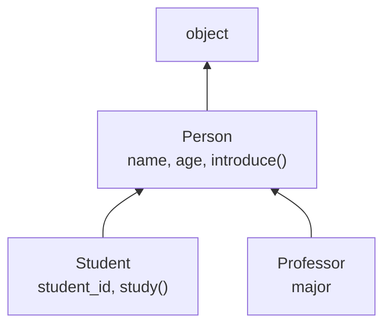
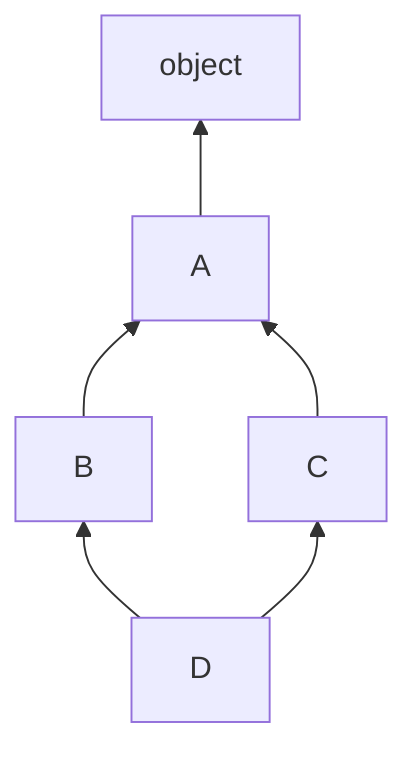

# Lecture 9 — Inheritance and Polymorphism

[Repository Guide](../../README.md) | [English](Concepts_Lecture.md) | [한국어](Concepts_Lecture.ko.md)

> **Last Updated:** 2026-11-19

> **Learning Objectives:**
> 1. Define a subclass that extends an existing class through inheritance, and explain that attribute lookup proceeds from the object to the subclass and then to the superclass
> 2. Override methods, call superclass methods with `super()`, and trace which method runs under dynamic dispatch
> 3. Explain polymorphism and duck typing, and check relationships between classes with `isinstance()` and `issubclass()`
> 4. Compute the method resolution order (MRO) of a multiple-inheritance hierarchy by hand, confirm it with `__mro__`, and explain the order of cooperative `super()` calls
> 5. Define abstract base classes with the `abc` module, and choose between inheritance and composition for the relationship between two classes
> 6. Define the special methods that correspond to operators and built-in functions so that objects work with `+`, `==`, `<`, and `len()`

---

## Table of Contents

- [1. The Concept of Inheritance](#1-the-concept-of-inheritance)
  - [1.1 The Problem with Writing Similar Classes Separately](#11-the-problem-with-writing-similar-classes-separately)
  - [1.2 Superclasses and Subclasses](#12-superclasses-and-subclasses)
  - [1.3 Defining a Subclass](#13-defining-a-subclass)
  - [1.4 The Order of Attribute Lookup](#14-the-order-of-attribute-lookup)
- [2. Method Overriding and super()](#2-method-overriding-and-super)
  - [2.1 Method Overriding](#21-method-overriding)
  - [2.2 Calling Superclass Methods with super()](#22-calling-superclass-methods-with-super)
  - [2.3 Common Mistakes When Overriding the Constructor](#23-common-mistakes-when-overriding-the-constructor)
  - [2.4 Tracing Dynamic Dispatch](#24-tracing-dynamic-dispatch)
- [3. Polymorphism](#3-polymorphism)
  - [3.1 Same Message, Different Behavior](#31-same-message-different-behavior)
  - [3.2 Duck Typing](#32-duck-typing)
  - [3.3 isinstance() and issubclass()](#33-isinstance-and-issubclass)
- [4. Multiple Inheritance and the Method Resolution Order](#4-multiple-inheritance-and-the-method-resolution-order)
  - [4.1 Multiple Inheritance](#41-multiple-inheritance)
  - [4.2 Diamond Inheritance and the MRO](#42-diamond-inheritance-and-the-mro)
  - [4.3 Cooperative super() Calls](#43-cooperative-super-calls)
  - [4.4 When No MRO Can Be Built](#44-when-no-mro-can-be-built)
- [5. Abstract Base Classes](#5-abstract-base-classes)
  - [5.1 Promises a Superclass Cannot Enforce](#51-promises-a-superclass-cannot-enforce)
  - [5.2 The abc Module](#52-the-abc-module)
- [6. Inheritance and Composition](#6-inheritance-and-composition)
  - [6.1 The is-a and has-a Relationships](#61-the-is-a-and-has-a-relationships)
  - [6.2 Replacing Inheritance with Composition](#62-replacing-inheritance-with-composition)
  - [6.3 Criteria for Choosing Inheritance or Composition](#63-criteria-for-choosing-inheritance-or-composition)
- [7. Operators and Special Methods](#7-operators-and-special-methods)
  - [7.1 Defining Arithmetic Operators](#71-defining-arithmetic-operators)
  - [7.2 Defining Comparison Operators](#72-defining-comparison-operators)
  - [7.3 String Representations and Length](#73-string-representations-and-length)
  - [7.4 NotImplemented and Reflected Operations](#74-notimplemented-and-reflected-operations)
- [Concept Applications](#concept-applications)
- [Summary](#summary)
- [Self-Check Questions](#self-check-questions)
- [References](#references)

---

<br>

## 1. The Concept of Inheritance

### 1.1 The Problem with Writing Similar Classes Separately

[Lecture 8](../Lec08_Classes-and-Objects/Concepts_Lecture.md) bundled the information about a person into a class. A program that manages a school must further distinguish students and professors among people. A student has a name and an age like any person, and in addition a student ID, and a student studies. A professor has a name and an age and in addition a major. Writing a student class with only the methods learned so far gives the following.

```python
class Person:
    def __init__(self, name, age):
        self.name = name
        self.age = age

    def introduce(self):
        return "이름: " + self.name + ", 나이: " + str(self.age)

class Student:
    def __init__(self, name, age, student_id):
        self.name = name
        self.age = age
        self.student_id = student_id

    def introduce(self):
        return "이름: " + self.name + ", 나이: " + str(self.age)

    def study(self):
        return self.name + " 학생이 공부한다"
```

Two lines of the `Student` constructor and the entire `introduce()` method are identical to `Person`. Copying the same code in this way causes three problems.

- **Duplication:** Each time a professor, staff, or assistant class is added, the same code is copied again.
- **Divergence:** Changing the format of the self-introduction requires finding every copied class and editing it identically, and if even one is missed, the format differs from class to class.
- **A hidden relationship:** The fact that a student is a kind of person does not appear in the code. From the code alone, one cannot tell whether a student object may be passed to a function that handles people.

What is needed is a way to write "a student is like a person, but also has a student ID and the ability to study." That is inheritance.

### 1.2 Superclasses and Subclasses

> **Definition:** **Inheritance** is defining a new class by taking over the instance variables and methods of an existing class and adding or changing what is needed.

The class that passes on its members is the **superclass**, and the class that inherits them is the **subclass**. A superclass is also called a base class or a parent class, and a subclass a derived class or a child class. A subclass is a **specialization** of its superclass, and a superclass is a **generalization** that gathers what several subclasses have in common.

Inheritance expresses the relationship "an object of the subclass is a kind of object of the superclass (is-a)." A student is a person (Student is a Person), and a professor is also a person. Conversely, not every person is a student.



*Figure 1. Inheritance relationships of Student and Professor with Person as their superclass*

The arrows in Figure 1 point from a subclass to its superclass. `Student` and `Professor` inherit the name, age, and `introduce()` of `Person`, and each adds a student ID and `study()`, or a major. The `object` at the top is the built-in class from which every Python class ultimately inherits, and it is discussed in Section 1.4.

### 1.3 Defining a Subclass

A subclass is defined by writing the superclass in parentheses after the class name in the `class` statement.

```python
class SubClass(SuperClass):
    body
```

Rewriting the `Student` of Section 1.1 with inheritance gives the following.

```python
class Person:
    def __init__(self, name, age):
        self.name = name
        self.age = age

    def introduce(self):
        return "이름: " + self.name + ", 나이: " + str(self.age)

class Student(Person):
    def __init__(self, name, age, student_id):
        super().__init__(name, age)
        self.student_id = student_id

    def study(self):
        return self.name + " 학생이 공부한다"

p = Person("Kim", 45)
s = Student("Lee", 20, "2024001")
print(p.introduce())
print(s.introduce())
print(s.study())
print(s.__dict__)
print(Student.__bases__)
print(Person.__bases__)
```

```text
이름: Kim, 나이: 45
이름: Lee, 나이: 20
Lee 학생이 공부한다
{'name': 'Lee', 'age': 20, 'student_id': '2024001'}
(<class '__main__.Person'>,)
(<class 'object'>,)
```

- **`class Student(Person):`** declares that `Student` inherits from `Person`. The body of `Student` contains only what differs from `Person`.
- **`super().__init__(name, age)`:** Calls the constructor of the superclass `Person` to initialize `self.name` and `self.age`. `super()` is discussed in detail in Section 2.2.
- **`self.student_id = student_id`:** Adds an instance variable that only `Student` has.
- **`s.introduce()`:** `Student` has no `introduce()`, but it can be called because it is inherited from the superclass `Person`.
- **`s.__dict__`:** The student object contains `name` and `age`, created by the superclass constructor, and `student_id`, created by the subclass constructor. Instance variables are stored in the object, not in a class, so they gather in the `__dict__` of one object regardless of which class's method created them.
- **`__bases__`:** Shows, as a tuple, the superclasses from which a class directly inherits. The superclass of a class defined without parentheses, such as `Person`, is `object`.

Now changing the format of the self-introduction requires editing only `Person.introduce()`, and the change is reflected in `Student` and in every subclass created later.

### 1.4 The Order of Attribute Lookup

When a name is written after a dot, as in `s.introduce`, Python looks for the attribute of that name in a fixed order [1]. It first looks at the object's own `__dict__` (its instance variables); if the name is not there, it looks at the object's class, and if it is still not found, it looks at the superclasses of that class in turn. It uses the first match and stops searching, and if the name is not found anywhere, an `AttributeError` occurs.

```python
s = Student("Lee", 20, "2024001")
print("introduce" in s.__dict__)
print("introduce" in Student.__dict__)
print("introduce" in Person.__dict__)
print(s.introduce)
```

```text
False
False
True
<bound method Person.introduce of <__main__.Student object at 0x1008a6f90>>
```

```text
Looking up s.introduce

  ① __dict__ of object s    {'name', 'age', 'student_id'}     not found
          │
          ▼
  ② class Student           __init__, study                   not found
          │
          ▼
  ③ superclass Person       __init__, introduce               found → use Person.introduce
          │
          ▼
  ④ object                  (not examined, found at ③)
```

*Figure 2. The order in which introduce is looked up from a student object*

`introduce` is in neither the object nor `Student` and is found in `Person`. The output `bound method Person.introduce of <... Student object ...>` means that the function found is the one defined in `Person`, and that it is bound to the student object `s`. When it is called, `s` is passed to `self`, so `self.name` is `"Lee"` ([Lecture 8, Section 4.3](../Lec08_Classes-and-Objects/Concepts_Lecture.md#43-the-meaning-of-self)).

At the end of the lookup chain there is always `object`. The default `__init__()` used when a class has no constructor, the `__str__()` and `__repr__()` that `print()` uses by default, and the default `==` comparison (Section 7.2) are all inherited from `object`. In [Lecture 8, Section 6.3](../Lec08_Classes-and-Objects/Concepts_Lecture.md#63-the-string-representation-method), an object without `__str__()` printed as `<__main__.Point object at 0x...>` because `object.__str__()` was used.

> **Key Point:** Attribute lookup proceeds in the order object → class → superclass → ... → `object` and uses the first match. Inheritance is the mechanism that extends this lookup chain, and when a subclass defines the same name, that name is found earlier in the chain and hides the superclass's version.

---

<br>

## 2. Method Overriding and super()

### 2.1 Method Overriding

> **Definition:** **Overriding** is redefining, in a subclass, a method with the same name as a method in the superclass in order to change its behavior.

To make a student's self-introduction show the student ID first, define a new `introduce()` in `Student`.

```python
class Student(Person):
    def __init__(self, name, age, student_id):
        super().__init__(name, age)
        self.student_id = student_id

    def introduce(self):                       # overriding
        return "학번: " + self.student_id + ", 이름: " + self.name

p = Person("Kim", 45)
s = Student("Lee", 20, "2024001")
print(p.introduce())
print(s.introduce())
print(Person.introduce(s))
```

```text
이름: Kim, 나이: 45
학번: 2024001, 이름: Lee
이름: Lee, 나이: 20
```

- **`p.introduce()`:** `introduce` is looked up in `Person`, the class of `p`, so the original format appears.
- **`s.introduce()`:** Following the order of Section 1.4, `introduce` is found first in `Student`, so the overriding format appears. `Person.introduce()` has not been deleted; it is only hidden.
- **`Person.introduce(s)`:** Taking the method directly from the class by name and passing `s` as `self` calls the hidden superclass method as well [1].

An overriding method should be callable in the same way as the superclass method. If the number or meaning of its parameters or the kind of its return value changes, code written for objects of the superclass breaks when it is given an object of the subclass.

### 2.2 Calling Superclass Methods with super()

The overriding in Section 2.1 **replaces** the behavior of the superclass. More often one wants to keep the superclass behavior and **add** something to it. In that case, the subclass method calls the same method of the superclass through `super()`.

```python
class Student(Person):
    def __init__(self, name, age, student_id):
        super().__init__(name, age)
        self.student_id = student_id

    def introduce(self):
        return super().introduce() + ", 학번: " + self.student_id

class Professor(Person):
    def __init__(self, name, age, major):
        super().__init__(name, age)
        self.major = major

    def introduce(self):
        return super().introduce() + ", 전공: " + self.major

print(Student("Lee", 20, "2024001").introduce())
print(Professor("Park", 52, "Computer Science").introduce())
```

```text
이름: Lee, 나이: 20, 학번: 2024001
이름: Park, 나이: 52, 전공: Computer Science
```

`super().introduce()` calls `Person.introduce()` on the current object and gets back `"이름: Lee, 나이: 20"`, and `Student.introduce()` appends the student ID to it. The common format lives in one place, `Person`, and each subclass appends only the information it alone has.

- **What `super()` means:** `super()` returns a proxy object that looks up attributes "starting from the class after the class now being defined." `super().introduce()` inside `Student` skips `Student` and looks for `introduce` starting from `Person`. In single inheritance the next class is the immediate superclass; in multiple inheritance it follows the order of Section 4.3.
- **The zero-argument form:** The form with empty parentheses, `super()`, can be used only in a method inside a class definition, where Python fills in the current class and `self` automatically [2].
- **The form that calls by class name:** Calling through the superclass name, as in `Person.__init__(self, name, age)`, does the same thing in single inheritance [1]. However, renaming the superclass then requires editing all of these calls, and in multiple inheritance the same method can run twice as in Section 4.3, so `super()` is preferable.

### 2.3 Common Mistakes When Overriding the Constructor

When a subclass defines `__init__()`, that is also an override, so the superclass `__init__()` is not called automatically. The following `missing_super.py` forgets to call `super().__init__()`.

```python
class Person:
    def __init__(self, name, age):
        self.name = name
        self.age = age

class Student(Person):
    def __init__(self, name, age, student_id):
        self.student_id = student_id         # super().__init__() is missing

s = Student("Lee", 20, "2024001")
print(s.__dict__)
print(s.name)
```

```text
{'student_id': '2024001'}
Traceback (most recent call last):
  File "missing_super.py", line 12, in <module>
    print(s.name)
          ^^^^^^
AttributeError: 'Student' object has no attribute 'name'
```

`Student.__init__()` hid `Person.__init__()`, so the code that creates `name` and `age` never ran. The fact that `s.__dict__` contains only `student_id` is the evidence. A subclass constructor usually calls `super().__init__(...)` on its first line so that the instance variables the superclass is responsible for are prepared first.

Conversely, if a subclass does not define `__init__()`, the superclass `__init__()` is used according to the lookup of Section 1.4. In the following `inherit_init.py`, `Student` adds only `study()`.

```python
class Person:
    def __init__(self, name, age):
        self.name = name
        self.age = age

class Student(Person):
    def study(self):
        return self.name + " 학생이 공부한다"

s = Student("Lee", 20)
print(s.study())
t = Student("Choi", 21, "2024002")
```

```text
Lee 학생이 공부한다
Traceback (most recent call last):
  File "inherit_init.py", line 12, in <module>
    t = Student("Choi", 21, "2024002")
TypeError: Person.__init__() takes 3 positional arguments but 4 were given
```

`Student("Lee", 20)` works because it is initialized by the inherited `Person.__init__()`. The second call, which also passes a student ID, fails because `Person.__init__()` accepts only three arguments: `self`, `name`, and `age`. The error message names `Person.__init__()` rather than `Student`, which shows that the constructor actually run is the superclass's.

> **Note:** The outputs in this unit were obtained with Python 3.13. The lines in a traceback that mark the failing expression with `^` and `~` were added in Python 3.11 [3], so Python 3.7 prints only the file name, line number, source line, and error message without these marker lines. The wording of error messages also differs slightly between versions. For example, Python 3.9 prints the `TypeError` above without the class name, as `__init__() takes 3 positional arguments but 4 were given`, so the message alone does not tell which class's constructor ran. How to read a traceback is covered in Lecture 11.

### 2.4 Tracing Dynamic Dispatch

When a superclass method calls `self.method()`, which class's method runs is decided not by the class in which that code was written but by **the class of the object that `self` actually refers to**.

> **Definition:** **Dynamic dispatch** is choosing the method to call at run time according to the actual class of the object that receives the call.

In the following bank account classes, `withdraw()` computes the fee with `self.fee()`. The premium account `PremiumAccount` overrides only `fee()`.

```python
class Account:
    def __init__(self, owner, balance):
        self.owner = owner
        self.balance = balance

    def fee(self):
        return 1000

    def withdraw(self, amount):
        total = amount + self.fee()
        if total > self.balance:
            return False
        self.balance -= total
        return True

class PremiumAccount(Account):
    def fee(self):
        return 0

a = Account("Kim", 10000)
b = PremiumAccount("Lee", 10000)
print(a.withdraw(5000), a.balance)
print(b.withdraw(5000), b.balance)
print(a.withdraw(4000), a.balance)
print(b.withdraw(5000), b.balance)
```

```text
True 4000
True 5000
False 4000
True 0
```

The execution of `b.withdraw(5000)` traces step by step as follows.

| Step | Code Executed | Where the Name Is Looked Up | Result |
|:-----|:-----|:-----|:-----|
| 1 | `b.withdraw(5000)` | `PremiumAccount`, the class of `b`, has no `withdraw`, so it is found in the superclass `Account` | `Account.withdraw(b, 5000)` runs, with `self` being `b` |
| 2 | `self.fee()` | Looked up starting from `PremiumAccount`, the class of `self`, which is `b` | `PremiumAccount.fee()` returns 0 |
| 3 | `total = 5000 + 0` | None | `total` is 5000 |
| 4 | Test `5000 > 10000` | None | False, so 5000 is subtracted from the balance |
| 5 | `return True` | None | `b.balance` is 5000 |

*Table 1. Execution of withdraw(5000) called on the premium account b*

Step 2 is the key. The code `self.fee()` is inside the `Account` class, but because `self` is a `PremiumAccount` object, `PremiumAccount.fee()` runs. The same `withdraw()` code uses a fee of 1000 won for an ordinary account and 0 won for a premium account. In the third line, `a.withdraw(4000)` is refused because $4000 + 1000 = 5000$ exceeds the balance 4000, giving `False`, and in the fourth line `b.withdraw(5000)` withdraws the entire balance of 5000 because there is no fee.

When the superclass fixes the skeleton of the process (`withdraw()`) and lets subclasses fill in only the one step that varies (`fee()`), a new kind of account needs to override only `fee()`. Every method in Python is dispatched dynamically in this way [1].

> **[Programming Languages]** Deciding the function to call at compile time from the declared type of a variable is called static binding, and deciding it at run time from the actual type of the object is called dynamic binding. C++ dispatches dynamically only the member functions declared `virtual`, but in Python variables have no types and every method call is resolved by attribute lookup during execution, so every method is dispatched dynamically [1]. Such differences in binding time and their implementation (virtual function tables and so on) are covered in Programming Languages.

---

<br>

## 3. Polymorphism

### 3.1 Same Message, Different Behavior

> **Definition:** **Polymorphism** is the property that an operation or method call with the same name behaves differently depending on the kind of object that receives it.

The following program defines a circle, a rectangle, and a triangle as subclasses of `Shape`, puts the three shapes in one list, and processes them with the same code.

```python
import math

class Shape:
    def __init__(self, name):
        self.name = name

    def area(self):
        return 0

    def describe(self):
        return self.name + "의 넓이는 " + str(round(self.area(), 2))

class Circle(Shape):
    def __init__(self, r):
        super().__init__("원")
        self.r = r

    def area(self):
        return math.pi * self.r ** 2

class Rectangle(Shape):
    def __init__(self, w, h):
        super().__init__("직사각형")
        self.w = w
        self.h = h

    def area(self):
        return self.w * self.h

class Triangle(Shape):
    def __init__(self, base, height):
        super().__init__("삼각형")
        self.base = base
        self.height = height

    def area(self):
        return self.base * self.height / 2

shapes = [Circle(1), Rectangle(3, 4), Triangle(6, 5)]
for s in shapes:
    print(s.describe())
total = 0
for s in shapes:
    total += s.area()
print(round(total, 2))
```

```text
원의 넓이는 3.14
직사각형의 넓이는 12
삼각형의 넓이는 15.0
30.14
```

- **Same call, different computation:** `s.area()` in the loop is a single line, but it computes $\pi r^2$ when `s` is a circle, width × height when it is a rectangle, and base × height ÷ 2 when it is a triangle. The loop never asks what kind of shape it has.
- **Use of dynamic dispatch:** `describe()` is defined only once, in `Shape`, and the `self.area()` inside it is dispatched according to the actual class of the object, as in Section 2.4.
- **The total area:** $\pi \times 1^2 + 3 \times 4 + 6 \times 5 / 2 = 3.14159... + 12 + 15 = 30.14159...$, which rounds to 30.14. The triangle's area is `15.0` because the `/` operation always produces a float ([Lecture 2](../Lec02_Getting-Started-with-Python/Concepts_Lecture.md)).
- **Extension:** To add a regular pentagon, it suffices to create one more subclass of `Shape` and define `area()`. The loop and `describe()` need no change.

Polymorphism is not a property of user-defined classes only. Built-in operations and built-in functions are also polymorphic.

```python
print(1 + 2, "ab" + "cd", [1] + [2])
print(len("hello"), len([1, 2, 3]), len({"a": 1}), len(range(10)))
```

```text
3 abcd [1, 2]
5 3 1 10
```

`+` performs addition on integers and concatenation on strings and lists, and `len()` returns the appropriate length for a string, a list, a dictionary, and a `range`. Section 7 shows how to let one's own classes take part in such operations.

### 3.2 Duck Typing

The three shapes of Section 3.1 all inherit from `Shape`. In Python, however, the only condition for `s.area()` to work is that `s` has a method named `area`. Even without an inheritance relationship, objects that have methods of the same name can be handled by the same code.

> **Definition:** **Duck typing** is a programming style that uses an object based only on whether it has the required methods or attributes, without checking its data type [4].

The name comes from the saying "if it walks like a duck and quacks like a duck, it must be a duck." The three classes in the following `duck.py` have no inheritance relationship with one another.

```python
class Duck:
    def speak(self):
        return "꽥꽥"

class Robot:
    def speak(self):
        return "삐빅"

class Person:
    def __init__(self, name):
        self.name = name

    def speak(self):
        return "안녕하세요, " + self.name + "입니다"

def make_it_speak(thing):
    print(thing.speak())

for x in [Duck(), Robot(), Person("Kim")]:
    make_it_speak(x)
make_it_speak(42)
```

```text
꽥꽥
삐빅
안녕하세요, Kim입니다
Traceback (most recent call last):
  File "duck.py", line 21, in <module>
    make_it_speak(42)
    ~~~~~~~~~~~~~^^^^
  File "duck.py", line 17, in make_it_speak
    print(thing.speak())
          ^^^^^^^^^^^
AttributeError: 'int' object has no attribute 'speak'
```

`make_it_speak()` calls `speak()` without asking whether the object it received is a duck, a robot, or a person. All three objects have `speak()`, so it works. The integer 42 has no `speak()`, so the attribute lookup fails and an `AttributeError` occurs. The two `File` lines of the traceback show that the error started at line 21, which called `make_it_speak(42)`, and occurred at line 17 inside the function.

Duck typing appears throughout Python. `print()` prints any object by calling its `__str__()`, and the `for` statement accepts any iterable object, whether a list, a string, or a `range`. The file objects of Lecture 10 follow the same principle: any object that has a `write()` method can serve as an output destination.

> **Caution:** With duck typing, the absence of a required method shows up only at the moment of the call. The `AttributeError` above occurred when `make_it_speak(42)` ran, not when the program started. State in a function's name and description (docstring) which methods it requires, and to enforce methods that must be present, use the abstract base classes of Section 5.

### 3.3 isinstance() and issubclass()

Whether an object is an instance of a class is checked with `isinstance(object, class)`, and whether one class is a subclass of another with `issubclass(class1, class2)` [1], [2]. Both functions decide by following the inheritance relationship upward.

```python
class Person:
    def __init__(self, name, age):
        self.name = name
        self.age = age

class Student(Person):
    pass

p = Person("Kim", 45)
s = Student("Lee", 20)
print(isinstance(s, Student), isinstance(s, Person), isinstance(s, object))
print(isinstance(p, Student))
print(issubclass(Student, Person), issubclass(Person, Student))
print(type(s) == Person, type(s) == Student)
print(issubclass(bool, int), isinstance(True, int), True + True)
print(isinstance(3.5, (int, float)), isinstance("3.5", (int, float)))
```

```text
True True True
False
True False
False True
True True 2
True False
```

- **`isinstance(s, Person)` is true:** A student is a person (is-a), so an object of a subclass is also judged to be an instance of the superclass. Every object is an instance of `object`.
- **Direction:** Not every person is a student, so `isinstance(p, Student)` and `issubclass(Person, Student)` are false.
- **The difference from `type()`:** `type(s) == Person` is false. `type()` returns only the one class that created the object and ignores the inheritance relationship. To accept subclass objects where superclass objects are expected, use `isinstance()` instead of comparing `type()`.
- **`bool` and `int`:** The Boolean type is a subclass of the integer type [1]. Therefore `True` is an instance of `int` and `True + True` is 2.
- **Tuples:** If the second argument is a tuple of classes, the result is true when the object is an instance of any one of them [2].

> **Note:** Since Python 3.10, types joined by `|`, as in `isinstance(3.5, int | float)`, can also be used as the second argument [2]. In Python 3.7 this form raises a `TypeError`, so to check several classes at once, use the tuple form, which works in every version.

Code that checks kinds with `isinstance()` to choose what to do runs in the opposite direction from polymorphism. If the shape example of Section 3.1 were written as `if isinstance(s, Circle): ... elif isinstance(s, Rectangle): ...`, this `if` statement would have to be found and edited every time a new shape is added. Keep behavior that varies with the kind of object in each class's methods, and use `isinstance()` where the kind itself matters, such as validating a function's input.

---

<br>

## 4. Multiple Inheritance and the Method Resolution Order

### 4.1 Multiple Inheritance

A Python class can have two or more superclasses. This is called **multiple inheritance**, and the superclasses are listed in the parentheses separated by commas, as in `class SubClass(SuperClass1, SuperClass2):`.

```python
class Flyer:
    def fly(self):
        return "날아간다"

    def move(self):
        return "하늘로 이동한다"

class Swimmer:
    def swim(self):
        return "헤엄친다"

    def move(self):
        return "물속으로 이동한다"

class Duck(Flyer, Swimmer):
    pass

d = Duck()
print(d.fly(), d.swim())
print(d.move())
print(Duck.__mro__)
```

```text
날아간다 헤엄친다
하늘로 이동한다
(<class '__main__.Duck'>, <class '__main__.Flyer'>, <class '__main__.Swimmer'>, <class 'object'>)
```

`Duck` inherits both `fly()` and `swim()` from its two superclasses. For `move()`, which both superclasses have, the version of `Flyer`, **written on the left** inside the parentheses, is used. The order in which Python searches the classes is stored as a tuple in the class's `__mro__` attribute; for `Duck` it is `Duck`, `Flyer`, `Swimmer`, `object`.

A small class such as `Flyer` or `Swimmer`, written to mix one feature into another class rather than to create objects on its own, is called a **mixin**. Multiple inheritance is easiest to understand when it combines mutually independent features, as mixins do.

### 4.2 Diamond Inheritance and the MRO

> **Definition:** The **method resolution order (MRO)** is the order in which base classes are searched when an attribute is looked up [4].

If `B` and `C` both inherit from `A`, and `D` inherits from `B` and `C`, as below, the inheritance relationships form a rhombus. Such a structure is called **diamond inheritance**.

```python
class A:
    def hello(self):
        return "A"

class B(A):
    def hello(self):
        return "B"

class C(A):
    def hello(self):
        return "C"

class D(B, C):
    pass

print(D().hello())
print([cls.__name__ for cls in D.__mro__])
print([cls.__name__ for cls in D.mro()])
```

```text
B
['D', 'B', 'C', 'A', 'object']
['D', 'B', 'C', 'A', 'object']
```



*Figure 3. Diamond inheritance leading to A through B and C*

There are two paths from `D` to `A`: one through `B` and one through `C`. A naive scheme that searches the left superclass all the way first (D, B, A, C, A) would examine `A` before `C`, so a method overridden by `C` would be hidden by `A`, and `A` would be examined twice. Python's MRO is D, B, C, A, object: it includes each class once and always places **a subclass before its superclasses**. `__mro__` returns this order as a tuple, and the `mro()` method returns the same order as a list.

Since version 2.3, Python has built the MRO with an algorithm called C3 linearization [5]. Let `L[X]` be the MRO of class `X`. The MRO of `object` is `[object]`, and the MRO of a class `X` with superclasses `P1, P2, ...` is as follows.

```math
L[X] = X + \mathrm{merge}(L[P_1], L[P_2], \ldots, [P_1, P_2, \ldots])
```

`merge` repeatedly finds, starting from the leftmost list, a first element of the given lists that **does not appear after the first element (in the tail) of any other list**, appends it to the result, and removes that class from all lists, until all lists are empty. If no such candidate exists, no MRO can be built (Section 4.4). Since `L[A] = [A, object]`, `L[B] = [B, A, object]`, and `L[C] = [C, A, object]`, `L[D]` is computed as follows.

| Step | Lists Remaining in merge | Class Chosen and Reason | Result So Far |
|:-----|:-----|:-----|:-----|
| 1 | `[B, A, object]`, `[C, A, object]`, `[B, C]` | `B`: in no tail | `D, B` |
| 2 | `[A, object]`, `[C, A, object]`, `[C]` | `A` is skipped because it is in the tail of `[C, A, object]`; `C`: in no tail | `D, B, C` |
| 3 | `[A, object]`, `[A, object]` | `A`: in no tail | `D, B, C, A` |
| 4 | `[object]`, `[object]` | `object` | `D, B, C, A, object` |

*Table 2. Computing the MRO of D by C3 linearization*

Skipping `A` in step 2 is the key. `A` must come after `C` in the MRO of `C`, so it cannot be added before `C`. As a result, C3 linearization keeps the following two properties [5].

- **Local precedence order:** It keeps the order of the superclasses written in the parentheses of the class definition (`B` before `C`).
- **Monotonicity:** If `X` precedes `Y` in the MRO of some class, then `X` precedes `Y` in the MRO of every subclass of that class. Creating a new subclass does not change the search order among existing classes.

### 4.3 Cooperative super() Calls

Section 2.2 said that `super()` looks up "starting from the class after the current class." Here "after" means not the immediate superclass but **the class after the current class in the MRO of the object on which the method was first called**. The following program, in which every class of the diamond calls `super().__init__()` in its constructor, confirms this.

```python
class A:
    def __init__(self):
        print("A.__init__")

class B(A):
    def __init__(self):
        print("B.__init__ 시작")
        super().__init__()
        print("B.__init__ 끝")

class C(A):
    def __init__(self):
        print("C.__init__ 시작")
        super().__init__()
        print("C.__init__ 끝")

class D(B, C):
    def __init__(self):
        print("D.__init__ 시작")
        super().__init__()
        print("D.__init__ 끝")

D()
print("---")
B()
```

```text
D.__init__ 시작
B.__init__ 시작
C.__init__ 시작
A.__init__
C.__init__ 끝
B.__init__ 끝
D.__init__ 끝
---
B.__init__ 시작
A.__init__
B.__init__ 끝
```

When `D()` is created, the MRO is D, B, C, A, object. `super()` in `D` leads to `B`, `super()` in `B` leads to `C`, the class after `B` in the MRO, and `super()` in `C` leads to `A`. `C` never appears in the code of `B`, yet when an object of `D` is created, `super()` in `B` calls `C`. On the other hand, creating `B()` directly gives the MRO B, A, object, so the same `super()` in `B` calls `A`. The target of `super()` is thus decided not when the code is written but at run time by the MRO of the object [1], and when every class calls `super()`, every class in the MRO runs exactly once. This style of calling is called **cooperative multiple inheritance**.

Calling directly by class name gives a different result.

```python
class A:
    def __init__(self):
        print("A.__init__")

class B(A):
    def __init__(self):
        print("B.__init__")
        A.__init__(self)

class C(A):
    def __init__(self):
        print("C.__init__")
        A.__init__(self)

class D(B, C):
    def __init__(self):
        print("D.__init__")
        B.__init__(self)
        C.__init__(self)

D()
```

```text
D.__init__
B.__init__
A.__init__
C.__init__
A.__init__
```

`A.__init__` ran twice. If the constructor of `A` increments a counter or opens a file, that action happens twice. In classes where a diamond can arise, write every class so that it calls the next class with `super()`.

> **Caution:** For cooperative `super()` to work, neighboring classes in the MRO must be callable with the same arguments, because when `B.__init__(self, x)` calls `super().__init__(x)`, the next class may be `C` rather than `A`. If the classes accept different arguments, the argument conventions must be aligned, for example by passing keyword arguments, and if that is difficult, consider the composition of Section 6 instead of multiple inheritance.

### 4.4 When No MRO Can Be Built

Not every inheritance structure admits a C3 linearization. In the following `mro_conflict.py`, `A` places `X` before `Y`, while `B` places `Y` before `X`.

```python
class X:
    pass

class Y:
    pass

class A(X, Y):
    pass

class B(Y, X):
    pass

class C(A, B):
    pass
```

```text
Traceback (most recent call last):
  File "mro_conflict.py", line 13, in <module>
    class C(A, B):
        pass
TypeError: Cannot create a consistent method resolution order (MRO) for bases X, Y
```

To respect the MRO of `A`, the MRO of `C` must put `X` before `Y`; to respect the MRO of `B`, it must put `Y` before `X`. No order satisfies both requirements, so the merge runs out of candidates. Python refuses to create such a class and raises a `TypeError` at the moment the class is defined [5]. The error occurs not when an object is created but when the `class C(A, B):` statement runs.

---

<br>

## 5. Abstract Base Classes

### 5.1 Promises a Superclass Cannot Enforce

`Shape.area()` in Section 3.1 returned 0. If a subclass does not override `area()`, the area of every shape silently becomes 0, and the mistake is hard to notice. Making the superclass method raise a `NotImplementedError` exception at least reveals the mistake when the method is called.

```python
class Shape:
    def area(self):
        raise NotImplementedError("하위 클래스가 area()를 정의해야 한다")

class Square(Shape):
    def __init__(self, side):
        self.side = side

    def are(self):                     # misspelled name
        return self.side ** 2

sq = Square(3)
print("객체 생성 성공")
print(sq.area())
```

```text
객체 생성 성공
Traceback (most recent call last):
  File "not_implemented.py", line 14, in <module>
    print(sq.area())
          ~~~~~~~^^
  File "not_implemented.py", line 3, in area
    raise NotImplementedError("하위 클래스가 area()를 정의해야 한다")
NotImplementedError: 하위 클래스가 area()를 정의해야 한다
```

The `raise` statement raises an exception and is covered in Lecture 11. This approach also has a limit. An object of `Square`, whose method name was misspelled as `are`, is created without any problem, and the mistake appears only when `area()` is first called. If that call happens long after the program starts, the cause is even harder to find.

### 5.2 The abc Module

> **Definition:** An **abstract base class (ABC)** is a class that declares, as abstract methods, the methods its subclasses must define, so that no object can be created from a class that does not define all of them.

Inherit from the `ABC` class of the standard module `abc`, and put `@abstractmethod` in front of each method that subclasses must define [6]. A line `@name` above a `def` is called a **decorator**, and it wraps the function defined directly below it with a fixed treatment. `@abstractmethod` marks the method as an **abstract method**.

```python
from abc import ABC, abstractmethod

class Shape(ABC):
    @abstractmethod
    def area(self):
        pass

    def describe(self):
        return type(self).__name__ + "의 넓이: " + str(self.area())

class Square(Shape):
    def __init__(self, side):
        self.side = side

    def area(self):
        return self.side ** 2

print(Square(3).describe())
print(isinstance(Square(3), Shape))
Shape()
```

```text
Square의 넓이: 9
True
Traceback (most recent call last):
  File "abc_shape.py", line 20, in <module>
    Shape()
    ~~~~~^^
TypeError: Can't instantiate abstract class Shape without an implementation for abstract method 'area'
```

- **Creating an object of an abstract class:** `Shape` has the unimplemented abstract method `area`, so `Shape()` is a `TypeError`. `Shape` is only the common framework of shapes, a concept whose area cannot be determined on its own.
- **A subclass that implements it:** `Square` defines `area()`, so objects can be created from it. Since `isinstance(Square(3), Shape)` is true, it can be passed to code that expects a `Shape`.
- **Concrete methods:** An abstract base class can also have ordinary methods with bodies, such as `describe()`. `describe()` calls the abstract method `area()`, but what actually runs, by dynamic dispatch, is the subclass's `area()`.
- **`type(self).__name__`:** Gives the name of the object's class as a string. The same `describe()` uses `"Square"` for an object of `Square`.

A class with a misspelled method name, as in Section 5.1, is now rejected at the moment an object is created.

```python
from abc import ABC, abstractmethod

class Shape(ABC):
    @abstractmethod
    def area(self):
        pass

class BadSquare(Shape):
    def __init__(self, side):
        self.side = side

    def are(self):
        return self.side ** 2

BadSquare(3)
```

```text
Traceback (most recent call last):
  File "abc_bad.py", line 15, in <module>
    BadSquare(3)
    ~~~~~~~~~^^^
TypeError: Can't instantiate abstract class BadSquare without an implementation for abstract method 'area'
```

`BadSquare` does not define `area()`, so the inherited abstract method remains, and it is therefore treated as an abstract class. The error occurs when the object is created rather than when `area()` is called, so the mistake surfaces much earlier.

> **Note:** An abstract method may also have a body, and a subclass can call that body from its overriding method with `super().area()` [6]. In this respect it differs from an abstract method in Java, which cannot have a body. Also, registering a class that does not inherit from the ABC as a virtual subclass with `Shape.register(SomeClass)` makes `isinstance()` and `issubclass()` true, but in this case whether the abstract methods are implemented is not checked [6].

---

<br>

## 6. Inheritance and Composition

### 6.1 The is-a and has-a Relationships

Inheritance is not the only relationship between classes. A car **has** an engine (Car has an Engine). A car is not a kind of engine, so having `Car` inherit from `Engine` would be awkward. In such cases, the car object holds an engine object as an instance variable.

> **Definition:** **Composition** is a way of building functionality in which an object of one class holds objects of other classes as instance variables and delegates the necessary work to them.

```python
class Engine:
    def __init__(self, horsepower):
        self.horsepower = horsepower
        self.running = False

    def start(self):
        self.running = True

class Car:
    def __init__(self, model, horsepower):
        self.model = model
        self.engine = Engine(horsepower)     # a Car has an Engine

    def start(self):
        self.engine.start()
        return self.model + " 출발 (" + str(self.engine.horsepower) + "마력)"

c = Car("A6", 265)
print(c.start(), c.engine.running)
print(isinstance(c, Engine))
```

```text
A6 출발 (265마력) True
False
```

`Car.start()` hands the job of starting to the `start()` of the engine object it holds. Passing a received request on to an object one holds in this way is called **delegation**. A car is not an engine, so `isinstance(c, Engine)` is false.

| Relationship | Meaning | Python Expression | Examples |
|:-----|:-----|:-----|:-----|
| is-a | A is a kind of B | `class A(B):` (inheritance) | A student is a person, a circle is a shape |
| has-a | A has B as a part | `self.b = B(...)` (composition) | A car has an engine, a playlist has songs |

*Table 3. Comparison of the is-a and has-a relationships*

### 6.2 Replacing Inheritance with Composition

A common misuse of inheritance is inheriting from "a class that has the features needed for the implementation." A stack is a data structure that removes first the element inserted last (LIFO). Since a list has `append()` and `pop()`, it may seem that inheriting from list makes building a stack easy.

```python
class Stack(list):
    def push(self, x):
        self.append(x)

    def peek(self):
        return self[-1]

s = Stack()
s.push(1)
s.push(2)
s.push(3)
print(s.peek(), len(s))
s.insert(0, 99)          # an operation a stack should not have
print(s)
print(s.pop(0))
```

```text
3 3
[99, 1, 2, 3]
99
```

`Stack` inherits every list method, so `insert(0, 99)`, which inserts at the bottom, and `pop(0)`, which removes from the bottom, are also available. As a result, 99 came out before 3, which was pushed last. The object fails to keep the promise of a stack. A stack is not a kind of list (not is-a); it is merely **implemented** with a list.

With composition, only the operations a stack permits are exposed.

```python
class Stack:
    def __init__(self):
        self._items = []

    def push(self, x):
        self._items.append(x)

    def pop(self):
        return self._items.pop()

    def peek(self):
        return self._items[-1]

    def __len__(self):
        return len(self._items)

s = Stack()
s.push(1)
s.push(2)
s.push(3)
print(s.pop(), s.peek(), len(s))
s.insert(0, 99)
```

```text
3 2 2
Traceback (most recent call last):
  File "stack_compose.py", line 22, in <module>
    s.insert(0, 99)
    ^^^^^^^^
AttributeError: 'Stack' object has no attribute 'insert'
```

- **`self._items`:** The list that holds the elements is a part that the stack owns. A name starting with a single underscore is a conventional sign that it should not be used outside the class ([Lecture 8, Section 7.2](../Lec08_Classes-and-Objects/Concepts_Lecture.md#72-name-mangling)).
- **Delegation:** `push()`, `pop()`, and `peek()` hand their work to the list's `append()`, `pop()`, and indexing.
- **Exposed operations:** Outside the class only the four defined operations are available, so `s.insert(0, 99)` is an `AttributeError`. `len(s)` works because `__len__()` of Section 7.3 is defined.
- **Easy to change:** Even if the internal storage is later changed to another data structure, code that uses `Stack` needs no change.

> **[Data Structures]** A stack is a linear data structure in which insertion and deletion happen only at one end (the top), and its operations are defined as `push`, `pop`, `peek` (or `top`), and a test for emptiness. Whether to implement a stack with an array or a linked list is a matter separate from the definition of the abstract data type, and the composition above expresses that separation in code. Applications of stacks (bracket matching, expression evaluation, managing function calls) are covered in Data Structures.

### 6.3 Criteria for Choosing Inheritance or Composition

| Criterion | When Inheritance Fits | When Composition Fits |
|:-----|:-----|:-----|
| The relationship between the two classes | A is a kind of B (is-a) | A has B or uses B (has-a) |
| The public methods of B as seen from A | All make sense | Only some make sense (`insert` in Section 6.2) |
| Putting an object of A where an object of B is used | Possible | Not possible |
| The effect of changes to B | A should change along with B | The public operations of A should stay the same |
| The need to swap parts at run time | None | Present (for example, replacing the engine object with another) |

*Table 4. Criteria for choosing inheritance or composition*

The third criterion is the most important. An object of a subclass can be passed to any code that expects an object of the superclass (`isinstance()` from Section 3.3 is true). Inheritance is justified only if that code still behaves correctly. `Stack(list)` from Section 6.2 behaves as a list when passed to code that accepts lists, but it breaks the promise of a stack, so it fails to be both. When in doubt, consider composition first. Composition chooses the operations to expose explicitly, so starting with composition and moving to inheritance later is easier than the reverse. Changing inheritance into composition removes superclass operations that are already in use, whereas changing composition into inheritance only adds operations.

> **[Software Engineering]** The principle that an object of a subtype must be substitutable anywhere an object of the supertype is used without breaking the correctness of the program is called the Liskov substitution principle. This principle, the design guideline "prefer composition over inheritance," and the design principles that lower the coupling between classes are covered under design and modeling in Software Engineering.

---

<br>

## 7. Operators and Special Methods

### 7.1 Defining Arithmetic Operators

Like `__str__()` in [Lecture 8, Section 6.3](../Lec08_Classes-and-Objects/Concepts_Lecture.md#63-the-string-representation-method), special methods whose names begin and end with two underscores are called automatically by Python in fixed situations. Operators are no different. When computing `x + y`, Python calls `x.__add__(y)` [7].

> **Definition:** **Operator overloading** is defining, in a user-defined class, the special methods that correspond to operators so that operators such as `+`, `-`, `*`, and `==` can be used on objects of that class.

The following `Vector` defines addition, subtraction, and scalar multiplication of two-dimensional vectors as operators.

```python
class Vector:
    def __init__(self, x, y):
        self.x = x
        self.y = y

    def __add__(self, other):
        return Vector(self.x + other.x, self.y + other.y)

    def __sub__(self, other):
        return Vector(self.x - other.x, self.y - other.y)

    def __mul__(self, k):
        return Vector(self.x * k, self.y * k)

    def __rmul__(self, k):
        return self * k

    def __repr__(self):
        return "Vector(" + str(self.x) + ", " + str(self.y) + ")"

v1 = Vector(1, 2)
v2 = Vector(3, 4)
print(v1 + v2)
print(v2 - v1)
print(v1 * 3)
print(3 * v1)
print(v1.__add__(v2))
print([v1, v2])
```

```text
Vector(4, 6)
Vector(2, 2)
Vector(3, 6)
Vector(3, 6)
Vector(4, 6)
[Vector(1, 2), Vector(3, 4)]
```

- **`v1 + v2`:** Runs as `v1.__add__(v2)` and returns a new vector $(1 + 3, 2 + 4) = (4, 6)$. Calling it directly, as in the fifth line, gives the same result. Neither operand changes; a new object is created.
- **`v1 * 3`:** This is `v1.__mul__(3)`, which multiplies each component by 3 to give $(3, 6)$.
- **`3 * v1`:** The left operand is an integer, so Python first tries integer multiplication. An integer does not know how to multiply a vector, so Python calls the right operand's `__rmul__()` as `v1.__rmul__(3)`. This process is examined in detail in Section 7.4.
- **`__repr__()`:** The representation method of [Lecture 8, Section 6.4](../Lec08_Classes-and-Objects/Concepts_Lecture.md#64-__repr__-and-__str__). Since there is no `__str__()`, `print()` also uses it, and the vectors inside a list are displayed with it too.

| Operation | Method Called | Operation | Method Called |
|:-----|:-----|:-----|:-----|
| `x + y` | `x.__add__(y)` | `x == y` | `x.__eq__(y)` |
| `x - y` | `x.__sub__(y)` | `x != y` | `x.__ne__(y)` |
| `x * y` | `x.__mul__(y)` | `x < y` | `x.__lt__(y)` |
| `x / y` | `x.__truediv__(y)` | `x <= y` | `x.__le__(y)` |
| `x // y` | `x.__floordiv__(y)` | `x > y` | `x.__gt__(y)` |
| `x % y` | `x.__mod__(y)` | `x >= y` | `x.__ge__(y)` |
| `-x` | `x.__neg__()` | `len(x)` | `x.__len__()` |
| `str(x)`, `print(x)` | `x.__str__()` | `repr(x)` | `x.__repr__()` |

*Table 5. Main special methods corresponding to operators and built-in functions*

When defining an operator, keep the meaning the operator originally has. `+` combines two values, so it is natural for it to return a new object without changing its operands. If `v1 + v2` changed `v1` itself, code that uses `v1` after `a = v1 + v2` would see an unexpected value.

### 7.2 Defining Comparison Operators

As seen in [Lecture 8, Section 6.5](../Lec08_Classes-and-Objects/Concepts_Lecture.md#65-special-methods-for-comparison-and-length), the default behavior of `==` is inherited from `object` and is true **only when the two operands are the same object**, and defining `__eq__()` makes the comparison use values [7]. This section covers the change in hashing that comes with defining `__eq__()` and the definition of ordering comparisons such as `<`.

```python
class Vector:
    def __init__(self, x, y):
        self.x = x
        self.y = y

    def __repr__(self):
        return "Vector(" + str(self.x) + ", " + str(self.y) + ")"

a = Vector(1, 2)
b = Vector(1, 2)
print(a == b, a == a)

class Vector2(Vector):
    def __eq__(self, other):
        return self.x == other.x and self.y == other.y

c = Vector2(1, 2)
d = Vector2(1, 2)
print(c == d, c != d, c is d)
print(Vector2.__hash__)
s = {c}
```

```text
False True
True False False
None
Traceback (most recent call last):
  File "vector_eq.py", line 21, in <module>
    s = {c}
        ^^^
TypeError: unhashable type: 'Vector2'
```

- **`a == b` and `c == d`:** The default `==` is decided the same way as `is`, so `a == b` is false, while in `Vector2`, which defines an `__eq__()` that compares components, `c == d` is true. Having the same value differs from being the same object, so `c is d` is still false.
- **Handling of `!=`:** Without a separate `__ne__()`, the default `__ne__()` inherited from `object` calls `__eq__()` and inverts the result. If `__eq__()` returns `NotImplemented` (Section 7.4), however, it passes that value on without inverting it [7].
- **Hashing:** A class that defines `__eq__()` but not `__hash__()` has its `__hash__` set to `None`, so its objects cannot be elements of a set or keys of a dictionary [7]. Two objects judged equal must have the same hash value, but the default hash differs from object to object. For sets and dictionary keys, see [Lecture 7, Section 10](../Lec07_Lists-and-Dictionaries/Concepts_Lecture.md#10-sets) and [Section 11](../Lec07_Lists-and-Dictionaries/Concepts_Lecture.md#11-dictionaries).

Once ordering comparisons are defined, `sorted()`, `min()`, and `max()` can also be used on the objects. The following `Version` splits a version string such as `"3.13"` into two integers and compares them.

```python
class Version:
    def __init__(self, text):
        parts = text.split(".")
        self.major = int(parts[0])
        self.minor = int(parts[1])

    def __eq__(self, other):
        return (self.major, self.minor) == (other.major, other.minor)

    def __lt__(self, other):
        return (self.major, self.minor) < (other.major, other.minor)

    def __repr__(self):
        return "Version('" + str(self.major) + "." + str(self.minor) + "')"

print("3.7" < "3.13")
print(Version("3.7") < Version("3.13"))
print(Version("3.13") > Version("3.7"))
vs = [Version("3.13"), Version("2.7"), Version("3.7"), Version("3.10")]
print(sorted(vs))
print(max(vs))
print(Version("3.7") <= Version("3.13"))
```

```text
False
True
True
[Version('2.7'), Version('3.7'), Version('3.10'), Version('3.13')]
Version('3.13')
Traceback (most recent call last):
  File "version.py", line 22, in <module>
    print(Version("3.7") <= Version("3.13"))
          ^^^^^^^^^^^^^^^^^^^^^^^^^^^^^^^^^
TypeError: '<=' not supported between instances of 'Version' and 'Version'
```

- **The pitfall of string comparison:** Strings are compared character by character in lexicographic order, so `"3.7"` and `"3.13"` are decided at their third characters, `'7'` and `'1'`, and `"3.7"` comes out larger.
- **Tuple comparison:** `__lt__()` compares tuples, as in `(3, 7) < (3, 13)`. Tuples are compared from the first element and decided at the first element that differs ([Lecture 7, Section 8.3](../Lec07_Lists-and-Dictionaries/Concepts_Lecture.md#83-concatenation-repetition-and-comparison)), so when the major versions are equal, the minor versions 7 and 13 are compared as integers.
- **Handling of `>`:** `__gt__()` is not defined, yet `Version("3.13") > Version("3.7")` works. In `x > y`, the `__gt__()` of `x` is the default method inherited from `object`, which returns `NotImplemented`, so Python then tries `y.__lt__(x)`. `__lt__()` and `__gt__()` are each other's reflection [7]. As this example shows, the reflection of a comparison is tried even when both operands have the same type, which differs from the arithmetic operations of Section 7.4.
- **`sorted()` and `max()`:** Both functions compare with `<` internally, so `__lt__()` alone suffices.
- **The failure of `<=`:** Neither `__le__()` nor its reflection `__ge__()` exists, so it is a `TypeError`. Having `==` and `<` does not make `<=` appear by itself.

> **Note:** To use all six comparison operations, each can be defined separately, but putting the `total_ordering` decorator from the standard module `functools` above the class builds the remaining comparison methods from two methods such as `__eq__()` and `__lt__()`. Where comparisons matter for the performance of a program, the methods made by the decorator can be slower than ones defined directly [8].

### 7.3 String Representations and Length

[Lecture 8, Sections 6.4](../Lec08_Classes-and-Objects/Concepts_Lecture.md#64-__repr__-and-__str__) and [6.5](../Lec08_Classes-and-Objects/Concepts_Lecture.md#65-special-methods-for-comparison-and-length) showed the distinction between `__str__()` and `__repr__()` and the relation between `__len__()` and truth values. This section defines the three methods together in one class to show one special method calling another, and extends the rule that decides truth values to `__bool__()`.

The truth value of an object is decided in the following order [7]. If the class has `__bool__()`, its return value is used; if not, Python checks whether the result of `__len__()` is nonzero; and if neither exists, every object is true. `Bag` in Lecture 8, Section 6.5 was the second case.

```python
class Playlist:
    def __init__(self, name, songs):
        self.name = name
        self.songs = list(songs)

    def __len__(self):
        return len(self.songs)

    def __str__(self):
        return self.name + " (" + str(len(self)) + "곡)"

    def __repr__(self):
        return "Playlist(" + repr(self.name) + ", " + repr(self.songs) + ")"

p = Playlist("아침", ["Song A", "Song B"])
e = Playlist("빈 목록", [])
print(len(p), len(e))
print(p)
print(str(p))
print(repr(p))
print([p, e])
print(bool(p), bool(e))
if not e:
    print(e.name + "은 비어 있다")
```

```text
2 0
아침 (2곡)
아침 (2곡)
Playlist('아침', ['Song A', 'Song B'])
[Playlist('아침', ['Song A', 'Song B']), Playlist('빈 목록', [])]
True False
빈 목록은 비어 있다
```

- **`print(p)` and `str(p)`:** `__str__()` is used. `len(self)` inside `__str__()` calls `__len__()` of the same object.
- **`repr(p)` and printing a list:** `__repr__()` is used. The display of a list is built from the `__repr__()` of each element, so the elements' `__str__()` is not used in `print([p, e])` either.
- **`repr(self.name)`:** The `repr()` of a string is `'아침'` with quotes, so the representation takes the form of code.
- **Truth value:** `Playlist` has no `__bool__()` and the length of `e` is 0, so `bool(e)` is false and the body of `if not e:` runs. The same rule that makes empty lists and empty strings false ([Lecture 4](../Lec04_Conditional-Statements/Concepts_Lecture.md)) applies to user-defined classes.

That `__bool__()` takes precedence over `__len__()` can be seen in a class whose two methods give different answers.

```python
class Wallet:
    def __init__(self, balance, history):
        self.balance = balance
        self.history = list(history)

    def __len__(self):
        return len(self.history)

    def __bool__(self):
        return self.balance > 0

class Plain:
    pass

w = Wallet(0, ["입금", "출금"])
print(len(w), bool(w))
print(bool(Plain()))
```

```text
2 False
True
```

`w` has two transaction records, so `len(w)` is 2, but `__bool__()` sees the balance of 0 and returns false, so `bool(w)` is `False`. `__bool__()` must return `True` or `False` [7]. An object of `Plain`, which defines neither method, is always true.

### 7.4 NotImplemented and Reflected Operations

The `__add__()` of Section 7.1 assumed that `other` is a vector. Adding an integer to a vector causes an `AttributeError` at `other.x`, and that message makes it hard to tell what went wrong. The rule is that an operation method that receives an unsupported operand returns the special value `NotImplemented` to announce "this operation is not known to me" [7].

```python
class Vector:
    def __init__(self, x, y):
        self.x = x
        self.y = y

    def __add__(self, other):
        if not isinstance(other, Vector):
            return NotImplemented
        return Vector(self.x + other.x, self.y + other.y)

    def __repr__(self):
        return "Vector(" + str(self.x) + ", " + str(self.y) + ")"

print(Vector(1, 2) + Vector(3, 4))
print(Vector(1, 2) + 5)
```

```text
Vector(4, 6)
Traceback (most recent call last):
  File "vector_bad.py", line 15, in <module>
    print(Vector(1, 2) + 5)
          ~~~~~~~~~~~~~^~~
TypeError: unsupported operand type(s) for +: 'Vector' and 'int'
```

On receiving `NotImplemented`, Python does not raise an error at once but follows these steps [7].

1. For `x + y`, it first calls `x.__add__(y)`.
2. If the result is `NotImplemented` or `x` has no `__add__()`, and the types of `x` and `y` differ, it calls the right operand's **reflected method** `y.__radd__(x)`.
3. If that method is also absent or returns `NotImplemented`, it raises `TypeError: unsupported operand type(s) for +`.

In `Vector(1, 2) + 5`, `Vector.__add__()` returned `NotImplemented` and integers have no `__radd__()` that adds a vector, so the `TypeError` of step 3 occurred. This message states the operator and the types of both operands precisely. `3 * v1` in Section 7.1 is a case in which `int.__mul__(3, v1)` in step 1 returned `NotImplemented` and `Vector.__rmul__(v1, 3)` called in step 2 succeeded.

| Expression | Step 1 | Step 2 | Result |
|:-----|:-----|:-----|:-----|
| `v1 * 3` | `v1.__mul__(3)` succeeds | None | `Vector(3, 6)` |
| `3 * v1` | `(3).__mul__(v1)` is `NotImplemented` | `v1.__rmul__(3)` succeeds | `Vector(3, 6)` |
| `Vector(1, 2) + 5` | `__add__` is `NotImplemented` | `(5).__radd__(...)` is `NotImplemented` | `TypeError` |

*Table 6. Processing of binary operations including reflected operations*

Reflected methods put `r` in front of the original name, as in `__radd__()`, `__rsub__()`, and `__rmul__()`. Subtraction and division are not commutative, so note that `y.__rsub__(x)` must compute $x - y$, not $y - x$. If both operands have the same type, the reflected method is not called, because if `__add__()` of that type failed, the operation is regarded as unsupported [7]. The comparison operations of Section 7.2, by contrast, try the reflection even between operands of the same type. Also, if the right operand's type is a subclass of the left operand's type and defines the reflected method differently, the right operand's reflected method is called first, before step 1 [7]. This rule lets a subclass decide the result of operations with its superclass.

> **Caution:** Raising a `NotImplementedError` exception instead of returning `NotImplemented` in the unsupported case prevents the reflected method of step 2 from being tried. `NotImplemented` is a return value meaning "ask the other operand," while `NotImplementedError` (Section 5.1) is an exception meaning "not implemented yet," so they serve different purposes.

---

<br>

## Concept Applications

When designing a new class, first decide its relationships with other classes and the operations its objects must take part in.

| Situation | Choice |
|:-----|:-----|
| Full-time, contract, and intern employees share a name and an employee number and differ only in how pay is computed. | Make `Employee` the superclass and override `pay()` in each subclass. The code that prints pay statements calls only `pay()`, so dynamic dispatch handles the rest. |
| Every payment method must implement `pay(amount)`, and a class that omits it should be rejected when an object is created. | Declare `pay()` as an abstract method in a `PaymentMethod` that inherits from `ABC` of `abc`. |
| The caller should decide whether a log is written to the screen, a file, or a list. | Design with duck typing so that the destination needs only a `write()` method. No inheritance relationship is needed. |
| An order object holds customer information and a list of products. | An order is not a kind of customer, so use composition with `self.customer` and `self.items`. |
| Two-dimensional coordinate objects should be added together, compared for equality, and put in a set. | Define `__add__()` and `__eq__()`, and to put them in a set, define `__hash__()` as well. Objects whose hash is used must not change their coordinates after creation. |
| Date objects should be sorted with `sorted()` and also compared with `<=`. | Define `__eq__()` and `__lt__()` and generate the remaining comparisons with `functools.total_ordering`. |

*Table 7. Choosing inheritance, composition, or special methods for design situations*

**True/False Check:**

| Statement | Judgment and Reason |
|:-----|:-----|
| If a subclass defines `__init__()`, the superclass `__init__()` also runs automatically first. | **F.** The subclass `__init__()` hides the superclass's, so `super().__init__()` must be called explicitly (Section 2.3). |
| `self.f()` called inside a superclass method always runs the superclass's `f()`. | **F.** `f` is looked up starting from the actual class of the object that `self` refers to, so an `f()` overridden by a subclass may run (Section 2.4). |
| `isinstance(True, int)` is true. | **T.** `bool` is a subclass of `int`, so `True` is an instance of `int` (Section 3.3). |
| In `class D(B, C)`, `super()` inside `B` always refers to the superclass of `B`. | **F.** `super()` refers to the class after `B` in the MRO of the running object, which can be `C` for an object of `D` (Section 4.3). |
| No object can be created from a subclass that leaves even one abstract method unimplemented. | **T.** If an inherited abstract method remains, that class is also abstract, so creating an object is a `TypeError` (Section 5.2). |
| After defining `__eq__()`, objects of the class can still be used as dictionary keys. | **F.** Without a `__hash__()` defined as well, `__hash__` becomes `None` and the objects are unhashable (Section 7.2). |
| When `__add__()` receives an unsupported operand, it should raise `NotImplementedError`. | **F.** It should return `NotImplemented` so that Python tries the right operand's reflected method (Section 7.4). |

---

<br>

## Summary

| Concept | Key Summary |
|:-----|:-----|
| Inheritance | `class Sub(Super):` takes over the instance variables and methods of the superclass, and the subclass contains only what differs. |
| Attribute lookup | A name is looked up in the order object, class, superclass, ..., `object`, the first match is used, and if none is found the result is an `AttributeError`. |
| Overriding | When a subclass defines a method with the same name, it is found earlier in the lookup and hides the superclass's method. |
| `super()` | Finds and calls a method starting from the class after the current class in the MRO of the running object, and a subclass constructor usually begins with `super().__init__()`. |
| Dynamic dispatch | The method that `self.f()` runs is decided by the actual class of `self`, not by the class in which the code was written. |
| Polymorphism | The same call behaves differently depending on the kind of object, so adding a new kind does not require changing the calling code. |
| Duck typing | An object is used based only on whether it has the required methods, without checking its type, and a missing method causes an `AttributeError` at the call. |
| `isinstance()` and `issubclass()` | They decide by following the inheritance relationship, so an object of a subclass is an instance of the superclass, and a tuple of classes can be the second argument. |
| Multiple inheritance and the MRO | With several superclasses, lookup follows the order in `__mro__` determined by C3 linearization, and if no consistent order exists the class definition is a `TypeError`. |
| Cooperative `super()` | When every class calls the next class with `super()`, each class in the MRO runs once even in a diamond structure. |
| Abstract base class | Objects can be created only after a subclass implements every method marked with `@abstractmethod` in a class that inherits from `ABC`. |
| Composition | A has-a relationship that holds other objects as instance variables and delegates work to them, letting the class choose the operations it exposes. |
| Operator overloading | Defining special methods such as `__add__()`, `__eq__()`, `__lt__()`, and `__len__()` lets operators and built-in functions work on user-defined objects. |
| `NotImplemented` | The value an operation method returns for an unsupported operand; Python then tries the reflected method and raises a `TypeError` if that also fails. |

---

<br>

## Self-Check Questions

1. **Attribute lookup:** Write the output of the following code, and explain in which class `who` and `self.name()` are each found for `c.who()`.

   ```python
   class A:
       def who(self):
           return "A가 정의한 who, 이름은 " + self.name()
       def name(self):
           return "A"

   class B(A):
       def name(self):
           return "B"

   class C(B):
       pass

   c = C()
   print(c.who())
   ```

   <details>
   <summary>Answer</summary>

   The output is `A가 정의한 who, 이름은 B`. `who` is in neither `C` nor `B`, so it is found in `A`. `self.name()` inside `A.who()` is looked up again starting from `C` because `self` is an object of `C`; it is not in `C`, and `name` is found in `B`, which returns `"B"`. By dynamic dispatch, the method overridden by `B` runs even inside the code of `A`.

   </details>

2. **super() and constructors:** The constructor of the superclass `Animal` creates `self.name`. If the constructor of the subclass `Dog` runs only `self.breed = breed` and does not call `super().__init__(name)`, what happens to `Dog("Max", "poodle").name`? Write the corrected constructor.

   <details>
   <summary>Answer</summary>

   `Dog.__init__()` hides `Animal.__init__()`, so `name` is never created and `AttributeError: 'Dog' object has no attribute 'name'` occurs. The corrected constructor is as follows.

   ```python
   class Dog(Animal):
       def __init__(self, name, breed):
           super().__init__(name)
           self.breed = breed
   ```

   </details>

3. **isinstance() and type():** With `class Animal: pass`, `class Dog(Animal): pass`, and `d = Dog()`, write the values of `isinstance(d, Animal)`, `type(d) == Animal`, `issubclass(Dog, object)`, and `isinstance(Animal, Dog)`, and explain which check a function expecting superclass objects should use.

   <details>
   <summary>Answer</summary>

   They are `True`, `False`, `True`, and `False` in order. The last expression asks whether the class `Animal` itself is an instance of `Dog`, so it is false. Comparing `type()` looks only at the one class that created the object, so it rejects subclass objects. To accept subclass objects as well, just as a student must be accepted as a person, use `isinstance()`.

   </details>

4. **Computing an MRO:** With `class P: pass`, `class Q(P): pass`, `class R(P): pass`, and `class S(R, Q): pass`, compute the MRO of `S` step by step by C3 linearization.

   <details>
   <summary>Answer</summary>

   `L[P] = [P, object]`, `L[Q] = [Q, P, object]`, and `L[R] = [R, P, object]`. In `L[S] = S + merge([R, P, object], [Q, P, object], [R, Q])`, `R` is in no tail, so it is chosen. From the remaining `[P, object]`, `[Q, P, object]`, and `[Q]`, `P` is skipped because it is in the tail of `[Q, P, object]`, and `Q` is chosen. From the remaining `[P, object]` and `[P, object]`, `P` and then `object` are chosen. The MRO is therefore `S, R, Q, P, object`, with `R` before `Q` as written in the parentheses.

   </details>

5. **Cooperative super():** In the classes of Question 4, the `hello()` of `P`, `Q`, `R`, and `S` each print the class's own name and then call `super().hello()` (except that `P` only prints). Write the outputs of `S().hello()` and `Q().hello()`.

   <details>
   <summary>Answer</summary>

   `S().hello()` follows the MRO `S, R, Q, P` and prints `S`, `R`, `Q`, and `P`, one per line. This is because `super()` inside `R` refers not to `P`, the superclass of `R`, but to `Q`, the next class in the MRO. `Q().hello()` prints `Q` and `P` because the MRO of `Q` is `Q, P, object`.

   </details>

6. **Abstract base classes:** `Shape` inherits from `ABC` and has `area()` and `perimeter()` as abstract methods. What happens when an object is created from a subclass `Circle` that defines only `area()`? Compare this with handling the same situation with `raise NotImplementedError`.

   <details>
   <summary>Answer</summary>

   The abstract method `perimeter` remains in `Circle`, so `Circle(1)` fails at the moment of object creation with `TypeError: Can't instantiate abstract class Circle without an implementation for abstract method 'perimeter'`. If the superclass method raised `NotImplementedError` instead, the object would be created and the error would occur only when `perimeter()` is first called. Abstract base classes reveal the mistake earlier.

   </details>

7. **Inheritance and composition:** Explain the problem with building a queue (a data structure that removes first the element inserted first) as `class Queue(list):`, and write a `Queue` with `enqueue()`, `dequeue()`, and `__len__()` using composition.

   <details>
   <summary>Answer</summary>

   Inheriting from list exposes every list method that breaks the order of a queue, such as `insert()`, `pop()` (removing from the end), and `sort()`, so the object fails to keep the promise of a queue. A queue is not a kind of list but is implemented with a list, so composition fits.

   ```python
   class Queue:
       def __init__(self):
           self._items = []
       def enqueue(self, x):
           self._items.append(x)
       def dequeue(self):
           return self._items.pop(0)
       def __len__(self):
           return len(self._items)
   ```

   `dequeue()` removes the front element. `pop(0)` shifts every later element one place forward, which is slow when there are many elements, and using `deque` from the standard module `collections` as the part avoids this problem. Because the class is built by composition, code that uses `Queue` stays the same even when the part is replaced.

   </details>

8. **Reflected operations:** If `__rmul__()` is removed from the `Vector` of Section 7.1, what happens to `3 * Vector(1, 2)` and to `Vector(1, 2) * Vector(3, 4)`? And what happens to `Vector(1, 2) * Vector(3, 4)` with the original `Vector`, which has `__rmul__()`?

   <details>
   <summary>Answer</summary>

   For `3 * Vector(1, 2)`, `int.__mul__()` returns `NotImplemented` and `Vector` has no `__rmul__()`, so `TypeError: unsupported operand type(s) for *: 'int' and 'Vector'` occurs. For `Vector(1, 2) * Vector(3, 4)`, `__mul__(self, k)` treats `k` as a number and computes `self.x * k`, and `1 * Vector(3, 4)` in turn goes through the `NotImplemented` of `int.__mul__()` and the search for a reflected method, ending in a `TypeError`. With the original `Vector`, `1 * Vector(3, 4)` becomes `Vector(3, 4)` through `__rmul__()` and `2 * Vector(3, 4)` becomes `Vector(6, 8)`, so the meaningless result `Vector(Vector(3, 4), Vector(6, 8))` appears without any error. This is more dangerous because not even an error occurs. If `__mul__()` is changed to return `NotImplemented` for non-numeric operands, both cases give `TypeError: unsupported operand type(s) for *: 'Vector' and 'Vector'`, and the error message points directly to the operands of the original multiplication.

   </details>

---

<br>

## References

1. Python Software Foundation, "Classes," *The Python Tutorial*, Python 3.13. https://docs.python.org/3.13/tutorial/classes.html
2. Python Software Foundation, "Built-in Functions," *The Python Standard Library*, Python 3.13. https://docs.python.org/3.13/library/functions.html
3. Python Software Foundation, "What's New In Python 3.11," *Python 3.13 Documentation*. https://docs.python.org/3.13/whatsnew/3.11.html
4. Python Software Foundation, "Glossary," *Python 3.13 Documentation*. https://docs.python.org/3.13/glossary.html
5. M. Simionato, "The Python 2.3 Method Resolution Order," *Python HOWTOs*, Python 3.13. https://docs.python.org/3.13/howto/mro.html
6. Python Software Foundation, "abc - Abstract Base Classes," *The Python Standard Library*, Python 3.13. https://docs.python.org/3.13/library/abc.html
7. Python Software Foundation, "Data model," *The Python Language Reference*, Python 3.13. https://docs.python.org/3.13/reference/datamodel.html
8. Python Software Foundation, "functools - Higher-order functions and operations on callable objects," *The Python Standard Library*, Python 3.13. https://docs.python.org/3.13/library/functools.html
