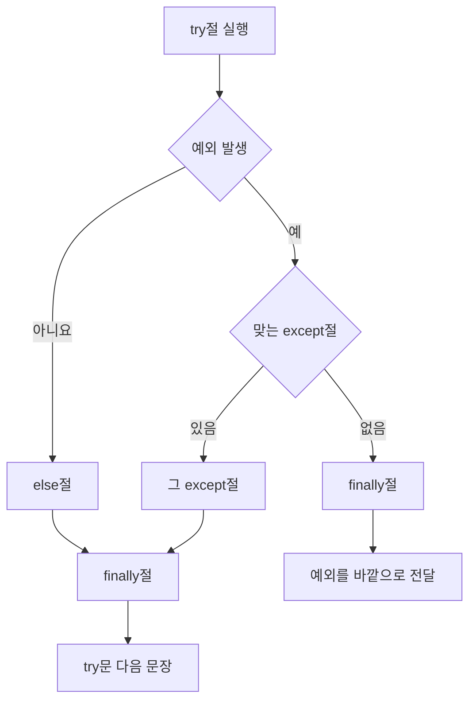
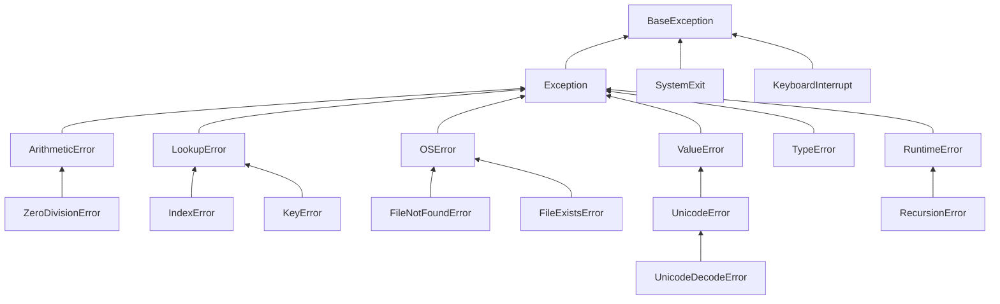

# 11강 — 예외 처리

[레포지토리 안내](../../README.ko.md) | [English](Concepts_Lecture.md) | [한국어](Concepts_Lecture.ko.md)

> **최종 수정일:** 2026-11-19

> **학습 목표:**
> 1. 구문 오류와 예외를 구분하고, 트레이스백을 아래에서 위로 읽어 예외의 종류, 일어난 위치, 호출 경로를 찾을 수 있다
> 2. `try`, `except`, `else`, `finally`의 실행 순서를 추적하고 처리할 예외를 구체적으로 지정할 수 있다
> 3. 예외 클래스의 계층을 설명하고, `except`절의 순서와 모든 예외를 잡을 때의 위험을 판단할 수 있다
> 4. `raise`문으로 예외를 일으키고, 사용자 정의 예외 클래스를 만들며, 예외를 연결할 수 있다
> 5. EAFP 방식과 LBYL 방식을 비교하여 상황에 맞는 방식을 고를 수 있다
> 6. `finally`와 `with`문으로 예외가 나도 자원이 정리되게 하고, 컨텍스트 관리자의 동작을 설명할 수 있다

---

## 목차

- [1. 오류와 예외](#1-오류와-예외)
  - [1.1 구문 오류](#11-구문-오류)
  - [1.2 예외](#12-예외)
  - [1.3 트레이스백 읽기](#13-트레이스백-읽기)
  - [1.4 예외 객체](#14-예외-객체)
- [2. try와 except](#2-try와-except)
  - [2.1 try문의 기본 형태](#21-try문의-기본-형태)
  - [2.2 처리되지 않는 예외](#22-처리되지-않는-예외)
  - [2.3 여러 예외의 처리](#23-여러-예외의-처리)
  - [2.4 호출을 거슬러 올라가는 예외](#24-호출을-거슬러-올라가는-예외)
  - [2.5 올바른 입력을 받을 때까지 반복하기](#25-올바른-입력을-받을-때까지-반복하기)
  - [2.6 처리기가 할 수 있는 일](#26-처리기가-할-수-있는-일)
- [3. else와 finally](#3-else와-finally)
  - [3.1 else절](#31-else절)
  - [3.2 finally절](#32-finally절)
  - [3.3 네 절의 실행 순서](#33-네-절의-실행-순서)
- [4. 예외의 계층](#4-예외의-계층)
  - [4.1 예외 클래스의 상속 관계](#41-예외-클래스의-상속-관계)
  - [4.2 except절의 순서](#42-except절의-순서)
  - [4.3 모든 예외를 잡을 때의 위험](#43-모든-예외를-잡을-때의-위험)
- [5. 예외 일으키기](#5-예외-일으키기)
  - [5.1 raise문](#51-raise문)
  - [5.2 예외 다시 일으키기](#52-예외-다시-일으키기)
  - [5.3 사용자 정의 예외](#53-사용자-정의-예외)
  - [5.4 예외의 연결](#54-예외의-연결)
  - [5.5 assert문](#55-assert문)
- [6. EAFP와 LBYL](#6-eafp와-lbyl)
  - [6.1 두 가지 방식](#61-두-가지-방식)
  - [6.2 방식을 고르는 기준](#62-방식을-고르는-기준)
  - [6.3 반환값으로 알리기와 예외로 알리기](#63-반환값으로-알리기와-예외로-알리기)
- [7. 자원의 정리](#7-자원의-정리)
  - [7.1 finally로 정리하기](#71-finally로-정리하기)
  - [7.2 with문과 컨텍스트 관리자](#72-with문과-컨텍스트-관리자)
  - [7.3 예외를 무시해도 되는 경우](#73-예외를-무시해도-되는-경우)
  - [7.4 여러 자원의 정리 순서](#74-여러-자원의-정리-순서)
- [개념 적용](#개념-적용)
- [요약](#요약)
- [점검 문제](#점검-문제)
- [참고 문헌](#참고-문헌)

---

<br>

## 1. 오류와 예외

### 1.1 구문 오류

파이썬 프로그램의 오류는 크게 두 종류이다 [1]. 첫째는 프로그램이 파이썬의 문법에 맞지 않는 **구문 오류(syntax error)** 이다. 파이썬은 프로그램을 실행하기 전에 전체를 읽어 바이트코드로 번역하는데([1강](../Lec01_Computer-Architecture-and-Introduction-to-Python/Concepts_Lecture.ko.md)), 이 단계에서 문법에 어긋난 곳을 발견하면 한 줄도 실행하지 않고 멈춘다.

```python
print("프로그램 시작")
if 3 > 2
    print("크다")
```

```text
  File "syntax_err.py", line 2
    if 3 > 2
            ^
SyntaxError: expected ':'
```

1행의 `print()`는 문법에 맞지만 실행되지 않았다. 2행의 `if`문 끝에 콜론이 없다는 것을 번역 단계에서 발견했기 때문이다. `^`는 파이썬이 문제를 발견한 위치이다. 구문 오류는 프로그램을 고쳐야만 없앨 수 있으며, 이 단원에서 배우는 예외 처리로 처리할 수 없다.

### 1.2 예외

> **용어 정의:** **예외(exception)** 는 문법에 맞는 프로그램을 실행하는 도중에 정상적으로 계속할 수 없는 상황이 생겼음을 알리는 객체이다. 예외가 생기는 것을 예외가 **발생한다(raise)** 고 한다.

```python
print("프로그램 시작")
x = 10 / 0
print("이 줄은 실행되지 않는다")
```

```text
프로그램 시작
Traceback (most recent call last):
  File "runtime_err.py", line 2, in <module>
    x = 10 / 0
        ~~~^~~
ZeroDivisionError: division by zero
```

이번에는 1행이 실행되어 `프로그램 시작`이 출력되었다. 2행을 실행하는 순간 0으로 나누는 예외가 발생했고, 아무도 그 예외를 처리하지 않았으므로 프로그램이 그 자리에서 멈추었다. 처리되지 않은 예외는 프로그램을 끝내지만, 예외가 반드시 프로그램을 끝내는 것은 아니다. 2절부터는 예외를 **처리하여(handle)** 프로그램을 계속하는 방법을 다룬다.

예외는 클래스의 객체이다. 파이썬에는 상황마다 미리 정의된 예외 클래스가 있으며, 자주 만나는 것은 다음과 같다 [2].

| 예외 | 발생하는 상황 | 예 | 메시지 |
|:-----|:-----|:-----|:-----|
| `ZeroDivisionError` | 0으로 나눈다 | `10 / 0` | `division by zero` |
| `ValueError` | 자료형은 맞지만 값이 알맞지 않다 | `int('3.5')` | `invalid literal for int() with base 10: '3.5'` |
| `TypeError` | 연산이나 함수에 맞지 않는 자료형을 썼다 | `'나이: ' + 20` | `can only concatenate str (not "int") to str` |
| `NameError` | 정의되지 않은 이름을 썼다 | `undefined_name` | `name 'undefined_name' is not defined` |
| `IndexError` | 시퀀스의 범위 밖 인덱스를 썼다 | `[1, 2, 3][3]` | `list index out of range` |
| `KeyError` | 딕셔너리에 없는 키를 찾았다 | `{'a': 1}['b']` | `'b'` |
| `AttributeError` | 객체에 없는 속성을 찾았다 | `'abc'.push('d')` | `'str' object has no attribute 'push'` |
| `FileNotFoundError` | 없는 파일을 읽기로 열었다 | `open('없는파일.txt')` | `[Errno 2] No such file or directory: '없는파일.txt'` |

*표 1. 자주 만나는 내장 예외*

예외의 이름은 무엇이 잘못되었는지를, 메시지는 구체적인 값을 알려 준다. `ValueError`와 `TypeError`의 구분은 특히 중요하다. `int('3.5')`는 문자열을 받는 `int()`에 문자열을 주었으므로 자료형은 맞지만 그 값이 정수의 표기가 아니어서 `ValueError`이고, `'나이: ' + 20`은 문자열과 정수라는 자료형의 조합 자체가 `+`에 맞지 않아 `TypeError`이다.

### 1.3 트레이스백 읽기

예외가 처리되지 않으면 파이썬은 **트레이스백(traceback)** 을 출력한다. 트레이스백은 예외가 발생했을 때 실행 중이던 함수 호출의 경로를 보여 준다. 다음 `trace.py`는 점수가 없는 학생에서 예외가 난다.

```python
def average(scores):
    return sum(scores) / len(scores)

def report(name, scores):
    avg = average(scores)
    print(name, "평균", avg)

report("Kim", [80, 90])
report("Lee", [])
```

```text
Kim 평균 85.0
Traceback (most recent call last):
  File "trace.py", line 9, in <module>
    report("Lee", [])
    ~~~~~~^^^^^^^^^^^
  File "trace.py", line 5, in report
    avg = average(scores)
  File "trace.py", line 2, in average
    return sum(scores) / len(scores)
           ~~~~~~~~~~~~^~~~~~~~~~~~~
ZeroDivisionError: division by zero
```

첫 줄의 `most recent call last`는 "가장 최근의 호출이 마지막에 있다"는 뜻이다. 그래서 트레이스백은 **아래에서 위로** 읽는다.

1. **마지막 줄:** 예외의 종류와 메시지이다. 0으로 나누었다(`ZeroDivisionError`).
2. **바로 위의 `File` 줄:** 예외가 실제로 발생한 곳이다. `average()` 함수의 2행이며, `~~~^~~~` 표시는 2행 가운데 `/` 연산이 실패했음을 가리킨다. 빈 리스트의 `len()`이 0이기 때문이다.
3. **그 위의 `File` 줄들:** 그 함수를 부른 곳을 거슬러 올라간다. `average()`는 `report()`의 5행에서, `report()`는 프로그램 맨 위 수준(`<module>`)의 9행에서 호출되었다.

```text
<module> 9행: report("Lee", [])          ← 맨 처음 호출 (트레이스백의 맨 위)
   └─ report() 5행: average(scores)
         └─ average() 2행: sum / len     ← 예외 발생 (트레이스백의 맨 아래)
```

*그림 1. trace.py의 트레이스백이 보여 주는 호출 경로*

원인을 고치는 곳은 예외가 발생한 줄이 아닐 수도 있다. 2행의 나눗셈 자체는 잘못이 없고, 빈 리스트를 넘긴 9행이나 빈 리스트를 대비하지 않은 `average()`의 설계가 문제이다. 트레이스백은 원인을 찾아 거슬러 올라갈 경로를 보여 준다.

> **참고:** 파이썬 3.11부터 트레이스백은 오류가 난 줄 아래에 `^`와 `~`로 정확한 식의 위치를 표시하고 [3], 3.10부터 `NameError`와 `AttributeError`에 `Did you mean: ...?` 형태의 비슷한 이름 제안과 `SyntaxError: expected ':'` 같은 구체적인 구문 오류 메시지를 보인다 [4]. 파이썬 3.7에서는 같은 오류가 이 표시 없이 파일, 줄 번호, 소스 줄, 오류 메시지만으로 나오고, 구문 오류의 메시지는 `SyntaxError: invalid syntax`처럼 더 일반적이다. 트레이스백을 아래에서 위로 읽는 방법은 어느 버전에서나 같다.

### 1.4 예외 객체

예외는 클래스의 객체이므로 속성을 가진다. `except 클래스 as e:`로 받은 예외 객체에서 정보를 꺼낼 수 있다.

```python
try:
    int("삼")
except ValueError as e:
    print(type(e), type(e).__name__)
    print(e.args)
    print(str(e))
    print(repr(e))
    print(isinstance(e, Exception))

e2 = KeyError("port")
print(e2.args, str(e2), repr(e2))
e3 = OSError(2, "No such file or directory", "a.txt")
print(e3.errno, e3.strerror, e3.filename)
print(e3)
```

```text
<class 'ValueError'> ValueError
("invalid literal for int() with base 10: '삼'",)
invalid literal for int() with base 10: '삼'
ValueError("invalid literal for int() with base 10: '삼'")
True
('port',) 'port' KeyError('port')
2 No such file or directory a.txt
[Errno 2] No such file or directory: 'a.txt'
```

- **`type(e)`:** 예외의 클래스이다. 클래스 이름 문자열은 `type(e).__name__`으로 얻는다.
- **`e.args`:** 예외를 만들 때 넘긴 인수들의 튜플이다. 대부분의 내장 예외는 메시지 하나를 담는다 [2].
- **`str(e)`와 `repr(e)`:** `str(e)`는 트레이스백의 마지막 줄에서 콜론 뒤에 나오는 메시지이고, `repr(e)`는 클래스 이름까지 붙인 표현이다. `KeyError`의 `str()`이 따옴표가 붙은 `'port'`인 것은 찾지 못한 키를 `repr()`로 보여 주기 때문이다.
- **예외마다의 속성:** `OSError`와 그 하위 클래스는 운영체제의 오류 번호 `errno`, 설명 `strerror`, 관련된 파일 이름 `filename`을 따로 가진다 [2]. 10강에서 본 `[Errno 2]`가 이 오류 번호이다.

예외 객체는 `raise`로 일으키기 전에는 보통의 객체이다. `e2 = KeyError("port")`는 예외를 만들기만 했으므로 아무 일도 일어나지 않는다. 예외를 일으키는 방법은 5절에서 다룬다.

---

<br>

## 2. try와 except

### 2.1 try문의 기본 형태

예외가 발생할 수 있는 코드를 `try`절에 두고, 그 예외가 발생했을 때 실행할 코드를 `except`절에 둔다.

```python
try:
    예외가 발생할 수 있는 코드
except 예외클래스:
    그 예외가 발생했을 때 실행할 코드
```

```python
def to_int(text):
    try:
        n = int(text)
        print("변환 성공")
    except ValueError:
        print(repr(text) + "는 정수가 아니다")
        n = 0
    print("결과:", n)
    return n

to_int("42")
to_int("4.2")
```

```text
변환 성공
결과: 42
'4.2'는 정수가 아니다
결과: 0
```

`try`문은 다음 순서로 실행된다 [1].

1. `try`절을 실행한다.
2. 예외가 발생하지 않으면 `except`절을 건너뛰고 `try`문 다음으로 간다. `to_int("42")`에서 `변환 성공`이 출력되고 `except`절은 실행되지 않았다.
3. `try`절을 실행하던 중 예외가 발생하면, 그 줄의 나머지와 `try`절의 남은 문장을 건너뛴다. `to_int("4.2")`에서 `int()`가 `ValueError`를 일으켰으므로 `print("변환 성공")`은 실행되지 않았다.
4. 발생한 예외가 `except` 뒤의 클래스와 맞으면 그 `except`절을 실행하고 `try`문 다음으로 간다. 예외는 처리되었으므로 프로그램은 계속된다.

> **용어 정의:** **예외 처리기(exception handler)** 는 특정한 종류의 예외가 발생했을 때 실행되도록 지정한 코드이며, 파이썬에서는 `except`절이 이 역할을 한다.

### 2.2 처리되지 않는 예외

`except`절은 지정한 종류의 예외만 처리한다. 다른 종류의 예외는 그대로 `try`문 밖으로 나간다.

```python
def safe_div(a, b):
    try:
        return a / b
    except ZeroDivisionError:
        print("0으로 나눌 수 없다")
        return None

print(safe_div(10, 4))
print(safe_div(10, 0))
print(safe_div(10, "2"))
```

```text
2.5
0으로 나눌 수 없다
None
Traceback (most recent call last):
  File "try_unmatched.py", line 10, in <module>
    print(safe_div(10, "2"))
          ~~~~~~~~^^^^^^^^^
  File "try_unmatched.py", line 3, in safe_div
    return a / b
           ~~^~~
TypeError: unsupported operand type(s) for /: 'int' and 'str'
```

정수를 문자열로 나누는 `TypeError`는 `except ZeroDivisionError`와 맞지 않으므로 처리되지 않았다. 처리기를 찾지 못한 예외는 `try`문을 둘러싼 바깥쪽으로 전달되고, 끝까지 처리기가 없으면 프로그램이 멈춘다 [1]. 이것은 잘못이 아니라 바람직한 동작이다. `safe_div()`는 0으로 나누는 경우만 대비했고, 숫자가 아닌 인수는 호출한 쪽의 잘못이므로 조용히 넘어가지 않는 편이 낫다.

### 2.3 여러 예외의 처리

한 `try`문에 `except`절을 여러 개 둘 수 있다. 예외가 발생하면 위에서부터 차례로 맞는 절을 찾아 **처음 맞는 절 하나만** 실행한다. `except 예외클래스 as 이름:`으로 쓰면 발생한 예외 객체가 그 이름에 연결되어, 메시지(`str(e)`)나 클래스 이름(`type(e).__name__`)을 쓸 수 있다.

```python
def parse_ratio(text):
    try:
        a, b = text.split("/")
        return int(a) / int(b)
    except ZeroDivisionError:
        return "분모가 0이다"
    except ValueError as e:
        return "형식 오류: " + str(e)

for t in ["3/4", "3/0", "3/x", "3", "1/2/3"]:
    print(t, "->", parse_ratio(t))
```

```text
3/4 -> 0.75
3/0 -> 분모가 0이다
3/x -> 형식 오류: invalid literal for int() with base 10: 'x'
3 -> 형식 오류: not enough values to unpack (expected 2, got 1)
1/2/3 -> 형식 오류: too many values to unpack (expected 2)
```

- **`"3/0"`:** 나눗셈에서 `ZeroDivisionError`가 발생하여 첫 번째 `except`절이 실행되었다.
- **`"3/x"`:** `int("x")`에서 `ValueError`가 발생했다.
- **`"3"`과 `"1/2/3"`:** `split("/")`의 결과가 한 조각, 세 조각이어서 두 변수로 풀 수 없다. 이것도 `ValueError`이므로 같은 처리기가 실행되었고, 메시지로 원인을 구별할 수 있다.

`as e`로 연결한 이름은 `except`절이 끝나면 지워진다. 예외 객체에 붙은 트레이스백이 실행 중인 함수의 지역 변수들을 붙잡아 두지 않게 하려는 규칙이다 [5]. 그래서 다음 코드의 마지막 줄은 `NameError`가 난다. 예외의 정보를 `except`절 밖에서 쓰려면 이 코드의 `message`처럼 다른 이름에 옮겨 둔다.

```python
try:
    int("x")
except ValueError as e:
    message = str(e)
print(message)
print(e)
```

```text
invalid literal for int() with base 10: 'x'
Traceback (most recent call last):
  File "as_cleared.py", line 6, in <module>
    print(e)
          ^
NameError: name 'e' is not defined
```

여러 종류를 같은 방법으로 처리하려면 클래스를 튜플로 묶는다.

```python
def get_item(seq, key):
    try:
        return seq[key]
    except (IndexError, KeyError) as e:
        print(type(e).__name__, "발생:", e)
        return None

print(get_item([10, 20], 5))
print(get_item({"a": 1}, "b"))
print(get_item([10, 20], 1))
```

```text
IndexError 발생: list index out of range
None
KeyError 발생: 'b'
None
20
```

### 2.4 호출을 거슬러 올라가는 예외

예외는 발생한 함수에서 처리되지 않으면 그 함수를 호출한 함수로, 다시 그 함수를 호출한 함수로 전달된다. 1.3절의 `trace.py`에서 `average()`가 일으킨 예외를 맨 위 수준에서 처리하면 다음과 같다.

```python
def average(scores):
    return sum(scores) / len(scores)

def report(name, scores):
    avg = average(scores)
    print(name, "평균", avg)

for name, scores in [("Kim", [80, 90]), ("Lee", []), ("Park", [70])]:
    try:
        report(name, scores)
    except ZeroDivisionError:
        print(name, "점수가 없다")
print("모든 보고 끝")
```

```text
Kim 평균 85.0
Lee 점수가 없다
Park 평균 70.0
모든 보고 끝
```

Lee의 차례에 `average()` 안에서 발생한 `ZeroDivisionError`는 `average()`와 `report()`를 차례로 빠져나와 반복문 안의 `try`문에서 처리되었다. 두 함수의 남은 문장(`report()`의 `print()`)은 실행되지 않았다. 예외가 처리된 뒤에는 반복이 계속되어 Park까지 처리된다.

```text
호출 스택이 쌓이는 방향 ↓              예외가 전달되는 방향 ↑

  맨 위 수준 (try문이 있음)  ─────────▶  여기서 except ZeroDivisionError가 처리
     report("Lee", [])                     ▲  report()의 남은 문장은 건너뜀
        average([])                        │
           sum([]) / len([])  ── 예외 발생 ┘
```

*그림 2. 예외가 호출을 거슬러 올라가 처리되는 과정*

이렇게 하면 예외를 **어디에서 처리할지** 고를 수 있다. `average()`는 빈 리스트를 어떻게 다룰지 결정할 정보가 없지만, 학생 목록을 반복하는 맨 위 수준은 "이 학생을 건너뛰고 다음으로 간다"고 결정할 수 있다. 예외를 일으키는 곳과 처리하는 곳을 나눌 수 있다는 것이 예외 처리의 가장 큰 장점이다.

> **[프로그래밍언어]** 예외가 처리기를 찾을 때까지 호출 스택의 함수들을 차례로 빠져나오는 과정을 스택 되감기(stack unwinding)라고 한다. 파이썬처럼 처리기를 실행한 뒤 예외가 발생한 지점으로 돌아가지 않고 처리기가 있는 `try`문 다음에서 계속하는 방식을 종료 모델(termination model)이라고 한다. 예외 처리 방식의 분류와 그 구현은 프로그래밍언어에서 다룬다.

### 2.5 올바른 입력을 받을 때까지 반복하기

사용자의 입력은 프로그램이 통제할 수 없으므로 예외 처리가 가장 자주 쓰이는 곳이다. 다음 프로그램은 0 이상의 정수가 들어올 때까지 나이를 다시 묻는다.

```python
while True:
    text = input("나이를 입력하시오: ")
    try:
        age = int(text)
    except ValueError:
        print("정수로 입력해야 한다")
        continue
    if age < 0:
        print("음수는 안 된다")
        continue
    break
print("입력된 나이:", age)
```

```text
나이를 입력하시오: 스물
정수로 입력해야 한다
나이를 입력하시오: -3
음수는 안 된다
나이를 입력하시오: 20
입력된 나이: 20
```

- **`int(text)`의 실패:** `"스물"`은 `ValueError`를 일으키고, 처리기는 안내를 출력한 뒤 `continue`로 다시 묻는다([5강](../Lec05_Loops/Concepts_Lecture.ko.md)).
- **값의 검사:** `-3`은 정수로 바뀌므로 예외가 없지만 나이로는 틀리다. 자료형의 문제는 예외로, 값의 범위는 `if`문으로 검사한다.
- **`break`:** 두 검사를 모두 통과해야 반복을 빠져나온다.
- **`try`절을 짧게:** `try`절에는 `int(text)` 한 줄만 두었다. `try`절이 길면 의도하지 않은 줄의 `ValueError`까지 같은 처리기가 잡는다(3.1절).

### 2.6 처리기가 할 수 있는 일

예외를 잡았다면 처리기는 그 실패에 대해 무엇인가 의미 있는 일을 해야 한다. 처리기가 할 수 있는 일은 대체로 다음 다섯 가지이다.

| 처리 방법 | 뜻 | 예 |
|:-----|:-----|:-----|
| 대체값으로 복구 | 실패한 결과 대신 정해 둔 값을 쓰고 계속한다 | 2.1절의 `to_int()`가 0을 반환 |
| 다시 시도 | 원인을 바꾸어 같은 작업을 다시 한다 | 2.5절의 입력 반복 |
| 기록하고 계속 | 실패를 기록하고 그 항목만 건너뛴다 | 2.4절의 학생 보고, 아래의 `traceback.print_exc()` |
| 기록하고 전달 | 실패를 기록한 뒤 같은 예외를 다시 일으킨다 | 5.2절의 인수 없는 `raise` |
| 다른 예외로 바꾸기 | 호출한 쪽이 이해하는 예외로 바꾸어 일으킨다 | 5.4절의 `raise ... from e` |

*표 2. 예외 처리기가 할 수 있는 일*

"기록하고 계속"할 때는 표준 모듈 `traceback`의 `print_exc()`가 유용하다. 처리 중인 예외의 트레이스백을 프로그램을 멈추지 않고 화면(표준 오류)에 출력한다.

```python
import traceback

def process(values):
    results = []
    for v in values:
        try:
            results.append(100 // v)
        except ZeroDivisionError:
            print("값", v, "을 건너뛴다. 자세한 내용:")
            traceback.print_exc()
    return results

print(process([5, 0, 20]))
```

```text
값 0 을 건너뛴다. 자세한 내용:
Traceback (most recent call last):
  File "tb_log.py", line 7, in process
    results.append(100 // v)
                   ~~~~^^~~
ZeroDivisionError: integer division or modulo by zero
[20, 5]
```

0으로 나눈 항목의 트레이스백이 출력되었지만 프로그램은 멈추지 않고 나머지 값을 처리하여 `[20, 5]`를 반환했다. 정수 나눗셈 `//`의 `ZeroDivisionError`는 메시지가 `/`와 조금 다르다.

> **주의:** `except ...: pass`처럼 아무 일도 하지 않는 처리기는 실패를 완전히 숨긴다. 무시하는 것이 옳다고 확신하는 구체적인 예외가 아니라면(7.3절), 적어도 실패를 기록하여 나중에 원인을 찾을 수 있게 한다.

---

<br>

## 3. else와 finally

### 3.1 else절

`try`문에는 `except`절 뒤에 `else`절을 둘 수 있다. `else`절은 `try`절에서 **예외가 발생하지 않았을 때만** 실행된다. `try`절에 넣을 수도 있는 코드를 `else`절로 빼는 이유는 그 코드에서 생긴 예외를 의도하지 않은 처리기가 잡지 않게 하려는 것이다 [1].

```python
def read_number(path):
    try:
        f = open(path, encoding="utf-8")
    except FileNotFoundError:
        print(path, "파일이 없다")
        return None
    else:
        with f:
            return int(f.read())

with open("n.txt", "w", encoding="utf-8") as f:
    f.write("42\n")
with open("bad.txt", "w", encoding="utf-8") as f:
    f.write("마흔둘\n")
print(read_number("n.txt"))
print(read_number("missing.txt"))
print(read_number("bad.txt"))
```

```text
42
missing.txt 파일이 없다
None
Traceback (most recent call last):
  File "else_demo.py", line 17, in <module>
    print(read_number("bad.txt"))
          ~~~~~~~~~~~^^^^^^^^^^^
  File "else_demo.py", line 9, in read_number
    return int(f.read())
ValueError: invalid literal for int() with base 10: '마흔둘\n'
```

- **`try`절:** 파일을 여는 일만 한다. 이 처리기가 대비하는 것은 "파일이 없다"는 상황뿐이다.
- **`else`절:** 파일이 열렸을 때만 실행되어 내용을 정수로 바꾼다. `with f:`는 이미 연 파일 객체를 블록이 끝날 때 닫게 한다([10강 2.3절](../Lec10_File-Input-and-Output/Concepts_Lecture.ko.md#23-with문으로-파일-닫기)). `int()`의 `ValueError`는 `try`절 밖에서 났으므로 `FileNotFoundError` 처리기와 섞이지 않고 호출한 쪽에 그대로 전달된다. `n.txt`의 내용 `'42\n'`처럼 앞뒤에 공백이나 줄바꿈이 있어도 `int()`는 그것을 무시하고 변환한다.
- **`bad.txt`의 결과:** 파일은 있지만 내용이 정수가 아니라는 것은 "파일이 없다"와 다른 문제이므로, 다른 처리기가 맡거나 프로그램을 멈추는 것이 맞다.

### 3.2 finally절

`finally`절은 `try`문을 빠져나갈 때 **예외의 발생 여부와 관계없이 항상** 실행된다. 예외가 처리되지 않고 바깥으로 나가는 경우에도, `try`절이나 `except`절에서 `return`으로 함수를 끝내는 경우에도 실행된다 [5]. 그래서 파일을 닫거나 연결을 끊는 것처럼 반드시 해야 하는 정리 작업을 둔다(7.1절).

```python
def f():
    try:
        print("try에서 return")
        return "try의 값"
    finally:
        print("finally 실행")

print(f())

def g():
    try:
        return 1
    finally:
        return 2

print(g())
```

```text
try에서 return
finally 실행
try의 값
2
```

`f()`는 `try`절에서 `return`했지만, 함수가 실제로 끝나기 전에 `finally`절이 실행되어 `finally 실행`이 먼저 출력되었다. 반환값은 `try`절의 것이 그대로 전달된다.

> **주의:** `g()`처럼 `finally`절에 `return`을 쓰면 그 값이 `try`절의 반환값을 덮어쓴다. 더 나쁜 것은 `try`절에서 처리되지 않은 예외가 발생했더라도 `finally`의 `return`이 그 예외를 버린다는 점이다 [5]. 예외가 조용히 사라지므로, `finally`절에는 정리 작업만 두고 `return`, `break`, `continue`를 쓰지 않는다.

### 3.3 네 절의 실행 순서

네 절을 모두 가진 `try`문으로 경우마다 실행되는 절을 확인한다.

```python
def run(x):
    print("--- x =", repr(x))
    try:
        print("1. try 시작")
        value = 10 / int(x)
        print("2. try 끝, value =", value)
    except ValueError:
        print("3. except ValueError")
    else:
        print("4. else")
    finally:
        print("5. finally")
    print("6. try문 다음")

run("5")
run("abc")
run("0")
```

```text
--- x = '5'
1. try 시작
2. try 끝, value = 2.0
4. else
5. finally
6. try문 다음
--- x = 'abc'
1. try 시작
3. except ValueError
5. finally
6. try문 다음
--- x = '0'
1. try 시작
5. finally
Traceback (most recent call last):
  File "order.py", line 17, in <module>
    run("0")
    ~~~^^^^^
  File "order.py", line 5, in run
    value = 10 / int(x)
            ~~~^~~~~~~~
ZeroDivisionError: division by zero
```

| 경우 | 실행되는 절 | `try`문 다음 |
|:-----|:-----|:-----|
| 예외가 발생하지 않음 (`"5"`) | `try` 전체 → `else` → `finally` | 실행된다 |
| 처리되는 예외 (`"abc"`, `ValueError`) | `try`의 앞부분 → `except` → `finally` | 실행된다 |
| 처리되지 않는 예외 (`"0"`, `ZeroDivisionError`) | `try`의 앞부분 → `finally` → 예외가 바깥으로 | 실행되지 않는다 |

*표 3. 경우에 따라 try문에서 실행되는 절*

세 번째 경우에 주목할 필요가 있다. `finally`절은 처리되지 않은 예외가 바깥으로 나가기 **직전에** 실행된다. 파이썬은 예외를 잠시 보관해 두고 `finally`절을 실행한 뒤, 그 끝에서 보관한 예외를 다시 일으킨다 [5]. 그래서 `5. finally`가 트레이스백보다 먼저 출력되었다.



*그림 3. try, except, else, finally의 실행 흐름*

---

<br>

## 4. 예외의 계층

### 4.1 예외 클래스의 상속 관계

예외 클래스들은 [9강](../Lec09_Inheritance-and-Polymorphism/Concepts_Lecture.ko.md)의 상속으로 계층을 이룬다. 모든 예외의 최상위 클래스는 `BaseException`이고, 프로그램이 처리할 만한 일반적인 예외는 모두 그 하위 클래스인 `Exception`을 상속한다 [2].



*그림 4. 내장 예외 클래스 계층의 일부*

`except`절은 발생한 예외가 지정한 클래스**이거나 그 하위 클래스이면** 맞는 것으로 본다 [5]. 9강의 `isinstance()`와 같은 판정이다. 그래서 상위 클래스를 지정하면 그 아래의 여러 예외를 한꺼번에 처리할 수 있다.

```python
def lookup(container, key):
    try:
        return container[key]
    except LookupError as e:
        return "찾지 못함 (" + type(e).__name__ + ")"

print(lookup([1, 2, 3], 10))
print(lookup({"a": 1}, "z"))
print(issubclass(KeyError, LookupError), issubclass(FileNotFoundError, OSError))
print([c.__name__ for c in FileNotFoundError.__mro__])
```

```text
찾지 못함 (IndexError)
찾지 못함 (KeyError)
True True
['FileNotFoundError', 'OSError', 'Exception', 'BaseException', 'object']
```

리스트의 `IndexError`와 딕셔너리의 `KeyError`는 모두 `LookupError`의 하위 클래스이므로 `except LookupError` 하나로 처리되었다. 10강에서 만난 `FileNotFoundError`와 `FileExistsError`는 `OSError`의 하위 클래스이며, 운영체제가 알린 오류는 대부분 `OSError` 계열이다. 1.4절의 `UnicodeDecodeError`가 `ValueError`의 하위 클래스라는 점도 기억해 둘 필요가 있다. 파일을 읽는 코드의 `except ValueError`는 인코딩 오류까지 잡는다.

### 4.2 except절의 순서

`except`절은 위에서부터 검사되고 처음 맞는 절 하나만 실행되므로, 상위 클래스의 절을 먼저 쓰면 그 아래의 하위 클래스 절은 영원히 실행되지 않는다.

```python
def classify(path):
    try:
        with open(path, encoding="utf-8") as f:
            return f.read()
    except OSError:
        return "OSError로 처리"
    except FileNotFoundError:
        return "FileNotFoundError로 처리"

print(classify("missing.txt"))

def classify2(path):
    try:
        with open(path, encoding="utf-8") as f:
            return f.read()
    except FileNotFoundError:
        return "FileNotFoundError로 처리"
    except OSError:
        return "OSError로 처리"

print(classify2("missing.txt"))
print(classify2("."))
```

```text
OSError로 처리
FileNotFoundError로 처리
OSError로 처리
```

`classify()`에서 `FileNotFoundError`는 `OSError`의 하위 클래스이므로 첫 절에 걸려, 두 번째 절은 실행될 기회가 없다. `classify2()`처럼 **구체적인 클래스를 먼저**, 일반적인 클래스를 나중에 쓴다. 폴더 `"."`를 파일처럼 열면 `FileNotFoundError`가 아닌 다른 `OSError`가 발생하여 두 번째 절이 처리했다. 이 결과를 얻은 macOS와 리눅스에서는 폴더를 열 수 없다는 `IsADirectoryError`이고, Windows에서는 접근이 거부되었다는 `PermissionError`이며, 둘 다 `OSError`의 하위 클래스이다.

### 4.3 모든 예외를 잡을 때의 위험

`except Exception:`은 거의 모든 예외를, 클래스를 쓰지 않은 `except:`는 `BaseException`까지 모든 예외를 잡는다. 편리해 보이지만 프로그램의 잘못을 숨긴다.

```python
def total_price(items):
    try:
        total = 0
        for name, price in items:
            total += pirce              # 오타: price
        return total
    except Exception:
        return 0

print(total_price([("펜", 1000), ("공책", 2500)]))
```

```text
0
```

변수 이름의 오타 때문에 `NameError`가 발생했지만, `except Exception`이 그것을 잡아 0을 반환했다. 합계가 0으로 나오는 이유를 찾기 어렵다. 처리기가 없었다면 다음 트레이스백이 오타의 위치와 고칠 이름까지 알려 주었을 것이다.

```text
Traceback (most recent call last):
  File "broad2.py", line 7, in <module>
    print(total_price([("펜", 1000), ("공책", 2500)]))
          ~~~~~~~~~~~^^^^^^^^^^^^^^^^^^^^^^^^^^^^^^^^
  File "broad2.py", line 4, in total_price
    total += pirce
             ^^^^^
NameError: name 'pirce' is not defined. Did you mean: 'price'?
```

클래스를 쓰지 않은 `except:`는 더 위험하다. `SystemExit`(프로그램 종료 요청)와 `KeyboardInterrupt`(사용자가 Ctrl+C를 누름)는 일부러 `Exception`이 아니라 `BaseException`의 직접 하위 클래스로 두어 `except Exception`에 걸리지 않게 했는데 [2], `except:`는 이것들까지 잡는다.

```python
import sys

try:
    sys.exit("종료 요청")
except:
    print("종료 요청까지 삼켰다")
print("프로그램이 계속된다")

try:
    sys.exit("종료 요청")
except Exception:
    print("이 줄은 실행되지 않는다")
print("이 줄도 실행되지 않는다")
```

```text
종료 요청까지 삼켰다
프로그램이 계속된다
종료 요청
```

`sys.exit()`는 `SystemExit` 예외를 일으켜 프로그램을 끝낸다. 첫 `try`문의 `except:`는 이것을 잡아 프로그램이 끝나지 않았다. 두 번째 `try`문의 `except Exception`은 `SystemExit`를 잡지 않으므로 예외가 그대로 나가 프로그램이 끝났고, 인수로 준 메시지가 출력되었다.

> **핵심:** 처리할 수 있는 예외만, 가능한 한 구체적인 클래스로, 가능한 한 짧은 `try`절에서 잡는다. 처리 방법을 모르는 예외는 잡지 않고 호출한 쪽으로 보내는 것이 올바른 처리이다.

> **[시스템프로그래밍]** 터미널에서 Ctrl+C를 누르면 운영체제가 실행 중인 프로세스에 인터럽트 시그널(SIGINT)을 보내고, 파이썬 인터프리터는 이 시그널을 받아 `KeyboardInterrupt` 예외로 바꾸어 일으킨다. 시그널의 종류, 시그널 처리기, 프로세스의 종료 상태(위의 `sys.exit()`가 남긴 종료 코드 1)는 시스템프로그래밍에서 다룬다.

---

<br>

## 5. 예외 일으키기

### 5.1 raise문

예외는 파이썬이 일으키기만 하는 것이 아니다. 함수가 받은 값으로 일을 계속할 수 없을 때, 함수는 `raise`문으로 직접 예외를 일으켜 호출한 쪽에 알린다.

```python
raise 예외클래스("메시지")
```

```python
def set_age(age):
    if not isinstance(age, int):
        raise TypeError("나이는 정수여야 한다: " + repr(age))
    if age < 0:
        raise ValueError("나이는 음수일 수 없다: " + str(age))
    return age

print(set_age(20))
try:
    set_age(-5)
except ValueError as e:
    print("ValueError:", e)
try:
    set_age("20")
except TypeError as e:
    print("TypeError:", e)
set_age(-1)
```

```text
20
ValueError: 나이는 음수일 수 없다: -5
TypeError: 나이는 정수여야 한다: '20'
Traceback (most recent call last):
  File "raise1.py", line 17, in <module>
    set_age(-1)
    ~~~~~~~^^^^
  File "raise1.py", line 5, in set_age
    raise ValueError("나이는 음수일 수 없다: " + str(age))
ValueError: 나이는 음수일 수 없다: -1
```

- **예외 객체 만들기:** `ValueError("...")`는 메시지를 가진 예외 객체를 만들고, `raise`가 그것을 일으킨다. `raise`가 실행되면 함수의 나머지는 실행되지 않는다.
- **알맞은 클래스:** 자료형이 틀리면 `TypeError`, 자료형은 맞지만 값이 틀리면 `ValueError`를 쓴다. 표 1의 내장 예외와 같은 뜻으로 쓰면 호출한 쪽이 그 의미를 바로 안다.
- **반환값과의 비교:** [8강 7.3절](../Lec08_Classes-and-Objects/Concepts_Lecture.ko.md#73-접근자와-설정자)의 설정자는 잘못된 값을 받으면 안내만 출력하고 돌아갔다. 그러면 호출한 쪽은 값이 거부되었다는 사실을 모른 채 계속 진행한다. 예외를 일으키면 호출한 쪽이 처리하거나, 처리하지 않으면 프로그램이 멈추므로 잘못이 묻히지 않는다.

### 5.2 예외 다시 일으키기

`except`절 안에서 클래스 없이 `raise`만 쓰면 지금 처리하고 있는 예외를 그대로 다시 일으킨다 [6]. 예외가 났다는 기록만 남기고 실제 처리는 호출한 쪽에 맡길 때 쓴다.

```python
def load_count(path):
    try:
        with open(path, encoding="utf-8") as f:
            return int(f.read())
    except ValueError:
        print("기록: 파일", path, "의 내용이 정수가 아니다")
        raise

with open("count.txt", "w", encoding="utf-8") as f:
    f.write("열\n")
load_count("count.txt")
```

```text
기록: 파일 count.txt 의 내용이 정수가 아니다
Traceback (most recent call last):
  File "reraise.py", line 11, in <module>
    load_count("count.txt")
    ~~~~~~~~~~^^^^^^^^^^^^^
  File "reraise.py", line 4, in load_count
    return int(f.read())
ValueError: invalid literal for int() with base 10: '열\n'
```

처리기가 기록을 출력한 뒤 같은 `ValueError`가 다시 일어나 트레이스백에 원래 발생 위치(4행)가 그대로 나타난다. `raise ValueError(...)`로 새 예외를 만들면 원래 위치와 메시지가 바뀌므로, 같은 예외를 전달할 때는 인수 없는 `raise`를 쓴다.

### 5.3 사용자 정의 예외

프로그램에 고유한 오류 상황은 직접 정의한 예외 클래스로 나타낸다. 예외 클래스는 `Exception`이나 그 하위 클래스를 상속하여 만들고, 이름은 내장 예외처럼 `Error`로 끝낸다 [1].

> **용어 정의:** **사용자 정의 예외(user-defined exception)** 는 프로그램이 `Exception`이나 그 하위 클래스를 상속하여 직접 정의한 예외 클래스이다.

```python
class BankError(Exception):
    """은행 계좌 작업의 모든 오류의 상위 클래스"""

class InsufficientFundsError(BankError):
    def __init__(self, balance, amount):
        super().__init__("잔액 " + str(balance) + "원, 요청 " + str(amount) + "원")
        self.balance = balance
        self.amount = amount

    def shortage(self):
        return self.amount - self.balance

class Account:
    def __init__(self, balance):
        self.balance = balance

    def withdraw(self, amount):
        if amount <= 0:
            raise ValueError("출금액은 양수여야 한다")
        if amount > self.balance:
            raise InsufficientFundsError(self.balance, amount)
        self.balance -= amount

acc = Account(10000)
for amount in [3000, 9000, -1]:
    try:
        acc.withdraw(amount)
        print(amount, "출금 성공, 잔액", acc.balance)
    except InsufficientFundsError as e:
        print("출금 실패:", e, "/ 부족액", e.shortage())
    except ValueError as e:
        print("잘못된 요청:", e)
print(issubclass(InsufficientFundsError, BankError), isinstance(InsufficientFundsError(1, 2), Exception))
acc.withdraw(50000)
```

```text
3000 출금 성공, 잔액 7000
출금 실패: 잔액 7000원, 요청 9000원 / 부족액 2000
잘못된 요청: 출금액은 양수여야 한다
True True
Traceback (most recent call last):
  File "custom.py", line 34, in <module>
    acc.withdraw(50000)
    ~~~~~~~~~~~~^^^^^^^
  File "custom.py", line 21, in withdraw
    raise InsufficientFundsError(self.balance, amount)
InsufficientFundsError: 잔액 7000원, 요청 50000원
```

- **`BankError`:** 본체가 독스트링뿐인 클래스이다. 이 프로그램의 모든 은행 오류의 상위 클래스로 두면 `except BankError` 하나로 은행 관련 오류를 모두 처리할 수 있다(4.1절).
- **생성자:** `super().__init__(메시지)`로 `Exception`의 생성자에 메시지를 넘기면 `str(e)`와 트레이스백에 그 메시지가 나온다. 잔액과 요청액은 인스턴스 변수로 저장한다.
- **처리기에서 정보 쓰기:** 처리기는 예외 객체의 속성과 메서드(`e.shortage()`)로 부족액 2000원을 계산하여 사용자에게 알린다. 메시지 문자열을 잘라 해석하는 것보다 안전하다.
- **`ValueError`와의 구분:** 음수 출금은 "값이 틀렸다"는 일반적인 의미이므로 내장 `ValueError`를, 잔액 부족은 이 프로그램에 고유한 상황이므로 새 클래스를 썼다.

예외 클래스를 설계할 때는 몇 가지 관례를 따른다. 프로그램이나 모듈마다 `BankError` 같은 공통 상위 클래스를 하나 두면, 호출한 쪽은 "이 모듈에서 온 실패"를 한꺼번에 잡을 수도 있고 `InsufficientFundsError`처럼 하나만 골라 잡을 수도 있다. 예외 클래스 자체는 단순하게 두고, 처리기가 판단에 쓸 정보만 속성으로 담는다 [1]. 메시지는 사람이 읽는 설명이므로, 처리기가 메시지 문자열의 내용에 따라 동작을 바꾸게 하지 않는다.

> **주의:** 사용자 정의 예외는 `BaseException`이 아니라 `Exception`을 상속한다 [2]. `BaseException`을 바로 상속하면 `except Exception`으로 잡히지 않아, 4.3절의 `SystemExit`처럼 일반적인 처리기를 모두 통과해 버린다.

### 5.4 예외의 연결

예외를 처리하는 도중에 다른 예외를 일으키면, 파이썬은 두 예외의 관계를 기록하고 트레이스백에 둘 다 보여 준다 [2]. 낮은 수준의 예외(`KeyError`)를 그 프로그램의 뜻에 맞는 예외(`ConfigError`)로 바꾸어 전달할 때는 `raise 새예외 from 원래예외`로 원인을 명시한다.

```python
class ConfigError(Exception):
    pass

def read_port(settings):
    try:
        return int(settings["port"])
    except KeyError as e:
        raise ConfigError("설정에 port가 없다") from e

read_port({"host": "localhost"})
```

```text
Traceback (most recent call last):
  File "chain.py", line 6, in read_port
    return int(settings["port"])
               ~~~~~~~~^^^^^^^^
KeyError: 'port'

The above exception was the direct cause of the following exception:

Traceback (most recent call last):
  File "chain.py", line 10, in <module>
    read_port({"host": "localhost"})
    ~~~~~~~~~^^^^^^^^^^^^^^^^^^^^^^^
  File "chain.py", line 8, in read_port
    raise ConfigError("설정에 port가 없다") from e
ConfigError: 설정에 port가 없다
```

두 트레이스백 사이의 문장은 "위의 예외가 아래 예외의 직접적인 원인이었다"는 뜻이다. `from e`로 지정한 원인은 새 예외의 `__cause__` 속성에 저장된다 [6]. 호출한 쪽은 `except ConfigError`로 처리하면서도, 필요하면 원래의 `KeyError`를 확인할 수 있다.

`from` 없이 처리기 안에서 예외가 생기면 문장이 다르다.

```python
def read_port(settings):
    try:
        return int(settings["port"])
    except KeyError:
        print("기본 포트를 찾는다")
        return int(settings["default_port"])

read_port({"host": "localhost"})
```

```text
기본 포트를 찾는다
Traceback (most recent call last):
  File "chain_implicit.py", line 3, in read_port
    return int(settings["port"])
               ~~~~~~~~^^^^^^^^
KeyError: 'port'

During handling of the above exception, another exception occurred:

Traceback (most recent call last):
  File "chain_implicit.py", line 8, in <module>
    read_port({"host": "localhost"})
    ~~~~~~~~~^^^^^^^^^^^^^^^^^^^^^^^
  File "chain_implicit.py", line 6, in read_port
    return int(settings["default_port"])
               ~~~~~~~~^^^^^^^^^^^^^^^^
KeyError: 'default_port'
```

"위의 예외를 처리하는 도중에 다른 예외가 발생했다"는 문장은 처리기 자체에 잘못이 있었음을 알린다. 이 경우 원래 예외는 새 예외의 `__context__` 속성에 저장된다 [2]. 두 문장을 구별하면 트레이스백만 보고도 "의도적으로 바꾼 예외"인지 "처리기에서 생긴 새 사고"인지 알 수 있다.

### 5.5 assert문

`assert 조건, 메시지`는 조건이 거짓이면 `AssertionError`를 일으킨다. 함수의 입력이 아니라 **프로그램 내부에서 항상 참이어야 하는 가정**을 확인하는 데 쓴다.

```python
def mean(values):
    assert len(values) > 0, "빈 리스트의 평균은 정의되지 않는다"
    return sum(values) / len(values)

print(mean([2, 4, 9]))
mean([])
```

```text
5.0
Traceback (most recent call last):
  File "assert_demo.py", line 6, in <module>
    mean([])
    ~~~~^^^^
  File "assert_demo.py", line 2, in mean
    assert len(values) > 0, "빈 리스트의 평균은 정의되지 않는다"
           ^^^^^^^^^^^^^^^
AssertionError: 빈 리스트의 평균은 정의되지 않는다
```

같은 프로그램을 최적화 옵션 `-O`를 주어 `python -O assert_demo.py`로 실행하면 `assert`문이 아예 실행되지 않는다 [6]. 그래서 빈 리스트가 그대로 나눗셈까지 가서 `ZeroDivisionError`가 난다.

```text
5.0
Traceback (most recent call last):
  File "assert_demo.py", line 6, in <module>
    mean([])
    ~~~~^^^^
  File "assert_demo.py", line 3, in mean
    return sum(values) / len(values)
           ~~~~~~~~~~~~^~~~~~~~~~~~~
ZeroDivisionError: division by zero
```

> **주의:** `assert`는 꺼질 수 있으므로 사용자의 입력이나 파일의 내용처럼 프로그램 밖에서 온 값을 검사하는 데 쓰지 않는다. 그런 값은 5.1절처럼 `if`문과 `raise ValueError(...)`로 검사한다. `assert`는 "이 줄에 왔다면 리스트는 이미 정렬되어 있어야 한다"처럼 프로그램의 논리가 맞는지 확인하는 용도이다.

---

<br>

## 6. EAFP와 LBYL

### 6.1 두 가지 방식

실패할 수 있는 작업을 다루는 방식은 두 가지이다.

> **용어 정의:** **LBYL(Look Before You Leap)** 은 작업을 하기 전에 그 작업이 성공할 조건을 `if`문으로 먼저 검사하는 방식이다 [7].

> **용어 정의:** **EAFP(Easier to Ask for Forgiveness than Permission)** 는 작업이 성공한다고 가정하고 먼저 시도한 뒤, 실패하면 예외를 처리하는 방식이다 [7].

LBYL은 "뛰기 전에 살펴라", EAFP는 "허락을 구하기보다 용서를 구하는 편이 쉽다"는 뜻이다. 파이썬 공식 문서는 EAFP를 파이썬에서 흔한 방식으로, LBYL을 C 같은 언어에서 흔한 방식으로 소개한다 [7]. 딕셔너리에서 값을 찾는 일을 두 방식으로 쓰면 다음과 같다.

```python
prices = {"펜": 1000, "공책": 2500}

def price_lbyl(name):
    if name in prices:
        return prices[name]
    return None

def price_eafp(name):
    try:
        return prices[name]
    except KeyError:
        return None

print(price_lbyl("펜"), price_lbyl("자"))
print(price_eafp("펜"), price_eafp("자"))
print(prices.get("자"), prices.get("자", 0))
```

```text
1000 None
1000 None
None 0
```

두 함수의 결과는 같다. 이처럼 자주 쓰이는 경우에는 딕셔너리의 `get(키, 기본값)`처럼 실패를 대신 처리해 주는 메서드가 이미 있으므로 그것을 쓰는 것이 가장 간단하다([7강 11.2절](../Lec07_Lists-and-Dictionaries/Concepts_Lecture.ko.md#112-값의-조회)).

### 6.2 방식을 고르는 기준

두 방식의 차이는 미리 하는 검사가 실제 작업의 성공을 **정확히** 보장하는지에서 드러난다. 문자열이 정수인지 `isdigit()`으로 먼저 검사하는 LBYL 방식과 `int()`를 시도하는 EAFP 방식을 비교한다.

```python
def to_int_lbyl(text):
    if text.isdigit():
        return int(text)
    return None

def to_int_eafp(text):
    try:
        return int(text)
    except ValueError:
        return None

for t in ["42", "-5", " 7 ", "3.0", "²"]:
    print(repr(t), to_int_lbyl(t), to_int_eafp(t))
```

```text
'42' 42 42
'-5' None -5
' 7 ' None 7
'3.0' None None
Traceback (most recent call last):
  File "isdigit.py", line 13, in <module>
    print(repr(t), to_int_lbyl(t), to_int_eafp(t))
                   ~~~~~~~~~~~^^^
  File "isdigit.py", line 3, in to_int_lbyl
    return int(text)
ValueError: invalid literal for int() with base 10: '²'
```

- **검사가 너무 엄격한 경우:** `int()`는 부호와 앞뒤 공백을 허용하므로 `"-5"`와 `" 7 "`을 변환할 수 있지만, `isdigit()`은 숫자가 아닌 문자가 있으면 거짓이므로 LBYL 함수는 이것들을 거부했다.
- **검사가 너무 느슨한 경우:** 위 첨자 `"²"`는 `isdigit()`이 숫자로 인정하지만 [8], `int()`는 변환하지 못한다. 그래서 LBYL 함수는 검사를 통과한 뒤 `int()`에서 예외를 내고 멈추었다.
- **EAFP의 장점:** `int()`가 성공하는 조건은 `int()` 자신이 가장 정확히 안다. 시도하고 실패를 처리하면 검사와 실제 작업이 어긋날 수 없다.

파일을 다룰 때는 시간의 문제도 있다. `if Path(p).exists():`로 확인한 다음 줄에서 `open(p)`을 하는 사이에 다른 프로그램이 파일을 지우면, 검사를 통과했는데도 `FileNotFoundError`가 난다. 검사와 사용 사이에 상태가 바뀔 수 있으면 EAFP만이 안전하다.

| 기준 | LBYL이 알맞은 경우 | EAFP가 알맞은 경우 |
|:-----|:-----|:-----|
| 검사의 정확성 | 간단한 조건이 성공을 정확히 보장한다 (예: `x != 0`) | 성공 조건이 복잡하여 작업 자신만 정확히 안다 (예: 문자열의 정수 변환) |
| 상태의 변화 | 검사와 사용 사이에 상태가 바뀌지 않는다 | 파일, 네트워크처럼 다른 프로그램이 상태를 바꿀 수 있다 |
| 실패의 빈도 | 실패가 흔하다 (예외를 일으키고 처리하는 비용이 `if`문의 검사보다 크다) | 실패가 드물다 (예외가 나지 않으면 `try`의 비용은 작다) |
| 읽기 쉬움 | 조건이 처리의 일부로 자연스럽다 (예: 나이의 범위 검사) | 정상 경로와 실패 처리를 분리하면 읽기 쉽다 |

*표 4. LBYL과 EAFP를 고르는 기준*

2.5절의 나이 입력은 두 방식을 함께 썼다. 정수로 바뀌는지는 `int()`에 맡기고(EAFP), 범위는 `if age < 0`으로 검사했다(LBYL). 정수 변환의 성공 조건은 복잡하지만 범위의 조건은 간단하고 정확하기 때문이다.

### 6.3 반환값으로 알리기와 예외로 알리기

함수가 실패를 알리는 방법에는 예외 말고도 `None`이나 -1 같은 특별한 반환값이 있다. 문자열의 두 메서드 `find()`와 `index()`는 같은 일을 두 방법으로 한다 [8].

```python
s = "banana"
print(s.find("n"), s.find("z"))
pos = s.find("z")
print(s[pos])
print(s.index("n"))
print(s.index("z"))
```

```text
2 -1
a
2
Traceback (most recent call last):
  File "find_index.py", line 6, in <module>
    print(s.index("z"))
          ~~~~~~~^^^^^
ValueError: substring not found
```

`find()`는 찾지 못하면 -1을 반환하고, `index()`는 `ValueError`를 일으킨다. 반환값 방식의 위험은 셋째 줄에 있다. 찾지 못했다는 뜻의 -1을 확인하지 않고 인덱스로 쓰자, 파이썬의 음수 인덱스 규칙에 따라 마지막 문자 `'a'`가 아무 오류 없이 나왔다. 실패가 정상적인 값처럼 보여 다음 계산으로 흘러간 것이다.

`None`을 반환하는 함수도 같은 문제를 가진다.

```python
prices = {"펜": 1000, "공책": 2500}

def price_of(name):
    if name in prices:
        return prices[name]
    return None

cart = ["펜", "자", "공책"]
subtotal = []
for item in cart:
    subtotal.append(price_of(item))
print(subtotal)
print(sum(subtotal))
```

```text
[1000, None, 2500]
Traceback (most recent call last):
  File "none_return.py", line 13, in <module>
    print(sum(subtotal))
          ~~~^^^^^^^^^^
TypeError: unsupported operand type(s) for +: 'int' and 'NoneType'
```

가격이 없는 `"자"`의 `None`은 리스트에 들어갔다가 `sum()`에서야 `TypeError`를 일으켰다. 트레이스백은 13행을 가리키지만 원인은 가격을 찾던 4행 근처에 있다. `price_of()`가 찾지 못한 순간 `KeyError`를 일으켰다면 트레이스백이 원인의 위치를 바로 가리켰을 것이다.

| 방법 | 장점 | 단점 |
|:-----|:-----|:-----|
| 특별한 반환값 (`None`, -1) | 실패가 흔하고 예상된 결과일 때 간단하다 (`dict.get()`, `str.find()`) | 호출한 쪽이 검사를 빠뜨리면 실패가 정상적인 값처럼 퍼진다 |
| 예외 | 처리하지 않으면 멈추므로 실패가 묻히지 않고, 처리하는 곳을 고를 수 있다 | 실패가 흔하면 `try`문이 많아지고 비용이 든다 |

*표 5. 실패를 알리는 두 방법의 비교*

"찾지 못함"이 흔한 결과이고 호출한 쪽이 매번 그것을 다룬다면 반환값이, 실패가 드물고 그대로 진행하면 잘못된 결과를 낳는다면 예외가 알맞다. C 언어처럼 예외가 없는 언어는 반환값과 오류 번호로 실패를 알리므로, 모든 호출 뒤에 검사 코드를 써야 한다.

---

<br>

## 7. 자원의 정리

### 7.1 finally로 정리하기

파일, 네트워크 연결, 잠금처럼 쓰고 나면 반드시 돌려주어야 하는 것을 **자원(resource)** 이라고 한다. 예외가 나도 자원이 정리되게 하려면 정리 코드를 `finally`절에 둔다.

```python
def first_number(path):
    f = open(path, encoding="utf-8")
    try:
        return int(f.readline())
    finally:
        f.close()
        print("파일을 닫았다:", f.closed)

with open("nums.txt", "w", encoding="utf-8") as f:
    f.write("7\n8\n")
with open("words.txt", "w", encoding="utf-8") as f:
    f.write("일곱\n")
print(first_number("nums.txt"))
print(first_number("words.txt"))
```

```text
파일을 닫았다: True
7
파일을 닫았다: True
Traceback (most recent call last):
  File "finally_close.py", line 14, in <module>
    print(first_number("words.txt"))
          ~~~~~~~~~~~~^^^^^^^^^^^^^
  File "finally_close.py", line 4, in first_number
    return int(f.readline())
ValueError: invalid literal for int() with base 10: '일곱\n'
```

정상적으로 `return`할 때도, `int()`가 예외를 낼 때도 `finally`절이 실행되어 파일이 닫혔다. `open()`을 `try`절 밖에 둔 것에도 이유가 있다. `open()` 자체가 실패하면 닫을 파일이 없으므로, `finally`절의 `f.close()`가 실행되어서는 안 된다.

### 7.2 with문과 컨텍스트 관리자

10강의 `with open(...) as f:`는 7.1절의 `try`와 `finally`를 짧게 쓴 것이다 [1]. `with`문이 다루는 객체를 **컨텍스트 관리자(context manager)** 라고 하며, 두 특수 메서드를 가진다 [5].

1. `with`문이 시작될 때 컨텍스트 관리자의 `__enter__()`를 호출하고, 그 반환값을 `as` 뒤의 이름에 연결한다.
2. 블록을 실행한다.
3. 블록이 어떻게 끝나든 `__exit__(exc_type, exc_value, traceback)`을 호출한다. 예외로 끝났으면 세 인수에 예외의 클래스, 예외 객체, 트레이스백이, 정상적으로 끝났으면 세 `None`이 전달된다.
4. 예외로 끝났을 때 `__exit__()`가 거짓을 반환하면 예외가 다시 일어나 바깥으로 나가고, 참을 반환하면 예외가 없어진다.

파일 객체의 `__exit__()`는 파일을 닫고 거짓을 반환한다. 그래서 `with` 블록 안의 예외는 파일을 닫은 뒤 그대로 바깥으로 전달된다. 같은 규칙으로 컨텍스트 관리자를 직접 만들 수 있다.

```python
class Section:
    def __init__(self, name):
        self.name = name

    def __enter__(self):
        print("[" + self.name + " 시작]")
        return self

    def __exit__(self, exc_type, exc_value, traceback):
        if exc_type is None:
            print("[" + self.name + " 정상 종료]")
        else:
            print("[" + self.name + " 예외로 종료: " + exc_type.__name__ + "]")
        return False                       # 예외를 삼키지 않는다

with Section("계산") as s:
    print("본체:", s.name)
    print(10 / 2)

try:
    with Section("나눗셈"):
        print(10 / 0)
        print("이 줄은 실행되지 않는다")
except ZeroDivisionError:
    print("바깥에서 ZeroDivisionError를 처리했다")
```

```text
[계산 시작]
본체: 계산
5.0
[계산 정상 종료]
[나눗셈 시작]
[나눗셈 예외로 종료: ZeroDivisionError]
바깥에서 ZeroDivisionError를 처리했다
```

- **`__enter__()`:** 시작을 알리고 자기 자신을 반환하므로 `as s`의 `s`는 그 `Section` 객체이다.
- **정상 종료:** 블록이 끝나면 `__exit__()`가 `exc_type`으로 `None`을 받아 정상 종료를 알린다.
- **예외 종료:** `10 / 0`의 예외로 블록이 중단되자 `__exit__()`가 예외의 클래스를 받았다. 거짓을 반환했으므로 예외는 `with`문 밖으로 나가 바깥의 `try`문에서 처리되었다.
- **정리의 보장:** 블록이 어떻게 끝나든 `__exit__()`가 호출되므로, 정리 코드를 `__exit__()`에 두면 `finally`를 쓰는 것과 같은 효과가 있다.

### 7.3 예외를 무시해도 되는 경우

간혹 예외를 처리할 방법이 "아무것도 하지 않기"인 경우가 있다. 임시 파일을 지우려는데 이미 없다면 목적은 이미 이루어진 것이다. 이럴 때 `except FileNotFoundError: pass`를 쓰거나, 표준 모듈 `contextlib`의 `suppress()`를 쓴다 [9].

```python
from contextlib import suppress
from pathlib import Path

Path("temp.txt").write_text("임시\n", encoding="utf-8")
with suppress(FileNotFoundError):
    Path("temp.txt").unlink()
    print("한 번 지웠다")
with suppress(FileNotFoundError):
    Path("temp.txt").unlink()
    print("이 줄은 실행되지 않는다")
print("프로그램 계속")
```

```text
한 번 지웠다
프로그램 계속
```

`suppress(FileNotFoundError)`는 블록 안에서 그 예외가 나면 `__exit__()`가 참을 반환하는 컨텍스트 관리자이다. 두 번째 `unlink()`에서 예외가 나자 블록의 나머지를 건너뛰고 `with`문 다음으로 갔다. 예외를 없애는 모든 방법과 마찬가지로, 조용히 넘어가는 것이 옳다고 확신하는 구체적인 예외에만 쓴다 [9].

> **참고:** 파이썬 3.11부터 예외 객체에 `add_note(문자열)`로 설명을 덧붙이면 트레이스백의 마지막 줄 아래에 그 설명이 함께 출력된다 [3]. 예를 들어 파일의 각 줄을 해석하다 `ValueError`가 나면 처리기에서 `e.add_note("파일의 2번째 줄: 'Lee 구십'")`을 호출하고 `raise`로 다시 일으켜, 어느 줄이 문제였는지 트레이스백에 남길 수 있다. 같은 버전에서 여러 예외를 한꺼번에 일으키는 `ExceptionGroup`과 그것을 처리하는 `except*`도 추가되었다 [3]. 파이썬 3.7에는 두 기능이 모두 없으므로, 3.7에서는 5.4절처럼 정보를 담은 새 예외를 `from`으로 연결한다.

### 7.4 여러 자원의 정리 순서

한 `with`문에 컨텍스트 관리자를 여러 개 쓰면, 왼쪽부터 차례로 `__enter__()`가 호출되고 블록이 끝나면 **반대 순서로** `__exit__()`가 호출된다.

```python
class Section:
    def __init__(self, name):
        self.name = name

    def __enter__(self):
        print("[" + self.name + " 시작]")
        return self

    def __exit__(self, exc_type, exc_value, traceback):
        print("[" + self.name + " 끝]")
        return False

with Section("A"), Section("B"):
    print("본체")
```

```text
[A 시작]
[B 시작]
본체
[B 끝]
[A 끝]
```

`with A, B:`는 `with A:` 안에 `with B:`를 중첩한 것과 같다. 나중에 얻은 자원이 먼저 얻은 자원에 기대는 경우가 많으므로(예: 연결을 연 뒤 그 연결로 파일을 연다), 나중에 얻은 것부터 돌려주는 것이 안전하다. 10강 4.3절에서 원본과 결과 파일을 한 `with`문으로 열었을 때도 결과 파일이 먼저 닫힌 뒤 원본 파일이 닫혔다. 어느 `__enter__()`가 예외를 내면, 그때까지 성공한 컨텍스트 관리자의 `__exit__()`만 반대 순서로 호출된다.

---

<br>

## 개념 적용

예외를 다룰 때는 무엇이 실패할 수 있는지, 그 실패를 어디에서 누가 처리할 수 있는지를 먼저 정한다.

| 상황 | 처리 방법 |
|:-----|:-----|
| 사용자에게 정수를 입력받는다. | `while True` 안에서 `int()`를 `try`로 감싸 `ValueError`이면 다시 묻고, 범위는 `if`문으로 검사한다(2.5절). |
| 설정 파일이 없으면 기본 설정으로 시작하고 싶다. | `open()`을 `try`로 감싸 `FileNotFoundError`를 처리한다. 파일이 있지만 JSON 문법이 틀린 경우(`json.JSONDecodeError`, `ValueError`의 하위 클래스)는 다른 처리기로 구분한다. |
| 함수가 음수 금액을 받으면 계속할 수 없다. | 함수 안에서 `raise ValueError("...")`로 알리고, 처리는 호출한 쪽에 맡긴다(5.1절). |
| 계좌의 잔액 부족처럼 프로그램에 고유한 실패를 구별하고 싶다. | `Exception`을 상속한 `InsufficientFundsError`를 정의하고 필요한 정보를 속성으로 담는다(5.3절). |
| 라이브러리의 `KeyError`를 "설정이 잘못되었다"는 뜻으로 바꾸어 알리고 싶다. | `raise ConfigError(...) from e`로 원인을 연결한다(5.4절). |
| 여러 파일을 처리하다 한 파일에서 실패해도 나머지는 계속하고 싶다. | 파일마다 처리하는 반복문의 안쪽에 `try`문을 두고, 실패한 파일의 이름을 기록한다(2.4절). |
| 반드시 닫아야 하는 자원을 쓴다. | `with`문을 쓰고, `with`를 지원하지 않는 자원은 `try`와 `finally`로 닫는다(7절). |
| 문자열에서 구분자의 위치를 찾아 그 앞부분을 잘라 낸다. | 구분자가 반드시 있어야 하면 `index()`로 찾아 없을 때 `ValueError`가 나게 하고, 없을 수도 있으면 `find()`의 -1을 바로 검사한다(6.3절). |

*표 6. 상황에 맞는 예외 처리 방법*

**T/F 점검:**

| 문장 | 판단과 근거 |
|:-----|:-----|
| 구문 오류도 `try`와 `except`로 처리할 수 있다. | **F.** 구문 오류는 실행 전 번역 단계에서 발견되므로 `try`문 자체가 실행되지 않는다(1.1절). |
| 트레이스백의 맨 아래 `File` 줄이 예외가 실제로 발생한 위치이다. | **T.** 가장 최근의 호출이 마지막에 나오므로 맨 아래가 예외가 발생한 곳이고, 위로 갈수록 그 함수를 부른 곳이다(1.3절). |
| `except ValueError:` 절은 `UnicodeDecodeError`도 처리한다. | **T.** `UnicodeDecodeError`는 `UnicodeError`를 거쳐 `ValueError`를 상속하므로 맞는 것으로 판정된다(4.1절). |
| `else`절은 `except`절이 실행된 뒤에 실행된다. | **F.** `else`절은 `try`절에서 예외가 발생하지 않았을 때만 실행된다(3.1절). |
| 처리되지 않은 예외가 발생하면 `finally`절은 실행되지 않는다. | **F.** `finally`절은 예외가 바깥으로 나가기 직전에도 실행된다(3.3절). |
| `except:`와 `except Exception:`은 같은 예외를 잡는다. | **F.** `except:`는 `SystemExit`, `KeyboardInterrupt`까지 잡지만 `except Exception:`은 잡지 않는다(4.3절). |
| 사용자의 입력을 검사하는 데 `assert`를 쓰면 안전하다. | **F.** `-O` 옵션으로 실행하면 `assert`문이 실행되지 않으므로 검사가 사라진다(5.5절). |
| `with A, B:` 블록이 끝나면 `A`의 `__exit__()`가 먼저 호출된다. | **F.** 나중에 들어간 `B`의 `__exit__()`가 먼저, `A`의 것이 나중에 호출된다(7.4절). |

---

<br>

## 요약

| 개념 | 핵심 요약 |
|:-----|:-----|
| 구문 오류 | 실행 전 번역 단계에서 발견되는 문법 오류이며, 한 줄도 실행되지 않고 예외 처리로 처리할 수 없다. |
| 예외 | 실행 중 정상적으로 계속할 수 없음을 알리는 객체이며, 처리되지 않으면 트레이스백을 출력하고 프로그램을 끝낸다. |
| 트레이스백 | 아래에서 위로 읽으며, 마지막 줄은 예외의 종류와 메시지, 그 위는 발생 위치와 그 함수를 부른 호출 경로이다. |
| `try`와 `except` | `try`절에서 예외가 나면 남은 문장을 건너뛰고 처음 맞는 `except`절을 실행하며, 맞는 절이 없으면 예외가 바깥으로 전달된다. |
| 예외의 전달 | 처리기를 찾을 때까지 호출한 함수들로 거슬러 올라가므로, 예외를 일으키는 곳과 처리하는 곳을 나눌 수 있다. |
| `else`절 | 예외가 없을 때만 실행되며, `try`절을 짧게 유지하여 의도하지 않은 예외를 잡지 않게 한다. |
| `finally`절 | 예외 여부나 `return`과 관계없이 항상 실행되며, 처리되지 않은 예외는 `finally`가 끝난 뒤 다시 일어난다. |
| 예외의 계층 | `except`절은 지정한 클래스와 그 하위 클래스를 잡으므로 구체적인 절을 먼저 쓰고, `except:`나 `except Exception:`은 잘못을 숨긴다. |
| `raise`문 | 함수가 계속할 수 없을 때 알맞은 예외 클래스로 호출한 쪽에 알리며, 인수 없는 `raise`는 처리 중인 예외를 다시 일으킨다. |
| 사용자 정의 예외 | `Exception`을 상속하여 이름을 `Error`로 끝내고, 처리에 필요한 정보를 속성으로 담는다. |
| 예외의 연결 | `raise 새예외 from 원인`은 원인을 `__cause__`에, 처리기 안에서 생긴 예외는 원래 예외를 `__context__`에 기록한다. |
| `assert`문 | 프로그램 내부의 가정을 확인하며, `-O`로 실행하면 사라지므로 외부 입력의 검사에 쓰지 않는다. |
| EAFP와 LBYL | 미리 검사하는 LBYL은 조건이 간단하고 정확할 때, 시도하고 처리하는 EAFP는 성공 조건이 복잡하거나 상태가 바뀔 수 있을 때 알맞다. |
| 컨텍스트 관리자 | `with`문은 `__enter__()`로 시작하고 블록이 어떻게 끝나든 `__exit__()`를 호출하며, `__exit__()`가 참을 반환하면 예외가 없어진다. |

---

<br>

## 점검 문제

1. **트레이스백:** 다음 트레이스백에서 예외의 종류, 예외가 발생한 함수와 줄, 맨 처음 호출이 일어난 줄을 쓰라.

   ```text
   Traceback (most recent call last):
     File "shop.py", line 12, in <module>
       checkout(cart)
     File "shop.py", line 8, in checkout
       total += price_of(item)
     File "shop.py", line 3, in price_of
       return PRICES[item]
   KeyError: '지우개'
   ```

   <details>
   <summary>정답</summary>

   예외는 `KeyError`이고, 딕셔너리 `PRICES`에 키 `'지우개'`가 없다는 뜻이다. 예외는 맨 아래 `File` 줄인 `price_of()` 함수의 3행에서 발생했다. 거슬러 올라가면 `price_of()`는 `checkout()`의 8행에서, `checkout()`은 맨 위 수준의 12행에서 호출되었으므로 맨 처음 호출은 12행이다.

   </details>

2. **실행 순서:** 다음 함수에 `"7"`, `"x"`, `None`을 넣었을 때 출력되는 줄을 각각 쓰라.

   ```python
   def h(v):
       try:
           n = int(v)
       except ValueError:
           print("A")
       else:
           print("B", n)
       finally:
           print("C")
       print("D")
   ```

   <details>
   <summary>정답</summary>

   `"7"`은 예외가 없으므로 `B 7`, `C`, `D`이다. `"x"`는 `ValueError`가 처리되므로 `A`, `C`, `D`이다. `None`은 `int(None)`이 `TypeError`를 일으키는데 이를 처리하는 절이 없으므로, `C`만 출력된 뒤 `TypeError`가 함수 밖으로 나가고 `D`는 출력되지 않는다.

   </details>

3. **except절의 순서:** 다음 코드는 `ZeroDivisionError`가 나도 항상 `"산술 오류"`를 출력한다. 이유를 설명하고 고쳐라.

   ```python
   try:
       x = 1 / 0
   except ArithmeticError:
       print("산술 오류")
   except ZeroDivisionError:
       print("0으로 나눔")
   ```

   <details>
   <summary>정답</summary>

   `ZeroDivisionError`는 `ArithmeticError`의 하위 클래스이므로 첫 번째 절에 걸리고, 처음 맞는 절 하나만 실행되므로 두 번째 절은 실행될 수 없다. 구체적인 `except ZeroDivisionError:` 절을 `except ArithmeticError:` 절보다 위에 쓰면 `"0으로 나눔"`이 출력된다.

   </details>

4. **처리할 곳:** 파일 이름의 리스트를 받아 각 파일의 첫 줄을 출력하는 함수에서, 없는 파일이 하나 있어도 나머지 파일은 출력하게 하려면 `try`문을 어디에 두어야 하는가? 반복문 전체를 감쌀 때와 비교하라.

   <details>
   <summary>정답</summary>

   반복문 **안**에서 파일 하나를 여는 부분을 `try`로 감싸고 `except FileNotFoundError`에서 그 파일을 건너뛰어야 한다. 그러면 예외가 처리된 뒤 반복이 다음 파일로 계속된다. 반복문 전체를 `try`로 감싸면 첫 번째로 없는 파일에서 예외가 반복문을 빠져나가 그 뒤의 파일은 처리되지 않는다.

   </details>

5. **사용자 정의 예외:** 재고보다 많은 수량을 주문하면 `OutOfStockError`를 일으키는 `order(stock, qty)`를 작성하라. 예외는 재고와 주문 수량을 속성으로 가지고, `except Exception`으로도 잡혀야 한다.

   <details>
   <summary>정답</summary>

   ```python
   class OutOfStockError(Exception):
       def __init__(self, stock, qty):
           super().__init__("재고 " + str(stock) + "개, 주문 " + str(qty) + "개")
           self.stock = stock
           self.qty = qty

   def order(stock, qty):
       if qty > stock:
           raise OutOfStockError(stock, qty)
       return stock - qty
   ```

   `Exception`을 상속했으므로 `except Exception`으로도 잡힌다. 처리기는 `e.stock`과 `e.qty`로 부족한 수량을 계산할 수 있다. `order(3, 5)`는 `OutOfStockError: 재고 3개, 주문 5개`를 일으킨다.

   </details>

6. **예외의 연결:** 트레이스백의 두 예외 사이에 "The above exception was the direct cause of the following exception:"이 나올 때와 "During handling of the above exception, another exception occurred:"가 나올 때의 차이를 설명하라.

   <details>
   <summary>정답</summary>

   앞의 문장은 `raise 새예외 from 원래예외`로 원인을 명시했을 때 나오며, 프로그래머가 의도적으로 예외를 바꾸어 전달했다는 뜻이다. 원래 예외는 `__cause__`에 저장된다. 뒤의 문장은 `except`절이나 `finally`절을 실행하는 도중에 `from` 없이 새 예외가 생겼을 때 나오며, 대개 처리기 자체에 잘못이 있었다는 뜻이다. 원래 예외는 `__context__`에 저장된다.

   </details>

7. **EAFP와 LBYL:** 리스트 `items`의 `i`번 요소를 가져오되 범위 밖이면 `None`을 반환하는 함수를 LBYL과 EAFP 방식으로 각각 쓰라. `i`가 음수일 때 두 함수의 동작이 같은지 확인하라.

   <details>
   <summary>정답</summary>

   ```python
   def get_lbyl(items, i):
       if 0 <= i < len(items):
           return items[i]
       return None

   def get_eafp(items, i):
       try:
           return items[i]
       except IndexError:
           return None
   ```

   두 함수는 `i`가 음수일 때 다르게 동작한다. `get_lbyl([1, 2, 3], -1)`은 조건 `0 <= i`가 거짓이므로 `None`이지만, `get_eafp([1, 2, 3], -1)`은 파이썬의 음수 인덱스로 마지막 요소 3을 반환한다. LBYL의 검사 조건이 실제 작업의 성공 조건과 다를 수 있다는 6.2절의 예이며, 어느 동작이 원하는 것인지 먼저 정해야 한다.

   </details>

8. **컨텍스트 관리자:** 7.2절의 `Section` 클래스에서 `__exit__()`가 `True`를 반환하도록 바꾸면 `with Section("나눗셈"): print(10 / 0)`은 어떻게 동작하는가? 이렇게 바꾸는 것이 왜 위험한지 설명하라.

   <details>
   <summary>정답</summary>

   `__exit__()`가 참을 반환하면 예외가 없어지므로, `[나눗셈 예외로 종료: ZeroDivisionError]`가 출력된 뒤 `with`문 다음 문장이 정상적으로 실행된다. 바깥의 `try`문은 예외를 받지 못한다. 이 컨텍스트 관리자는 블록 안의 **모든** 예외를 삼키므로, 4.3절의 `except Exception: pass`처럼 프로그램의 잘못까지 숨긴다. 예외를 없애는 컨텍스트 관리자는 `suppress()`처럼 특정한 예외만 대상으로 해야 한다.

   </details>

9. **반환값과 예외:** `line = "name=Kim"`에서 `=` 앞의 키를 얻으려고 `key = line[:line.find("=")]`라고 썼다. `line`이 `"nameKim"`처럼 `=`가 없는 문자열이면 `key`는 무엇이 되는가? 이 잘못이 드러나게 고쳐라.

   <details>
   <summary>정답</summary>

   `find()`가 -1을 반환하므로 `line[:-1]`이 되어 `key`는 마지막 문자를 뺀 `"nameKi"`이다. 오류 없이 잘못된 키가 만들어진다. `line.index("=")`를 쓰면 `=`가 없을 때 `ValueError: substring not found`가 나서 잘못이 바로 드러난다. `=`가 없는 줄을 건너뛰어야 한다면 `try`문으로 그 `ValueError`를 처리하거나, `find()`의 결과가 -1인지 먼저 검사한다.

   </details>

10. **처리기의 선택:** 1,000개의 측정값 파일을 차례로 처리하는 프로그램에서, 형식이 틀린 파일을 만났을 때 (1) 프로그램 전체를 멈추어야 하는 경우와 (2) 그 파일만 건너뛰어야 하는 경우의 예를 하나씩 들고, 각각에 알맞은 처리 방법을 표 2에서 골라라.

    <details>
    <summary>정답</summary>

    (1) 모든 파일이 같은 실험의 일부여서 하나라도 틀리면 전체 결과를 믿을 수 없다면 멈추어야 한다. 이때는 처리기를 두지 않거나 "기록하고 전달"(인수 없는 `raise`)로 어느 파일이 문제인지 남긴 뒤 예외를 그대로 내보낸다. (2) 파일마다 독립된 측정이어서 틀린 파일을 빼고도 나머지 결과가 의미 있다면 "기록하고 계속"이 알맞다. 반복문 안의 `try`문에서 그 파일의 이름과 `traceback.print_exc()`의 트레이스백을 기록하고 다음 파일로 간다.

    </details>

---

<br>

## 참고 문헌

1. Python Software Foundation, "Errors and Exceptions," *The Python Tutorial*, Python 3.13. https://docs.python.org/3.13/tutorial/errors.html
2. Python Software Foundation, "Built-in Exceptions," *The Python Standard Library*, Python 3.13. https://docs.python.org/3.13/library/exceptions.html
3. Python Software Foundation, "What's New In Python 3.11," *Python 3.13 Documentation*. https://docs.python.org/3.13/whatsnew/3.11.html
4. Python Software Foundation, "What's New In Python 3.10," *Python 3.13 Documentation*. https://docs.python.org/3.13/whatsnew/3.10.html
5. Python Software Foundation, "Compound statements," *The Python Language Reference*, Python 3.13. https://docs.python.org/3.13/reference/compound_stmts.html
6. Python Software Foundation, "Simple statements," *The Python Language Reference*, Python 3.13. https://docs.python.org/3.13/reference/simple_stmts.html
7. Python Software Foundation, "Glossary," *Python 3.13 Documentation*. https://docs.python.org/3.13/glossary.html
8. Python Software Foundation, "Built-in Types," *The Python Standard Library*, Python 3.13. https://docs.python.org/3.13/library/stdtypes.html
9. Python Software Foundation, "contextlib - Utilities for with-statement contexts," *The Python Standard Library*, Python 3.13. https://docs.python.org/3.13/library/contextlib.html
