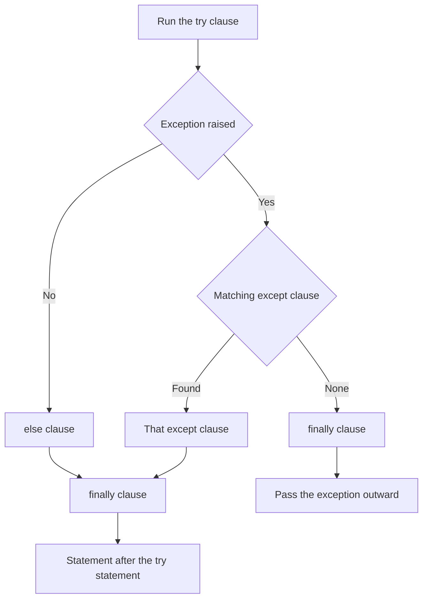
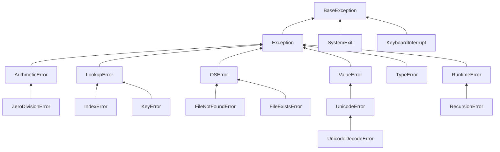

# Lecture 11 — Exception Handling

[Repository Guide](../../README.md) | [English](Concepts_Lecture.md) | [한국어](Concepts_Lecture.ko.md)

> **Last Updated:** 2026-11-19

> **Learning Objectives:**
> 1. Distinguish syntax errors from exceptions, and read a traceback from the bottom up to find the kind of exception, where it occurred, and the call path
> 2. Trace the order of execution of `try`, `except`, `else`, and `finally`, and specify precisely the exceptions to be handled
> 3. Explain the hierarchy of exception classes, and judge the order of `except` clauses and the danger of catching every exception
> 4. Raise exceptions with the `raise` statement, create user-defined exception classes, and chain exceptions
> 5. Compare the EAFP and LBYL styles and choose the one that fits a situation
> 6. Ensure that resources are cleaned up even when exceptions occur by using `finally` and the `with` statement, and explain how context managers work

---

## Table of Contents

- [1. Errors and Exceptions](#1-errors-and-exceptions)
  - [1.1 Syntax Errors](#11-syntax-errors)
  - [1.2 Exceptions](#12-exceptions)
  - [1.3 Reading a Traceback](#13-reading-a-traceback)
  - [1.4 Exception Objects](#14-exception-objects)
- [2. try and except](#2-try-and-except)
  - [2.1 The Basic Form of the try Statement](#21-the-basic-form-of-the-try-statement)
  - [2.2 Exceptions That Are Not Handled](#22-exceptions-that-are-not-handled)
  - [2.3 Handling Several Exceptions](#23-handling-several-exceptions)
  - [2.4 Exceptions Traveling Back up the Calls](#24-exceptions-traveling-back-up-the-calls)
  - [2.5 Repeating until a Valid Input Is Received](#25-repeating-until-a-valid-input-is-received)
  - [2.6 What a Handler Can Do](#26-what-a-handler-can-do)
- [3. else and finally](#3-else-and-finally)
  - [3.1 The else Clause](#31-the-else-clause)
  - [3.2 The finally Clause](#32-the-finally-clause)
  - [3.3 The Order of Execution of the Four Clauses](#33-the-order-of-execution-of-the-four-clauses)
- [4. The Exception Hierarchy](#4-the-exception-hierarchy)
  - [4.1 Inheritance among Exception Classes](#41-inheritance-among-exception-classes)
  - [4.2 The Order of except Clauses](#42-the-order-of-except-clauses)
  - [4.3 The Danger of Catching Every Exception](#43-the-danger-of-catching-every-exception)
- [5. Raising Exceptions](#5-raising-exceptions)
  - [5.1 The raise Statement](#51-the-raise-statement)
  - [5.2 Re-raising an Exception](#52-re-raising-an-exception)
  - [5.3 User-Defined Exceptions](#53-user-defined-exceptions)
  - [5.4 Exception Chaining](#54-exception-chaining)
  - [5.5 The assert Statement](#55-the-assert-statement)
- [6. EAFP and LBYL](#6-eafp-and-lbyl)
  - [6.1 Two Styles](#61-two-styles)
  - [6.2 Criteria for Choosing a Style](#62-criteria-for-choosing-a-style)
  - [6.3 Signaling by Return Value and by Exception](#63-signaling-by-return-value-and-by-exception)
- [7. Cleaning Up Resources](#7-cleaning-up-resources)
  - [7.1 Cleaning Up with finally](#71-cleaning-up-with-finally)
  - [7.2 The with Statement and Context Managers](#72-the-with-statement-and-context-managers)
  - [7.3 When Ignoring an Exception Is Acceptable](#73-when-ignoring-an-exception-is-acceptable)
  - [7.4 The Order in Which Several Resources Are Cleaned Up](#74-the-order-in-which-several-resources-are-cleaned-up)
- [Concept Applications](#concept-applications)
- [Summary](#summary)
- [Self-Check Questions](#self-check-questions)
- [References](#references)

---

<br>

## 1. Errors and Exceptions

### 1.1 Syntax Errors

Errors in Python programs fall into two broad kinds [1]. The first is the **syntax error**, in which the program does not follow Python's grammar. Python reads the whole program and translates it into bytecode before running it ([Lecture 1](../Lec01_Computer-Architecture-and-Introduction-to-Python/Concepts_Lecture.md)), and if this stage finds a place that violates the grammar, it stops without running a single line.

```python
print("프로그램 시작")
if 3 > 2
    print("크다")
```

```text
  File "syntax_err.py", line 2
    if 3 > 2
            ^
SyntaxError: expected ':'
```

The `print()` on line 1 is grammatical, yet it did not run, because the missing colon at the end of the `if` statement on line 2 was found during translation. The `^` marks the place where Python found the problem. A syntax error can be removed only by fixing the program, and it cannot be handled with the exception handling covered in this unit.

### 1.2 Exceptions

> **Definition:** An **exception** is an object that signals, while a grammatical program is running, that a situation has arisen in which execution cannot continue normally. The occurrence of an exception is described by saying that an exception is **raised**.

```python
print("프로그램 시작")
x = 10 / 0
print("이 줄은 실행되지 않는다")
```

```text
프로그램 시작
Traceback (most recent call last):
  File "runtime_err.py", line 2, in <module>
    x = 10 / 0
        ~~~^~~
ZeroDivisionError: division by zero
```

This time line 1 ran and printed `프로그램 시작`. At the moment line 2 ran, an exception for dividing by zero was raised, and since nothing handled it, the program stopped on the spot. An unhandled exception ends the program, but an exception does not necessarily end the program. From Section 2 on, this unit covers how to **handle** exceptions and let the program continue.

Exceptions are objects of classes. Python has predefined exception classes for each situation, and the ones met most often are the following [2].

| Exception | Situation in Which It Is Raised | Example | Message |
|:-----|:-----|:-----|:-----|
| `ZeroDivisionError` | Dividing by zero | `10 / 0` | `division by zero` |
| `ValueError` | The type is right but the value is unsuitable | `int('3.5')` | `invalid literal for int() with base 10: '3.5'` |
| `TypeError` | A type unsuitable for an operation or function was used | `'나이: ' + 20` | `can only concatenate str (not "int") to str` |
| `NameError` | An undefined name was used | `undefined_name` | `name 'undefined_name' is not defined` |
| `IndexError` | An index outside the range of a sequence was used | `[1, 2, 3][3]` | `list index out of range` |
| `KeyError` | A key not in a dictionary was looked up | `{'a': 1}['b']` | `'b'` |
| `AttributeError` | An attribute the object does not have was looked up | `'abc'.push('d')` | `'str' object has no attribute 'push'` |
| `FileNotFoundError` | A missing file was opened for reading | `open('없는파일.txt')` | `[Errno 2] No such file or directory: '없는파일.txt'` |

*Table 1. Built-in exceptions met often*

The name of an exception tells what went wrong, and the message gives the specific values. The distinction between `ValueError` and `TypeError` is especially important. `int('3.5')` gives a string to `int()`, which accepts strings, so the type is right, but the value is not the notation of an integer, hence `ValueError`; in `'나이: ' + 20`, the combination of types itself, a string and an integer, does not fit `+`, hence `TypeError`.

### 1.3 Reading a Traceback

When an exception is not handled, Python prints a **traceback**. A traceback shows the path of function calls that were running when the exception was raised. The following `trace.py` raises an exception for a student with no scores.

```python
def average(scores):
    return sum(scores) / len(scores)

def report(name, scores):
    avg = average(scores)
    print(name, "평균", avg)

report("Kim", [80, 90])
report("Lee", [])
```

```text
Kim 평균 85.0
Traceback (most recent call last):
  File "trace.py", line 9, in <module>
    report("Lee", [])
    ~~~~~~^^^^^^^^^^^
  File "trace.py", line 5, in report
    avg = average(scores)
  File "trace.py", line 2, in average
    return sum(scores) / len(scores)
           ~~~~~~~~~~~~^~~~~~~~~~~~~
ZeroDivisionError: division by zero
```

The `most recent call last` on the first line means "the most recent call comes last." A traceback is therefore read **from the bottom up**.

1. **The last line:** The kind and message of the exception. A division by zero (`ZeroDivisionError`) occurred.
2. **The `File` line just above:** The place where the exception was actually raised. It is line 2 of the function `average()`, and the `~~~^~~~` marker indicates that the `/` operation on line 2 failed, because the `len()` of the empty list is 0.
3. **The `File` lines above that:** They trace back to where the function was called. `average()` was called on line 5 of `report()`, and `report()` on line 9 of the top level of the program (`<module>`).

```text
<module> line 9: report("Lee", [])       ← first call (top of the traceback)
   └─ report() line 5: average(scores)
         └─ average() line 2: sum / len   ← exception raised (bottom of the traceback)
```

*Figure 1. The call path shown by the traceback of trace.py*

The place to fix the cause may not be the line where the exception was raised. The division on line 2 is not wrong in itself; the problem is line 9, which passed an empty list, or the design of `average()`, which did not prepare for an empty list. A traceback shows the path along which to trace back in search of the cause.

> **Note:** Since Python 3.11, tracebacks mark the exact position of the expression with `^` and `~` below the failing line [3], and since 3.10, `NameError` and `AttributeError` show suggestions of similar names in the form `Did you mean: ...?`, and syntax errors have more specific messages such as `SyntaxError: expected ':'` [4]. In Python 3.7 the same errors appear without these markers, showing only the file, line number, source line, and error message, and syntax error messages are more general, as in `SyntaxError: invalid syntax`. Reading a traceback from the bottom up works the same way in every version.

### 1.4 Exception Objects

An exception is an object of a class, so it has attributes. Information can be taken from the exception object received with `except Class as e:`.

```python
try:
    int("삼")
except ValueError as e:
    print(type(e), type(e).__name__)
    print(e.args)
    print(str(e))
    print(repr(e))
    print(isinstance(e, Exception))

e2 = KeyError("port")
print(e2.args, str(e2), repr(e2))
e3 = OSError(2, "No such file or directory", "a.txt")
print(e3.errno, e3.strerror, e3.filename)
print(e3)
```

```text
<class 'ValueError'> ValueError
("invalid literal for int() with base 10: '삼'",)
invalid literal for int() with base 10: '삼'
ValueError("invalid literal for int() with base 10: '삼'")
True
('port',) 'port' KeyError('port')
2 No such file or directory a.txt
[Errno 2] No such file or directory: 'a.txt'
```

- **`type(e)`:** The class of the exception. The class name as a string is obtained with `type(e).__name__`.
- **`e.args`:** The tuple of arguments passed when the exception was created. Most built-in exceptions hold one message [2].
- **`str(e)` and `repr(e)`:** `str(e)` is the message that appears after the colon on the last line of a traceback, and `repr(e)` is the representation with the class name attached. The `str()` of a `KeyError` is `'port'` with quotes because it shows the missing key with `repr()`.
- **Per-exception attributes:** `OSError` and its subclasses have separate attributes for the operating system's error number `errno`, the description `strerror`, and the related file name `filename` [2]. The `[Errno 2]` seen in Lecture 10 is this error number.

Before it is raised with `raise`, an exception object is an ordinary object. `e2 = KeyError("port")` merely creates an exception, so nothing happens. How to raise exceptions is covered in Section 5.

---

<br>

## 2. try and except

### 2.1 The Basic Form of the try Statement

Code that may raise an exception goes in the `try` clause, and the code to run when that exception is raised goes in the `except` clause.

```python
try:
    code that may raise an exception
except ExceptionClass:
    code to run when that exception is raised
```

```python
def to_int(text):
    try:
        n = int(text)
        print("변환 성공")
    except ValueError:
        print(repr(text) + "는 정수가 아니다")
        n = 0
    print("결과:", n)
    return n

to_int("42")
to_int("4.2")
```

```text
변환 성공
결과: 42
'4.2'는 정수가 아니다
결과: 0
```

The `try` statement runs in the following order [1].

1. Run the `try` clause.
2. If no exception is raised, skip the `except` clause and go on after the `try` statement. In `to_int("42")`, `변환 성공` was printed and the `except` clause did not run.
3. If an exception is raised while the `try` clause runs, skip the rest of that line and the remaining statements of the `try` clause. In `to_int("4.2")`, `int()` raised a `ValueError`, so `print("변환 성공")` did not run.
4. If the raised exception matches the class after `except`, run that `except` clause and go on after the `try` statement. The exception has been handled, so the program continues.

> **Definition:** An **exception handler** is code designated to run when a particular kind of exception is raised; in Python the `except` clause plays this role.

### 2.2 Exceptions That Are Not Handled

An `except` clause handles only the kind of exception it names. Other kinds of exceptions leave the `try` statement unchanged.

```python
def safe_div(a, b):
    try:
        return a / b
    except ZeroDivisionError:
        print("0으로 나눌 수 없다")
        return None

print(safe_div(10, 4))
print(safe_div(10, 0))
print(safe_div(10, "2"))
```

```text
2.5
0으로 나눌 수 없다
None
Traceback (most recent call last):
  File "try_unmatched.py", line 10, in <module>
    print(safe_div(10, "2"))
          ~~~~~~~~^^^^^^^^^
  File "try_unmatched.py", line 3, in safe_div
    return a / b
           ~~^~~
TypeError: unsupported operand type(s) for /: 'int' and 'str'
```

The `TypeError` of dividing an integer by a string does not match `except ZeroDivisionError`, so it was not handled. An exception for which no handler is found is passed outward to whatever surrounds the `try` statement, and if there is no handler anywhere, the program stops [1]. This is not a defect but desirable behavior. `safe_div()` prepared only for division by zero, and a non-numeric argument is the caller's mistake, which is better not passed over silently.

### 2.3 Handling Several Exceptions

One `try` statement can have several `except` clauses. When an exception is raised, the clauses are searched from the top for a match, and **only the first matching clause** runs. Writing `except ExceptionClass as name:` binds the raised exception object to that name, so that its message (`str(e)`) or class name (`type(e).__name__`) can be used.

```python
def parse_ratio(text):
    try:
        a, b = text.split("/")
        return int(a) / int(b)
    except ZeroDivisionError:
        return "분모가 0이다"
    except ValueError as e:
        return "형식 오류: " + str(e)

for t in ["3/4", "3/0", "3/x", "3", "1/2/3"]:
    print(t, "->", parse_ratio(t))
```

```text
3/4 -> 0.75
3/0 -> 분모가 0이다
3/x -> 형식 오류: invalid literal for int() with base 10: 'x'
3 -> 형식 오류: not enough values to unpack (expected 2, got 1)
1/2/3 -> 형식 오류: too many values to unpack (expected 2)
```

- **`"3/0"`:** The division raised a `ZeroDivisionError`, so the first `except` clause ran.
- **`"3/x"`:** `int("x")` raised a `ValueError`.
- **`"3"` and `"1/2/3"`:** `split("/")` gives one piece and three pieces, which cannot be unpacked into two variables. This is also a `ValueError`, so the same handler ran, and the message distinguishes the causes.

The name bound with `as e` is deleted when the `except` clause ends. This rule prevents the traceback attached to the exception object from keeping the local variables of the running function alive [5]. Therefore the last line of the following code causes a `NameError`. To use the information of an exception outside the `except` clause, move it to another name, like `message` in this code.

```python
try:
    int("x")
except ValueError as e:
    message = str(e)
print(message)
print(e)
```

```text
invalid literal for int() with base 10: 'x'
Traceback (most recent call last):
  File "as_cleared.py", line 6, in <module>
    print(e)
          ^
NameError: name 'e' is not defined
```

To handle several kinds in the same way, group the classes in a tuple.

```python
def get_item(seq, key):
    try:
        return seq[key]
    except (IndexError, KeyError) as e:
        print(type(e).__name__, "발생:", e)
        return None

print(get_item([10, 20], 5))
print(get_item({"a": 1}, "b"))
print(get_item([10, 20], 1))
```

```text
IndexError 발생: list index out of range
None
KeyError 발생: 'b'
None
20
```

### 2.4 Exceptions Traveling Back up the Calls

An exception not handled in the function where it was raised is passed to the function that called it, and then to the function that called that one. Handling the exception raised by `average()` in `trace.py` of Section 1.3 at the top level gives the following.

```python
def average(scores):
    return sum(scores) / len(scores)

def report(name, scores):
    avg = average(scores)
    print(name, "평균", avg)

for name, scores in [("Kim", [80, 90]), ("Lee", []), ("Park", [70])]:
    try:
        report(name, scores)
    except ZeroDivisionError:
        print(name, "점수가 없다")
print("모든 보고 끝")
```

```text
Kim 평균 85.0
Lee 점수가 없다
Park 평균 70.0
모든 보고 끝
```

On Lee's turn, the `ZeroDivisionError` raised inside `average()` left `average()` and `report()` in turn and was handled by the `try` statement inside the loop. The remaining statements of the two functions (the `print()` in `report()`) did not run. After the exception was handled, the loop continued and Park was processed too.

```text
Direction in which the call stack grows ↓     Direction in which the exception travels ↑

  top level (has the try statement)  ───▶  handled here by except ZeroDivisionError
     report("Lee", [])                       ▲  rest of report() is skipped
        average([])                          │
           sum([]) / len([])  ── raised ─────┘
```

*Figure 2. An exception traveling back up the calls to be handled*

This makes it possible to choose **where** to handle an exception. `average()` has no information for deciding what to do with an empty list, but the top level, which loops over the list of students, can decide to "skip this student and move on." Being able to separate the place that raises an exception from the place that handles it is the greatest advantage of exception handling.

> **[Programming Languages]** The process of leaving the functions on the call stack one after another until a handler is found is called stack unwinding. The approach in which, as in Python, execution after the handler does not return to the point where the exception was raised but continues after the `try` statement containing the handler is called the termination model. The classification and implementation of exception-handling mechanisms are covered in Programming Languages.

### 2.5 Repeating until a Valid Input Is Received

User input is beyond the program's control, so it is where exception handling is used most often. The following program asks for an age again until an integer of 0 or more is entered.

```python
while True:
    text = input("나이를 입력하시오: ")
    try:
        age = int(text)
    except ValueError:
        print("정수로 입력해야 한다")
        continue
    if age < 0:
        print("음수는 안 된다")
        continue
    break
print("입력된 나이:", age)
```

```text
나이를 입력하시오: 스물
정수로 입력해야 한다
나이를 입력하시오: -3
음수는 안 된다
나이를 입력하시오: 20
입력된 나이: 20
```

- **The failure of `int(text)`:** `"스물"` raises a `ValueError`, and the handler prints a message and asks again with `continue` ([Lecture 5](../Lec05_Loops/Concepts_Lecture.md)).
- **Checking the value:** `-3` converts to an integer, so there is no exception, but it is wrong as an age. Problems of type are checked with exceptions and the range of values with an `if` statement.
- **`break`:** The loop is left only after both checks pass.
- **Keeping the `try` clause short:** The `try` clause holds only the single line `int(text)`. If the `try` clause were long, the same handler would also catch `ValueError`s from unintended lines (Section 3.1).

### 2.6 What a Handler Can Do

Once an exception is caught, the handler should do something meaningful about the failure. What a handler can do falls broadly into the following five kinds.

| Handling | Meaning | Example |
|:-----|:-----|:-----|
| Recover with a substitute value | Use a predetermined value in place of the failed result and continue | `to_int()` of Section 2.1 returns 0 |
| Retry | Change the cause and do the same work again | The input loop of Section 2.5 |
| Record and continue | Record the failure and skip only that item | The student report of Section 2.4, `traceback.print_exc()` below |
| Record and pass on | Record the failure and then raise the same exception again | The argument-less `raise` of Section 5.2 |
| Convert to another exception | Raise an exception that the caller understands instead | `raise ... from e` of Section 5.4 |

*Table 2. What an exception handler can do*

To "record and continue," `print_exc()` of the standard module `traceback` is useful. It prints the traceback of the exception being handled to the screen (standard error) without stopping the program.

```python
import traceback

def process(values):
    results = []
    for v in values:
        try:
            results.append(100 // v)
        except ZeroDivisionError:
            print("값", v, "을 건너뛴다. 자세한 내용:")
            traceback.print_exc()
    return results

print(process([5, 0, 20]))
```

```text
값 0 을 건너뛴다. 자세한 내용:
Traceback (most recent call last):
  File "tb_log.py", line 7, in process
    results.append(100 // v)
                   ~~~~^^~~
ZeroDivisionError: integer division or modulo by zero
[20, 5]
```

The traceback for the item that divided by zero was printed, but the program did not stop; it processed the remaining values and returned `[20, 5]`. The `ZeroDivisionError` of integer division `//` has a slightly different message from that of `/`.

> **Caution:** A handler that does nothing, as in `except ...: pass`, hides the failure completely. Unless it is a specific exception that one is sure should be ignored (Section 7.3), at least record the failure so that its cause can be found later.

---

<br>

## 3. else and finally

### 3.1 The else Clause

A `try` statement can have an `else` clause after its `except` clauses. The `else` clause runs **only when no exception was raised** in the `try` clause. The reason for moving code that could go into the `try` clause into the `else` clause is to keep exceptions raised in that code from being caught by the wrong handler [1].

```python
def read_number(path):
    try:
        f = open(path, encoding="utf-8")
    except FileNotFoundError:
        print(path, "파일이 없다")
        return None
    else:
        with f:
            return int(f.read())

with open("n.txt", "w", encoding="utf-8") as f:
    f.write("42\n")
with open("bad.txt", "w", encoding="utf-8") as f:
    f.write("마흔둘\n")
print(read_number("n.txt"))
print(read_number("missing.txt"))
print(read_number("bad.txt"))
```

```text
42
missing.txt 파일이 없다
None
Traceback (most recent call last):
  File "else_demo.py", line 17, in <module>
    print(read_number("bad.txt"))
          ~~~~~~~~~~~^^^^^^^^^^^
  File "else_demo.py", line 9, in read_number
    return int(f.read())
ValueError: invalid literal for int() with base 10: '마흔둘\n'
```

- **The `try` clause:** Only opens the file. The only situation this handler prepares for is "the file does not exist."
- **The `else` clause:** Runs only when the file was opened and converts its contents to an integer. `with f:` makes the already opened file object close when the block ends ([Lecture 10, Section 2.3](../Lec10_File-Input-and-Output/Concepts_Lecture.md#23-closing-files-with-the-with-statement)). The `ValueError` of `int()` occurred outside the `try` clause, so it does not mix with the `FileNotFoundError` handler and passes unchanged to the caller. Even with whitespace or a newline around it, as in the contents `'42\n'` of `n.txt`, `int()` ignores them and converts.
- **The result for `bad.txt`:** That the file exists but its contents are not an integer is a problem different from "the file does not exist," so it is right for another handler to take it or for the program to stop.

### 3.2 The finally Clause

The `finally` clause **always** runs when leaving the `try` statement, **regardless of whether an exception was raised**. It runs even when an exception leaves unhandled, and even when the function is ended with `return` in the `try` or `except` clause [5]. Therefore it holds cleanup work that must always be done, such as closing files or disconnecting (Section 7.1).

```python
def f():
    try:
        print("try에서 return")
        return "try의 값"
    finally:
        print("finally 실행")

print(f())

def g():
    try:
        return 1
    finally:
        return 2

print(g())
```

```text
try에서 return
finally 실행
try의 값
2
```

`f()` returned in the `try` clause, but the `finally` clause ran before the function actually ended, so `finally 실행` was printed first. The return value of the `try` clause is passed on unchanged.

> **Caution:** Writing `return` in a `finally` clause, as in `g()`, makes its value overwrite the return value of the `try` clause. Worse, even if an unhandled exception was raised in the `try` clause, the `return` in `finally` discards that exception [5]. The exception disappears silently, so put only cleanup work in `finally` clauses and do not use `return`, `break`, or `continue` there.

### 3.3 The Order of Execution of the Four Clauses

A `try` statement with all four clauses shows which clauses run in each case.

```python
def run(x):
    print("--- x =", repr(x))
    try:
        print("1. try 시작")
        value = 10 / int(x)
        print("2. try 끝, value =", value)
    except ValueError:
        print("3. except ValueError")
    else:
        print("4. else")
    finally:
        print("5. finally")
    print("6. try문 다음")

run("5")
run("abc")
run("0")
```

```text
--- x = '5'
1. try 시작
2. try 끝, value = 2.0
4. else
5. finally
6. try문 다음
--- x = 'abc'
1. try 시작
3. except ValueError
5. finally
6. try문 다음
--- x = '0'
1. try 시작
5. finally
Traceback (most recent call last):
  File "order.py", line 17, in <module>
    run("0")
    ~~~^^^^^
  File "order.py", line 5, in run
    value = 10 / int(x)
            ~~~^~~~~~~~
ZeroDivisionError: division by zero
```

| Case | Clauses That Run | After the try Statement |
|:-----|:-----|:-----|
| No exception (`"5"`) | All of `try` → `else` → `finally` | Runs |
| A handled exception (`"abc"`, `ValueError`) | The first part of `try` → `except` → `finally` | Runs |
| An unhandled exception (`"0"`, `ZeroDivisionError`) | The first part of `try` → `finally` → the exception goes outward | Does not run |

*Table 3. Clauses of a try statement that run in each case*

The third case deserves attention. The `finally` clause runs **just before** an unhandled exception goes outward. Python temporarily keeps the exception, runs the `finally` clause, and raises the kept exception again at its end [5]. That is why `5. finally` was printed before the traceback.



*Figure 3. The flow of execution of try, except, else, and finally*

---

<br>

## 4. The Exception Hierarchy

### 4.1 Inheritance among Exception Classes

Exception classes form a hierarchy through the inheritance of [Lecture 9](../Lec09_Inheritance-and-Polymorphism/Concepts_Lecture.md). The top class of all exceptions is `BaseException`, and the general exceptions a program might handle all inherit from its subclass `Exception` [2].



*Figure 4. Part of the hierarchy of built-in exception classes*

An `except` clause regards a raised exception as matching if it is the named class **or one of its subclasses** [5]. This is the same test as `isinstance()` in Lecture 9. Therefore naming a superclass handles several exceptions beneath it at once.

```python
def lookup(container, key):
    try:
        return container[key]
    except LookupError as e:
        return "찾지 못함 (" + type(e).__name__ + ")"

print(lookup([1, 2, 3], 10))
print(lookup({"a": 1}, "z"))
print(issubclass(KeyError, LookupError), issubclass(FileNotFoundError, OSError))
print([c.__name__ for c in FileNotFoundError.__mro__])
```

```text
찾지 못함 (IndexError)
찾지 못함 (KeyError)
True True
['FileNotFoundError', 'OSError', 'Exception', 'BaseException', 'object']
```

The `IndexError` of a list and the `KeyError` of a dictionary are both subclasses of `LookupError`, so one `except LookupError` handled both. The `FileNotFoundError` and `FileExistsError` met in Lecture 10 are subclasses of `OSError`, and most errors reported by the operating system belong to the `OSError` family. It is also worth remembering that the `UnicodeDecodeError` of Lecture 10, Section 1.4 is a subclass of `ValueError`. An `except ValueError` in code that reads files catches encoding errors too.

### 4.2 The Order of except Clauses

`except` clauses are tested from the top and only the first matching one runs, so if a superclass clause is written first, the subclass clauses below it never run.

```python
def classify(path):
    try:
        with open(path, encoding="utf-8") as f:
            return f.read()
    except OSError:
        return "OSError로 처리"
    except FileNotFoundError:
        return "FileNotFoundError로 처리"

print(classify("missing.txt"))

def classify2(path):
    try:
        with open(path, encoding="utf-8") as f:
            return f.read()
    except FileNotFoundError:
        return "FileNotFoundError로 처리"
    except OSError:
        return "OSError로 처리"

print(classify2("missing.txt"))
print(classify2("."))
```

```text
OSError로 처리
FileNotFoundError로 처리
OSError로 처리
```

In `classify()`, `FileNotFoundError` is a subclass of `OSError`, so it is caught by the first clause and the second clause never gets a chance to run. As in `classify2()`, write **the specific class first** and the general class later. Opening the folder `"."` like a file raises an `OSError` other than `FileNotFoundError`, so the second clause handled it. On macOS and Linux, where this result was obtained, it is an `IsADirectoryError`, saying that a folder cannot be opened, and on Windows it is a `PermissionError`, saying that access is denied; both are subclasses of `OSError`.

### 4.3 The Danger of Catching Every Exception

`except Exception:` catches almost every exception, and `except:` without a class catches every exception up to `BaseException`. This looks convenient but hides mistakes in the program.

```python
def total_price(items):
    try:
        total = 0
        for name, price in items:
            total += pirce              # typo: price
        return total
    except Exception:
        return 0

print(total_price([("펜", 1000), ("공책", 2500)]))
```

```text
0
```

A typo in a variable name raised a `NameError`, but `except Exception` caught it and returned 0. It is hard to find why the total comes out as 0. Without the handler, the following traceback would have shown the location of the typo and even the name to use instead.

```text
Traceback (most recent call last):
  File "broad2.py", line 7, in <module>
    print(total_price([("펜", 1000), ("공책", 2500)]))
          ~~~~~~~~~~~^^^^^^^^^^^^^^^^^^^^^^^^^^^^^^^^
  File "broad2.py", line 4, in total_price
    total += pirce
             ^^^^^
NameError: name 'pirce' is not defined. Did you mean: 'price'?
```

`except:` without a class is even more dangerous. `SystemExit` (a request to end the program) and `KeyboardInterrupt` (the user pressed Ctrl+C) are deliberately made direct subclasses of `BaseException` rather than of `Exception` so that `except Exception` does not catch them [2], but `except:` catches them too.

```python
import sys

try:
    sys.exit("종료 요청")
except:
    print("종료 요청까지 삼켰다")
print("프로그램이 계속된다")

try:
    sys.exit("종료 요청")
except Exception:
    print("이 줄은 실행되지 않는다")
print("이 줄도 실행되지 않는다")
```

```text
종료 요청까지 삼켰다
프로그램이 계속된다
종료 요청
```

`sys.exit()` ends the program by raising a `SystemExit` exception. The `except:` of the first `try` statement caught it, so the program did not end. The `except Exception` of the second `try` statement does not catch `SystemExit`, so the exception left unchanged, the program ended, and the message given as the argument was printed.

> **Key Point:** Catch only the exceptions that can be handled, with the most specific classes possible, in the shortest `try` clauses possible. Not catching an exception one does not know how to handle, and letting it go to the caller, is the correct handling.

> **[Systems Programming]** Pressing Ctrl+C in a terminal makes the operating system send an interrupt signal (SIGINT) to the running process, and the Python interpreter receives this signal and raises it as a `KeyboardInterrupt` exception. Kinds of signals, signal handlers, and the exit status of a process (the exit code 1 left by `sys.exit()` above) are covered in Systems Programming.

---

<br>

## 5. Raising Exceptions

### 5.1 The raise Statement

Exceptions are not raised only by Python. When a function cannot continue its work with the values it received, it raises an exception itself with the `raise` statement to inform the caller.

```python
raise ExceptionClass("message")
```

```python
def set_age(age):
    if not isinstance(age, int):
        raise TypeError("나이는 정수여야 한다: " + repr(age))
    if age < 0:
        raise ValueError("나이는 음수일 수 없다: " + str(age))
    return age

print(set_age(20))
try:
    set_age(-5)
except ValueError as e:
    print("ValueError:", e)
try:
    set_age("20")
except TypeError as e:
    print("TypeError:", e)
set_age(-1)
```

```text
20
ValueError: 나이는 음수일 수 없다: -5
TypeError: 나이는 정수여야 한다: '20'
Traceback (most recent call last):
  File "raise1.py", line 17, in <module>
    set_age(-1)
    ~~~~~~~^^^^
  File "raise1.py", line 5, in set_age
    raise ValueError("나이는 음수일 수 없다: " + str(age))
ValueError: 나이는 음수일 수 없다: -1
```

- **Creating an exception object:** `ValueError("...")` creates an exception object with a message, and `raise` raises it. Once `raise` runs, the rest of the function does not run.
- **A suitable class:** Use `TypeError` when the type is wrong and `ValueError` when the type is right but the value is wrong. Using them in the same sense as the built-in exceptions of Table 1 lets the caller understand their meaning at once.
- **Comparison with return values:** The setter of [Lecture 8, Section 7.3](../Lec08_Classes-and-Objects/Concepts_Lecture.md#73-getters-and-setters) printed a message and returned when it received a wrong value. The caller then continues without knowing that the value was rejected. Raising an exception means the caller either handles it or, if it does not, the program stops, so the mistake is not buried.

### 5.2 Re-raising an Exception

Writing only `raise`, without a class, inside an `except` clause raises the exception now being handled again, unchanged [6]. It is used to leave only a record that an exception occurred while leaving the actual handling to the caller.

```python
def load_count(path):
    try:
        with open(path, encoding="utf-8") as f:
            return int(f.read())
    except ValueError:
        print("기록: 파일", path, "의 내용이 정수가 아니다")
        raise

with open("count.txt", "w", encoding="utf-8") as f:
    f.write("열\n")
load_count("count.txt")
```

```text
기록: 파일 count.txt 의 내용이 정수가 아니다
Traceback (most recent call last):
  File "reraise.py", line 11, in <module>
    load_count("count.txt")
    ~~~~~~~~~~^^^^^^^^^^^^^
  File "reraise.py", line 4, in load_count
    return int(f.read())
ValueError: invalid literal for int() with base 10: '열\n'
```

After the handler printed the record, the same `ValueError` was raised again, and the original location (line 4) appears unchanged in the traceback. Creating a new exception with `raise ValueError(...)` would change the original location and message, so use the argument-less `raise` to pass on the same exception.

### 5.3 User-Defined Exceptions

Error situations specific to a program are represented by exception classes defined for them. An exception class is created by inheriting from `Exception` or one of its subclasses, and its name ends in `Error`, like the built-in exceptions [1].

> **Definition:** A **user-defined exception** is an exception class that a program defines itself by inheriting from `Exception` or one of its subclasses.

```python
class BankError(Exception):
    """은행 계좌 작업의 모든 오류의 상위 클래스"""

class InsufficientFundsError(BankError):
    def __init__(self, balance, amount):
        super().__init__("잔액 " + str(balance) + "원, 요청 " + str(amount) + "원")
        self.balance = balance
        self.amount = amount

    def shortage(self):
        return self.amount - self.balance

class Account:
    def __init__(self, balance):
        self.balance = balance

    def withdraw(self, amount):
        if amount <= 0:
            raise ValueError("출금액은 양수여야 한다")
        if amount > self.balance:
            raise InsufficientFundsError(self.balance, amount)
        self.balance -= amount

acc = Account(10000)
for amount in [3000, 9000, -1]:
    try:
        acc.withdraw(amount)
        print(amount, "출금 성공, 잔액", acc.balance)
    except InsufficientFundsError as e:
        print("출금 실패:", e, "/ 부족액", e.shortage())
    except ValueError as e:
        print("잘못된 요청:", e)
print(issubclass(InsufficientFundsError, BankError), isinstance(InsufficientFundsError(1, 2), Exception))
acc.withdraw(50000)
```

```text
3000 출금 성공, 잔액 7000
출금 실패: 잔액 7000원, 요청 9000원 / 부족액 2000
잘못된 요청: 출금액은 양수여야 한다
True True
Traceback (most recent call last):
  File "custom.py", line 34, in <module>
    acc.withdraw(50000)
    ~~~~~~~~~~~~^^^^^^^
  File "custom.py", line 21, in withdraw
    raise InsufficientFundsError(self.balance, amount)
InsufficientFundsError: 잔액 7000원, 요청 50000원
```

- **`BankError`:** A class whose body is only a docstring. Making it the superclass of every bank error in this program allows a single `except BankError` to handle all bank-related errors (Section 4.1).
- **The constructor:** Passing the message to the constructor of `Exception` with `super().__init__(message)` makes that message appear in `str(e)` and in the traceback. The balance and the requested amount are stored as instance variables.
- **Using the information in a handler:** The handler computes the shortage of 2000 won from the attributes and methods of the exception object (`e.shortage()`) and informs the user. This is safer than cutting up and interpreting the message string.
- **The distinction from `ValueError`:** A negative withdrawal has the general meaning "the value is wrong," so the built-in `ValueError` is used, while an insufficient balance is a situation specific to this program, so a new class is used.

Designing exception classes follows a few conventions. Giving each program or module one common superclass, like `BankError`, lets the caller catch "failures from this module" all at once or pick only one, like `InsufficientFundsError`. Keep the exception classes themselves simple, holding as attributes only the information that handlers use for decisions [1]. The message is an explanation for people to read, so do not make a handler change its behavior according to the contents of the message string.

> **Caution:** User-defined exceptions inherit from `Exception`, not from `BaseException` [2]. Inheriting directly from `BaseException` keeps them from being caught by `except Exception`, so, like the `SystemExit` of Section 4.3, they pass through every general handler.

### 5.4 Exception Chaining

When another exception is raised while an exception is being handled, Python records the relationship between the two and shows both in the traceback [2]. When converting a low-level exception (`KeyError`) into one that fits the meaning of the program (`ConfigError`), state the cause explicitly with `raise NewException from original_exception`.

```python
class ConfigError(Exception):
    pass

def read_port(settings):
    try:
        return int(settings["port"])
    except KeyError as e:
        raise ConfigError("설정에 port가 없다") from e

read_port({"host": "localhost"})
```

```text
Traceback (most recent call last):
  File "chain.py", line 6, in read_port
    return int(settings["port"])
               ~~~~~~~~^^^^^^^^
KeyError: 'port'

The above exception was the direct cause of the following exception:

Traceback (most recent call last):
  File "chain.py", line 10, in <module>
    read_port({"host": "localhost"})
    ~~~~~~~~~^^^^^^^^^^^^^^^^^^^^^^^
  File "chain.py", line 8, in read_port
    raise ConfigError("설정에 port가 없다") from e
ConfigError: 설정에 port가 없다
```

The sentence between the two tracebacks means that "the exception above was the direct cause of the exception below." The cause given with `from e` is stored in the `__cause__` attribute of the new exception [6]. The caller can handle it with `except ConfigError` while still being able to inspect the original `KeyError` if needed.

When an exception arises inside a handler without `from`, the sentence is different.

```python
def read_port(settings):
    try:
        return int(settings["port"])
    except KeyError:
        print("기본 포트를 찾는다")
        return int(settings["default_port"])

read_port({"host": "localhost"})
```

```text
기본 포트를 찾는다
Traceback (most recent call last):
  File "chain_implicit.py", line 3, in read_port
    return int(settings["port"])
               ~~~~~~~~^^^^^^^^
KeyError: 'port'

During handling of the above exception, another exception occurred:

Traceback (most recent call last):
  File "chain_implicit.py", line 8, in <module>
    read_port({"host": "localhost"})
    ~~~~~~~~~^^^^^^^^^^^^^^^^^^^^^^^
  File "chain_implicit.py", line 6, in read_port
    return int(settings["default_port"])
               ~~~~~~~~^^^^^^^^^^^^^^^^
KeyError: 'default_port'
```

The sentence "during handling of the above exception, another exception occurred" signals that the handler itself had a fault. In this case the original exception is stored in the `__context__` attribute of the new exception [2]. Distinguishing the two sentences tells, from the traceback alone, whether an exception was "deliberately converted" or is "a new accident in the handler."

### 5.5 The assert Statement

`assert condition, message` raises an `AssertionError` if the condition is false. It is used to check **assumptions that must always hold inside the program**, not a function's input.

```python
def mean(values):
    assert len(values) > 0, "빈 리스트의 평균은 정의되지 않는다"
    return sum(values) / len(values)

print(mean([2, 4, 9]))
mean([])
```

```text
5.0
Traceback (most recent call last):
  File "assert_demo.py", line 6, in <module>
    mean([])
    ~~~~^^^^
  File "assert_demo.py", line 2, in mean
    assert len(values) > 0, "빈 리스트의 평균은 정의되지 않는다"
           ^^^^^^^^^^^^^^^
AssertionError: 빈 리스트의 평균은 정의되지 않는다
```

Running the same program with the optimization option `-O`, as `python -O assert_demo.py`, does not run the `assert` statement at all [6]. The empty list therefore reaches the division unchanged, and a `ZeroDivisionError` occurs.

```text
5.0
Traceback (most recent call last):
  File "assert_demo.py", line 6, in <module>
    mean([])
    ~~~~^^^^
  File "assert_demo.py", line 3, in mean
    return sum(values) / len(values)
           ~~~~~~~~~~~~^~~~~~~~~~~~~
ZeroDivisionError: division by zero
```

> **Caution:** `assert` can be switched off, so do not use it to check values that come from outside the program, such as user input or the contents of files. Check such values with an `if` statement and `raise ValueError(...)` as in Section 5.1. `assert` is for confirming that the program's logic is correct, as in "if execution reached this line, the list must already be sorted."

---

<br>

## 6. EAFP and LBYL

### 6.1 Two Styles

There are two styles for dealing with operations that may fail.

> **Definition:** **LBYL (Look Before You Leap)** is a style that checks with an `if` statement, before performing an operation, the conditions under which it will succeed [7].

> **Definition:** **EAFP (Easier to Ask for Forgiveness than Permission)** is a style that assumes an operation will succeed, tries it first, and handles the exception if it fails [7].

LBYL means "look before you leap," and EAFP means "it is easier to ask for forgiveness than permission." The official Python documentation describes EAFP as a common style in Python and LBYL as one common in languages such as C [7]. Looking up a value in a dictionary in both styles gives the following.

```python
prices = {"펜": 1000, "공책": 2500}

def price_lbyl(name):
    if name in prices:
        return prices[name]
    return None

def price_eafp(name):
    try:
        return prices[name]
    except KeyError:
        return None

print(price_lbyl("펜"), price_lbyl("자"))
print(price_eafp("펜"), price_eafp("자"))
print(prices.get("자"), prices.get("자", 0))
```

```text
1000 None
1000 None
None 0
```

The two functions give the same results. For such common cases there is already a method that handles the failure, like the dictionary's `get(key, default)`, so using it is simplest ([Lecture 7, Section 11.2](../Lec07_Lists-and-Dictionaries/Concepts_Lecture.md#112-looking-up-values)).

### 6.2 Criteria for Choosing a Style

The difference between the two styles shows in whether the check done in advance guarantees the success of the actual operation **exactly**. Compare the LBYL style, which first checks with `isdigit()` whether a string is an integer, with the EAFP style, which tries `int()`.

```python
def to_int_lbyl(text):
    if text.isdigit():
        return int(text)
    return None

def to_int_eafp(text):
    try:
        return int(text)
    except ValueError:
        return None

for t in ["42", "-5", " 7 ", "3.0", "²"]:
    print(repr(t), to_int_lbyl(t), to_int_eafp(t))
```

```text
'42' 42 42
'-5' None -5
' 7 ' None 7
'3.0' None None
Traceback (most recent call last):
  File "isdigit.py", line 13, in <module>
    print(repr(t), to_int_lbyl(t), to_int_eafp(t))
                   ~~~~~~~~~~~^^^
  File "isdigit.py", line 3, in to_int_lbyl
    return int(text)
ValueError: invalid literal for int() with base 10: '²'
```

- **A check that is too strict:** `int()` allows a sign and surrounding whitespace, so it can convert `"-5"` and `" 7 "`, but `isdigit()` is false if there is any non-digit character, so the LBYL function rejected them.
- **A check that is too loose:** The superscript `"²"` is accepted as a digit by `isdigit()` [8], but `int()` cannot convert it. So the LBYL function passed the check and then raised an exception in `int()` and stopped.
- **The advantage of EAFP:** `int()` itself knows most exactly the conditions under which `int()` succeeds. Trying and handling the failure means the check and the actual operation can never disagree.

With files there is also a problem of timing. If another program deletes the file between `if Path(p).exists():` and `open(p)` on the next line, a `FileNotFoundError` occurs even though the check passed. When the state can change between the check and the use, only EAFP is safe.

| Criterion | When LBYL Fits | When EAFP Fits |
|:-----|:-----|:-----|
| Accuracy of the check | A simple condition exactly guarantees success (for example, `x != 0`) | The success condition is complicated and only the operation itself knows it exactly (for example, converting a string to an integer) |
| Changes of state | The state does not change between the check and the use | Other programs can change the state, as with files and networks |
| Frequency of failure | Failure is common (raising and handling an exception costs more than an `if` check) | Failure is rare (when no exception occurs, `try` costs little) |
| Readability | The condition is a natural part of the processing (for example, checking the range of an age) | Separating the normal path from failure handling reads more easily |

*Table 4. Criteria for choosing LBYL or EAFP*

The age input of Section 2.5 used both styles together. Whether the text converts to an integer was left to `int()` (EAFP), and the range was checked with `if age < 0` (LBYL). The success condition of integer conversion is complicated, but the range condition is simple and exact.

### 6.3 Signaling by Return Value and by Exception

Besides exceptions, a function can signal failure with a special return value such as `None` or -1. The two string methods `find()` and `index()` do the same job in the two ways [8].

```python
s = "banana"
print(s.find("n"), s.find("z"))
pos = s.find("z")
print(s[pos])
print(s.index("n"))
print(s.index("z"))
```

```text
2 -1
a
2
Traceback (most recent call last):
  File "find_index.py", line 6, in <module>
    print(s.index("z"))
          ~~~~~~~^^^^^
ValueError: substring not found
```

`find()` returns -1 when it finds nothing, and `index()` raises a `ValueError`. The danger of the return-value style is in the third line. When the -1, which means "not found," was used as an index without being checked, Python's rule for negative indices produced the last character `'a'` without any error. The failure looked like a normal value and flowed into the next computation.

A function that returns `None` has the same problem.

```python
prices = {"펜": 1000, "공책": 2500}

def price_of(name):
    if name in prices:
        return prices[name]
    return None

cart = ["펜", "자", "공책"]
subtotal = []
for item in cart:
    subtotal.append(price_of(item))
print(subtotal)
print(sum(subtotal))
```

```text
[1000, None, 2500]
Traceback (most recent call last):
  File "none_return.py", line 13, in <module>
    print(sum(subtotal))
          ~~~^^^^^^^^^^
TypeError: unsupported operand type(s) for +: 'int' and 'NoneType'
```

The `None` of `"자"`, which has no price, went into the list and caused a `TypeError` only in `sum()`. The traceback points to line 13, but the cause lies near line 4, where the price was looked up. Had `price_of()` raised a `KeyError` at the moment it found nothing, the traceback would have pointed directly to the location of the cause.

| Method | Advantages | Disadvantages |
|:-----|:-----|:-----|
| A special return value (`None`, -1) | Simple when failure is a common and expected result (`dict.get()`, `str.find()`) | If the caller forgets to check, the failure spreads like a normal value |
| An exception | It stops the program if not handled, so failures are not buried, and the place of handling can be chosen | If failure is common, `try` statements multiply and there is a cost |

*Table 5. Comparison of the two ways of signaling failure*

If "not found" is a common result that the caller deals with every time, a return value fits; if failure is rare and proceeding regardless would produce wrong results, an exception fits. Languages without exceptions, such as C, signal failure with return values and error numbers, so checking code must be written after every call.

---

<br>

## 7. Cleaning Up Resources

### 7.1 Cleaning Up with finally

Things that must be returned after use, such as files, network connections, and locks, are called **resources**. To clean up a resource even when an exception occurs, put the cleanup code in a `finally` clause.

```python
def first_number(path):
    f = open(path, encoding="utf-8")
    try:
        return int(f.readline())
    finally:
        f.close()
        print("파일을 닫았다:", f.closed)

with open("nums.txt", "w", encoding="utf-8") as f:
    f.write("7\n8\n")
with open("words.txt", "w", encoding="utf-8") as f:
    f.write("일곱\n")
print(first_number("nums.txt"))
print(first_number("words.txt"))
```

```text
파일을 닫았다: True
7
파일을 닫았다: True
Traceback (most recent call last):
  File "finally_close.py", line 14, in <module>
    print(first_number("words.txt"))
          ~~~~~~~~~~~~^^^^^^^^^^^^^
  File "finally_close.py", line 4, in first_number
    return int(f.readline())
ValueError: invalid literal for int() with base 10: '일곱\n'
```

Both when it returned normally and when `int()` raised an exception, the `finally` clause ran and the file was closed. There is also a reason for placing `open()` outside the `try` clause. If `open()` itself fails, there is no file to close, so `f.close()` in the `finally` clause must not run.

### 7.2 The with Statement and Context Managers

The `with open(...) as f:` of Lecture 10 is a short way of writing the `try` and `finally` of Section 7.1 [1]. An object handled by a `with` statement is called a **context manager**, and it has two special methods [5].

1. When the `with` statement starts, it calls the context manager's `__enter__()` and binds its return value to the name after `as`.
2. It runs the block.
3. However the block ends, it calls `__exit__(exc_type, exc_value, traceback)`. If the block ended with an exception, the three arguments receive the exception's class, the exception object, and the traceback; if it ended normally, three `None`s are passed.
4. If the block ended with an exception and `__exit__()` returns false, the exception is raised again and goes outward; if it returns true, the exception disappears.

The `__exit__()` of a file object closes the file and returns false. Therefore an exception inside a `with` block passes outward unchanged after the file is closed. Context managers can be created by following the same rules.

```python
class Section:
    def __init__(self, name):
        self.name = name

    def __enter__(self):
        print("[" + self.name + " 시작]")
        return self

    def __exit__(self, exc_type, exc_value, traceback):
        if exc_type is None:
            print("[" + self.name + " 정상 종료]")
        else:
            print("[" + self.name + " 예외로 종료: " + exc_type.__name__ + "]")
        return False                       # do not swallow the exception

with Section("계산") as s:
    print("본체:", s.name)
    print(10 / 2)

try:
    with Section("나눗셈"):
        print(10 / 0)
        print("이 줄은 실행되지 않는다")
except ZeroDivisionError:
    print("바깥에서 ZeroDivisionError를 처리했다")
```

```text
[계산 시작]
본체: 계산
5.0
[계산 정상 종료]
[나눗셈 시작]
[나눗셈 예외로 종료: ZeroDivisionError]
바깥에서 ZeroDivisionError를 처리했다
```

- **`__enter__()`:** Announces the start and returns the object itself, so the `s` of `as s` is that `Section` object.
- **Normal end:** When the block ends, `__exit__()` receives `None` as `exc_type` and announces a normal end.
- **End by exception:** When the block was interrupted by the exception of `10 / 0`, `__exit__()` received the class of the exception. It returned false, so the exception left the `with` statement and was handled by the outer `try` statement.
- **Guaranteed cleanup:** `__exit__()` is called however the block ends, so putting cleanup code in `__exit__()` has the same effect as using `finally`.

### 7.3 When Ignoring an Exception Is Acceptable

Occasionally the way to handle an exception is "do nothing." When deleting a temporary file that is already gone, the goal has already been achieved. In such cases, write `except FileNotFoundError: pass` or use `suppress()` from the standard module `contextlib` [9].

```python
from contextlib import suppress
from pathlib import Path

Path("temp.txt").write_text("임시\n", encoding="utf-8")
with suppress(FileNotFoundError):
    Path("temp.txt").unlink()
    print("한 번 지웠다")
with suppress(FileNotFoundError):
    Path("temp.txt").unlink()
    print("이 줄은 실행되지 않는다")
print("프로그램 계속")
```

```text
한 번 지웠다
프로그램 계속
```

`suppress(FileNotFoundError)` is a context manager whose `__exit__()` returns true when that exception occurs in the block. When the second `unlink()` raised the exception, the rest of the block was skipped and execution went on after the `with` statement. As with every means of making exceptions disappear, use it only for specific exceptions for which continuing silently is known to be right [9].

> **Note:** Since Python 3.11, adding an explanation to an exception object with `add_note(string)` makes the explanation appear below the last line of the traceback [3]. For example, when a `ValueError` occurs while interpreting each line of a file, the handler can call `e.add_note("파일의 2번째 줄: 'Lee 구십'")` and raise it again with `raise`, leaving in the traceback which line was the problem. The same version also added `ExceptionGroup`, which raises several exceptions at once, and `except*`, which handles them [3]. Python 3.7 has neither feature, so in 3.7 chain a new exception that carries the information with `from`, as in Section 5.4.

### 7.4 The Order in Which Several Resources Are Cleaned Up

When several context managers are written in one `with` statement, their `__enter__()` methods are called from the left, and when the block ends their `__exit__()` methods are called **in the reverse order**.

```python
class Section:
    def __init__(self, name):
        self.name = name

    def __enter__(self):
        print("[" + self.name + " 시작]")
        return self

    def __exit__(self, exc_type, exc_value, traceback):
        print("[" + self.name + " 끝]")
        return False

with Section("A"), Section("B"):
    print("본체")
```

```text
[A 시작]
[B 시작]
본체
[B 끝]
[A 끝]
```

`with A, B:` is the same as nesting `with B:` inside `with A:`. A resource acquired later often depends on one acquired earlier (for example, a file opened through a connection opened before it), so it is safe to return the later one first. When the source and result files were opened in one `with` statement in Lecture 10, Section 4.3, the result file was likewise closed first and then the source file. If one `__enter__()` raises an exception, only the `__exit__()` methods of the context managers that had succeeded up to then are called, in reverse order.

---

<br>

## Concept Applications

When dealing with exceptions, first decide what can fail, and where and by whom that failure can be handled.

| Situation | Handling |
|:-----|:-----|
| Receive an integer from the user. | Inside `while True`, wrap `int()` in `try` and ask again on `ValueError`, checking the range with an `if` statement (Section 2.5). |
| Start with the default settings if the settings file is missing. | Wrap `open()` in `try` and handle `FileNotFoundError`. Distinguish with another handler the case in which the file exists but its JSON syntax is wrong (`json.JSONDecodeError`, a subclass of `ValueError`). |
| A function cannot continue if it receives a negative amount. | Signal it with `raise ValueError("...")` inside the function and leave the handling to the caller (Section 5.1). |
| Distinguish failures specific to the program, such as an insufficient account balance. | Define an `InsufficientFundsError` that inherits from `Exception` and hold the necessary information as attributes (Section 5.3). |
| Report a library's `KeyError` in the sense of "the settings are wrong." | Chain the cause with `raise ConfigError(...) from e` (Section 5.4). |
| While processing several files, continue with the rest even if one file fails. | Put the `try` statement inside the loop that processes each file and record the names of the files that failed (Section 2.4). |
| Use a resource that must be closed. | Use the `with` statement, and close resources that do not support `with` with `try` and `finally` (Section 7). |
| Find the position of a separator in a string and cut off the part before it. | If the separator must be present, find it with `index()` so that a `ValueError` occurs when it is missing; if it may be absent, check the -1 of `find()` immediately (Section 6.3). |

*Table 6. Ways of handling exceptions that fit each situation*

**True/False Check:**

| Statement | Judgment and Reason |
|:-----|:-----|
| Syntax errors can also be handled with `try` and `except`. | **F.** A syntax error is found during translation before execution, so the `try` statement itself never runs (Section 1.1). |
| The bottom `File` line of a traceback is where the exception was actually raised. | **T.** The most recent call comes last, so the bottom is where the exception was raised, and moving up gives the places that called that function (Section 1.3). |
| An `except ValueError:` clause also handles `UnicodeDecodeError`. | **T.** `UnicodeDecodeError` inherits from `ValueError` through `UnicodeError`, so it is judged to match (Section 4.1). |
| The `else` clause runs after an `except` clause has run. | **F.** The `else` clause runs only when no exception was raised in the `try` clause (Section 3.1). |
| When an unhandled exception is raised, the `finally` clause does not run. | **F.** The `finally` clause runs even just before the exception goes outward (Section 3.3). |
| `except:` and `except Exception:` catch the same exceptions. | **F.** `except:` also catches `SystemExit` and `KeyboardInterrupt`, but `except Exception:` does not (Section 4.3). |
| Using `assert` to check user input is safe. | **F.** When run with the `-O` option, `assert` statements do not run, so the check disappears (Section 5.5). |
| When a `with A, B:` block ends, the `__exit__()` of `A` is called first. | **F.** The `__exit__()` of `B`, entered later, is called first, and that of `A` later (Section 7.4). |

---

<br>

## Summary

| Concept | Key Summary |
|:-----|:-----|
| Syntax error | A grammatical error found during translation before execution; not a single line runs, and it cannot be handled by exception handling. |
| Exception | An object signaling during execution that it cannot continue normally; if unhandled, it prints a traceback and ends the program. |
| Traceback | Read from the bottom up: the last line is the kind and message of the exception, and above it are the location where it was raised and the call path that called that function. |
| `try` and `except` | When an exception occurs in the `try` clause, the remaining statements are skipped and the first matching `except` clause runs; if no clause matches, the exception is passed outward. |
| Propagation of exceptions | An exception travels back up through the calling functions until a handler is found, so the place that raises an exception can be separated from the place that handles it. |
| The `else` clause | Runs only when there was no exception, keeping the `try` clause short so that unintended exceptions are not caught. |
| The `finally` clause | Always runs regardless of exceptions or `return`, and an unhandled exception is raised again after `finally` ends. |
| The exception hierarchy | An `except` clause catches the named class and its subclasses, so specific clauses come first, and `except:` or `except Exception:` hides mistakes. |
| The `raise` statement | Signals to the caller with a suitable exception class when a function cannot continue, and an argument-less `raise` re-raises the exception being handled. |
| User-defined exception | Inherits from `Exception`, has a name ending in `Error`, and holds as attributes the information needed for handling. |
| Exception chaining | `raise new from cause` records the cause in `__cause__`, and an exception raised inside a handler records the original exception in `__context__`. |
| The `assert` statement | Checks the program's internal assumptions and disappears when run with `-O`, so it is not used to check external input. |
| EAFP and LBYL | LBYL, which checks in advance, fits when the condition is simple and exact; EAFP, which tries and handles, fits when the success condition is complicated or the state may change. |
| Context manager | The `with` statement starts with `__enter__()` and calls `__exit__()` however the block ends, and the exception disappears if `__exit__()` returns true. |

---

<br>

## Self-Check Questions

1. **Tracebacks:** From the following traceback, write the kind of exception, the function and line where it was raised, and the line where the first call took place.

   ```text
   Traceback (most recent call last):
     File "shop.py", line 12, in <module>
       checkout(cart)
     File "shop.py", line 8, in checkout
       total += price_of(item)
     File "shop.py", line 3, in price_of
       return PRICES[item]
   KeyError: '지우개'
   ```

   <details>
   <summary>Answer</summary>

   The exception is a `KeyError`, meaning that the dictionary `PRICES` has no key `'지우개'`. It was raised at line 3 of the function `price_of()`, the bottom `File` line. Tracing back, `price_of()` was called at line 8 of `checkout()`, and `checkout()` at line 12 of the top level, so the first call is line 12.

   </details>

2. **Order of execution:** Write the lines printed when `"7"`, `"x"`, and `None` are given to the following function.

   ```python
   def h(v):
       try:
           n = int(v)
       except ValueError:
           print("A")
       else:
           print("B", n)
       finally:
           print("C")
       print("D")
   ```

   <details>
   <summary>Answer</summary>

   For `"7"` there is no exception, so `B 7`, `C`, and `D`. For `"x"` the `ValueError` is handled, so `A`, `C`, and `D`. For `None`, `int(None)` raises a `TypeError` that no clause handles, so only `C` is printed before the `TypeError` leaves the function, and `D` is not printed.

   </details>

3. **The order of except clauses:** The following code always prints `"산술 오류"` even for a `ZeroDivisionError`. Explain why and fix it.

   ```python
   try:
       x = 1 / 0
   except ArithmeticError:
       print("산술 오류")
   except ZeroDivisionError:
       print("0으로 나눔")
   ```

   <details>
   <summary>Answer</summary>

   `ZeroDivisionError` is a subclass of `ArithmeticError`, so it is caught by the first clause, and since only the first matching clause runs, the second clause can never run. Writing the specific `except ZeroDivisionError:` clause above the `except ArithmeticError:` clause prints `"0으로 나눔"`.

   </details>

4. **Where to handle:** In a function that receives a list of file names and prints the first line of each file, where should the `try` statement go so that the remaining files are printed even if one file is missing? Compare with wrapping the entire loop.

   <details>
   <summary>Answer</summary>

   Wrap the part that opens one file **inside** the loop in `try`, and skip that file in `except FileNotFoundError`. The loop then continues with the next file after the exception is handled. If the entire loop is wrapped in `try`, the exception at the first missing file leaves the loop, and the files after it are not processed.

   </details>

5. **User-defined exceptions:** Write `order(stock, qty)`, which raises an `OutOfStockError` when the quantity ordered exceeds the stock. The exception must have the stock and the ordered quantity as attributes and must also be caught by `except Exception`.

   <details>
   <summary>Answer</summary>

   ```python
   class OutOfStockError(Exception):
       def __init__(self, stock, qty):
           super().__init__("재고 " + str(stock) + "개, 주문 " + str(qty) + "개")
           self.stock = stock
           self.qty = qty

   def order(stock, qty):
       if qty > stock:
           raise OutOfStockError(stock, qty)
       return stock - qty
   ```

   It inherits from `Exception`, so it is also caught by `except Exception`. A handler can compute the shortfall from `e.stock` and `e.qty`. `order(3, 5)` raises `OutOfStockError: 재고 3개, 주문 5개`.

   </details>

6. **Exception chaining:** Explain the difference between a traceback that shows "The above exception was the direct cause of the following exception:" between two exceptions and one that shows "During handling of the above exception, another exception occurred:".

   <details>
   <summary>Answer</summary>

   The first sentence appears when the cause was stated with `raise new_exception from original_exception`, meaning that the programmer deliberately converted and passed on the exception. The original exception is stored in `__cause__`. The second sentence appears when a new exception arose without `from` while an `except` or `finally` clause was running, usually meaning that the handler itself had a fault. The original exception is stored in `__context__`.

   </details>

7. **EAFP and LBYL:** Write, in the LBYL and EAFP styles, a function that gets element `i` of the list `items` and returns `None` if it is out of range. Check whether the two functions behave the same when `i` is negative.

   <details>
   <summary>Answer</summary>

   ```python
   def get_lbyl(items, i):
       if 0 <= i < len(items):
           return items[i]
       return None

   def get_eafp(items, i):
       try:
           return items[i]
       except IndexError:
           return None
   ```

   The two functions behave differently when `i` is negative. `get_lbyl([1, 2, 3], -1)` returns `None` because the condition `0 <= i` is false, but `get_eafp([1, 2, 3], -1)` returns the last element 3 through Python's negative indexing. This is an example of the point in Section 6.2 that the condition of an LBYL check can differ from the success condition of the actual operation, and one must first decide which behavior is wanted.

   </details>

8. **Context managers:** If the `__exit__()` of the `Section` class in Section 7.2 is changed to return `True`, how does `with Section("나눗셈"): print(10 / 0)` behave? Explain why this change is dangerous.

   <details>
   <summary>Answer</summary>

   When `__exit__()` returns true, the exception disappears, so after `[나눗셈 예외로 종료: ZeroDivisionError]` is printed, the statement after the `with` statement runs normally. An outer `try` statement never receives the exception. This context manager swallows **every** exception in the block, so, like the `except Exception: pass` of Section 4.3, it hides even mistakes in the program. A context manager that makes exceptions disappear should target only specific exceptions, as `suppress()` does.

   </details>

9. **Return values and exceptions:** To get the key before `=` in `line = "name=Kim"`, someone wrote `key = line[:line.find("=")]`. If `line` is a string without `=`, such as `"nameKim"`, what does `key` become? Fix the code so that the mistake shows up.

   <details>
   <summary>Answer</summary>

   `find()` returns -1, so the expression becomes `line[:-1]`, and `key` is `"nameKi"`, the string without its last character. A wrong key is produced without any error. Using `line.index("=")` raises `ValueError: substring not found` when there is no `=`, so the mistake shows up at once. If lines without `=` should be skipped, handle that `ValueError` with a `try` statement, or check first whether the result of `find()` is -1.

   </details>

10. **Choosing a handler:** In a program that processes 1,000 measurement files in turn, give one example each of when meeting a badly formatted file should (1) stop the whole program and (2) skip only that file, and choose the appropriate handling for each from Table 2.

    <details>
    <summary>Answer</summary>

    (1) If all the files are parts of the same experiment, so that the overall result cannot be trusted if even one is wrong, the program should stop. In this case, have no handler, or "record and pass on" (the argument-less `raise`) to leave a record of which file was the problem and then let the exception go out unchanged. (2) If each file is an independent measurement, so that the remaining results are meaningful even without the bad file, "record and continue" fits. In a `try` statement inside the loop, record the file's name and the traceback from `traceback.print_exc()`, and move on to the next file.

    </details>

---

<br>

## References

1. Python Software Foundation, "Errors and Exceptions," *The Python Tutorial*, Python 3.13. https://docs.python.org/3.13/tutorial/errors.html
2. Python Software Foundation, "Built-in Exceptions," *The Python Standard Library*, Python 3.13. https://docs.python.org/3.13/library/exceptions.html
3. Python Software Foundation, "What's New In Python 3.11," *Python 3.13 Documentation*. https://docs.python.org/3.13/whatsnew/3.11.html
4. Python Software Foundation, "What's New In Python 3.10," *Python 3.13 Documentation*. https://docs.python.org/3.13/whatsnew/3.10.html
5. Python Software Foundation, "Compound statements," *The Python Language Reference*, Python 3.13. https://docs.python.org/3.13/reference/compound_stmts.html
6. Python Software Foundation, "Simple statements," *The Python Language Reference*, Python 3.13. https://docs.python.org/3.13/reference/simple_stmts.html
7. Python Software Foundation, "Glossary," *Python 3.13 Documentation*. https://docs.python.org/3.13/glossary.html
8. Python Software Foundation, "Built-in Types," *The Python Standard Library*, Python 3.13. https://docs.python.org/3.13/library/stdtypes.html
9. Python Software Foundation, "contextlib - Utilities for with-statement contexts," *The Python Standard Library*, Python 3.13. https://docs.python.org/3.13/library/contextlib.html
