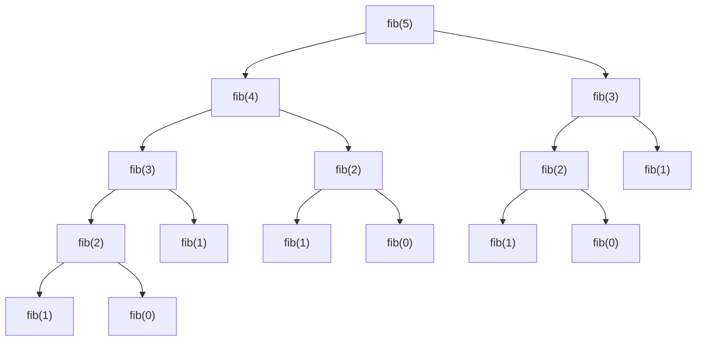

# 12강 — 재귀

[레포지토리 안내](../../README.ko.md) | [English](Concepts_Lecture.md) | [한국어](Concepts_Lecture.ko.md)

> **최종 수정일:** 2026-11-19

> **학습 목표:**
> 1. 재귀 함수를 기저 사례와 재귀 사례로 나누어 정의하고, 재귀가 끝나기 위한 조건을 설명할 수 있다
> 2. 호출 스택을 그려 재귀 호출과 반환의 순서를 추적할 수 있다
> 3. 팩토리얼, 리스트의 합, 거듭제곱처럼 문제를 더 작은 같은 문제로 줄이는 재귀 함수를 작성할 수 있다
> 4. 피보나치 수의 단순한 재귀가 지수 시간이 걸리는 이유를 호출 횟수로 설명하고 메모이제이션으로 개선할 수 있다
> 5. 이진 탐색, 순열, 하노이의 탑을 재귀로 풀고 그 호출 횟수나 이동 횟수를 구할 수 있다
> 6. 재귀 깊이의 한도와 `RecursionError`를 설명하고, 재귀와 반복을 비교하여 알맞은 방법을 고를 수 있다

---

## 목차

- [1. 재귀의 개념](#1-재귀의-개념)
  - [1.1 자기 자신을 호출하는 함수](#11-자기-자신을-호출하는-함수)
  - [1.2 기저 사례와 재귀 사례](#12-기저-사례와-재귀-사례)
  - [1.3 재귀적으로 생각하기](#13-재귀적으로-생각하기)
  - [1.4 재귀적으로 정의되는 구조](#14-재귀적으로-정의되는-구조)
- [2. 호출 스택](#2-호출-스택)
  - [2.1 함수 호출과 스택 프레임](#21-함수-호출과-스택-프레임)
  - [2.2 팩토리얼의 추적](#22-팩토리얼의-추적)
  - [2.3 재귀 호출 전과 후의 작업](#23-재귀-호출-전과-후의-작업)
- [3. 재귀로 푸는 문제](#3-재귀로-푸는-문제)
  - [3.1 리스트의 합과 최댓값](#31-리스트의-합과-최댓값)
  - [3.2 거듭제곱](#32-거듭제곱)
  - [3.3 회문 판정과 최대공약수](#33-회문-판정과-최대공약수)
  - [3.4 중첩된 리스트](#34-중첩된-리스트)
- [4. 피보나치 수와 메모이제이션](#4-피보나치-수와-메모이제이션)
  - [4.1 단순한 재귀](#41-단순한-재귀)
  - [4.2 호출 횟수의 증가](#42-호출-횟수의-증가)
  - [4.3 메모이제이션](#43-메모이제이션)
  - [4.4 functools.lru_cache](#44-functoolslru_cache)
  - [4.5 반복으로 계산하기](#45-반복으로-계산하기)
- [5. 분할 정복과 탐색](#5-분할-정복과-탐색)
  - [5.1 이진 탐색](#51-이진-탐색)
  - [5.2 순열 만들기](#52-순열-만들기)
  - [5.3 하노이의 탑](#53-하노이의-탑)
  - [5.4 병합 정렬](#54-병합-정렬)
- [6. 재귀의 한계와 반복](#6-재귀의-한계와-반복)
  - [6.1 재귀 깊이의 한도](#61-재귀-깊이의-한도)
  - [6.2 기저 사례가 없거나 닿지 않는 재귀](#62-기저-사례가-없거나-닿지-않는-재귀)
  - [6.3 꼬리 재귀와 반복](#63-꼬리-재귀와-반복)
  - [6.4 재귀와 반복의 선택](#64-재귀와-반복의-선택)
- [개념 적용](#개념-적용)
- [요약](#요약)
- [점검 문제](#점검-문제)
- [참고 문헌](#참고-문헌)

---

<br>

## 1. 재귀의 개념

### 1.1 자기 자신을 호출하는 함수

[6강](../Lec06_Functions/Concepts_Lecture.ko.md)에서 함수는 다른 함수를 호출할 수 있었다. 함수는 자기 자신도 호출할 수 있다.

> **용어 정의:** **재귀(recursion)** 는 어떤 대상을 정의하거나 계산할 때 그 대상 자신을 더 작은 형태로 다시 사용하는 방법이다. 함수 안에서 그 함수 자신을 호출하는 함수를 **재귀 함수(recursive function)** 라고 한다.

```python
def countdown(n):
    if n == 0:
        print("발사")
    else:
        print(n)
        countdown(n - 1)

countdown(3)
```

```text
3
2
1
발사
```

`countdown(3)`은 3을 출력하고 `countdown(2)`를 호출한다. `countdown(2)`는 2를 출력하고 `countdown(1)`을, `countdown(1)`은 1을 출력하고 `countdown(0)`을 호출한다. `countdown(0)`은 `n == 0`이므로 더 이상 자신을 호출하지 않고 `발사`를 출력한다. 같은 일을 `for`문으로 쓸 수도 있지만([5강](../Lec05_Loops/Concepts_Lecture.ko.md)), 재귀는 "3부터 세는 일은 3을 말한 뒤 2부터 세는 일이다"처럼 문제를 그 자신의 더 작은 형태로 설명한다.

### 1.2 기저 사례와 재귀 사례

모든 재귀 함수는 두 부분으로 이루어진다.

> **용어 정의:** **기저 사례(base case)** 는 재귀 호출 없이 답을 바로 낼 수 있는 가장 작은 입력의 경우이다.

> **용어 정의:** **재귀 사례(recursive case)** 는 문제를 더 작은 같은 문제로 줄여 자기 자신을 호출하고, 그 결과로 답을 만드는 경우이다.

$n$의 팩토리얼 $n! = n \times (n-1) \times \cdots \times 1$은 다음과 같이 재귀적으로 정의할 수 있다. 0!은 1로 정의한다.

```math
n! = \begin{cases} 1 & (n = 0) \\ n \times (n-1)! & (n \geq 1) \end{cases}
```

위의 줄이 기저 사례, 아래 줄이 재귀 사례이다. 이 정의를 그대로 함수로 옮긴다.

```python
def factorial(n):
    if n == 0:                  # 기저 사례
        return 1
    return n * factorial(n - 1) # 재귀 사례

for k in [0, 1, 5, 10, 20]:
    print(k, factorial(k))
import math
print(factorial(20) == math.factorial(20))
```

```text
0 1
1 1
5 120
10 3628800
20 2432902008176640000
True
```

재귀 함수가 올바르게 끝나려면 다음 두 조건이 모두 필요하다.

1. **기저 사례가 있어야 한다.** 재귀 호출 없이 반환하는 경우가 없으면 함수는 자신을 끝없이 호출한다(6.2절).
2. **모든 재귀 호출이 기저 사례에 가까워져야 한다.** `factorial(n)`은 `factorial(n - 1)`을 호출하므로, 0 이상의 정수에서 시작하면 인수가 1씩 줄어 반드시 0에 닿는다. `factorial(-1)`처럼 기저 사례를 지나쳐 버리는 입력은 끝나지 않는다.

> **핵심:** 재귀 함수를 쓸 때는 (1) 가장 작은 경우의 답, (2) 문제를 한 단계 작은 같은 문제로 줄이는 방법, (3) 줄인 문제의 답으로 원래 문제의 답을 만드는 방법의 세 가지를 정한다.

### 1.3 재귀적으로 생각하기

`factorial(5)`가 올바른지 확인하려고 `factorial(4)`, `factorial(3)`, ...의 실행을 모두 따라갈 필요는 없다. 대신 다음 두 가지만 확인한다.

- 기저 사례 `factorial(0)`은 올바른 값 1을 반환한다.
- `factorial(n - 1)`이 $(n-1)!$을 올바르게 반환한다고 **가정하면**, `n * factorial(n - 1)`은 $n \times (n-1)! = n!$이므로 올바르다.

이 두 가지가 성립하면 0, 1, 2, ...의 모든 $n$에 대해 함수가 올바르다. 0에서 올바르므로 1에서 올바르고, 1에서 올바르므로 2에서 올바른 것이 끝없이 이어지기 때문이다. 재귀 함수를 설계할 때도 같다. 더 작은 문제를 푸는 호출은 이미 올바르게 동작한다고 믿고, 그 결과로 지금의 문제를 푸는 일에만 집중한다.

> **[이산수학]** 위의 논증은 수학적 귀납법이다. 기저 사례의 확인이 귀납의 기초 단계, "더 작은 경우가 옳으면 지금 경우도 옳다"가 귀납 단계에 해당한다. 재귀 함수의 실행 횟수를 나타내는 점화식(4.2절, 5.3절)과 그 풀이도 이산수학에서 다룬다.

### 1.4 재귀적으로 정의되는 구조

재귀는 계산뿐 아니라 데이터의 구조를 정의하는 데도 쓰인다. 재귀적으로 정의된 구조는 재귀 함수로 다루기가 자연스럽다. 함수의 모양이 구조의 정의를 그대로 따르기 때문이다.

- **음이 아닌 정수:** 0은 음이 아닌 정수이고, $n$이 음이 아닌 정수이면 $n + 1$도 음이 아닌 정수이다. 팩토리얼처럼 $n$을 $n - 1$로 줄이는 재귀는 이 정의를 거꾸로 따라간다.
- **리스트:** 빈 리스트는 리스트이고, 요소 하나와 리스트를 이어 붙인 것도 리스트이다. "첫 요소와 나머지"로 나누는 3.1절의 재귀가 이 정의를 따른다.
- **문자열:** 빈 문자열은 문자열이고, 글자 하나와 문자열을 이어 붙인 것도 문자열이다. 2.3절의 `reverse()`가 이 정의를 따른다.
- **중첩된 리스트와 폴더:** 리스트의 요소가 다시 리스트일 수 있고, 폴더 안에 다시 폴더가 있을 수 있다. 3.4절의 중첩 리스트와 [10강 6.2절](../Lec10_File-Input-and-Output/Concepts_Lecture.ko.md#62-파일과-폴더의-조작)의 폴더 구조가 그 예이며, 이런 구조는 깊이가 정해져 있지 않아 반복문 몇 겹으로는 다룰 수 없다.

정의의 "빈 리스트", "빈 문자열", "0"이 재귀 함수의 기저 사례가 되고, "이어 붙인 것"이 재귀 사례가 된다. 재귀 함수를 쓰기 어려울 때는 다루는 데이터를 이런 형태로 정의해 보면 기저 사례와 재귀 사례가 드러난다.

---

<br>

## 2. 호출 스택

### 2.1 함수 호출과 스택 프레임

재귀 함수에서 같은 이름의 매개변수 `n`이 여러 값을 동시에 가질 수 있는 이유는 호출마다 지역 변수를 담는 공간이 따로 만들어지기 때문이다.

> **용어 정의:** **스택 프레임(stack frame)** 은 함수가 한 번 호출될 때 만들어져 그 호출의 매개변수, 지역 변수, 돌아갈 위치를 담는 공간이다. 실행 중인 함수들의 프레임을 호출 순서대로 쌓은 것을 **호출 스택(call stack)** 이라고 한다.

함수를 호출하면 새 프레임이 스택의 맨 위에 쌓이고, 함수가 반환하면 맨 위의 프레임이 사라지며 그 아래 프레임의 함수가 멈추었던 곳부터 다시 실행된다. 나중에 쌓인 것이 먼저 사라지므로 스택(stack, 마지막에 넣은 것을 먼저 꺼내는 구조)이라고 부른다. [11강 1.3절](../Lec11_Exception-Handling/Concepts_Lecture.ko.md#13-트레이스백-읽기)의 트레이스백은 예외가 발생한 순간의 호출 스택을 가장 먼저 쌓인 프레임부터 차례로 보여 준 것이다. 그래서 트레이스백의 맨 아래 항목이 스택의 맨 위 프레임이다.

> **[시스템프로그래밍]** C 같은 언어에서 스택 프레임은 프로세스 메모리의 스택 영역에 놓이며, 호출할 때마다 반환 주소와 지역 변수를 담은 프레임이 쌓이고 반환할 때 사라진다. 파이썬 인터프리터도 실행 중인 함수마다 프레임 객체를 만든다. 스택 영역의 배치와 호출 규약은 시스템프로그래밍에서 다룬다.

### 2.2 팩토리얼의 추적

`factorial(3)`이 실행될 때의 호출 스택은 다음과 같이 변한다. 각 상자가 프레임이며, 맨 위가 지금 실행 중인 호출이다.

```text
  ① 호출          ② 호출          ③ 호출          ④ 기저 사례       ⑤ 반환          ⑥ 반환          ⑦ 반환
                                                 ┌────────────┐
                                  ┌────────────┐ │ n = 0      │
                  ┌────────────┐  │ n = 1      │ │ → 1 반환   │  ┌────────────┐
  ┌────────────┐  │ n = 2      │  ├────────────┤ ├────────────┤  │ n = 1      │
  │ n = 3      │  ├────────────┤  │ n = 2      │ │ n = 1      │  │ 1 * 1 = 1  │  ┌────────────┐
  │            │  │ n = 3      │  ├────────────┤ ├────────────┤  ├────────────┤  │ n = 2      │  ┌────────────┐
  │            │  │            │  │ n = 3      │ │ n = 2      │  │ n = 2      │  │ 2 * 1 = 2  │  │ n = 3      │
  │            │  │            │  │            │ ├────────────┤  ├────────────┤  ├────────────┤  │ 3 * 2 = 6  │
  │            │  │            │  │            │ │ n = 3      │  │ n = 3      │  │ n = 3      │  │ → 6 반환   │
  └────────────┘  └────────────┘  └────────────┘ └────────────┘  └────────────┘  └────────────┘  └────────────┘
```

*그림 1. factorial(3)을 실행할 때 호출 스택의 변화*

①\~④에서 호출이 일어날 때마다 프레임이 쌓인다. 이때 각 호출은 `n * factorial(n - 1)`의 곱셈을 아직 하지 못하고, 아래 호출의 결과를 기다리며 멈춰 있다. ④에서 기저 사례가 1을 반환하면 ⑤\~⑦에서 프레임이 하나씩 사라지며 기다리던 곱셈이 차례로 계산된다. 재귀는 **내려가며 문제를 쪼개고, 올라오며 답을 조립한다**.

호출과 반환을 들여쓰기로 출력하면 이 과정을 직접 볼 수 있다. 매개변수 `depth`는 출력의 들여쓰기 깊이만 정한다.

```python
def factorial(n, depth=0):
    indent = "    " * depth
    print(indent + "factorial(" + str(n) + ") 호출")
    if n == 0:
        result = 1
    else:
        result = n * factorial(n - 1, depth + 1)
    print(indent + "factorial(" + str(n) + ") = " + str(result) + " 반환")
    return result

print(factorial(4))
```

```text
factorial(4) 호출
    factorial(3) 호출
        factorial(2) 호출
            factorial(1) 호출
                factorial(0) 호출
                factorial(0) = 1 반환
            factorial(1) = 1 반환
        factorial(2) = 2 반환
    factorial(3) = 6 반환
factorial(4) = 24 반환
24
```

`factorial(4)`는 프레임을 5개(인수 4, 3, 2, 1, 0) 쌓는다. 일반적으로 `factorial(n)`은 호출을 $n + 1$번 하고, 가장 깊을 때 프레임 $n + 1$개가 동시에 스택에 있다. 이 깊이에 한도가 있다는 점이 6.1절의 주제이다.

### 2.3 재귀 호출 전과 후의 작업

재귀 호출보다 **앞에** 둔 작업은 내려가는 동안, **뒤에** 둔 작업은 올라오는 동안 실행된다. 이 차이로 순서를 뒤집을 수 있다.

```python
def before(n):
    if n == 0:
        return
    print(n, end=" ")
    before(n - 1)

def after(n):
    if n == 0:
        return
    after(n - 1)
    print(n, end=" ")

before(4)
print()
after(4)
print()

def reverse(s):
    if s == "":
        return ""
    return reverse(s[1:]) + s[0]

print(reverse("python"))
```

```text
4 3 2 1 
1 2 3 4 
nohtyp
```

- **`before(4)`:** 출력한 뒤 재귀 호출을 하므로 4, 3, 2, 1의 순서로 출력된다.
- **`after(4)`:** 재귀 호출이 모두 끝나 올라오는 길에 출력하므로, 가장 나중에 호출된 `after(1)`이 먼저 1을 출력한다.
- **`reverse(s)`:** "문자열을 뒤집은 것은 첫 글자를 뺀 나머지를 뒤집고 그 뒤에 첫 글자를 붙인 것"이다. `reverse("python")`은 `reverse("ython") + "p"`이고, 이것이 이어져 `"nohtyp"`가 된다. 빈 문자열이 기저 사례이다.

---

<br>

## 3. 재귀로 푸는 문제

### 3.1 리스트의 합과 최댓값

리스트도 "첫 요소와 나머지 리스트"로 나누면 재귀로 다룰 수 있다. 나머지 리스트는 슬라이싱 `lst[1:]`로 얻는다([7강 2.2절](../Lec07_Lists-and-Dictionaries/Concepts_Lecture.ko.md#22-슬라이싱)).

```python
def sum_list(lst):
    if len(lst) == 0:
        return 0
    return lst[0] + sum_list(lst[1:])

def max_list(lst):
    if len(lst) == 1:
        return lst[0]
    rest_max = max_list(lst[1:])
    if lst[0] > rest_max:
        return lst[0]
    return rest_max

data = [3, 8, 1, 6]
print(sum_list(data), max_list(data))
print(sum_list([]))
```

```text
18 8
0
```

- **합:** 빈 리스트의 합은 0(기저 사례)이고, 그 밖에는 첫 요소에 나머지의 합을 더한다. $3 + (8 + (1 + (6 + 0))) = 18$이다.
- **최댓값:** 빈 리스트의 최댓값은 정의되지 않으므로 기저 사례는 요소가 하나인 리스트이다. 나머지의 최댓값 8과 첫 요소 3을 비교하여 큰 쪽을 반환한다.
- **기저 사례의 선택:** 합의 기저 사례를 빈 리스트로 잡았기 때문에 `sum_list([])`도 올바르게 0이다. 반면 `max_list([])`는 `len(lst) == 1`에 영원히 닿지 않는다. 빈 리스트의 `[1:]`은 다시 빈 리스트이기 때문이며, 이 결과는 6.2절에서 확인한다.

> **주의:** `lst[1:]`은 호출할 때마다 나머지 요소를 복사한 새 리스트를 만든다. 길이 $n$인 리스트에서 복사되는 요소 수의 합은 $(n-1) + (n-2) + \cdots + 1 = n(n-1)/2$이므로, 재귀 자체는 $n$번이어도 전체 작업량은 $n^2$에 비례한다. 큰 리스트에서는 리스트를 자르는 대신 인덱스를 매개변수로 넘기거나(5.1절의 이진 탐색처럼), 내장 함수 `sum()`과 `max()`를 쓴다.

### 3.2 거듭제곱

$x^n$을 $x \times x^{n-1}$로 줄이면 호출이 $n + 1$번 일어난다. 지수를 반으로 줄이면 훨씬 적게 호출할 수 있다.

```math
x^n = \begin{cases} 1 & (n = 0) \\ \left(x^{\lfloor n/2 \rfloor}\right)^2 & (n \text{이 짝수}) \\ \left(x^{\lfloor n/2 \rfloor}\right)^2 \times x & (n \text{이 홀수}) \end{cases}
```

```python
calls = 0

def power(x, n):
    global calls
    calls += 1
    if n == 0:
        return 1
    return x * power(x, n - 1)

def fast_power(x, n):
    global calls
    calls += 1
    if n == 0:
        return 1
    half = fast_power(x, n // 2)
    if n % 2 == 0:
        return half * half
    return half * half * x

for n in [10, 100, 500]:
    calls = 0
    a = power(2, n)
    c1 = calls
    calls = 0
    b = fast_power(2, n)
    c2 = calls
    print(n, a == b == 2 ** n, c1, c2)
```

```text
10 True 11 5
100 True 101 8
500 True 501 10
```

- **호출 횟수의 측정:** 전역 변수 `calls`를 호출마다 1씩 늘려 센다([6강 5.4절](../Lec06_Functions/Concepts_Lecture.ko.md#54-함수-안에서-전역-변수-변경하기)).
- **`power`:** 지수가 1씩 줄어 호출 횟수가 $n + 1$이다.
- **`fast_power`:** 지수가 절반으로 줄어 호출 횟수가 $\lfloor \log_2 n \rfloor + 2$이다($n \geq 1$). $n = 500$이면 $\log_2 500 \approx 8.97$이므로 $8 + 2 = 10$번이다.
- **`half`를 한 번만 계산하는 이유:** `fast_power(x, n // 2) * fast_power(x, n // 2)`처럼 두 번 호출하면 호출 횟수가 다시 $n$에 비례하게 늘어난다. 같은 작은 문제를 두 번 풀지 않는 것이 핵심이며, 이것은 4절의 주제이기도 하다.

`power(2, 1000)`은 프레임이 1001개 필요하므로 6.1절의 한도에 걸려 실패하지만, `fast_power(2, 1000)`은 11번만 호출하므로 문제가 없다.

### 3.3 회문 판정과 최대공약수

앞에서 읽으나 뒤에서 읽으나 같은 문자열을 **회문(palindrome)** 이라고 한다. "첫 글자와 끝 글자가 같고, 그 둘을 뺀 가운데가 회문이면 회문이다"로 정의할 수 있다. 두 정수의 최대공약수는 유클리드 호제법으로 구한다. $b$가 0이면 최대공약수는 $a$이고, 그렇지 않으면 $b$와 $a \bmod b$의 최대공약수와 같다.

```python
def is_palindrome(s):
    if len(s) <= 1:
        return True
    if s[0] != s[-1]:
        return False
    return is_palindrome(s[1:-1])

for w in ["level", "토마토", "python", "", "abba", "abca"]:
    print(repr(w), is_palindrome(w))

def gcd(a, b):
    if b == 0:
        return a
    return gcd(b, a % b)

print(gcd(48, 18), gcd(18, 48), gcd(17, 5))
import math
print(math.gcd(48, 18))
```

```text
'level' True
'토마토' True
'python' False
'' True
'abba' True
'abca' False
6 6 1
6
```

- **두 개의 기저 사례:** 글자가 0개나 1개인 문자열은 회문이다(`len(s) <= 1`). 또 끝 글자가 다르면 가운데를 볼 필요 없이 `False`이다. 기저 사례가 여럿일 수 있다.
- **`s[1:-1]`:** 첫 글자와 끝 글자를 뺀 가운데이다. `"level"`은 `"eve"`, `"v"`로 줄어 `True`가 된다.
- **최대공약수의 추적:** `gcd(48, 18)`은 `gcd(18, 12)`, `gcd(12, 6)`, `gcd(6, 0)`으로 이어져 6이다. $48 \bmod 18 = 12$, $18 \bmod 12 = 6$, $12 \bmod 6 = 0$이다. `gcd(18, 48)`은 첫 호출에서 $18 \bmod 48 = 18$이므로 `gcd(48, 18)`로 바뀌어 같은 답이 나온다.
- **재귀 호출이 마지막 작업:** `gcd()`와 `is_palindrome()`은 재귀 호출의 결과를 그대로 반환하므로 올라오는 길에 할 일이 없다. 이런 형태는 6.3절에서 반복문으로 쉽게 바꿀 수 있음을 보인다.

### 3.4 중첩된 리스트

`[1, [2, [3, 4]], 5, []]`처럼 요소가 다시 리스트인 리스트의 모든 정수를 더하려면, 중첩이 몇 겹인지 미리 알 수 없으므로 반복문만으로는 어렵다. 요소가 리스트이면 그 리스트에 같은 함수를 적용하면 된다.

```python
def nested_sum(items):
    total = 0
    for x in items:
        if isinstance(x, list):
            total += nested_sum(x)      # 요소가 리스트이면 재귀
        else:
            total += x
    return total

def depth_of(items):
    if not isinstance(items, list):
        return 0
    deepest = 0
    for x in items:
        d = depth_of(x)
        if d > deepest:
            deepest = d
    return deepest + 1

data = [1, [2, [3, 4]], 5, []]
print(nested_sum(data), depth_of(data))
print(nested_sum([]), depth_of([]), depth_of(7))
```

```text
15 3
0 1 0
```

- **반복과 재귀의 결합:** `nested_sum()`은 한 단계의 요소들은 `for`문으로 돌고, 요소가 리스트일 때만 재귀한다. 기저 사례는 따로 쓰지 않았지만, 리스트가 아닌 요소(정수)와 빈 리스트(반복이 한 번도 돌지 않음)에서 재귀가 일어나지 않으므로 반드시 끝난다.
- **`isinstance(x, list)`:** 요소가 리스트인지 검사한다([9강 3.3절](../Lec09_Inheritance-and-Polymorphism/Concepts_Lecture.ko.md#33-isinstance와-issubclass)). 여기서는 요소의 종류에 따라 구조 자체가 갈라지므로 종류 검사가 알맞다.
- **합:** $1 + (2 + (3 + 4)) + 5 + 0 = 15$이다.
- **깊이:** `depth_of()`는 정수의 깊이를 0, 리스트의 깊이를 "가장 깊은 요소의 깊이 + 1"로 정의한다. `[3, 4]`가 1, `[2, [3, 4]]`가 2, 전체가 3이다. 빈 리스트는 요소가 없으므로 $0 + 1 = 1$이다.
- **재귀의 깊이:** 이 함수들의 재귀 깊이는 리스트의 길이가 아니라 중첩의 깊이이다. 요소가 100만 개여도 중첩이 3겹이면 깊이는 3이므로 6.1절의 한도는 문제가 되지 않는다.

---

<br>

## 4. 피보나치 수와 메모이제이션

### 4.1 단순한 재귀

피보나치 수열은 0, 1로 시작하여 앞의 두 수를 더해 다음 수를 만든다.

```math
F_0 = 0, \quad F_1 = 1, \quad F_n = F_{n-1} + F_{n-2} \quad (n \geq 2)
```

정의를 그대로 옮기면 재귀 호출이 두 번 있는 함수가 된다.

```python
import time

calls = 0

def fib(n):
    global calls
    calls += 1
    if n < 2:
        return n
    return fib(n - 1) + fib(n - 2)

print([fib(k) for k in range(11)])
for n in [10, 20, 25, 30]:
    calls = 0
    start = time.perf_counter()
    value = fib(n)
    elapsed = time.perf_counter() - start
    print(n, value, calls, round(elapsed, 3))
```

```text
[0, 1, 1, 2, 3, 5, 8, 13, 21, 34, 55]
10 55 177 0.0
20 6765 21891 0.001
25 75025 242785 0.014
30 832040 2692537 0.144
```

함수는 올바른 값을 낸다. 하지만 각 줄의 셋째 수인 호출 횟수가 $n$이 5 늘 때마다 약 11배씩 늘고, 넷째 수인 실행 시간(초, 이 결과를 얻은 컴퓨터에서 `time.perf_counter()`로 잰 값)도 같은 비율로 는다. `fib(30)` 한 번에 함수가 약 270만 번 호출되었다.



*그림 2. fib(5)를 계산할 때의 호출 트리*

호출 트리를 그리면 원인이 보인다. `fib(5)`를 계산하는 동안 `fib(3)`은 2번, `fib(2)`는 3번, `fib(1)`은 5번 계산된다. 같은 작은 문제를 처음부터 다시 푸는 일이 트리의 아래로 갈수록 기하급수적으로 늘어난다. 그림의 노드는 15개로, `fib(5)`의 호출 횟수 15와 같다.

### 4.2 호출 횟수의 증가

`fib(n)`의 호출 횟수를 $C(n)$이라 하자. `fib(0)`과 `fib(1)`은 호출 한 번으로 끝나고, `fib(n)`은 자기 자신 한 번에 두 재귀 호출의 횟수를 더한다.

```math
C(0) = C(1) = 1, \qquad C(n) = C(n-1) + C(n-2) + 1 \quad (n \geq 2)
```

양변에 1을 더하고 $D(n) = C(n) + 1$이라 하면 $D(n) = D(n-1) + D(n-2)$이고 $D(0) = D(1) = 2$이다. 이것은 피보나치 수열에 2를 곱한 것과 같은 점화식이므로 $D(n) = 2F_{n+1}$, 곧 다음이 성립한다.

```math
C(n) = 2F_{n+1} - 1
```

$n = 30$이면 $F_{31} = 1346269$이므로 $C(30) = 2 \times 1346269 - 1 = 2692537$이고, 4.1절에서 센 값과 같다. 피보나치 수는 이웃한 두 수의 비가 황금비 $\varphi = (1 + \sqrt{5}) / 2 \approx 1.618$에 가까워지므로 대략 $\varphi^n$에 비례하여 커진다. $n$이 5 늘면 호출 횟수는 약 $\varphi^5 \approx 11.09$배가 되며, 측정에서 $2692537 / 242785 \approx 11.09$였다. 이처럼 입력이 1 늘 때마다 일정한 비율로 곱해지며 커지는 증가를 **지수적 증가(exponential growth)** 라고 한다. 이 속도라면 `fib(50)`은 `fib(30)`의 약 $\varphi^{20} \approx 15000$배의 시간이 걸린다.

### 4.3 메모이제이션

> **용어 정의:** **메모이제이션(memoization)** 은 함수가 어떤 인수에 대해 계산한 결과를 저장해 두고, 같은 인수로 다시 호출되면 계산하지 않고 저장한 결과를 돌려주는 기법이다.

저장소로는 인수를 키로, 결과를 값으로 하는 딕셔너리가 알맞다([7강 11절](../Lec07_Lists-and-Dictionaries/Concepts_Lecture.ko.md#11-딕셔너리)).

```python
calls = 0
memo = {}

def fib_memo(n):
    global calls
    calls += 1
    if n in memo:
        return memo[n]
    if n < 2:
        result = n
    else:
        result = fib_memo(n - 1) + fib_memo(n - 2)
    memo[n] = result
    return result

for n in [10, 30, 100]:
    calls = 0
    memo.clear()
    print(n, fib_memo(n), calls)
```

```text
10 55 19
30 832040 59
100 354224848179261915075 199
```

- **저장소 확인:** 함수는 먼저 `memo`에 답이 있는지 본다. 있으면 그 값을 바로 반환한다.
- **계산 후 저장:** 없으면 계산하고, 반환하기 전에 `memo[n]`에 저장한다.
- **호출 횟수:** `fib_memo(n)`은 0부터 $n$까지의 각 값을 한 번씩만 계산하므로 호출 횟수가 $2n - 1$로 $n$에 비례한다. 270만 번이던 `fib(30)`이 59번으로 줄었고, 단순한 재귀로는 사실상 끝나지 않는 `fib(100)`도 199번 만에 계산된다.
- **`memo.clear()`:** 측정마다 저장소를 비워 처음부터 센다. 비우지 않으면 앞의 결과를 재사용하여 호출 횟수가 더 줄어든다.

> **[알고리즘]** 작은 문제의 답을 저장해 두고 큰 문제의 답을 조립하는 방법을 동적 계획법(dynamic programming)이라고 한다. 메모이제이션은 재귀로 위에서부터 내려가며 필요한 답만 저장하는 방식(하향식)이고, 4.5절처럼 작은 답부터 차례로 채우는 방식(상향식)도 있다. 두 방식의 설계 원리와 복잡도 분석은 알고리즘에서 다룬다.

### 4.4 functools.lru_cache

메모이제이션은 흔히 쓰이므로 표준 모듈 `functools`가 데코레이터로 제공한다 [1]. 데코레이터는 [9강 5.2절](../Lec09_Inheritance-and-Polymorphism/Concepts_Lecture.ko.md#52-abc-모듈)에서 본 것처럼 함수 정의 위에 `@이름`으로 붙여 그 함수에 기능을 덧씌운다.

```python
from functools import lru_cache

@lru_cache(maxsize=None)
def fib(n):
    if n < 2:
        return n
    return fib(n - 1) + fib(n - 2)

print(fib(30))
print(fib.cache_info())
print(fib(100))
print(fib.cache_info())
fib.cache_clear()
print(fib.cache_info())
```

```text
832040
CacheInfo(hits=28, misses=31, maxsize=None, currsize=31)
354224848179261915075
CacheInfo(hits=99, misses=101, maxsize=None, currsize=101)
CacheInfo(hits=0, misses=0, maxsize=None, currsize=0)
```

- **`@lru_cache(maxsize=None)`:** 함수 본체는 단순한 재귀 그대로이고, 데코레이터가 인수와 결과를 저장하는 일을 맡는다. `maxsize=None`은 저장할 결과의 수에 제한을 두지 않는다는 뜻이다. 제한이 있으면 가장 오래 쓰이지 않은(least recently used, LRU) 결과부터 버린다 [1].
- **`cache_info()`:** 저장소를 찾아 답이 있던 횟수(`hits`), 없어서 계산한 횟수(`misses`), 저장된 결과 수(`currsize`)를 알려 준다 [1]. `fib(30)`에서 `misses`는 0부터 30까지의 31번이고, `hits`는 이미 계산한 값을 다시 찾은 28번이다.
- **저장소의 재사용:** 이어서 `fib(100)`을 호출하면 0\~30의 답은 이미 있으므로 31부터 100까지의 70개만 새로 계산하여 `misses`가 101이 된다.
- **`cache_clear()`:** 저장소를 비운다.

> **참고:** `functools.cache`는 `lru_cache(maxsize=None)`과 같은 일을 하는 더 짧은 이름이며 파이썬 3.9에서 추가되었다 [1]. 또 괄호 없이 `@lru_cache`만 쓰는 형태는 파이썬 3.8부터 허용된다 [1]. 파이썬 3.7에서는 둘 다 쓸 수 없으므로 위의 예처럼 `@lru_cache(maxsize=None)`으로 쓴다.

> **주의:** 메모이제이션은 같은 인수에 항상 같은 결과를 내는 함수에만 쓴다. 결과가 전역 변수, 파일의 내용, 현재 시각에 따라 달라지는 함수에 쓰면 오래된 결과를 돌려준다. 또 인수가 딕셔너리의 키로 쓰이므로 리스트처럼 해시할 수 없는 인수를 받는 함수에는 `lru_cache`를 쓸 수 없다.

### 4.5 반복으로 계산하기

피보나치 수는 앞의 두 값만 기억하면 되므로 반복문으로도 계산할 수 있다.

```python
def fib_iter(n):
    a, b = 0, 1
    for _ in range(n):
        a, b = b, a + b
    return a

print(fib_iter(10), fib_iter(30), fib_iter(100))
print(len(str(fib_iter(10000))))
```

```text
55 832040 354224848179261915075
2090
```

`a`와 `b`는 늘 이웃한 두 피보나치 수 $F_k$, $F_{k+1}$을 담는다. 동시 대입 `a, b = b, a + b`는 오른쪽을 먼저 모두 계산한 뒤 대입하므로 임시 변수 없이 한 칸씩 전진한다([7강 7.4절](../Lec07_Lists-and-Dictionaries/Concepts_Lecture.ko.md#74-튜플-언패킹)). 반복 횟수는 $n$이고 저장소도 변수 두 개면 되며, 재귀 깊이의 한도(6.1절)도 받지 않으므로 `fib_iter(10000)`처럼 2,090자리의 수도 바로 계산한다. 루프 변수 `_`는 값을 쓰지 않는 변수에 관례적으로 붙이는 이름이다.

| 방법 | 호출 또는 반복 횟수 | 추가 저장 공간 | 재귀 깊이 |
|:-----|:-----|:-----|:-----|
| 단순한 재귀 `fib` | $2F_{n+1} - 1$ (지수적) | 없음 | $n$ |
| 메모이제이션 `fib_memo`, `lru_cache` | $2n - 1$ | 결과 $n + 1$개 | $n$ |
| 반복 `fib_iter` | $n$ | 변수 2개 | 없음 |

*표 1. 피보나치 수를 계산하는 세 방법의 비교*

---

<br>

## 5. 분할 정복과 탐색

### 5.1 이진 탐색

> **용어 정의:** **분할 정복(divide and conquer)** 은 문제를 같은 종류의 더 작은 문제들로 나누어 각각을 재귀로 풀고, 그 답을 합쳐 원래 문제의 답을 만드는 방법이다.

정렬된 리스트에서 값을 찾는 **이진 탐색(binary search)** 은 분할 정복의 가장 간단한 예이다. 탐색 범위의 가운데 요소와 찾는 값을 비교하여, 같으면 찾은 것이고, 찾는 값이 더 크면 오른쪽 절반을, 더 작으면 왼쪽 절반을 다시 탐색한다. 탐색 범위가 비면 값이 없는 것이다. 리스트를 자르는 대신 범위의 양 끝 인덱스 `lo`, `hi`를 매개변수로 넘긴다.

```python
def binary_search(a, target, lo, hi):
    print("  탐색 범위", lo, "~", hi)
    if lo > hi:
        return -1
    mid = (lo + hi) // 2
    if a[mid] == target:
        return mid
    elif a[mid] < target:
        return binary_search(a, target, mid + 1, hi)
    else:
        return binary_search(a, target, lo, mid - 1)

data = [2, 5, 8, 12, 16, 23, 38, 56, 72, 91]
print("23 찾기")
print("결과:", binary_search(data, 23, 0, len(data) - 1))
print("7 찾기")
print("결과:", binary_search(data, 7, 0, len(data) - 1))
```

```text
23 찾기
  탐색 범위 0 ~ 9
  탐색 범위 5 ~ 9
  탐색 범위 5 ~ 6
결과: 5
7 찾기
  탐색 범위 0 ~ 9
  탐색 범위 0 ~ 3
  탐색 범위 2 ~ 3
  탐색 범위 2 ~ 1
결과: -1
```

| 호출 | `lo` | `hi` | `mid` | `a[mid]` | 판단 |
|:-----|-----:|-----:|-----:|-----:|:-----|
| 1 | 0 | 9 | 4 | 16 | 23 > 16이므로 오른쪽 절반 |
| 2 | 5 | 9 | 7 | 56 | 23 < 56이므로 왼쪽 절반 |
| 3 | 5 | 6 | 5 | 23 | 같으므로 인덱스 5를 반환 |

*표 2. 23을 이진 탐색하는 과정*

- **기저 사례 두 개:** 범위가 빈 경우(`lo > hi`, 값이 없음)와 가운데 요소가 찾는 값인 경우이다. 7을 찾을 때는 범위가 2\~1로 비어 -1을 반환했다.
- **기저 사례에 가까워짐:** 호출할 때마다 `mid`를 제외한 절반만 남으므로 범위의 크기가 반 이하로 준다. 요소가 $n$개이면 호출은 약 $\log_2 n$번이다. 10개에서는 많아야 4번 비교한다. 요소가 100만 개여도 약 20번이면 된다.
- **정렬의 전제:** 이진 탐색은 리스트가 오름차순으로 정렬되어 있을 때만 옳다. "가운데보다 크면 오른쪽에 있다"는 판단이 정렬에 기대기 때문이다.

### 5.2 순열 만들기

서로 다른 요소들을 한 줄로 늘어놓는 모든 순서를 **순열(permutation)** 이라고 한다. 요소가 $n$개이면 순열은 $n!$개이다. 순열을 재귀로 만드는 생각은 다음과 같다. 맨 앞에 올 요소를 하나 고르고, 나머지 요소들의 모든 순열을 재귀로 만든 뒤 그 앞에 고른 요소를 붙인다. 맨 앞 요소를 모든 요소로 바꾸어 가며 이것을 반복한다.

```python
def permutations(items):
    if len(items) <= 1:
        return [items[:]]
    result = []
    for i in range(len(items)):
        first = items[i]
        rest = items[:i] + items[i + 1:]
        for p in permutations(rest):
            result.append([first] + p)
    return result

ps = permutations(["A", "B", "C"])
print(len(ps))
for p in ps:
    print("".join(p))
print(len(permutations([1, 2, 3, 4, 5])))

import itertools
print(list(itertools.permutations("ABC")) == [tuple(p) for p in ps])
```

```text
6
ABC
ACB
BAC
BCA
CAB
CBA
120
True
```

- **기저 사례:** 요소가 0개나 1개이면 순열은 그 리스트 하나뿐이다. `items[:]`로 복사본을 넣어, 결과 리스트가 인수와 같은 객체를 공유하지 않게 한다.
- **재귀 사례:** `items[:i] + items[i + 1:]`은 `i`번 요소를 뺀 나머지이다. `"A"`를 고르면 나머지 `["B", "C"]`의 순열 `BC`, `CB` 앞에 `A`를 붙여 `ABC`, `ACB`를 얻는다.
- **개수:** 맨 앞을 고르는 방법이 $n$가지이고 각각에 대해 나머지의 순열이 $(n-1)!$개이므로 $n \times (n-1)! = n!$개이다. 요소 5개이면 120개이다.
- **`"".join(p)`:** 문자열의 리스트를 이어 붙인 문자열을 만든다.
- **표준 모듈:** `itertools.permutations()`도 같은 순서로 순열을 튜플로 만든다. 실제로는 이 함수를 쓰며, 순열 수는 매우 빨리 늘어나므로($10! = 3628800$) 모두 리스트로 만들 때는 개수에 주의해야 한다.

### 5.3 하노이의 탑

하노이의 탑은 기둥 세 개(A, B, C)와 크기가 모두 다른 원판 $n$개로 하는 퍼즐이다. 처음에 원판은 모두 A에 큰 것이 아래로 가게 쌓여 있다. 다음 규칙을 지키며 모든 원판을 C로 옮겨야 한다.

1. 한 번에 원판 하나만 옮긴다.
2. 각 기둥의 맨 위 원판만 옮길 수 있다.
3. 큰 원판을 작은 원판 위에 놓을 수 없다.

반복문으로 풀 방법을 떠올리기 어렵지만, 재귀로 생각하면 간단하다. 가장 큰 원판 $n$을 A에서 C로 옮기려면 그 위의 원판 $n - 1$개가 모두 B에 있어야 한다. 따라서 $n$개를 A에서 C로 옮기는 일은 다음 세 단계이다.

1. 위의 $n - 1$개를 A에서 B로 옮긴다(C를 거쳐 감). 이것은 크기가 하나 작은 같은 문제이다.
2. 가장 큰 원판을 A에서 C로 옮긴다.
3. B의 $n - 1$개를 B에서 C로 옮긴다(A를 거쳐 감).

```python
moves = 0

def hanoi(n, src, dst, via):
    global moves
    if n == 0:
        return
    hanoi(n - 1, src, via, dst)
    moves += 1
    print(str(moves) + ": 원판 " + str(n) + ", " + src + " -> " + dst)
    hanoi(n - 1, via, dst, src)

hanoi(3, "A", "C", "B")
```

```text
1: 원판 1, A -> C
2: 원판 2, A -> B
3: 원판 1, C -> B
4: 원판 3, A -> C
5: 원판 1, B -> A
6: 원판 2, B -> C
7: 원판 1, A -> C
```

- **매개변수:** `hanoi(n, src, dst, via)`는 "원판 $n$개를 `src`에서 `dst`로, `via`를 거쳐 옮긴다"는 뜻이다. 1단계에서는 목적지와 거쳐 가는 기둥이 바뀌어 `hanoi(n - 1, src, via, dst)`가 된다.
- **추적:** 1\~3번째 이동은 원판 2개를 A에서 B로 옮기는 1단계, 4번째는 가장 큰 원판 3의 이동, 5\~7번째는 B의 원판 2개를 C로 옮기는 3단계이다.
- **기저 사례:** 원판이 0개이면 할 일이 없다. 1개를 기저 사례로 잡을 수도 있지만 0개로 잡으면 코드가 더 짧다.

원판 $n$개를 옮기는 이동 횟수를 $T(n)$이라 하면, 세 단계에서 $T(n-1)$, 1, $T(n-1)$번 이동하므로 다음 점화식을 얻는다.

```math
T(0) = 0, \qquad T(n) = 2T(n-1) + 1
```

$T(n) + 1 = 2(T(n-1) + 1)$이므로 $T(n) + 1$은 단계마다 2배가 되어 $2^n$이고, $T(n) = 2^n - 1$이다. 원판 3개이면 $2^3 - 1 = 7$번으로 위의 출력과 같다. 이 수도 지수적으로 늘어 원판 20개이면 $2^{20} - 1 = 1048575$번, 64개이면 $2^{64} - 1 = 18446744073709551615$번이다. 4.2절의 피보나치와 달리 여기서는 같은 계산을 되풀이하는 낭비가 없으며, 어떤 방법으로도 $2^n - 1$번보다 적게 옮길 수 없다. 가장 큰 원판이 A를 떠나려면 나머지 $n - 1$개가 모두 다른 한 기둥에 모여 있어야 하고, 가장 큰 원판이 C에 놓인 뒤에도 $n - 1$개를 다시 그 위로 옮겨야 하므로, 원판 $n$개를 옮기는 최소 횟수는 적어도 $n - 1$개를 옮기는 최소 횟수의 2배에 1을 더한 값이기 때문이다.

### 5.4 병합 정렬

[8강 1.2절](../Lec08_Classes-and-Objects/Concepts_Lecture.ko.md#12-정렬-함수-만들기)의 버블 정렬은 비교를 약 $n^2/2$번 한다. 분할 정복으로 정렬하면 훨씬 적게 비교할 수 있다. **병합 정렬(merge sort)** 은 리스트를 반으로 나누어 각 절반을 재귀로 정렬한 뒤, 정렬된 두 절반을 하나로 합친다. 요소가 하나 이하인 리스트는 이미 정렬되어 있으므로 기저 사례이다.

정렬된 두 리스트를 합치는 **병합(merge)** 은 두 리스트의 앞에서부터 작은 요소를 하나씩 골라 결과에 붙이는 일이다.

```python
def merge(left, right):
    result = []
    i = j = 0
    while i < len(left) and j < len(right):
        if left[i] <= right[j]:
            result.append(left[i])
            i += 1
        else:
            result.append(right[j])
            j += 1
    result.extend(left[i:])
    result.extend(right[j:])
    return result

def merge_sort(a, depth=0):
    print("    " * depth + str(a))
    if len(a) <= 1:
        return a
    mid = len(a) // 2
    left = merge_sort(a[:mid], depth + 1)
    right = merge_sort(a[mid:], depth + 1)
    merged = merge(left, right)
    print("    " * depth + "병합 -> " + str(merged))
    return merged

print(merge([1, 4, 9], [2, 3, 10, 11]))
print(merge_sort([38, 27, 43, 3, 9, 82]))
```

```text
[1, 2, 3, 4, 9, 10, 11]
[38, 27, 43, 3, 9, 82]
    [38, 27, 43]
        [38]
        [27, 43]
            [27]
            [43]
        병합 -> [27, 43]
    병합 -> [27, 38, 43]
    [3, 9, 82]
        [3]
        [9, 82]
            [9]
            [82]
        병합 -> [9, 82]
    병합 -> [3, 9, 82]
병합 -> [3, 9, 27, 38, 43, 82]
[3, 9, 27, 38, 43, 82]
```

- **`merge()`:** `i`와 `j`는 두 리스트에서 아직 고르지 않은 첫 요소의 인덱스이다. 한쪽이 바닥나면 다른 쪽의 남은 요소들은 이미 정렬되어 있으므로 `extend()`로 한꺼번에 붙인다. `left[i] <= right[j]`에서 같을 때 왼쪽을 먼저 고르므로, 같은 값의 원래 순서가 유지된다.
- **나누기:** 들여쓰기가 깊어지는 줄들이 리스트를 반으로 나누어 내려가는 과정이다. 요소가 하나가 되면 더 나누지 않는다.
- **합치기:** `병합 ->` 줄들이 올라오며 정렬된 절반들을 합치는 과정이다. 2.2절에서 본 것처럼 내려가며 쪼개고 올라오며 답을 조립한다.

요소가 $n$개이면 반으로 나누는 단계는 약 $\log_2 n$번이고, 각 단계에서 모든 병합이 다루는 요소를 합하면 $n$개이다. 그래서 병합 정렬의 비교 횟수는 대략 $n \log_2 n$에 비례한다. 요소가 100만 개이면 버블 정렬의 약 $5 \times 10^{11}$번 비교에 비해 병합 정렬은 약 $2 \times 10^7$번이다. 재귀 깊이도 약 $\log_2 n$이므로 큰 리스트에서도 한도에 걸리지 않는다. 다만 이 구현은 슬라이싱과 병합 결과로 새 리스트를 만들므로 요소 수에 비례하는 추가 메모리를 쓴다.

---

<br>

## 6. 재귀의 한계와 반복

### 6.1 재귀 깊이의 한도

재귀 호출마다 프레임이 하나씩 쌓이고, 프레임에는 메모리가 든다. 끝없는 재귀가 인터프리터 내부의 스택을 넘치게 하여 파이썬이 비정상적으로 종료되는 것을 막기 위해, 파이썬은 호출 스택의 깊이에 한도를 둔다 [2]. 이 한도를 넘으면 `RecursionError`가 발생한다 [3].

```python
import sys

def depth(n):
    if n == 0:
        return 0
    return 1 + depth(n - 1)

print(sys.getrecursionlimit())
print(depth(900))
print(depth(5000))
```

```text
1000
900
Traceback (most recent call last):
  File "limit.py", line 10, in <module>
    print(depth(5000))
          ~~~~~^^^^^^
  File "limit.py", line 6, in depth
    return 1 + depth(n - 1)
               ~~~~~^^^^^^^
  File "limit.py", line 6, in depth
    return 1 + depth(n - 1)
               ~~~~~^^^^^^^
  File "limit.py", line 6, in depth
    return 1 + depth(n - 1)
               ~~~~~^^^^^^^
  [Previous line repeated 996 more times]
RecursionError: maximum recursion depth exceeded
```

- **한도의 값:** `sys.getrecursionlimit()`은 현재 한도를 알려 준다. 이 실행에서는 1000이었다. 맨 위 수준의 코드도 프레임 하나를 쓰므로 실제로 쌓을 수 있는 재귀 깊이는 1000보다 조금 작다.
- **`depth(900)`:** 프레임 약 900개로 한도 안이므로 성공했다.
- **`depth(5000)`:** 한도를 넘는 순간 `RecursionError`가 발생했다. 트레이스백은 같은 줄이 반복되는 부분을 `[Previous line repeated 996 more times]`로 줄여 보여 준다.
- **예외의 계층:** `RecursionError`는 `RuntimeError`의 하위 클래스이다([11강 4.1절](../Lec11_Exception-Handling/Concepts_Lecture.ko.md#41-예외-클래스의-상속-관계)) [3].

한도는 `sys.setrecursionlimit()`으로 바꿀 수 있다 [2].

```python
import sys

def depth(n):
    if n == 0:
        return 0
    return 1 + depth(n - 1)

sys.setrecursionlimit(6000)
print(sys.getrecursionlimit())
print(depth(5000))
```

```text
6000
5000
```

> **주의:** 한도를 높이면 더 깊은 재귀가 가능해지지만, 한도는 실제 메모리가 버틸 수 있는 깊이를 보장하지 않는다. 너무 높이면 `RecursionError` 대신 인터프리터가 비정상적으로 종료될 수 있다 [2]. 재귀 깊이가 입력의 크기에 비례하는 함수라면 한도를 높이기보다 6.3절처럼 반복문으로 바꾸거나 깊이가 $\log n$인 방법(3.2절의 `fast_power`, 5.1절의 이진 탐색)을 쓴다.

> **참고:** 파이썬 3.12부터 재귀 한도는 파이썬 코드의 호출에만 적용되고, 내장 함수의 재귀는 별도의 장치로 보호된다 [4]. 또 파이썬 3.5보다 오래된 버전에서는 같은 상황에 `RecursionError` 대신 `RuntimeError`가 발생했다 [3]. 파이썬 3.7을 포함한 3.5 이후의 버전에서는 이 단원의 예제가 같은 `RecursionError`를 내지만, 메시지의 문구는 버전에 따라 조금 다를 수 있다. 예를 들어 파이썬 3.9에서 6.1절의 `depth(5000)`은 `maximum recursion depth exceeded in comparison`이라는 메시지를 낸다.

### 6.2 기저 사례가 없거나 닿지 않는 재귀

1.2절의 두 조건 가운데 하나라도 어기면 재귀는 끝나지 않고 6.1절의 한도에 걸린다. 다음 `countdown()`은 기저 사례를 빠뜨렸다.

```python
def countdown(n):
    print(n, end=" ")
    countdown(n - 1)

countdown(3)
```

이 프로그램은 `3 2 1 0 -1 -2 ...`로 음수까지 계속 출력하다가, 이 실행에서는 `-995`를 출력한 뒤 `RecursionError: maximum recursion depth exceeded`로 멈추었다. 0에서 멈추라는 기저 사례가 없으므로 인수가 끝없이 줄어든다.

기저 사례가 있어도 입력이 그것을 지나치면 같은 일이 생긴다. 3.1절의 `max_list()`에 빈 리스트를 넘긴 결과는 다음과 같다.

```text
Traceback (most recent call last):
  File "list_rec.py", line 17, in <module>
    max_list([])
    ~~~~~~~~^^^^
  File "list_rec.py", line 9, in max_list
    rest_max = max_list(lst[1:])
  File "list_rec.py", line 9, in max_list
    rest_max = max_list(lst[1:])
  File "list_rec.py", line 9, in max_list
    rest_max = max_list(lst[1:])
  [Previous line repeated 996 more times]
RecursionError: maximum recursion depth exceeded
```

빈 리스트는 길이가 1이 아니므로 재귀 사례로 가고, `[][1:]`은 다시 빈 리스트이므로 크기가 줄지 않는다. 기저 사례에 가까워지지 않는 재귀 호출이다. 이런 입력은 함수 첫머리에서 `if len(lst) == 0: raise ValueError("빈 리스트의 최댓값은 없다")`처럼 검사하여 의미 있는 예외로 알리는 것이 좋다([11강 5.1절](../Lec11_Exception-Handling/Concepts_Lecture.ko.md#51-raise문)).

> **주의:** `RecursionError`의 트레이스백에서 같은 줄이 수백 번 반복되면 대개 기저 사례가 없거나, 재귀 호출의 인수가 기저 사례 쪽으로 줄지 않거나, 기저 사례의 조건이 일부 입력(음수, 빈 리스트, 실수)을 놓친 것이다. 한도를 높이는 것은 이 경우의 해결책이 아니다.

### 6.3 꼬리 재귀와 반복

재귀 호출이 함수가 하는 **마지막 일**이어서 그 결과를 바로 반환하는 형태를 **꼬리 재귀(tail recursion)** 라고 한다. 3.3절의 `gcd()`가 그 예이다. `factorial()`의 `n * factorial(n - 1)`은 재귀 호출 뒤에 곱셈이 남아 있으므로 꼬리 재귀가 아니다. 곱셈의 중간 결과를 누적 변수로 넘기면 꼬리 재귀로 바꿀 수 있다.

```python
def fact_tail(n, acc=1):
    if n == 0:
        return acc
    return fact_tail(n - 1, acc * n)

def fact_loop(n):
    acc = 1
    while n > 0:
        acc = acc * n
        n = n - 1
    return acc

print(fact_tail(10), fact_loop(10))
print(fact_loop(3000).bit_length())
print(fact_tail(3000))
```

```text
3628800 3628800
30332
Traceback (most recent call last):
  File "tail.py", line 15, in <module>
    print(fact_tail(3000))
          ~~~~~~~~~^^^^^^
  File "tail.py", line 4, in fact_tail
    return fact_tail(n - 1, acc * n)
  File "tail.py", line 4, in fact_tail
    return fact_tail(n - 1, acc * n)
  File "tail.py", line 4, in fact_tail
    return fact_tail(n - 1, acc * n)
  [Previous line repeated 996 more times]
RecursionError: maximum recursion depth exceeded
```

- **꼬리 재귀와 반복의 대응:** `fact_tail(n, acc)`의 재귀 호출은 "`n`을 `n - 1`로, `acc`를 `acc * n`으로 바꾸고 처음부터 다시"와 같다. 그래서 매개변수를 변수로 바꾸고 재귀 호출을 반복으로 바꾸면 `fact_loop()`가 된다. 기저 사례의 조건 `n == 0`은 반복을 끝내는 조건 `n > 0`의 부정이 된다.
- **`fact_loop(3000)`:** $3000!$은 30,332비트의 큰 정수이지만 반복문이므로 깊이의 제한 없이 계산된다. `bit_length()`는 그 정수를 2진수로 나타내는 데 필요한 비트 수이다.
- **`fact_tail(3000)`:** 꼬리 재귀여도 `RecursionError`이다. 일부 언어의 구현은 꼬리 호출이 프레임을 재사용하도록 최적화하지만, 이 실행 결과처럼 파이썬 인터프리터는 꼬리 재귀에도 호출마다 프레임을 쌓는다. 파이썬에서 깊은 꼬리 재귀는 반복문으로 직접 바꾸어야 한다.

꼬리 재귀가 아닌 재귀(5.3절의 하노이처럼 재귀 호출이 둘 이상인 경우)를 반복으로 바꾸려면, 인터프리터가 하던 일을 흉내 내어 처리할 일을 리스트로 만든 스택에 직접 쌓고 꺼내야 한다. 이런 경우는 재귀로 쓰는 편이 훨씬 읽기 쉽고, 깊이도 대개 문제가 되지 않는다. 하노이의 깊이는 $n$뿐이고, $n$이 1000 가까이 되면 이동 횟수가 너무 커서 어차피 다 실행할 수 없다.

### 6.4 재귀와 반복의 선택

| 기준 | 재귀가 알맞은 경우 | 반복이 알맞은 경우 |
|:-----|:-----|:-----|
| 문제의 구조 | 문제가 같은 모양의 작은 문제로 나뉜다 (트리, 분할 정복, 하노이, 순열) | 같은 일을 정해진 횟수나 조건까지 되풀이한다 (합, 팩토리얼, 피보나치) |
| 재귀 깊이 | 깊이가 $\log n$이거나 작게 제한된다 | 깊이가 입력의 크기 $n$에 비례하고 $n$이 수천 이상일 수 있다 |
| 같은 하위 문제의 반복 | 없거나, 메모이제이션으로 없앨 수 있다 | 작은 답부터 차례로 계산하면 저장 공간도 아낄 수 있다 |
| 읽기 쉬움 | 수학적 정의를 그대로 옮길 수 있다 | 진행 상태가 변수 몇 개로 드러난다 |
| 실행 비용 | 호출마다 프레임을 만드는 비용이 든다 | 함수 호출의 비용이 없다 |

*표 3. 재귀와 반복을 고르는 기준*

정리하면, 재귀는 문제의 구조가 재귀적일 때 코드를 짧고 올바르게 만드는 도구이다. 반복으로 쉽게 쓸 수 있고 깊이가 클 수 있는 문제(팩토리얼, 리스트의 합)는 파이썬에서는 반복문이나 내장 함수를 쓰고, 문제의 구조 자체가 갈라지는 문제(트리의 탐색, 하노이, 순열)는 재귀로 쓴다.

---

<br>

## 개념 적용

재귀로 풀 때는 기저 사례, 문제를 줄이는 방법, 깊이와 중복 계산을 함께 따진다.

| 문제 | 재귀 설계와 고려할 점 |
|:-----|:-----|
| 중첩된 리스트(`[1, [2, [3, 4]], 5]`)의 모든 정수의 합 | 요소가 리스트이면 그 리스트에 같은 함수를 재귀로 적용하고, 정수이면 그대로 더한다(3.4절). 중첩의 깊이만큼만 재귀하므로 깊이는 문제가 되지 않는다. |
| 폴더 안의 모든 파일 크기의 합 | 폴더 안의 항목이 폴더이면 재귀로 그 폴더의 합을 구하고, 파일이면 크기를 더한다([10강 6.2절](../Lec10_File-Input-and-Output/Concepts_Lecture.ko.md#62-파일과-폴더의-조작)의 `iterdir()`, `is_dir()`). |
| 계단을 한 번에 1칸 또는 2칸씩 올라 $n$칸을 오르는 방법의 수 | $W(n) = W(n-1) + W(n-2)$로 피보나치와 같은 구조이다. 중복 계산이 많으므로 `lru_cache`나 반복을 쓴다. |
| 길이 100만인 정렬된 리스트에서 값 찾기 | 이진 탐색은 깊이가 약 20이므로 재귀로 써도 된다. |
| 성적 10만 건을 점수순으로 정렬 | 병합 정렬처럼 반으로 나누는 재귀는 깊이가 약 17이므로 한도와 무관하다. 실제로는 내장 `sorted()`를 쓴다. |
| 1부터 100만까지의 합 | 깊이가 100만이므로 재귀로 쓰면 `RecursionError`이다. `sum(range(1, 1000001))`이나 반복문을 쓴다. |
| 문자 4개로 만들 수 있는 모든 비밀번호 순서 | 순열의 재귀로 $4! = 24$개를 만든다. 문자가 늘면 $n!$로 급격히 늘어나므로 개수를 먼저 계산한다. |

*표 4. 재귀로 풀 수 있는 문제와 설계의 고려 사항*

**T/F 점검:**

| 문장 | 판단과 근거 |
|:-----|:-----|
| 기저 사례가 있는 재귀 함수는 모든 입력에서 반드시 끝난다. | **F.** 재귀 호출이 기저 사례에 가까워지지 않는 입력(`factorial(-1)`, `max_list([])`)에서는 끝나지 않는다(1.2절, 6.2절). |
| 재귀 함수의 각 호출은 자신만의 지역 변수를 가진다. | **T.** 호출마다 새 스택 프레임이 만들어져 매개변수와 지역 변수를 따로 담는다(2.1절). |
| 재귀 호출 뒤에 둔 `print()`는 가장 처음 호출된 함수에서 먼저 실행된다. | **F.** 재귀 호출이 모두 반환된 뒤 올라오면서 실행되므로 가장 나중에 호출된 함수에서 먼저 실행된다(2.3절). |
| 단순한 재귀 `fib(n)`의 호출 횟수는 $n$에 비례한다. | **F.** 호출 횟수는 $2F_{n+1} - 1$로 지수적으로 늘어난다(4.2절). |
| 메모이제이션은 모든 함수의 속도를 높이는 안전한 방법이다. | **F.** 같은 인수에 같은 결과를 내는 함수에만 쓸 수 있고, 인수가 해시 가능해야 한다(4.4절). |
| 파이썬은 꼬리 재귀를 반복으로 바꾸어 실행하므로 꼬리 재귀는 깊이의 한도를 받지 않는다. | **F.** 파이썬은 꼬리 재귀에도 호출마다 프레임을 쌓으므로 `RecursionError`가 난다(6.3절). |
| 하노이의 탑에서 원판 $n$개를 옮기는 최소 이동 횟수는 $2^n - 1$이다. | **T.** $T(n) = 2T(n-1) + 1$, $T(0) = 0$을 풀면 $2^n - 1$이다(5.3절). |

---

<br>

## 요약

| 개념 | 핵심 요약 |
|:-----|:-----|
| 재귀 | 대상을 그 자신의 더 작은 형태로 정의하거나 계산하는 방법이며, 재귀 함수는 자기 자신을 호출한다. |
| 기저 사례와 재귀 사례 | 재귀 함수는 재귀 호출 없이 답하는 기저 사례와 더 작은 문제로 줄이는 재귀 사례로 이루어지며, 모든 재귀 호출이 기저 사례에 가까워져야 끝난다. |
| 재귀적 사고 | 기저 사례가 옳고, 더 작은 호출이 옳다고 가정했을 때 지금의 호출이 옳으면 모든 입력에서 옳다(수학적 귀납법). |
| 호출 스택 | 호출마다 매개변수와 지역 변수를 담은 프레임이 쌓이고 반환하면 사라지며, 재귀는 내려가며 쪼개고 올라오며 답을 조립한다. |
| 호출 전후의 작업 | 재귀 호출 앞의 작업은 내려가는 순서로, 뒤의 작업은 반대 순서로 실행된다. |
| 거듭제곱 | 지수를 절반으로 줄이면 호출 횟수가 $n + 1$에서 약 $\log_2 n$으로 준다. |
| 피보나치의 단순한 재귀 | 같은 하위 문제를 반복해서 풀어 호출 횟수가 $2F_{n+1} - 1$로 지수적으로 늘어난다. |
| 메모이제이션 | 인수별 결과를 저장해 재사용하는 기법으로, `fib`의 호출을 $2n - 1$번으로 줄이며 `functools.lru_cache`가 이를 제공한다. |
| 이진 탐색 | 정렬된 리스트에서 범위를 절반씩 줄이는 분할 정복이며, 요소 $n$개에서 약 $\log_2 n$번 호출한다. |
| 순열 | 맨 앞 요소를 고르고 나머지의 순열을 재귀로 만들어 붙이며, $n$개의 순열은 $n!$개이다. |
| 하노이의 탑 | $n - 1$개를 비켜 두고 가장 큰 원판을 옮긴 뒤 다시 $n - 1$개를 옮기며, 이동 횟수는 $2^n - 1$이다. |
| 병합 정렬 | 리스트를 반으로 나누어 각각을 재귀로 정렬한 뒤 병합하며, 비교 횟수는 약 $n \log_2 n$이다. |
| 재귀 깊이의 한도 | 기본 한도는 1000이며 넘으면 `RecursionError`가 나고, `sys.setrecursionlimit()`으로 바꿀 수 있지만 너무 높이면 위험하다. |
| 꼬리 재귀 | 재귀 호출이 마지막 일인 형태로 반복문으로 쉽게 바꿀 수 있으며, 파이썬은 꼬리 재귀도 최적화하지 않는다. |
| 재귀와 반복의 선택 | 구조가 갈라지는 문제는 재귀로, 깊이가 입력에 비례하는 단순 반복은 반복문으로 쓴다. |

---

<br>

## 점검 문제

1. **기저 사례와 재귀 사례:** 1부터 $n$까지의 합을 구하는 재귀 함수 `sum_to(n)`을 작성하라. 기저 사례와 재귀 사례를 밝히고, `sum_to(-3)`을 호출하면 어떻게 되는지 설명하라.

   <details>
   <summary>정답</summary>

   ```python
   def sum_to(n):
       if n == 0:
           return 0
       return n + sum_to(n - 1)
   ```

   기저 사례는 `n == 0`(합 0)이고, 재귀 사례는 $n$에 1부터 $n - 1$까지의 합을 더하는 것이다. `sum_to(-3)`은 인수가 -4, -5, ...로 줄어 0에 닿지 않으므로 `RecursionError`가 난다. 기저 사례를 `n <= 0`으로 바꾸면 음수 입력에서 0을 반환한다.

   </details>

2. **호출 스택의 추적:** 다음 함수에서 `f(3)`의 출력을 쓰라.

   ```python
   def f(n):
       if n == 0:
           print("바닥")
           return
       print("내려감", n)
       f(n - 1)
       print("올라옴", n)
   ```

   <details>
   <summary>정답</summary>

   `내려감 3`, `내려감 2`, `내려감 1`, `바닥`, `올라옴 1`, `올라옴 2`, `올라옴 3`이 한 줄씩 출력된다. 재귀 호출 앞의 출력은 호출이 쌓이는 순서로, 뒤의 출력은 프레임이 사라지는 반대 순서로 실행된다. 가장 깊을 때 스택에는 `f(3)`, `f(2)`, `f(1)`, `f(0)`의 프레임 4개가 있다.

   </details>

3. **호출 횟수:** 단순한 재귀 `fib(6)`은 함수를 모두 몇 번 호출하는가? 공식 $C(n) = 2F_{n+1} - 1$과 점화식 $C(n) = C(n-1) + C(n-2) + 1$로 각각 구하라.

   <details>
   <summary>정답</summary>

   $F_7 = 13$이므로 $C(6) = 2 \times 13 - 1 = 25$번이다. 점화식으로는 $C(0) = C(1) = 1$에서 $C(2) = 3$, $C(3) = 5$, $C(4) = 9$, $C(5) = 15$, $C(6) = 15 + 9 + 1 = 25$로 같다. $C(5) = 15$는 그림 2의 노드 수와 같다.

   </details>

4. **메모이제이션:** 다음 함수는 계단을 한 번에 1칸이나 2칸씩 올라 $n$칸을 오르는 방법의 수를 센다. `ways(40)`이 느린 이유를 설명하고 `lru_cache`로 고쳐라.

   ```python
   def ways(n):
       if n <= 1:
           return 1
       return ways(n - 1) + ways(n - 2)
   ```

   <details>
   <summary>정답</summary>

   `ways(n)`은 `ways(n - 1)`과 `ways(n - 2)`를 따로 계산하므로 피보나치와 같은 구조로 같은 하위 문제가 지수적으로 반복된다. 호출 횟수는 피보나치의 경우처럼 $\varphi^n$에 비례하여 늘어 $n = 40$이면 수억 번이다. 함수 정의 위에 `@lru_cache(maxsize=None)`(`from functools import lru_cache` 필요)을 붙이면 0부터 40까지 각 값을 한 번씩만 계산한다. `ways(40)`은 165580141이다.

   </details>

5. **이진 탐색:** 표 2의 리스트 `[2, 5, 8, 12, 16, 23, 38, 56, 72, 91]`에서 91을 이진 탐색할 때 각 호출의 `lo`, `hi`, `mid`를 쓰라.

   <details>
   <summary>정답</summary>

   첫 호출은 `lo = 0`, `hi = 9`, `mid = 4`(16)이고 91이 더 크므로 오른쪽으로 간다. 둘째는 5, 9, 7(56), 셋째는 8, 9, 8(72)이고 모두 91이 더 크다. 넷째는 9, 9, 9(91)이고 같으므로 인덱스 9를 반환한다. 비교는 4번이며, 요소 10개에서 필요한 최대 비교 횟수 $\lfloor \log_2 10 \rfloor + 1 = 4$와 같다.

   </details>

6. **하노이의 탑:** 원판 4개를 옮기는 데 필요한 이동 횟수를 점화식으로 구하고, 첫 이동에서 원판 1이 어느 기둥으로 가는지 쓰라(A에서 C로 옮기며 B를 거침).

   <details>
   <summary>정답</summary>

   $T(1) = 1$, $T(2) = 3$, $T(3) = 7$, $T(4) = 2 \times 7 + 1 = 15$번이다. `hanoi(4, "A", "C", "B")`는 먼저 `hanoi(3, "A", "B", "C")`를, 그 안에서 `hanoi(2, "A", "C", "B")`를, 다시 `hanoi(1, "A", "B", "C")`를 호출하므로 첫 이동은 원판 1을 A에서 B로 옮기는 것이다. 원판 수가 짝수이면 첫 이동이 거쳐 가는 기둥으로, 홀수이면 목적지 기둥으로 간다.

   </details>

7. **재귀에서 반복으로:** 3.3절의 꼬리 재귀 `gcd(a, b)`를 `while`문으로 바꾸어 쓰라.

   <details>
   <summary>정답</summary>

   ```python
   def gcd_loop(a, b):
       while b != 0:
           a, b = b, a % b
       return a
   ```

   재귀 호출 `gcd(b, a % b)`는 "`a`를 `b`로, `b`를 `a % b`로 바꾸고 처음부터 다시"와 같으므로 동시 대입과 반복으로 바뀐다. 기저 사례의 조건 `b == 0`은 반복을 계속하는 조건 `b != 0`의 부정이 되고, 기저 사례의 반환값 `a`는 반복이 끝난 뒤의 반환값이 된다.

   </details>

8. **방법의 선택:** 다음 세 경우에 재귀와 반복 가운데 무엇을 쓰는 것이 알맞은지 이유와 함께 쓰라. (1) 길이 10만의 리스트에서 최댓값 찾기, (2) 깊이가 10 이하인 중첩 리스트의 모든 정수 더하기, (3) $n = 50$일 때 피보나치 수 계산.

   <details>
   <summary>정답</summary>

   (1) 반복이나 내장 함수 `max()`이다. "첫 요소와 나머지"로 나누는 재귀는 깊이가 10만이 되어 `RecursionError`가 나고, 슬라이싱 때문에 작업량도 $n^2$에 비례한다. (2) 재귀이다. 요소가 리스트인지에 따라 구조가 갈라지므로 재귀가 자연스럽고, 깊이가 10 이하여서 한도와 무관하다. (3) 반복(`fib_iter`)이나 메모이제이션이다. 단순한 재귀는 약 $2F_{51} \approx 4 \times 10^{10}$번 호출하므로 사실상 끝나지 않는다.

   </details>

9. **병합 정렬:** `merge_sort([5, 1, 4, 2])`가 호출하는 `merge()`의 인수와 반환값을 호출 순서대로 쓰라.

   <details>
   <summary>정답</summary>

   리스트는 `[5, 1]`과 `[4, 2]`로, 다시 각각 요소 하나로 나뉜다. 병합은 `merge([5], [1])`이 `[1, 5]`, `merge([4], [2])`가 `[2, 4]`, 마지막으로 `merge([1, 5], [2, 4])`가 `[1, 2, 4, 5]`를 반환하는 순서이다. 마지막 병합에서는 1, 2, 4를 고른 뒤 오른쪽이 바닥나 남은 5를 붙인다. 왼쪽 절반의 병합이 오른쪽 절반을 나누기 전에 끝나는 것은 `left = merge_sort(...)`가 `right = merge_sort(...)`보다 먼저 모두 실행되기 때문이다.

   </details>

---

<br>

## 참고 문헌

1. Python Software Foundation, "functools - Higher-order functions and operations on callable objects," *The Python Standard Library*, Python 3.13. https://docs.python.org/3.13/library/functools.html
2. Python Software Foundation, "sys - System-specific parameters and functions," *The Python Standard Library*, Python 3.13. https://docs.python.org/3.13/library/sys.html
3. Python Software Foundation, "Built-in Exceptions," *The Python Standard Library*, Python 3.13. https://docs.python.org/3.13/library/exceptions.html
4. Python Software Foundation, "What's New In Python 3.12," *Python 3.13 Documentation*. https://docs.python.org/3.13/whatsnew/3.12.html
