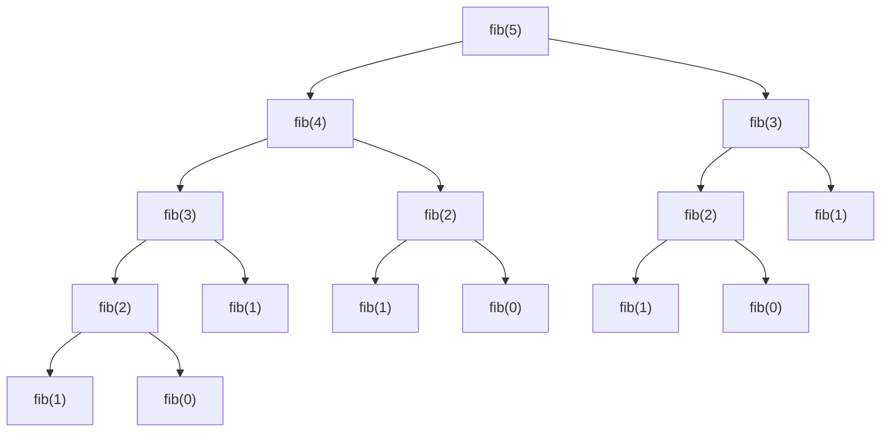

# Lecture 12 — Recursion

[Repository Guide](../../README.md) | [English](Concepts_Lecture.md) | [한국어](Concepts_Lecture.ko.md)

> **Last Updated:** 2026-11-19

> **Learning Objectives:**
> 1. Define a recursive function by dividing it into base cases and recursive cases, and explain the conditions for a recursion to terminate
> 2. Draw the call stack and trace the order of recursive calls and returns
> 3. Write recursive functions that reduce a problem to a smaller instance of the same problem, such as the factorial, the sum of a list, and exponentiation
> 4. Explain with call counts why the naive recursion for Fibonacci numbers takes exponential time, and improve it with memoization
> 5. Solve binary search, permutations, and the Tower of Hanoi recursively, and find their numbers of calls or moves
> 6. Explain the recursion depth limit and `RecursionError`, and compare recursion with iteration to choose the appropriate method

---

## Table of Contents

- [1. The Concept of Recursion](#1-the-concept-of-recursion)
  - [1.1 Functions That Call Themselves](#11-functions-that-call-themselves)
  - [1.2 Base Cases and Recursive Cases](#12-base-cases-and-recursive-cases)
  - [1.3 Thinking Recursively](#13-thinking-recursively)
  - [1.4 Recursively Defined Structures](#14-recursively-defined-structures)
- [2. The Call Stack](#2-the-call-stack)
  - [2.1 Function Calls and Stack Frames](#21-function-calls-and-stack-frames)
  - [2.2 Tracing the Factorial](#22-tracing-the-factorial)
  - [2.3 Work Before and After the Recursive Call](#23-work-before-and-after-the-recursive-call)
- [3. Problems Solved by Recursion](#3-problems-solved-by-recursion)
  - [3.1 The Sum and Maximum of a List](#31-the-sum-and-maximum-of-a-list)
  - [3.2 Exponentiation](#32-exponentiation)
  - [3.3 Palindromes and the Greatest Common Divisor](#33-palindromes-and-the-greatest-common-divisor)
  - [3.4 Nested Lists](#34-nested-lists)
- [4. Fibonacci Numbers and Memoization](#4-fibonacci-numbers-and-memoization)
  - [4.1 The Naive Recursion](#41-the-naive-recursion)
  - [4.2 The Growth of the Number of Calls](#42-the-growth-of-the-number-of-calls)
  - [4.3 Memoization](#43-memoization)
  - [4.4 functools.lru_cache](#44-functoolslru_cache)
  - [4.5 Computing by Iteration](#45-computing-by-iteration)
- [5. Divide and Conquer and Searching](#5-divide-and-conquer-and-searching)
  - [5.1 Binary Search](#51-binary-search)
  - [5.2 Generating Permutations](#52-generating-permutations)
  - [5.3 The Tower of Hanoi](#53-the-tower-of-hanoi)
  - [5.4 Merge Sort](#54-merge-sort)
- [6. The Limits of Recursion and Iteration](#6-the-limits-of-recursion-and-iteration)
  - [6.1 The Recursion Depth Limit](#61-the-recursion-depth-limit)
  - [6.2 Recursion without a Base Case or That Never Reaches It](#62-recursion-without-a-base-case-or-that-never-reaches-it)
  - [6.3 Tail Recursion and Iteration](#63-tail-recursion-and-iteration)
  - [6.4 Choosing between Recursion and Iteration](#64-choosing-between-recursion-and-iteration)
- [Concept Applications](#concept-applications)
- [Summary](#summary)
- [Self-Check Questions](#self-check-questions)
- [References](#references)

---

<br>

## 1. The Concept of Recursion

### 1.1 Functions That Call Themselves

In [Lecture 6](../Lec06_Functions/Concepts_Lecture.md), functions could call other functions. A function can also call itself.

> **Definition:** **Recursion** is a method of defining or computing something by using that thing itself again in a smaller form. A function that calls itself inside its own body is called a **recursive function**.

```python
def countdown(n):
    if n == 0:
        print("발사")
    else:
        print(n)
        countdown(n - 1)

countdown(3)
```

```text
3
2
1
발사
```

`countdown(3)` prints 3 and calls `countdown(2)`. `countdown(2)` prints 2 and calls `countdown(1)`, and `countdown(1)` prints 1 and calls `countdown(0)`. `countdown(0)` has `n == 0`, so it calls itself no further and prints `발사`. The same job could be written with a `for` statement ([Lecture 5](../Lec05_Loops/Concepts_Lecture.md)), but recursion describes the problem in terms of a smaller form of itself, as in "counting down from 3 is saying 3 and then counting down from 2."

### 1.2 Base Cases and Recursive Cases

Every recursive function consists of two parts.

> **Definition:** A **base case** is a case of the smallest inputs, for which the answer can be given directly without a recursive call.

> **Definition:** A **recursive case** is a case that reduces the problem to a smaller instance of the same problem, calls the function itself, and builds the answer from the result.

The factorial of $n$, $n! = n \times (n-1) \times \cdots \times 1$, can be defined recursively as follows. 0! is defined as 1.

```math
n! = \begin{cases} 1 & (n = 0) \\ n \times (n-1)! & (n \geq 1) \end{cases}
```

The upper line is the base case and the lower line the recursive case. This definition is turned directly into a function.

```python
def factorial(n):
    if n == 0:                  # base case
        return 1
    return n * factorial(n - 1) # recursive case

for k in [0, 1, 5, 10, 20]:
    print(k, factorial(k))
import math
print(factorial(20) == math.factorial(20))
```

```text
0 1
1 1
5 120
10 3628800
20 2432902008176640000
True
```

For a recursive function to terminate correctly, both of the following conditions are necessary.

1. **There must be a base case.** If there is no case that returns without a recursive call, the function calls itself endlessly (Section 6.2).
2. **Every recursive call must move closer to a base case.** `factorial(n)` calls `factorial(n - 1)`, so starting from a nonnegative integer, the argument decreases by 1 and must reach 0. An input that skips past the base case, such as `factorial(-1)`, never terminates.

> **Key Point:** When writing a recursive function, decide three things: (1) the answer for the smallest case, (2) how to reduce the problem to the same problem one step smaller, and (3) how to build the answer to the original problem from the answer to the reduced problem.

### 1.3 Thinking Recursively

To confirm that `factorial(5)` is correct, there is no need to follow every execution of `factorial(4)`, `factorial(3)`, and so on. Instead, only two things are checked.

- The base case `factorial(0)` returns the correct value 1.
- **Assuming** that `factorial(n - 1)` correctly returns $(n-1)!$, `n * factorial(n - 1)` is $n \times (n-1)! = n!$, so it is correct.

If these two hold, the function is correct for every $n$ among 0, 1, 2, and so on, because being correct at 0 makes it correct at 1, being correct at 1 makes it correct at 2, and so on without end. Designing a recursive function works the same way. Trust that the call solving the smaller problem already works correctly, and concentrate only on solving the current problem with its result.

> **[Discrete Mathematics]** The argument above is mathematical induction. Checking the base case corresponds to the basis step of induction, and "if the smaller case is right, the current case is right" to the inductive step. The recurrences that express the number of executions of recursive functions (Sections 4.2 and 5.3) and their solutions are also covered in Discrete Mathematics.

### 1.4 Recursively Defined Structures

Recursion is used not only for computation but also to define the structure of data. Recursively defined structures are handled naturally by recursive functions, because the shape of the function follows the definition of the structure directly.

- **Non-negative integers:** 0 is a non-negative integer, and if $n$ is a non-negative integer, so is $n + 1$. Recursion that reduces $n$ to $n - 1$, like the factorial, follows this definition backward.
- **Lists:** The empty list is a list, and an element joined to a list is also a list. The recursion of Section 3.1, which divides a list into "the first element and the rest," follows this definition.
- **Strings:** The empty string is a string, and a character joined to a string is also a string. The `reverse()` of Section 2.3 follows this definition.
- **Nested lists and folders:** An element of a list can itself be a list, and a folder can contain folders. The nested lists of Section 3.4 and the folder structure of [Lecture 10, Section 6.2](../Lec10_File-Input-and-Output/Concepts_Lecture.md#62-working-with-files-and-folders) are examples, and such structures have no fixed depth, so they cannot be handled with a few layers of loops.

The "empty list," "empty string," and "0" of these definitions become the base cases of recursive functions, and "joined to" becomes the recursive case. When a recursive function is hard to write, trying to define the data in this form reveals the base and recursive cases.

---

<br>

## 2. The Call Stack

### 2.1 Function Calls and Stack Frames

In a recursive function, the parameter of the same name `n` can hold several values at once because a separate space for local variables is created for each call.

> **Definition:** A **stack frame** is a space created each time a function is called, holding that call's parameters, local variables, and the place to return to. The frames of the running functions piled up in the order of the calls form the **call stack**.

Calling a function piles a new frame on top of the stack, and when the function returns, the top frame disappears and the function of the frame beneath resumes from where it stopped. What was piled last disappears first, so it is called a stack (a structure from which the last item put in is taken out first). The traceback of [Lecture 11, Section 1.3](../Lec11_Exception-Handling/Concepts_Lecture.md#13-reading-a-traceback) showed the call stack at the moment the exception was raised, starting from the frame that was piled first. The bottom entry of a traceback is therefore the top frame of the stack.

> **[Systems Programming]** In languages such as C, stack frames are placed in the stack region of process memory; a frame holding the return address and local variables is pushed at each call and disappears on return. The Python interpreter also creates a frame object for each running function. The layout of the stack region and calling conventions are covered in Systems Programming.

### 2.2 Tracing the Factorial

While `factorial(3)` runs, the call stack changes as follows. Each box is a frame, and the top one is the call now running.

```text
  ① call          ② call          ③ call          ④ base case       ⑤ return        ⑥ return        ⑦ return
                                                 ┌────────────┐
                                  ┌────────────┐ │ n = 0      │
                  ┌────────────┐  │ n = 1      │ │ → return 1 │  ┌────────────┐
  ┌────────────┐  │ n = 2      │  ├────────────┤ ├────────────┤  │ n = 1      │
  │ n = 3      │  ├────────────┤  │ n = 2      │ │ n = 1      │  │ 1 * 1 = 1  │  ┌────────────┐
  │            │  │ n = 3      │  ├────────────┤ ├────────────┤  ├────────────┤  │ n = 2      │  ┌────────────┐
  │            │  │            │  │ n = 3      │ │ n = 2      │  │ n = 2      │  │ 2 * 1 = 2  │  │ n = 3      │
  │            │  │            │  │            │ ├────────────┤  ├────────────┤  ├────────────┤  │ 3 * 2 = 6  │
  │            │  │            │  │            │ │ n = 3      │  │ n = 3      │  │ n = 3      │  │ → return 6 │
  └────────────┘  └────────────┘  └────────────┘ └────────────┘  └────────────┘  └────────────┘  └────────────┘
```

*Figure 1. Changes of the call stack while factorial(3) runs*

In ①-④, a frame is piled up at each call. Each call cannot yet perform the multiplication in `n * factorial(n - 1)` and is paused, waiting for the result of the call below. When the base case returns 1 at ④, the frames disappear one by one in ⑤-⑦ and the waiting multiplications are computed in turn. Recursion **splits the problem on the way down and assembles the answer on the way up**.

Printing calls and returns with indentation shows this process directly. The parameter `depth` only sets the indentation depth of the output.

```python
def factorial(n, depth=0):
    indent = "    " * depth
    print(indent + "factorial(" + str(n) + ") 호출")
    if n == 0:
        result = 1
    else:
        result = n * factorial(n - 1, depth + 1)
    print(indent + "factorial(" + str(n) + ") = " + str(result) + " 반환")
    return result

print(factorial(4))
```

```text
factorial(4) 호출
    factorial(3) 호출
        factorial(2) 호출
            factorial(1) 호출
                factorial(0) 호출
                factorial(0) = 1 반환
            factorial(1) = 1 반환
        factorial(2) = 2 반환
    factorial(3) = 6 반환
factorial(4) = 24 반환
24
```

`factorial(4)` piles up 5 frames (with arguments 4, 3, 2, 1, and 0). In general, `factorial(n)` makes $n + 1$ calls, and at its deepest there are $n + 1$ frames on the stack at once. That this depth has a limit is the subject of Section 6.1.

### 2.3 Work Before and After the Recursive Call

Work placed **before** the recursive call runs on the way down, and work placed **after** it runs on the way up. This difference can reverse an order.

```python
def before(n):
    if n == 0:
        return
    print(n, end=" ")
    before(n - 1)

def after(n):
    if n == 0:
        return
    after(n - 1)
    print(n, end=" ")

before(4)
print()
after(4)
print()

def reverse(s):
    if s == "":
        return ""
    return reverse(s[1:]) + s[0]

print(reverse("python"))
```

```text
4 3 2 1 
1 2 3 4 
nohtyp
```

- **`before(4)`:** It prints and then makes the recursive call, so the output is in the order 4, 3, 2, 1.
- **`after(4)`:** It prints on the way up after all the recursive calls have finished, so `after(1)`, the last one called, prints 1 first.
- **`reverse(s)`:** "The reverse of a string is the reverse of the rest after the first character, followed by the first character." `reverse("python")` is `reverse("ython") + "p"`, and this continues until it becomes `"nohtyp"`. The empty string is the base case.

---

<br>

## 3. Problems Solved by Recursion

### 3.1 The Sum and Maximum of a List

A list can also be handled recursively by dividing it into "the first element and the rest of the list." The rest is obtained with the slice `lst[1:]` ([Lecture 7, Section 2.2](../Lec07_Lists-and-Dictionaries/Concepts_Lecture.md#22-slicing)).

```python
def sum_list(lst):
    if len(lst) == 0:
        return 0
    return lst[0] + sum_list(lst[1:])

def max_list(lst):
    if len(lst) == 1:
        return lst[0]
    rest_max = max_list(lst[1:])
    if lst[0] > rest_max:
        return lst[0]
    return rest_max

data = [3, 8, 1, 6]
print(sum_list(data), max_list(data))
print(sum_list([]))
```

```text
18 8
0
```

- **The sum:** The sum of the empty list is 0 (the base case); otherwise the first element is added to the sum of the rest. $3 + (8 + (1 + (6 + 0))) = 18$.
- **The maximum:** The maximum of the empty list is undefined, so the base case is a list with one element. The maximum of the rest, 8, is compared with the first element 3, and the larger is returned.
- **Choosing the base case:** The base case of the sum was taken as the empty list, so `sum_list([])` correctly gives 0 too. In contrast, `max_list([])` never reaches `len(lst) == 1`, because the `[1:]` of an empty list is again an empty list; this result is confirmed in Section 6.2.

> **Caution:** `lst[1:]` creates a new list copying the remaining elements at every call. For a list of length $n$, the total number of elements copied is $(n-1) + (n-2) + \cdots + 1 = n(n-1)/2$, so even though there are only $n$ recursive calls, the total work is proportional to $n^2$. For large lists, pass indices as parameters instead of cutting the list (as in the binary search of Section 5.1), or use the built-in functions `sum()` and `max()`.

### 3.2 Exponentiation

Reducing $x^n$ to $x \times x^{n-1}$ makes $n + 1$ calls. Halving the exponent makes far fewer calls.

```math
x^n = \begin{cases} 1 & (n = 0) \\ \left(x^{\lfloor n/2 \rfloor}\right)^2 & (n \text{ even}) \\ \left(x^{\lfloor n/2 \rfloor}\right)^2 \times x & (n \text{ odd}) \end{cases}
```

```python
calls = 0

def power(x, n):
    global calls
    calls += 1
    if n == 0:
        return 1
    return x * power(x, n - 1)

def fast_power(x, n):
    global calls
    calls += 1
    if n == 0:
        return 1
    half = fast_power(x, n // 2)
    if n % 2 == 0:
        return half * half
    return half * half * x

for n in [10, 100, 500]:
    calls = 0
    a = power(2, n)
    c1 = calls
    calls = 0
    b = fast_power(2, n)
    c2 = calls
    print(n, a == b == 2 ** n, c1, c2)
```

```text
10 True 11 5
100 True 101 8
500 True 501 10
```

- **Measuring the number of calls:** The global variable `calls` is increased by 1 at each call to count them ([Lecture 6, Section 5.4](../Lec06_Functions/Concepts_Lecture.md#54-changing-a-global-variable-inside-a-function)).
- **`power`:** The exponent decreases by 1, so the number of calls is $n + 1$.
- **`fast_power`:** The exponent is halved, so the number of calls is $\lfloor \log_2 n \rfloor + 2$ (for $n \geq 1$). For $n = 500$, $\log_2 500 \approx 8.97$, so there are $8 + 2 = 10$ calls.
- **Why `half` is computed only once:** Calling it twice, as in `fast_power(x, n // 2) * fast_power(x, n // 2)`, makes the number of calls grow in proportion to $n$ again. Not solving the same smaller problem twice is the key, and it is also the subject of Section 4.

`power(2, 1000)` needs 1001 frames, so it fails at the limit of Section 6.1, but `fast_power(2, 1000)` makes only 11 calls and has no problem.

### 3.3 Palindromes and the Greatest Common Divisor

A string that reads the same forward and backward is called a **palindrome**. It can be defined as "a string whose first and last characters are equal and whose middle, without those two, is a palindrome." The greatest common divisor of two integers is found by the Euclidean algorithm. If $b$ is 0, the greatest common divisor is $a$; otherwise, it equals the greatest common divisor of $b$ and $a \bmod b$.

```python
def is_palindrome(s):
    if len(s) <= 1:
        return True
    if s[0] != s[-1]:
        return False
    return is_palindrome(s[1:-1])

for w in ["level", "토마토", "python", "", "abba", "abca"]:
    print(repr(w), is_palindrome(w))

def gcd(a, b):
    if b == 0:
        return a
    return gcd(b, a % b)

print(gcd(48, 18), gcd(18, 48), gcd(17, 5))
import math
print(math.gcd(48, 18))
```

```text
'level' True
'토마토' True
'python' False
'' True
'abba' True
'abca' False
6 6 1
6
```

- **Two base cases:** A string of 0 or 1 characters is a palindrome (`len(s) <= 1`). Also, if the end characters differ, the answer is `False` without looking at the middle. There can be several base cases.
- **`s[1:-1]`:** The middle without the first and last characters. `"level"` shrinks to `"eve"` and `"v"` and gives `True`.
- **Tracing the greatest common divisor:** `gcd(48, 18)` continues to `gcd(18, 12)`, `gcd(12, 6)`, and `gcd(6, 0)`, giving 6. $48 \bmod 18 = 12$, $18 \bmod 12 = 6$, and $12 \bmod 6 = 0$. For `gcd(18, 48)`, the first call has $18 \bmod 48 = 18$, so it turns into `gcd(48, 18)` and gives the same answer.
- **The recursive call as the last action:** `gcd()` and `is_palindrome()` return the result of the recursive call as it is, so there is nothing to do on the way up. Section 6.3 shows that this form is easily turned into a loop.

### 3.4 Nested Lists

To add up all the integers in a list whose elements can themselves be lists, such as `[1, [2, [3, 4]], 5, []]`, loops alone are difficult because the number of nesting levels is not known in advance. If an element is a list, apply the same function to it.

```python
def nested_sum(items):
    total = 0
    for x in items:
        if isinstance(x, list):
            total += nested_sum(x)      # recurse if the element is a list
        else:
            total += x
    return total

def depth_of(items):
    if not isinstance(items, list):
        return 0
    deepest = 0
    for x in items:
        d = depth_of(x)
        if d > deepest:
            deepest = d
    return deepest + 1

data = [1, [2, [3, 4]], 5, []]
print(nested_sum(data), depth_of(data))
print(nested_sum([]), depth_of([]), depth_of(7))
```

```text
15 3
0 1 0
```

- **Combining iteration and recursion:** `nested_sum()` loops over the elements of one level with a `for` statement and recurses only when an element is a list. No base case is written separately, but no recursion occurs for elements that are not lists (integers) or for an empty list (the loop never runs), so it always terminates.
- **`isinstance(x, list)`:** Checks whether an element is a list ([Lecture 9, Section 3.3](../Lec09_Inheritance-and-Polymorphism/Concepts_Lecture.md#33-isinstance-and-issubclass)). Here the structure itself branches according to the kind of element, so checking the kind is appropriate.
- **The sum:** $1 + (2 + (3 + 4)) + 5 + 0 = 15$.
- **The depth:** `depth_of()` defines the depth of an integer as 0 and the depth of a list as "the depth of its deepest element + 1." `[3, 4]` has depth 1, `[2, [3, 4]]` depth 2, and the whole depth 3. An empty list has no elements, so its depth is $0 + 1 = 1$.
- **The depth of recursion:** The recursion depth of these functions is not the length of the list but the depth of nesting. Even with a million elements, if the nesting is three levels, the depth is 3, so the limit of Section 6.1 is not a concern.

---

<br>

## 4. Fibonacci Numbers and Memoization

### 4.1 The Naive Recursion

The Fibonacci sequence starts with 0 and 1 and makes each next number by adding the previous two.

```math
F_0 = 0, \quad F_1 = 1, \quad F_n = F_{n-1} + F_{n-2} \quad (n \geq 2)
```

Translating the definition directly gives a function with two recursive calls.

```python
import time

calls = 0

def fib(n):
    global calls
    calls += 1
    if n < 2:
        return n
    return fib(n - 1) + fib(n - 2)

print([fib(k) for k in range(11)])
for n in [10, 20, 25, 30]:
    calls = 0
    start = time.perf_counter()
    value = fib(n)
    elapsed = time.perf_counter() - start
    print(n, value, calls, round(elapsed, 3))
```

```text
[0, 1, 1, 2, 3, 5, 8, 13, 21, 34, 55]
10 55 177 0.0
20 6765 21891 0.001
25 75025 242785 0.014
30 832040 2692537 0.144
```

The function gives correct values. But the third number of each line, the number of calls, grows about 11 times each time $n$ increases by 5, and the fourth number, the running time (in seconds, measured with `time.perf_counter()` on the computer that produced this output), grows at the same rate. A single `fib(30)` called the function about 2.7 million times.



*Figure 2. The call tree for computing fib(5)*

Drawing the call tree reveals the cause. While computing `fib(5)`, `fib(3)` is computed twice, `fib(2)` three times, and `fib(1)` five times. Solving the same small problem again from scratch multiplies exponentially toward the bottom of the tree. The figure has 15 nodes, the same as the 15 calls of `fib(5)`.

### 4.2 The Growth of the Number of Calls

Let $C(n)$ be the number of calls of `fib(n)`. `fib(0)` and `fib(1)` finish in one call, and `fib(n)` adds the counts of its two recursive calls to its own one.

```math
C(0) = C(1) = 1, \qquad C(n) = C(n-1) + C(n-2) + 1 \quad (n \geq 2)
```

Adding 1 to both sides and letting $D(n) = C(n) + 1$ gives $D(n) = D(n-1) + D(n-2)$ with $D(0) = D(1) = 2$. This is the same recurrence as the Fibonacci sequence multiplied by 2, so $D(n) = 2F_{n+1}$, that is, the following holds.

```math
C(n) = 2F_{n+1} - 1
```

For $n = 30$, $F_{31} = 1346269$, so $C(30) = 2 \times 1346269 - 1 = 2692537$, the same as the value counted in Section 4.1. The ratio of two neighboring Fibonacci numbers approaches the golden ratio $\varphi = (1 + \sqrt{5}) / 2 \approx 1.618$, so Fibonacci numbers grow roughly in proportion to $\varphi^n$. Each increase of $n$ by 5 multiplies the number of calls by about $\varphi^5 \approx 11.09$, and the measurement gave $2692537 / 242785 \approx 11.09$. Growth that multiplies by a fixed ratio each time the input increases by 1 is called **exponential growth**. At this rate, `fib(50)` would take about $\varphi^{20} \approx 15000$ times as long as `fib(30)`.

### 4.3 Memoization

> **Definition:** **Memoization** is a technique in which a function stores the result it computed for an argument and, when called again with the same argument, returns the stored result without computing it.

A dictionary with arguments as keys and results as values is a suitable store ([Lecture 7, Section 11](../Lec07_Lists-and-Dictionaries/Concepts_Lecture.md#11-dictionaries)).

```python
calls = 0
memo = {}

def fib_memo(n):
    global calls
    calls += 1
    if n in memo:
        return memo[n]
    if n < 2:
        result = n
    else:
        result = fib_memo(n - 1) + fib_memo(n - 2)
    memo[n] = result
    return result

for n in [10, 30, 100]:
    calls = 0
    memo.clear()
    print(n, fib_memo(n), calls)
```

```text
10 55 19
30 832040 59
100 354224848179261915075 199
```

- **Checking the store:** The function first looks in `memo` for the answer. If it is there, the value is returned at once.
- **Storing after computing:** If not, the function computes it and stores it in `memo[n]` before returning.
- **The number of calls:** `fib_memo(n)` computes each value from 0 to $n$ only once, so the number of calls is $2n - 1$, proportional to $n$. `fib(30)`, which took 2.7 million calls, dropped to 59, and `fib(100)`, which the naive recursion would practically never finish, is computed in 199 calls.
- **`memo.clear()`:** The store is emptied for each measurement so that counting starts from scratch. Without emptying it, earlier results would be reused and the number of calls would drop further.

> **[Algorithms]** Storing the answers to small problems and assembling the answer to a large problem from them is called dynamic programming. Memoization stores only the needed answers while descending recursively from the top (top-down), and there is also the approach of filling in answers from the smallest in order, as in Section 4.5 (bottom-up). The design principles and complexity analysis of both approaches are covered in Algorithms.

### 4.4 functools.lru_cache

Memoization is used so often that the standard module `functools` provides it as a decorator [1]. A decorator, as seen in [Lecture 9, Section 5.2](../Lec09_Inheritance-and-Polymorphism/Concepts_Lecture.md#52-the-abc-module), is attached above a function definition as `@name` and wraps the function with a feature.

```python
from functools import lru_cache

@lru_cache(maxsize=None)
def fib(n):
    if n < 2:
        return n
    return fib(n - 1) + fib(n - 2)

print(fib(30))
print(fib.cache_info())
print(fib(100))
print(fib.cache_info())
fib.cache_clear()
print(fib.cache_info())
```

```text
832040
CacheInfo(hits=28, misses=31, maxsize=None, currsize=31)
354224848179261915075
CacheInfo(hits=99, misses=101, maxsize=None, currsize=101)
CacheInfo(hits=0, misses=0, maxsize=None, currsize=0)
```

- **`@lru_cache(maxsize=None)`:** The function body is the naive recursion unchanged, and the decorator takes care of storing arguments and results. `maxsize=None` means there is no limit on the number of results stored. With a limit, the least recently used (LRU) results are discarded first [1].
- **`cache_info()`:** Reports the number of times the answer was found in the store (`hits`), the number of times it was missing and computed (`misses`), and the number of stored results (`currsize`) [1]. For `fib(30)`, `misses` is the 31 values from 0 to 30, and `hits` is the 28 times already computed values were looked up again.
- **Reusing the store:** Calling `fib(100)` next finds the answers for 0-30 already present, so only the 70 values from 31 to 100 are computed anew, making `misses` 101.
- **`cache_clear()`:** Empties the store.

> **Note:** `functools.cache` is a shorter name that does the same as `lru_cache(maxsize=None)`, added in Python 3.9 [1]. Also, writing `@lru_cache` alone without parentheses is allowed from Python 3.8 [1]. Neither is available in Python 3.7, so write `@lru_cache(maxsize=None)` as in the example above.

> **Caution:** Use memoization only for functions that always give the same result for the same arguments. Using it on a function whose result depends on global variables, the contents of a file, or the current time returns stale results. Also, the arguments are used as dictionary keys, so `lru_cache` cannot be used for a function that receives unhashable arguments such as lists.

### 4.5 Computing by Iteration

Fibonacci numbers need only the previous two values to be remembered, so they can also be computed with a loop.

```python
def fib_iter(n):
    a, b = 0, 1
    for _ in range(n):
        a, b = b, a + b
    return a

print(fib_iter(10), fib_iter(30), fib_iter(100))
print(len(str(fib_iter(10000))))
```

```text
55 832040 354224848179261915075
2090
```

`a` and `b` always hold two neighboring Fibonacci numbers $F_k$ and $F_{k+1}$. The simultaneous assignment `a, b = b, a + b` computes the whole right side before assigning, so it advances one step without a temporary variable ([Lecture 7, Section 7.4](../Lec07_Lists-and-Dictionaries/Concepts_Lecture.md#74-tuple-unpacking)). The loop runs $n$ times, two variables suffice for storage, and it is not subject to the recursion depth limit (Section 6.1), so it computes even a 2,090-digit number such as `fib_iter(10000)` at once. The loop variable `_` is the name conventionally given to a variable whose value is not used.

| Method | Number of Calls or Iterations | Extra Storage | Recursion Depth |
|:-----|:-----|:-----|:-----|
| Naive recursion `fib` | $2F_{n+1} - 1$ (exponential) | None | $n$ |
| Memoization `fib_memo`, `lru_cache` | $2n - 1$ | $n + 1$ results | $n$ |
| Iteration `fib_iter` | $n$ | 2 variables | None |

*Table 1. Comparison of three methods for computing Fibonacci numbers*

---

<br>

## 5. Divide and Conquer and Searching

### 5.1 Binary Search

> **Definition:** **Divide and conquer** is a method that divides a problem into smaller problems of the same kind, solves each recursively, and combines their answers into the answer to the original problem.

**Binary search**, which finds a value in a sorted list, is the simplest example of divide and conquer. It compares the target with the middle element of the search range: if they are equal, the value is found; if the target is larger, it searches the right half again; if smaller, the left half. If the search range becomes empty, the value is absent. Instead of cutting the list, the indices `lo` and `hi` of both ends of the range are passed as parameters.

```python
def binary_search(a, target, lo, hi):
    print("  탐색 범위", lo, "~", hi)
    if lo > hi:
        return -1
    mid = (lo + hi) // 2
    if a[mid] == target:
        return mid
    elif a[mid] < target:
        return binary_search(a, target, mid + 1, hi)
    else:
        return binary_search(a, target, lo, mid - 1)

data = [2, 5, 8, 12, 16, 23, 38, 56, 72, 91]
print("23 찾기")
print("결과:", binary_search(data, 23, 0, len(data) - 1))
print("7 찾기")
print("결과:", binary_search(data, 7, 0, len(data) - 1))
```

```text
23 찾기
  탐색 범위 0 ~ 9
  탐색 범위 5 ~ 9
  탐색 범위 5 ~ 6
결과: 5
7 찾기
  탐색 범위 0 ~ 9
  탐색 범위 0 ~ 3
  탐색 범위 2 ~ 3
  탐색 범위 2 ~ 1
결과: -1
```

| Call | `lo` | `hi` | `mid` | `a[mid]` | Decision |
|:-----|-----:|-----:|-----:|-----:|:-----|
| 1 | 0 | 9 | 4 | 16 | 23 > 16, so the right half |
| 2 | 5 | 9 | 7 | 56 | 23 < 56, so the left half |
| 3 | 5 | 6 | 5 | 23 | Equal, so return index 5 |

*Table 2. The process of binary searching for 23*

- **Two base cases:** The range is empty (`lo > hi`, the value is absent), or the middle element is the target. When searching for 7, the range became 2-1, which is empty, and -1 was returned.
- **Moving closer to a base case:** Each call leaves only a half excluding `mid`, so the size of the range shrinks to half or less. With $n$ elements, there are about $\log_2 n$ calls. With 10 elements, at most 4 comparisons are made. Even with a million elements, about 20 suffice.
- **The precondition of sorting:** Binary search is correct only when the list is sorted in ascending order, because the decision "if larger than the middle, it is on the right" relies on the ordering.

### 5.2 Generating Permutations

Each order in which distinct elements can be lined up is called a **permutation**. With $n$ elements there are $n!$ permutations. The idea of generating permutations recursively is as follows. Choose one element to come first, generate all permutations of the remaining elements recursively, and put the chosen element in front of each. Repeat this with each element in turn as the first.

```python
def permutations(items):
    if len(items) <= 1:
        return [items[:]]
    result = []
    for i in range(len(items)):
        first = items[i]
        rest = items[:i] + items[i + 1:]
        for p in permutations(rest):
            result.append([first] + p)
    return result

ps = permutations(["A", "B", "C"])
print(len(ps))
for p in ps:
    print("".join(p))
print(len(permutations([1, 2, 3, 4, 5])))

import itertools
print(list(itertools.permutations("ABC")) == [tuple(p) for p in ps])
```

```text
6
ABC
ACB
BAC
BCA
CAB
CBA
120
True
```

- **The base case:** With 0 or 1 elements, the only permutation is the list itself. A copy, `items[:]`, is put in so that the result list does not share an object with the argument.
- **The recursive case:** `items[:i] + items[i + 1:]` is the rest without element `i`. Choosing `"A"` puts `A` in front of the permutations `BC` and `CB` of the rest `["B", "C"]`, giving `ABC` and `ACB`.
- **The count:** There are $n$ ways to choose the first element, and for each there are $(n-1)!$ permutations of the rest, so there are $n \times (n-1)! = n!$. With 5 elements there are 120.
- **`"".join(p)`:** Builds a string by concatenating a list of strings.
- **The standard module:** `itertools.permutations()` also generates the permutations, as tuples, in the same order. In practice this function is used, and since the number of permutations grows very fast ($10! = 3628800$), care is needed with the count when making them all into a list.

### 5.3 The Tower of Hanoi

The Tower of Hanoi is a puzzle with three pegs (A, B, C) and $n$ disks of all different sizes. Initially all disks are stacked on A with larger ones below. All disks must be moved to C while obeying the following rules.

1. Move only one disk at a time.
2. Only the top disk of each peg can be moved.
3. A larger disk cannot be placed on a smaller disk.

A way to solve it with loops is hard to come up with, but thinking recursively makes it simple. To move the largest disk $n$ from A to C, all $n - 1$ disks above it must be on B. Therefore moving $n$ disks from A to C takes the following three steps.

1. Move the top $n - 1$ disks from A to B (via C). This is the same problem one size smaller.
2. Move the largest disk from A to C.
3. Move the $n - 1$ disks on B from B to C (via A).

```python
moves = 0

def hanoi(n, src, dst, via):
    global moves
    if n == 0:
        return
    hanoi(n - 1, src, via, dst)
    moves += 1
    print(str(moves) + ": 원판 " + str(n) + ", " + src + " -> " + dst)
    hanoi(n - 1, via, dst, src)

hanoi(3, "A", "C", "B")
```

```text
1: 원판 1, A -> C
2: 원판 2, A -> B
3: 원판 1, C -> B
4: 원판 3, A -> C
5: 원판 1, B -> A
6: 원판 2, B -> C
7: 원판 1, A -> C
```

- **The parameters:** `hanoi(n, src, dst, via)` means "move $n$ disks from `src` to `dst` via `via`." In step 1 the destination and the intermediate peg swap, giving `hanoi(n - 1, src, via, dst)`.
- **The trace:** Moves 1-3 are step 1, moving 2 disks from A to B; move 4 is the move of the largest disk 3; and moves 5-7 are step 3, moving the 2 disks on B to C.
- **The base case:** With 0 disks there is nothing to do. One disk could be taken as the base case, but taking 0 makes the code shorter.

Letting $T(n)$ be the number of moves for $n$ disks, the three steps take $T(n-1)$, 1, and $T(n-1)$ moves, which gives the following recurrence.

```math
T(0) = 0, \qquad T(n) = 2T(n-1) + 1
```

Since $T(n) + 1 = 2(T(n-1) + 1)$, $T(n) + 1$ doubles at each step to $2^n$, and $T(n) = 2^n - 1$. With 3 disks it is $2^3 - 1 = 7$, the same as the output above. This number also grows exponentially: 20 disks take $2^{20} - 1 = 1048575$ moves and 64 disks $2^{64} - 1 = 18446744073709551615$ moves. Unlike the Fibonacci case of Section 4.2, there is no waste of repeating the same computation here, and no method can do it in fewer than $2^n - 1$ moves. For the largest disk to leave A, the other $n - 1$ disks must all be gathered on one other peg, and after the largest disk is placed on C, the $n - 1$ disks must be moved onto it again, so the minimum number of moves for $n$ disks is at least twice the minimum for $n - 1$ disks plus 1.

### 5.4 Merge Sort

The bubble sort of [Lecture 8, Section 1.2](../Lec08_Classes-and-Objects/Concepts_Lecture.md#12-writing-a-sort-function) makes about $n^2/2$ comparisons. Sorting by divide and conquer makes far fewer comparisons. **Merge sort** divides a list in half, sorts each half recursively, and then combines the two sorted halves into one. A list of at most one element is already sorted, so it is the base case.

**Merging** two sorted lists means picking the smaller element from the fronts of the two lists one at a time and appending it to the result.

```python
def merge(left, right):
    result = []
    i = j = 0
    while i < len(left) and j < len(right):
        if left[i] <= right[j]:
            result.append(left[i])
            i += 1
        else:
            result.append(right[j])
            j += 1
    result.extend(left[i:])
    result.extend(right[j:])
    return result

def merge_sort(a, depth=0):
    print("    " * depth + str(a))
    if len(a) <= 1:
        return a
    mid = len(a) // 2
    left = merge_sort(a[:mid], depth + 1)
    right = merge_sort(a[mid:], depth + 1)
    merged = merge(left, right)
    print("    " * depth + "병합 -> " + str(merged))
    return merged

print(merge([1, 4, 9], [2, 3, 10, 11]))
print(merge_sort([38, 27, 43, 3, 9, 82]))
```

```text
[1, 2, 3, 4, 9, 10, 11]
[38, 27, 43, 3, 9, 82]
    [38, 27, 43]
        [38]
        [27, 43]
            [27]
            [43]
        병합 -> [27, 43]
    병합 -> [27, 38, 43]
    [3, 9, 82]
        [3]
        [9, 82]
            [9]
            [82]
        병합 -> [9, 82]
    병합 -> [3, 9, 82]
병합 -> [3, 9, 27, 38, 43, 82]
[3, 9, 27, 38, 43, 82]
```

- **`merge()`:** `i` and `j` are the indices of the first not-yet-chosen elements of the two lists. When one side runs out, the remaining elements of the other side are already sorted, so they are appended all at once with `extend()`. In `left[i] <= right[j]`, the left one is chosen first when they are equal, so the original order of equal values is preserved.
- **Dividing:** The lines with deepening indentation are the process of going down while halving the list. When a list has one element, it is not divided further.
- **Combining:** The `병합 ->` lines are the process of combining the sorted halves on the way up. As seen in Section 2.2, the problem is split on the way down and the answer assembled on the way up.

With $n$ elements, there are about $\log_2 n$ levels of halving, and at each level the merges together handle $n$ elements. Therefore the number of comparisons of merge sort is roughly proportional to $n \log_2 n$. With a million elements, merge sort makes about $2 \times 10^7$ comparisons against about $5 \times 10^{11}$ for bubble sort. The recursion depth is also about $\log_2 n$, so even large lists do not hit the limit. However, this implementation creates new lists through slicing and merging, so it uses extra memory proportional to the number of elements.

---

<br>

## 6. The Limits of Recursion and Iteration

### 6.1 The Recursion Depth Limit

Each recursive call piles up a frame, and frames take memory. To prevent endless recursion from overflowing the interpreter's internal stack and crashing Python, Python places a limit on the depth of the call stack [2]. Exceeding this limit raises a `RecursionError` [3].

```python
import sys

def depth(n):
    if n == 0:
        return 0
    return 1 + depth(n - 1)

print(sys.getrecursionlimit())
print(depth(900))
print(depth(5000))
```

```text
1000
900
Traceback (most recent call last):
  File "limit.py", line 10, in <module>
    print(depth(5000))
          ~~~~~^^^^^^
  File "limit.py", line 6, in depth
    return 1 + depth(n - 1)
               ~~~~~^^^^^^^
  File "limit.py", line 6, in depth
    return 1 + depth(n - 1)
               ~~~~~^^^^^^^
  File "limit.py", line 6, in depth
    return 1 + depth(n - 1)
               ~~~~~^^^^^^^
  [Previous line repeated 996 more times]
RecursionError: maximum recursion depth exceeded
```

- **The value of the limit:** `sys.getrecursionlimit()` reports the current limit, which was 1000 in this run. The top-level code also uses one frame, so the recursion depth that can actually be piled up is slightly less than 1000.
- **`depth(900)`:** About 900 frames, within the limit, so it succeeded.
- **`depth(5000)`:** At the moment it exceeded the limit, a `RecursionError` was raised. The traceback abbreviates the part where the same line repeats as `[Previous line repeated 996 more times]`.
- **The exception hierarchy:** `RecursionError` is a subclass of `RuntimeError` ([Lecture 11, Section 4.1](../Lec11_Exception-Handling/Concepts_Lecture.md#41-inheritance-among-exception-classes)) [3].

The limit can be changed with `sys.setrecursionlimit()` [2].

```python
import sys

def depth(n):
    if n == 0:
        return 0
    return 1 + depth(n - 1)

sys.setrecursionlimit(6000)
print(sys.getrecursionlimit())
print(depth(5000))
```

```text
6000
5000
```

> **Caution:** Raising the limit allows deeper recursion, but the limit does not guarantee the depth that actual memory can withstand. Setting it too high can make the interpreter crash instead of raising a `RecursionError` [2]. If a function's recursion depth is proportional to the size of its input, rather than raising the limit, convert it to a loop as in Section 6.3 or use a method of depth $\log n$ (`fast_power` of Section 3.2, the binary search of Section 5.1).

> **Note:** From Python 3.12, the recursion limit applies only to calls of Python code, and recursion in built-in functions is protected by a separate mechanism [4]. Also, versions older than Python 3.5 raised a `RuntimeError` instead of a `RecursionError` in the same situation [3]. In versions from 3.5 on, including Python 3.7, the examples of this unit raise the same `RecursionError`, although the wording of the message can differ slightly between versions. For example, in Python 3.9, `depth(5000)` of Section 6.1 gives the message `maximum recursion depth exceeded in comparison`.

### 6.2 Recursion without a Base Case or That Never Reaches It

If either of the two conditions of Section 1.2 is violated, the recursion does not terminate and runs into the limit of Section 6.1. The following `countdown()` omits the base case.

```python
def countdown(n):
    print(n, end=" ")
    countdown(n - 1)

countdown(3)
```

This program keeps printing `3 2 1 0 -1 -2 ...` into the negative numbers, and in this run it stopped with `RecursionError: maximum recursion depth exceeded` after printing `-995`. With no base case telling it to stop at 0, the argument decreases without end.

Even with a base case, the same thing happens if the input passes it by. The result of passing an empty list to `max_list()` of Section 3.1 is as follows.

```text
Traceback (most recent call last):
  File "list_rec.py", line 17, in <module>
    max_list([])
    ~~~~~~~~^^^^
  File "list_rec.py", line 9, in max_list
    rest_max = max_list(lst[1:])
  File "list_rec.py", line 9, in max_list
    rest_max = max_list(lst[1:])
  File "list_rec.py", line 9, in max_list
    rest_max = max_list(lst[1:])
  [Previous line repeated 996 more times]
RecursionError: maximum recursion depth exceeded
```

The empty list does not have length 1, so it goes to the recursive case, and `[][1:]` is again an empty list, so the size does not shrink. This is a recursive call that does not move closer to the base case. Such inputs are better checked at the start of the function, as in `if len(lst) == 0: raise ValueError("빈 리스트의 최댓값은 없다")`, and reported with a meaningful exception ([Lecture 11, Section 5.1](../Lec11_Exception-Handling/Concepts_Lecture.md#51-the-raise-statement)).

> **Caution:** When the same line repeats hundreds of times in the traceback of a `RecursionError`, usually there is no base case, the argument of the recursive call does not shrink toward the base case, or the condition of the base case misses some inputs (negative numbers, empty lists, floats). Raising the limit is not the solution in this case.

### 6.3 Tail Recursion and Iteration

The form in which the recursive call is the **last thing** the function does, returning its result directly, is called **tail recursion**. The `gcd()` of Section 3.3 is an example. The `n * factorial(n - 1)` of `factorial()` still has a multiplication left after the recursive call, so it is not tail recursion. Passing the intermediate result of the multiplication as an accumulator turns it into tail recursion.

```python
def fact_tail(n, acc=1):
    if n == 0:
        return acc
    return fact_tail(n - 1, acc * n)

def fact_loop(n):
    acc = 1
    while n > 0:
        acc = acc * n
        n = n - 1
    return acc

print(fact_tail(10), fact_loop(10))
print(fact_loop(3000).bit_length())
print(fact_tail(3000))
```

```text
3628800 3628800
30332
Traceback (most recent call last):
  File "tail.py", line 15, in <module>
    print(fact_tail(3000))
          ~~~~~~~~~^^^^^^
  File "tail.py", line 4, in fact_tail
    return fact_tail(n - 1, acc * n)
  File "tail.py", line 4, in fact_tail
    return fact_tail(n - 1, acc * n)
  File "tail.py", line 4, in fact_tail
    return fact_tail(n - 1, acc * n)
  [Previous line repeated 996 more times]
RecursionError: maximum recursion depth exceeded
```

- **The correspondence between tail recursion and iteration:** The recursive call of `fact_tail(n, acc)` amounts to "change `n` to `n - 1` and `acc` to `acc * n` and start over." Therefore turning the parameters into variables and the recursive call into a loop gives `fact_loop()`. The base-case condition `n == 0` becomes the negation of the loop condition `n > 0`.
- **`fact_loop(3000)`:** $3000!$ is a large integer of 30,332 bits, but since it uses a loop, it is computed without a depth limit. `bit_length()` is the number of bits needed to write that integer in binary.
- **`fact_tail(3000)`:** It is a `RecursionError` even though it is tail recursion. Some language implementations optimize tail calls so that they reuse frames, but, as this output shows, the Python interpreter piles up a frame for every call even in tail recursion. In Python, deep tail recursion must be converted into a loop by hand.

To convert recursion that is not tail recursion (such as the Hanoi of Section 5.3, with two or more recursive calls) into iteration, one must imitate what the interpreter did by pushing work to be done onto a stack made from a list and popping it off. In such cases recursion is far easier to read, and the depth is usually not a problem. The depth of Hanoi is only $n$, and when $n$ approaches 1000, the number of moves is so large that it could not all be executed anyway.

### 6.4 Choosing between Recursion and Iteration

| Criterion | When Recursion Fits | When Iteration Fits |
|:-----|:-----|:-----|
| The structure of the problem | The problem divides into smaller problems of the same shape (trees, divide and conquer, Hanoi, permutations) | The same work repeats a fixed number of times or until a condition (sums, factorials, Fibonacci) |
| Recursion depth | The depth is $\log n$ or small and bounded | The depth is proportional to the input size $n$, and $n$ may be thousands or more |
| Repetition of the same subproblems | None, or removable by memoization | Computing from the smallest answers in order can also save storage |
| Readability | The mathematical definition can be transcribed directly | The progress of the state is visible in a few variables |
| Running cost | Each call has the cost of creating a frame | There is no cost of function calls |

*Table 3. Criteria for choosing recursion or iteration*

In short, recursion is a tool that makes code short and correct when the structure of a problem is recursive. Problems that are easy to write with iteration and may be deep (factorials, sums of lists) use loops or built-in functions in Python, and problems whose structure itself branches (traversing trees, Hanoi, permutations) are written recursively.

---

<br>

## Concept Applications

When solving with recursion, consider the base case, the way of reducing the problem, the depth, and repeated computation together.

| Problem | Recursive Design and Points to Consider |
|:-----|:-----|
| The sum of all integers in a nested list (`[1, [2, [3, 4]], 5]`) | If an element is a list, apply the same function to it recursively; if it is an integer, add it (Section 3.4). The recursion goes only as deep as the nesting, so depth is not a problem. |
| The sum of the sizes of all files in a folder | If an entry in the folder is a folder, find its sum recursively; if it is a file, add its size (`iterdir()` and `is_dir()` of [Lecture 10, Section 6.2](../Lec10_File-Input-and-Output/Concepts_Lecture.md#62-working-with-files-and-folders)). |
| The number of ways to climb $n$ stairs taking 1 or 2 steps at a time | $W(n) = W(n-1) + W(n-2)$, the same structure as Fibonacci. There is much repeated computation, so use `lru_cache` or iteration. |
| Finding a value in a sorted list of length one million | Binary search has a depth of about 20, so writing it recursively is fine. |
| Sorting 100,000 grade records by score | Recursion that halves the list, like merge sort, has a depth of about 17, so the limit does not matter. In practice, use the built-in `sorted()`. |
| The sum from 1 to one million | The depth would be one million, so writing it recursively gives a `RecursionError`. Use `sum(range(1, 1000001))` or a loop. |
| Every order of passwords made from 4 characters | Generate the $4! = 24$ orders with the permutation recursion. As the characters increase, the count grows rapidly as $n!$, so compute the count first. |

*Table 4. Problems solvable by recursion and points to consider in their design*

**True/False Check:**

| Statement | Judgment and Reason |
|:-----|:-----|
| A recursive function with a base case always terminates for every input. | **F.** It does not terminate for inputs whose recursive calls do not move closer to the base case (`factorial(-1)`, `max_list([])`) (Sections 1.2 and 6.2). |
| Each call of a recursive function has its own local variables. | **T.** A new stack frame is created at each call, holding its parameters and local variables separately (Section 2.1). |
| A `print()` placed after the recursive call runs first in the function called first. | **F.** It runs on the way up after all recursive calls have returned, so it runs first in the function called last (Section 2.3). |
| The number of calls of the naive recursive `fib(n)` is proportional to $n$. | **F.** The number of calls is $2F_{n+1} - 1$, which grows exponentially (Section 4.2). |
| Memoization is a safe way to speed up any function. | **F.** It can be used only for functions that give the same result for the same arguments, and the arguments must be hashable (Section 4.4). |
| Python converts tail recursion into iteration, so tail recursion is not subject to the depth limit. | **F.** Python piles up a frame for every call even in tail recursion, so a `RecursionError` occurs (Section 6.3). |
| The minimum number of moves to move $n$ disks in the Tower of Hanoi is $2^n - 1$. | **T.** Solving $T(n) = 2T(n-1) + 1$ with $T(0) = 0$ gives $2^n - 1$ (Section 5.3). |

---

<br>

## Summary

| Concept | Key Summary |
|:-----|:-----|
| Recursion | A method of defining or computing something by a smaller form of itself; a recursive function calls itself. |
| Base case and recursive case | A recursive function consists of base cases that answer without recursive calls and recursive cases that reduce to smaller problems, and it terminates only if every recursive call moves closer to a base case. |
| Recursive thinking | If the base case is right, and the current call is right assuming the smaller calls are right, then it is right for every input (mathematical induction). |
| Call stack | A frame holding parameters and local variables is piled up at each call and disappears on return; recursion splits on the way down and assembles the answer on the way up. |
| Work before and after the call | Work before the recursive call runs in the order of descent, and work after it in the reverse order. |
| Exponentiation | Halving the exponent reduces the number of calls from $n + 1$ to about $\log_2 n$. |
| Naive recursion for Fibonacci | Solving the same subproblems repeatedly makes the number of calls grow exponentially as $2F_{n+1} - 1$. |
| Memoization | A technique of storing and reusing results per argument, which reduces the calls of `fib` to $2n - 1$; `functools.lru_cache` provides it. |
| Binary search | Divide and conquer that halves the range in a sorted list, making about $\log_2 n$ calls for $n$ elements. |
| Permutations | Choose the first element and attach it to the permutations of the rest generated recursively; $n$ elements have $n!$ permutations. |
| Tower of Hanoi | Move $n - 1$ disks aside, move the largest disk, then move the $n - 1$ disks again; the number of moves is $2^n - 1$. |
| Merge sort | Divide the list in half, sort the halves recursively, and merge them, making about $n \log_2 n$ comparisons. |
| Recursion depth limit | The default limit is 1000, exceeding it raises a `RecursionError`, and `sys.setrecursionlimit()` can change it, though setting it too high is dangerous. |
| Tail recursion | A form in which the recursive call is the last action and which is easily turned into a loop; Python does not optimize tail recursion. |
| Choosing between recursion and iteration | Use recursion for problems whose structure branches and loops for simple repetition whose depth is proportional to the input. |

---

<br>

## Self-Check Questions

1. **Base and recursive cases:** Write a recursive function `sum_to(n)` that finds the sum from 1 to $n$. Identify the base case and the recursive case, and explain what happens when `sum_to(-3)` is called.

   <details>
   <summary>Answer</summary>

   ```python
   def sum_to(n):
       if n == 0:
           return 0
       return n + sum_to(n - 1)
   ```

   The base case is `n == 0` (sum 0), and the recursive case adds $n$ to the sum from 1 to $n - 1$. `sum_to(-3)` decreases the argument to -4, -5, and so on, never reaching 0, so a `RecursionError` occurs. Changing the base case to `n <= 0` returns 0 for negative inputs.

   </details>

2. **Tracing the call stack:** Write the output of `f(3)` for the following function.

   ```python
   def f(n):
       if n == 0:
           print("바닥")
           return
       print("내려감", n)
       f(n - 1)
       print("올라옴", n)
   ```

   <details>
   <summary>Answer</summary>

   `내려감 3`, `내려감 2`, `내려감 1`, `바닥`, `올라옴 1`, `올라옴 2`, and `올라옴 3` are printed, one per line. The output before the recursive call runs in the order in which calls pile up, and the output after it in the reverse order in which frames disappear. At its deepest the stack holds 4 frames, for `f(3)`, `f(2)`, `f(1)`, and `f(0)`.

   </details>

3. **Number of calls:** How many calls in total does the naive recursive `fib(6)` make? Find it with both the formula $C(n) = 2F_{n+1} - 1$ and the recurrence $C(n) = C(n-1) + C(n-2) + 1$.

   <details>
   <summary>Answer</summary>

   $F_7 = 13$, so $C(6) = 2 \times 13 - 1 = 25$ calls. With the recurrence, starting from $C(0) = C(1) = 1$, $C(2) = 3$, $C(3) = 5$, $C(4) = 9$, $C(5) = 15$, and $C(6) = 15 + 9 + 1 = 25$, the same. $C(5) = 15$ equals the number of nodes in Figure 2.

   </details>

4. **Memoization:** The following function counts the ways to climb $n$ stairs taking 1 or 2 steps at a time. Explain why `ways(40)` is slow and fix it with `lru_cache`.

   ```python
   def ways(n):
       if n <= 1:
           return 1
       return ways(n - 1) + ways(n - 2)
   ```

   <details>
   <summary>Answer</summary>

   `ways(n)` computes `ways(n - 1)` and `ways(n - 2)` separately, so with the same structure as Fibonacci, the same subproblems repeat exponentially. The number of calls grows in proportion to $\varphi^n$, as in the Fibonacci case, reaching hundreds of millions for $n = 40$. Putting `@lru_cache(maxsize=None)` (with `from functools import lru_cache`) above the function definition computes each value from 0 to 40 only once. `ways(40)` is 165580141.

   </details>

5. **Binary search:** When binary searching for 91 in the list `[2, 5, 8, 12, 16, 23, 38, 56, 72, 91]` of Table 2, write `lo`, `hi`, and `mid` for each call.

   <details>
   <summary>Answer</summary>

   The first call has `lo = 0`, `hi = 9`, and `mid = 4` (16), and since 91 is larger it goes right. The second has 5, 9, 7 (56), and the third 8, 9, 8 (72), with 91 larger in both. The fourth has 9, 9, 9 (91), which is equal, so index 9 is returned. There are 4 comparisons, equal to the maximum number of comparisons needed for 10 elements, $\lfloor \log_2 10 \rfloor + 1 = 4$.

   </details>

6. **Tower of Hanoi:** Find with the recurrence the number of moves needed to move 4 disks, and write to which peg disk 1 goes on the first move (moving from A to C via B).

   <details>
   <summary>Answer</summary>

   $T(1) = 1$, $T(2) = 3$, $T(3) = 7$, and $T(4) = 2 \times 7 + 1 = 15$ moves. `hanoi(4, "A", "C", "B")` first calls `hanoi(3, "A", "B", "C")`, which calls `hanoi(2, "A", "C", "B")`, which in turn calls `hanoi(1, "A", "B", "C")`, so the first move takes disk 1 from A to B. With an even number of disks the first move goes to the intermediate peg, and with an odd number to the destination peg.

   </details>

7. **From recursion to iteration:** Rewrite the tail-recursive `gcd(a, b)` of Section 3.3 with a `while` statement.

   <details>
   <summary>Answer</summary>

   ```python
   def gcd_loop(a, b):
       while b != 0:
           a, b = b, a % b
       return a
   ```

   The recursive call `gcd(b, a % b)` amounts to "change `a` to `b` and `b` to `a % b` and start over," so it becomes a simultaneous assignment and a loop. The base-case condition `b == 0` becomes the negation of the loop-continuation condition `b != 0`, and the base case's return value `a` becomes the return value after the loop.

   </details>

8. **Choosing a method:** For each of the following three cases, write whether recursion or iteration is appropriate, with reasons. (1) Finding the maximum in a list of length 100,000; (2) adding all integers in a nested list of depth at most 10; (3) computing the Fibonacci number for $n = 50$.

   <details>
   <summary>Answer</summary>

   (1) Iteration or the built-in function `max()`. Recursion that divides into "the first element and the rest" reaches a depth of 100,000 and raises a `RecursionError`, and slicing also makes the work proportional to $n^2$. (2) Recursion. The structure branches according to whether an element is a list, so recursion is natural, and the depth is at most 10, so the limit does not matter. (3) Iteration (`fib_iter`) or memoization. The naive recursion makes about $2F_{51} \approx 4 \times 10^{10}$ calls, so it practically never finishes.

   </details>

9. **Merge sort:** Write, in the order of the calls, the arguments and return values of the `merge()` calls made by `merge_sort([5, 1, 4, 2])`.

   <details>
   <summary>Answer</summary>

   The list is divided into `[5, 1]` and `[4, 2]`, and each again into single elements. The merges occur in the order `merge([5], [1])` returning `[1, 5]`, `merge([4], [2])` returning `[2, 4]`, and finally `merge([1, 5], [2, 4])` returning `[1, 2, 4, 5]`. In the last merge, 1, 2, and 4 are chosen, and then the right side runs out and the remaining 5 is appended. The merge of the left half finishes before the right half is divided because `left = merge_sort(...)` runs completely before `right = merge_sort(...)`.

   </details>

---

<br>

## References

1. Python Software Foundation, "functools - Higher-order functions and operations on callable objects," *The Python Standard Library*, Python 3.13. https://docs.python.org/3.13/library/functools.html
2. Python Software Foundation, "sys - System-specific parameters and functions," *The Python Standard Library*, Python 3.13. https://docs.python.org/3.13/library/sys.html
3. Python Software Foundation, "Built-in Exceptions," *The Python Standard Library*, Python 3.13. https://docs.python.org/3.13/library/exceptions.html
4. Python Software Foundation, "What's New In Python 3.12," *Python 3.13 Documentation*. https://docs.python.org/3.13/whatsnew/3.12.html
