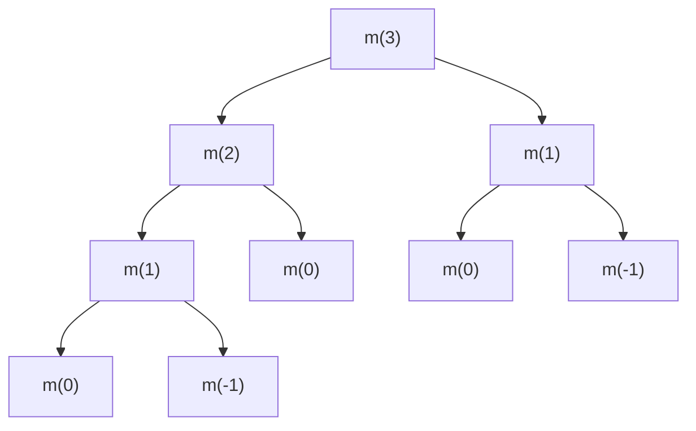

# 12강 연습 문제 풀이 — 재귀

[레포지토리 안내](../../README.ko.md) | [English](Solutions.md) | [한국어](Solutions.ko.md)

> **최종 수정일:** 2026-11-19

---

<br>

## 목차

- [연습 문제 1: 자릿수의 합과 자릿수](#연습-문제-1-자릿수의-합과-자릿수)
- [연습 문제 2: 두 번 호출하는 재귀의 추적](#연습-문제-2-두-번-호출하는-재귀의-추적)
- [연습 문제 3: 2진수 문자열](#연습-문제-3-2진수-문자열)
- [연습 문제 4: 중첩 리스트 펼치기](#연습-문제-4-중첩-리스트-펼치기)
- [연습 문제 5: 조합의 수](#연습-문제-5-조합의-수)
- [연습 문제 6: 모든 부분 집합](#연습-문제-6-모든-부분-집합)
- [연습 문제 7: 폴더 크기의 합](#연습-문제-7-폴더-크기의-합)
- [연습 문제 8: 반복으로 바꾼 이진 탐색](#연습-문제-8-반복으로-바꾼-이진-탐색)

---

<br>

## 연습 문제 1: 자릿수의 합과 자릿수

**문제:** 정수의 각 자리 숫자의 합과 자릿수를 `//`와 `%`만으로 구하는 재귀 함수를 작성하라. 문제 전문과 실행 예시는 [연습 문제 1](Exercises.ko.md#연습-문제-1-자릿수의-합과-자릿수)에 있다.

### 풀이

**접근 방법:** `n % 10`은 일의 자리 숫자이고, `n // 10`은 일의 자리를 뗀 나머지 수이다. 자릿수의 합은 "일의 자리 숫자 + 나머지 수의 자릿수의 합"이고, 한 자리 수(`n < 10`)는 자기 자신이 합이다. 자릿수도 같은 방식으로 "1 + 나머지 수의 자릿수"이다. 인수가 10으로 나뉘며 줄어들므로 반드시 한 자리 수에 닿는다([12강 1.2절](Concepts_Lecture.ko.md#12-기저-사례와-재귀-사례)).

**코드:**

```python
def digit_sum(n):
    if n < 10:                      # a single digit is its own sum
        return n
    return n % 10 + digit_sum(n // 10)

def num_digits(n):
    if n < 10:
        return 1
    return 1 + num_digits(n // 10)

for n in [7, 1234, 9875, 1000000]:
    print(n, digit_sum(n), num_digits(n))
```

**실행 결과:**

```text
7 7 1
1234 10 4
9875 29 4
1000000 1 7
```

- **추적:** `digit_sum(1234)`는 4에 `digit_sum(123)`을 더한 값이고, `digit_sum(123)`은 3에 `digit_sum(12)`를, `digit_sum(12)`는 2에 `digit_sum(1)`을 더한 값이다. 기저 사례 `digit_sum(1)`이 1이므로 $4 + 3 + 2 + 1 = 10$이다.
- **0의 처리:** 기저 사례를 `n == 0`으로 잡으면 `num_digits(0)`이 0이 되어 틀린다. `n < 10`으로 잡으면 0도 한 자리 수로 처리된다.
- **재귀 깊이:** 자릿수만큼만 재귀하므로 매우 큰 수도 깊이는 작다. 1000자리 수라야 깊이가 1000이다.

---

<br>

## 연습 문제 2: 두 번 호출하는 재귀의 추적

**문제:** `m(n - 1)`, 출력, `m(n - 2)`의 순서로 실행하는 함수 `m`에서 `m(3)`의 출력과 호출 횟수를 구하라. 문제 전문은 [연습 문제 2](Exercises.ko.md#연습-문제-2-두-번-호출하는-재귀의-추적)에 있다.

### 풀이

**실행 결과:**

```text
1 2 3 1 
9
```

**호출 트리:** 각 노드는 호출 하나이고, 왼쪽 자식이 `m(n - 1)`, 오른쪽 자식이 `m(n - 2)`이다. `n <= 0`인 호출은 아무것도 출력하지 않고 반환한다.



*그림 1. m(3)의 호출 트리*

- **출력 순서:** 각 호출은 왼쪽 자식을 모두 끝낸 뒤 자기 `n`을 출력하고 오른쪽 자식으로 간다([12강 2.3절](Concepts_Lecture.ko.md#23-재귀-호출-전과-후의-작업)). 그래서 트리를 왼쪽부터 훑으며 `m(1)`(아래쪽)이 1, `m(2)`가 2, `m(3)`이 3, 오른쪽의 `m(1)`이 1을 출력한다.
- **호출 횟수:** 트리의 노드 수 9이다. 출력이 없는 `m(0)` 세 번과 `m(-1)` 두 번도 호출이므로 센다.
- **점화식:** 호출 횟수를 $K(n)$이라 하면 $K(n) = 1$ ($n \leq 0$), $K(n) = 1 + K(n-1) + K(n-2)$이다. $K(1) = 1 + 1 + 1 = 3$, $K(2) = 1 + 3 + 1 = 5$, $K(3) = 1 + 5 + 3 = 9$로 같다.

---

<br>

## 연습 문제 3: 2진수 문자열

**문제:** `bin()` 없이 정수의 2진수 문자열을 재귀로 만들어라. 문제 전문과 실행 예시는 [연습 문제 3](Exercises.ko.md#연습-문제-3-2진수-문자열)에 있다.

### 풀이

**접근 방법:** 정수를 2로 나눈 나머지 `n % 2`는 2진수의 맨 끝 자리이고, 몫 `n // 2`의 2진수 뒤에 그 자리를 붙이면 `n`의 2진수가 된다. 0과 1은 그 자체가 한 자리 2진수이므로 기저 사례이다. 끝 자리를 재귀 호출의 결과 **뒤에** 붙이므로 자리가 올바른 순서로 나온다([12강 2.3절](Concepts_Lecture.ko.md#23-재귀-호출-전과-후의-작업)).

**코드:**

```python
def to_binary(n):
    if n < 2:
        return str(n)
    return to_binary(n // 2) + str(n % 2)

for n in [0, 1, 6, 13, 255, 1024]:
    print(n, to_binary(n), bin(n)[2:] == to_binary(n))
```

**실행 결과:**

```text
0 0 True
1 1 True
6 110 True
13 1101 True
255 11111111 True
1024 10000000000 True
```

- **추적:** `to_binary(13)`은 `to_binary(6) + "1"`, `to_binary(6)`은 `to_binary(3) + "0"`, `to_binary(3)`은 `to_binary(1) + "1"`, `to_binary(1)`은 `"1"`이므로 결과는 `"1101"`이다. $13 = 8 + 4 + 1$이다.
- **`bin(n)[2:]`:** `bin()`은 `'0b1101'`처럼 앞에 `0b`를 붙이므로 슬라이싱으로 떼고 비교했다.
- **자릿수와 깊이:** 재귀 깊이는 2진수의 자릿수와 같다. 1024는 $2^{10}$이므로 11자리이다.

---

<br>

## 연습 문제 4: 중첩 리스트 펼치기

**문제:** 깊이에 제한이 없는 중첩 리스트를 1차원 리스트로 펼치는 `flatten(items)`를 작성하라. 문제 전문과 실행 예시는 [연습 문제 4](Exercises.ko.md#연습-문제-4-중첩-리스트-펼치기)에 있다.

### 풀이

**접근 방법:** [12강 3.4절](Concepts_Lecture.ko.md#34-중첩된-리스트)의 `nested_sum()`과 같은 구조이다. 요소를 차례로 보며, 리스트가 아니면 결과에 넣고, 리스트이면 그 리스트를 재귀로 펼친 결과를 이어 붙인다. 이어 붙일 때는 `append()`가 아니라 `extend()`를 쓴다.

**코드:**

```python
def flatten(items):
    result = []
    for x in items:
        if isinstance(x, list):
            result.extend(flatten(x))   # splice in the flattened sublist
        else:
            result.append(x)
    return result

print(flatten([1, [2, [3, [4]], 5], [], [[6]]]))
print(flatten([]))
print(flatten([[["a"]], "b"]))
```

**실행 결과:**

```text
[1, 2, 3, 4, 5, 6]
[]
['a', 'b']
```

- **`extend()`와 `append()`:** `result.append(flatten(x))`로 쓰면 펼친 리스트가 요소 하나로 들어가 중첩이 남는다. `extend()`는 펼친 리스트의 요소들을 하나씩 붙인다([7강 3.2절](../Lec07_Lists-and-Dictionaries/Concepts_Lecture.ko.md#32-요소-추가)).
- **빈 리스트:** 반복이 한 번도 돌지 않아 빈 결과가 반환된다. `[]`가 요소로 들어 있어도 아무것도 더해지지 않는다.
- **문자열 요소:** `"b"`는 리스트가 아니므로 그대로 들어간다. 문자열도 순회할 수 있지만 `isinstance(x, list)`만 검사하므로 글자로 쪼개지지 않는다.

---

<br>

## 연습 문제 5: 조합의 수

**문제:** 파스칼의 관계로 정의한 재귀 `comb(n, k)`의 호출 횟수를 세고, `lru_cache`를 붙인 경우와 비교하라. 문제 전문과 실행 예시는 [연습 문제 5](Exercises.ko.md#연습-문제-5-조합의-수)에 있다.

### 풀이

**접근 방법:** 식을 그대로 옮기면 기저 사례는 `k == 0`이나 `k == n`이고, 재귀 사례는 두 번의 재귀 호출이다. 피보나치처럼 같은 `(n, k)`를 여러 번 계산하므로, `@lru_cache(maxsize=None)`을 붙이면 각 `(n, k)`를 한 번씩만 계산한다([12강 4.4절](Concepts_Lecture.ko.md#44-functoolslru_cache)). 인수가 둘이어도 `lru_cache`는 인수의 조합을 키로 저장한다.

**코드:**

```python
from functools import lru_cache
import math

calls = 0

def comb(n, k):
    global calls
    calls += 1
    if k == 0 or k == n:
        return 1
    return comb(n - 1, k - 1) + comb(n - 1, k)

@lru_cache(maxsize=None)
def comb_memo(n, k):
    if k == 0 or k == n:
        return 1
    return comb_memo(n - 1, k - 1) + comb_memo(n - 1, k)

print(comb(5, 2), calls)
calls = 0
print(comb(20, 10), calls)
print(comb_memo(20, 10), comb_memo.cache_info().misses)
print(math.comb(20, 10))
```

**실행 결과:**

```text
10 19
184756 369511
184756 120
184756
```

- **호출 횟수의 규칙:** 기저 사례는 모두 1을 반환하므로 결과 $\binom{n}{k}$는 기저 사례 호출의 수와 같다. 호출 트리에서 두 갈래로 나뉘는 호출은 기저 사례 수보다 하나 적으므로 전체 호출은 $2\binom{n}{k} - 1$이다. $2 \times 10 - 1 = 19$, $2 \times 184756 - 1 = 369511$로 출력과 같다. 4.2절의 피보나치와 같은 구조이다.
- **메모이제이션의 효과:** `comb_memo`는 서로 다른 `(n, k)` 120가지만 계산하여 같은 답을 얻었다. 약 37만 번이 120번으로 줄었다.
- **`math.comb`:** 표준 함수의 결과와 같다. `math.comb`는 파이썬 3.8에서 추가되었으므로 3.7에서는 쓸 수 없다.

---

<br>

## 연습 문제 6: 모든 부분 집합

**문제:** 리스트의 모든 부분 집합을 재귀로 만드는 `subsets(items)`를 작성하라. 문제 전문과 실행 예시는 [연습 문제 6](Exercises.ko.md#연습-문제-6-모든-부분-집합)에 있다.

### 풀이

**접근 방법:** 첫 요소를 기준으로 부분 집합을 두 종류로 나눈다. 첫 요소를 포함하지 않는 부분 집합은 나머지 요소들의 부분 집합 그대로이고, 첫 요소를 포함하는 부분 집합은 그 각각의 앞에 첫 요소를 붙인 것이다. 빈 리스트의 부분 집합은 빈 집합 하나(`[[]]`)이며 이것이 기저 사례이다.

**코드:**

```python
def subsets(items):
    if len(items) == 0:
        return [[]]
    rest = subsets(items[1:])
    with_first = [[items[0]] + s for s in rest]
    return rest + with_first

result = subsets(["a", "b", "c"])
print(len(result))
print(result)
print(len(subsets(list(range(10)))))
```

**실행 결과:**

```text
8
[[], ['c'], ['b'], ['b', 'c'], ['a'], ['a', 'c'], ['a', 'b'], ['a', 'b', 'c']]
1024
```

- **개수:** 요소가 하나 늘 때마다 부분 집합은 "포함하지 않는 것"과 "포함하는 것"으로 두 배가 되므로 $n$개의 요소에서 $2^n$개이다. $2^3 = 8$, $2^{10} = 1024$이다.
- **순서:** `["c"]`의 부분 집합은 `[[], ['c']]`, 여기에 `"b"`를 붙이면 `[['b'], ['b', 'c']]`, 합쳐 4개가 된 뒤 다시 `"a"`를 붙인 4개가 뒤에 이어진다.
- **기저 사례의 값:** 빈 리스트의 부분 집합을 `[]`(부분 집합이 하나도 없음)로 잡으면 모든 결과가 빈 리스트가 된다. 빈 집합 하나를 담은 `[[]]`여야 한다.

---

<br>

## 연습 문제 7: 폴더 크기의 합

**문제:** 파일이면 크기를, 폴더이면 안의 모든 파일 크기의 합을 반환하며 구조를 들여쓰기로 출력하는 `total_size(path)`를 작성하라. 문제 전문과 실행 예시는 [연습 문제 7](Exercises.ko.md#연습-문제-7-폴더-크기의-합)에 있다.

### 풀이

**접근 방법:** 폴더는 파일과 폴더를 담는 재귀적 구조이다([12강 1.4절](Concepts_Lecture.ko.md#14-재귀적으로-정의되는-구조)). 파일이 기저 사례로 `stat().st_size`를 반환하고, 폴더는 `iterdir()`로 항목을 돌며 각 항목에 같은 함수를 적용한 결과를 더한다([10강 6.2절](../Lec10_File-Input-and-Output/Concepts_Lecture.ko.md#62-파일과-폴더의-조작)). 들여쓰기는 깊이를 매개변수로 넘겨 정한다.

**코드:**

```python
from pathlib import Path

def make_tree(root):
    (root / "docs" / "old").mkdir(parents=True, exist_ok=True)
    (root / "a.txt").write_text("hello\n", encoding="utf-8")
    (root / "docs" / "b.txt").write_text("한글\n", encoding="utf-8")
    (root / "docs" / "old" / "c.txt").write_text("x" * 100, encoding="utf-8")

def total_size(path, depth=0):
    if path.is_file():
        size = path.stat().st_size
        print("  " * depth + path.name, size)
        return size
    print("  " * depth + path.name + "/")
    total = 0
    for child in sorted(path.iterdir()):
        total += total_size(child, depth + 1)
    return total

root = Path("tree_demo")
make_tree(root)
print("합계:", total_size(root))
```

**실행 결과:**

```text
tree_demo/
  a.txt 6
  docs/
    b.txt 7
    old/
      c.txt 100
합계: 113
```

- **크기:** `"hello\n"`은 6바이트, UTF-8의 `"한글\n"`은 $2 \times 3 + 1 = 7$바이트, `"x" * 100`은 100바이트이므로 합은 $6 + 7 + 100 = 113$이다.
- **`sorted(path.iterdir())`:** `iterdir()`의 순서는 정해져 있지 않으므로 `Path` 객체를 정렬하여 이름순으로 처리했다.
- **재귀 깊이:** 깊이는 폴더의 중첩 수이므로, 폴더가 수백 겹으로 중첩되지 않는 한 한도와 무관하다.
- **빈 폴더:** 항목이 없으면 반복이 돌지 않아 0을 반환한다.

---

<br>

## 연습 문제 8: 반복으로 바꾼 이진 탐색

**문제:** 재귀 이진 탐색을 `while`문으로 바꾸고, 100만 개의 리스트에서 비교 횟수를 확인하라. 문제 전문과 실행 예시는 [연습 문제 8](Exercises.ko.md#연습-문제-8-반복으로-바꾼-이진-탐색)에 있다.

### 풀이

**접근 방법:** `search_rec()`의 재귀 호출은 모두 결과를 그대로 반환하는 꼬리 재귀이므로([12강 6.3절](Concepts_Lecture.ko.md#63-꼬리-재귀와-반복)), 매개변수 `lo`, `hi`를 변수로 두고 재귀 호출 대신 그 변수를 바꾸어 반복한다. 기저 사례 `lo > hi`는 반복을 계속하는 조건 `lo <= hi`의 부정이 된다.

**코드:**

```python
def search_rec(a, target, lo, hi):
    if lo > hi:
        return -1
    mid = (lo + hi) // 2
    if a[mid] == target:
        return mid
    if a[mid] < target:
        return search_rec(a, target, mid + 1, hi)
    return search_rec(a, target, lo, mid - 1)

def search_loop(a, target):
    lo, hi = 0, len(a) - 1
    steps = 0
    while lo <= hi:
        steps += 1
        mid = (lo + hi) // 2
        if a[mid] == target:
            return mid, steps
        if a[mid] < target:
            lo = mid + 1
        else:
            hi = mid - 1
    return -1, steps

data = list(range(0, 2000000, 2))           # 1,000,000 even numbers
print(search_loop(data, 1234568))
print(search_loop(data, 1234567))
print(search_rec(data, 1234568, 0, len(data) - 1))
ok = True
for t in range(-3, 40):
    small = list(range(0, 30, 3))
    if search_loop(small, t)[0] != search_rec(small, t, 0, len(small) - 1):
        ok = False
print(ok)
```

**실행 결과:**

```text
(617284, 17)
(-1, 20)
617284
True
```

- **인덱스:** 짝수 $2i$는 인덱스 $i$에 있으므로 1234568은 $1234568 / 2 = 617284$번에 있다.
- **비교 횟수:** 요소가 $10^6$개이면 $\log_2 10^6 \approx 19.9$이므로 많아야 20번 비교한다. 1234568은 17번 만에 찾았고, 홀수인 1234567은 없으므로 범위가 빌 때까지 20번 비교했다.
- **재귀 버전도 가능한 이유:** 재귀 깊이도 약 20이므로 `search_rec()`도 한도에 걸리지 않는다. 이진 탐색은 재귀로 써도 되지만, 반복으로 쓰면 함수 호출의 비용이 없고 비교 횟수 같은 정보를 함께 다루기 쉽다.
- **검증:** 값이 있는 경우, 없는 경우, 범위의 양 끝 밖(-3, 39)을 포함한 43가지 대상에서 두 함수의 결과가 모두 같았다.
