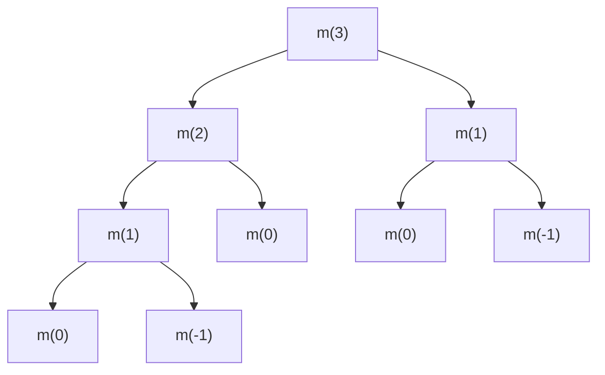

# Lecture 12 Solutions — Recursion

[Repository Guide](../../README.md) | [English](Solutions.md) | [한국어](Solutions.ko.md)

> **Last Updated:** 2026-11-19

---

<br>

## Table of Contents

- [Exercise 1: The Digit Sum and the Number of Digits](#exercise-1-the-digit-sum-and-the-number-of-digits)
- [Exercise 2: Tracing a Recursion That Calls Twice](#exercise-2-tracing-a-recursion-that-calls-twice)
- [Exercise 3: Binary Strings](#exercise-3-binary-strings)
- [Exercise 4: Flattening Nested Lists](#exercise-4-flattening-nested-lists)
- [Exercise 5: The Number of Combinations](#exercise-5-the-number-of-combinations)
- [Exercise 6: All Subsets](#exercise-6-all-subsets)
- [Exercise 7: The Total Size of a Folder](#exercise-7-the-total-size-of-a-folder)
- [Exercise 8: Binary Search Converted to Iteration](#exercise-8-binary-search-converted-to-iteration)

---

<br>

## Exercise 1: The Digit Sum and the Number of Digits

**Problem:** Write recursive functions that find the sum of the digits of an integer and its number of digits using only `//` and `%`. The full problem and sample run are in [Exercise 1](Exercises.md#exercise-1-the-digit-sum-and-the-number-of-digits).

### Solution

**Approach:** `n % 10` is the units digit, and `n // 10` is the remaining number without the units digit. The digit sum is "the units digit + the digit sum of the remaining number," and a one-digit number (`n < 10`) is its own sum. The number of digits is likewise "1 + the number of digits of the remaining number." The argument shrinks by division by 10, so it always reaches a one-digit number ([Lecture 12, Section 1.2](Concepts_Lecture.md#12-base-cases-and-recursive-cases)).

**Code:**

```python
def digit_sum(n):
    if n < 10:                      # a single digit is its own sum
        return n
    return n % 10 + digit_sum(n // 10)

def num_digits(n):
    if n < 10:
        return 1
    return 1 + num_digits(n // 10)

for n in [7, 1234, 9875, 1000000]:
    print(n, digit_sum(n), num_digits(n))
```

**Output:**

```text
7 7 1
1234 10 4
9875 29 4
1000000 1 7
```

- **Trace:** `digit_sum(1234)` is 4 plus `digit_sum(123)`, `digit_sum(123)` is 3 plus `digit_sum(12)`, and `digit_sum(12)` is 2 plus `digit_sum(1)`. The base case `digit_sum(1)` is 1, so the result is $4 + 3 + 2 + 1 = 10$.
- **Handling 0:** Taking `n == 0` as the base case would make `num_digits(0)` 0, which is wrong. Taking `n < 10` treats 0 as a one-digit number too.
- **Recursion depth:** The recursion goes only as deep as the number of digits, so even very large numbers have a small depth. Only a 1000-digit number would reach a depth of 1000.

---

<br>

## Exercise 2: Tracing a Recursion That Calls Twice

**Problem:** For a function `m` that runs `m(n - 1)`, prints, and runs `m(n - 2)` in that order, find the output and the number of calls of `m(3)`. The full problem is in [Exercise 2](Exercises.md#exercise-2-tracing-a-recursion-that-calls-twice).

### Solution

**Output:**

```text
1 2 3 1 
9
```

**Call tree:** Each node is one call; the left child is `m(n - 1)` and the right child `m(n - 2)`. Calls with `n <= 0` return without printing anything.



*Figure 1. The call tree of m(3)*

- **Order of output:** Each call finishes its whole left child, prints its own `n`, and then goes to its right child ([Lecture 12, Section 2.3](Concepts_Lecture.md#23-work-before-and-after-the-recursive-call)). So sweeping the tree from the left, the lower `m(1)` prints 1, `m(2)` prints 2, `m(3)` prints 3, and the right `m(1)` prints 1.
- **Number of calls:** The 9 nodes of the tree. The three `m(0)` calls and two `m(-1)` calls, which print nothing, are calls too and are counted.
- **Recurrence:** Letting $K(n)$ be the number of calls, $K(n) = 1$ ($n \leq 0$) and $K(n) = 1 + K(n-1) + K(n-2)$. $K(1) = 1 + 1 + 1 = 3$, $K(2) = 1 + 3 + 1 = 5$, and $K(3) = 1 + 5 + 3 = 9$, the same.

---

<br>

## Exercise 3: Binary Strings

**Problem:** Build the binary string of an integer recursively without `bin()`. The full problem and sample run are in [Exercise 3](Exercises.md#exercise-3-binary-strings).

### Solution

**Approach:** The remainder `n % 2` of dividing an integer by 2 is the last binary digit, and appending that digit to the binary form of the quotient `n // 2` gives the binary form of `n`. 0 and 1 are one-digit binary numbers themselves, so they are the base case. The last digit is appended **after** the result of the recursive call, so the digits come out in the right order ([Lecture 12, Section 2.3](Concepts_Lecture.md#23-work-before-and-after-the-recursive-call)).

**Code:**

```python
def to_binary(n):
    if n < 2:
        return str(n)
    return to_binary(n // 2) + str(n % 2)

for n in [0, 1, 6, 13, 255, 1024]:
    print(n, to_binary(n), bin(n)[2:] == to_binary(n))
```

**Output:**

```text
0 0 True
1 1 True
6 110 True
13 1101 True
255 11111111 True
1024 10000000000 True
```

- **Trace:** `to_binary(13)` is `to_binary(6) + "1"`, `to_binary(6)` is `to_binary(3) + "0"`, `to_binary(3)` is `to_binary(1) + "1"`, and `to_binary(1)` is `"1"`, so the result is `"1101"`. $13 = 8 + 4 + 1$.
- **`bin(n)[2:]`:** `bin()` prefixes `0b`, as in `'0b1101'`, so it is removed by slicing before comparing.
- **Digits and depth:** The recursion depth equals the number of binary digits. 1024 is $2^{10}$, so it has 11 digits.

---

<br>

## Exercise 4: Flattening Nested Lists

**Problem:** Write `flatten(items)`, which flattens a nested list of unlimited depth into a one-dimensional list. The full problem and sample run are in [Exercise 4](Exercises.md#exercise-4-flattening-nested-lists).

### Solution

**Approach:** The structure is the same as `nested_sum()` of [Lecture 12, Section 3.4](Concepts_Lecture.md#34-nested-lists). Look at the elements in turn: if one is not a list, put it in the result; if it is a list, append the result of flattening it recursively. Use `extend()`, not `append()`, for appending.

**Code:**

```python
def flatten(items):
    result = []
    for x in items:
        if isinstance(x, list):
            result.extend(flatten(x))   # splice in the flattened sublist
        else:
            result.append(x)
    return result

print(flatten([1, [2, [3, [4]], 5], [], [[6]]]))
print(flatten([]))
print(flatten([[["a"]], "b"]))
```

**Output:**

```text
[1, 2, 3, 4, 5, 6]
[]
['a', 'b']
```

- **`extend()` and `append()`:** Writing `result.append(flatten(x))` would put the flattened list in as a single element, leaving nesting. `extend()` appends the elements of the flattened list one by one ([Lecture 7, Section 3.2](../Lec07_Lists-and-Dictionaries/Concepts_Lecture.md#32-adding-elements)).
- **The empty list:** The loop never runs, so an empty result is returned. Even with `[]` as an element, nothing is added.
- **String elements:** `"b"` is not a list, so it goes in as it is. Strings can also be iterated over, but only `isinstance(x, list)` is checked, so they are not split into characters.

---

<br>

## Exercise 5: The Number of Combinations

**Problem:** Count the calls of the recursive `comb(n, k)` defined by Pascal's relation and compare with the version decorated with `lru_cache`. The full problem and sample run are in [Exercise 5](Exercises.md#exercise-5-the-number-of-combinations).

### Solution

**Approach:** Transcribing the formula directly, the base cases are `k == 0` or `k == n`, and the recursive case is two recursive calls. Like Fibonacci, it computes the same `(n, k)` many times, so putting `@lru_cache(maxsize=None)` on it computes each `(n, k)` only once ([Lecture 12, Section 4.4](Concepts_Lecture.md#44-functoolslru_cache)). Even with two arguments, `lru_cache` stores the combination of arguments as the key.

**Code:**

```python
from functools import lru_cache
import math

calls = 0

def comb(n, k):
    global calls
    calls += 1
    if k == 0 or k == n:
        return 1
    return comb(n - 1, k - 1) + comb(n - 1, k)

@lru_cache(maxsize=None)
def comb_memo(n, k):
    if k == 0 or k == n:
        return 1
    return comb_memo(n - 1, k - 1) + comb_memo(n - 1, k)

print(comb(5, 2), calls)
calls = 0
print(comb(20, 10), calls)
print(comb_memo(20, 10), comb_memo.cache_info().misses)
print(math.comb(20, 10))
```

**Output:**

```text
10 19
184756 369511
184756 120
184756
```

- **The rule for the number of calls:** Every base case returns 1, so the result $\binom{n}{k}$ equals the number of base-case calls. In the call tree, the calls that branch into two are one fewer than the base cases, so the total number of calls is $2\binom{n}{k} - 1$. $2 \times 10 - 1 = 19$ and $2 \times 184756 - 1 = 369511$, the same as the output. This is the same structure as the Fibonacci case of Section 4.2.
- **The effect of memoization:** `comb_memo` computed only the 120 distinct `(n, k)` pairs and got the same answer. About 370,000 calls were reduced to 120.
- **`math.comb`:** It agrees with the result of the standard function. `math.comb` was added in Python 3.8, so it is not available in 3.7.

---

<br>

## Exercise 6: All Subsets

**Problem:** Write `subsets(items)`, which generates all subsets of a list recursively. The full problem and sample run are in [Exercise 6](Exercises.md#exercise-6-all-subsets).

### Solution

**Approach:** Divide the subsets into two kinds according to the first element. The subsets that do not contain the first element are exactly the subsets of the remaining elements, and the subsets that contain it are each of those with the first element put in front. The only subset of the empty list is the empty set (`[[]]`), and this is the base case.

**Code:**

```python
def subsets(items):
    if len(items) == 0:
        return [[]]
    rest = subsets(items[1:])
    with_first = [[items[0]] + s for s in rest]
    return rest + with_first

result = subsets(["a", "b", "c"])
print(len(result))
print(result)
print(len(subsets(list(range(10)))))
```

**Output:**

```text
8
[[], ['c'], ['b'], ['b', 'c'], ['a'], ['a', 'c'], ['a', 'b'], ['a', 'b', 'c']]
1024
```

- **The count:** Each additional element doubles the subsets into "those without it" and "those with it," so $n$ elements give $2^n$ subsets. $2^3 = 8$ and $2^{10} = 1024$.
- **The order:** The subsets of `["c"]` are `[[], ['c']]`; putting `"b"` in front gives `[['b'], ['b', 'c']]`, making 4 together, and then the 4 with `"a"` put in front follow.
- **The value of the base case:** Taking the subsets of the empty list as `[]` (no subsets at all) would make every result an empty list. It must be `[[]]`, holding one empty set.

---

<br>

## Exercise 7: The Total Size of a Folder

**Problem:** Write `total_size(path)`, which returns the size of a file or the sum of the sizes of all files in a folder, printing the structure with indentation. The full problem and sample run are in [Exercise 7](Exercises.md#exercise-7-the-total-size-of-a-folder).

### Solution

**Approach:** A folder is a recursive structure holding files and folders ([Lecture 12, Section 1.4](Concepts_Lecture.md#14-recursively-defined-structures)). A file is the base case and returns `stat().st_size`, and a folder loops over its entries with `iterdir()` and adds the results of applying the same function to each ([Lecture 10, Section 6.2](../Lec10_File-Input-and-Output/Concepts_Lecture.md#62-working-with-files-and-folders)). The indentation is set by passing the depth as a parameter.

**Code:**

```python
from pathlib import Path

def make_tree(root):
    (root / "docs" / "old").mkdir(parents=True, exist_ok=True)
    (root / "a.txt").write_text("hello\n", encoding="utf-8")
    (root / "docs" / "b.txt").write_text("한글\n", encoding="utf-8")
    (root / "docs" / "old" / "c.txt").write_text("x" * 100, encoding="utf-8")

def total_size(path, depth=0):
    if path.is_file():
        size = path.stat().st_size
        print("  " * depth + path.name, size)
        return size
    print("  " * depth + path.name + "/")
    total = 0
    for child in sorted(path.iterdir()):
        total += total_size(child, depth + 1)
    return total

root = Path("tree_demo")
make_tree(root)
print("합계:", total_size(root))
```

**Output:**

```text
tree_demo/
  a.txt 6
  docs/
    b.txt 7
    old/
      c.txt 100
합계: 113
```

- **Sizes:** `"hello\n"` is 6 bytes, `"한글\n"` in UTF-8 is $2 \times 3 + 1 = 7$ bytes, and `"x" * 100` is 100 bytes, so the total is $6 + 7 + 100 = 113$.
- **`sorted(path.iterdir())`:** The order of `iterdir()` is not fixed, so the `Path` objects were sorted to process them in order of name.
- **Recursion depth:** The depth is the number of nested folders, so unless folders are nested hundreds of levels deep, the limit does not matter.
- **Empty folders:** With no entries, the loop does not run and 0 is returned.

---

<br>

## Exercise 8: Binary Search Converted to Iteration

**Problem:** Convert the recursive binary search into a `while` statement and check the number of comparisons in a list of one million elements. The full problem and sample run are in [Exercise 8](Exercises.md#exercise-8-binary-search-converted-to-iteration).

### Solution

**Approach:** Every recursive call of `search_rec()` is a tail call that returns its result as it is ([Lecture 12, Section 6.3](Concepts_Lecture.md#63-tail-recursion-and-iteration)), so the parameters `lo` and `hi` become variables, and instead of a recursive call, those variables are changed and the loop repeats. The base-case condition `lo > hi` becomes the negation of the loop-continuation condition `lo <= hi`.

**Code:**

```python
def search_rec(a, target, lo, hi):
    if lo > hi:
        return -1
    mid = (lo + hi) // 2
    if a[mid] == target:
        return mid
    if a[mid] < target:
        return search_rec(a, target, mid + 1, hi)
    return search_rec(a, target, lo, mid - 1)

def search_loop(a, target):
    lo, hi = 0, len(a) - 1
    steps = 0
    while lo <= hi:
        steps += 1
        mid = (lo + hi) // 2
        if a[mid] == target:
            return mid, steps
        if a[mid] < target:
            lo = mid + 1
        else:
            hi = mid - 1
    return -1, steps

data = list(range(0, 2000000, 2))           # 1,000,000 even numbers
print(search_loop(data, 1234568))
print(search_loop(data, 1234567))
print(search_rec(data, 1234568, 0, len(data) - 1))
ok = True
for t in range(-3, 40):
    small = list(range(0, 30, 3))
    if search_loop(small, t)[0] != search_rec(small, t, 0, len(small) - 1):
        ok = False
print(ok)
```

**Output:**

```text
(617284, 17)
(-1, 20)
617284
True
```

- **The index:** The even number $2i$ is at index $i$, so 1234568 is at index $1234568 / 2 = 617284$.
- **The number of comparisons:** With $10^6$ elements, $\log_2 10^6 \approx 19.9$, so at most 20 comparisons are made. 1234568 was found in 17 comparisons, and the odd number 1234567, which is absent, took 20 comparisons until the range became empty.
- **Why the recursive version also works:** The recursion depth is also about 20, so `search_rec()` does not hit the limit either. Binary search may be written recursively, but writing it iteratively avoids the cost of function calls and makes it easy to handle information such as the number of comparisons alongside.
- **Verification:** For 43 targets, including present values, absent values, and values beyond both ends of the range (-3 and 39), the two functions gave the same results.
